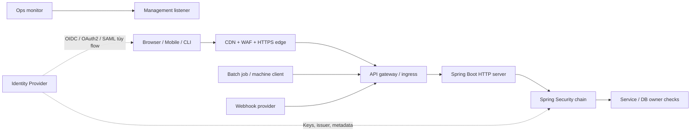
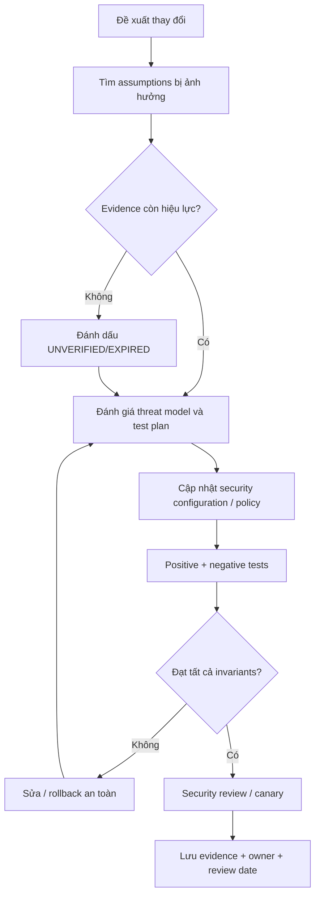

# Ghi lại giả thiết về client, thông tin xác thực và hạ tầng

## 1. Vấn đề: cùng endpoint nhưng mỗi đội hiểu khác mô hình bảo mật

Một dịch vụ Spring Boot nhận yêu cầu từ nhiều nguồn: browser SPA, web server-rendered, ứng dụng di động, một batch job nội bộ và webhook từ đối tác. Backend chạy sau CDN, API gateway và reverse proxy. Nhóm frontend nói “API đã dùng HTTPS và JWT”, nhóm backend nói “không cần CSRF vì REST”, trong khi người vận hành cho rằng API gateway đã xóa tất cả headers không đáng tin.

Cả ba phát biểu **có thể đúng trong một tuyến request và sai trong tuyến khác**:

- SPA có thể dùng bearer token trong `Authorization`, nhưng cũng gửi refresh-token cookie tự động.
- Server-rendered UI có thể dùng `JSESSIONID` và đòi CSRF cho POST, dù API dùng JSON.
- Gateway có thể xác minh bearer token cho `/api/**`, nhưng `/actuator/**` đi qua một ingress khác.
- Browser thấy HTTPS ở edge, nhưng Spring chỉ thấy HTTP nội bộ nếu chưa xử lý forwarded metadata.
- CDN có thể không cache POST nhưng vẫn cache nhầm GET chứa dữ liệu người dùng.
- Một đối tác có thể gửi webhook với chữ ký HMAC, trong khi một ứng dụng khác gọi cùng path bằng IP allowlist mà không có chứng cứ xác thực mạnh.

Khi **giả thiết chưa được viết thành hợp đồng kỹ thuật có thể kiểm chứng**, mỗi nhóm cấu hình CORS, CSRF, session, headers, HTTP firewall và authorization theo một mô hình khác nhau. Chỉ một thay đổi nhỏ ở proxy, cookie, OAuth2 flow hoặc security chain cũng có thể phá vỡ bất biến bảo mật.

Bài thuộc chương **Tích hợp ứng dụng** của mô-đun **SPRING_SECURITY_HTTP_PROTECTION**. Mô-đun tập trung áp dụng các lớp phòng vệ HTTP và trình duyệt trong Spring Security: CSRF, CORS, security headers, CSP, HSTS, HTTP firewall, session, với triển khai Servlet và Reactive, kiểm thử tình huống tấn công web và chẩn đoán xung đột. Chủ đề ở đây là **“Ghi lại giả thiết về client, thông tin xác thực và hạ tầng”**: biến các tuyên bố ban đầu thành một hồ sơ bảo mật có owner, bằng chứng, phép thử và tiêu chí cập nhật.

### Mục tiêu học tập

Sau bài, bạn có thể:

1. Phân loại browser, SPA, SSR/BFF, native mobile, CLI, batch job, webhook và monitoring client theo **khả năng tự gửi credential, origin và quyền kiểm soát mã client**.
2. Ghi rõ credential format, nơi lưu, cách truyền, lifetime, rotation, audience/issuer, cách thu hồi và quan hệ với CSRF/session.
3. Vẽ trust boundaries giữa client, CDN/WAF, gateway, proxy, HTTP parser, Spring Security chain và service/data layer.
4. Viết một **assumption register** có ID, owner, evidence, cách chứng minh sai, rủi ro, hiệu lực và trạng thái.
5. Quyết định đúng phạm vi CORS, CSRF, cookie/SameSite, HSTS/CSP, firewall, caching và management exposure.
6. Phân biệt cấu hình Servlet `HttpSecurity` với Reactive `ServerHttpSecurity`; tránh suy luận sang stack không đang chạy.
7. Xây bộ test phủ **positive path, negative path, cross-layer differential, proxy bypass, expiration/rotation và quyền dữ liệu**.
8. Gắn hồ sơ giả thiết với review khi thay client, identity provider, mạng, reverse proxy, Spring Boot hoặc Spring Security.
9. Biết khi nào phải ghi **UNKNOWN / NOT VERIFIED** và chặn rollout, thay vì tự mặc định một giả thiết là đúng.

## 2. Từ phát biểu miệng đến giả thiết kiểm chứng được

Một phát biểu như “ứng dụng an toàn vì có JWT” chưa đủ. Một giả thiết có chất lượng phải trả lời:

| Trường | Câu hỏi | Ví dụ có ý nghĩa |
| --- | --- | --- |
| `id` | Dùng mã nào để theo dõi? | `AUTH-03` |
| `statement` | Chính xác điều gì được giả định? | “Browser chỉ tự gửi session cookie trên những đường dẫn được chỉ định” |
| `scope` | Host, route, client, environment nào? | `https://app.example.test/api/**` production |
| `owner` | Ai chịu trách nhiệm xác minh? | API security owner và platform owner |
| `source` | Bằng chứng đến từ đâu? | Config có version, response HTTPS, integration tests |
| `threat_if_false` | Nếu sai thì rủi ro gì? | CSRF, auth bypass, cookie leakage |
| `validation` | Làm sao chứng minh đúng/sai? | Cross-site browser test + cookie jar + Spring Security logs an toàn |
| `status` | Đã xác minh chưa? | `VERIFIED`, `UNVERIFIED`, `REJECTED`, `EXPIRED` |
| `last_verified` | Bằng chứng được tạo khi nào? | Ngày release/test cụ thể |
| `review_trigger` | Khi nào phải kiểm tra lại? | Chuyển login flow, CDN, cookie policy, new origin |
| `decision` | Cấu hình nào phụ thuộc giả thiết? | CSRF enabled cho cookie-auth routes |
| `fallback` | Nếu không có bằng chứng? | Giữ deny-by-default và không mở origin/endpoint |

### 2.1. Bốn loại thông tin không được gộp

- **Sự thật đã quan sát**: response `Set-Cookie` từ staging có `Secure`, `SameSite` rõ.
- **Giả thiết cần kiểm tra**: người dùng production chỉ truy cập thông qua public TLS gateway.
- **Quyết định chính sách**: tất cả state-changing browser requests có CSRF protection.
- **Rủi ro chấp nhận có điều kiện**: một client cũ cần method ngoại lệ đến một ngày dừng hỗ trợ.

Một bản ghi đủ tốt phân biệt được bốn loại này. Nếu một operator bật `server.forward-headers-strategy=framework`, đó là **cấu hình**, chưa phải bằng chứng rằng proxy đã làm sạch headers từ client Internet.

### 2.2. Trạng thái nên rõ nghĩa

```text
PROPOSED    — vừa đề xuất, chưa có evidence
UNVERIFIED  — chờ phép thử, không dùng làm cơ sở nới bảo mật
VERIFIED    — có bằng chứng tương ứng với đúng phiên bản và topology
REJECTED    — giả thiết bị chứng minh sai
EXPIRED     — bằng chứng cũ, cần xác minh lại vì hệ thống thay đổi
ACCEPTED_RISK — ngoại lệ có approval, expiry và compensating controls
```

Không dùng `PASS` cho một phép thử chưa chạy hoặc một môi trường chưa thực sự tồn tại. Việc bằng chứng có từ staging không tự động chứng minh production giống staging.

## 3. Vẽ bản đồ trust boundaries trước khi cấu hình

Giả định một hệ thống có SPA và backend SSR, API gateway và một Spring Boot service:



Mỗi mũi tên là một **hợp đồng** cần ghi: ai sở hữu kết nối, dùng HTTP/TLS gì, credential nào tồn tại ở hop đó, proxy có được sửa headers/method/path không, và bên nhận xác thực nguồn thông tin bằng cách nào.

### 3.1. Boundary #1 — Browser đến edge

Ghi:

- Origin, site, hostname và HTTPS certificate/SNI.
- Browser có cookie nào gửi tự động theo Domain/Path/SameSite/Secure?
- JS có gắn `Authorization` hay header CSRF thủ công không?
- CORS preflight do frontend tạo khi nào?
- Redirect HTTP→HTTPS và HSTS do edge hay app sở hữu?
- CSP, frame protections và cookie flags có được trả về đúng trên HTML/401/403/redirect không?

### 3.2. Boundary #2 — Edge/gateway đến origin

Ghi:

- TLS offload hay re-encrypt/mTLS.
- Header `Forwarded`/`X-Forwarded-*` do ai tạo và ai được phép đọc.
- Path rewrite, normalization, slash decoding, encoded characters, HTTP method forwarding.
- Identity propagation: gateway chỉ forward bearer token, hay biến nó thành trusted headers?
- HTTP parser, request size/header limits, timeout, retry và caching.
- Có đường đi trực tiếp tới origin bypass gateway không?

### 3.3. Boundary #3 — Spring Security đến service

Ghi:

- Filter chain nào match URL/method, thứ tự chains.
- Authentication mechanism, CSRF repository, session policy.
- URL-level authorization so với **owner/tenant/resource authorization** ở service.
- Đường dẫn admin, actuator, static resources và fallback deny-all.
- Exception handler, error response và cache/security headers khi request bị từ chối sớm.

### 3.4. Boundary #4 — Runtime state/data và control plane

Ghi:

- Session store Redis/JDBC, cache proxy và key partition theo tenant.
- Identity Provider/JWK endpoint và network/trust.
- Actuator cổng riêng, monitoring credentials, secrets manager, network policy.
- Logs/traces: có raw bearer token, session ID, CSRF token, URL query hay PII không?
- Failover và rollback có đưa về cấu hình yếu hơn không?

## 4. Phân loại client: “không phải browser” chưa đủ thông tin

| Client | Credential phổ biến | Tự động gửi credential? | Quan tâm CSRF/CORS? | Điểm dễ sai |
| --- | --- | --- | --- | --- |
| HTML SSR + form | Session cookie | Browser tự gửi theo policy cookie | CSRF cho unsafe methods; CORS nếu cross-origin | POST form không có token |
| SPA same-origin + session | Session cookie | Có | CSRF, SameSite, session, CSP | Tin SameSite là thay CSRF |
| SPA cross-origin + cookie | Cookie có `SameSite=None; Secure` khi phù hợp | Có, tùy browser settings | CORS credentials + CSRF + cookie scope | Mở wildcard CORS hoặc refresh token sai |
| SPA + bearer trong JS memory | JS gắn `Authorization: Bearer` | Thông thường không do browser tự gắn | CORS khi cross-origin; CSRF threat model vẫn xem các cookie/flow khác | Tin bearer nhưng refresh/auth cookie vẫn ambient |
| BFF/SSR | Browser→BFF cookie; BFF→API bearer | Browser gửi cookie tới BFF | CSRF tại BFF; API authn/authz riêng | Bảo vệ API nhưng quên BFF |
| Native mobile | OAuth2/OIDC token qua SDK, system browser | Tùy implementation | CORS thường không áp cho native HTTP; CSRF tùy webview/cookie | Token trong logs/URL, redirect URI sai |
| CLI/Batch job | Client credentials, mTLS, short-lived token | Do program chủ động gắn | CORS không áp; CSRF nếu có cookie-auth endpoint chung cần xét | Được cấp scope quá rộng |
| Webhook provider | HMAC/JWS signature, mTLS, timestamp | Gửi theo integration contract | CORS không liên quan | IP allowlist được coi là authentication |
| Monitoring scraper | Machine credential/mTLS | Theo scraper | Không cần browser CORS | Actuator public hoặc metrics bị cache |

**CORS là chính sách được browser thực thi**, không phải API authorization. **CSRF phụ thuộc khả năng một tác nhân bên ngoài khiến browser gửi credential tự động**, không phụ thuộc API trả JSON hay form. Browser API dùng bearer trong header thủ công có threat model khác cookie session, nhưng refresh cookies, login/logout hoặc cookie-backed endpoints vẫn phải được xem xét.

### 4.1. “Site” khác “origin”

Một origin được phân biệt bởi **scheme + host + port**; browser cookie SameSite dùng khái niệm site (thường schemeful registrable domain) khác origin. Ví dụ `https://app.example.test` và `https://api.example.test` là **cross-origin** nhưng có thể là **same-site**. Vì vậy:

- SameSite không giải quyết toàn bộ nhu cầu CORS.
- CORS allowlist không thay CSRF protection.
- Cookie `Domain=.example.test` có thể được gửi đến nhiều subdomains, làm tăng rủi ro nếu một subdomain bị chiếm.
- Một subdomain độc hại cùng site có thể tạo các tình huống mà thiết kế dựa hoàn toàn vào SameSite không đủ.

### 4.2. Client inventory phải theo flow, không chỉ theo app name

Một SPA có thể có các flows:

| Flow | Credential thực tế | Rủi ro |
| --- | --- | --- |
| Login callback | Browser redirect + state/nonce + cookie tạm | CSRF login, redirect/cookie policy |
| GET API | `Authorization: Bearer` trong JS | Token theft/XSS, CORS |
| Token refresh | Refresh cookie `HttpOnly` | Ambient cookie, CSRF/logout consideration |
| POST tài liệu | Bearer hoặc session cookie tùy API path | Có/không CSRF khác nhau |
| File download | Browser navigation có thể tự gửi cookie | Cache, Content-Disposition, object authz |
| Logout | Cookie session, POST theo flow | CSRF/logout lifecycle |

Một phát biểu duy nhất “SPA dùng bearer” không đủ để quyết định `csrf.disable()` cho **toàn bộ ứng dụng**.

## 5. Ghi nhận thông tin xác thực: credential contract

Cần lưu ít nhất:

| Thuộc tính | Câu hỏi cần trả lời |
| --- | --- |
| `credential_type` | Session cookie, OAuth2 access token, API key, mTLS, webhook signature? |
| `credential_issuer` | IDP nào phát và trust được bằng cách nào? |
| `holder` | Browser JS, native secure storage, server-side BFF, workload identity? |
| `transport` | Cookie, Authorization header, TLS client cert, signed body? |
| `automatic_attachment` | Browser có tự gửi hay code chủ động thêm? |
| `scope/audience` | Token dùng cho resource server nào, tenant nào, quyền gì? |
| `lifetime` | Expiry, max session idle, absolute lifetime, refresh behavior? |
| `revocation` | Logout, token denylist, short-lived tokens, key rotation? |
| `verification` | Signature/JWKS, issuer/audience/expiration, session lookup, HMAC? |
| `rotation` | Session fixation mitigation, refresh token rotation, key rollover? |
| `logging` | Có lộ token qua URL, exception message, access log không? |
| `failure_contract` | 401/403/302, retry được hay phải re-authenticate? |

### 5.1. Session cookie không bằng JWT

| Mô hình | Server kiểm chứng như thế nào? | Mối quan tâm |
| --- | --- | --- |
| `JSESSIONID` / `SESSION` | Lookup session trong container/Spring Session | Cookie scope, Secure/SameSite, idle timeout, fixation, CSRF |
| Bearer JWT | Chữ ký và các claims theo validation policy | `iss`/`aud`/`exp`, algorithm/key trust, authority mapping, replay/rotation |
| Opaque bearer token | Introspection hoặc internal lookup | Endpoint reliability, cache, revocation, audience/scope |
| API key | Lookup/hash/permissions | Rotation, key leakage, scope, rate limiting |
| mTLS client certificate | TLS handshake + client identity mapping | CA trust, certificate lifecycle, workload identity |
| Webhook HMAC/JWS | Verify raw body + timestamp/nonce/secret | Replay prevention, body canonicalization, key rotation |

**Bearer token có giá trị khi được cầm giữ**: nếu lộ, kẻ khác có thể dùng nó như credential. TLS, redaction logs và giới hạn token lifetime là bắt buộc; không đặt token trong query string để tránh URL logging/history.

### 5.2. JWT có mặt không có nghĩa “stateless toàn bộ”

Một request có access token JWT có thể không dùng `HttpSession`, nhưng flow đăng nhập, OAuth2 authorization request, CSRF token repository hoặc refresh-token rotation vẫn dùng cookie/session. Cần xác nhận **đường đi cụ thể** và `SecurityContextRepository`/`SessionCreationPolicy` thực đang có hiệu lực.

### 5.3. Token verification và authorization là hai việc

Một JWT có chữ ký hợp lệ chỉ xác nhận những claims đúng theo issuer/key trust. Để truy cập tài liệu `/api/documents/42` còn phải kiểm tra principal/tenant có quyền đối với document 42. Không tin `tenantId` query parameter hoặc header tự khai báo thay authorization ở service.

### 5.4. Phân biệt 401 và 403

- `401` thường nghĩa thiếu/không hợp lệ authentication; bearer challenge có thể có `WWW-Authenticate`.
- `403` thường nghĩa caller đã có identity nhưng không đủ quyền, hoặc CSRF bị từ chối.
- `302` có thể là form-login redirect thay cho API 401.
- `400` có thể đến HTTP firewall/parser, không phải luôn auth.
- `429` có thể do rate limiting, không chứng minh credential sai.

Không gắn quy tắc client “mọi 403 đều refresh token” vì 403 còn có thể là thiếu quyền hoặc CSRF mismatch.

## 6. CSRF assumption table: quyết định theo credential flow

| Trường hợp | Kỳ vọng ban đầu | Phải kiểm chứng |
| --- | --- | --- |
| Browser cookie session, POST thay đổi trạng thái | Bật CSRF | CSRF token được lấy/gửi đúng, POST thiếu token bị chặn |
| SSR form POST | CSRF enabled | Hidden field/token request handler đúng framework |
| SPA cookie-auth, `SameSite=Lax` | Giữ CSRF | SameSite không thay token; login/refresh/logout flows |
| Cross-site SPA dùng cookie credentials | CSRF + CORS allowlist | `SameSite=None; Secure` khi cần và CSRF token delivery an toàn |
| Browser gắn Authorization bearer từ JS memory | Có thể không cần CSRF cho endpoints chỉ bearer | Chắc chắn không có cookies/Basic/browser ambient credentials chấp nhận cùng route |
| SPA bearer nhưng refresh cookie | Refresh/logout vẫn cần threat model CSRF | Các unsafe endpoints có cookie credentials |
| Native app token trong header | Thường không phụ thuộc browser CSRF | Có WebView/session cookie nào dùng chung không? |
| Machine-to-machine client credentials | Có thể loại CSRF ở chain M2M đã review | Không chấp nhận browser cookie trên cùng chain |
| Webhook chữ ký HMAC | CSRF thường không phải biện pháp chính | Verify signature/timestamp/replay, method/path, auth isolation |

**Không bật/tắt CSRF theo nhãn “REST”.** Spring Security có CSRF mặc định cho unsafe HTTP methods trong nhiều cấu hình. Nếu quyết định ngoại lệ, ghi matcher, credential proof, owner, tests và thời điểm review.

### 6.1. Preflight không có session cookies

Một CORS preflight `OPTIONS` thường không mang cookie session. Spring Security cần xử lý CORS sớm để không mặc định từ chối preflight như anonymous access. Đây là lý do không lấy preflight 401 làm bằng chứng “token hết hạn”.

### 6.2. Tránh nhầm bảo vệ CSRF và CORS

- CSRF ngăn browser gửi unsafe request được xác thực tự động mà thiếu token hợp lệ.
- CORS giới hạn origin script có thể đọc cross-origin response theo policy browser.
- CORS **không** xác nhận user hoặc quyền đối tượng.
- POST form đơn giản từ website khác vẫn có thể được gửi dù CORS không cho script đọc response.
- Không dùng `Access-Control-Allow-Origin: *` cùng credentials để chữa lỗi.

## 7. Session và cookie: các giả thiết cần ghi rõ

| Giả thiết | Bằng chứng nên có |
| --- | --- |
| Cookie session chỉ dùng cho host dự kiến | `Set-Cookie` Domain/Path trên HTTPS response |
| Cookie được đánh dấu `Secure` | Browser/devtools và E2E HTTPS |
| `HttpOnly` giữ session ID ngoài JavaScript | Cookie attributes và XSS review |
| `SameSite` phù hợp SSO/cross-site flow | Browser tests trong đúng origin topology |
| Idle session timeout = 20 phút | Runtime store configuration và E2E timeout |
| Absolute login lifetime = 8 giờ | Server-side policy riêng, không chỉ idle timeout |
| CSRF token sống theo session repository | Direct repository test + stale token POST test |
| Logout hủy auth session | Server session invalidation và cookie lifecycle |
| Session ID rotate lúc login | Integration test trước/sau authentication |
| Multiple nodes dùng shared session store | Redis/JDBC/Spring Session availability tests |
| CDN không cache trang user/token | `no-store` + edge bypass/cache tests |

**Cookie không được scope theo TCP port.** Nếu main app và management cùng hostname nhưng khác cổng, cookie có thể được gửi ở cả hai cổng nếu Domain/Path cho phép. Không lấy management port riêng làm session isolation.

### 7.1. SameSite không thay CSRF

Một số requests same-site nhưng cross-origin vẫn có thể gửi cookie. Một subdomain bị chiếm có thể hoạt động same-site với app chính. Vì vậy SameSite có giá trị phòng vệ bổ sung nhưng không chứng minh mọi unsafe browser request đã an toàn.

### 7.2. Session timeout và token lifecycle không đồng nghĩa

Session server có thể hết hạn trong khi browser còn giữ session cookie và CSRF token cũ trong tab. Tại request tiếp theo, CSRF 403 hoặc auth 401/redirect có thể xuất hiện. Client cần re-authenticate và lấy token mới theo flow, **không tự replay yêu cầu nhạy cảm**.

### 7.3. Các chuẩn cookie và browser không đứng yên

Các browser có thay đổi về third-party cookies, SameSite và partitioning. Nếu flow dựa trên cross-site cookie, cần ghi rõ browser/version supported, alternative BFF flow và E2E tests; không dùng “trên Chrome máy phát triển hoạt động” làm bằng chứng toàn bộ production.

## 8. Hạ tầng HTTP/TLS và forwarded-header contract

Ví dụ đường đi:

```text
Browser -- HTTPS:443 --> CDN TLS
CDN -- HTTPS hoặc HTTP --> Ingress
Ingress -- HTTP:8080 --> Spring Boot
```

Tại Spring, socket có thể là HTTP dù browser thật sự dùng HTTPS. Proxy đáng tin truyền `Forwarded` hoặc `X-Forwarded-Proto`/`X-Forwarded-Host` để ứng dụng tạo redirect/absolute links và cookie policy chính xác.

### 8.1. Điều phải ghi trong assumption register

| Thuộc tính | Ví dụ |
| --- | --- |
| `public_origin` | `https://app.example.test` |
| `tls_termination` | CDN, Ingress hoặc origin |
| `upstream_transport` | CDN→Ingress HTTPS; Ingress→Pod HTTP trong mạng bảo vệ |
| `trusted_proxy_set` | Ingress pod CIDRs/service identity, không phải mọi IP |
| `forwarded_header_owner` | Edge xóa giá trị client và dựng metadata mới |
| `host_policy` | Public host được allow, unknown Host bị reject |
| `path_rewrite` | `/public-api/**` → `/api/**`, không nới auth |
| `http_version` | HTTP/2 ở edge, HTTP/1.1 tới origin |
| `error_owner` | Edge 502/503; Spring trả 401/403/400 tùy chain |
| `direct_origin_access` | Bị chặn từ Internet, chỉ từ đúng ingress |
| `hsts_owner` | HTTPS edge, không app và edge cùng phát mâu thuẫn |

**Không tin header `X-Forwarded-Proto: https` chỉ vì nó có trong request.** Nếu client Internet gửi header đó và edge không xóa/ghi đè, Spring có thể nhầm một kết nối ngoài HTTP là HTTPS.

### 8.2. Boot 3.5 và Boot 4 không dùng tên property giống hệt

Với Spring Boot **3.5**, một cấu hình khi chạy sau trusted proxy:

```properties
# Một trong NONE / NATIVE / FRAMEWORK, chọn theo adapter/topology.
server.forward-headers-strategy=framework
```

- Servlet dùng `ForwardedHeaderFilter` khi áp Spring Framework processing.
- Reactive dùng `ForwardedHeaderTransformer`.
- Native mode phụ thuộc HTTP container/runtime; cần đối chiếu trust proxy và headers hỗ trợ.

**Spring Boot 4** có cơ chế property khác, ví dụ `server.request.header.forwarded.strategy`; luôn đối chiếu version BOM/runtime. `FRAMEWORK` không tự biến mọi client thành proxy đáng tin: chính edge phải sanitize headers và network policy phải cấm truy cập origin trực tiếp ngoài ý định.

### 8.3. HTTP security không chỉ TLS

Ghi rõ:

- TLS verification, SNI, certificate rotation, mTLS internal hops nếu có.
- HTTP/1.1 vs HTTP/2/3 conversion và request-target normalization.
- Header size/duplicate handling, method overrides, URL decoding.
- Request buffering, retry policy, body size limits, idle timeouts.
- Rate limiting trên IP/user/token/API key với trust boundary đúng.
- WAF/CDN chỉ thêm lớp phòng vệ, không thay application authorization.

## 9. Proxy normalization và firewall: đừng giả thiết Spring thấy nguyên URL

Các hops có thể hiểu khác nhau về:

| Input ví dụ | Rủi ro giả thiết sai |
| --- | --- |
| `/api/../admin` | Edge normalize trước khi Spring match security chain |
| `/api//documents/42` | Double slash được xử lý không nhất quán |
| `/api;v=1/private` | Semicolon/matrix variables khác parser |
| `/api%2Fprivate` | Encoded slash bị giải mã ở tầng khác |
| `%252F` | Double decoding |
| `TRACE` hoặc extension method | Firewall allowlist khác proxy/handler |
| Header `Host`/`Forwarded` mâu thuẫn | Redirect/tenant routing sai |
| Repeated query parameters | Business validation chọn first/last khác nhau |

Spring Security HTTP firewall là một lớp request-shape validation, **không thay** parser policy của Netty/Tomcat, gateway, route selection hay service authorization.

Test trực tiếp `StrictHttpFirewall`/`StrictServerWebExchangeFirewall` chỉ biết class; test HTTP server thật mới thấy parser/wiring; test qua edge mới thấy normalization/trust headers. Đòi “mọi payload phải 400 ở mọi tầng” là sai mục tiêu: điều quan trọng là request mơ hồ **không đi vào route cấp quyền cao hơn hoặc lấy dữ liệu ngoài quyền**.

## 10. Ranh giới CORS: origin nào, phương thức nào và credentials nào?

Ví dụ production:

```text
SPA:      https://app.example.test
API:      https://api.example.test
Ops UI:   https://ops.example.test
Actuator: chỉ private network
```

SPA → API là **cross-origin**: cần CORS nếu browser JS gọi trực tiếp, ngay cả khi hai host cùng site. Ops UI và Actuator không tự dùng chung CORS với SPA.

Một CORS assumption hoàn chỉnh ghi:

- Origins chính xác được phép (không dùng `*` cho credentialed browser calls).
- Methods/headers cần thiết và preflight handling.
- `allowCredentials` có bật không và vì sao.
- `Access-Control-Allow-Origin` được set bởi app hay gateway.
- `Vary: Origin` và cache key.
- Actual request vẫn kiểm tra authentication, CSRF và authorization.
- Error responses 401/403 và preflight có thể được browser đọc theo hợp đồng.
- CDN/proxy có rewrite CORS headers hay không.

**Đừng mở CORS cho cả Actuator chỉ vì main API dùng cross-origin SPA.** Prometheus/CLI không cần CORS để thực hiện HTTP requests.

## 11. Security headers phải gắn với route, content type và hostname

| Header | Nơi áp dụng | Giả thiết phải có |
| --- | --- | --- |
| `Strict-Transport-Security` | HTTPS hostname/browser | TLS hợp lệ, domain/subdomain inventory, owner edge/app rõ |
| `Content-Security-Policy` | HTML document, đặc biệt admin | Script/style/connect/form sources, nonces/hashes, rollout report-only |
| `X-Content-Type-Options: nosniff` | JSON, HTML, scripts, downloads | Content-Type được set đúng |
| `X-Frame-Options`/`frame-ancestors` | Browser-rendered HTML admin | Có cho iframe hợp pháp không? |
| `Cache-Control: no-store` | Private API, forms, token, admin | CDN bypass và không shared-cache |
| `Referrer-Policy` | Browser pages | Không lộ URL/query nhạy cảm |
| `Set-Cookie` | Session/authn responses | Secure/HttpOnly/SameSite/Domain/Path phù hợp |
| `Access-Control-Allow-Origin` | Browser cross-origin route | Origin allowlist rõ, không thay auth |
| `Content-Disposition` | File downloads | MIME/filename safe, authn/authz |
| `WWW-Authenticate` | API 401 | Client biết challenge scheme, không leak internals |

Ví dụ CSP cho admin HTML có `frame-ancestors 'none'` không khiến một API JSON có quyền OPS trở nên bí mật hơn. Chọn policy theo response, không sao chép một header global rồi giả định đủ an toàn.

### 11.1. Không tắt header cache toàn cục để phục vụ static assets

Hashed static JavaScript/CSS có thể dùng long-lived immutable cache; `/api/me` hoặc `/admin/dashboard` nên no-store. Spring Security có thể tôn trọng `Cache-Control` do controller set trước. Vì vậy kiểm tra response cuối của từng resource và CDN, không chỉ security DSL.

### 11.2. HSTS không phải một policy riêng cho `/admin/**`

Browser ghi HSTS theo hostname, không theo URL path. Nếu includeSubDomains, phải inventory các host vận hành hoặc legacy HTTP-only trước khi bật. Browser không tin HSTS nhận qua HTTP thông thường.

## 12. Quản trị vận hành là client và trust boundary riêng

Actuator `/actuator/health`, `/actuator/prometheus`, `/actuator/info`, `/actuator/loggers`, `/actuator/env` có mục tiêu khác nhau. Một application admin không tự là OPS admin.

Cần ghi:

- Endpoint nào **expose** qua HTTP (default Boot 3.5 chỉ health), không mặc định `*`.
- Management dùng cùng port hay `management.server.port` riêng; listener nào reachable ở đâu.
- Monitoring scraper dùng mTLS, Basic, bearer hoặc workload identity.
- Health anonymous được phép trên mạng nào và có lộ details không.
- User admin nghiệp vụ có bị deny Actuator khi không có OPS role không.
- Management không được tự share browser session chỉ vì khác port (cookie scope không theo port).
- Header response của management port có thể khác vì web context/security chain khác.
- Probes `/livez`/`/readyz` trên main port (nếu bật additional paths) được test riêng.

Network isolation, exposure và authorization là **ba lớp khác nhau**, không được dùng `X-Frame-Options` hay CORS thay các lớp ấy.

## 13. Giả thiết về source-of-truth và môi trường

| Cấu hình/đường đi | Dev local | CI integration | Staging | Production |
| --- | --- | --- | --- | --- |
| Browser origins | localhost | test origins | staging hostname | public hostname |
| TLS termination | Có thể không TLS | test TLS proxy | ingress | CDN + ingress |
| Authentication | Mock user/test IDP | test IDP | staging IDP | production IDP |
| Session store | In-memory | Test Redis | Redis staging | HA Redis/JDBC |
| CORS policy | localhost allowlist | E2E allowlist | staging allowlist | strict production list |
| CSRF | Phải giống threat model | Negative test | Policy thật | Policy thật |
| Security chain | Có thể bị mock/override | Integration | Same topology | Same topology |
| Management port | Thường local | Test port | Private listener | Private listener |
| CDN cache | Có thể không | Simulated proxy | Staging edge | Production edge |
| IdP key rotation | Không thực | Simulated rollover | Staging keys | Real keys/rollover |

**Khác môi trường là một giả thiết phải được ghi, không phải lý do bỏ kiểm thử.** Nếu CI dùng `@WithMockUser` nhưng production xác thực JWT, cần thêm real HTTP JWT validation tests. Nếu staging không có CDN, test riêng policy CDN hoặc đánh dấu coverage chưa đủ.

### 13.1. “Bằng chứng test” cần đúng phiên bản

Ghi Spring Boot, Spring Security, Framework, Reactor Netty/Tomcat, proxy/CDN/WAF, JDK, OAuth2 provider config và build/image digest dùng trong thử nghiệm. Mốc `VERIFIED` hết hiệu lực khi thay đổi một thành phần ảnh hưởng giả thiết.

## 14. Ma trận giả thiết lõi: mẫu để triển khai

| ID | Giả thiết | Rủi ro nếu sai | Bằng chứng tối thiểu |
| --- | --- | --- | --- |
| CLI-01 | Browser frontend chỉ dùng origin được liệt kê | CORS/cookie cross-origin lỗi hoặc mở quá rộng | Browser network + deployed origins |
| CLI-02 | SPA gắn bearer thủ công trên API bearer-only | Bỏ CSRF sai nếu cookie vẫn được chấp nhận | Negative cookie-only request |
| CLI-03 | Refresh endpoint dùng HttpOnly cookie | CSRF/refresh bypass | Request credentials matrix |
| AUTH-01 | JWT chỉ tin đúng issuer/audience/key algorithms | Token confusion | Bad iss/aud/signature tests |
| AUTH-02 | Machine API token có scope nhỏ nhất | Privilege escalation | Scope/role negative tests |
| AUTH-03 | User đã xác thực vẫn phải kiểm tra owner/tenant | IDOR | Alice/Bob cross-tenant tests |
| SESS-01 | Cookie Secure/HttpOnly/SameSite đúng | Credential leak/cross-site request | HTTPS browser + response headers |
| SESS-02 | Timeout/rotation như chính sách | Stale login/session fixation | Real HTTP session store tests |
| CSRF-01 | Unsafe cookie-auth requests có token | Cross-site state change | Missing/invalid/valid tests |
| CORS-01 | Không wildcard credentialed CORS | Cross-origin data exposure | Foreign Origin tests |
| EDGE-01 | Edge xóa Forwarded/X-Forwarded client giả | Host/scheme spoof | Forged header tests via edge |
| EDGE-02 | Origin không reachable ngoài proxy | Bypass WAF/TLS/auth | Network reachability test |
| EDGE-03 | URI normalization không bypass chain | ACL mismatch | Raw path tests per hop |
| CACHE-01 | Private response không shared cache | Cross-user data leak | Two-principal CDN tests |
| HDR-01 | HSTS/CSP/frame/nosniff có owner đúng | Header conflict/HTML break | Public HTTPS 200/401/403/5xx |
| OPS-01 | Management exposure/roles/network đúng | Secrets/ops API leak | Scraper/anonymous/role tests |
| OBS-01 | Logs/traces không chứa secrets | Token/session leak | Redaction inspection |
| ROLLOUT-01 | Rollback không vô hiệu phòng vệ | Security regression | Re-run negative suite on rollback |

## 15. Mẫu sổ đăng ký giả thiết có thể dùng ngay

Một trang Markdown hoặc ADR được lưu trong repository có thể chứa dữ liệu cấu trúc như sau. Đây là **ví dụ trong bài học**, không phải yêu cầu sinh thêm file hoặc thay metadata của module.

```yaml
document:
  id: SEC-ASSUMPTIONS-2026-01
  service: SPRING_SECURITY_HTTP_PROTECTION
  scope: "Browser, API và gateway của ứng dụng tài liệu"
  runtime:
    spring_boot: "3.5.x - xác nhận patch ở runtime"
    spring_security: "6.5.x - xác nhận patch ở runtime"
    stack: "SERVLET|REACTIVE"
    public_origin: "https://app.example.test"
  owners:
    client: frontend-team
    application: api-team
    identity: iam-team
    infrastructure: platform-team
    security_review: appsec-team
  review:
    last_reviewed: "2026-11-26"
    next_review: "theo release/change trigger"
    triggers:
      - "Thêm browser origin hoặc mobile client"
      - "Thay cookie/session hoặc refresh-token flow"
      - "Đổi OAuth2 issuer, audience, token lifetime"
      - "Chuyển TLS termination, gateway hoặc forwarded headers"
      - "Bật Actuator endpoint hoặc thay CDN cache rule"

assumptions:
  - id: CLI-02
    statement: "Các request /m2m/** chỉ nhận bearer token chủ động gửi"
    scope: "PRODUCTION /m2m/**"
    status: UNVERIFIED
    owner: api-team
    threat_if_false: "Tắt CSRF nhầm trên route có cookie credentials"
    evidence_required:
      - "Integration test cookie-only POST bị từ chối"
      - "OAuth2 bearer validation qua HTTP server thực"
      - "Không dùng session auth cho /m2m/**"
    decision: "Chỉ miễn CSRF ở chain /m2m/** sau khi VERIFIED"
    fallback: "Giữ CSRF/default deny cho đến khi có bằng chứng"

  - id: EDGE-01
    statement: "Edge loại bỏ forwarded headers do client tự gửi"
    scope: "Public HTTPS ingress đến Spring origin"
    status: UNVERIFIED
    owner: platform-team
    threat_if_false: "Spoof scheme/host dẫn tới redirect và auth policy sai"
    evidence_required:
      - "Ingress config review"
      - "Negative test Host/X-Forwarded-Proto từ nguồn Internet staging"
      - "Origin chỉ reachable từ ingress được duyệt"
    fallback: "Không cho app tin external forwarded metadata"

  - id: AUTH-03
    statement: "Quyền đọc tài liệu được kiểm tra theo principal và tenant"
    scope: "GET /api/documents/{id}"
    status: VERIFIED
    owner: api-team
    evidence_required:
      - "Alice/Red đọc 42 thành công"
      - "Bob/Blue đọc 42 bị từ chối"
      - "Cùng test qua edge sau path rewrite"
    review_trigger: "Thay route, auth claims, data ownership model"
```

### 15.1. Chỉ ghi trạng thái VERIFIED khi có evidence

Thí dụ `AUTH-03` ở trên là **minh họa cách ghi**, không phải tuyên bố rằng một ứng dụng thực đã được test. Khi áp dụng cho dự án, cần thay bằng test artifact và kết quả có ngày/phiên bản. Chỉ đưa đường dẫn tới log/test summary **đã redacted**, không nhúng raw JWT/session ID/CSRF token vào assumption register.

### 15.2. Không biến tài liệu thành kho bí mật

Hồ sơ được commit vào Git **không được chứa**:

- Private keys, API keys, OAuth2 client secrets hoặc webhook HMAC secrets.
- Sample bearer token còn hiệu lực, cookie session, CSRF token thật.
- Raw request/response dumps có PII, query chứa code/state hoặc credential.
- IP/hostname nội bộ nhạy cảm không được tổ chức cho phép chia sẻ.
- Hash đơn giản của session ID nếu có thể dùng để correlation/re-identification ngoài mục đích.

Chỉ lưu **tham chiếu bí mật** (ví dụ tên Secret Manager key) và data fixtures giả. Bằng chứng ở observability system cần access control/retention riêng.

## 16. Chuyển giả thiết thành cấu hình: tách hai credential boundaries

Giả định chính sách đã được xác minh:

- `/m2m/**`: client không phải browser, **chỉ bearer token**, không chấp nhận cookie/session credentials, không tạo session. Vì không có ambient browser credentials ở route đó, nhóm đã duyệt ngoại lệ CSRF hẹp.
- `/ui/**` và `/api/**`: browser/session đăng nhập bằng form, sử dụng cookie; CSRF giữ mặc định cho unsafe methods.
- `/public/**`: công khai nhưng vẫn qua security chain để có response headers.
- `/admin/**`: cần `ROLE_APP_ADMIN`.
- Mọi URL khác: deny-all.
- `/actuator/**`: quản lý riêng theo policy OPS/network, không được vô tình mở chỉ vì mẫu này chưa trình bày Actuator chain.

### 16.1. Cấu hình Servlet Spring Security 6.5

```java
import org.springframework.context.annotation.Bean;
import org.springframework.context.annotation.Configuration;
import org.springframework.core.annotation.Order;
import org.springframework.security.config.Customizer;
import org.springframework.security.config.annotation.web.builders.HttpSecurity;
import org.springframework.security.config.http.SessionCreationPolicy;
import org.springframework.security.web.SecurityFilterChain;

@Configuration
class CredentialBoundariesServlet {

    @Bean
    @Order(1)
    SecurityFilterChain machineApi(HttpSecurity http) throws Exception {
        return http
            .securityMatcher("/m2m/**")
            .sessionManagement(session -> session
                .sessionCreationPolicy(SessionCreationPolicy.STATELESS))
            // Chỉ cho M2M bearer-only đã được chứng minh không
            // chấp nhận browser ambient credential.
            .csrf(csrf -> csrf.disable())
            .oauth2ResourceServer(oauth2 -> oauth2
                .jwt(Customizer.withDefaults()))
            .authorizeHttpRequests(auth -> auth
                .requestMatchers("/m2m/health").authenticated()
                .requestMatchers("/m2m/jobs/**").hasAuthority("SCOPE_jobs")
                .anyRequest().denyAll())
            .build();
    }

    @Bean
    @Order(2)
    SecurityFilterChain browserAndFallback(HttpSecurity http)
            throws Exception {
        return http
            .authorizeHttpRequests(auth -> auth
                .requestMatchers("/public/**", "/login").permitAll()
                .requestMatchers("/admin/**").hasRole("APP_ADMIN")
                .requestMatchers("/ui/**", "/api/**").authenticated()
                .anyRequest().denyAll())
            .formLogin(Customizer.withDefaults())
            // CSRF được giữ mặc định, không disable.
            .csrf(Customizer.withDefaults())
            .build();
    }
}
```

Đây là **mẫu có điều kiện**, không phải khuyến nghị tự động tắt CSRF cho API mang tên M2M. Nó cần các dependencies resource server/Jose tương thích, một `JwtDecoder` hoặc cấu hình issuer/JWK hợp lệ, một authentication provider cho form login và controllers/test fixtures.

**Đặc biệt:** `SessionCreationPolicy.STATELESS` ở chain M2M có nghĩa không dùng `HttpSession` để lấy/lưu SecurityContext của chain đó; nó **không chứng minh** browser/cookie credentials chưa từng được một filter/gateway khác chấp nhận. Vì vậy phải có negative tests cookie-only. Khi gateway chuyển identity vào trusted headers, cấu hình khác và phải ghi threat model riêng.

### 16.2. Giới hạn của ví dụ Servlet

- `/login` được phép qua fallback chain; POST login vẫn dùng CSRF theo mặc định.
- Không có `permitAll()` cho `/**` hoặc `/actuator/**`.
- Authorization theo URL chưa đủ: `/api/documents/{id}` còn cần service-level owner/tenant checks.
- Không cấp quyền `SCOPE_jobs` dựa trên chuỗi user tự khai trong `X-Role` header.
- Nếu một route chấp nhận cả cookie và bearer, phải đánh giá lại toàn bộ điều kiện miễn CSRF.
- Nếu máy M2M dùng Basic auth và browser có thể tự gắn cached credentials, không áp giả thiết bearer-only mà chưa xét lại CSRF.
- Error pages, CORS và HTTPS redirect cần được thiết kế theo response contract khác nhau cho browser và M2M.

## 17. Cấu hình Reactive cho cùng giả thiết

Trong WebFlux, sử dụng `SecurityWebFilterChain` và `ServerHttpSecurity`. Không chuyển `SecurityFilterChain` của Servlet nguyên xi sang Reactive.

```java
import org.springframework.context.annotation.Bean;
import org.springframework.context.annotation.Configuration;
import org.springframework.core.annotation.Order;
import org.springframework.security.config.Customizer;
import org.springframework.security.config.web.server.ServerHttpSecurity;
import org.springframework.security.web.server.SecurityWebFilterChain;
import org.springframework.security.web.server.util.matcher.PathPatternParserServerWebExchangeMatcher;

@Configuration
class CredentialBoundariesReactive {

    @Bean
    @Order(1)
    SecurityWebFilterChain machineApi(ServerHttpSecurity http) {
        return http
            .securityMatcher(
                new PathPatternParserServerWebExchangeMatcher("/m2m/**"))
            // Ngoại lệ CSRF giới hạn ở chain M2M bearer-only.
            .csrf(csrf -> csrf.disable())
            .oauth2ResourceServer(oauth2 -> oauth2
                .jwt(Customizer.withDefaults()))
            .authorizeExchange(auth -> auth
                .pathMatchers("/m2m/health").authenticated()
                .pathMatchers("/m2m/jobs/**")
                    .hasAuthority("SCOPE_jobs")
                .anyExchange().denyAll())
            .build();
    }

    @Bean
    @Order(2)
    SecurityWebFilterChain browserAndFallback(ServerHttpSecurity http) {
        return http
            .authorizeExchange(auth -> auth
                .pathMatchers("/public/**", "/login").permitAll()
                .pathMatchers("/admin/**").hasRole("APP_ADMIN")
                .pathMatchers("/ui/**", "/api/**").authenticated()
                .anyExchange().denyAll())
            .formLogin(Customizer.withDefaults())
            // Không vô hiệu CSRF trong browser chain.
            .csrf(Customizer.withDefaults())
            .build();
    }
}
```

Lưu ý bản mẫu dùng Spring Security 6.5 và cấu hình form-login/cookie được bổ sung bởi hạ tầng đăng nhập thật; chỉ thể hiện **trust boundary và authorization**, không phải mẫu ứng dụng production hoàn chỉnh. `ReactiveSecurityContextHolder` và WebSession có cơ chế khác Servlet HttpSession. Nếu dùng nhiều `SecurityWebFilterChain`, phải bảo đảm có **catch-all fallback** và đúng `@Order`.

### 17.1. Vì sao không ép “stateless” chỉ bằng một thuộc tính Reactive?

WebFlux có thể lưu SecurityContext/session qua `ServerSecurityContextRepository`/`WebSession` tùy cấu hình; không áp `SessionCreationPolicy.STATELESS` của Servlet lên API Reactive. Cấu hình stateless bearer endpoint cần được kiểm chứng bằng **absence of session cookies/side effects**, chứ không chỉ mong một DSL giống Servlet.

### 17.2. Cùng security policy, khác API contract

| Mục | Servlet | Reactive |
| --- | --- | --- |
| Chain | `SecurityFilterChain` | `SecurityWebFilterChain` |
| DSL | `HttpSecurity` | `ServerHttpSecurity` |
| Matcher | `securityMatcher("/m2m/**")` | `PathPatternParserServerWebExchangeMatcher` |
| Authorization | `authorizeHttpRequests` | `authorizeExchange` |
| CSRF filter | `CsrfFilter` | `CsrfWebFilter` |
| CORS integration | Servlet `CorsFilter`/source | Reactive `CorsWebFilter`/source |
| Session | `HttpSession` | `WebSession` |
| JWT resource server | Servlet security context | Reactive security context |
| Unit/integration tests | `MockMvc` | `WebTestClient` |
| HTTP server | Tomcat/Jetty/Undertow/... | Reactor Netty hoặc Reactive adapter |

Không dùng một test mock Servlet làm bằng chứng Reactive Netty sẽ parse URI, headers và forwarded metadata y hệt.

## 18. CORS configuration phải có chủ sở hữu và tests

Một ví dụ CORS source **cho main browser API** trên Servlet:

```java
import java.util.List;
import org.springframework.context.annotation.Bean;
import org.springframework.context.annotation.Configuration;
import org.springframework.web.cors.CorsConfiguration;
import org.springframework.web.cors.UrlBasedCorsConfigurationSource;

@Configuration
class BrowserApiCors {

    @Bean
    UrlBasedCorsConfigurationSource corsConfigurationSource() {
        var config = new CorsConfiguration();
        config.setAllowedOrigins(
            List.of("https://app.example.test"));
        config.setAllowedMethods(
            List.of("GET", "POST", "PUT", "DELETE"));
        config.setAllowedHeaders(
            List.of("Content-Type", "X-CSRF-TOKEN"));
        config.setAllowCredentials(true);

        var source = new UrlBasedCorsConfigurationSource();
        source.registerCorsConfiguration("/ui/**", config);
        source.registerCorsConfiguration("/api/**", config);
        return source;
    }
}
```

Ở Servlet, cần tích hợp source với Spring Security `http.cors(Customizer.withDefaults())` trong chain browser nếu framework không tự dùng source trong setup đã chọn; đồng thời kiểm tra thứ tự CORS trước authentication. Với nhiều CORS sources/chains, có thể cần chỉ định source cho đúng chain.

**Quan trọng:** Ví dụ này chỉ đúng nếu `https://app.example.test` thật sự cần credentialed cross-origin access tới API. Nếu app/API cùng origin, không cần tự mở CORS. Browser cookie policy và CSRF protection vẫn là điều kiện độc lập.

Với Reactive, cấu hình `CorsWebFilter` hoặc reactive `CorsConfigurationSource` theo package `org.springframework.web.cors.reactive`, áp dụng đúng route/origin. Không copy `org.springframework.web.cors.UrlBasedCorsConfigurationSource` (Servlet) vào WebFlux và nghĩ runtime chắc dùng. Hãy test preflight/actual requests ở stack thật.

### 18.1. Các câu hỏi test CORS

- `OPTIONS` từ allowed origin được xử lý không cần cookie?
- Unsupported method hoặc header có bị từ chối không?
- Unknown origin không nhận credentials-friendly CORS response?
- Actual POST vẫn phải có session/auth và CSRF token nếu cookie-based?
- Có `Vary: Origin` đúng khi response phụ thuộc Origin?
- CDN có cache `Access-Control-Allow-Origin` theo đúng key không?
- Host/app scheme trong `Origin` có đúng HTTPS public domain không?
- Error 401/403 có cho frontend hợp lệ đọc error contract khi cần không?

Không phát token CSRF cho mọi Origin chỉ để browser không báo CORS error.

## 19. Từ giả thiết đến phép thử Servlet: MockMvc

Tạo endpoint fixture:

```java
import org.springframework.http.ResponseEntity;
import org.springframework.web.bind.annotation.PostMapping;
import org.springframework.web.bind.annotation.RestController;

@RestController
class UiSettingsFixture {

    @PostMapping("/ui/settings")
    ResponseEntity<Void> update() {
        // Test fixture; production phải kiểm tra owner/tenant
        // và không ghi trạng thái trái quyền.
        return ResponseEntity.noContent().build();
    }
}
```

Một số kiểm thử giả thiết bằng `MockMvc`:

```java
import org.junit.jupiter.api.Test;
import org.springframework.beans.factory.annotation.Autowired;
import org.springframework.boot.test.autoconfigure.web.servlet.AutoConfigureMockMvc;
import org.springframework.boot.test.context.SpringBootTest;
import org.springframework.test.web.servlet.MockMvc;

import static org.springframework.security.test.web.servlet.request.SecurityMockMvcRequestPostProcessors.csrf;
import static org.springframework.security.test.web.servlet.request.SecurityMockMvcRequestPostProcessors.user;
import static org.springframework.test.web.servlet.request.MockMvcRequestBuilders.post;
import static org.springframework.test.web.servlet.result.MockMvcResultMatchers.status;

@SpringBootTest
@AutoConfigureMockMvc
class CredentialAssumptionsServletTest {

    @Autowired MockMvc mvc;

    @Test
    void browserPostWithoutCsrfIsForbidden() throws Exception {
        mvc.perform(post("/ui/settings")
                .with(user("alice").roles("USER")))
            .andExpect(status().isForbidden());
    }

    @Test
    void browserPostWithCsrfCanReachController() throws Exception {
        mvc.perform(post("/ui/settings")
                .with(user("alice").roles("USER"))
                .with(csrf()))
            .andExpect(status().isNoContent());
    }

    @Test
    void anonymousMachinePostIsNotAllowed() throws Exception {
        mvc.perform(post("/m2m/jobs/run"))
            .andExpect(status().isUnauthorized());
    }
}
```

Test trên giả định:

- Hai security chains ở mục 16 được load.
- `/ui/settings` dùng controller fixture và có quyền cho user test.
- M2M chain cấu hình JWT resource server có decoder/test config cần thiết.
- `@AutoConfigureMockMvc` tích hợp Spring Security filter chain.

Các phép thử này xác minh **filter/authorization theo mock request**. Chúng **chưa chứng minh** JWT signature/issuer/audience thật được validate, cookie browser gửi thế nào, hoặc gateway có bypass.

### 19.1. Test JWT bằng mock không thay kiểm thử cryptographic validation

`spring-security-test` có `jwt()` request post processor để giả danh token. Nó hữu ích cho mapping authorities, nhưng có thể bỏ qua JWK retrieval/cryptographic verification. Phải có một bài kiểm thử khác gửi:

- JWT giả sai signature/issuer/audience;
- JWT hết hạn;
- JWT hợp lệ nhưng thiếu scope;
- JWT hợp lệ đúng scope;
- Cookie-only request tới bearer-only route.

Chạy qua real HTTP server và issuer/JWKS test fixture đáng tin; không dùng token production.

## 20. Từ giả thiết đến phép thử Reactive: WebTestClient

Với WebFlux, dùng `spring-security-test` và mock integration:

```java
import org.junit.jupiter.api.Test;
import org.springframework.beans.factory.annotation.Autowired;
import org.springframework.boot.test.autoconfigure.web.reactive.AutoConfigureWebTestClient;
import org.springframework.boot.test.context.SpringBootTest;
import org.springframework.test.web.reactive.server.WebTestClient;

import static org.springframework.security.test.web.reactive.server.SecurityMockServerConfigurers.csrf;
import static org.springframework.security.test.web.reactive.server.SecurityMockServerConfigurers.mockUser;

@SpringBootTest(properties =
    "spring.main.web-application-type=reactive")
@AutoConfigureWebTestClient
class CredentialAssumptionsReactiveTest {

    @Autowired WebTestClient client;

    @Test
    void browserPostWithoutCsrfIsForbidden() {
        client.mutateWith(mockUser("alice").roles("USER"))
            .post().uri("/ui/settings")
            .exchange()
            .expectStatus().isForbidden();
    }

    @Test
    void browserPostWithCsrfIsAccepted() {
        client.mutateWith(mockUser("alice").roles("USER"))
            .mutateWith(csrf())
            .post().uri("/ui/settings")
            .exchange()
            .expectStatus().isNoContent();
    }

    @Test
    void publicGetStillWorks() {
        client.get().uri("/public/ping")
            .exchange()
            .expectStatus().isOk();
    }
}
```

Cần controllers/fixture đúng stack và custom security chains ở mục 17; `/public/ping` phải trả 200. `mutateWith(mockUser())` và `mutateWith(csrf())` dành cho WebFlux integration mock, không tự chứng minh browser cookie lifecycle hay HTTP parser thật.

### 20.1. HTTP server thật vẫn bắt buộc cho topology assumptions

Dùng `@SpringBootTest(webEnvironment = RANDOM_PORT)` và `WebTestClient.bindToServer()` để đi qua TCP và Reactive HTTP server; với Servlet có thể dùng `TestRestTemplate`/HTTP client thật. Khi test proxy/CORS/TLS, chạy qua staging ingress/CDN thay vì chỉ localhost.

### 20.2. Tại sao MockMvc/WebTestClient không đủ?

- Mock users không xác minh IDP/Key rotation.
- Mock request `https` không thực hiện TLS handshake.
- Mock forwarded header không chứng minh edge đã sanitize nó.
- Mock CSRF token không mô phỏng session đã hết hạn.
- Mock path không đảm bảo HTTP client/server/proxy sẽ giữ raw request-target.
- Mock authorization chưa xác minh dữ liệu tenant trong DB.

Vì vậy cần phân tách **unit**, **application integration** và **edge-to-origin** E2E.

## 21. E2E kiểm tra những giả thiết về hạ tầng

Trong staging được cấp phép, lấy ví dụ:

```bash
# 1. Public HTTPS health/ping: kiểm tra TLS và headers.
curl --http1.1 --silent --show-error \
  --dump-header - --output /dev/null \
  'https://app.example.test/public/ping'

# 2. Không theo redirect tự động để xem hop HTTP đầu.
curl --http1.1 --silent --show-error \
  --dump-header - --output /dev/null \
  'http://app.example.test/public/ping'

# 3. Raw path gửi theo dự kiến ở phía curl.
curl --http1.1 -i --path-as-is \
  'https://app.example.test/api/../admin/reports'

# 4. CORS preflight có giả định Origin.
curl --http1.1 -i -X OPTIONS \
  -H 'Origin: https://app.example.test' \
  -H 'Access-Control-Request-Method: POST' \
  -H 'Access-Control-Request-Headers: content-type,x-csrf-token' \
  'https://api.example.test/api/documents'

# 5. HTTP method TRACE bị chặn ở một tầng phù hợp.
curl --http1.1 -i -X TRACE \
  'https://api.example.test/public/ping'
```

Các URL `example.test` là placeholders. Chỉ thực hiện trong hạ tầng test được duyệt, dùng dữ liệu giả; không gửi bearer/cookie production. Không dùng `--insecure` để bỏ xác minh TLS certificate.

### 21.1. `--path-as-is` không khóa proxy normalization

`curl --path-as-is` hạn chế curl tự normalize dot segments; CDN/NGINX/Ingress/Netty vẫn có thể normalize hoặc reject. So request-target do client định gửi, proxy URI sau rewrite, path Spring thấy và selected security chain bằng telemetry an toàn.

### 21.2. Negative test headers giả mạo

Trong môi trường được phép:

- Client gửi `X-Forwarded-Proto: https` trên một HTTP request thật tới edge; không được bypass redirect-to-HTTPS.
- Client gửi `X-Forwarded-Host: attacker.invalid`; không được tạo `Location` đến host lạ.
- Client gửi `Forwarded` và `X-Forwarded-*` mâu thuẫn; edge phải chuẩn hóa/xóa.
- Request trực tiếp tới origin từ mạng không tin cậy phải bị chặn.
- Host không được dùng để cấp quyền tenant mà không có authenticated principal check.

Đây là **kiểm thử trust boundary**, không phải cho phép bypass public gateway hay quét hệ thống không được ủy quyền.

### 21.3. HSTS, CSP và lỗi sớm

Một HTTP response có HSTS không có nghĩa browser chấp nhận (RFC 6797 chỉ chấp nhận policy trên HTTPS tin cậy). CSP cho HTML admin cần test browser/report-only; `X-Content-Type-Options` cần đúng content type.

Response 502 từ edge có thể chưa chạy Spring Security; baseline security headers của edge cần được test riêng. Không suy “Spring header writer hỏng” chỉ vì một proxy-generated error page thiếu CSP.

## 22. Ma trận kiểm thử: mỗi assumption phải có phép bác bỏ

| ID | Positive test | Negative/counterexample test | Cấp độ |
| --- | --- | --- | --- |
| CLI-01 | Trusted SPA origin gọi API | Origin ngoài danh sách không đọc credentialed response | Browser + edge |
| CLI-02 | Bearer-only request thành công | Cookie-only unsafe request không được authenticate | Real HTTP |
| CLI-03 | Refresh token flow hợp lệ | Cross-site refresh không qua bảo vệ | Browser |
| AUTH-01 | JWT đúng issuer/audience/exp/signature | Sai issuer, audience, signature, expired | Decoder + real HTTP |
| AUTH-02 | Machine scope `jobs` gọi đúng route | Token thiếu scope/khác audience bị deny | Integration |
| AUTH-03 | Alice/Red đọc doc 42 | Bob/Blue không đọc doc 42 dù ID hợp lệ | Service + edge |
| SESS-01 | Secure/HttpOnly/SameSite cookie trên HTTPS | Cookie không bị gửi/accept sai cross-site | Browser |
| SESS-02 | Session còn hạn truy cập được | Session hết hạn không khôi phục bằng cookie cũ | Real session store |
| CSRF-01 | Form/session POST có token hợp lệ | Thiếu/sai/stale token không đổi state | Mock + real HTTP |
| CORS-01 | Preflight allowed origin | Unknown Origin không có allow-credentials response | Browser + edge |
| EDGE-01 | XFP đúng từ trusted proxy | Spoof XFP/Forwarded từ client không đổi scheme | Edge E2E |
| EDGE-02 | Ingress→origin hoạt động | Untrusted network không connect trực tiếp origin | Network test |
| EDGE-03 | Raw normal path đúng route | Dot/semicolon/encoded slash không bypass auth | Edge + origin |
| CACHE-01 | User A nhận data của A | User B không nhận cached body của A | Browser/CDN |
| HDR-01 | HTTPS valid và HSTS/CSP/no-store đúng | HTTP HSTS không được browser tin; CSP conflict được phát hiện | Browser + edge |
| OPS-01 | Scraper có quyền đọc metrics | Anonymous không đọc env/loggers/heapdump | Network + auth |
| OBS-01 | Traces theo request ID | Không có token/PII/raw credential | Controlled log audit |
| ROLLOUT-01 | New version giữ invariants | Rollback/config toggles không mở quyền | Release regression |

### 22.1. Thiết lập tiêu chí FAIL rõ ràng

Một test “forbidden status không phải 200” có thể bỏ sót việc handler đã thực hiện state change trước khi error trả về. Với unsafe requests, phải assert **không có thay đổi dữ liệu** và không gọi downstream side effect (email, payment, job) khi thiếu auth/CSRF.

Với owner/tenant, phải assert response body/cache không chứa dữ liệu người khác, không chỉ status. Với proxy header, phải kiểm tra scheme/host/redirect được sinh, không chỉ đọc response `400`.

## 23. Khi giả thiết và thực tế mâu thuẫn: quy trình điều tra

Giả sử sau khi thay API gateway, UI bắt đầu bị `403` khi POST và một số `Location` trỏ về internal host.

1. Xác định request nào, từ client/flow nào; **đừng quy tất cả 403 là CSRF**.
2. Chụp evidence đã redacted: public Origin, method, status, route category, request ID và server instance.
3. Xác định auth mechanism của chính route: cookie/session, bearer, Basic, mTLS.
4. Nếu cookie-based, xem CSRF token presence, session state, SameSite, credentials mode.
5. Nếu bearer, kiểm tra issuer/audience/scope/signature expiry và authority mapping.
6. Kiểm tra CORS preflight `OPTIONS` trước security chain, allowed origin/method/header.
7. Kiểm tra TLS edge, forwarded scheme/host, redirect builder và unknown Host policy.
8. Xem path rewrite, selected security chain, owner/tenant checks ở service.
9. So origin-direct với edge E2E; 400/401/403/404 có thể do những tầng khác nhau.
10. Nếu giả thiết bị sai, đánh dấu `REJECTED`, nêu chủ sở hữu fix, thêm regression test và mới sửa config.
11. Không tắt CSRF, không bật `permitAll()` toàn bộ, không tin `X-Forwarded-*` bừa bãi để đưa status về 200.
12. Sau sửa, chạy positive + negative tests; cập nhật quyết định/ADR và ngày review.

### 23.1. Ví dụ phản biện giả thiết

**Phát biểu ban đầu:** “Ứng dụng chỉ dùng JWT; tắt CSRF an toàn.”

**Bằng chứng mới:** SPA gửi `Authorization` cho GET/POST API nhưng dùng refresh token cookie `HttpOnly` tự động trên `POST /auth/refresh`.

**Kết luận:** Giả thiết “mọi unsafe endpoint không có ambient credentials” là **sai**. Không đủ cơ sở disable CSRF global. Cần threat model và giải pháp CSRF/cookie/Origin cho refresh flow; giữ M2M bearer-only chain tách biệt.

**Phát biểu ban đầu:** “Gateway đảm bảo HTTPS, nên app tin forwarded headers.”

**Bằng chứng mới:** Request HTTP từ client Internet với `X-Forwarded-Proto: https` được chuyển nguyên vào origin.

**Kết luận:** Trust boundary bị vi phạm. Sửa gateway sanitize và network restriction, không đẩy trách nhiệm xác minh TLS sang giá trị client tự khai.

## 24. Đo lường và logging không tự phá hỏng giả thiết

| Có thể ghi | Không nên ghi |
| --- | --- |
| Event code `CSRF_MISSING`, `AUTH_INVALID`, `FORWARDED_SPOOF_BLOCKED` | Raw CSRF token/session cookie |
| Route template `/api/documents/{id}` | Raw URL/query có user info |
| Auth mechanism category `cookie`/`bearer` | Raw Authorization header/API key |
| Status/latency/upstream status | JWT payload nhạy cảm/refresh token |
| Synthetic trace ID do hệ thống kiểm soát | Secret material và private keys |
| Deployment version/image digest | Toàn bộ env/configprops không redacted |
| Allowed origin classification | Raw arbitrary Origin làm metric label |
| Token validation failure **reason code** | Token hoặc key bits |

Ghi loại credential và kết quả xác minh không có nghĩa log được **giá trị** credential. Một `X-Request-ID` do client cung cấp phải được validate/replace, tránh log injection hoặc spoof correlations.

Khi điều tra HTTP firewall rejection, không ghi raw rejected exception message có thể chứa URL/header nguy hiểm. Với HTTP response headers, nếu muốn phân tích CSP violations, hạn chế dữ liệu report và chính sách retention.

### 24.1. Telemetry cũng có trust boundary

Một header tracing từ gateway có thể đi vào logs của mọi services. Nếu client Internet kiểm soát giá trị này, nó có thể giả mạo user correlation hoặc tăng metric cardinality. Chuẩn hóa/giới hạn kích thước và cho edge tạo ID kiểm soát được.

## 25. Review khi có thay đổi client, credential hoặc hạ tầng

### 25.1. Những thay đổi bắt buộc xét lại assumptions

- Thêm mobile app, CLI, webhook hoặc trình duyệt khác.
- Chuyển SPA từ bearer-in-memory sang cookie refresh hoặc BFF.
- Bật OAuth2 SSO, đổi IdP/issuer/audience, key rotation/algorithms.
- Đổi Domain/SameSite cookie, session store, logout/refresh semantics.
- Mở thêm CORS origin/allowed methods hoặc thay credentials mode.
- Thêm reverse proxy, CDN, service mesh, đổi TLS termination.
- Đổi `Forwarded` handling hoặc thư viện HTTP server.
- Bật Actuator endpoints hoặc đổi management port/network policies.
- Nâng Spring Security, Spring Boot, Spring Framework, Reactor Netty.
- Thay security matchers, URL patterns, path rewriting, authorization rules.
- Bật caching/edge error pages hoặc đưa nội dung riêng lên CDN.
- Thêm webhook provider, signature version, shared secret rotation.

### 25.2. Luồng change management



Không chờ tới khi có incident mới rà soát một giả thiết “origin không thể gọi trực tiếp”. IaC, ingress annotations, SecurityGroups/NetworkPolicies và routes thay đổi cũng phải kích hoạt kiểm tra.

### 25.3. Kết quả review nên là quyết định cụ thể

Không chỉ “đã check”. Ghi:

- Giả thiết giữ nguyên hay bị bác bỏ?
- Trust boundary thay đổi ở đâu?
- CSRF/CORS/session/JWT/headers/proxy rules cần đổi gì?
- Bằng chứng tích cực và tiêu cực ở đúng environment nào?
- Test nào được thêm vào CI và ai chịu trách nhiệm?
- Rủi ro còn lại và hạn review.
- Rollback có giữ authn/authz/HTTPS hay không?

## 26. Một cuộc review liên chức năng mẫu

Có bốn vai trò:

- **Frontend owner:** hiểu browser origins, cookies, SPA login/logout và CSRF token delivery.
- **Backend owner:** hiểu chains, bearer validation, authorization ở service và error contract.
- **Identity owner:** hiểu OIDC/OAuth2, issuer/audience, refresh token, logout/session policies.
- **Platform owner:** hiểu TLS edge, forwarded headers, CDN, internal ingress, Actuator và logs.

Một reviewer bảo mật tập hợp bằng chứng thay vì tự đoán.

| Câu hỏi review | Ai trả lời? | Dấu hiệu cảnh báo |
| --- | --- | --- |
| Browser tự gửi credential nào trên từng endpoint? | Frontend + Backend | “Chỉ dùng JWT” nhưng có refresh cookie |
| JWT issuer/audience/scope nào được kiểm tra? | IAM + Backend | Chỉ decode JWT mà không validate |
| Service có kiểm tra tenant/owner? | Backend | Chỉ dựa vào `.authenticated()` |
| CSRF được tắt ở chain nào và vì sao? | Backend + AppSec | `csrf.disable()` toàn ứng dụng |
| Origin nào có credentials CORS? | Frontend + Backend | Wildcard khi credentials=true |
| Edge có xóa forwarded headers client không? | Platform | Tin `X-Forwarded-Proto` tùy ý |
| Cổng management có public không? | Platform | Actuator ở ingress công khai |
| Private API response có shared-cache không? | Platform + Backend | `Cache-Control: public` trên account data |
| 401/403/404/5xx được ghi/log thế nào? | Backend + Platform | Token/cookie in ra logs |
| Có E2E tests ở topology thật không? | QA + Platform | Chỉ chạy `MockMvc` rồi claim production verified |

Nếu một vai trò chưa có chứng cứ, ghi `UNVERIFIED` và không dùng giả thiết đó để nới security policy.

## 27. Bài tập tình huống

Một ứng dụng Spring Boot có:

- HTML admin SSR tại `https://app.example.test/admin/**`, đăng nhập bằng session cookie.
- SPA ở `https://app.example.test` gọi API `https://api.example.test/api/**` bằng bearer token lưu trong memory.
- Refresh endpoint `POST /auth/refresh` của SPA dùng HttpOnly cookie.
- Mobile app dùng OAuth2 access token.
- Batch worker dùng client credentials đến `/m2m/jobs/**`.
- Webhook provider ký request bằng HMAC.
- CDN terminate TLS, Ingress forward HTTP đến origin.
- `management.server.port=9090` expose health và Prometheus vào private network.
- Backend có `SecurityFilterChain` cho API bearer, chain browser và controller bảo vệ tài liệu theo tenant.
- Một số endpoint GET được CDN cache; team tuyên bố “response đã có no-store”.
- Platform chưa kiểm tra client-supplied `X-Forwarded-Proto`.
- Sau nâng cấp Spring Boot, client nhận redirect vòng lặp và CORS preflight trả 401.

### Nhiệm vụ

1. Vẽ trust boundaries Client→CDN→Ingress→Spring→Service/DB và đường OPS riêng.
2. Viết client inventory, phân biệt SPA, SSR, mobile, M2M, webhook, scraper.
3. Viết credential contract cho từng flow, kể cả refresh cookie.
4. Bác bỏ/phê duyệt giả thiết “SPA dùng JWT nên CSRF luôn không cần”.
5. Thiết kế CORS cho `app.example.test` gọi `api.example.test` khi có/không có credentials.
6. Thiết kế CSRF cho SSR admin, refresh endpoint và bearer-only chain.
7. Xác định cookie Secure/HttpOnly/SameSite và session idle/absolute timeout.
8. Liệt kê JWT issuer/audience/scope/signature/expiry/rotation tests.
9. Thiết kế webhook signature/timestamp/replay window; không chỉ IP allowlist.
10. Xác định rủi ro khi edge tin `X-Forwarded-Proto` từ client.
11. Giải thích nguyên nhân có thể gây redirect loop sau TLS termination.
12. Thiết kế HSTS/CSP/nosniff/no-store theo HTML admin/API/Actuator.
13. Phân biệt CORS 401 của preflight với 401 do access token sai.
14. Viết hai security chains cho browser và M2M trên Servlet.
15. Viết phiên bản Reactive tương ứng.
16. Dùng MockMvc test thiếu/đúng CSRF; dùng WebTestClient cho WebFlux.
17. Viết E2E test cookie-only tới bearer-only route phải bị từ chối.
18. Test Alice/tenant Red không đọc được tài liệu Bob/tenant Blue.
19. Test proxy path normalization không khiến `/public/../admin` được phép.
20. Test `/actuator/env` không lộ, `/actuator/prometheus` chỉ OPS/machine.
21. Test CDN không phục vụ data riêng của user A cho user B.
22. Đánh dấu mỗi assumption `VERIFIED`/`UNVERIFIED` theo evidence có thật.
23. Nêu stop conditions và rollback khi gateway/CDN làm sai mô hình.
24. Soạn một ADR tóm tắt lựa chọn cookie vs bearer, HSTS owner, CORS source và test ownership.

### Hướng giải tham khảo

- Không có bằng chứng nào cho phép mặc định “JWT ở mọi endpoint”: refresh cookie làm phát sinh một threat boundary riêng.
- CSRF phải được đánh giá theo **credential được browser gắn tự động**, không chỉ tên API.
- CORS preflight không có cookie/identity, cần xử lý trước authentication phù hợp.
- Backend không được tin forwarded headers chưa được edge làm sạch.
- Đường kết nối HTTPS public và HTTP internal là hai hop; request effective scheme phải phản ánh external TLS đúng.
- JWT validation chưa thay tenant/owner checks và không bảo vệ client secrets khỏi logs.
- Actuator exposure/network/OPS authorization tách khỏi admin nghiệp vụ.
- No-store trên origin không chứng minh CDN đã bypass cache; cần E2E.
- Mock tests chỉ là một cấp: real HTTP server và proxy tests kiểm tra parser/topology thật.
- Assumptions chưa có evidence phải được đánh dấu UNVERIFIED và có owner/test plan, không “điền PASS” cho đẹp.

## 28. Checklist bàn giao trước triển khai

- [ ] Client inventory bao gồm browser SPA, SSR, mobile, CLI, machine, webhook và monitor nếu có.
- [ ] Mọi route quan trọng có owner và danh sách client hợp lệ.
- [ ] Credential type, issuer, audience, transport, storage, lifetime và revocation đã được ghi.
- [ ] Xác định route nào có browser ambient credentials, kể cả refresh/login/logout.
- [ ] CSRF được quyết định theo credential model; mọi ngoại lệ là per-chain, có evidence.
- [ ] CORS origin/method/header/credentials và preflight behavior đúng.
- [ ] JWT validation gồm signature, issuer, audience, expiry, scope và authority mapping.
- [ ] Service kiểm tra owner/tenant độc lập với URL authentication.
- [ ] Session cookie Secure/HttpOnly/SameSite và timeout theo policy đã được test.
- [ ] Không dùng SameSite hoặc CORS làm vật thay thế CSRF/authz.
- [ ] Edge kiểm soát `Forwarded`/`X-Forwarded-*`; origin không mở Internet ngoài ý định.
- [ ] Scheme/Host/port sau TLS proxy đúng và không redirect loop.
- [ ] HTTP method/path normalization không bypass selected security chain.
- [ ] HSTS có owner rõ, CSP phù hợp HTML, nosniff đúng với Content-Type.
- [ ] Dữ liệu riêng có no-store và CDN không shared-cache.
- [ ] Management exposure/network/OPS auth được ghi, không public ngoài ý định.
- [ ] Servlet/Reactive configs và test tools đúng runtime.
- [ ] Có MockMvc/WebTestClient tests cho CSRF/authz/filter chain.
- [ ] Có real HTTP tests cho JWT verification/session timeout.
- [ ] Có edge E2E tests cho TLS/CORS/forwarded headers/cache/path.
- [ ] Webhook có signature, timestamp/replay protection và key rotation.
- [ ] Logs/traces không chứa token, cookie, CSRF, PII hoặc raw secrets.
- [ ] Giả thiết đều có ID, owner, status, evidence, scope và review triggers.
- [ ] Các trạng thái UNVERIFIED không được dùng để nới security policy.
- [ ] Có canary/rollback, với tiêu chí dừng khi xuất hiện auth bypass/data leak.
- [ ] Đã dự trù Content QA chuyên môn ở bước sau; readback file chỉ xác minh hoàn thành kỹ thuật.

## Tài liệu tham khảo

- [Spring Security 6.5 — Servlet CSRF](https://docs.spring.io/spring-security/reference/6.5/servlet/exploits/csrf.html): CSRF theo request/credential và SPA integration.
- [Spring Security 6.5 — Reactive CSRF](https://docs.spring.io/spring-security/reference/6.5/reactive/exploits/csrf.html): WebFlux CSRF và ServerCsrfTokenRepository.
- [Spring Security 6.5 — Servlet CORS](https://docs.spring.io/spring-security/reference/6.5/servlet/integrations/cors.html): preflight và CorsConfigurationSource.
- [Spring Security 6.5 — Reactive CORS](https://docs.spring.io/spring-security/reference/6.5/reactive/integrations/cors.html): CorsWebFilter/Reactive integration.
- [Spring Security 6.5 — Servlet Security Filter Architecture](https://docs.spring.io/spring-security/reference/6.5/servlet/architecture.html): filter order, FilterChainProxy, SecurityFilterChain.
- [Spring Security 6.5 — Reactive Authorization](https://docs.spring.io/spring-security/reference/6.5/reactive/authorization/authorize-http-requests.html): SecurityWebFilterChain authorization.
- [Spring Security — OAuth2 Resource Server JWT](https://docs.spring.io/spring-security/reference/servlet/oauth2/resource-server/jwt.html): issuer, JWT validation và authority mapping.
- [Spring Security — WebFlux OAuth2 Resource Server JWT](https://docs.spring.io/spring-security/reference/reactive/oauth2/resource-server/jwt.html): Reactive bearer validation.
- [Spring Boot 3.5 — Running Behind a Front-end Proxy](https://docs.spring.io/spring-boot/3.5/how-to/webserver.html): `server.forward-headers-strategy` và TLS edge.
- [Spring Framework — Servlet Forwarded Headers](https://docs.spring.io/spring-framework/reference/6.2/web/webmvc/filters.html): ForwardedHeaderFilter, trusted boundaries và removeOnly.
- [Spring Framework — WebFlux Filters](https://docs.spring.io/spring-framework/reference/web/webflux/filters.html): ForwardedHeaderTransformer trên Reactive.
- [Spring Boot 3.5 — Actuator Endpoints](https://docs.spring.io/spring-boot/3.5/reference/actuator/endpoints.html): exposure, security, probes và management policy.
- [Spring Security — Servlet HTTP Security Headers](https://docs.spring.io/spring-security/reference/servlet/exploits/headers.html): HSTS/CSP/cache/nosniff.
- [Spring Security — Reactive HTTP Security Headers](https://docs.spring.io/spring-security/reference/reactive/exploits/headers.html): reactive header writers.
- [OWASP — Threat Modeling Cheat Sheet](https://cheatsheetseries.owasp.org/cheatsheets/Threat_Modeling_Cheat_Sheet.html): assets, trust boundaries và threat assumptions.
- [OWASP — Authentication Cheat Sheet](https://cheatsheetseries.owasp.org/cheatsheets/Authentication_Cheat_Sheet.html): authn policy và lifecycle.
- [OWASP — Session Management Cheat Sheet](https://cheatsheetseries.owasp.org/cheatsheets/Session_Management_Cheat_Sheet.html): cookies, idle/absolute timeout.
- [OWASP — Cross-Site Request Forgery Prevention](https://cheatsheetseries.owasp.org/cheatsheets/Cross-Site_Request_Forgery_Prevention_Cheat_Sheet.html): CSRF/ambient credentials.
- [OWASP — CORS Security Cheat Sheet](https://cheatsheetseries.owasp.org/cheatsheets/CORS_Security_Cheat_Sheet.html): origin allowlists, credentials và proxy.
- [OWASP — REST Security Cheat Sheet](https://cheatsheetseries.owasp.org/cheatsheets/REST_Security_Cheat_Sheet.html): API authorization, token transport.
- [OWASP — JSON Web Token for Java](https://cheatsheetseries.owasp.org/cheatsheets/JSON_Web_Token_for_Java_Cheat_Sheet.html): JWT validation/rotation.
- [RFC 6265 — Cookies](https://www.rfc-editor.org/rfc/rfc6265.html): Cookie scope và lifetime.
- [RFC 6797 — HSTS](https://www.rfc-editor.org/rfc/rfc6797.html): HTTPS browser policy.
- [RFC 7239 — Forwarded HTTP Extension](https://www.rfc-editor.org/rfc/rfc7239.html): proxy metadata và trust.
- [RFC 9110 — HTTP Semantics](https://www.rfc-editor.org/rfc/rfc9110.html): safe methods, status và HTTP semantics.
