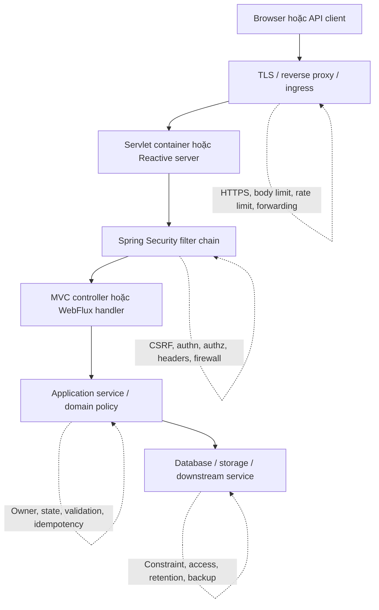
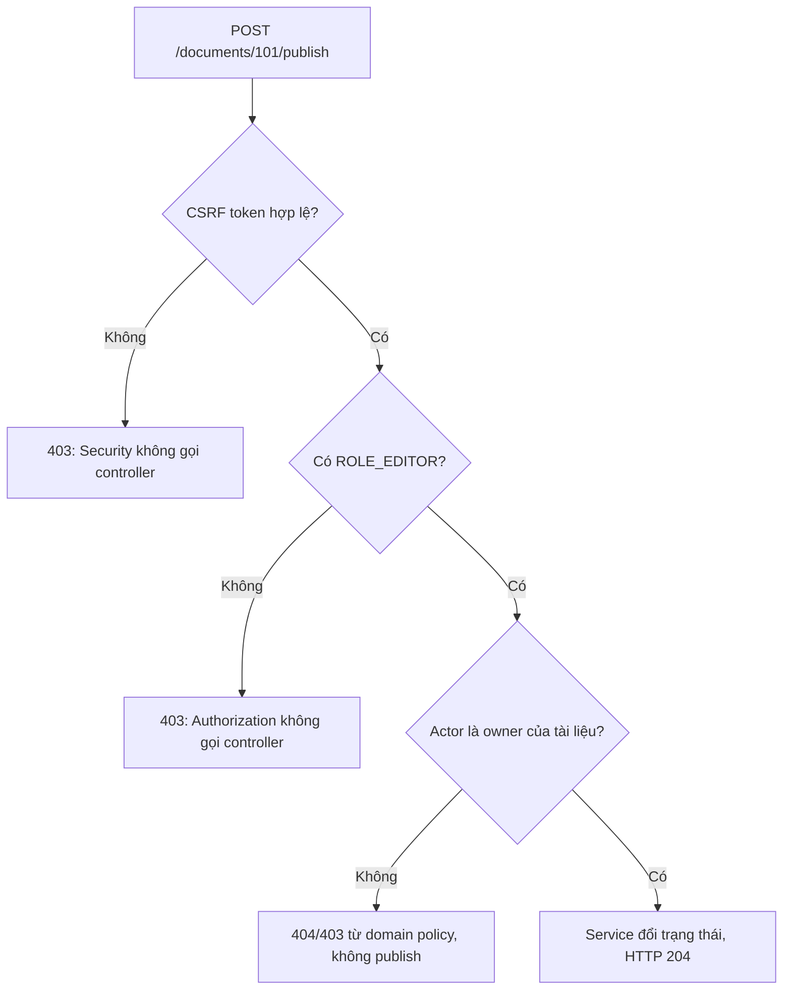
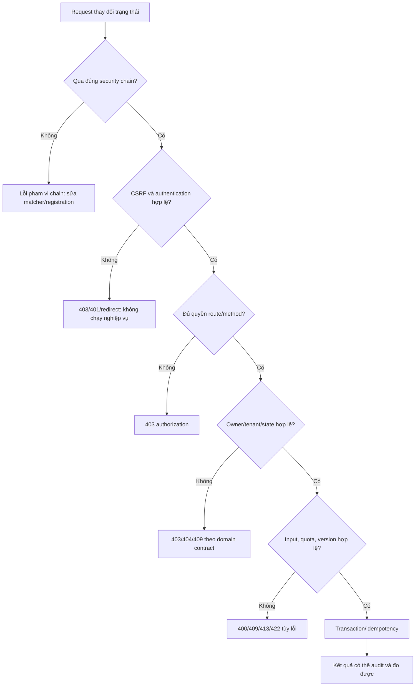

# Phạm vi tự động bảo vệ và trách nhiệm của mã ứng dụng

Trong module `SPRING_SECURITY_HTTP_PROTECTION`, Spring Security cung cấp nhiều lớp bảo vệ HTTP và trình duyệt: CSRF, CORS, security headers, Content Security Policy (CSP), HTTP Strict Transport Security (HSTS), HTTP firewall và quản lý session. Các thành phần này thực hiện những kiểm tra quan trọng tại **ranh giới HTTP**, nhưng không tự hiểu mọi quy tắc nghiệp vụ và toàn bộ hạ tầng mà ứng dụng phụ thuộc.

Bài thuộc chương **Ranh giới bảo vệ**, giải đáp câu hỏi:

> **Spring Security tự thực thi điều gì khi request đi qua filter chain, và phần nào mã ứng dụng hoặc hạ tầng phải tự chịu trách nhiệm?**

Ví dụ, một POST `/documents/101/publish` có thể vượt qua authentication, CSRF và kiểm tra `ROLE_EDITOR`, nhưng người gọi vẫn có thể **không sở hữu tài liệu 101**. Nếu service không xác minh owner, Spring Security không có cách mặc định để suy ra quy tắc riêng đó. Tương tự, CSRF token đúng không chứng minh file tải lên vô hại, không ngăn nghiệp vụ xử lý lặp và không bảo đảm proxy không lưu thông tin nhạy cảm vào log.

Bài hướng tới cả **Servlet/Spring MVC** lẫn **Spring WebFlux/Reactive**, với bảng trách nhiệm, code, kiểm thử và checklist. Ví dụ theo phong cách Spring Security 6.x, Spring Boot 3.x và Java 17+; hành vi cụ thể cần đối chiếu với version và cấu hình được dùng khi triển khai.

## 1. Mục tiêu học tập

Sau bài này, người học có thể:

- Mô tả phạm vi của `SecurityFilterChain` và `SecurityWebFilterChain` với một request cụ thể.
- Phân biệt bảo vệ **framework tự thực hiện trong chain** với kiểm tra **nghiệp vụ và hạ tầng phải cung cấp**.
- Không nhầm CSRF, CORS, CSP, HSTS, HTTP firewall hay session management là giải pháp vạn năng.
- Thiết kế authorization theo tài nguyên, tenant và owner, ngoài URL/role authorization.
- Đặt input validation, output encoding, file scanning, idempotency, audit và giới hạn tài nguyên ở đúng tầng.
- Kiểm thử cả request bị từ chối bởi security **lẫn** request qua được security nhưng bị service từ chối.
- Áp dụng cùng nguyên tắc cho WebFlux mà không copy cấu hình Servlet hoặc chặn Reactor event loop.

## 2. Mô hình bảo vệ theo nhiều tầng



Ranh giới của một lớp bảo vệ phụ thuộc **thông tin nó có** và **quyết định nó được phép đưa ra**.

- Spring Security biết request URL/method, header/cookie, principal và những policy đã cấu hình. Nó có thể xác minh CSRF và quyền route/method.
- Controller/service biết nội dung nghiệp vụ, record trong database, owner, trạng thái đơn hàng, quota và các ràng buộc liên quan.
- Reverse proxy/ingress biết kết nối mạng, TLS, kích thước body, tải hệ thống và các giới hạn vận hành.
- Database/storage bảo đảm unique constraints, transaction, quyền lưu trữ, backup và integrity mà HTTP filter không tự cung cấp.

**Không có một lớp duy nhất thay thế toàn bộ những lớp còn lại.** Ví dụ, POST bị 403 ở Security vẫn có thể đã tiêu tốn băng thông hoặc temporary disk nếu proxy/container/multipart parser đọc body trước đó.

### 2.1. “Tự động” không có nghĩa luôn áp dụng

Một biện pháp của Spring Security chỉ có tác dụng khi:

1. Request đi qua **filter chain có chứa biện pháp** ấy.
2. Chain được chọn đúng theo `securityMatcher`, thứ tự và URL/method.
3. Biện pháp đang bật, không bị loại trừ, và được cấu hình tương thích với request.
4. Các dependency liên quan (cookie, session, authentication repository, forward headers) hoạt động đúng.
5. Mã sau filter không vô tình làm ngược lại kết quả đã được bảo vệ.

Khi security không thấy request, hoặc app cố ý bỏ qua chain, không thể coi request đã được framework bảo vệ.

## 3. Bảng phân chia trách nhiệm

| Chủ đề | Spring Security hỗ trợ | Mã ứng dụng phải làm | Hạ tầng phải làm |
| --- | --- | --- | --- |
| Authentication | Login/filter, principal, `SecurityContext` | Chính sách tài khoản, re-auth cho thao tác nhạy cảm | Identity provider, TLS, secret management |
| URL authorization | `requestMatchers`, role/authority checks | Owner, tenant, record state, field-level rights | Bảo vệ endpoint ngoài app |
| CSRF | Token generation/repository, kiểm tra unsafe requests | Chèn/gửi token, GET không có side effect, idempotency riêng | Cookie/proxy/log an toàn |
| CORS | Xử lý origin/preflight theo cấu hình | Chọn allowlist origin/method/header/credentials | Tránh proxy override policy |
| Security headers | Các header mặc định và tùy chỉnh | Chính sách CSP, encode output, xử lý file download | HTTPS/HSTS, forwarding đúng |
| HTTP firewall | Chặn một số URL/path/method bất thường | Input validation, path canonicalization, quotas | WAF, rate/body limits |
| Session | Integration authentication, fixation/logout | Draft state, session UX, re-auth và concurrency policy | TTL, cookie flags, session store |
| Upload | CSRF và route authorization | File type/content scanning, owner, storage key | Multipart limits, temp cleanup |
| Transaction | Không tự chống duplicate business write | Unique constraints, idempotency, transaction | Retry/queue policy |
| XSS và injection | Một số headers giảm rủi ro | Escape/sanitize HTML, SQL parameters, safe templates | Dependency security, monitoring |
| Audit và vận hành | Security events/principal context | Audit ai đã làm gì, không log bí mật | Log retention và truy cập an toàn |

Đừng hiểu bảng này như yêu cầu **tự viết lại** CSRF/authentication. Hãy dùng đúng cơ chế có sẵn của Spring Security, sau đó bổ sung những bất biến mà framework không thể suy ra.

## 4. Ranh giới thực thi của security filter chain

### 4.1. Chain chỉ bảo vệ request khớp

Trong Servlet, `FilterChainProxy` chọn `SecurityFilterChain` đầu tiên có matcher phù hợp. Nếu ứng dụng có nhiều chain, thứ tự đóng vai trò quan trọng. Ví dụ sau **chỉ minh họa lựa chọn chain**, không phải cấu hình hoàn chỉnh để copy production:

```java
import org.springframework.context.annotation.Bean;
import org.springframework.context.annotation.Configuration;
import org.springframework.core.annotation.Order;
import org.springframework.security.config.Customizer;
import org.springframework.security.config.annotation.web.builders.HttpSecurity;
import org.springframework.security.web.SecurityFilterChain;

@Configuration
public class ChainSelectionExample {

    @Bean
    @Order(1)
    SecurityFilterChain apiChain(HttpSecurity http) throws Exception {
        return http
                .securityMatcher("/api/**")
                .authorizeHttpRequests(auth -> auth
                        .requestMatchers("/api/public/**").permitAll()
                        .anyRequest().authenticated())
                .httpBasic(Customizer.withDefaults())
                .build();
    }

    @Bean
    @Order(2)
    SecurityFilterChain webChain(HttpSecurity http) throws Exception {
        return http
                .authorizeHttpRequests(auth -> auth
                        .anyRequest().authenticated())
                .formLogin(Customizer.withDefaults())
                .build();
    }
}
```

Nếu chỉ có chain khớp `/api/**` mà không có catch-all hoặc cách bảo vệ khác, những URL ngoài `/api/**` có thể **không được bảo vệ bởi Spring Security**. Với từng chain, phải chủ động đánh giá CSRF, credentials, statefulness và policy. HTTP Basic có thể vẫn liên quan CSRF khi browser tự gửi credentials; không tắt CSRF chỉ vì tên endpoint có chữ API.

### 4.2. PermitAll và bỏ qua security khác nhau

| Hình thức | Request có qua Spring Security chain? | Ảnh hưởng |
| --- | --- | --- |
| `requestMatchers("/assets/**").permitAll()` | Có, nếu khớp chain | Không đòi authorization nhưng các filter/headers khác vẫn có thể hoạt động. |
| `web.ignoring().requestMatchers("/assets/**")` | Không qua chain | Không có các lớp bảo vệ từ chain cho URL bị ignore. |
| `securityMatcher("/api/**")` nhưng thiếu chain khác | Không có chain này cho URL ngoài phạm vi | Cần chain bao phủ hoặc bảo vệ thay thế. |

Đối với static assets và trang công khai, thường nên dùng `permitAll()` thay vì bỏ qua toàn bộ security, trừ khi có lý do rõ và hiểu các headers/filter bị mất.

### 4.3. Filter order và dispatcher type

Một số xử lý chạy trước Security (reverse proxy, multipart filter, method override), các xử lý khác chạy sau Security. Nếu `MultipartFilter` chạy trước `CsrfFilter`, request giả mạo vẫn có thể tạo file tạm trước 403. Filter order vì thế ảnh hưởng **chi phí, method quan sát và chính sách áp dụng**.

Servlet dispatcher types `REQUEST`, `FORWARD`, `ERROR` và `ASYNC` có thể liên quan filter registration và authorization. Nếu cho phép FORWARD/ERROR để render view, chỉ nên cho phép đúng luồng cần thiết, không biến các route ghi dữ liệu thành đường vòng không kiểm tra quyền.

## 5. CSRF: chống giả mạo, không chứng minh nghiệp vụ hợp lệ

Spring Security thông thường yêu cầu CSRF token với các method thay đổi trạng thái như POST, PUT, PATCH, DELETE; không yêu cầu với GET/HEAD/OPTIONS/TRACE theo giả định chúng an toàn để đọc.

### 5.1. Phần Spring Security có thể tự thực hiện

- Dùng `CsrfTokenRepository` tạo/lưu/tải token, với Servlet mặc định thường gắn `HttpSession`.
- Expose token cho request/view thông qua handler, với Spring Security 6 có deferred token và masking để giảm nguy cơ BREACH.
- Đọc token từ form parameter/header theo cấu hình hiện hành.
- Từ chối unsafe request khi token thiếu/sai, thông thường 403.
- Kết hợp lifecycle token với login/logout và session theo cấu hình.

### 5.2. Phần ứng dụng không được bỏ trống

- **GET phải không ghi dữ liệu.** Nếu ứng dụng xóa bằng GET, CSRF mặc định không chặn.
- Form HTML phải render hidden `_csrf` đúng; Thymeleaf `th:action` có thể tích hợp tự động với Spring MVC/Security.
- JavaScript fetch/XHR phải gửi token theo header/body tương thích với repository/handler. Sau login/logout/session đổi, token cũ có thể không hợp lệ.
- Authorization phải kiểm tra owner/tài nguyên cụ thể; CSRF token không cấp quyền.
- Dữ liệu phải được validate, kiểm tra version và chống xử lý lặp. CSRF không phải idempotency key.
- Không đặt token vào query URL hoặc log; không dùng `csrf.disable()` làm giải pháp khi form sai.

### 5.3. Ví dụ token đúng nhưng owner sai

```text
alice, ROLE_EDITOR
POST /documents/202/publish + CSRF hợp lệ
        |
        v
CsrfFilter: PASS
URL authorization: PASS
        |
        v
Service load document 202
ownerUsername = bob
        |
        v
Domain authorization: REJECT
        |
        X Không xuất bản dữ liệu của bob
```

Spring Security có **method security** và custom authorization hooks để giúp đưa các policy phức tạp vào security layer nếu ứng dụng cung cấp quy tắc tương ứng. Nhưng mặc định nó không biết mọi bản ghi trong database thuộc user nào.

### 5.4. CORS không thay thế CSRF

CORS chủ yếu là cơ chế **trình duyệt kiểm soát quyền script ở origin khác đọc response** và xử lý một số preflight. Nó không xác thực người dùng, không ngăn toàn bộ cross-site form submissions, và không ràng buộc mọi HTTP client như cURL.

Một form cross-site có thể gửi request dù JavaScript phía attacker **không được đọc response**. Do đó CORS không được dùng làm lý do tắt CSRF; hai cơ chế xử lý hai vấn đề khác nhau.


## 6. CORS: framework xử lý preflight, ứng dụng xác định origin đáng tin

CORS là ví dụ điển hình của việc **hỗ trợ kỹ thuật** không thay thế **quyết định chính sách**. Spring Security có thể tích hợp `CorsConfigurationSource` để xử lý preflight đúng vị trí, nhưng không tự xác định frontend nào của tổ chức được dùng cookie để gọi API.

### 6.1. Những câu hỏi phải trả lời

| Câu hỏi | Quyết định triển khai |
| --- | --- |
| Origin nào được tin? | Dùng allowlist cụ thể, ví dụ `https://app.example.test`. |
| Method nào thực sự cần? | Chỉ GET/POST hoặc thêm PATCH/DELETE cho những API có nhu cầu. |
| Header nào client được gửi? | `Content-Type`, `Accept`, CSRF header và header ứng dụng có lý do. |
| Có dùng cookie/credentials cross-origin không? | Chỉ nếu kiến trúc yêu cầu và origin được tin cậy. |
| Preflight có được xử lý trước xác thực không? | Cần thiết: OPTIONS preflight thường không mang cookie phiên. |
| Cookie có được browser gửi không? | Kiểm tra `SameSite`, `Secure`, credentials và domain/path. |

Đừng cấu hình `Access-Control-Allow-Origin: *` cùng credentials. Cũng không tự động phản chiếu mọi `Origin` do client gửi nếu không có policy kiểm soát: đó là mở rộng trust boundary.

### 6.2. Servlet CORS configuration mẫu

```java
import java.util.List;
import org.springframework.context.annotation.Bean;
import org.springframework.context.annotation.Configuration;
import org.springframework.web.cors.CorsConfiguration;
import org.springframework.web.cors.CorsConfigurationSource;
import org.springframework.web.cors.UrlBasedCorsConfigurationSource;

@Configuration
public class BrowserCorsConfig {

    @Bean
    CorsConfigurationSource corsConfigurationSource() {
        CorsConfiguration cfg = new CorsConfiguration();
        cfg.setAllowedOrigins(List.of("https://app.example.test"));
        cfg.setAllowedMethods(List.of("GET", "POST", "OPTIONS"));
        cfg.setAllowedHeaders(List.of(
                "Content-Type", "Accept", "X-CSRF-TOKEN"));
        cfg.setAllowCredentials(true);
        cfg.setMaxAge(1800L);

        UrlBasedCorsConfigurationSource source =
                new UrlBasedCorsConfigurationSource();
        source.registerCorsConfiguration("/api/**", cfg);
        return source;
    }
}
```

Để sử dụng cùng `HttpSecurity`, cấu hình `http.cors(Customizer.withDefaults())` và bảo đảm bean tương ứng được security chọn. Domain trong ví dụ là minh họa; nó **không phải URL thật**.

**Lưu ý về lỗi:** Preflight không vượt qua CORS khác với POST bị `CsrfFilter` từ chối. Trong DevTools, nếu browser không phát POST vì OPTIONS thất bại, đó không phải bằng chứng CSRF token sai. Với request có cookie, cả CORS lẫn CSRF và authorization phải được cấu hình đúng.

### 6.3. Cross-origin không nhất thiết cross-site

Hai origin khác nhau khi khác **scheme, host hoặc port**; hai site được browser xác định theo tiêu chí riêng (schemeful site/eTLD+1). Vì vậy một SPA ở subdomain khác có thể cross-origin nhưng same-site cho cookie `SameSite`; ngược lại browser policy hoặc third-party-cookie restrictions có thể chặn cookies.

Không thiết kế CSRF dựa trên việc “CORS đã thành công nên cookie chắc đã được gửi”. Hãy kiểm tra Network và threat model thực tế.

## 7. Security headers, CSP và HSTS: giảm thiểu có điều kiện

Spring Security có khả năng viết một số security headers mặc định cho response trong chain. Các header như `X-Content-Type-Options`, chống framing, cache-control và HSTS cho HTTPS có thể xuất hiện tùy phiên bản/cấu hình. **Nội dung header chính xác phải được xác minh trên response thực**, không dựa vào trí nhớ về một version khác.

Quan trọng: Spring Security **không tự tạo một CSP đầy đủ phù hợp mọi giao diện**; ứng dụng phải quyết định nguồn script/style và các hành vi trình duyệt được phép.

### 7.1. Bảng ranh giới của các header

| Header / biện pháp | Có thể giúp | Không tự giải quyết |
| --- | --- | --- |
| `X-Content-Type-Options: nosniff` | Giảm một số kiểu MIME sniffing | Không kiểm tra file upload là an toàn. |
| `X-Frame-Options` | Giảm nguy cơ clickjacking khi trang bị nhúng | Không thay CSRF hoặc xác minh chủ sở hữu tài nguyên. |
| CSP `frame-ancestors` | Kiểm soát nơi có thể nhúng trang | Không ngăn mọi hành vi giả mạo request. |
| CSP `script-src` | Hạn chế nguồn script và một số đường XSS khi cấu hình nghiêm | Không thay output escaping, input validation và review frontend. |
| `Strict-Transport-Security` | Yêu cầu browser dùng HTTPS cho host ở những truy cập tương lai | Không cài TLS certificate hoặc xác minh forwarding proxy. |
| `Referrer-Policy` | Điều khiển dữ liệu URL gửi qua Referer | Không loại query token khỏi access log/proxy tracing. |
| `Cache-Control: no-store` | Giảm khả năng cache response chứa dữ liệu nhạy cảm | Không thay authorization và không xóa dữ liệu trong log. |
| `Permissions-Policy` | Giới hạn một số tính năng browser | Không xử lý business permission hay CSRF. |

Ví dụ `X-Frame-Options: DENY` có thể bảo vệ trang quản trị khỏi bị nhúng iframe, nhưng một API công khai cho phép GET dữ liệu riêng của người khác do thiếu kiểm tra owner vẫn có lỗ hổng. Các lớp này **không chồng khít chức năng**.

### 7.2. Cấu hình headers trên Servlet

Trong một `SecurityFilterChain` có thể tùy chỉnh CSP:

```java
import org.springframework.context.annotation.Bean;
import org.springframework.context.annotation.Configuration;
import org.springframework.security.config.Customizer;
import org.springframework.security.config.annotation.web.builders.HttpSecurity;
import org.springframework.security.web.SecurityFilterChain;

@Configuration
public class BrowserHeaderConfig {

    @Bean
    SecurityFilterChain browserChain(HttpSecurity http) throws Exception {
        return http
                .authorizeHttpRequests(auth -> auth
                        .anyRequest().authenticated())
                .formLogin(Customizer.withDefaults())
                .csrf(Customizer.withDefaults())
                .headers(headers -> headers
                        .contentSecurityPolicy(csp -> csp
                                .policyDirectives(
                                        "default-src 'self'; "
                                      + "script-src 'self'; "
                                      + "object-src 'none'; "
                                      + "base-uri 'self'; "
                                      + "frame-ancestors 'none'")))
                .build();
    }
}
```

Đây là **một SecurityFilterChain độc lập để minh họa headers**. Nếu ứng dụng đã có chain khác như ở mục 4, hãy gộp đoạn `headers(...)` vào chain hiện hành thay vì đăng ký hai catch-all chains cạnh tranh với nhau.

Policy này chỉ phù hợp khi các trang không cần inline scripts hoặc nguồn ngoài allowlist; không nên copy mù quáng. Tổ chức có thể thử `Content-Security-Policy-Report-Only`, quan sát vi phạm không lộ dữ liệu nhạy cảm và xây dựng policy theo nhu cầu. Việc thêm `'unsafe-inline'` tràn lan chỉ để “hết lỗi giao diện” có thể làm giảm giá trị phòng vệ.

Spring Security giúp **gắn header**; mã ứng dụng vẫn phải escape HTML output, tránh `th:utext` với nội dung không tin cậy, sử dụng parameterized SQL và kiểm soát script dependencies.

### 7.3. HSTS sau reverse proxy

Một ứng dụng nhận HTTP từ reverse proxy nhưng người dùng thực sự truy cập HTTPS có thể bị sai thông tin scheme nếu proxy forwarding chưa được cấu hình an toàn. Spring Security thường chỉ thêm HSTS khi request được nhận diện secure, trong khi TLS certificate và redirect HTTP→HTTPS thường do edge/proxy quản lý.

Checklist hạ tầng:

1. Bật HTTPS với certificate hợp lệ và chính sách redirect phù hợp.
2. Chỉ tin `Forwarded`/`X-Forwarded-*` do **proxy đáng tin** cung cấp; không chấp nhận arbitrary client-supplied forwarding headers.
3. Kiểm tra HSTS trên **response HTTPS công khai** thực tế, kể cả login và trang lỗi.
4. Chọn `max-age` theo kế hoạch vận hành; `includeSubDomains` hoặc `preload` cần đánh giá **mọi subdomain** và tác động khó đảo ngược.
5. Tránh edge và application xuất header mâu thuẫn; xác định rõ ai sở hữu policy.

Không có cấu hình `headers()` nào tự giải quyết TLS, DNS, load balancer, certificates và toàn bộ proxy forwarding.

## 8. HTTP firewall không phải WAF hay input validator toàn năng

Spring Security Servlet dùng `HttpFirewall` (ví dụ `StrictHttpFirewall`) để từ chối một số request URL/path/method bất thường, giúp giảm không nhất quán khi matching giữa container và security. Đây là lớp quan trọng trước authorization, nhưng phạm vi của nó **không phải mọi loại dữ liệu người dùng**.

### 8.1. Những điều HTTP firewall có thể làm

- Từ chối một số path/encoding/character hoặc HTTP method không được phép theo cấu hình.
- Giảm nguy cơ security matcher và ứng dụng diễn giải request path khác nhau.
- Chặn sớm request bất thường mà chính sách firewall nhận diện.
- Phối hợp với URL authorization, không thay quyền truy cập nghiệp vụ.

### 8.2. Những điều firewall không biết

HTTP firewall không tự xác định:

- Tên file `../../confidential` có được phép lưu trong storage không.
- JSON `{"amount": -1000000}` có hợp lệ với nghiệp vụ không.
- Một regex do ứng dụng viết có nguy cơ ReDoS hay không.
- SQL query được xây bằng chuỗi user input có gây SQL injection không.
- Tài liệu PDF upload có mã độc, macro hoặc nội dung không mong muốn không.
- Người dùng đã vượt quota hay đơn hàng đã thanh toán chưa.

Những câu hỏi đó cần **validation + policy trong service + safe storage/database API + giới hạn tài nguyên**.

### 8.3. Không nới firewall chỉ để endpoint chạy

Nếu một đường dẫn bị `StrictHttpFirewall` từ chối vì semicolon, slash hoặc encoded characters, không nên lập tức cho phép mọi ký tự nguy hiểm. Cần xác định liệu route có thực sự cần dạng URL ấy, có thể chuẩn hóa/encode dữ liệu trong parameter hoặc body không, và các tầng proxy/controller có hiểu path nhất quán không.

Một “bản vá” khiến firewall chấp nhận tất cả URL có thể tạo lỗ hổng khi authorization matcher hiểu một đường dẫn nhưng controller lại xử lý đường khác. Nếu cần nới rule, phải có test cả URL hợp lệ lẫn các dạng bypass.

### 8.4. Rate limiting và request size ở ngoài phạm vi mặc định

Ngay cả request bị 403 ở Spring Security cũng có thể tiêu tốn băng thông, connection slots và body buffering trước đó. Cần đặt giới hạn ở proxy và server, ví dụ:

- Giới hạn kích thước request/file upload, số parts, request duration và concurrency.
- Rate limiting theo identity/IP/thao tác, có xem xét NAT hoặc shared identities.
- Quota/circuit breaker với downstream storage và APIs.
- Timeout và backpressure phù hợp cho các thao tác tốn tài nguyên.
- Quan sát `413 Payload Too Large`, `429 Too Many Requests`, 4xx/5xx và saturation metrics.

Không giả định Spring Security mặc định đã cung cấp WAF, antivirus, API rate limiter hoặc giới hạn business quota.

## 9. Session management: danh tính HTTP khác trạng thái nghiệp vụ

Session management cho phép Spring Security làm việc với `HttpSession` hoặc `WebSession`, giữ authentication state và hỗ trợ bảo vệ như session fixation mitigation, logout và invalid session handling. Tuy nhiên, **thời gian sống của mọi loại dữ liệu, bản nháp và phiên giao dịch** vẫn là vấn đề thiết kế ứng dụng.

### 9.1. Điều Spring Security hỗ trợ

- Duy trì `SecurityContext` theo cơ chế session/security context repository đã cấu hình.
- Hỗ trợ chính sách session creation và session fixation protection ở Servlet, tùy authentication flow.
- Tích hợp logout, xóa authentication, có thể invalidated session và xóa CSRF token theo strategy.
- Hỗ trợ các session management strategies và concurrent-session controls ở những mô hình/cấu hình phù hợp.
- Cung cấp hook để xử lý invalid/expired session hoặc redirect tới login tùy application.

### 9.2. Ứng dụng phải xử lý phần còn lại

| Tình huống | Điều có thể xảy ra | Việc ứng dụng phải làm |
| --- | --- | --- |
| Người dùng đang điền form thì session timeout | POST bị 403/redirect login hoặc lỗi session khác | Lưu bản nháp phù hợp, hướng dẫn đăng nhập lại, lấy token mới. |
| Login ở tab B, tab A vẫn có HTML cũ | Token trong tab A có thể không còn khớp repository | Không tự replay POST; cho GET form/token mới. |
| Người dùng đổi tài khoản trên cùng browser | Bản nháp cũ có thể thuộc account khác | Kiểm tra owner trước khôi phục dữ liệu. |
| Hai tab sửa cùng tài nguyên | Dữ liệu cũ gây lost update | Optimistic locking/version, phản hồi 409 nếu xung đột. |
| Logout sau khi bấm lưu | Có thể không rõ request đã hoàn tất hay chưa | Kiểm tra trạng thái nghiệp vụ/idempotency. |
| Nhiều node không chia sẻ session | Request có thể thấy session khác | Dùng shared session store hoặc kiến trúc routing phù hợp. |

### 9.3. Cookie flags và bfcache

Cookie `Secure`, `HttpOnly`, `SameSite`, domain/path là những yếu tố cần cấu hình từ framework/servlet container/proxy theo chính sách. `SameSite` có ích nhưng không thay thế CSRF đầy đủ. `HttpOnly` giảm khả năng JavaScript đọc cookie phiên nhưng không ngăn XSS thực hiện request với cookie có sẵn.

Browser Back và bfcache có thể hiển thị trang cũ ngay cả khi session đã hết. **Thấy form trên màn hình không chứng minh principal hoặc CSRF token còn hợp lệ.** Đừng phát lại POST nhạy cảm tự động sau khi GET token mới; xác minh dữ liệu, quyền và trạng thái giao dịch.

### 9.4. Stateless API không tự động đồng nghĩa an toàn

Nếu API dùng một bearer token chỉ được JavaScript chủ động đặt trong `Authorization` header và không có cookie credentials tự gửi, mô hình CSRF có thể khác cookie-session browser. Nhưng khi cùng ứng dụng còn có form login hoặc cookie refresh token, cần xem **từng route/chain**. Không đặt `sessionCreationPolicy(STATELESS)` rồi mặc định kết luận toàn bộ ứng dụng không cần CSRF, authorization, CORS hay chống XSS.

**Ranh giới quan trọng:** Statelessness là cách lưu authentication state, không phải cơ chế kiểm soát mọi yêu cầu giả mạo và cũng không thay thế business authorization.


## 10. Quyền theo tài nguyên: ví dụ Servlet/Spring MVC

Để thấy rõ đường ranh, hãy xét một ứng dụng cho phép user có `ROLE_EDITOR` xuất bản tài liệu. Quy tắc nghiệp vụ còn yêu cầu tài liệu phải **thuộc quyền quản lý của chính user**. Hai người đều có role EDITOR nhưng không được xuất bản tài liệu của nhau.

### 10.1. SecurityFilterChain bảo vệ method/path

Ví dụ này sử dụng **một chain độc lập**; khi thực hành, không đăng ký đồng thời các catch-all chains của các phần trước. Có thể gộp chính sách CORS/CSP theo thiết kế đã chọn.

```java
import org.springframework.context.annotation.Bean;
import org.springframework.context.annotation.Configuration;
import org.springframework.http.HttpMethod;
import org.springframework.security.config.Customizer;
import org.springframework.security.config.annotation.web.builders.HttpSecurity;
import org.springframework.security.web.SecurityFilterChain;

@Configuration
public class DocumentSecurityConfig {

    @Bean
    SecurityFilterChain securityFilterChain(HttpSecurity http)
            throws Exception {
        return http
                .authorizeHttpRequests(auth -> auth
                        .requestMatchers(HttpMethod.POST,
                                "/documents/*/publish")
                            .hasRole("EDITOR")
                        .requestMatchers(HttpMethod.GET,
                                "/documents/**")
                            .authenticated()
                        .anyRequest().denyAll())
                .formLogin(login -> login.permitAll())
                .csrf(Customizer.withDefaults())
                .build();
    }
}
```

Điều SecurityFilterChain **biết**:

- Request phải là POST và path khớp `/documents/*/publish`.
- Principal cần có authority tương đương `ROLE_EDITOR`.
- CSRF token phải hợp lệ khi POST dùng chính sách mặc định.

Điều chain **chưa biết**: tài liệu có `id=101` thuộc `alice` hay `bob`, đã xuất bản chưa, có bị khóa nghiệp vụ không, hoặc có cần đồng ý pháp lý trước khi publish hay không.

### 10.2. Service thực thi owner và trạng thái

Để code tự đọc được mà không cần cơ sở dữ liệu, ví dụ dùng `ConcurrentHashMap`; **đây là mô hình minh họa, không phải persistence production**.

```java
import java.util.Map;
import java.util.concurrent.ConcurrentHashMap;
import org.springframework.http.HttpStatus;
import org.springframework.stereotype.Service;
import org.springframework.web.server.ResponseStatusException;

@Service
public class DocumentService {

    public record Document(
            long id, String ownerUsername, boolean published) {}

    private final Map<Long, Document> documents =
            new ConcurrentHashMap<>(Map.of(
                    101L, new Document(101, "alice", false),
                    202L, new Document(202, "bob", false)
            ));

    public void publishOwned(long id, String actorUsername) {
        documents.compute(id, (key, current) -> {
            // Trả 404 cho tài liệu không tồn tại hoặc không thuộc quyền.
            if (current == null ||
                    !current.ownerUsername().equals(actorUsername)) {
                throw new ResponseStatusException(
                        HttpStatus.NOT_FOUND, "Không tìm thấy tài liệu");
            }

            // Publish lặp được xử lý không tạo trạng thái mới trong demo.
            if (current.published()) {
                return current;
            }

            return new Document(
                    current.id(), current.ownerUsername(), true);
        });
    }

    public boolean isPublished(long id) {
        Document doc = documents.get(id);
        return doc != null && doc.published();
    }
}
```

Ràng buộc `ownerUsername` được kiểm tra từ **data server quản lý**, không lấy từ hidden input `owner=alice` do client gửi. Nếu user là `bob` gửi ID của `alice`, service phải từ chối, dù cả hai đều là EDITOR và CSRF token đều hợp lệ.

Trong production, nên đặt kiểm tra owner/tenant và state ở **cùng transaction với update**, dùng conditional SQL update/optimistic locking khi phù hợp để tránh race condition. Không tự coi `ConcurrentHashMap` là transaction store nhiều node.

### 10.3. Controller không được bỏ qua service

```java
import org.springframework.http.ResponseEntity;
import org.springframework.security.core.Authentication;
import org.springframework.web.bind.annotation.PathVariable;
import org.springframework.web.bind.annotation.PostMapping;
import org.springframework.web.bind.annotation.RestController;

@RestController
public class DocumentController {

    private final DocumentService service;

    public DocumentController(DocumentService service) {
        this.service = service;
    }

    @PostMapping("/documents/{id}/publish")
    ResponseEntity<Void> publish(@PathVariable long id,
                                 Authentication authentication) {
        // Actor từ SecurityContext, không phải từ request body.
        service.publishOwned(id, authentication.getName());
        return ResponseEntity.noContent().build();
    }
}
```

Ví dụ response là **204 No Content** sau khi service hoàn tất; nếu tích hợp HTML form có thể chọn 303 tới GET detail, nhưng không nên chuyển hành động publish sang GET chỉ để tránh CSRF.

### 10.4. Phân biệt ba trường hợp



**Cùng HTTP 403 có thể đến từ các tầng khác nhau.** Một lỗi CSRF không đồng nghĩa session đã hết hạn; một lỗi authorization không thể sửa bằng cách cấp lại CSRF token. Khi ứng dụng chọn 404 để không tiết lộ sự tồn tại của record người khác, cần viết test theo **hợp đồng bảo mật được chọn**.

### 10.5. Method security là công cụ, không phải tri thức tự có

Spring Security hỗ trợ method-level authorization qua `@EnableMethodSecurity`, `@PreAuthorize` hoặc custom authorization managers. Ứng dụng có thể chuyển kiểm tra quyền sở hữu thành policy có thể tái sử dụng. Tuy nhiên, developer vẫn phải định nghĩa cách xác định owner, tenant và trạng thái hợp lệ.

Nếu endpoint có nhiều đường gọi cùng service (controller, scheduler, message consumer, batch job), một kiểm tra chỉ đặt ở URL chain có thể **không bảo vệ những đường gọi không qua HTTP**. Đặt bất biến nghiệp vụ ở service/domain hoặc policy dùng chung là cách giảm rủi ro bỏ sót.

## 11. Các trách nhiệm ứng dụng không thể giao cho HTTP filter

### 11.1. Validate dữ liệu và chống injection

Khi Spring Security cho request đi tiếp, dữ liệu JSON, form, path và multipart vẫn là **input không tin cậy**. Cần:

- Validation về kiểu, khoảng giá trị, độ dài, enum và liên hệ giữa các trường.
- Không nối SQL/JPQL từ input; dùng bind parameters và API query an toàn.
- Escape output theo ngữ cảnh HTML/attribute/JavaScript; không render HTML chưa được kiểm duyệt bằng API raw HTML.
- Kiểm tra business constraints ở service/database, không chỉ dùng JavaScript validation trên frontend.
- Giới hạn số lượng kết quả, pagination và độ phức tạp truy vấn để bảo vệ tài nguyên.

`@Valid` trên DTO là một lớp hỗ trợ của Bean Validation, **không tự mã hóa toàn bộ chính sách nghiệp vụ**. Ví dụ số tiền âm có thể qua một DTO chỉ kiểm tra not-null nhưng sai nghiệp vụ.

### 11.2. Quyền truy cập object và multi-tenancy

Tránh **IDOR/BOLA**: user thay `id` trong URL để thao tác lên record của người khác. Kiểm tra:

- Principal/tenant **được lấy từ nguồn tin cậy**, không từ hidden field do client sửa được.
- Query giới hạn theo owner/tenant hoặc service từ chối trước ghi.
- Mối quan hệ giữa child resource và parent resource, không chỉ role chung.
- Row-level security của database (nếu có) là defense in depth, không mặc nhiên thay service policy.
- Các thao tác batch/chunk cũng phải kiểm tra từng record hoặc thực hiện điều kiện theo tenant.

### 11.3. File upload và content security

`CsrfFilter` chỉ biết token; `HttpFirewall` chỉ lọc một số hình dạng request; không có bước nào tự xác minh file upload.

Một pipeline upload cần: giới hạn kích thước, số parts, extension allowlist, MIME + magic bytes, nội dung thực (và antivirus theo threat model), storage key sinh bởi server, vùng private/quarantine, quyền download và cleanup. Đừng lấy `MultipartFile.getOriginalFilename()` làm đường dẫn lưu trực tiếp hoặc đưa file vào web root để trình duyệt thực thi.

Nếu multipart được parse **trước security**, request thiếu/sai CSRF vẫn có thể tiêu tốn disk/RAM. Ưu tiên CSRF header khi upload bằng JavaScript để filter đọc token sớm hơn trong ứng dụng, song vẫn phải đặt limits ở proxy/container.

### 11.4. Idempotency và transaction

CSRF token **không phải** khóa chống submit trùng. Hai POST từ cùng session mang cùng token có thể hợp lệ đều, vì token thường được tái sử dụng trong vòng đời session chứ không phải “mỗi POST một token”.

Với hành động tạo đơn/thu tiền:

1. Client gửi `Idempotency-Key` hoặc operation ID do kiến trúc định nghĩa.
2. Server gắn key với actor/operation, kiểm tra request trùng và trạng thái đã xử lý.
3. Database dùng unique constraint/transaction để đảm bảo kết quả nhất quán.
4. Nếu response mất do mạng, client có thể tra trạng thái thay vì gửi lại mù quáng.
5. Security vẫn kiểm tra CSRF/authentication/authorization **trên từng unsafe request**.

Phần này thuộc **nghiệp vụ và persistence**, không thể hoàn thành chỉ bằng `csrf().asHeader()`.

### 11.5. Redirect, URL và logging

Spring Security có thể xử lý success/failure redirects, nhưng mã ứng dụng phải tránh:

- **Open redirect** từ tham số `next`/`returnUrl` không được allowlist.
- Ghi CSRF token, cookie phiên, credential hoặc nội dung nhạy cảm vào query string.
- Ghi full request body, Authorization header hoặc session token vào log/traces.
- Phát tán thông tin qua redirect tới origin ngoài ý muốn.
- Dùng GET để thực hiện thay đổi trạng thái chỉ vì endpoint được chuyển hướng.

Khi cần chẩn đoán, dùng correlation ID, status, route đã chuẩn hóa và loại lỗi; giới hạn retention/quyền xem log theo mức nhạy cảm.

## 12. Phòng vệ theo giai đoạn: request chưa tới service cũng có chi phí

Một cách thiết kế tốt là hỏi: **tài nguyên nào đã bị sử dụng trước khi request được xác minh?**

| Giai đoạn | Tài nguyên có thể tiêu thụ | Biện pháp kiểm soát |
| --- | --- | --- |
| Trước Spring Security | TLS handshake, bandwidth, proxy buffer | Ingress rate limit, timeouts, max body size |
| Servlet multipart filter chạy sớm | Temporary files, memory/CPU, nhiều parts | File limits, temp quota, cleanup, parser limits |
| Authentication | Hash/verification, identity provider requests | Lockout/rate controls, circuit breaker, IdP policy |
| Authorization theo dữ liệu | Database queries cho owner/tenant | Bounded queries, indexes, cache theo quyền |
| Service ghi dữ liệu | DB locks, transactions, storage | Quota, constraints, optimistic concurrency |
| Downstream API | Latency, retries, queue pressure | Timeout, backoff, idempotency, bulkhead |

Chặn 403 ở tầng bảo mật là cần thiết, nhưng không đủ để chống DoS nếu backend đã nhận body rất lớn trước khi đến filter. Không coi `SecurityFilterChain` là bộ điều tiết toàn bộ request lifecycle.

### 12.1. Tình huống lừa tưởng đã an toàn

Một nhóm triển khai chỉ test rằng POST thiếu CSRF trả **403**. Nhưng ingress không có body limit; request 5 GB vẫn được buffer tạm trước khi CSRF filter chạy. Test 403 **PASS về CSRF** mà hệ thống vẫn có nguy cơ cạn storage.

Bộ test cần cả: status security, **side effect không xảy ra**, lượng disk/RAM tạm, request giới hạn size và cleanup. Các bài kiểm tra vận hành không được thay thế bằng một test unit đơn giản.


## 13. WebFlux/Reactive: cùng ranh giới, API và vòng đời khác

Trong Spring WebFlux, Spring Security sử dụng **`SecurityWebFilterChain`** và **`CsrfWebFilter`** thay vì các Servlet filters. Với cấu hình session mặc định, token có thể được quản lý qua `WebSessionServerCsrfTokenRepository` và expose dạng `Mono<CsrfToken>` qua `ServerWebExchange`.

Nhưng một request Reactive vẫn đi qua các ranh giới tương tự:

```text
Browser / API client
    |
    v
Netty / Reactive server / proxy
    |
    v
SecurityWebFilterChain
    |  CSRF, authentication, authorization, headers
    v
WebFlux controller / handler
    |
    v
Reactive application service
    |  owner, tenant, state, validation, idempotency
    v
Reactive repository / storage / downstream
```

**Reactive không tự đồng nghĩa với an toàn hơn.** Nếu service bỏ qua owner, WebFlux cũng có IDOR/BOLA. Nếu handler gọi blocking JDBC/file I/O trên event loop, hệ thống có thể gặp vấn đề hiệu năng/DoS dù security policy đúng.

### 13.1. Reactive security chain

Đây là **cấu hình dành cho ứng dụng WebFlux riêng**, không đăng ký cùng mẫu Servlet `HttpSecurity` ở mục 10 trong một bài chạy duy nhất.

```java
import org.springframework.context.annotation.Bean;
import org.springframework.context.annotation.Configuration;
import org.springframework.http.HttpMethod;
import org.springframework.security.config.Customizer;
import org.springframework.security.config.web.server.ServerHttpSecurity;
import org.springframework.security.web.server.SecurityWebFilterChain;

@Configuration
public class ReactiveDocumentSecurity {

    @Bean
    SecurityWebFilterChain securityWebFilterChain(ServerHttpSecurity http) {
        return http
                .authorizeExchange(auth -> auth
                        .pathMatchers(HttpMethod.POST,
                                "/documents/*/publish")
                            .hasRole("EDITOR")
                        .pathMatchers(HttpMethod.GET,
                                "/documents/**")
                            .authenticated()
                        .anyExchange().authenticated())
                .formLogin(Customizer.withDefaults())
                .csrf(Customizer.withDefaults())
                .build();
    }
}
```

`.csrf(Customizer.withDefaults())` thể hiện chính sách mặc định. Nếu API dùng session cookie, mỗi POST vẫn phải có token. Việc cấu hình authorization theo role chỉ là tầng đầu; service cần kiểm tra owner.

### 13.2. Reactive service kiểm tra owner và thực hiện thay đổi

Ví dụ trong RAM sau **có chủ đích không thực hiện blocking I/O**. Các thao tác trên map rất nhỏ, chỉ dùng để minh họa ranh giới. Production nên dùng reactive database driver và transaction/persistence thích hợp.

```java
import java.util.Map;
import java.util.concurrent.ConcurrentHashMap;
import org.springframework.http.HttpStatus;
import org.springframework.stereotype.Service;
import org.springframework.web.server.ResponseStatusException;
import reactor.core.publisher.Mono;

@Service
public class ReactiveDocumentService {

    public record Document(
            long id, String ownerUsername, boolean published) {}

    private final Map<Long, Document> documents =
            new ConcurrentHashMap<>(Map.of(
                    101L, new Document(101, "alice", false),
                    202L, new Document(202, "bob", false)
            ));

    public Mono<Void> publishOwned(long id, String username) {
        return Mono.fromRunnable(() ->
                documents.compute(id, (key, current) -> {
                    if (current == null ||
                            !current.ownerUsername().equals(username)) {
                        throw new ResponseStatusException(
                                HttpStatus.NOT_FOUND,
                                "Không tìm thấy tài liệu");
                    }
                    if (current.published()) {
                        return current;
                    }
                    return new Document(
                            current.id(), current.ownerUsername(), true);
                })
        ).then();
    }

    public boolean isPublished(long id) {
        Document doc = documents.get(id);
        return doc != null && doc.published();
    }
}
```

`Mono.fromRunnable(...)` tạo một Publisher thực thi khi được subscribe; tránh tạo side effect trước khi security/controller xử lý đúng Publisher. Ứng dụng thật không dùng blocking database query trực tiếp trong hàm này; chuyển sang R2DBC hoặc API bất đồng bộ phù hợp, đảm bảo update được thực thi với owner/state condition.

### 13.3. Reactive controller chỉ báo thành công sau service

```java
import java.security.Principal;
import org.springframework.http.ResponseEntity;
import org.springframework.web.bind.annotation.PathVariable;
import org.springframework.web.bind.annotation.PostMapping;
import org.springframework.web.bind.annotation.RestController;
import reactor.core.publisher.Mono;

@RestController
public class ReactiveDocumentController {

    private final ReactiveDocumentService service;

    public ReactiveDocumentController(ReactiveDocumentService service) {
        this.service = service;
    }

    @PostMapping("/documents/{id}/publish")
    Mono<ResponseEntity<Void>> publish(@PathVariable long id,
                                       Mono<Principal> principal) {
        ResponseEntity<Void> response =
                ResponseEntity.noContent().build();

        return principal.flatMap(actor ->
                service.publishOwned(id, actor.getName())
                        .thenReturn(response));
    }
}
```

Khi test CSRF/role thành công nhưng owner sai, Publisher từ service phát lỗi `ResponseStatusException` và trả 404 theo mapping của WebFlux. Không có thay đổi state. Controller không tự đưa role hoặc owner từ body vào service.

### 13.4. Reactive CORS, headers và multipart

- **CORS** trong WebFlux dùng các lớp/cấu hình Reactive tương ứng (ví dụ `org.springframework.web.cors.reactive.CorsConfigurationSource`). Không copy nguyên `UrlBasedCorsConfigurationSource` của Servlet package sang WebFlux.
- **Security headers** được cấu hình qua `ServerHttpSecurity.headers(...)`, không dùng DSL của `HttpSecurity` Servlet như một API hoàn toàn giống nhau. CSP vẫn cần policy của ứng dụng; HSTS vẫn cần HTTPS/proxy nhận diện đúng.
- **CSRF token** trong WebFlux thường expose dưới dạng `Mono<CsrfToken>` trong exchange. Template hoặc GET endpoint phải tiêu thụ Publisher, không cast thành token đồng bộ.
- **Multipart body** được xử lý qua WebFlux codecs/part readers, không chịu sự điều khiển của `spring.servlet.multipart.*`. Một số request handler Reactive mặc định không đọc CSRF từ multipart form body; khi JavaScript upload, có thể truyền token qua header thay vì bật parse multipart chỉ để tìm token.
- **HTTP firewall Servlet** không phải một thành phần có thể copy nguyên sang WebFlux; cần xem rõ các request validation/firewall controls được stack Reactive/server/gateway thực thi.

### 13.5. Không block event loop chỉ vì security đã pass

Ví dụ không nên làm:

```java
// KHÔNG áp dụng cho handler chạy trên Reactor event loop:
// Document doc = jdbcTemplate.queryForObject(...);
// externalClient.block();
// Files.copy(filePart, ...); // I/O blocking không được điều phối

// Phương án đúng phụ thuộc driver/storage:
// return reactiveRepository.findById(id)
//         .flatMap(doc -> checkOwnerAndSave(doc, principal))
//         .then();
```

Thao tác blocking cần được thay bằng API non-blocking hoặc được điều phối đúng scheduler khi thật sự bắt buộc; đồng thời phải thiết kế timeout, cancellation, limits và transaction để không gây quá tải khi nhiều request qua security cùng lúc.

## 14. Kiểm thử Servlet: cả HTTP boundary và domain boundary

Một test chỉ chứng minh `403 Forbidden` khi thiếu CSRF là **chưa đủ**. Ta cần chứng minh ít nhất ba trường hợp độc lập:

1. Thiếu/sai CSRF: filter từ chối, service không publish.
2. CSRF hợp lệ nhưng thiếu `ROLE_EDITOR`: authorization từ chối, service không publish.
3. CSRF + role hợp lệ nhưng owner sai: service từ chối, dữ liệu không thay đổi.

### 14.1. MockMvc dựa trên cấu hình và service ở mục 10

```java
import static org.junit.jupiter.api.Assertions.assertFalse;
import static org.springframework.security.test.web.servlet.request
        .SecurityMockMvcRequestPostProcessors.csrf;
import static org.springframework.security.test.web.servlet.request
        .SecurityMockMvcRequestPostProcessors.user;
import static org.springframework.test.web.servlet.request.MockMvcRequestBuilders.post;
import static org.springframework.test.web.servlet.result.MockMvcResultMatchers.*;

import org.junit.jupiter.api.Test;
import org.springframework.beans.factory.annotation.Autowired;
import org.springframework.boot.test.autoconfigure.web.servlet.AutoConfigureMockMvc;
import org.springframework.boot.test.context.SpringBootTest;
import org.springframework.test.web.servlet.MockMvc;

@SpringBootTest
@AutoConfigureMockMvc
class DocumentBoundaryTests {

    @Autowired
    MockMvc mvc;

    @Autowired
    DocumentService service;

    @Test
    void withoutCsrfDoesNotPublish() throws Exception {
        mvc.perform(post("/documents/202/publish")
                        .with(user("bob").roles("EDITOR")))
                .andExpect(status().isForbidden());

        assertFalse(service.isPublished(202));
    }

    @Test
    void invalidCsrfDoesNotPublish() throws Exception {
        mvc.perform(post("/documents/202/publish")
                        .with(user("bob").roles("EDITOR"))
                        .with(csrf().useInvalidToken()))
                .andExpect(status().isForbidden());

        assertFalse(service.isPublished(202));
    }

    @Test
    void viewerIsNotAllowedEvenWithCsrf() throws Exception {
        mvc.perform(post("/documents/202/publish")
                        .with(user("bob").roles("VIEWER"))
                        .with(csrf()))
                .andExpect(status().isForbidden());

        assertFalse(service.isPublished(202));
    }

    @Test
    void editorCannotPublishSomebodyElsesDocument() throws Exception {
        mvc.perform(post("/documents/202/publish")
                        .with(user("alice").roles("EDITOR"))
                        .with(csrf()))
                .andExpect(status().isNotFound());

        assertFalse(service.isPublished(202));
    }

    @Test
    void ownerWithRoleAndCsrfMayPublish() throws Exception {
        mvc.perform(post("/documents/101/publish")
                        .with(user("alice").roles("EDITOR"))
                        .with(csrf()))
                .andExpect(status().isNoContent());
    }
}
```

`with(user(...))` thiết lập principal mock nhằm cô lập việc kiểm tra quyền, không thay thế test login/password/session cookie thực. `with(csrf())` đưa token hợp lệ vào MockMvc request, **không kiểm tra template có render token**. Trong app có form, cần GET view và kiểm tra hidden input `_csrf` trong HTML thực.

Demo dùng map singleton và các ID riêng để test hạn chế ảnh hưởng lẫn nhau. Ở test suite lớn hoặc chạy song song, cần tạo fixture riêng và reset/cô lập state; không dùng dữ liệu shared mutable làm điều kiện ngầm.

### 14.2. Kiểm thử điều kiện có owner trên cơ sở dữ liệu thật

Với JPA/JDBC, kiểm tra owner ở service nên nằm cùng transaction. Trường hợp hai request thay đổi owner/state đồng thời có thể xảy ra race nếu code load–check–save không có locking/constraint phù hợp.

Ví dụ SQL điều kiện minh họa:

```sql
UPDATE documents
SET published = TRUE
WHERE id = :documentId
  AND owner_username = :actorUsername
  AND published = FALSE;
```

Sau câu lệnh, service phải phân biệt số dòng cập nhật 0 vì **đã publish**, **không có quyền** hoặc **không tồn tại**, theo contract nghiệp vụ. Đừng diễn giải `rowsUpdated=0` thành thành công trong mọi trường hợp. Cần unique constraints, optimistic version hoặc locking nếu domain yêu cầu.

### 14.3. Test cả phạm vi route

Ngoài tests ở trên, cần kiểm tra:

- URL mới được thêm có đi qua catch-all chain hay bỏ lọt vì `securityMatcher` quá hẹp không?
- Static asset/public URL còn security headers không khi dùng `permitAll()`?
- GET nào đó vô tình sửa dữ liệu không?
- POST multipart thiếu CSRF có tạo file tạm trước khi bị chặn không?
- Cookie/session thay đổi sau logout/login có làm form cũ bị từ chối đúng không?
- `FORWARD`/`ERROR` dispatch có gây lộ dữ liệu hoặc bỏ qua check do custom matcher không?
- API bị redirect login HTML trong khi frontend tưởng đã nhận JSON 200 không?

Test theo từng ranh giới thay vì chỉ assert HTTP status cho một happy path.

## 15. Kiểm thử Reactive với WebTestClient

Với ứng dụng WebFlux ở mục 13, `spring-security-test` hỗ trợ `SecurityMockServerConfigurers.csrf()` và `mockUser(...)`.

### 15.1. Test logic CSRF, role, owner

```java
import static org.junit.jupiter.api.Assertions.assertFalse;
import static org.springframework.security.test.web.reactive.server
        .SecurityMockServerConfigurers.csrf;
import static org.springframework.security.test.web.reactive.server
        .SecurityMockServerConfigurers.mockUser;

// Đoạn minh họa nằm trong test class đã có WebTestClient
// tích hợp Spring Security và ReactiveDocumentService.
webTestClient.mutateWith(mockUser("bob").roles("EDITOR"))
        .post()
        .uri("/documents/202/publish")
        .exchange()
        .expectStatus().isForbidden();

assertFalse(service.isPublished(202));

webTestClient.mutateWith(mockUser("bob").roles("VIEWER"))
        .mutateWith(csrf())
        .post()
        .uri("/documents/202/publish")
        .exchange()
        .expectStatus().isForbidden();

assertFalse(service.isPublished(202));

webTestClient.mutateWith(mockUser("alice").roles("EDITOR"))
        .mutateWith(csrf())
        .post()
        .uri("/documents/202/publish")
        .exchange()
        .expectStatus().isNotFound();

assertFalse(service.isPublished(202));

webTestClient.mutateWith(mockUser("alice").roles("EDITOR"))
        .mutateWith(csrf())
        .post()
        .uri("/documents/101/publish")
        .exchange()
        .expectStatus().isNoContent();
```

Đây là **đoạn method-level test minh họa**, cần cấu hình bean `WebTestClient` và service/test fixture tương ứng, ví dụ `@SpringBootTest(webEnvironment=RANDOM_PORT)` hoặc bind trực tiếp application context với Spring Security test integration. Test thiếu token và role/owner khác nhau phải được giữ riêng để phát hiện đúng nơi thất bại.

### 15.2. Những assertion không thể chỉ dựa vào WebTestClient mock

Một request mock có thể không đi qua ingress proxy, TLS termination hoặc proxy header rewriting. Vì vậy cần integration/browser tests để xác minh:

- CORS preflight và cookie browser thực.
- HSTS xuất hiện trên HTTPS response từ public origin.
- CSP không chặn nhầm giao diện hoặc mở rộng không cần thiết.
- Body/multipart limits ở ingress và WebFlux codecs.
- Session store và timeout nhiều node.
- Traces/logs không lưu bearer token, cookie hoặc CSRF token.
- Native HTTP method và URL normalize ở proxy/backend thống nhất.

**Không coi test Reactive thành công là bằng chứng hạ tầng đã được cấu hình đúng.**


## 16. Tình huống thực tế: xác định ranh giới nào đang thủng

| Hiện tượng | Vì sao cấu hình Spring Security có thể trông “đúng” nhưng vẫn chưa an toàn? | Thành phần cần khắc phục |
| --- | --- | --- |
| User có ROLE_EDITOR xem/sửa tài liệu tenant khác | URL authorization chỉ kiểm tra role, không ràng buộc tenant/owner | Service/repository authorization; tenant filter, transaction |
| POST thiếu CSRF trả 403 nhưng server vẫn đầy disk | Multipart/proxy buffer body trước security | Proxy/container multipart limits, temp quotas, rate limiting |
| Trang đã gửi CSP nhưng có XSS từ HTML template | CSP quá rộng hoặc mã ứng dụng render unescaped HTML | Escape/sanitize dữ liệu, CSP nghiêm, dependency review |
| HTTPS ở browser nhưng thiếu HSTS | Proxy forwarding sai hoặc edge/app không phát header đúng | TLS/forwarding/headers ở public origin |
| Bật CORS allowlist nhưng attacker vẫn gửi form cross-site | CORS không bảo vệ mọi cross-site form submission | CSRF + cookie + authorization |
| SecurityFilterChain chỉ match `/api/**`, nhưng `/admin/**` không được bao phủ | Không có catch-all chain hoặc bỏ qua URL | Filter chain design, matcher coverage |
| File upload có token CSRF hợp lệ nhưng chứa malware | CSRF không quét nội dung tệp | File validation/scan/quarantine |
| POST đặt hàng hợp lệ bị lặp sau retry mạng | CSRF không phải idempotency key | Operation ID, unique constraint, transaction |
| App đã bật session fixation protection nhưng form cũ vẫn được gửi từ tab A | Browser giữ HTML cũ trong cache/bfcache, session đổi | UX/session recovery, GET token mới, state version |
| HTTP firewall chặn ký tự lạ nhưng path traversal vẫn xảy ra trong filename | Firewall lọc request path, không kiểm tra mọi dữ liệu trong body/file metadata | Safe path APIs, storage keys, content validation |
| Test MockMvc qua nhưng browser báo lỗi upload | Browser cookie/CORS/proxy hoặc filter order ngoài mock khác | Integration/E2E ở public-like topology |

**Khi chẩn đoán, tìm bước thất bại đầu tiên** và xác định nguồn ra quyết định. Ví dụ 403 có thể từ CSRF, authorization hoặc business policy; 413 có thể từ proxy/container; 409 có thể từ optimistic locking. Đừng tự động tắt một lớp bảo vệ khác chỉ để làm request qua được.

### 16.1. Mô hình kiểm tra một yêu cầu nhạy cảm



Sơ đồ này là **mẫu tư duy kiểm tra**, không phải thứ tự cứng cho mọi filter. Một proxy có thể từ chối request từ trước, và một app có custom matchers có thứ tự riêng. Dùng nó để xác định **ai sở hữu từng điều kiện** và tìm test còn thiếu.

## 17. Checklist review trước khi phát hành

### 17.1. Spring Security và HTTP policy

- [ ] Mọi URL nhạy cảm có filter chain phù hợp; không có endpoint vô tình nằm ngoài `securityMatcher` và catch-all.
- [ ] Các route công khai sử dụng `permitAll()` có chủ đích; đường bị ignore đã được xem xét mất headers/filter.
- [ ] Authorization có default-deny hợp lý và không chỉ dựa trên role rộng khi tài nguyên cần owner/tenant.
- [ ] CSRF bật cho các unsafe browser requests theo threat model; GET không có side effect.
- [ ] Form login/logout, wizard và upload có CSRF token từ ngữ cảnh hiện tại; không đưa token vào URL.
- [ ] CORS origin/method/header/credentials dùng allowlist, OPTIONS preflight được xử lý đúng vị trí.
- [ ] Security headers được kiểm tra trên response thực, kể cả error/login/static routes trong phạm vi bảo vệ.
- [ ] CSP được thiết kế/test theo giao diện; không dùng `unsafe-inline` tùy tiện để bỏ lỗi.
- [ ] HSTS/HTTPS/forwarded headers được xác minh tại public origin sau proxy.
- [ ] HTTP firewall không bị nới rộng chỉ để nhận URL không chuẩn mà chưa đánh giá bypass.

### 17.2. Mã ứng dụng và dữ liệu

- [ ] Mỗi thao tác có authorization theo owner/tenant/resource state, không tin userId/role từ body.
- [ ] Validation, output encoding, safe query và file content checks được đặt ở đúng tầng.
- [ ] Transaction, concurrency/version và idempotency được thiết kế cho thao tác ghi.
- [ ] API GET chỉ đọc; redirect sau POST không tự phát lại thao tác nhạy cảm.
- [ ] Error handlers không tiết lộ session IDs, CSRF token, stack trace, thông tin record không thuộc quyền.
- [ ] Log/audit chỉ giữ dữ liệu cần thiết; bí mật trong query/header/body được redact trước lưu.
- [ ] Upload và downstream operations có size/time/CPU/memory/disk quotas và cleanup.

### 17.3. Servlet, Reactive và vận hành

- [ ] Không copy `HttpSecurity`, Servlet `FilterRegistrationBean` hoặc `MultipartFilter` vào WebFlux như thể chúng áp dụng như nhau.
- [ ] WebFlux service không thực hiện blocking I/O không kiểm soát trên event loop.
- [ ] Cookie, session TTL, login/logout và nhiều tab được kiểm thử trong topology gần production.
- [ ] Security test xác minh **không có side effect** khi request bị từ chối, không chỉ HTTP status.
- [ ] Browser/E2E test kiểm tra CORS, CSP, HSTS, cookies và proxy forwarding thực.
- [ ] Có audit/metrics/correlation IDs để biết request bị từ chối ở tầng nào mà không log secret.

## 18. Bài thực hành: rà soát một tính năng “đã bật Spring Security”

**Bối cảnh:** Hệ thống quản lý tài liệu dùng cookie-session authentication. Nhóm phát triển đã cấu hình Spring Security, login, CSRF, HSTS và role `EDITOR`. Tuy nhiên ứng dụng có ba endpoint:

- `POST /documents/{id}/publish`: xuất bản tài liệu.
- `POST /documents/{id}/upload`: tải file đính kèm.
- `GET /documents/{id}/download`: trả file cho người dùng.

Một nhân viên phản ánh có thể thay `id` để truy cập tài liệu người khác; đồng thời log proxy chứa URL đầy đủ và server từng bị đầy thư mục upload tạm.

Thực hiện:

1. **Lập sơ đồ trust boundary:** browser → proxy → server → Spring Security → controller → service → storage. Ghi những lớp có đủ thông tin để kiểm tra method, owner, kích thước và nội dung file.
2. **Đánh giá filter coverage:** kiểm tra cả ba endpoint có đi qua chain đúng không, và khác biệt giữa `permitAll()` với ignoring.
3. **Phân quyền:** cho user `alice` và `bob` cùng role EDITOR. Chứng minh cả hai có thể qua route role check nhưng user không được publish/download tài liệu của người khác. Sửa ở service/repository.
4. **CSRF:** thử POST thiếu token, token sai và token đúng; xác nhận chỉ token đúng đi tiếp, nhưng token đúng **chưa đủ quyền owner**.
5. **Multipart:** kiểm tra phần nào có thể tạo temporary file trước CSRF. Thiết lập size/parts/concurrency limits và cleanup; cân nhắc CSRF header nếu có JavaScript.
6. **CORS:** chỉ cho frontend được tin cậy; test OPTIONS preflight và cookie khi origin khác, không dùng CORS thay CSRF.
7. **Headers:** kiểm tra thực tế `X-Content-Type-Options`, CSP, HSTS, framing, caching; test app sau HTTPS reverse proxy.
8. **Firewall/input:** thử các URL encoding bất thường và filename `../`. Phân biệt URL firewall với filename validation.
9. **Session:** đăng xuất tab A rồi gửi form cũ tab B; đảm bảo không tự phát lại lệnh ghi và không khôi phục bản nháp sai tài khoản.
10. **Idempotency:** mô phỏng mất response sau publish/upload; kiểm tra giao dịch không bị tạo lặp khi client retry.
11. **Reactive:** nếu dự án dùng WebFlux, chuyển controller/service sang reactive API, dùng `SecurityWebFilterChain` và kiểm tra không block event loop.
12. **Bằng chứng:** nộp bảng test có status, điểm bị từ chối, state trước/sau, quan sát logs/headers và quyết định ai sở hữu mỗi rule.

**Đạt yêu cầu** khi người học chỉ ra được rằng Spring Security thực thi bảo vệ HTTP trong phạm vi được cấu hình, còn mã nghiệp vụ chịu trách nhiệm kiểm tra owner, tài nguyên, trạng thái, dữ liệu và transaction; hạ tầng chịu trách nhiệm TLS, ingress limits, proxy, log và khả năng vận hành.

## 19. Tổng kết

Ba nguyên tắc cốt lõi của **ranh giới bảo vệ**:

1. **SecurityFilterChain không phải toàn bộ hệ thống.** Nó bảo vệ request được áp dụng chính sách, không tự bảo vệ URL bị bỏ qua, job chạy ngoài HTTP hoặc mọi dữ liệu trong storage.
2. **Security policy không tự biết business policy.** CSRF, authentication và role authorization có thể đều đúng, nhưng quyền sở hữu, tenant, state, idempotency, transaction và kiểm tra file vẫn phải được mã ứng dụng thực thi.
3. **Bảo vệ HTTP cần xác minh từ browser đến hạ tầng.** CSP/HSTS/CORS/firewall/session có tác dụng trong những điều kiện cụ thể; reverse proxy, TLS, cookie, body limits, log redaction và tests end-to-end quyết định liệu bảo vệ có vận hành đúng hay không.

Không đánh giá một tính năng chỉ bằng câu “Spring Security đã được bật”. Hãy liệt kê **mỗi quyết định bảo mật**, xác định **thành phần sở hữu**, rồi viết một kiểm thử hoặc bằng chứng triển khai cho nó.

## Tài liệu tham khảo

- [Spring Security — Servlet Authorization](https://docs.spring.io/spring-security/reference/servlet/authorization/authorize-http-requests.html): matcher, authorization và phạm vi request.
- [Spring Security — Servlet CSRF](https://docs.spring.io/spring-security/reference/servlet/exploits/csrf.html): token repository, request handler, unsafe methods và login/logout.
- [Spring Security — Servlet CORS](https://docs.spring.io/spring-security/reference/servlet/integrations/cors.html): cấu hình CORS và preflight.
- [Spring Security — Servlet Security Headers](https://docs.spring.io/spring-security/reference/servlet/exploits/headers.html): headers mặc định, CSP và HSTS.
- [Spring Security — HTTP Firewall](https://docs.spring.io/spring-security/reference/servlet/exploits/firewall.html): StrictHttpFirewall và request normalization.
- [Spring Security — Servlet Session Management](https://docs.spring.io/spring-security/reference/servlet/authentication/session-management.html): session fixation, logout và xử lý invalid session.
- [Spring Security — Method Security](https://docs.spring.io/spring-security/reference/servlet/authorization/method-security.html): method-level authorization và policy tùy chỉnh.
- [Spring Security — Reactive WebFlux Security](https://docs.spring.io/spring-security/reference/reactive/configuration/webflux.html): SecurityWebFilterChain, authentication và authorization.
- [Spring Security — Reactive CSRF](https://docs.spring.io/spring-security/reference/reactive/exploits/csrf.html): CsrfWebFilter và WebSession.
- [Spring Security — Reactive Security Headers](https://docs.spring.io/spring-security/reference/reactive/exploits/headers.html): headers cho WebFlux.
- [Spring Security — MockMvc CSRF Testing](https://docs.spring.io/spring-security/reference/servlet/test/mockmvc/csrf.html): csrf() và invalid token.
- [Spring Security — WebFlux CSRF Testing](https://docs.spring.io/spring-security/reference/reactive/test/web/csrf.html): SecurityMockServerConfigurers.csrf().
- [OWASP — Cross-Site Request Forgery Prevention Cheat Sheet](https://cheatsheetseries.owasp.org/cheatsheets/Cross-Site_Request_Forgery_Prevention_Cheat_Sheet.html): CSRF threat model và browser requests.
- [OWASP — Authorization Cheat Sheet](https://cheatsheetseries.owasp.org/cheatsheets/Authorization_Cheat_Sheet.html): kiểm tra quyền theo object và nguyên tắc least privilege.
- [OWASP — File Upload Cheat Sheet](https://cheatsheetseries.owasp.org/cheatsheets/File_Upload_Cheat_Sheet.html): file validation, storage, limits, malware và cleanup.
