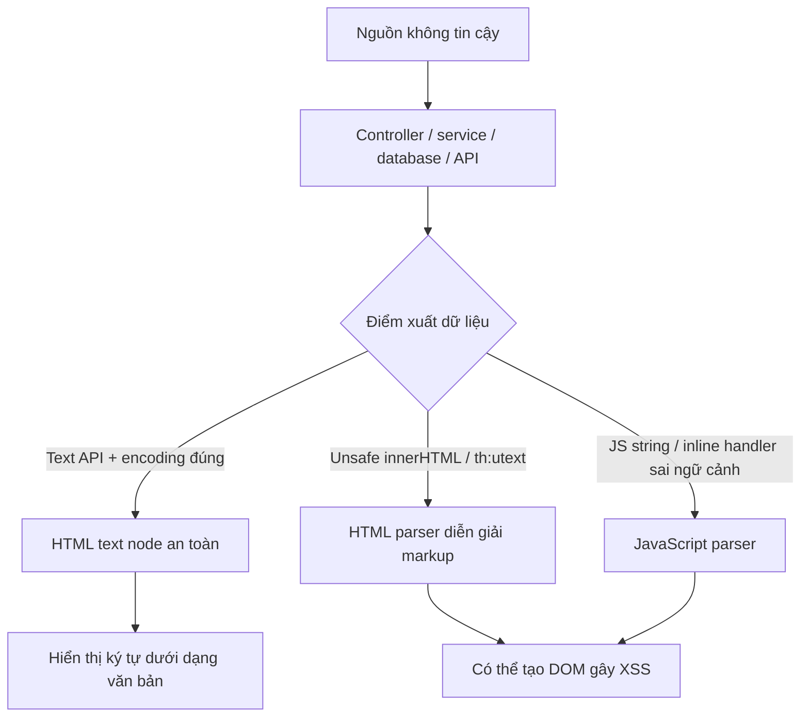

# XSS và yêu cầu mã hóa đầu ra đúng ngữ cảnh

Trong module `SPRING_SECURITY_HTTP_PROTECTION`, Spring Security hỗ trợ các lớp phòng vệ HTTP và trình duyệt: CSRF, CORS, security headers, Content Security Policy (CSP), HSTS, HTTP firewall và quản lý session. Các biện pháp này rất quan trọng nhưng **không tự động biến mọi dữ liệu do ứng dụng hiển thị thành HTML/JavaScript an toàn**.

Bài thuộc chương **Ranh giới bảo vệ**, tập trung một giới hạn đặc biệt: **Cross-Site Scripting (XSS)** xuất hiện khi dữ liệu không tin cậy được trình duyệt diễn giải thành mã hoặc markup có khả năng thực thi thay vì thành văn bản. Trách nhiệm chính của mã ứng dụng là chọn đúng API render và **mã hóa đầu ra theo ngữ cảnh (contextual output encoding)**. Spring Security có thể bổ sung CSP và các security headers để giảm tác động, nhưng không thay template engine, DOM API hoặc quy tắc kiểm soát HTML của ứng dụng.

Ví dụ, người dùng gửi nội dung bình luận:

```text

```

Nếu ứng dụng hiển thị nguyên chuỗi ấy bằng HTML được render như markup, trình duyệt có thể tạo thẻ `img` và chạy event handler `onerror`. Nếu cùng chuỗi được đưa vào **text node**, người xem chỉ thấy các ký tự ``, không có hình ảnh hoặc script được thực thi.

**Nguyên tắc cốt lõi:** không phải “chặn mọi ký tự `<`” mà là **không cho dữ liệu chưa được tin cậy thoát khỏi ngữ cảnh dữ liệu của nó**. Một cách mã hóa đúng cho HTML text có thể không đúng cho JavaScript string, CSS value, URL hay HTML attribute.

## 1. Mục tiêu học tập

Sau bài này, người học có thể:

- Phân biệt **stored XSS**, **reflected XSS** và **DOM-based XSS** dựa trên nguồn và vị trí trình duyệt thực thi dữ liệu.
- Chỉ ra *source* (request parameter, database, API response, URL hash, WebSocket, file metadata) và *sink* (HTML, `innerHTML`, event handler, JavaScript, URL attribute) trong một luồng thực tế.
- Chọn đúng chiến lược cho **HTML text**, **HTML attribute**, **JavaScript**, **URL** và **CSS**; biết những ngữ cảnh cần tránh nhúng dữ liệu hoàn toàn.
- Dùng `th:text` và các thuộc tính Thymeleaf có escaping; nhận diện rủi ro của `th:utext`.
- Phân biệt **output encoding** với **HTML sanitization** và **validation**; biết khi nào bắt buộc dùng sanitizer có allowlist.
- Tránh DOM XSS bằng `textContent` / `createElement` thay vì `innerHTML` / `insertAdjacentHTML` cho dữ liệu không tin cậy.
- Cấu hình CSP như **defense in depth** trong Spring Security, không dùng CSP để biện minh cho HTML injection.
- Viết kiểm thử Servlet/MockMvc, Reactive/WebTestClient và browser/E2E để xác minh text không biến thành DOM thực thi.
- Liên hệ XSS với CSRF token trong DOM, session cookie, CORS và file upload để hiểu đúng giới hạn tự động bảo vệ.

## 2. XSS xảy ra khi dữ liệu đi qua ranh giới tin cậy

Trong ứng dụng web, input không tin cậy không chỉ đến từ request mới gửi:

- Form text, bình luận, tìm kiếm, tên hiển thị và query parameters.
- Nội dung từng được lưu trong database hoặc cache.
- JSON từ downstream API, webhook, WebSocket, event queue.
- Tên file upload, metadata, URL và path.
- Dữ liệu trong `location.search`, `location.hash` hoặc `window.name`.
- Dữ liệu từ phía admin/đối tác: có quyền truy cập hệ thống **không biến nội dung thành markup đáng tin**.

Nếu một thành phần đưa dữ liệu đó vào vùng mà browser **phân tích cú pháp thành HTML hoặc JavaScript**, nó đã vượt ranh giới giữa *dữ liệu* và *mã*.



Rủi ro không được giải quyết chỉ bằng việc “dữ liệu đã được lưu trong DB”. **Stored data vẫn là untrusted data** đối với trình duyệt.

### 2.1. Ba dạng XSS phổ biến

| Dạng | Luồng dữ liệu điển hình | Điểm gây lỗi |
| --- | --- | --- |
| **Reflected XSS** | URL/query `q` → controller → trang kết quả → browser | Query được chèn vào HTML hoặc JS không đúng cách. |
| **Stored XSS** | Người A lưu bình luận → DB → người B xem trang | Nội dung lưu được render thành HTML/JS, ảnh hưởng nhiều người xem. |
| **DOM-based XSS** | Browser đọc `location.hash` / JSON → JavaScript client → DOM | Script dùng sink nguy hiểm như `innerHTML` hoặc `insertAdjacentHTML`. |

Đây là các cách phân loại theo **nguồn và luồng**. Một ứng dụng có thể đồng thời có stored DOM XSS: payload lưu trong database nhưng chỉ bị thực thi khi frontend dựng DOM bằng `innerHTML`.

### 2.2. Những điều kiện làm XSS có tác động

Nếu XSS thực thi trong origin của ứng dụng, script độc hại có thể:

- Đọc hoặc thay đổi nội dung trang, dữ liệu mà script cùng origin được phép truy cập.
- Đọc CSRF token được đặt trong hidden input, meta tag hoặc API mà JavaScript của trang truy cập được.
- Gửi request với cookie hiện có của nạn nhân dù cookie có `HttpOnly` (vì browser vẫn tự đính kèm cookie).
- Lừa người dùng nhập mật khẩu, sửa giao diện hoặc đưa người dùng tới trang giả.
- Thực hiện những tác vụ mà account hiện tại được quyền thực hiện, tùy các lớp kiểm soát phía server.

**Không suy rằng HttpOnly và CSRF đủ chống XSS.** `HttpOnly` giúp hạn chế JavaScript đọc giá trị cookie, nhưng mã chạy trong trang vẫn có thể gọi API với session của browser. CSRF chống request giả mạo từ origin khác; XSS chạy trong chính origin hợp lệ có vị trí và quyền khác.

## 3. Quy tắc nền: mã hóa tại điểm xuất, đúng ngữ cảnh

**Output encoding** là quá trình biến ký tự đặc biệt thành biểu diễn mà parser của ngữ cảnh đích hiểu là **dữ liệu**, không phải cú pháp lệnh. Mỗi ngữ cảnh có quy tắc khác nhau.

Ví dụ `` trong HTML text có thể được hiển thị thành:

```html
&lt;img src=x onerror=alert(1)&gt;
```

Browser hiển thị chuỗi ký tự `` như văn bản. Nhưng nếu ta đưa chính chuỗi đã HTML-encoded ấy vào một JavaScript string, chỉ HTML encoding chưa chắc xử lý đúng dấu quote, backslash hoặc kết thúc thẻ `</script>`.

### 3.1. Bảng ngữ cảnh và cách xử lý

| Ngữ cảnh xuất dữ liệu | Ví dụ vị trí | Cách tiếp cận an toàn | Tránh |
| --- | --- | --- | --- |
| **HTML text** | `<p>TEXT</p>` | Template engine tự HTML-escape hoặc DOM `textContent` | Render text bằng `th:utext` / `innerHTML`. |
| **HTML attribute thông thường** | `title="VALUE"`, `data-name="VALUE"` | Attribute escaping qua template engine; luôn có dấu quote | Nối chuỗi HTML thủ công, attribute không quote. |
| **URL attribute** | `href="URL"`, `src="URL"` | Kiểm tra scheme/host/relative path + encode đúng thành phần URL + attribute escaping | Coi HTML escaping là đủ để loại `javascript:`. |
| **JavaScript string / data** | Giá trị trong script | Ưu tiên dữ liệu qua JSON response rồi DOM text APIs; khi buộc nhúng, dùng serializer/escaping đúng JavaScript **và** HTML script context | Nối user input vào inline script hoặc event handlers. |
| **CSS value/style** | `style="..."` hoặc CSS rule | Dùng class/value allowlist cố định; không nhận cả đoạn CSS từ input | Nối dữ liệu vào `style` hoặc `<style>`. |
| **HTML giàu định dạng** | Nội dung bài viết có `<b>`/`<a>` | Sanitizer HTML theo **allowlist** trước khi render dạng HTML | Regex tự viết để “xóa thẻ script”, chỉ dùng HTML escape nếu cần giữ markup. |
| **DOM API** | Cập nhật trang sau `fetch` | `createElement`, `textContent`, `append`, thuộc tính an toàn đã validate | `innerHTML`, `outerHTML`, `document.write` với dữ liệu không tin cậy. |
| **Download file** | Tài liệu HTML/SVG tải lên | Kiểm soát content type/disposition, private storage, nguồn phục vụ riêng khi cần | Phục vụ active content của người dùng như HTML tin cậy từ cùng origin. |

Bảng trên là **chỉ dẫn chọn API**. Không tồn tại một hàm `escape(String input)` duy nhất xử lý an toàn mọi HTML, JavaScript, CSS, URL và template context.

### 3.2. Tại sao xử lý lúc nhận input là chưa đủ?

Một kiểu triển khai dễ mắc lỗi:

```java
// KHÔNG khuyến nghị xử lý mọi input theo cách này:
String stored = input.replace("<", "&lt;")
                     .replace(">", "&gt;");
repository.save(stored);
```

Lỗi thiết kế:

- Dữ liệu bị biến đổi ngay khi lưu, làm mất định dạng gốc có thể cần cho các consumer khác như PDF, plain text hay JSON.
- Nếu tầng view sau đó lại escape, người xem có thể thấy `&amp;lt;` (*double encoding*).
- Cách thay `<`/`>` không xử lý đầy đủ ngữ cảnh attribute/JS/URL/CSS.
- Nếu dữ liệu được sử dụng ở một sink mới trong tương lai, nó vẫn có thể không an toàn.

Với **plain text**, thường nên lưu dữ liệu gốc **sau validation nghiệp vụ** và encode ở nơi hiển thị. Với **rich HTML được phép**, cần chính sách sanitization nghiêm ngặt riêng và kiểm soát provenance của dữ liệu đã sanitize.

### 3.3. Validation, encoding và sanitization không thay thế nhau

| Khâu | Trả lời câu hỏi | Ví dụ |
| --- | --- | --- |
| **Validation** | Giá trị này có hợp lệ cho nghiệp vụ? | Tên dài tối đa 80 ký tự; URL hồ sơ chỉ cho HTTPS và domain được tin. |
| **Output encoding** | Parser đích có hiểu đây là dữ liệu thay vì mã? | `<` → `&lt;` trong HTML text. |
| **HTML sanitization** | Cho phép một tập markup an toàn trong nội dung giàu định dạng? | Giữ `<strong>`, loại event handler/script/URL scheme nguy hiểm. |
| **CSP / browser headers** | Giảm thực thi trái phép nếu vẫn còn lỗi render? | `script-src 'self'`, `object-src 'none'`, `frame-ancestors 'none'`. |
| **Authorization** | Người dùng được xem/sửa nội dung này không? | Chỉ owner được sửa bình luận hoặc tài liệu. |

Để làm đúng phải kết hợp theo luồng dữ liệu thực tế. Ví dụ validation `length <= 80` vẫn chấp nhận chuỗi `<svg onload=...>`; mã hóa ở HTML text mới ngăn parser diễn giải nó như thẻ.


## 4. Spring MVC + Thymeleaf: render bình luận dưới dạng text

Tình huống: một trang cho người đã đăng nhập đăng bình luận. Nội dung comment có thể chứa ký tự `<`, `>`, dấu quote và các chuỗi trông giống mã. Chúng phải hiển thị **nguyên nghĩa là văn bản**, không được trở thành HTML element hay JavaScript.

Dependency Spring Boot (Servlet) cho ví dụ:

```groovy
implementation 'org.springframework.boot:spring-boot-starter-web'
implementation 'org.springframework.boot:spring-boot-starter-thymeleaf'
implementation 'org.springframework.boot:spring-boot-starter-security'

testImplementation 'org.springframework.boot:spring-boot-starter-test'
testImplementation 'org.springframework.security:spring-security-test'
```

### 4.1. Giữ CSRF và authorization của route ghi dữ liệu

```java
import org.springframework.context.annotation.Bean;
import org.springframework.context.annotation.Configuration;
import org.springframework.http.HttpMethod;
import org.springframework.security.config.Customizer;
import org.springframework.security.config.annotation.web.builders.HttpSecurity;
import org.springframework.security.web.SecurityFilterChain;

@Configuration
public class CommentSecurityConfig {

    @Bean
    SecurityFilterChain securityFilterChain(HttpSecurity http)
            throws Exception {
        return http
                .authorizeHttpRequests(auth -> auth
                        .requestMatchers(HttpMethod.GET, "/comments")
                            .permitAll()
                        .requestMatchers(HttpMethod.POST, "/comments")
                            .authenticated()
                        .anyRequest().authenticated())
                .formLogin(Customizer.withDefaults())
                .csrf(Customizer.withDefaults())
                .build();
    }
}
```

GET bình luận được công khai, POST cần đăng nhập và CSRF. Đây là hai điều kiện HTTP riêng với XSS:

- CSRF đúng **không khiến comment trở thành HTML đáng tin**.
- Một comment đã được đăng bởi user có quyền **vẫn phải được HTML-escape** khi người khác xem.
- Việc user gửi comment chứa các ký tự `<`, `>` là dữ liệu text hợp lệ trong ví dụ; không nhất thiết phải chặn chúng ở input.

### 4.2. Service lưu plain text và xác minh URL hồ sơ

Ví dụ dùng danh sách trong RAM để minh họa. Production phải dùng persistence phù hợp, phân quyền sửa/xóa comment, rate limiting, transaction và audit.

```java
import java.net.URI;
import java.net.URISyntaxException;
import java.util.List;
import java.util.concurrent.CopyOnWriteArrayList;
import java.util.concurrent.atomic.AtomicLong;
import org.springframework.http.HttpStatus;
import org.springframework.stereotype.Service;
import org.springframework.web.server.ResponseStatusException;

@Service
public class CommentService {

    public record Comment(
            long id, String author, String message, String safeProfileUrl) {}

    private final AtomicLong sequence = new AtomicLong(1);
    private final List<Comment> comments = new CopyOnWriteArrayList<>();

    public List<Comment> all() {
        return List.copyOf(comments);
    }

    public void add(String author, String message, String profileUrl) {
        String a = author.trim();
        String m = message.trim();

        // Validation nghiệp vụ, không phải output encoding.
        if (a.isBlank() || a.length() > 80 ||
                m.isBlank() || m.length() > 3000) {
            throw new ResponseStatusException(
                    HttpStatus.BAD_REQUEST, "Dữ liệu không hợp lệ");
        }

        String safeUrl = validateProfileUrl(profileUrl);
        comments.add(new Comment(
                sequence.getAndIncrement(), a, m, safeUrl));
    }

    private String validateProfileUrl(String raw) {
        if (raw == null || raw.isBlank()) {
            return null;
        }

        String candidate = raw.trim();
        if (candidate.length() > 2048) {
            throw new ResponseStatusException(
                    HttpStatus.BAD_REQUEST, "URL quá dài");
        }

        try {
            URI uri = new URI(candidate);
            boolean allowed =
                    "https".equalsIgnoreCase(uri.getScheme()) &&
                    "profiles.example.test".equalsIgnoreCase(uri.getHost()) &&
                    uri.getRawUserInfo() == null &&
                    uri.getPort() == -1;

            if (!allowed) {
                throw new ResponseStatusException(
                        HttpStatus.BAD_REQUEST, "URL hồ sơ không được phép");
            }
            return uri.toASCIIString();
        } catch (URISyntaxException exception) {
            throw new ResponseStatusException(
                    HttpStatus.BAD_REQUEST, "URL không hợp lệ");
        }
    }
}
```

Tên miền `profiles.example.test` là **placeholder cho allowlist**; hãy thay bằng domain thật mà tổ chức sở hữu và kiểm soát. Đoạn kiểm tra chỉ minh họa URL HTTPS ở host được cho phép, không phải URL validation áp dụng cho mọi nghiệp vụ.

Đặc biệt, chỉ HTML-escape `href` không đủ ngăn `javascript:`, `data:` hoặc các URL không được phép. Vì vậy ví dụ **kiểm tra scheme/host trước**, rồi để template engine escape giá trị thuộc tính khi render.

### 4.3. Controller nhận dữ liệu nhưng không tự nối HTML

```java
import java.net.URI;
import org.springframework.http.HttpStatus;
import org.springframework.http.ResponseEntity;
import org.springframework.stereotype.Controller;
import org.springframework.ui.Model;
import org.springframework.web.bind.annotation.GetMapping;
import org.springframework.web.bind.annotation.PostMapping;
import org.springframework.web.bind.annotation.RequestParam;

@Controller
public class CommentController {

    private final CommentService service;

    public CommentController(CommentService service) {
        this.service = service;
    }

    @GetMapping("/comments")
    String list(Model model) {
        model.addAttribute("comments", service.all());
        return "comments/list";
    }

    @PostMapping("/comments")
    ResponseEntity<Void> add(
            @RequestParam String author,
            @RequestParam String message,
            @RequestParam(name = "profileUrl", required = false)
            String profileUrl) {

        service.add(author, message, profileUrl);

        // Post/Redirect/Get: GET không tự thêm comment lần nữa.
        return ResponseEntity.status(HttpStatus.SEE_OTHER)
                .location(URI.create("/comments"))
                .build();
    }
}
```

Controller không dùng `response.getWriter().write("<p>" + message + "</p>")`. Nó chỉ chuyển dữ liệu sang service/model; **view có trách nhiệm render đúng ngữ cảnh**. 303 tạo GET riêng, không làm dữ liệu “tự an toàn” — GET sẽ hiển thị bình luận đã lưu nên vẫn cần escaping.

### 4.4. Template Thymeleaf an toàn

Tạo `src/main/resources/templates/comments/list.html`:

```html
<!doctype html>
<html lang="vi" xmlns:th="http://www.thymeleaf.org">
<head>
    <meta charset="UTF-8">
    <title>Bình luận</title>
</head>
<body>
    <h1>Bình luận</h1>

    <ul>
        <li th:each="comment : ${comments}">
            <strong th:text="${comment.author()}">Tên hiển thị</strong>
            <p th:text="${comment.message()}">Văn bản bình luận</p>

            <a th:if="${comment.safeProfileUrl() != null}"
               th:href="${comment.safeProfileUrl()}"
               target="_blank"
               rel="noopener noreferrer">Hồ sơ</a>
        </li>
    </ul>

    <form method="post" th:action="@{/comments}">
        <label for="author">Tên hiển thị</label>
        <input id="author" name="author" maxlength="80" required>

        <label for="message">Bình luận</label>
        <textarea id="message" name="message"
                  maxlength="3000" required></textarea>

        <label for="profileUrl">URL hồ sơ (tùy chọn)</label>
        <input id="profileUrl" name="profileUrl" type="url">

        <button type="submit">Đăng bình luận</button>
    </form>
</body>
</html>
```

Trong template:

- `th:text` HTML-escape giá trị, hiển thị như text node thay vì parse markup.
- `th:href` xử lý giá trị thuộc tính, nhưng **URL đã phải qua kiểm tra scheme/host** từ service.
- `target="_blank"` đi cùng `rel="noopener noreferrer"` để hạn chế việc trang đích truy cập `window.opener` và giảm lộ Referer; vẫn cần kiểm soát destination.
- `th:action="@{/comments}"` trên form POST phối hợp với Spring Security để render CSRF hidden field khi tích hợp đúng. Kiểm tra HTML **đã render**, đừng tự hardcode token.
- Browser validation `maxlength` chỉ hỗ trợ UX; server tiếp tục kiểm tra độ dài và dữ liệu.

Với bình luận:

```text

```

HTML response có thể chứa dạng đã mã hóa:

```html
<p>&lt;img src=x onerror=alert(1)&gt;</p>
```

Người xem nhìn thấy chuỗi ký tự, **không có phần tử `img` được tạo từ dữ liệu**. Browser DevTools có thể hiển thị text node dưới dạng khác nhau; kiểm thử quan trọng là không tồn tại thẻ/event handler phát sinh từ input.

### 4.5. `th:utext` là một quyết định tin cậy, không phải bản tương đương `th:text`

Đoạn sau **không an toàn nếu message chưa được sanitize và chính sách cho phép nội dung HTML chưa được định nghĩa**:

```html
<!-- SAI với bình luận plain text không tin cậy -->
<p th:utext="${comment.message()}"></p>
```

`th:utext` render nội dung không HTML-escape; markup sẽ được browser diễn giải. Chỉ dùng render HTML raw khi **nghiệp vụ thực sự cần rich text**, và chỉ với giá trị đã được sanitizer đáng tin cậy xử lý theo allowlist phù hợp.

Không “sửa” lỗi XSS bằng cách đổi `th:text` thành `th:utext` để xuống dòng, định dạng hoặc link của người dùng trông đẹp hơn. Với plain text nhiều dòng, có thể giữ `th:text` và dùng CSS `white-space: pre-wrap` trên thẻ, không cần cho phép HTML.

## 5. Attribute, URL và class: escape thôi chưa đủ

### 5.1. Attribute value phải được encode đúng

Nếu dùng template engine, ưu tiên:

```html
<!-- Có attribute escaping của template engine -->
<input type="text" th:value="${comment.author()}">
<p th:title="${comment.message()}">Di chuột để xem</p>
```

Không nối raw HTML:

```java
// SAI: tạo HTML bằng string concatenation.
String html = "<input value=\"" + userInput + "\">";
```

Nếu user input chứa dấu quote, nó có thể thoát khỏi giá trị attribute và tạo attribute mới. Việc **có dấu quote cố định** và để template engine encode thuộc tính làm giảm nguy cơ đó.

Ngoài value, bản thân **tên attribute** hoặc **tên thẻ** cũng không nên do input quyết định. Không cho user chọn `onclick`, `onerror`, `style` hoặc thẻ `script` như một “thuộc tính cấu hình giao diện”.

### 5.2. URL: phải kiểm tra scheme và đích

Ví dụ dữ liệu:

```text
javascript:alert(1)
```

Nó không cần chứa `<` hoặc dấu quote để gây rủi ro khi được đặt vào `href`. **HTML attribute escaping không phải URL sanitization**.

Mẫu an toàn cho link user profile:

1. Parse URL bằng parser đáng tin, không dùng regex đơn giản để đoán scheme.
2. Chỉ cho scheme phù hợp, ví dụ HTTPS.
3. Nếu nghiệp vụ có domain cố định, allowlist **host đã parse** và xử lý port, userinfo, subdomain/path theo policy.
4. Khi tự tạo URL nội bộ, chỉ nhận dữ liệu **thành phần** (path segment/query value) và encode đúng thành phần; đừng tin cả URL do user cung cấp.
5. Render URL đã xác minh bằng template engine để còn được escape khi đặt trong HTML attribute.

Ví dụ tạo link nội bộ với path segment do client cung cấp:

```java
import org.springframework.web.util.UriComponentsBuilder;

String href = UriComponentsBuilder
        .fromPath("/profiles/{id}")
        .encode()
        .buildAndExpand(userSuppliedId)
        .toUriString();
```

`encode()` ở đây hướng vào URI component/template variable, không phải HTML escaping; vẫn để `th:href` encode theo ngữ cảnh thuộc tính và tiếp tục kiểm tra authorization của route đích.

### 5.3. Class/style: prefer allowlist giá trị cố định

Nếu muốn tô màu bình luận dựa trên trạng thái:

```java
String cssClass = isApproved ? "comment-approved" : "comment-pending";
```

Sau đó đưa vào attribute class qua template engine. Không lấy cả đoạn `style` hoặc CSS selector do user gửi rồi đưa vào `th:style` / `<style>`. Mã hóa HTML không thay thế CSS parser rules, và CSP `style-src` chỉ là một lớp giảm thiểu.

Không cho người dùng kiểm soát URL trong `url(...)` của CSS nếu chưa có chính sách nguồn chặt chẽ; với theme, ưu tiên enum như `LIGHT`, `DARK` được ánh xạ thành class cố định.


## 6. DOM-based XSS: JSON không nguy hiểm cho đến khi dùng sai sink

Một REST endpoint có thể trả nội dung bình luận dưới dạng JSON:

```json
{
  "author": "alice",
  "message": ""
}
```

Khi response được khai báo đúng `Content-Type: application/json`, browser không tự chạy chuỗi trong field `message`. **Lỗ hổng xuất hiện nếu JavaScript ở client chuyển chuỗi đó thành HTML markup.**

### 6.1. Hai cách cập nhật DOM nhìn giống nhau nhưng khác ranh giới

Không an toàn với dữ liệu không tin cậy:

```javascript
const comment = await response.json();

// SAI: browser parse trường message thành HTML.
document.querySelector("#comment")
        .innerHTML = comment.message;
```

An toàn khi nội dung chỉ là text:

```javascript
const comment = await response.json();

const node = document.querySelector("#comment");
// ĐÚNG: tạo text node, không mở HTML parser.
node.textContent = comment.message;
```

`textContent` không biến chuỗi `` thành thẻ `img`. Tương tự, `document.createTextNode(comment.message)` kết hợp `appendChild` giữ nội dung dưới dạng văn bản.

### 6.2. Tạo cả một danh sách bằng DOM API an toàn

Giả sử API `GET /api/comments` trả mảng đối tượng với `author` và `message`. JavaScript nằm trong file external `/js/comments.js`:

```javascript
async function renderComments() {
    const response = await fetch("/api/comments", {
        method: "GET",
        credentials: "same-origin",
        headers: { Accept: "application/json" }
    });

    if (!response.ok) {
        throw new Error("Không tải được danh sách bình luận");
    }

    const contentType = response.headers.get("Content-Type") || "";
    if (!contentType.includes("application/json")) {
        throw new Error("API trả về nội dung ngoài dự kiến");
    }

    const comments = await response.json();
    const list = document.getElementById("commentList");
    list.replaceChildren();

    for (const comment of comments) {
        const item = document.createElement("li");
        const name = document.createElement("strong");
        const body = document.createElement("p");

        name.textContent = comment.author;
        body.textContent = comment.message;

        item.append(name, body);
        list.append(item);
    }
}
```

`replaceChildren`, `createElement`, `textContent` và `append` xây DOM qua API cấu trúc, không dùng HTML parser cho dữ liệu text. Dù response đến từ database nội bộ, vẫn không coi `comment.message` là markup.

Đoạn code tập trung sink an toàn, không trình bày UI loading/error state đầy đủ. Trong sản phẩm thật, cần kiểm tra JSON schema, tối đa số bản ghi/độ dài, authentication/authorization ở API và xử lý lỗi khi session hết hạn.

### 6.3. Các sink cần review kỹ

| Sink / API | Nguy cơ | Cách thay thế hoặc kiểm soát |
| --- | --- | --- |
| `element.innerHTML = userData` | Parse chuỗi thành markup | `textContent` cho plain text; sanitizer + Trusted Types khi buộc phải dùng HTML. |
| `element.outerHTML = userData` | Thay toàn bộ element bằng HTML từ dữ liệu | Tạo DOM node bằng `createElement`. |
| `insertAdjacentHTML(position, userData)` | Chèn HTML parser output | `append` / `appendChild` với text node. |
| `document.write(userData)` | Parse HTML từ nguồn không tin | Không dùng cho dữ liệu do người dùng kiểm soát. |
| `setTimeout(userData, ...)` hoặc `eval(userData)` | Thực thi chuỗi như JavaScript | Truyền function callback, không dùng eval. |
| `element.setAttribute("onclick", userData)` | Gắn event handler từ chuỗi | `addEventListener` với function tin cậy. |
| `anchor.href = userData` | Dễ nhận `javascript:`/URL ngoài ý muốn | Validate URL scheme/origin/host trước khi gán. |
| `iframe.srcdoc = userData` | Parse một tài liệu HTML mới | Tránh dữ liệu không tin; nếu thật sự cần, sanitizer và sandbox chặt. |
| `element.style.cssText = userData` | Cho input quyết định CSS | Ánh xạ enum sang class/value cố định. |

**Không phải mọi `setAttribute` đều nguy hiểm như nhau**: đặt `title` hoặc `aria-label` với giá trị không tin cậy qua DOM API thường là cách xử lý text phù hợp, trong khi `onclick`, `srcdoc`, `href` và URL-bearing attributes có ngữ nghĩa đặc biệt. Cần đánh giá **thuộc tính cụ thể**.

### 6.4. Client-side URL policy vẫn cần thiết

Nếu API đưa URL do người dùng cung cấp, frontend không nên gán thẳng cho anchor. Ví dụ chỉ chấp nhận link **cùng origin**:

```javascript
function toSafeSameOriginUrl(candidate) {
    try {
        const url = new URL(candidate, window.location.origin);

        if (url.origin !== window.location.origin) {
            return null;
        }
        if (url.protocol !== "https:" && url.protocol !== "http:") {
            return null;
        }

        return url.href;
    } catch {
        return null;
    }
}

const href = toSafeSameOriginUrl(comment.profileLink);
if (href) {
    const link = document.createElement("a");
    link.href = href;
    link.rel = "noopener noreferrer";
    link.textContent = "Xem hồ sơ";
    container.append(link);
}
```

Đây là **allowlist same-origin cho ví dụ**, không thay backend policy. Nếu nghiệp vụ cho phép origin khác, cần allowlist rõ; không nhận bất kỳ chuỗi nào chỉ vì nó qua được `new URL(...)`.

## 7. JavaScript được nhúng trong HTML: hai parser, hai trách nhiệm

Một lỗi thường gặp là đặt dữ liệu người dùng vào JavaScript inline:

```html
<!-- SAI: dữ liệu không tin cậy nằm trực tiếp trong code. -->
<script>
    const greeting = "USER_CONTROLLED_TEXT";
</script>
```

Nếu ứng dụng nối chuỗi để thay `USER_CONTROLLED_TEXT` mà không dùng serializer và escaping đúng, ký tự quote/backslash có thể phá JavaScript string. Ngoài ra, HTML parser xử lý **`</script>` như kết thúc thẻ** bất kể JavaScript parser đang nghĩ đó là string hay không.

Vì vậy, không được coi “tôi đã thêm dấu quote quanh dữ liệu” là đủ an toàn. Cũng không coi HTML text encoding thuần là phương án xử lý JavaScript string context.

### 7.1. Tránh inline JavaScript khi có thể

Ưu tiên:

1. Trang HTML chỉ chứa cấu trúc an toàn, không ghép dữ liệu vào mã JavaScript.
2. File script được serve từ nguồn đã tin và được CSP cho phép.
3. Script gọi endpoint `application/json`, parse JSON thành dữ liệu.
4. Script dùng `textContent` và DOM APIs an toàn để hiển thị.

Với Thymeleaf, `th:inline="javascript"` có khả năng serialization/escaping chuyên biệt hơn việc nối string trong `<script>`; tuy nhiên khi nhúng dữ liệu không tin vào **một thẻ script bên trong HTML**, phải đánh giá cả JavaScript context **và** HTML parser/script terminator. Đối với luồng mới, fetch JSON rồi render text thường giảm đáng kể rủi ro sai ngữ cảnh.

### 7.2. Không đặt dữ liệu vào inline event handler

Ví dụ sai:

```html
<!-- Đừng lắp ghép dữ liệu người dùng vào code onclick. -->
<button onclick="showMessage('USER_CONTROLLED_TEXT')">
    Xem bình luận
</button>
```

Giá trị của `onclick` là **mã JavaScript**, dù nhìn giống một HTML attribute. HTML attribute escaping **một mình** không chứng minh JavaScript code trong handler an toàn.

Thay bằng:

```javascript
const button = document.getElementById("showComment");
const output = document.getElementById("commentOutput");

button.addEventListener("click", () => {
    output.textContent = comment.message;
});
```

Không xây tên function, event handler hoặc đoạn mã JS từ user-controlled string. Nếu muốn chọn một hành vi, dùng allowlist hành vi có sẵn của ứng dụng.

## 8. Khi nghiệp vụ thực sự cần HTML giàu định dạng

Không phải mọi trường đều là plain text: wiki, bài đăng, email HTML hoặc trình soạn thảo WYSIWYG có thể cần giữ một tập nhỏ markup như `<strong>`, `<em>`, `<p>` hoặc links.

Khi đó, **HTML encoding toàn bộ** sẽ làm mất hiệu ứng định dạng. Nhưng render HTML raw của người dùng thì tạo XSS. Lối đi phù hợp là **HTML sanitization với allowlist**, không phải viết regex để loại chuỗi `<script>`.

### 8.1. Sanitize bằng thư viện có chính sách rõ

Một lựa chọn phổ biến trong Java là **OWASP Java HTML Sanitizer**. Ví dụ cấu hình chính sách tối thiểu theo nhóm formatting/links do thư viện cung cấp:

```java
import org.owasp.html.PolicyFactory;
import org.owasp.html.Sanitizers;

public final class RichTextPolicy {

    private static final PolicyFactory POLICY =
            Sanitizers.FORMATTING.and(Sanitizers.LINKS);

    private RichTextPolicy() {}

    public static String sanitize(String untrustedHtml) {
        if (untrustedHtml == null) {
            return "";
        }
        return POLICY.sanitize(untrustedHtml);
    }
}
```

Để chạy, dự án cần dependency `com.googlecode.owasp-java-html-sanitizer:owasp-java-html-sanitizer` với phiên bản được quản lý/pin và cập nhật bảo mật phù hợp. Ví dụ `Sanitizers.FORMATTING` và `Sanitizers.LINKS` là một **allowlist có sẵn**, không có nghĩa đáp ứng mọi yêu cầu sản phẩm. Cần review các element/attribute/protocol được cho phép, cách xử lý link, và cập nhật library theo advisory.

Đầu ra sanitized chỉ được coi là **HTML markup được phép cho vùng nội dung** theo chính sách đã chọn. Nó không tự trở thành an toàn nếu sau đó được nối vào JavaScript string, style attribute, URL, SQL hoặc command line.

### 8.2. Render sanitized HTML có chủ đích

Nếu business yêu cầu rich text:

```java
String cleanedHtml = RichTextPolicy.sanitize(userSubmittedHtml);
model.addAttribute("sanitizedDescriptionHtml", cleanedHtml);
```

Template:

```html
<!-- Chỉ dùng th:utext với giá trị được sanitizer allowlist xử lý. -->
<article th:utext="${sanitizedDescriptionHtml}"></article>
```

**Không dùng tên variable như `safeHtml` để giả định tự động an toàn**: phải kiểm soát dữ liệu được tạo từ đâu, sanitizer version/policy nào đã áp dụng, và có bước biến đổi nào sau sanitization làm mất bảo đảm hay không.

### 8.3. Đừng tự viết sanitizer bằng regex

Các dạng HTML phức tạp bao gồm:

- Event handler attributes như `onload`, `onerror`, `onclick`.
- URL schemes như `javascript:` và các dạng encode/normalize khác nhau.
- HTML entities, comments, malformed markup và namespace của SVG/MathML.
- Nội dung trong attribute, style hoặc các thẻ có quy tắc parser riêng.
- HTML được browser sửa cấu trúc sau khi parse (mutation XSS).

Một regex xóa `<script>` không hiểu đầy đủ HTML parser/browser behavior, nên dễ bị bypass. Dùng thư viện chuyên dụng, **policy allowlist tối thiểu**, cập nhật phiên bản và test với payload đại diện cho nhu cầu thực.

### 8.4. Trusted Types là lớp tăng cường ở client

Trên những browser hỗ trợ **Trusted Types**, CSP directive như `require-trusted-types-for 'script'` có thể hạn chế việc gán string tùy ý vào một số DOM sinks nguy hiểm. Nếu ứng dụng cần rich HTML, có thể xây Trusted Types policy chỉ nhận output từ sanitizer đã được đánh giá.

Nhưng Trusted Types **không thay**:

- Server-side validation hoặc authorization.
- Output encoding cho các context khác.
- HTML sanitization policy đúng.
- Review sự hỗ trợ của browser và library frontend.
- Kiểm thử đường DOM thật.

Không bật Trusted Types đột ngột cho app có nhiều code dùng `innerHTML` mà chưa có migration/test; nó có thể làm giao diện hỏng nhưng không tự tạo sanitizer an toàn.


## 9. CSP và security headers: phòng vệ bổ sung, không phải bộ encode tự động

Spring Security hỗ trợ gửi **Content-Security-Policy** header và các security headers khác. CSP cho phép browser hạn chế nguồn script, object, form action, framing và một số khả năng thực thi. Nhưng **Spring Security không tự tạo CSP chi tiết cho mọi ứng dụng** và CSP không thay thế output encoding.

Với trang comments chỉ sử dụng script external cùng origin và không cần inline script, một cấu hình CSP minh họa:

```text
default-src 'self';
script-src 'self';
object-src 'none';
base-uri 'self';
frame-ancestors 'none';
form-action 'self'
```

Policy này có thể chặn nhiều inline event handlers không được cho phép, nhưng còn phụ thuộc browser, nguồn tài nguyên, và toàn bộ chính sách. Cần kiểm thử giao diện thật, các template, CDN và cách triển khai. Đừng thêm `'unsafe-inline'` cho `script-src` chỉ để che đi lỗi triển khai mà không phân tích.

### 9.1. Thêm CSP vào đúng SecurityFilterChain

Với Servlet, bổ sung phần `headers(...)` vào **chain đã có** ở `CommentSecurityConfig`, không tạo thêm catch-all chain thứ hai:

```java
// Đặt trong chuỗi cấu hình HttpSecurity trước .build():
.headers(headers -> headers
        .contentSecurityPolicy(csp -> csp.policyDirectives(
                "default-src 'self'; "
              + "script-src 'self'; "
              + "object-src 'none'; "
              + "base-uri 'self'; "
              + "frame-ancestors 'none'; "
              + "form-action 'self'")))
```

Ví dụ là đoạn DSL cần tích hợp, không phải class độc lập. Trong test có thể kiểm tra response header `Content-Security-Policy` trên `GET /comments`.

**CSP không được Spring Security tự bật đầy đủ như trên khi bạn chỉ thêm starter**. Framework cung cấp header writer/configuration, còn policy directive là quyết định của nhóm phát triển. Chính sách nên được xây dựa trên các nguồn thực sự cần dùng, và nên thử ở môi trường kiểm soát hoặc chế độ report-only khi thay đổi lớn.

### 9.2. Vì sao CSP không loại bỏ trách nhiệm encode?

Giả sử ứng dụng còn sink:

```javascript
commentNode.innerHTML = userSubmittedContent;
```

CSP có thể cản một số event handler hoặc inline script, nhưng DOM vẫn được tạo từ dữ liệu không tin cậy. Cấu hình CSP bị nới, browser khác, gadget trong script hợp lệ hoặc thay đổi frontend trong tương lai có thể khiến lỗ hổng trở nên khai thác được.

Cách xử lý đúng là **loại lỗi ở nguồn** bằng `textContent` / template escaping hoặc sanitizer khi cần markup, sau đó dùng CSP như defense in depth.

### 9.3. CSP nonce, hash và report-only

Nếu ứng dụng buộc phải dùng inline script:

- Ưu tiên loại bỏ inline script hoặc dùng file external.
- Khi cần, dùng nonce có entropy cao, **tạo mới theo response**, đồng bộ với CSP header và attribute script đúng cách; không dùng một chuỗi nonce cố định trong config.
- Với script tĩnh, hash có thể là lựa chọn phù hợp tùy quy trình build.
- Dùng `Content-Security-Policy-Report-Only` để đo vi phạm trước khi enforcement nếu ứng dụng lớn.
- Dữ liệu gửi đến report endpoint có thể chứa URL/path, vì vậy phải áp dụng log redaction và privacy policy tương ứng.

**Nonce không phải giải pháp cho `innerHTML` không an toàn.** Nó nhằm xác định script đáng tin được phép thực thi, không xác minh mọi DOM mutation trong trang.

### 9.4. Headers khác giúp gì trong bài toán XSS?

| Header / cấu hình | Tác dụng liên quan | Giới hạn |
| --- | --- | --- |
| `X-Content-Type-Options: nosniff` | Giảm một số kiểu nhầm lẫn content type khi tải tài nguyên | Không xử lý nội dung HTML đã được ứng dụng render sai. |
| `Content-Security-Policy` | Hạn chế nguồn/hành vi thực thi tùy directive | Không thay contextual output encoding. |
| `Strict-Transport-Security` | Buộc browser dùng HTTPS ở lần truy cập sau theo chính sách | Không làm HTML/JS đã được phục vụ trở nên an toàn. |
| `X-Frame-Options` / `frame-ancestors` | Giảm rủi ro framing/clickjacking | Không chặn toàn bộ stored/reflected/DOM XSS. |
| `HttpOnly` của session cookie | Hạn chế script đọc cookie qua `document.cookie` | XSS trong origin vẫn có thể gửi request đã xác thực. |
| `SameSite` cookie | Giảm một số tình huống gửi cookie cross-site | Không chặn XSS và không thay CSRF. |
| Legacy `X-XSS-Protection` | Từng hỗ trợ cơ chế lọc của một số browser cũ | Không dựa vào làm phòng vệ XSS hiện đại; ưu tiên encoding/CSP. |

Spring Security, servlet container và reverse proxy có thể cùng đặt các header này. Cần kiểm tra **response thực trên public origin**, tránh CSP mâu thuẫn giữa edge và app, và không suy từ một unit test rằng browser đã thực thi policy đúng.

## 10. XSS làm thay đổi cách hiểu về CSRF, CORS và session

### 10.1. CSRF không ngăn script đang chạy cùng origin

Trình tự có thể xảy ra:

```text
1. Người dùng mở /comments, comment được render bằng innerHTML
2. Payload XSS thực thi trong origin của ứng dụng
3. Script truy cập DOM và thấy hidden input _csrf
4. Script gửi POST có _csrf và session cookie browser tự đính kèm
5. CsrfFilter có thể xem request là hợp lệ
```

Đây không phải bằng chứng `CsrfFilter` bị lỗi. CSRF được thiết kế chống request giả mạo **không có token hợp lệ**; XSS đã phá ranh giới mã tin cậy trong chính trang và có thể thao tác như script hợp lệ.

Vì vậy: **giữ CSRF bật**, đồng thời sửa XSS và kiểm tra authorization theo tài nguyên. Không có một lớp nào thay thế hai lớp còn lại.

### 10.2. CORS không phải bảo vệ chống XSS trong origin

CORS chủ yếu kiểm soát khả năng script từ một origin khác đọc response và xử lý preflight. Script XSS thực thi **trong origin của ứng dụng** thường có quyền same-origin như script hợp lệ, nên CORS không ngăn nó gọi API cùng origin.

CORS còn không làm cho HTML/JSON từ API tự động an toàn khi được render. Một response JSON cross-origin được phép đọc chỉ là **dữ liệu**; ứng dụng vẫn phải xử lý đúng sink sau khi đọc.

### 10.3. HttpOnly, Secure, SameSite và HSTS

Các thuộc tính cookie có mục đích khác nhau:

- `HttpOnly` hạn chế JavaScript trực tiếp đọc giá trị session cookie.
- `Secure` hướng cookie chỉ được gửi qua kết nối bảo mật tương ứng.
- `SameSite` kiểm soát cookie trong một số ngữ cảnh cross-site.
- HSTS khiến browser dùng HTTPS theo chính sách đã học cho host.

Chúng bảo vệ session/transport, nhưng **không bảo đảm HTML template không có injection**. XSS vẫn có thể thay giao diện hoặc phát lệnh qua browser cùng origin. Không coi cookie HttpOnly là “đã chống XSS”.

### 10.4. HTTP firewall không quét nội dung text trong database

`StrictHttpFirewall` chủ yếu giúp lọc một số URL/path/method bất thường và giảm sai khác trong request matching. Nó không quét mọi giá trị form/JSON, comment đã lưu hoặc HTML do template sinh ra.

Chính nơi **đưa dữ liệu vào DOM** phải dùng output encoding hoặc sanitizer thích hợp. Rate limiting, WAF và input validation có ích theo threat model, nhưng không thể thay contextual output encoding.

### 10.5. Upload file có nội dung active

Một đường XSS khác là phục vụ HTML/SVG hoặc tài liệu active do người dùng tải lên từ **cùng origin** với ứng dụng tin cậy:

- CSRF đúng chỉ xác minh điều kiện của request upload.
- Authorization đúng chỉ xác minh quyền upload.
- `MultipartFile` hoặc `FilePart` không tự chứng minh file không chứa script.
- `Content-Type` do client khai báo không phải nguồn xác minh an toàn.

Ứng dụng cần validate nội dung/extension/MIME, dùng kho private hoặc origin tách biệt cho file không tin cậy khi cần, và quyết định `Content-Disposition`, CSP, `nosniff` và quyền download. Với file người dùng khác xem, đây là vấn đề **content trust boundary**, không phải lỗi CSRF.

## 11. Servlet vs Reactive: vị trí encode không đổi, cơ chế chạy khác

Spring MVC thường render view Thymeleaf/FreeMarker/JSP qua Servlet. Spring WebFlux có thể trả view Reactive hoặc JSON qua WebFlux handler.

**Cùng một quy tắc bất biến**:

- HTML text: encode qua template engine hoặc dùng DOM text API.
- HTML attributes: encode theo attribute context và validate URL nếu attribute chứa URL.
- JavaScript: không ghép dữ liệu vào executable context; ưu tiên JSON + safe DOM APIs.
- Rich HTML: sanitize trước khi render với mục đích rõ ràng.
- Headers/CSP: là lớp bổ sung, không thay code rendering.

Sự khác biệt ở WebFlux là `SecurityWebFilterChain`, `CsrfWebFilter`, `WebSession`, token dạng `Mono<CsrfToken>` và luồng Reactive; **không dùng Servlet `FilterRegistrationBean` để quản lý WebFilter Reactive**.

### 11.1. Reactive security chain cho API JSON

Ví dụ cấu hình riêng cho WebFlux:

```java
import org.springframework.context.annotation.Bean;
import org.springframework.context.annotation.Configuration;
import org.springframework.http.HttpMethod;
import org.springframework.security.config.Customizer;
import org.springframework.security.config.web.server.ServerHttpSecurity;
import org.springframework.security.web.server.SecurityWebFilterChain;

@Configuration
public class ReactiveCommentSecurityConfig {

    @Bean
    SecurityWebFilterChain securityWebFilterChain(ServerHttpSecurity http) {
        return http
                .authorizeExchange(auth -> auth
                        .pathMatchers(HttpMethod.GET, "/api/comments")
                            .permitAll()
                        .anyExchange().authenticated())
                .csrf(Customizer.withDefaults())
                .headers(headers -> headers
                        .contentSecurityPolicy(csp -> csp.policyDirectives(
                                "default-src 'self'; "
                              + "script-src 'self'; "
                              + "object-src 'none'; "
                              + "base-uri 'self'")))
                .build();
    }
}
```

Đây là chain WebFlux độc lập. **Nếu trang HTML được phục vụ bởi ứng dụng khác**, gắn CSP lên response JSON của API **không tự thêm CSP cho trang HTML ấy**. Chính nơi phát HTML phải áp dụng policy browser tương ứng.

### 11.2. Reactive JSON endpoint chỉ trả dữ liệu

```java
import org.springframework.http.MediaType;
import org.springframework.web.bind.annotation.GetMapping;
import org.springframework.web.bind.annotation.RequestMapping;
import org.springframework.web.bind.annotation.RestController;
import reactor.core.publisher.Flux;

@RestController
@RequestMapping("/api/comments")
public class ReactiveCommentApi {

    public record CommentDto(String author, String message) {}

    @GetMapping(produces = MediaType.APPLICATION_JSON_VALUE)
    Flux<CommentDto> comments() {
        return Flux.just(new CommentDto(
                "alice",
                ""
        ));
    }
}
```

Response JSON chứa chuỗi `` là **dữ liệu**, không làm cho browser tự chạy JavaScript. Nhưng nếu SPA nhận JSON rồi dùng `innerHTML`, đó vẫn là DOM XSS. Vì thế test API JSON cần **được bổ sung test DOM ở trình duyệt**, không chỉ kiểm tra status 200.

Trong hệ thống thật, danh sách comments sẽ lấy từ repository Reactive; không thực hiện JDBC blocking hoặc gọi `block()` trong event loop.

### 11.3. Khi WebFlux render HTML qua template engine

Nếu một WebFlux controller dùng Thymeleaf template:

- Tiếp tục dùng `th:text` cho plain text và `th:attr`/`th:href` cho giá trị thuộc tính phù hợp.
- Không biến `Mono<String>` từ database thành `th:utext` chỉ vì source là Reactive.
- Nếu template có form POST với cookie session, kiểm tra CSRF token được expose/resolve phù hợp với `CsrfWebFilter` và request handler.
- Không coi CSP header của một API response là thay thế CSP trên HTML page.

Reactive hay Servlet đều không tự đưa ra quyết định về **HTML sanitizer policy** cho dữ liệu rich text của sản phẩm.


## 12. Kiểm thử Servlet: xác minh dữ liệu không biến thành markup

Một test bảo mật XSS không nên chỉ gửi payload rồi kiểm tra HTTP 200/303. Cần kiểm tra **HTML được render**, xác nhận payload vẫn xuất hiện như dữ liệu, không tạo element hay attribute không mong muốn.

### 12.1. MockMvc: stored XSS được escape ở view

Với `CommentSecurityConfig`, `CommentService`, `CommentController` và template ở mục 4, có thể kiểm thử:

```java
import static org.hamcrest.Matchers.containsString;
import static org.hamcrest.Matchers.not;
import static org.junit.jupiter.api.Assertions.assertEquals;
import static org.springframework.security.test.web.servlet.request
        .SecurityMockMvcRequestPostProcessors.csrf;
import static org.springframework.security.test.web.servlet.request
        .SecurityMockMvcRequestPostProcessors.user;
import static org.springframework.test.web.servlet.request.MockMvcRequestBuilders.get;
import static org.springframework.test.web.servlet.request.MockMvcRequestBuilders.post;
import static org.springframework.test.web.servlet.result.MockMvcResultMatchers.*;

import org.junit.jupiter.api.Test;
import org.springframework.beans.factory.annotation.Autowired;
import org.springframework.boot.test.autoconfigure.web.servlet.AutoConfigureMockMvc;
import org.springframework.boot.test.context.SpringBootTest;
import org.springframework.test.web.servlet.MockMvc;

@SpringBootTest
@AutoConfigureMockMvc
class CommentXssTests {

    @Autowired
    MockMvc mvc;

    @Autowired
    CommentService service;

    @Test
    void storedPayloadRendersAsTextNotHtmlElement() throws Exception {
        String payload = "";

        mvc.perform(post("/comments")
                        .with(user("writer"))
                        .with(csrf())
                        .param("author", "alice")
                        .param("message", payload))
                .andExpect(status().isSeeOther())
                .andExpect(header().string("Location", "/comments"));

        mvc.perform(get("/comments"))
                .andExpect(status().isOk())
                .andExpect(content().string(
                        containsString(
                                "&lt;img src=x onerror=alert(1)&gt;")))
                .andExpect(content().string(
                        not(containsString(payload))));
    }

    @Test
    void javascriptSchemeIsRejectedBeforeRendering() throws Exception {
        int before = service.all().size();

        mvc.perform(post("/comments")
                        .with(user("writer"))
                        .with(csrf())
                        .param("author", "alice")
                        .param("message", "Tài khoản của tôi")
                        .param("profileUrl", "javascript:alert(1)"))
                .andExpect(status().isBadRequest());

        assertEquals(before, service.all().size());
    }

    @Test
    void requestWithoutCsrfCannotWriteComment() throws Exception {
        int before = service.all().size();

        mvc.perform(post("/comments")
                        .with(user("writer"))
                        .param("author", "alice")
                        .param("message", "Nội dung"))
                .andExpect(status().isForbidden());

        assertEquals(before, service.all().size());
    }
}
```

Ba test xác minh **ba ranh giới khác nhau**:

1. Request có CSRF hợp lệ và được phép lưu nhưng HTML cuối **không biến message thành markup**.
2. URL scheme `javascript:` bị service từ chối trước khi ghi.
3. Request thiếu CSRF không được ghi, nhưng điều này **không thay thế XSS test**.

Dữ liệu demo được lưu trong singleton `CopyOnWriteArrayList`. Test dùng giá trị đếm trước/sau để tránh giả định luôn bắt đầu từ 0; nếu test chạy song song hoặc chia sẻ context, cần fixture riêng hay cách cô lập dữ liệu theo chuẩn dự án.

**Giới hạn của MockMvc:** assertion chuỗi HTML giúp phát hiện nhiều lỗi escaping, nhưng chưa chạy HTML parser và JavaScript engine của browser. Một XSS ở DOM client do `innerHTML` chỉ xuất hiện sau khi JavaScript chạy; cần browser/E2E test.

### 12.2. Kiểm tra header CSP, nếu đã cấu hình

Sau khi đã gắn `headers(...contentSecurityPolicy(...))` vào chain như mục 9, có thể kiểm tra:

```java
@Test
void commentPageHasCspHeader() throws Exception {
    mvc.perform(get("/comments"))
            .andExpect(status().isOk())
            .andExpect(header().string(
                    "Content-Security-Policy",
                    containsString("script-src 'self'")));
}
```

Đây là method thêm vào test class trước. Nó chỉ chứng minh **server phát CSP header**; browser còn phải parse/enforce policy và frontend không bị phá chức năng. Nên có E2E để đo vi phạm CSP và đảm bảo không dùng `'unsafe-inline'` chỉ để qua test.

### 12.3. Kiểm tra reflected XSS và ngữ cảnh khác

Nếu ứng dụng có tìm kiếm với `GET /search?q=...`, test cần cho query chứa chuỗi giống HTML và xác minh:

- Query được hiển thị qua `th:text` hoặc HTML text encoder.
- Query trong `value="..."` được attribute-escape và có dấu quote.
- Query nằm trong URL query khác được encode **theo thành phần URL** và render attribute an toàn.
- Không có raw `th:utext`, dynamic inline event handler hoặc JavaScript string concatenation.
- GET vẫn chỉ đọc và không tạo side effect; thiếu CSRF trong GET là hành vi bình thường theo default policy.

Có thể thêm property-based/fuzz tests với các họ ký tự như `<`, `>`, `&`, `"`, `'`, backslash và Unicode; không chỉ test một chuỗi payload đơn lẻ. Kết quả cần được đối chiếu **đúng từng ngữ cảnh**, không dùng một assertion HTML escaping cho mọi sink.

## 13. WebFlux/WebTestClient: JSON là dữ liệu, browser mới quyết định sink

Ví dụ Reactive `GET /api/comments` ở mục 11 trả JSON chứa chuỗi trông giống HTML. Một WebTestClient test có thể xác minh API không vô tình phát HTML:

```java
import static org.junit.jupiter.api.Assertions.assertEquals;
import org.junit.jupiter.api.Test;
import org.springframework.beans.factory.annotation.Autowired;
import org.springframework.boot.test.autoconfigure.web.reactive.AutoConfigureWebTestClient;
import org.springframework.boot.test.context.SpringBootTest;
import org.springframework.http.MediaType;
import org.springframework.test.web.reactive.server.WebTestClient;

@SpringBootTest(
        webEnvironment = SpringBootTest.WebEnvironment.RANDOM_PORT)
@AutoConfigureWebTestClient
class ReactiveCommentApiTests {

    @Autowired
    WebTestClient webTestClient;

    @Test
    void apiReturnsCommentAsJsonData() {
        webTestClient.get()
                .uri("/api/comments")
                .exchange()
                .expectStatus().isOk()
                .expectHeader()
                    .contentTypeCompatibleWith(MediaType.APPLICATION_JSON)
                .expectBody()
                    .jsonPath("$[0].message")
                    .isEqualTo("");
    }
}
```

Đây là test response format; **không chứng minh XSS đã được ngăn ở client**. Frontend có thể nhận JSON đúng rồi vẫn sai khi chèn nội dung qua `innerHTML`. Cần test DOM trong môi trường browser tương ứng với frontend thực tế.

Trong WebFlux, cũng cần test unsafe POST với `SecurityMockServerConfigurers.csrf()` nếu có API thêm/sửa bình luận, nhưng **CSRF test và XSS render test là hai mục tiêu khác nhau**. Không tắt CSRF chỉ vì API trả JSON.

## 14. Kiểm thử trong trình duyệt: xác nhận không có DOM thực thi

Để xác minh browser thực sự coi payload là text, dùng DevTools hoặc một framework E2E như Playwright/Selenium. Luồng cần chạy qua login test fixture hợp lệ (vì POST comment yêu cầu authenticated user), tránh tự hardcode cookie phiên sản xuất.

Ví dụ khung Playwright khi test runner đã có `baseURL` và trạng thái đăng nhập phù hợp:

```javascript
import { test, expect } from "@playwright/test";

test("stored comment is text, not an injected image", async ({ page }) => {
    const payload = "";

    await page.goto("/comments");
    await page.locator('input[name="author"]').fill("alice");
    await page.locator('textarea[name="message"]').fill(payload);
    await page.locator('button[type="submit"]').click();

    // Trang GET sau 303 hiển thị đúng chuỗi.
    await expect(page.locator("li p").filter({
        hasText: payload
    })).toBeVisible();

    // Không có phần tử img phát sinh bên trong bình luận.
    await expect(page.locator("li p img")).toHaveCount(0);
});
```

Cần bổ sung setup/teardown, test account, môi trường riêng và fixture không chạy song song trên một storage dùng chung nếu làm production test suite. Trong bài học, đoạn này minh họa **điều kiện cần quan sát ở DOM**, không có nghĩa mọi project đều đã cài Playwright.

### 14.1. Các đường XSS browser test nên bao phủ

| Luồng | Dữ liệu đưa vào | Điểm cần quan sát |
| --- | --- | --- |
| Reflected search | Query có markup, quote, ampersand | DOM text đúng, không có element/event handler mới. |
| Stored comment | Comment chứa thẻ/event attribute | Người xem khác thấy text, không thực thi script. |
| DOM fetch | JSON message chứa markup | Frontend dùng `textContent`, không có element injection. |
| URL link | `javascript:...`, `data:...` hoặc URL ngoài allowlist | Link bị từ chối hoặc không được tạo. |
| Rich HTML | Markup nằm ngoài allowlist, event handlers | Sanitizer giữ định dạng được cho phép, loại nội dung nguy hiểm. |
| CSP | Trang cố dùng inline code ngoài policy | Header được enforce, vi phạm có thể quan sát; UX chính không hỏng. |
| Cookie/session | XSS test trong môi trường cách ly | Không coi `HttpOnly` là bằng chứng đã ngăn XSS. |
| Uploaded HTML/SVG | Nội dung active do user tải lên | Không được phục vụ như trang đáng tin cùng origin theo policy. |

Không dùng dữ liệu thật hoặc chạy payload phá hoại trên production để “chứng minh XSS”. Các chuỗi minh họa nên được giới hạn trong môi trường thử nghiệm và xác nhận điều kiện DOM/HTTP cụ thể.

## 15. Chẩn đoán khi trang có nguy cơ XSS

| Triệu chứng | Nguyên nhân khả dĩ | Hướng sửa |
| --- | --- | --- |
| Bình luận chứa `` trở thành thẻ img | `th:utext` hoặc `innerHTML` trên dữ liệu plain text | Dùng `th:text`/`textContent`. |
| Giá trị title an toàn nhưng href có `javascript:` | Attribute escaping không kiểm tra scheme | Parse URL, allowlist protocol/host, sau đó render an toàn. |
| Chuỗi có quote phá inline script | Dữ liệu được nối trực tiếp vào JavaScript | Tách dữ liệu qua JSON endpoint, không dùng code-string interpolation. |
| HTML bị encode hai lần, hiện `&amp;lt;` | Escape lúc lưu rồi escape lại lúc render | Lưu plain text sau validation; encode ở output sink. |
| Rich text bị mất mọi định dạng | Dùng HTML escaping cho nội dung cần markup | Dùng sanitizer allowlist và render đúng vùng HTML cho phép. |
| Rich text còn event handler | Sanitizer tự viết bằng regex hoặc policy quá rộng | Dùng sanitizer chuyên dụng và test policy. |
| CSP phát header nhưng XSS vẫn có đường khai thác | CSP rộng, trusted script gadget hoặc sink vẫn sai | Sửa sink trước, CSP defense-in-depth và test browser. |
| CSP chặn script hợp lệ sau triển khai | Policy không phù hợp frontend/inline scripts | Tách external script, điều chỉnh nonce/hash/allowlist, không mở `unsafe-inline` bừa bãi. |
| HTML template an toàn nhưng SPA vẫn XSS | Client dùng `innerHTML` sau fetch JSON | Review DOM sinks, test E2E. |
| CSRF đúng nhưng script độc hại gửi POST được | XSS chạy cùng origin đọc token và dùng session | Sửa XSS; giữ CSRF, owner authorization, hạn chế tác động. |
| Upload SVG/HTML làm trình duyệt thực thi mã | File active được phục vụ từ origin tin cậy | Private storage, download policy, sandbox/origin isolation và validate file. |
| MockMvc pass mà browser vẫn có script | Chỉ test response string, không chạy DOM JS | Bổ sung Playwright/Selenium, CSP inspection, browser DOM tests. |

Để chẩn đoán đúng, tìm **nguồn dữ liệu**, **đường chuyển đổi**, **sink cuối** và **parser sẽ xử lý nó**. Không suy từ một kết quả “HTTP 200” hoặc “CSP header tồn tại” rằng luồng đã an toàn.


## 16. Checklist rà soát XSS trước production

### 16.1. Nguồn dữ liệu và mô hình tin cậy

- [ ] Đã liệt kê các nguồn không tin cậy: request, database, cache, external API, WebSocket, file metadata và URL fragment/query.
- [ ] Không coi dữ liệu của admin hoặc của ứng dụng nội bộ là HTML đáng tin mặc định.
- [ ] Dữ liệu plain text được lưu/trao đổi với nghĩa text; không làm double-encoding tại nhiều tầng.
- [ ] Validation về độ dài, định dạng và business constraints được thực hiện trên server, không chỉ client.
- [ ] Các giá trị URL có policy scheme/host/path riêng; không chỉ dựa vào HTML escaping.
- [ ] Nội dung HTML giàu định dạng có sanitizer policy allowlist, library được cập nhật và có test cụ thể.
- [ ] Các consumer thứ hai (email, PDF, report, admin console) cũng dùng encoding đúng **ngữ cảnh riêng**.

### 16.2. Servlet/Thymeleaf và frontend

- [ ] `th:text` được dùng để render text; mọi `th:utext` có lý do kinh doanh và nguồn sanitized được chứng minh.
- [ ] Tất cả dynamic attribute values được quote và encode qua template engine; tên thẻ/attribute không lấy trực tiếp từ input.
- [ ] `href`/`src`/redirect destinations được kiểm tra URL policy; không cho `javascript:`/`data:` không được phép.
- [ ] Không chèn raw data vào `<script>`, inline event handler hoặc CSS rule.
- [ ] Frontend dùng `textContent`/`createElement` cho plain text; mọi `innerHTML`, `outerHTML`, `insertAdjacentHTML` có review riêng.
- [ ] JSON được parse như dữ liệu và đưa vào safe sinks; không nhầm `application/json` với “đã XSS-safe khi render”.
- [ ] Nếu cần Trusted Types, chính sách và sanitizer được đánh giá, không tạo policy cho phép mọi string.
- [ ] Với WebFlux, mọi view/DOM sink tiếp tục tuân thủ đúng các quy tắc trên.

### 16.3. Spring Security và hạ tầng

- [ ] CSRF tiếp tục bật cho unsafe browser requests theo threat model; form/JS nhận token đúng ngữ cảnh.
- [ ] Authorization kiểm tra owner/tenant/resource state, không chỉ authenticated và role.
- [ ] CSP được xây cho frontend thực tế và phát trên **HTML responses** của đúng origin; không dựa vào header của JSON API khác.
- [ ] Không thêm `unsafe-inline` bừa bãi; nonce/hash nếu dùng được tạo/quản lý phù hợp.
- [ ] HTTP security headers, HTTPS/HSTS, cookie flags và forwarding proxy được test ở môi trường giống production.
- [ ] CORS được cấu hình theo origin đáng tin; không coi CORS là XSS hoặc CSRF defense.
- [ ] Upload HTML/SVG/active documents có chính sách storage, MIME, download và origin isolation rõ ràng.
- [ ] Security logs, CSP reports và tracing không ghi session cookie, CSRF token hoặc nội dung nhạy cảm không cần thiết.

### 16.4. Kiểm thử và phòng regression

- [ ] Có test stored XSS, reflected XSS và DOM-based XSS theo những nguồn/sink thực tế của sản phẩm.
- [ ] Có test HTML text, attribute, URL scheme, rich HTML sanitizer và JavaScript frontend.
- [ ] MockMvc kiểm tra output escaped, không chỉ response status.
- [ ] WebTestClient kiểm tra content type/JSON nhưng vẫn có browser test cho DOM.
- [ ] Browser/E2E xác nhận **không tạo HTML element/event handler từ plain text**, không chỉ string mang payload xuất hiện.
- [ ] Test CSRF, permission và owner độc lập; request bị từ chối không có side effect nghiệp vụ.
- [ ] Có review dependency/CSP policy thay đổi sau khi bổ sung frontend library hoặc rich text editor.

## 17. Bài thực hành tổng hợp: comment, hồ sơ và rich text

**Bối cảnh:** Hệ thống quản lý tài liệu sử dụng Spring Security, session cookie và trang bình luận Thymeleaf. Người dùng có thể nhập tên, bình luận và link hồ sơ. Sau đó nhóm muốn bổ sung một trường mô tả giàu định dạng. Cùng dữ liệu bình luận còn được frontend WebFlux API trả về dưới dạng JSON.

Hãy làm các bước sau:

1. **Lập bản đồ source → sink.** Ghi dữ liệu từ form POST, database, JSON và query URL đi đến HTML text, attribute, `href`, JavaScript hay `innerHTML` ở chỗ nào.
2. **Chứng minh stored XSS trong môi trường thử nghiệm.** Thử chuỗi `` với một template cố tình dùng `th:utext`, quan sát DOM; không giữ bản triển khai sai đó.
3. **Sửa template thành `th:text`.** Đảm bảo comment vẫn hiển thị nguyên nghĩa dưới dạng ký tự, không tạo thẻ ảnh và không mất dữ liệu text.
4. **Thử attribute injection.** Gửi chuỗi có dấu quote vào tên và attribute title; xác minh attribute được template engine escape và không tạo thuộc tính `on...`.
5. **Thử URL scheme.** Gửi `javascript:...` làm link hồ sơ; backend phải từ chối. Cho phép link HTTPS tới host trong allowlist.
6. **DOM-based XSS.** Viết frontend nhận JSON rồi thử `innerHTML` với dữ liệu không tin cậy trong môi trường test; chuyển sang `textContent` và DOM APIs cấu trúc.
7. **Rich text.** Cho phép formatting/links qua OWASP Java HTML Sanitizer; hiển thị output sanitized ở một vùng HTML riêng. Không cho policy biến thành “cho phép mọi tag”.
8. **CSP.** Thêm `script-src 'self'` và các directive cần thiết vào đúng SecurityFilterChain, test header trên HTML page. Kiểm tra script external vẫn hoạt động mà không thêm `unsafe-inline` bừa bãi.
9. **CSRF/session.** Giữ form POST có token, thử bỏ/sửa token và xác nhận không thêm bình luận. Giải thích vì sao một XSS cùng origin có thể phá giả định bảo mật CSRF.
10. **Servlet test.** Viết MockMvc test gửi payload rồi GET HTML xác minh chuỗi đã escape; test URL scheme bị từ chối và CSRF 403 không có side effect.
11. **Reactive test.** Viết WebTestClient test API trả JSON với content type đúng; chạy browser test để bảo đảm frontend không chèn JSON text như HTML.
12. **Production checklist.** Mô tả ai sở hữu output encoding, HTML sanitization policy, CSP, CORS, authorization, kiểm tra file upload và browser regression tests.

### 17.1. Bảng đánh giá kết quả

| Kịch bản | Kết quả đạt yêu cầu |
| --- | --- |
| Plain text có HTML-like payload | Hiển thị ký tự, không phát sinh HTML element. |
| URL hồ sơ có scheme nguy hiểm | Bị từ chối, không tạo anchor có thể thực thi script. |
| Inline JavaScript nhận input | Không nối trực tiếp user data vào executable code; chuyển sang JSON và safe DOM APIs. |
| Rich text | Sanitizer chỉ giữ markup nằm trong policy, loại phần bị cấm. |
| CSP | Header được phát đúng origin; frontend hợp lệ hoạt động; không coi CSP thay output encoding. |
| CSRF thiếu/sai | POST bị từ chối; service không tạo comment. |
| User thiếu quyền | Không được sửa/xóa comment của người khác ngay cả khi token đúng. |
| WebFlux JSON | JSON là dữ liệu, frontend render bằng text API. |
| Browser E2E | Không có injected element hoặc event handler được tạo từ plain text. |

**Đạt yêu cầu** khi người học có thể giải thích vì sao cùng một chuỗi có thể an toàn ở text node nhưng nguy hiểm ở `href`, JavaScript hay HTML parser; kiểm chứng được mã ứng dụng có encoding/sanitization đúng; và biết Spring Security chỉ cung cấp **lớp phòng vệ HTTP bổ sung** chứ không tự sửa tất cả các sink của ứng dụng.

## 18. Tổng kết

Ba nguyên tắc cần ghi nhớ:

1. **Mã hóa theo ngữ cảnh, tại điểm xuất dữ liệu.** HTML text, HTML attribute, URL, JavaScript, CSS và rich HTML có ngữ nghĩa khác nhau; một hàm escape chung không bảo đảm an toàn mọi chỗ.
2. **Ưu tiên APIs không parse dữ liệu thành mã.** Với plain text, dùng `th:text` và `textContent`. Khi cần rich HTML, dùng sanitizer allowlist được duy trì và kiểm thử. Tránh `th:utext`, `innerHTML`, inline JS handlers với input không tin cậy.
3. **Spring Security không thay trách nhiệm render của ứng dụng.** CSP, headers, CSRF, CORS, firewall và session đều cần thiết nhưng có phạm vi riêng. Chống XSS đòi hỏi source/sink review, đúng output encoding, URL policy, sanitization và browser tests.

Một cách kiểm tra nhanh cho mọi đoạn code hiển thị input là: **“Parser tiếp theo sẽ xem chuỗi này là dữ liệu hay là cú pháp?”** Nếu câu trả lời chưa chắc chắn, cần thay API hoặc áp dụng encoding/sanitization phù hợp trước khi xuất.

## Tài liệu tham khảo

- [OWASP — Cross Site Scripting Prevention Cheat Sheet](https://cheatsheetseries.owasp.org/cheatsheets/Cross_Site_Scripting_Prevention_Cheat_Sheet.html): các ngữ cảnh output encoding, safe sinks và các trường hợp HTML sanitization.
- [OWASP — DOM Based XSS Prevention Cheat Sheet](https://cheatsheetseries.owasp.org/cheatsheets/DOM_based_XSS_Prevention_Cheat_Sheet.html): JavaScript/DOM sources, sinks và phòng tránh DOM XSS.
- [OWASP — Java HTML Sanitizer](https://github.com/OWASP/java-html-sanitizer): thư viện HTML sanitizer theo allowlist cho Java.
- [Spring Security — Servlet Security Headers](https://docs.spring.io/spring-security/reference/servlet/exploits/headers.html): cấu hình CSP, HSTS và các headers khác.
- [Spring Security — Reactive Security Headers](https://docs.spring.io/spring-security/reference/reactive/exploits/headers.html): response headers trong WebFlux.
- [Spring Security — Servlet CSRF](https://docs.spring.io/spring-security/reference/servlet/exploits/csrf.html): CSRF token và giới hạn trước XSS.
- [Spring Security — Reactive CSRF](https://docs.spring.io/spring-security/reference/reactive/exploits/csrf.html): `CsrfWebFilter` và WebSession CSRF.
- [Thymeleaf — Using Thymeleaf](https://www.thymeleaf.org/doc/tutorials/3.1/usingthymeleaf.html): `th:text`, `th:utext` và xử lý thuộc tính.
- [MDN — Node.textContent](https://developer.mozilla.org/en-US/docs/Web/API/Node/textContent): cập nhật DOM như văn bản.
- [MDN — Element.innerHTML](https://developer.mozilla.org/en-US/docs/Web/API/Element/innerHTML): HTML parsing sink và các lưu ý về injection.
- [MDN — Content Security Policy](https://developer.mozilla.org/en-US/docs/Web/HTTP/CSP): browser CSP enforcement.
- [MDN — Trusted Types API](https://developer.mozilla.org/en-US/docs/Web/API/Trusted_Types_API): kiểm soát một số DOM injection sinks.
- [OWASP — File Upload Cheat Sheet](https://cheatsheetseries.owasp.org/cheatsheets/File_Upload_Cheat_Sheet.html): file content, storage, MIME và active file handling.
