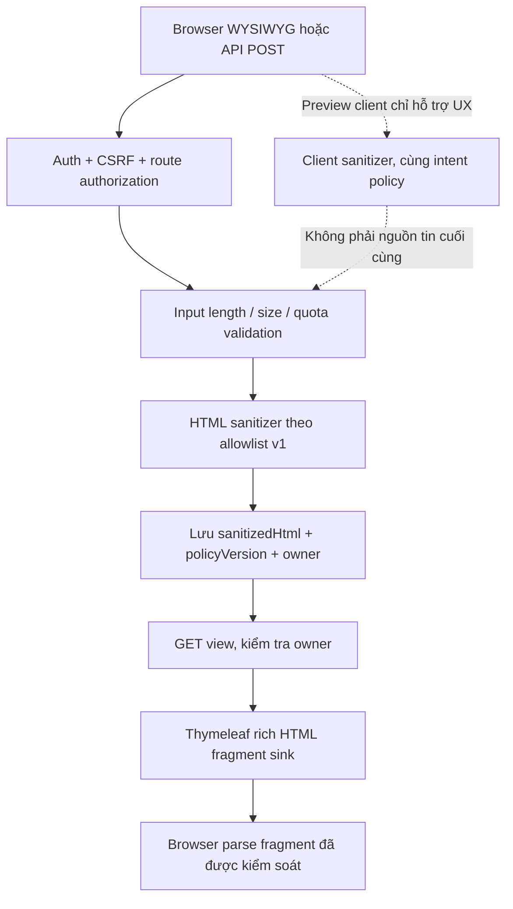
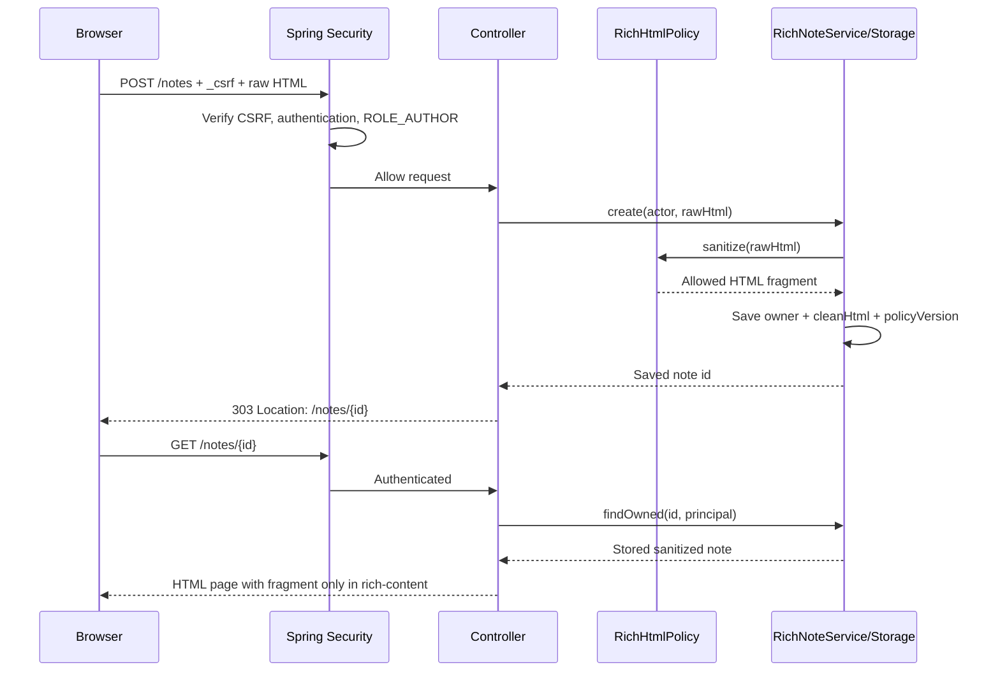

# Nội dung HTML được phép nhập và nhu cầu làm sạch dữ liệu

Trong module `SPRING_SECURITY_HTTP_PROTECTION`, Spring Security triển khai những lớp bảo vệ HTTP và trình duyệt như CSRF, CORS, security headers, Content Security Policy (CSP), HSTS, HTTP firewall và session protection. Tuy nhiên, ứng dụng vẫn có thể gặp **Cross-Site Scripting (XSS)** nếu cho người dùng soạn HTML rồi đưa nó trở lại trang như markup có thể thực thi mà không kiểm soát.

Bài thuộc chương **Ranh giới bảo vệ**, đi sâu vào bài toán **cho phép người dùng nhập một tập HTML có giới hạn**: mô tả sản phẩm, bài viết nội bộ, bình luận rich text, tài liệu hỗ trợ hoặc nội dung từ WYSIWYG editor. Khác với một trường tên hiển thị chỉ cần giữ nguyên văn bản, HTML được phép nhập là dữ liệu mà ứng dụng *cố ý* muốn trình duyệt phân tích thành các thẻ như `<p>`, `<strong>`, `<ul>` và `<a>`. Vì vậy, chỉ HTML-escape toàn bộ nội dung sẽ làm mất định dạng; nhưng render nguyên văn sẽ tạo nguy cơ XSS.

Giải pháp là thiết kế **chính sách HTML cho phép (allowlist)**, dùng **HTML sanitizer chuyên dụng** trên dữ liệu không tin cậy và chỉ render kết quả ở đúng **ngữ cảnh HTML fragment**. Spring Security hỗ trợ thêm CSP, chống giả mạo request và kiểm soát truy cập; nó **không tự chọn thẻ HTML được phép và không tự làm sạch dữ liệu nghiệp vụ của ứng dụng**.

Bài sử dụng ví dụ **Spring MVC/Servlet** và **Spring WebFlux/Reactive**, kiểm thử sanitizer, HTML đã render, CSRF/authorization và hành vi trình duyệt. Mã theo phong cách Spring Boot 3.x, Spring Security 6.x và Java 17+. Các API/library cần được kiểm tra theo phiên bản thực tế trước khi sử dụng trong sản phẩm.

## 1. Mục tiêu học tập

Sau bài, người học có thể:

- Phân biệt trường **plain text** nên encode khi xuất với trường **rich HTML** cần sanitizer.
- Tự định nghĩa một allowlist rõ ràng cho **element**, **attribute**, **URL protocol**, nguồn media và các dạng nội dung bị cấm.
- Giải thích vì sao regex, chỉ chặn `<script>` hoặc chỉ kiểm tra `javascript:` không đủ để làm sạch HTML.
- Dùng **OWASP Java HTML Sanitizer** để xử lý nội dung rich text trước khi render bằng Thymeleaf.
- Thiết kế pipeline có thể kiểm toán: input → validation/quota → sanitization → lưu trữ có provenance → render đúng ngữ cảnh.
- Biết đánh đổi giữa **lưu HTML gốc** và **lưu bản đã sanitize**, quản lý version của policy và dữ liệu cũ.
- Phân biệt **HTML fragment đã sanitize** với chuỗi an toàn cho **JavaScript, URL, CSS, HTML attribute** và file download.
- Bảo vệ các request lưu/sửa HTML bằng CSRF, authentication, owner authorization; không nhầm các lớp này với sanitization.
- Viết unit tests cho allowlist, MockMvc/Reactive tests và browser/E2E tests để xác minh nội dung bị loại không quay lại DOM.
- Chẩn đoán editor preview khác server render, double encoding, liên kết bị sửa, nội dung đã sanitize bị biến đổi và CSP xung đột.

## 2. Khi nào phải làm sạch HTML, khi nào chỉ cần output encoding?

Một form nhập **tên bài viết** không cần HTML markup:

```text
Tên bài viết: 
```

Nếu sản phẩm muốn hiển thị đúng từng ký tự, dùng template HTML escaping hoặc DOM `textContent`. Với Thymeleaf:

```html
<h1 th:text="${article.title}">Tiêu đề</h1>
```

Kết quả trình duyệt hiển thị chuỗi như văn bản, không tạo thẻ ảnh. **Không cần sanitizer HTML** chỉ để cho phép ký tự `<` trong text.

Ngược lại, người dùng của editor có thể cần:

```html
<p>Đã triển khai <strong>bản cập nhật</strong> cho nhóm.</p>
<ul>
  <li>Sửa lỗi CSRF form</li>
  <li>Kiểm tra CSP</li>
</ul>
<p>Xem <a href="https://docs.example.test/guide">hướng dẫn</a>.</p>
```

Với nội dung này, HTML-escape toàn bộ sẽ khiến người xem thấy `<p>` và `<strong>` thay vì đoạn văn có định dạng. Nhưng nhận tất cả thẻ/thuộc tính lại cho phép dữ liệu độc hại đi vào HTML parser. Đây là thời điểm cần **sanitization theo allowlist**.

| Loại trường | Kỳ vọng hiển thị | Chiến lược chính |
| --- | --- | --- |
| Tên, tiêu đề, mã sản phẩm, bình luận plain text | Giữ nguyên ý nghĩa ký tự, không có markup | Validate nghiệp vụ rồi encode ở output; `th:text` hoặc `textContent`. |
| Bài viết định dạng đơn giản | Có đoạn, chữ đậm/nghiêng, danh sách, link | Sanitize HTML theo allowlist, render trong vùng HTML fragment riêng. |
| Editor WYSIWYG đầy đủ | Có bảng, ảnh, nhúng video… | Thiết kế chính sách theo từng tính năng; pipeline media/URL riêng, không dùng “allow all”. |
| Mã HTML/JS dùng trong tài liệu kỹ thuật | Hiển thị nguyên code như ví dụ | Encode thành text hoặc dùng code renderer an toàn; không thực thi code của người dùng. |
| Template do lập trình viên deploy | Markup/code nằm trong source đã review | Giữ tách biệt khỏi user-authored HTML; không biến user input thành template source. |
| File HTML/SVG do người dùng upload | Có thể chứa nội dung active | Chính sách file type, cách phục vụ/download, isolation riêng; không đồng nhất với rich-text fragment. |

### 2.1. Một payload có thể đi qua nhiều dạng XSS

- **Stored XSS:** người A lưu rich HTML, người B mở bài viết và bị thực thi dữ liệu nguy hiểm.
- **Reflected XSS:** một query hoặc nội dung preview chưa lưu được ghép vào HTML và phản hồi ngay.
- **DOM-based XSS:** server/API trả JSON, frontend chèn string vào `innerHTML` hoặc một DOM HTML sink nguy hiểm.

Sanitize chỉ ở màn hình xem bài viết là chưa đủ nếu trang **preview, notification, email HTML, admin panel, history view** hoặc frontend React/Vue có đường render khác. Phải lập bản đồ **mọi điểm xuất nội dung** và chọn chiến lược cho từng sink.

### 2.2. XSS không chỉ là thẻ script

Một danh sách biểu hiện cần xem xét:

```html
<script>alert(1)</script>


<a href="javascript:alert(1)">Mở tài liệu</a>

<iframe srcdoc="<script>alert(1)</script>"></iframe>

<svg onload="alert(1)"></svg>

<p style="position:fixed;inset:0;z-index:9999">Che giao diện</p>
```

Đây là **chuỗi kiểm thử trong môi trường cách ly**, không phải các tính năng hợp lệ của editor ở bài này. Chúng cho thấy chỉ tìm từ khóa `script` là thiếu: event handlers, protocol, HTML namespace, iframe và CSS có thể tạo bề mặt rủi ro khác nhau.

Ngoài JavaScript execution, nội dung HTML “hợp lệ cú pháp” còn có thể **che nội dung, giả giao diện đăng nhập, chèn link lừa đảo, theo dõi người xem** hoặc gây tải tài nguyên ngoài ý muốn. Sanitizer không tự giải quyết mọi rủi ro phishing/visual spoofing; policy và UX vẫn phải kiểm soát.

## 3. Thiết kế allowlist trước khi viết sanitizer

**Allowlist là một hợp đồng nội dung**, không phải danh sách ngẫu nhiên những tag “chắc có vẻ an toàn”. Viết rõ tính năng editor được phép tạo và dữ liệu người xem thực sự cần.

Ví dụ sản phẩm nội bộ chỉ cho:

- Đoạn văn và xuống dòng: `p`, `br`.
- Nhấn mạnh: `strong`, `em`.
- Danh sách: `ul`, `ol`, `li`.
- Trích dẫn: `blockquote`.
- Liên kết: `a` có `href` với protocol **HTTPS**.
- Văn bản thông thường bên trong các thẻ trên.

**Không cho** `script`, `style`, `iframe`, `object`, `embed`, `form`, `input`, `button`, `svg`, `math`, `img`; không cho `on*` event handlers, `style`, `srcdoc`, `target` hoặc các attribute khác chưa được phê duyệt.

| Nhóm | Cho phép trong policy mẫu? | Lý do |
| --- | --- | --- |
| `p`, `br`, `strong`, `em`, `ul`, `ol`, `li`, `blockquote` | Có | Hỗ trợ định dạng tài liệu cơ bản. |
| `a[href]` | Có, HTTPS | Liên kết ra ngoài mà không cho JavaScript URL scheme. |
| `a[target]` | Không trong ví dụ | Không cần mở tab mới; giảm bề mặt navigation và chính sách `window.opener`. |
| `onclick`, `onerror`, các `on*` | Không | Thuộc tính chứa executable event code. |
| `script`, `iframe`, `srcdoc`, `object`, `embed` | Không | Có thể tạo ngữ cảnh thực thi/nhúng. |
| `style`, CSS inline | Không | Không cần cho rich text cơ bản; giảm giao diện giả, URL/resource, parser complexity. |
| `img`, `video`, `audio` | Không mặc định | Cần media pipeline, nguồn, kích thước, theo dõi và quota riêng. |
| SVG/MathML | Không mặc định | Namespace và parser behavior phức tạp hơn HTML rich text tối thiểu. |
| Form elements/inputs/buttons | Không | Không cho bài viết tạo form giả hoặc UI có hành vi nghiệp vụ. |
| `id`, `class` bất kỳ | Không mặc định | Không cho nội dung ảnh hưởng DOM selector, CSS/JS của trang host. |

### 3.1. Phải kiểm soát cả element, attribute và URL protocol

Cho phép thẻ `a` **không tự đồng nghĩa** cho mọi attribute của `a`. Ví dụ:

```html
<a href="javascript:alert(1)" onclick="doSomething()">Xem</a>
```

Policy tốt phải xử lý **hai chiều riêng**:

1. `href` có được phép hiện diện không, và giá trị URL thuộc protocol nào?
2. `onclick` có được phép không? Trong ví dụ: không.

Chỉ HTML-encode dấu quote hoặc biến `<` thành entity trong một vị trí không đúng vẫn chưa giải quyết toàn bộ URL schemes. Sanitizer phải hiểu markup và URL protocols, không chỉ replace ký tự.

### 3.2. Không bắt buộc giữ chính xác markup người dùng gửi

Sanitizer có thể chuẩn hóa thẻ, loại attribute, bỏ element bị cấm hoặc sửa HTML không hợp lệ thành fragment khác. Ví dụ input:

```html
<p>Xin chào <strong>nhóm</strong>

<a href="javascript:alert(1)">nhấn</a>
</p>
```

Sau sanitize, phần chữ và định dạng được phép có thể còn; thẻ ảnh và `href` nguy hiểm phải không tồn tại ở output. **Không dựa vào một chuỗi output “chuẩn tuyệt đối” cho mọi sanitizer/version**. Kiểm thử các **bất biến cấu trúc**: không `img`, không event handler, không link scheme nguy hiểm, các thẻ được phép vẫn hoạt động.

### 3.3. Policy càng rộng thì chi phí review càng lớn

Thêm bảng, media, inline CSS hoặc attributes tùy ý có thể là nhu cầu có thật nhưng cần review riêng:

- **Bảng:** số hàng/cột, layout/phân trang, nested structures, độ dài nội dung.
- **Ảnh:** chỉ nhận asset ID đã được upload/scan, không cho data URL hoặc tải image từ host tùy ý.
- **Link:** có cho HTTPS bên ngoài hay chỉ domain nội bộ; có gắn `rel` và cảnh báo điều hướng không?
- **CSS:** nếu buộc có, chỉ cho property/value đã xác định, tránh toàn bộ `style` tùy ý.
- **Embed:** ưu tiên component do ứng dụng dựng từ metadata đã kiểm tra, không chấp nhận raw iframe HTML.

Không mở rộng allowlist chỉ để giữ nguyên toàn bộ HTML mà editor thứ ba sinh ra. Editor có thể thêm classes/styles phục vụ giao diện soạn thảo, nhưng người xem không nhất thiết cần chúng.

## 4. Sanitization, validation và output encoding là ba nhiệm vụ khác nhau

| Cơ chế | Kiểm tra gì? | Ví dụ |
| --- | --- | --- |
| **Input validation** | Kích thước, giới hạn, loại dữ liệu, quyền soạn nội dung | Không nhận HTML dài hơn 20.000 ký tự; chỉ editor được viết bài. |
| **HTML sanitization** | Cấu trúc HTML nào được phép tồn tại trong fragment? | Giữ `p`/`strong`; loại `script`, `onerror`, `javascript:`. |
| **Contextual output encoding** | Parser đích có diễn giải biến thành mã? | Với title plain text dùng `th:text`; với attribute phải có attribute escaping. |
| **Authorization** | Ai được lưu, xem và sửa dữ liệu? | Owner hoặc ROLE_EDITOR mới được cập nhật bài viết. |
| **CSP và headers** | Browser được thực thi/tải resource nào? | `script-src 'self'`, `object-src 'none'`. |
| **File/content controls** | Upload có sạch và được phép phục vụ không? | Quét file, private storage, download isolation. |

Một **fragment đã sanitize** có thể phù hợp để render **bên trong HTML body** với rich-content sink, nhưng **không được coi là chuỗi an toàn để ghép vào JavaScript, CSS, URL, thuộc tính HTML hay SQL**. Khi ngữ cảnh thay đổi, phải chọn API và encoding của ngữ cảnh mới.

### 4.1. Vì sao không dùng regex hoặc blacklist?

HTML parser có các trường hợp phức tạp: entities, case folding, comments, malformed tags, namespaces, mutation của DOM, URL encoding, attribute parsing và browser differences.

Ví dụ thay chuỗi:

```java
// Không an toàn: đây không phải HTML sanitizer.
String cleaned = html.replace("<script>", "")
                     .replace("</script>", "");
```

Đoạn code không xử lý event handler, SVG/MathML, `javascript:` URL, inline CSS hay những cách biểu diễn khác. Ngay cả regex rất dài cũng không tương đương một parser HTML + policy engine được bảo trì.

### 4.2. Vì sao “chỉ escape khi lưu” cũng không đúng?

Nếu lưu `&lt;strong&gt;` thay cho `<strong>` thì người xem sẽ thấy thẻ như text, không còn rich formatting. Nếu đưa nó qua HTML encoder lần nữa, nội dung có thể bị **double encoded** thành `&amp;lt;strong&amp;gt;`.

Làm sạch HTML khi được phép có markup là một thao tác khác với escape plain text. Lưu trữ và rendering phải có **kiểu dữ liệu/provenance rõ** để biết trường nào là raw input, trường nào là HTML fragment đã sanitized.


## 5. Triển khai chính sách bằng OWASP Java HTML Sanitizer

**OWASP Java HTML Sanitizer** là thư viện dùng parser/policy để biến HTML không tin cậy thành fragment được phép nhúng trong nội dung trang. Thay vì nhận mọi HTML rồi tìm thứ cần xóa, ta xây **PolicyFactory** từ những gì nghiệp vụ chấp nhận.

Dependency Gradle minh họa (chọn version đã được bộ phận phụ thuộc bảo mật phê duyệt và pin trong dự án):

```groovy
dependencies {
    implementation 'org.springframework.boot:spring-boot-starter-web'
    implementation 'org.springframework.boot:spring-boot-starter-security'
    implementation 'org.springframework.boot:spring-boot-starter-thymeleaf'

    // Ví dụ một phiên bản đã công bố; theo dõi advisory và cập nhật.
    implementation 'com.googlecode.owasp-java-html-sanitizer:owasp-java-html-sanitizer:20261103.2'

    testImplementation 'org.springframework.boot:spring-boot-starter-test'
    testImplementation 'org.springframework.security:spring-security-test'
}
```

Không coi version ví dụ là cam kết mãi mãi mới nhất. Dùng dependency lock/catalog và quy trình nâng cấp library của dự án. Không tự copy nguyên config từ tài liệu cũ khi API/policy đã thay đổi.

### 5.1. Policy tối thiểu: formatting và links

OWASP cung cấp các policy đóng gói sẵn có thể kết hợp:

```java
import org.owasp.html.PolicyFactory;
import org.owasp.html.Sanitizers;

PolicyFactory policy =
        Sanitizers.FORMATTING.and(Sanitizers.LINKS);

String clean = policy.sanitize(untrustedHtml);
```

Đây là điểm khởi đầu để thử, nhưng **không có nghĩa đã đáp ứng yêu cầu nghiệp vụ của bạn**. Các policy đóng gói có thể cho nhiều thành phần/URL hơn yêu cầu của trang nội bộ. Cần kiểm tra nội dung được phép, links, thuộc tính, protocol và cách output được sử dụng.

### 5.2. Policy tùy biến giới hạn theo nhu cầu thực

Ví dụ dưới chỉ cho đoạn, chữ nhấn mạnh, danh sách, trích dẫn và **link HTTPS đến một host cố định**. Cấu hình này cố tình **không cho image, CSS, iframe hay event handlers**.

```java
import java.net.URI;
import org.owasp.html.HtmlPolicyBuilder;
import org.owasp.html.PolicyFactory;
import org.springframework.stereotype.Component;

@Component
public final class RichHtmlPolicy {

    public static final String VERSION = "rich-v1";

    private static final PolicyFactory POLICY =
            new HtmlPolicyBuilder()
                    .allowElements(
                            "p", "br", "strong", "em",
                            "ul", "ol", "li", "blockquote", "a")
                    .allowUrlProtocols("https")
                    .allowAttributes("href")
                    .matching((elementName, attributeName, value) -> {
                        // AttributePolicy: giá trị URL đã được parser cung cấp.
                        try {
                            URI url = URI.create(value);

                            boolean accepted =
                                    "https".equalsIgnoreCase(url.getScheme())
                                    && "docs.example.test".equalsIgnoreCase(
                                            url.getHost())
                                    && url.getRawUserInfo() == null
                                    && url.getPort() == -1;

                            return accepted ? url.toASCIIString() : null;
                        } catch (IllegalArgumentException ex) {
                            return null;
                        }
                    })
                    .onElements("a")
                    .requireRelNofollowOnLinks()
                    .toFactory();

    public String sanitize(String rawHtml) {
        if (rawHtml == null) {
            return "";
        }
        return POLICY.sanitize(rawHtml);
    }
}
```

**Giải thích theo từng quyết định:**

1. `allowElements(...)` đặt tập thẻ có thể còn trong output; mọi thẻ không được allow phải được sanitizer xử lý theo policy.
2. `allowAttributes("href").onElements("a")` chỉ xem xét `href` trên `a`, không mở `onclick`, `onerror`, `style` hoặc `srcdoc`.
3. `allowUrlProtocols("https")` lọc những URL có protocol không nằm trong allowlist.
4. `matching(...)` còn **bắt buộc URL tuyệt đối** dùng scheme HTTPS và host `docs.example.test`, không cho relative hoặc protocol-relative URL trong mẫu này. `URI.getHost()` được kiểm tra bằng so sánh **host đã parse**, không bằng `contains("docs.example.test")`.
5. `requireRelNofollowOnLinks()` thêm quan hệ `nofollow` vào links; nó không thay việc kiểm tra đích link.
6. `toFactory()` tạo factory để sử dụng lại. **HtmlPolicyBuilder không nên dùng làm mutable singleton được thay đổi đồng thời**, còn PolicyFactory hoàn chỉnh có thể được chia sẻ cho các request.
7. `VERSION` giúp nhận biết chính sách đã dùng khi lưu dữ liệu và khi migrate về sau.

**Chi tiết quan trọng:** `allowUrlProtocols("https")` **một mình không nhất thiết bắt buộc URL tuyệt đối**; theo API của thư viện, giá trị không ghi scheme có thể vẫn được cho qua. Đó là lý do code còn có `matching(...)` kiểm tra `getScheme()` và `getHost()`. Nếu nghiệp vụ muốn cho relative links, hãy thiết kế một policy riêng (chẳng hạn dựa trên `allowOnlyRelativeUrls()` với phiên bản hỗ trợ), kiểm thử slash/backslash và xử lý base URL rõ ràng. Không tự mở scheme `javascript`/`data` để link “hoạt động”.

### 5.3. Nếu sản phẩm cho phép link HTTPS tới mọi host

Cũng có thể chỉ yêu cầu protocol HTTPS mà không giới hạn host, nhưng phải chấp nhận rủi ro link ra ngoài hoặc phishing. Với sản phẩm dùng link ngoài:

- Gắn `rel="nofollow"` và cân nhắc `noopener noreferrer` theo hành vi mở tab.
- Không tự thêm `target="_blank"` từ dữ liệu người dùng.
- Cân nhắc trang cảnh báo khi chuyển ra ngoài, chính sách domain deny/allow theo sản phẩm.
- Kiểm tra URL normalization, userinfo, host và redirect nếu có bộ xử lý link riêng.
- Không nhầm `rel=nofollow` với cơ chế chống phishing, ngăn XSS hoặc bảo đảm origin an toàn.

### 5.4. Cho phép HTML là quyết định về thành phần và nguồn tài nguyên

Một policy chỉ cho các thẻ cơ bản sẽ khiến nội dung WYSIWYG chứa ảnh/iframe bị mất khi sanitize. Đây có thể là **hành vi đúng**: editor cần giới hạn tính năng, không buộc sanitizer chấp nhận thứ không nằm trong business contract.

Nếu có yêu cầu sản phẩm rõ về ảnh hoặc iframe, hãy bổ sung pipeline media/embedding sau khi có threat model, không chỉ gọi `allowElements("img", "iframe")` và cho mọi `src`.

## 6. Tách HTML gốc khỏi HTML đã sanitize bằng kiểu dữ liệu và provenance

Nguy cơ lớn là ứng dụng có nhiều field kiểu `String`:

```java
String rawHtml;
String sanitizedHtml;
String title;
String previewHtml;
```

Một lập trình viên dễ đưa nhầm `rawHtml` vào `th:utext` vì cùng kiểu `String`. Có thể dùng kiểu bao bọc để làm rõ **mức tin cậy**:

```java
public record SanitizedRichHtml(
        String markup,
        String policyVersion) {
}
```

Mọi object `SanitizedRichHtml` phải chỉ được tạo qua service/policy được kiểm soát. Record này **không tự tạo ra bảo đảm an toàn** nếu code bất kỳ được phép gọi `new SanitizedRichHtml(userInput, "rich-v1")`; muốn giảm sai sót hơn, dùng constructor hạn chế truy cập, factory nội bộ hoặc package/module boundaries.

### 6.1. Nguyên tắc không có “HTML an toàn cho mọi nơi”

Đầu ra `SanitizedRichHtml.markup` chỉ phù hợp với **vùng HTML fragment** đã thiết kế, ví dụ `<article class="rich-content">...`. Nó không tự phù hợp khi:

- Được nối vào `onclick` hoặc JavaScript inline.
- Được đặt trong `style` hay CSS value.
- Được nhúng làm toàn bộ URL/attribute.
- Được đưa vào JSON rồi client lại sửa chuỗi, ghép markup không an toàn hoặc render bằng custom parser.
- Được dùng làm template source cho Thymeleaf hoặc expression interpreter.

Khi cần hiển thị **mã nguồn HTML**, không render fragment; dùng `th:text` hoặc `textContent` để giữ nó dưới dạng văn bản.

### 6.2. Vị trí sanitize trong pipeline

Một luồng thông dụng:



Sanitize ở **server** là bắt buộc nếu server là nguồn dữ liệu sẽ được người khác xem. Một WYSIWYG editor có thể sanitize ở browser để preview tốt hơn, nhưng client-side sanitization có thể bị bỏ qua bởi request từ curl, API client hoặc browser extension; **không dùng nó làm cơ chế bảo mật cuối cùng**.

### 6.3. Sanitize trước khi lưu hay khi render?

| Chiến lược | Ưu điểm | Đánh đổi |
| --- | --- | --- |
| **Sanitize trước khi lưu, chỉ lưu clean HTML** | Các màn hình đọc thường dùng cùng output được kiểm soát; giảm nguy cơ raw HTML rò vào view | Mất markup bị loại; khi policy mới được mở rộng không khôi phục được phần đã xóa. |
| **Lưu raw HTML và sanitize khi render** | Có thể tái áp policy mới; giữ bản gốc cho editor có quyền | Raw nguy hiểm tồn tại lâu trong DB/log/export; cần sanitize mọi read path, cache và consumer; tăng CPU. |
| **Lưu cả raw và clean có version** | Có khả năng tái xử lý; trang xem dùng clean | Phải phân quyền chặt với raw, backup/retention, không phát raw sang preview/notification. |
| **Lưu rich-text AST/structured document** | Có thể ràng buộc schema node/attribute rõ ràng | Cần serializer HTML an toàn và kiểm soát mọi converter; AST không tự vô nhiễm với XSS. |

Bài thực hành chọn **lưu clean HTML và policy version**. Nếu cần giữ raw vì nghiệp vụ, phải coi raw như nội dung chưa tin cậy: lưu riêng, giới hạn quyền đọc, không đưa vào `th:utext`, không ghi log, và làm sạch lại mỗi khi dùng ở HTML sink.

### 6.4. Policy thay đổi là một kiểu migration dữ liệu

Khi phát hiện một lớp HTML trước kia được phép nay không còn an toàn:

1. Cập nhật/pin phiên bản sanitizer đã được bảo trì.
2. Tạo policy mới `rich-v2` với yêu cầu chặt hơn.
3. Xác định dữ liệu từng dùng policy cũ qua `policyVersion`.
4. Resanitize có kiểm soát **các bản cũ** trước khi tiếp tục serve, hoặc chặn render/áp phiên bản mới trên read path trong thời gian migration.
5. Invalidate cache/search snippets/email-rendering pipeline nếu có bản HTML đã sanitize cũ.
6. Kiểm tra layout và chức năng bị ảnh hưởng, đối chiếu output theo đúng policy mới.
7. Theo dõi số bản bị thay đổi, log **ID và số liệu** chứ không ghi HTML nhạy cảm.

Nếu chỉ lưu HTML đã được làm sạch theo policy cũ, resanitize bằng policy chặt hơn có thể loại bớt phần đã từng được phép. Nhưng khi muốn khôi phục phần markup đã bị loại trước đây, không thể tự phục hồi nếu không lưu raw có kiểm soát.

### 6.5. Không sửa markup sau khi đã sanitize

Một anti-pattern nghiêm trọng:

```java
String clean = sanitizer.sanitize(rawHtml);

// SAI: nối thêm dữ liệu không tin cậy sau điểm tin cậy.
String finalHtml = clean + request.getParameter("footerHtml");
```

Kết quả cuối **không còn bảo đảm** từ sanitizer. Tương tự, một library frontend tự sửa hoặc parse lại HTML sau sanitize có thể tạo ra cấu trúc khác với cấu trúc sanitizer đã kiểm tra (*mutation XSS*).

Giải pháp: đưa **toàn bộ fragment cuối cùng** qua sanitizer policy phù hợp ở điểm cuối, hoặc tách dữ liệu bổ sung thành **text node được escape** thay vì nối HTML string. Không dùng `StringBuilder`/`replaceAll` để thêm markup dựa vào input chưa tin cậy sau khi sanitize.


## 7. Spring MVC/Servlet: nhận, làm sạch, lưu và hiển thị rich HTML

Bây giờ xây một ví dụ **bài ghi chú có nội dung HTML**. Một user `ROLE_AUTHOR` tạo ghi chú, dữ liệu được sanitize trên server rồi lưu với owner và policy version. GET xem bài kiểm tra owner, sau đó render fragment đã được sanitizer tạo.

Đây là một hệ thống **minh họa trong bộ nhớ**, không phải sản phẩm hoàn chỉnh. Các lớp Java dưới đây được hiểu là nằm trong các file/class riêng thuộc cùng ứng dụng.

### 7.1. SecurityFilterChain bảo vệ HTTP boundary

```java
import org.springframework.context.annotation.Bean;
import org.springframework.context.annotation.Configuration;
import org.springframework.http.HttpMethod;
import org.springframework.security.config.Customizer;
import org.springframework.security.config.annotation.web.builders.HttpSecurity;
import org.springframework.security.web.SecurityFilterChain;

@Configuration
public class RichNoteSecurityConfig {

    @Bean
    SecurityFilterChain securityFilterChain(HttpSecurity http)
            throws Exception {
        return http
                .authorizeHttpRequests(auth -> auth
                        .requestMatchers(HttpMethod.GET,
                                "/notes/new", "/notes/*")
                            .authenticated()
                        .requestMatchers(HttpMethod.POST, "/notes")
                            .hasRole("AUTHOR")
                        .anyRequest().denyAll())
                .formLogin(login -> login.permitAll())
                .csrf(Customizer.withDefaults())
                .headers(headers -> headers
                        .contentSecurityPolicy(csp -> csp
                                .policyDirectives(
                                        "default-src 'self'; "
                                      + "script-src 'self'; "
                                      + "object-src 'none'; "
                                      + "base-uri 'self'; "
                                      + "frame-ancestors 'none'; "
                                      + "form-action 'self'; "
                                      + "img-src 'none'")))
                .build();
    }
}
```

Trong ví dụ:

- POST `/notes` yêu cầu **CSRF token và ROLE_AUTHOR**, không có nghĩa HTML đầu vào đã được làm sạch.
- GET `/notes/{id}` yêu cầu authenticated, nhưng chưa biết record thuộc ai; service phải kiểm tra owner.
- CSP không cho phép các nguồn script/nhúng ngoài policy; đây là **lớp bổ sung**, không phải lý do bỏ sanitizer.
- `img-src 'none'` phù hợp với trang mẫu không cần ảnh. Nếu layout thực tế có logo, phải điều chỉnh policy trong phạm vi được phép.

Không tạo thêm catch-all `SecurityFilterChain` chỉ để bổ sung CSP khi ứng dụng đã có chain; tích hợp cấu hình vào chain đang chịu trách nhiệm cho các URL tương ứng.

### 7.2. Service thực hiện validation và sanitization

```java
import java.util.Map;
import java.util.concurrent.ConcurrentHashMap;
import java.util.concurrent.atomic.AtomicLong;
import org.springframework.http.HttpStatus;
import org.springframework.stereotype.Service;
import org.springframework.web.server.ResponseStatusException;

@Service
public class RichNoteService {

    public record Note(
            long id,
            String ownerUsername,
            String sanitizedHtml,
            String policyVersion) {}

    private final AtomicLong nextId = new AtomicLong(1);
    private final Map<Long, Note> notes = new ConcurrentHashMap<>();
    private final RichHtmlPolicy htmlPolicy;

    public RichNoteService(RichHtmlPolicy htmlPolicy) {
        this.htmlPolicy = htmlPolicy;
    }

    public Note create(String ownerUsername, String rawHtml) {
        if (rawHtml == null || rawHtml.isBlank()
                || rawHtml.length() > 20_000) {
            throw new ResponseStatusException(
                    HttpStatus.BAD_REQUEST,
                    "Nội dung rỗng hoặc vượt giới hạn");
        }

        String cleaned = htmlPolicy.sanitize(rawHtml);
        if (cleaned.isBlank()) {
            throw new ResponseStatusException(
                    HttpStatus.UNPROCESSABLE_ENTITY,
                    "Không có nội dung được phép");
        }

        Note note = new Note(
                nextId.getAndIncrement(),
                ownerUsername,
                cleaned,
                RichHtmlPolicy.VERSION
        );

        notes.put(note.id(), note);
        return note;
    }

    public Note findOwned(long id, String username) {
        Note note = notes.get(id);
        if (note == null ||
                !note.ownerUsername().equals(username)) {
            throw new ResponseStatusException(
                    HttpStatus.NOT_FOUND, "Không tìm thấy ghi chú");
        }
        return note;
    }

    public int size() {
        return notes.size();
    }
}
```

Ở đây `cleaned.isBlank()` chỉ là **điều kiện tối thiểu để minh họa**. Trong ứng dụng thực, HTML như `<p><br></p>` có thể không chứa text hữu ích dù chuỗi không rỗng; cần kiểm tra độ dài **visible text** qua HTML parser đáng tin nếu nghiệp vụ yêu cầu. Ngoài ra, phải giới hạn **kích thước body ở ingress/container** và giới hạn CPU/thời gian xử lý sanitizer: điều kiện `rawHtml.length() <= 20_000` không tự bảo vệ khỏi request body khổng lồ đã bị buffer trước khi đến method này.

Khi xây nghiệp vụ chỉnh sửa, phải kiểm tra owner **ở cùng transaction với update** để tránh thay nhầm tài liệu sau race condition. Ví dụ in-memory không giải quyết concurrency nhiều node, database constraint hay optimistic locking.

### 7.3. Controller không render raw HTML

```java
import java.net.URI;
import org.springframework.http.HttpStatus;
import org.springframework.http.ResponseEntity;
import org.springframework.security.core.Authentication;
import org.springframework.stereotype.Controller;
import org.springframework.ui.Model;
import org.springframework.web.bind.annotation.GetMapping;
import org.springframework.web.bind.annotation.PathVariable;
import org.springframework.web.bind.annotation.PostMapping;
import org.springframework.web.bind.annotation.RequestParam;

@Controller
public class RichNoteController {

    private final RichNoteService service;

    public RichNoteController(RichNoteService service) {
        this.service = service;
    }

    @GetMapping("/notes/new")
    String newNote() {
        return "notes/new";
    }

    @PostMapping("/notes")
    ResponseEntity<Void> create(@RequestParam("html") String rawHtml,
                                Authentication authentication) {
        var note = service.create(
                authentication.getName(), rawHtml);

        return ResponseEntity.status(HttpStatus.SEE_OTHER)
                .location(URI.create("/notes/" + note.id()))
                .build();
    }

    @GetMapping("/notes/{id}")
    String view(@PathVariable long id,
                Authentication authentication,
                Model model) {
        model.addAttribute("note", service.findOwned(
                id, authentication.getName()));
        return "notes/view";
    }
}
```

Controller luôn gọi `service.create(...)` để sanitize; không có đường ghi tắt “để admin có thể upload raw HTML”. GET không sinh HTML từ raw field nào khác.

### 7.4. Form Thymeleaf nhập rich HTML

Ví dụ `templates/notes/new.html`:

```html
<!doctype html>
<html lang="vi" xmlns:th="http://www.thymeleaf.org">
<head>
    <meta charset="utf-8">
    <title>Tạo ghi chú rich text</title>
</head>
<body>
    <h1>Tạo ghi chú</h1>

    <form method="post" th:action="@{/notes}">
        <label for="html">Nội dung HTML giới hạn</label>
        <textarea id="html" name="html"
                  rows="12" maxlength="20000" required></textarea>
        <button type="submit">Lưu ghi chú</button>
    </form>
</body>
</html>
```

Thymeleaf + Spring Security tích hợp đúng sẽ chèn hidden CSRF input cho form POST có `th:action`; phải **kiểm tra HTML render thực tế**. `maxlength` là hỗ trợ UX, không thay server validation.

Ở sản phẩm thật, một WYSIWYG editor sẽ tạo HTML từ toolbar; editor chỉ nên cung cấp các tính năng trùng với allowlist server. Nếu editor có thể tạo iframe/image/CSS nhưng server loại bỏ, người dùng sẽ thấy preview khác bản đã lưu.

### 7.5. Render fragment đã được kiểm soát

Ví dụ `templates/notes/view.html`:

```html
<!doctype html>
<html lang="vi" xmlns:th="http://www.thymeleaf.org">
<head>
    <meta charset="utf-8">
    <title>Xem ghi chú</title>
</head>
<body>
    <h1>Ghi chú đã lưu</h1>

    <!-- Owner được render như text thông thường. -->
    <p>Người tạo:
        <span th:text="${note.ownerUsername()}"></span>
    </p>

    <!-- Chủ đích duy nhất của th:utext trong ví dụ:
         dữ liệu đã được service sanitizer làm sạch,
         lưu kèm policyVersion và chỉ dùng ở HTML fragment sink. -->
    <article class="rich-content"
             th:utext="${note.sanitizedHtml()}"></article>
</body>
</html>
```

**`th:utext` không tự an toàn**. Nó chỉ được chấp nhận trong ví dụ vì ứng dụng đảm bảo `note.sanitizedHtml()` luôn do policy server tạo ra, không nhận raw HTML trực tiếp từ request hoặc database field chưa phân loại. Đặt `th:utext="${request.html}"` là lỗi nghiêm trọng.

**Không áp `th:text` lên `sanitizedHtml` nếu muốn giữ rich formatting**; làm vậy sẽ hiển thị nguyên thẻ `<p>`/`<strong>` như văn bản. Đối với trường plain text khác (title, owner, tags), vẫn dùng `th:text`.

### 7.6. Chuỗi đường đi điển hình



Mọi bước có trách nhiệm riêng: CSRF/role ở security, validation/sanitization/ownership ở service, output context ở template, CSP ở browser. Nếu thiếu một trong các bước đó, các bước còn lại không tự lấp lỗ hổng.

## 8. Quy tắc riêng cho liên kết, ảnh, iframe, CSS và file

### 8.1. Liên kết không chỉ là chuyện XSS

Một link HTTPS không chứa JavaScript vẫn có thể dẫn tới trang giả hoặc theo dõi người dùng. Vì vậy xác định rõ:

- Host có phải domain của tổ chức không?
- Có cho link tương đối hoặc protocol-relative URLs không?
- Có cho fragment/query không, và xử lý redirect ở đích thế nào?
- Có cần `rel="nofollow"`, `noopener`, `noreferrer` hoặc trang cảnh báo chuyển origin không?
- Có cần cấm userinfo/port hoặc host có tên giống domain nội bộ không?

**URL allowlist của sanitizer** giải quyết một phần, không bảo đảm URL đó là đích đáng tin trong mọi chính sách. Ví dụ ở mục 5 cố ý chỉ cho `docs.example.test` để dễ kiểm toán.

### 8.2. Ảnh cần pipeline media riêng

Nếu người dùng thật sự cần chèn ảnh:

1. Upload file đến endpoint riêng với CSRF, authentication, owner authorization và giới hạn kích thước.
2. Kiểm tra extension/MIME/signature, malware theo threat model, pixel dimensions/metadata và format.
3. Lưu trong private storage hoặc vùng được tách khỏi origin chứa logic ứng dụng; tránh serve HTML/SVG active không kiểm soát.
4. Trả asset ID do server sinh, không nhận đường dẫn filesystem hoặc URL tùy ý.
5. Khi render, ứng dụng tạo thẻ `img` bằng template/component với `src` từ asset ID đáng tin và attributes allowlist.
6. Thiết lập CSP `img-src` phù hợp và kiểm tra tracking/privacy.

Không nên chỉ cho `img[src]` với URL tùy ý vì hình ảnh có thể làm lộ request metadata, tải nội dung qua bên thứ ba hoặc vượt quota, ngoài rủi ro về active formats. `data:` URLs có quy tắc và tác động riêng; không bật chỉ để giữ pasted images của editor.

### 8.3. Iframe/embeds không phải HTML rich text cơ bản

Một `iframe` có thể nhúng toàn bộ website bên ngoài. Nếu nghiệp vụ thực sự yêu cầu video embed, ưu tiên **mô hình dữ liệu có cấu trúc**:

```json
{
  "type": "videoEmbed",
  "provider": "approved-provider",
  "videoId": "12345"
}
```

Server/renderer ánh xạ `provider` đã allowlist thành URL embed và thuộc tính `sandbox`, `allow`, `referrerpolicy` theo chính sách. **Không nhận nguyên `<iframe ...>` do người dùng copy từ bất kỳ site nào** và coi nó an toàn chỉ vì HTML sanitizer được mở cho iframe.

### 8.4. CSS, SVG và MathML cần review riêng

Inline CSS có thể che UI, kích hoạt tải resource hoặc gây xung đột với layout. SVG/MathML có namespaces và browser parsing đặc biệt. Nếu không có nhu cầu sản phẩm, **loại khỏi policy**. Nếu thực sự cần chúng, phải có sanitizer/parser hỗ trợ đúng loại nội dung và tests chuyên biệt; không mở bằng regex hoặc một cấu hình HTML general-purpose chưa được đánh giá.

### 8.5. Rich HTML không phải template source

Nếu người dùng nhập:

```html
<p th:utext="${secret}">Nội dung</p>
```

đây chỉ là dữ liệu rich HTML cần sanitizer, **không được đưa lại vào Thymeleaf template engine** như nguồn template để thực thi các expression. Sanitizer phải bỏ các attributes không được phép. Không có bước nào được phép dùng `TemplateEngine.process(rawUserHtml, ...)` với nội dung từ người dùng như một template tin cậy.

## 9. Editor preview phải phản ánh policy server

Một lỗi UX phổ biến:

```text
Editor frontend:
  cho image, inline style, color, iframe
         ↓
Preview frontend:
  render raw HTML với innerHTML
         ↓
Server sanitizer:
  chỉ giữ p/strong/em/list/a
         ↓
Sau lưu:
  ảnh, màu sắc và iframe bị xóa
```

Luồng này có hai vấn đề: **preview có thể tạo XSS ngay trước khi lưu**, và **người dùng thấy kết quả đã lưu khác preview**.

### 9.1. Hai cách thiết kế preview

**Cách A — preview từ kết quả server sanitizer.** Client POST nội dung tới `/notes/preview` (unsafe method, vẫn cần CSRF nếu dùng cookie session), server trả fragment sanitized hoặc một preview page có chứa fragment từ policy. Không lưu dữ liệu, nhưng phải giới hạn size/rate để tránh làm sanitizer thành điểm DoS.

**Cách B — client sanitize để UX nhanh, server sanitize lại khi lưu.** Browser dùng sanitizer đáng tin cậy như DOMPurify được pin version và policy được giữ nhất quán với server. Tuy nhiên **client policy không thay server policy**, và dữ liệu sau sanitizer không được biến đổi bởi library khác để rồi thành HTML chưa được kiểm soát.

Với cách nào, **chính server xác định bản HTML chấp nhận sau cùng**. UI có thể hiển thị thông báo những thành phần đã bị loại, ví dụ “Ảnh nhúng không được hỗ trợ”, thay vì âm thầm chấp nhận và xóa không giải thích.

### 9.2. CSP và Trusted Types giúp hạn chế HTML sinks

CSP ở trang rich text có thể dùng các directive như:

```text
default-src 'self';
script-src 'self';
object-src 'none';
base-uri 'self';
frame-ancestors 'none';
form-action 'self';
img-src 'none'
```

Đây là **policy minh họa** phù hợp với trang mẫu. Spring Security cho phép thêm CSP header qua `HttpSecurity.headers(...)` hoặc DSL tương ứng trong WebFlux. CSP không phải sanitizer; một chính sách lỏng hoặc gadget có sẵn trong script vẫn có thể tạo hậu quả.

Trên browser có **Trusted Types**, `require-trusted-types-for 'script'` có thể khiến một số DOM HTML sinks từ chối plain strings trừ khi dữ liệu đi qua Trusted Types policy. Nhưng Trusted Types **không tự sanitize**: policy quá rộng hoặc implementation không dùng sanitizer đúng sẽ mất tác dụng. Cần kiểm tra browser support và editor compatibility trước khi bật enforcement.

### 9.3. Tránh double sanitize với chính sách khác nhau mà không chủ đích

Nếu client cho `<h3>` nhưng server chỉ cho `<p>`, preview và kết quả sẽ lệch. Nếu server sanitize rồi frontend lại dùng một policy khác, markup có thể bị xóa thêm hoặc được cấu trúc lại.

Làm rõ **điểm quyết định cuối cùng** và version policy; dùng golden fixtures để so sánh hành vi cả hai bên. Không cố buộc hai sanitizer tạo **chuỗi HTML giống byte-for-byte**: hãy so sánh DOM/những bất biến mà sản phẩm yêu cầu.


## 10. Unit tests cho policy: kiểm tra DOM invariant, không chỉ chuỗi

Sanitizer là một phần của trust boundary, vì vậy phải có **unit tests trực tiếp**. Dùng HTML parser cho test giúp xác minh cấu trúc sau sanitize thay vì mong output có spacing/quote giống hệt input.

Có thể thêm jsoup trong test scope:

```groovy
testImplementation 'org.jsoup:jsoup:1.24.1'
```

Đây là dependency **cho test DOM** trong ví dụ; code production ở mục 5 dùng OWASP Java HTML Sanitizer. Nếu dự án quyết định dùng jsoup Cleaner làm sanitizer production, phải review/pin `Safelist` và test riêng, không coi parser thông thường là sanitizer mặc định.

### 10.1. Kiểm thử giữ định dạng được phép

```java
import static org.junit.jupiter.api.Assertions.*;

import org.jsoup.Jsoup;
import org.jsoup.nodes.Document;
import org.junit.jupiter.api.Test;

class RichHtmlPolicyTests {

    private final RichHtmlPolicy policy = new RichHtmlPolicy();

    @Test
    void keepsFormattingThatTheProductAllows() {
        String input =
                "<p>Xin chào <strong>nhóm</strong></p>"
              + "<ul><li>Mục A</li><li>Mục B</li></ul>";

        String output = policy.sanitize(input);
        Document doc = Jsoup.parseBodyFragment(output);

        assertEquals(1, doc.select("strong").size());
        assertEquals(2, doc.select("ul > li").size());
        assertEquals("Xin chào nhóm Mục A Mục B",
                doc.body().text());
    }

    @Test
    void stripsForbiddenTagsAttributesAndEvents() {
        String input =
                "<p>Hi <strong>đậm</strong>"
              + ""
              + "<script>alert(1)</script>"
              + "<svg onload=alert(1)></svg>"
              + "<a href='javascript:alert(1)' "
              + "onclick='alert(1)'>liên kết</a></p>";

        String output = policy.sanitize(input);
        Document doc = Jsoup.parseBodyFragment(output);

        assertEquals(1, doc.select("strong").size());
        assertTrue(doc.select(
                "img,script,svg,iframe,object,style,form").isEmpty());
        assertTrue(doc.select(
                "[onload],[onerror],[onclick],[style],[srcdoc]")
                .isEmpty());
        assertTrue(doc.select("a[href^=javascript:]").isEmpty());
    }

    @Test
    void allowsOnlyTheExpectedAbsoluteHttpsHost() {
        String input =
                "<p><a href='https://docs.example.test/guide'>ok</a>"
              + "<a href='https://docs.example.test.evil/'>bad</a>"
              + "<a href='//docs.example.test/guide'>relative-host</a>"
              + "<a href='/local'>relative-path</a>"
              + "<a href='http://docs.example.test/'>http</a>"
              + "</p>";

        String output = policy.sanitize(input);
        Document doc = Jsoup.parseBodyFragment(output);

        var allowedLinks = doc.select("a[href]");
        assertEquals(1, allowedLinks.size());
        assertEquals("https://docs.example.test/guide",
                allowedLinks.first().attr("href"));
    }
}
```

**Tránh assert quá chặt chuỗi output** như `"<a href=...>"` nếu mục tiêu là an toàn; sanitizer có thể chuẩn hóa attribute order, quote, whitespace hoặc bỏ tag rỗng theo version. Cần assert những điều policy phải giữ và phải loại.

### 10.2. Bảng ca kiểm thử cần có

| Nhóm test | Input điển hình | Bất biến mong đợi |
| --- | --- | --- |
| Formatting | `p`, `strong`, `em`, `ul/li` | Thẻ được allow tồn tại, text vẫn đọc được. |
| Script/event | `script`, `onerror`, `onclick` | Không còn executable tag/attribute. |
| Link scheme | `javascript:`, `data:`, `http:`, `https:` | Chỉ link được policy xác minh có `href`. |
| Host spoofing | `docs.example.test.evil`, URL có userinfo | Không được link tới host ngoài allowlist. |
| Relative URL | `/path`, `//host/path`, dấu slash/backslash hỗn hợp | Kết quả theo policy xác định; ví dụ này không cho. |
| Iframe/embed | `iframe`, `srcdoc`, `object` | Không tồn tại trong fragment. |
| SVG/MathML | Namespace markup, event attributes | Không tồn tại như markup active. |
| CSS | `style`, `style=...` | Không còn CSS tùy ý. |
| Malformed HTML | Tag thiếu đóng, nested lạ, entities | Parser output vẫn chỉ gồm thẻ/attr cho phép. |
| Độ dài cực đại | Gần và vượt giới hạn 20.000 | Server chấp nhận/từ chối theo quota, không làm cạn CPU/RAM. |
| Unicode/entity | Dấu nháy, `&amp;`, ký tự đa ngôn ngữ | Văn bản giữ ý nghĩa, không biến thành code. |
| Idempotent re-sanitization | Sanitize lại output của v1 | Không mở rộng nội dung bị cấm, không tạo cấu trúc nguy hiểm mới. |
| Policy upgrade | v1 và v2 trên cùng fixture | Ghi rõ khác biệt được chủ đích chấp nhận. |

Không có sanitizer nào được chứng minh an toàn bằng một payload đơn lẻ. Dùng một tập fixtures đa dạng và thường xuyên nâng cấp dependency khi thư viện/browser có thay đổi.

### 10.3. Resanitize sau khi đổi policy

Khi `rich-v2` chặt hơn `rich-v1`, test migration nên có các cases:

- Fragment v1 chỉ dùng markup còn hợp lệ ở v2 → kết quả vẫn đọc được.
- Fragment v1 chứa attribute vừa bị cấm → v2 loại bỏ.
- Nội dung đã sanitize có link được redirect/transform ở tầng khác → sau thay đổi, policy vẫn đạt invariant.
- Cache chưa invalidate → không phục vụ output cũ vượt policy.
- HTML có thể bị double encode → tránh tự biến HTML fragment thành plain text ngoài ý muốn.

Test được viết theo **quy tắc và DOM behavior**, không phải so sánh byte-for-byte giữa hai version sanitizer.

## 11. MockMvc: kiểm tra CSRF, owner và HTML đã được render

Đoạn code ở mục 7 dùng `RichNoteService` trong RAM. Test dưới mô phỏng một user ROLE_AUTHOR gửi raw HTML và xác minh **GET trang xem chỉ chứa DOM đã kiểm soát**.

### 11.1. Tạo note chứa input nguy hiểm, xem output đã sanitize

```java
import static org.junit.jupiter.api.Assertions.*;
import static org.springframework.security.test.web.servlet.request
        .SecurityMockMvcRequestPostProcessors.csrf;
import static org.springframework.security.test.web.servlet.request
        .SecurityMockMvcRequestPostProcessors.user;
import static org.springframework.test.web.servlet.request.MockMvcRequestBuilders.get;
import static org.springframework.test.web.servlet.request.MockMvcRequestBuilders.post;
import static org.springframework.test.web.servlet.result.MockMvcResultMatchers.*;

import org.jsoup.Jsoup;
import org.junit.jupiter.api.Test;
import org.springframework.beans.factory.annotation.Autowired;
import org.springframework.boot.test.autoconfigure.web.servlet.AutoConfigureMockMvc;
import org.springframework.boot.test.context.SpringBootTest;
import org.springframework.test.web.servlet.MockMvc;

@SpringBootTest
@AutoConfigureMockMvc
class RichNoteBoundaryTests {

    @Autowired MockMvc mvc;
    @Autowired RichNoteService service;

    @Test
    void validPostStoresSanitizedMarkupOnly() throws Exception {
        String dirty =
                "<p>Hi <strong>nhóm</strong>"
              + ""
              + "<a href='javascript:alert(1)'>bad</a></p>";

        var saved = mvc.perform(post("/notes")
                        .with(user("alice").roles("AUTHOR"))
                        .with(csrf())
                        .param("html", dirty))
                .andExpect(status().isSeeOther())
                .andReturn();

        String location = saved.getResponse().getHeader("Location");
        assertNotNull(location);

        var viewed = mvc.perform(get(location)
                        .with(user("alice").roles("AUTHOR")))
                .andExpect(status().isOk())
                .andExpect(header().exists("Content-Security-Policy"))
                .andReturn();

        var page = Jsoup.parse(
                viewed.getResponse().getContentAsString());
        var rich = page.selectFirst("article.rich-content");

        assertNotNull(rich);
        assertEquals(1, rich.select("strong").size());
        assertTrue(rich.select("img,script,svg,iframe").isEmpty());
        assertTrue(rich.select("[onerror],[onclick],[style]")
                .isEmpty());
        assertTrue(rich.select("a[href^=javascript:]").isEmpty());
    }

    @Test
    void missingCsrfCannotCreate() throws Exception {
        int before = service.size();

        mvc.perform(post("/notes")
                        .with(user("alice").roles("AUTHOR"))
                        .param("html", "<p>Xin chào</p>"))
                .andExpect(status().isForbidden());

        assertEquals(before, service.size());
    }

    @Test
    void correctCsrfDoesNotGrantMissingRole() throws Exception {
        int before = service.size();

        mvc.perform(post("/notes")
                        .with(user("viewer").roles("VIEWER"))
                        .with(csrf())
                        .param("html", "<p>Xin chào</p>"))
                .andExpect(status().isForbidden());

        assertEquals(before, service.size());
    }

    @Test
    void contentOverLimitIsRejected() throws Exception {
        int before = service.size();

        mvc.perform(post("/notes")
                        .with(user("alice").roles("AUTHOR"))
                        .with(csrf())
                        .param("html", "A".repeat(20_001)))
                .andExpect(status().isBadRequest());

        assertEquals(before, service.size());
    }

    @Test
    void ownerCannotBeBypassedWithAnId() throws Exception {
        var saved = mvc.perform(post("/notes")
                        .with(user("alice").roles("AUTHOR"))
                        .with(csrf())
                        .param("html", "<p>Chỉ của Alice</p>"))
                .andExpect(status().isSeeOther())
                .andReturn();

        String location = saved.getResponse().getHeader("Location");
        assertNotNull(location);

        mvc.perform(get(location)
                        .with(user("bob").roles("AUTHOR")))
                .andExpect(status().isNotFound());
    }
}
```

Các test phân biệt:

- **CSRF:** thiếu token từ chối trước controller, không ghi.
- **URL authorization:** token đúng nhưng role thiếu vẫn từ chối.
- **Business authorization:** user authenticated không đồng nghĩa được xem note có ID người khác.
- **Sanitization:** request được phép lưu có thể chứa HTML chưa tin cậy, nhưng phần HTML cuối phải tuân allowlist.
- **CSP:** header có mặt theo security chain mẫu, nhưng đây **chưa phải test browser enforcement**.

Test ở trên dùng in-memory store singleton; trong test suite thực nên cô lập dữ liệu giữa tests và tránh race khi chạy song song, đặc biệt khi kiểm tra `service.size()`. Không dùng giá trị đếm ở các test song song làm bằng chứng xác định mà không có fixture isolation.

### 11.2. Không nhầm `csrf()` với kiểm thử hidden input trên form

`.with(csrf())` trong MockMvc cung cấp token cho request test; nó không chứng minh form template `notes/new.html` đã render `_csrf`.

Bổ sung test GET:

```java
import static org.hamcrest.Matchers.containsString;

@Test
void createFormRendersCsrfHiddenInput() throws Exception {
    mvc.perform(get("/notes/new")
                    .with(user("alice").roles("AUTHOR")))
            .andExpect(status().isOk())
            .andExpect(content().string(
                    containsString("name=\"_csrf\"")));
}
```

Method này có thể đặt vào class test ở trên. Khi có nhiều form POST (save, delete, logout), kiểm tra token trong **từng form**, không chỉ việc page có một chuỗi `_csrf` đâu đó.

### 11.3. Hạn chế của kiểm thử MVC

MockMvc không thực thi JavaScript và không áp dụng CSP như browser. Nó cũng không chứng minh rich text từ các kênh khác (email, mobile app, PDF, export) đã được xử lý an toàn.

Cần thêm:

- Test browser trên trang xem thực và trên WYSIWYG preview.
- Test URL link, tab opening và redirect behavior.
- Test CSP trên HTML response qua proxy/HTTPS thực.
- Test các đường rich HTML render khác: search result, history, email template, notification.
- Test upload media và chính sách file nếu đã mở chức năng ảnh.

## 12. WebFlux/Reactive: dùng cùng policy, khác cách xử lý request

Trên WebFlux, Spring Security sử dụng `SecurityWebFilterChain`, `CsrfWebFilter` và security context Reactive. **HTML sanitizer vẫn thuộc application service**, không phải tính năng tự động của `SecurityWebFilterChain`.

Một API WebFlux thường trả JSON với một trường `sanitizedHtml`. Trường ấy là **dữ liệu JSON**, không tự được browser diễn giải như HTML. Khi frontend đưa nó vào DOM, vẫn phải bảo đảm đây là output của policy server, được sử dụng đúng HTML fragment sink, không bị nối thêm dữ liệu raw.

### 12.1. Reactive security chain cho JSON API dùng cookie session

```java
import org.springframework.context.annotation.Bean;
import org.springframework.context.annotation.Configuration;
import org.springframework.http.HttpMethod;
import org.springframework.security.config.Customizer;
import org.springframework.security.config.web.server.ServerHttpSecurity;
import org.springframework.security.web.server.SecurityWebFilterChain;

@Configuration
public class ReactiveRichNoteSecurityConfig {

    @Bean
    SecurityWebFilterChain securityWebFilterChain(ServerHttpSecurity http) {
        return http
                .authorizeExchange(auth -> auth
                        .pathMatchers(HttpMethod.POST, "/api/notes")
                            .hasRole("AUTHOR")
                        .pathMatchers(HttpMethod.GET, "/api/notes/*")
                            .authenticated()
                        .anyExchange().denyAll())
                .formLogin(Customizer.withDefaults())
                .csrf(Customizer.withDefaults())
                .build();
    }
}
```

Đây là cấu hình **cho ứng dụng WebFlux riêng**, không kết hợp đồng thời với `HttpSecurity` Servlet vào một ví dụ chạy chung.

Vì API dùng session cookie/form login, POST vẫn chịu CSRF mặc định. Nếu ứng dụng production dùng auth hoàn toàn bearer không tự gửi qua browser, phải phân tích CSRF threat model theo credentials thực tế, không suy từ việc URL có chữ `api`.

### 12.2. Service Reactive giữ sanitize trong Publisher

```java
import java.util.Map;
import java.util.concurrent.ConcurrentHashMap;
import java.util.concurrent.atomic.AtomicLong;
import org.springframework.http.HttpStatus;
import org.springframework.stereotype.Service;
import org.springframework.web.server.ResponseStatusException;
import reactor.core.publisher.Mono;

@Service
public class ReactiveRichNoteService {

    public record Note(
            long id, String ownerUsername,
            String sanitizedHtml, String policyVersion) {}

    private final AtomicLong ids = new AtomicLong(1);
    private final Map<Long, Note> notes = new ConcurrentHashMap<>();
    private final RichHtmlPolicy policy;

    public ReactiveRichNoteService(RichHtmlPolicy policy) {
        this.policy = policy;
    }

    public Mono<Note> create(String owner, String rawHtml) {
        return Mono.fromSupplier(() -> {
            if (rawHtml == null || rawHtml.isBlank()
                    || rawHtml.length() > 20_000) {
                throw new ResponseStatusException(
                        HttpStatus.BAD_REQUEST, "HTML không hợp lệ");
            }

            String clean = policy.sanitize(rawHtml);
            if (clean.isBlank()) {
                throw new ResponseStatusException(
                        HttpStatus.UNPROCESSABLE_ENTITY,
                        "Không có nội dung được phép");
            }

            Note saved = new Note(
                    ids.getAndIncrement(), owner,
                    clean, RichHtmlPolicy.VERSION);

            notes.put(saved.id(), saved);
            return saved;
        });
    }

    public Mono<Note> findOwned(long id, String owner) {
        return Mono.defer(() -> {
            Note note = notes.get(id);

            if (note == null ||
                    !note.ownerUsername().equals(owner)) {
                return Mono.error(new ResponseStatusException(
                        HttpStatus.NOT_FOUND,
                        "Không tìm thấy ghi chú"));
            }
            return Mono.just(note);
        });
    }

    public int size() {
        return notes.size();
    }
}
```

Dùng `Mono.fromSupplier` / `Mono.defer` giữ tác vụ trong chuỗi Reactive khi được subscribe. Demo chỉ dùng map trong RAM và sanitizer có giới hạn đầu vào nhỏ; không thực hiện blocking database/file I/O.

Sanitization là công việc **CPU-bound**; với HTML lớn hoặc nhiều request, cần size/rate/concurrency budgets và đo latency. Không mặc định một bộ xử lý HTML nặng là “non-blocking” chỉ vì nó nằm trong `Mono`; khi cần, quản lý scheduler và backpressure phù hợp.

### 12.3. Reactive controller cho POST và GET

```java
import java.security.Principal;
import org.springframework.http.HttpStatus;
import org.springframework.http.MediaType;
import org.springframework.http.ResponseEntity;
import org.springframework.web.bind.annotation.*;
import reactor.core.publisher.Mono;

@RestController
@RequestMapping("/api/notes")
public class ReactiveRichNoteController {

    public record CreateNote(String html) {}
    public record NoteCreated(long id, String policyVersion) {}
    public record NoteView(
            long id, String sanitizedHtml, String policyVersion) {}

    private final ReactiveRichNoteService service;

    public ReactiveRichNoteController(
            ReactiveRichNoteService service) {
        this.service = service;
    }

    @PostMapping(consumes = MediaType.APPLICATION_JSON_VALUE)
    Mono<ResponseEntity<NoteCreated>> create(
            @RequestBody Mono<CreateNote> body,
            Mono<Principal> principal) {

        return Mono.zip(principal, body)
                .flatMap(tuple -> service.create(
                        tuple.getT1().getName(),
                        tuple.getT2().html()))
                .map(note -> ResponseEntity
                        .status(HttpStatus.CREATED)
                        .body(new NoteCreated(
                                note.id(), note.policyVersion())));
    }

    @GetMapping("/{id}")
    Mono<NoteView> view(@PathVariable long id,
                        Mono<Principal> principal) {
        return principal.flatMap(actor -> service.findOwned(
                        id, actor.getName()))
                .map(note -> new NoteView(
                        note.id(),
                        note.sanitizedHtml(),
                        note.policyVersion()));
    }
}
```

GET JSON ở đây trả **sanitized fragment**, không trả raw input. Nhưng frontend **không được coi mọi trường JSON tên `sanitizedHtml` đều đáng tin**; phải biết API nào cung cấp, policy nào áp dụng và có bước client transformations nào làm mất bảo đảm không.

Nếu frontend của một origin khác phục vụ trang HTML, **CSP phải có trên trang HTML ở origin đó**; CSP gắn vào response JSON API không tự thêm chính sách cho trang frontend.

### 12.4. Test bằng WebTestClient với CSRF và role

Đoạn dưới nằm trong một test method đã có `webTestClient` tích hợp Spring Security và `service` fixture riêng:

```java
import static org.junit.jupiter.api.Assertions.assertEquals;
import static org.springframework.security.test.web.reactive.server
        .SecurityMockServerConfigurers.csrf;
import static org.springframework.security.test.web.reactive.server
        .SecurityMockServerConfigurers.mockUser;

import org.springframework.http.MediaType;

int before = service.size();

// Token thiếu: không lưu nội dung.
webTestClient.mutateWith(mockUser("alice").roles("AUTHOR"))
        .post()
        .uri("/api/notes")
        .contentType(MediaType.APPLICATION_JSON)
        .bodyValue(new ReactiveRichNoteController.CreateNote(
                "<p>Xin chào</p>"))
        .exchange()
        .expectStatus().isForbidden();

assertEquals(before, service.size());

// Có token nhưng không đủ role: vẫn không lưu.
webTestClient.mutateWith(mockUser("viewer").roles("VIEWER"))
        .mutateWith(csrf())
        .post()
        .uri("/api/notes")
        .contentType(MediaType.APPLICATION_JSON)
        .bodyValue(new ReactiveRichNoteController.CreateNote(
                "<p>Xin chào</p>"))
        .exchange()
        .expectStatus().isForbidden();

assertEquals(before, service.size());

// Đủ token + role: service xử lý sanitizer.
webTestClient.mutateWith(mockUser("alice").roles("AUTHOR"))
        .mutateWith(csrf())
        .post()
        .uri("/api/notes")
        .contentType(MediaType.APPLICATION_JSON)
        .bodyValue(new ReactiveRichNoteController.CreateNote(
                "<p><strong>đậm</strong>"
              + "</p>"))
        .exchange()
        .expectStatus().isCreated();

assertEquals(before + 1, service.size());
```

Test này kiểm tra CSRF/role và side effect, **chưa chứng minh sanitized HTML an toàn trong DOM**. Cần gọi GET với principal owner, parse `sanitizedHtml` bằng HTML parser/test, và chạy browser/E2E test cho frontend thực tế.

Trong môi trường test thực, dùng `spring-security-test` và cấu hình `WebTestClient` tương ứng (`springSecurity()`, `@AutoConfigureWebTestClient` hoặc setup đã đăng ký Security WebFilters). Không viết một test chỉ POST JSON thành công rồi khẳng định WebFlux đã tự ngăn XSS.

## 13. Client-side rendering: rich HTML sink cần ranh giới rõ

Nếu frontend nhận:

```json
{
  "id": 12,
  "sanitizedHtml": "<p>Xin chào <strong>nhóm</strong></p>",
  "policyVersion": "rich-v1"
}
```

thì `sanitizedHtml` được thiết kế để **cố ý render như HTML fragment**. Nhưng đây vẫn là sink cần review, vì một lỗi server hoặc API khác trả raw HTML có thể dẫn XSS nếu client chèn thẳng vào `innerHTML`.

Cách an toàn hơn cho sản phẩm có nhiều nguồn dữ liệu là:

1. Chỉ nhận field từ API đáng tin đã bảo đảm sanitize server-side.
2. Trước khi dùng HTML sink, nếu threat model yêu cầu, dùng sanitizer **client-side** có policy tương đương hoặc nghiêm hơn, ví dụ DOMPurify được quản lý phiên bản.
3. Chỉ đưa output sanitizer vào một container rich-content cố định, không dùng làm script, style, SVG hoặc HTML template source.
4. Dùng Trusted Types nếu browser hỗ trợ và ứng dụng có thể cưỡng chế covered sinks.
5. Không nối thêm raw text/attributes vào fragment sau sanitize; khi cần thêm text thì `textContent` vào node riêng.

### 13.1. Ví dụ DOMPurify trên frontend

Giả sử dự án đã import và pin phiên bản DOMPurify phù hợp với build pipeline:

```javascript
// DOMPurify phải được import từ dependency mà dự án quản lý.
const allowedTags = [
    "p", "br", "strong", "em",
    "ul", "ol", "li", "blockquote", "a"
];

function renderRichText(container, receivedHtml) {
    const cleaned = DOMPurify.sanitize(receivedHtml, {
        ALLOWED_TAGS: allowedTags,
        ALLOWED_ATTR: ["href"]
    });

    // Chỉ dùng cho vùng rich HTML đã được sanitizer xử lý.
    container.innerHTML = cleaned;
}
```

Đây là **minh họa**, chưa tương đương hoàn toàn policy Java ở mục 5: `ALLOWED_ATTR` không tự ràng buộc hostname `docs.example.test`; URL protocol/host phải được kiểm soát bổ sung. **Không copy code rồi coi server/client policy đồng nhất.** Với Trusted Types enforcement, ví dụ cũng cần dùng TrustedHTML/policy phù hợp thay vì gán string tùy ý.

Nếu chỉ cần hiển thị plain text, **không dùng sanitizer + `innerHTML`**; dùng:

```javascript
container.textContent = rawPlainText;
```

### 13.2. Tránh dùng nội dung rich HTML cho template engine

Phần tử `<a>` hay `<p>` sau sanitize là **markup cho browser**, không phải mã Thymeleaf, Vue template, JSX source hay expression language. Không compile/evaluate nội dung người dùng như một template mới. Sanitizer HTML không được thiết kế để ngăn template injection trong một expression engine khác.

## 14. Cách kiểm thử browser và hoạt động thực tế

Unit test sanitizer kiểm tra cấu trúc output; MockMvc/WebTestClient kiểm tra security boundary; browser/E2E test xác minh HTML thực sự được DOM parser diễn giải như mong đợi.

### 14.1. Khung Playwright cho trang rich content

Giả sử môi trường test có user ROLE_AUTHOR đã đăng nhập và Playwright đã cấu hình `baseURL`:

```javascript
import { test, expect } from "@playwright/test";

test("rich HTML keeps formatting and removes active content",
        async ({ page }) => {
    await page.goto("/notes/new");

    const dirty =
        "<p>Xin chào <strong>nhóm</strong>"
      + ""
      + "<a href='javascript:alert(1)'>link</a></p>";

    await page.locator('textarea[name="html"]').fill(dirty);
    await page.locator('button[type="submit"]').click();

    const rich = page.locator("article.rich-content");

    await expect(rich.locator("strong")).toHaveText("nhóm");
    await expect(rich.locator("img")).toHaveCount(0);
    await expect(rich.locator("script")).toHaveCount(0);
    await expect(rich.locator("[onerror]")).toHaveCount(0);
    await expect(rich.locator('a[href^="javascript:"]'))
            .toHaveCount(0);
});
```

Cần fixture user/session, reset dữ liệu và kiểm tra actual DOM trong môi trường test. Nếu CSP đã chặn event handler, điều đó **không được thay thế assertion về DOM đã sanitize**: với policy ví dụ, thẻ ảnh không nên tồn tại ngay từ đầu.

### 14.2. Đừng bỏ qua các kênh xem nội dung khác

Một cùng HTML note có thể xuất hiện trong:

- Trang xem bài viết chính.
- Trang preview chưa lưu.
- Email thông báo có HTML template.
- Admin dashboard và màn hình moderation.
- Search snippets hoặc lịch sử phiên bản.
- File export PDF/HTML hoặc báo cáo nội bộ.
- API JSON được nhiều frontend tiêu thụ.

Mỗi kênh phải quyết định rõ **dùng clean HTML ở ngữ cảnh nào**. Ví dụ email HTML có sanitizer/policy khác với trang browser, và HTML fragment không tự phù hợp cho PDF renderer hoặc string template. **Không coi clean HTML là “chuỗi không cần kiểm tra ở mọi downstream”.**

### 14.3. Regression tests sau khi nâng thư viện

Nâng version sanitizer hoặc browser có thể thay cách HTML malformed được sửa thành DOM, cách URL được normalize hoặc policy xử lý attributes. Bộ test phải phát hiện:

- Bất kỳ tag/attribute trước đây bị cấm nay lọt vào.
- URL bypass do encoding/normalization khác.
- Nội dung hợp lệ bị xóa ngoài dự định (regression UX).
- Client preview và server output không còn cùng hợp đồng.
- Dữ liệu cũ dùng policy version cũ được serve mà không resanitize.
- CSP chặn editor hoặc rendering hợp lệ sau deploy.

Nên giữ một bộ **golden fixtures theo cấu trúc DOM và bất biến bảo mật**, thêm regression case từ bug/báo cáo thực tế theo chính sách nội bộ, và duy trì cập nhật thư viện.

## 15. Bảo vệ tài nguyên và vận hành sanitizer

Sanitization thường chạy với dữ liệu **do người dùng điều khiển**. Dù code sanitizer đúng, vẫn cần kiểm soát availability và logging.

| Nguy cơ | Lớp phòng vệ |
| --- | --- |
| Input HTML rất lớn | Giới hạn request size ở ingress, giới hạn độ dài trong controller/service. |
| HTML lồng nhau cực sâu, nhiều attributes | Limits, timeouts/concurrency, đo CPU và memory, test malformed HTML. |
| POST preview liên tục | Authentication, CSRF theo threat model, rate limiting, quota người dùng. |
| Raw HTML lọt vào log/error report | Không log body; log correlation ID, size, policyVersion và kết quả phân loại. |
| Cached HTML từ policy cũ | Cache invalidation hoặc re-sanitize theo version. |
| Editor upload data URI ảnh lớn | Hạn chế input size, tách upload media, không mở data URI tùy tiện. |
| Sanitizer library có lỗ hổng | Theo dõi advisory, pin/upgrade dependency, regression tests. |
| Nhiều worker/node có policy khác nhau | Triển khai đồng nhất version/config, kiểm tra dữ liệu được serve. |
| Downstream library biến đổi fragment | Không sửa raw HTML sau điểm sanitize; review parser/renderers phía sau. |

**Không tự lưu raw HTML trong audit log** để “debug đầy đủ” nếu không có yêu cầu và kiểm soát truy cập tương xứng. Nếu thật sự cần điều tra nội dung gốc, lưu trong kênh dữ liệu riêng với retention và quyền truy cập rõ ràng, không đưa vào log thông thường.


## 16. Ranh giới với Spring Security, CORS, CSP, HSTS và session

Việc làm sạch HTML thuộc về **mã ứng dụng**. Các cơ chế của Spring Security/hạ tầng giữ nguyên trách nhiệm riêng:

| Biện pháp | Giúp gì trong luồng lưu rich HTML? | Không tự làm gì? |
| --- | --- | --- |
| **CSRF** | Chặn request ghi nội dung do site khác giả mạo theo policy token | Không kiểm tra nội dung HTML có script/event handler không. |
| **Authentication** | Xác nhận user đang thao tác | Không chứng minh HTML do user đó tạo là đáng tin. |
| **Authorization** | Chỉ cho ROLE_AUTHOR/owner tạo/sửa/xem note | Không tự thiết kế thẻ/attribute/URL allowlist. |
| **CORS** | Kiểm soát quyền JavaScript origin khác đọc response và preflight | Không chặn XSS cùng origin hoặc tự sanitize JSON/HTML. |
| **CSP** | Hạn chế nguồn script/nhúng, giảm hậu quả nếu còn lỗi render | Không thay sanitizer và không bảo đảm mọi injected markup vô hại. |
| **HSTS/HTTPS** | Bảo vệ transport/giảm downgrade | Không xử lý HTML do client nhập. |
| **HTTP firewall** | Lọc một số URL/path/method bất thường | Không quét mọi HTML fragment trong body/database. |
| **Session cookies** | Giữ authentication state và các cookie attributes | `HttpOnly` không ngăn XSS gửi request với cookie có sẵn. |
| **Rate/body limits** | Hạn chế DoS với HTML lớn/nested structure | Không quyết định element hoặc link nào được phép. |
| **File upload scanning** | Kiểm tra file đính kèm, MIME, storage | Không tự làm sạch HTML đang được render trong body trang. |

### 16.1. Vì sao XSS có thể phá giả định của CSRF?

Một script XSS chạy trong chính origin được tin cậy có thể đọc token CSRF trong DOM, gọi GET endpoint cấp token (nếu được phép) và gửi POST với cookie session của browser. Đó không phải là lỗi trong thuật toán CSRF: **XSS đã phá ranh giới tin cậy của code trong trang**.

Do đó, không tắt CSRF khi thêm sanitizer; vẫn cần CSRF cùng sanitizer, authorization theo owner và các kiểm tra nghiệp vụ. Việc dùng `HttpOnly` giúp giảm đọc cookie trực tiếp nhưng **không ngăn** script XSS phát request đã được browser đính cookie.

### 16.2. CORS và API trả sanitized HTML

Khi API WebFlux ở ví dụ trả JSON:

```json
{"sanitizedHtml": "<p><strong>Thông báo</strong></p>"}
```

JavaScript frontend phải **chủ động** chuyển giá trị này thành DOM. CORS chỉ kiểm soát cross-origin read theo browser policy, không làm dữ liệu JSON an toàn hơn. Nếu frontend ở origin khác gọi API có cookie, phải xử lý CORS allowlist và session cookie policy; **vẫn cần CSRF cho unsafe requests theo threat model**.

Vì sanitizer chỉ kiểm soát một fragment, **trang chứa fragment** còn phải phát CSP và security headers phù hợp. Nếu API chỉ trả JSON còn HTML nằm ở frontend origin khác, CSP cần được áp dụng tại **origin phát trang HTML**, không chỉ API.

### 16.3. CSP không phải phương án thay thế policy

Bắt đầu bằng CSP chặt như:

```text
default-src 'self'; script-src 'self'; object-src 'none';
base-uri 'self'; frame-ancestors 'none'; form-action 'self'
```

CSP có thể ngăn nhiều inline scripts, nhưng cấu hình frontend thay đổi, các script đã được allow hoặc thiếu browser support vẫn có thể để lại đường khai thác. **Không chấp nhận raw HTML chỉ vì response đang có CSP**.

Khi cần dùng script inline, nên dùng nonce/hash theo cấu hình phù hợp; không thêm `unsafe-inline` bừa bãi để bỏ thông báo lỗi. Trusted Types có thể bổ sung kiểm soát DOM sinks trong browser hỗ trợ, nhưng policy của Trusted Types cũng phải dùng sanitizer đáng tin, không trả mọi input như `TrustedHTML`.

### 16.4. Không cho rich HTML thay thế layout ứng dụng

Ngay cả markup không có JavaScript vẫn có thể tạo rủi ro **content spoofing** như đặt một đoạn chữ lớn “hãy nhập mật khẩu tại đây”. Do đó:

- Dùng container rõ ràng như `article.rich-content`, giới hạn layout và CSS inheritance.
- Không cho form, input, button, CSS tùy ý trong HTML của người dùng.
- Phân biệt nội dung do user viết với thông báo chính thức của hệ thống.
- Với khu vực public/community, cân nhắc hiện nguồn tác giả và cảnh báo liên kết ngoài.
- Không để input HTML thay thế trực tiếp các phần UI đáng tin như navbar/login/reset-password.

Sanitizer là cần thiết để chống code injection, nhưng không giải quyết tất cả social-engineering/phishing bằng nội dung hợp lệ.

## 17. Bảng chẩn đoán rich HTML và sanitizer

| Hiện tượng | Nguyên nhân thường gặp | Hướng xử lý |
| --- | --- | --- |
| Người dùng nhìn thấy nguyên `<strong>` trong bài | Đã HTML-escape toàn bộ thay vì render rich fragment được sanitize | Tách plain text và rich text; render `sanitizedHtml` đúng fragment sink. |
| Thẻ `img`/`iframe` bị mất sau lưu | Policy không cho media/embed | Không tự mở tag; quyết định tính năng media riêng, cập nhật editor/UX. |
| `javascript:` vẫn xuất hiện trong link | Attribute/URL protocol policy quá rộng hoặc bypass sanitizer | Kiểm tra `href`, URL guard, host và DOM after parse; cập nhật test. |
| `href` HTTPS tới host giả vẫn tồn tại | Chỉ kiểm tra scheme, không kiểm tra host | Dùng host đã parse; không so sánh bằng substring; kiểm tra userinfo/port. |
| URL tương đối không giữ được | Policy yêu cầu absolute HTTPS | Quyết định có cho relative URL không, thiết kế base/authority handling và test. |
| HTML được sanitize nhưng popup XSS vẫn xuất hiện | Fragment bị nối raw/biến đổi sau sanitize hoặc render ở sink khác | Tìm bước sau sanitizer, loại nối HTML, áp lại policy cuối cùng. |
| Preview an toàn nhưng trang xem sai | Server policy và client policy khác, hoặc view dùng raw field | Đồng bộ intent, dùng service sanitized output cho view và test cả hai. |
| Trang xem an toàn nhưng admin preview bị XSS | Admin dashboard dùng `innerHTML` / `th:utext` của raw data | Review toàn bộ sinks, không coi admin là vùng tin cậy tự nhiên. |
| HTML bị `&amp;lt;` hoặc double escape | Sanitize/encode nhiều lần không phân biệt type | Thiết kế provenance, không encode rich fragment như plain text. |
| User có role nhưng sửa HTML note của người khác | Chỉ check ROLE_AUTHOR, thiếu owner | Service/repository authorization, transaction và tests cho IDOR/BOLA. |
| CSRF 403 ở POST editor | Thiếu/sai token, session khác hoặc handler mismatch | Xác minh form/input/header, không disable CSRF. |
| POST hợp lệ nhưng sanitizer bị CPU quá tải | Body lớn, HTML sâu/nhiều parts, preview không rate limit | Ingress size limit, app limit, concurrency budget, performance tests. |
| CSP báo vi phạm sau khi thêm WYSIWYG | Editor dùng inline script/style hoặc nguồn ngoài policy | Thiết kế editor tương thích, không tự mở `unsafe-inline`. |
| File SVG có script hoạt động khi mở | File upload được phục vụ như tài liệu cùng origin | Content policy, storage isolation, MIME/disposition/sandbox phù hợp. |
| Test unit pass nhưng browser vẫn tạo DOM nguy hiểm | DOM parser/client library thay output hoặc sink khác | Browser E2E, CSP monitoring và regression fixtures. |
| Dữ liệu trước nâng policy vẫn có markup cũ | Chưa migrate/resanitize cache & database | Policy version, resanitize on read/migration, cache invalidation. |

### 17.1. Quy trình truy lỗi theo source → transform → sink

Khi gặp một sự cố rich HTML, đừng chỉ search đoạn code có chữ `sanitize`. Tìm:

1. **Nguồn:** nội dung nhập ở editor, raw HTML trong DB, webhook, email parser hay một cache cũ?
2. **Policy:** version nào đang chạy, tag/attribute/protocol nào được phép?
3. **Transform sau sanitizer:** có concat string, Markdown converter, editor normalization hoặc template engine chạy lại không?
4. **Sink:** `th:utext`, `innerHTML`, SVG, URL attribute, email HTML, PDF renderer hay JS string?
5. **Browser DOM:** phần tử/attribute thực tế sau parse là gì?
6. **Security boundary:** request đã qua CSRF/authorization chưa, record thuộc ai, HTML được serve cho origin nào?
7. **Hạ tầng:** cache/proxy/CDN có phục vụ bản cũ, response headers có đúng không?

Chỉ khi xác định được chuỗi này mới khắc phục tận gốc, thay vì làm mất định dạng của mọi bài viết hoặc tắt CSP/CSRF để che lỗi.

## 18. Checklist triển khai production

### 18.1. Chính sách nội dung

- [ ] Đã xác nhận nghiệp vụ thực sự cần rich HTML; trường chỉ cần text không dùng raw HTML sink.
- [ ] Allowlist có tài liệu cho element, attribute, URL protocol và nguồn link/media.
- [ ] Các yếu tố nguy hiểm như script, event handlers, iframe, style, SVG/MathML bị từ chối nếu không có yêu cầu có kiểm soát.
- [ ] Có giới hạn chiều dài, request size, quota, rate/concurrency cho input và preview.
- [ ] HTML sanitizer là library được duy trì, pin version, theo dõi advisory.
- [ ] Không có regex tự viết đóng vai trò sanitizer.
- [ ] Dữ liệu rich HTML, raw HTML và plain text được phân biệt bằng model/provenance.

### 18.2. Lưu trữ và rendering

- [ ] Server-side sanitize tại trust boundary, không chỉ client/editor.
- [ ] Output lưu kèm policyVersion/owner và có chiến lược migrate/resanitize.
- [ ] Mọi read path tới HTML sinks dùng fragment đã được policy kiểm soát.
- [ ] Không nối thêm HTML raw hoặc đổi cấu trúc sau sanitize mà không kiểm tra lại.
- [ ] `th:utext` chỉ được sử dụng cho nội dung rich đã sanitize; title/owner khác vẫn `th:text`.
- [ ] URL link được kiểm tra scheme/host nếu nghiệp vụ đòi hỏi; không chỉ HTML-escape.
- [ ] Media được xử lý bằng pipeline lưu trữ/quyền/file validation riêng.
- [ ] Email/admin/search/export/SPA có output rules theo ngữ cảnh, không mặc định sử dụng cùng string mọi nơi.
- [ ] Không đưa HTML từ người dùng thành template source hoặc executable script.

### 18.3. Security và vận hành

- [ ] POST/PUT/PATCH/DELETE lưu/sửa HTML yêu cầu CSRF theo threat model và authorization thích hợp.
- [ ] Service xác minh owner/tenant và trạng thái bản ghi, không chỉ ROLE_AUTHOR.
- [ ] CSP/headers được phát ở trang HTML thật, đã test frontend WYSIWYG không bị phá chức năng.
- [ ] CORS và cookie policy được kiểm tra nếu editor/API chạy khác origin.
- [ ] HTTPS/HSTS và proxy forwarding được cấu hình đúng; không kỳ vọng bảo vệ XSS bằng transport.
- [ ] Không log raw HTML nhạy cảm, session/cookie/CSRF token vào access logs hoặc tracing.
- [ ] Cache và search indexes được invalidate khi policy đổi, không serve HTML cũ vượt policy.
- [ ] Có bộ unit + MVC/Reactive + browser regression tests và kế hoạch nâng thư viện bảo mật.

## 19. Bài thực hành: editor HTML tối thiểu có policy

**Bối cảnh:** Một trang kiến thức nội bộ cho phép ROLE_AUTHOR nhập nội dung bằng WYSIWYG, xem trước và xuất bản. Có yêu cầu hỗ trợ chữ đậm, nghiêng, danh sách, trích dẫn và link tài liệu nội bộ. Trước đó hệ thống dùng `th:utext` với HTML thô từ database. Nhóm phát hiện có thể chèn event handler và link `javascript:`.

### 19.1. Các bước thực hiện

1. **Viết allowlist chính thức.** Chỉ cho `p/br/strong/em/ul/ol/li/blockquote` và `a[href]` tới `https://docs.example.test`. Cấm script, iframe, style, SVG, image và event handlers.
2. **Bổ sung OWASP Java HTML Sanitizer.** Cài policy `RichHtmlPolicy` với `PolicyFactory`, URL protocol guard và kiểm tra host đã parse. Không dùng regex thay thế.
3. **Viết unit tests.** Chứng minh formatting giữ nguyên, những tag/attribute nguy hiểm bị loại, `javascript:`, relative URL và host giả bị từ chối.
4. **Tích hợp Spring MVC.** Tạo form POST chứa CSRF, controller gọi service sanitize, lưu clean HTML cùng `policyVersion` và owner. GET viewer dùng `th:utext` chỉ cho clean field.
5. **Test authorization.** ROLE_VIEWER không được POST; user khác không được GET hoặc sửa note của owner dù có CSRF đúng.
6. **Test browser DOM.** Render nội dung có ``, xác nhận thẻ img không tồn tại; `strong` vẫn tồn tại và hiển thị đúng.
7. **Thiết kế preview.** Dùng cùng policy server, trả 200 preview đã sanitize hoặc client sanitize để UX và server sanitize lại. Giải thích khi nào dữ liệu có thể bị lệch.
8. **Kiểm tra CSP.** Thêm `script-src 'self'`, `object-src 'none'`, `frame-ancestors 'none'` trên trang HTML; không dựa CSP để chấp nhận raw HTML.
9. **Thiết kế migration.** Dữ liệu trước đây được lưu raw phải được sanitize trước khi serve. Gắn version; xử lý cache và thông báo markup đã bị loại.
10. **So sánh Servlet/Reactive.** Viết API WebFlux POST JSON có CSRF/role và Reactive service sanitize; GET JSON trả clean fragment, frontend xử lý đúng HTML sink.
11. **Chuẩn bị media extension.** Giả sử tương lai editor cho ảnh: mô tả asset ID, upload scanning, source allowlist, CSP img-src và quota trước khi mở `img`.
12. **Viết báo cáo threat boundary.** Chỉ ra nhiệm vụ Spring Security, sanitizer, app authorization, HTML renderer và hạ tầng; nêu tests riêng cho mỗi lớp.

### 19.2. Ma trận chấm kết quả

| Tình huống | Kỳ vọng |
| --- | --- |
| Input chỉ có `p/strong/em/list` | Được giữ ở fragment đầu ra. |
| Input chứa `img`, `iframe`, `svg`, `script` hoặc `onerror` | Không còn markup/attribute đó sau sanitizer. |
| Link `javascript:` hoặc host giả | Không còn `href` bị cấm. |
| Link tới host HTTPS được phép | Giữ được link và quan hệ `rel` theo policy. |
| POST thiếu CSRF | 403 mặc định, không thêm note. |
| User thiếu role hoặc owner | Bị từ chối tương ứng, không thay đổi dữ liệu. |
| GET view | Render rich formatting đúng nhưng không có executable markup. |
| Frontend preview | Không dùng raw HTML sink; kết quả tương thích policy server. |
| Nâng policy version | Dữ liệu cũ được migrate/resanitize, cache không phát bản cũ. |
| WebFlux | API giữ nguyên CSRF/owner/sanitizer, không tự coi JSON là HTML an toàn. |

**Đạt yêu cầu** khi người học trình bày được vì sao việc **cố ý cho phép một phần HTML** đòi hỏi sanitizer có policy rõ ràng, kiểm soát dữ liệu qua lưu trữ và rendering, và một bộ test từ policy tới browser. Bật Spring Security là cần thiết nhưng **không thay thế mã làm sạch dữ liệu của ứng dụng**.

## 20. Tổng kết

Có năm điều phải nhớ:

1. **Trường plain text nên được output-encode, rich HTML phải có sanitizer.** Không nhầm sanitize với escape toàn bộ chuỗi.
2. **Cho phép ít nhất có thể.** Element, attribute, URL scheme/host, CSS và media là những quyết định độc lập; không có lý do hợp lệ thì không cho.
3. **Sanitizer có phạm vi ngữ cảnh.** HTML fragment đã làm sạch không tự an toàn khi nhúng vào JavaScript, URL, CSS, SVG hoặc template source.
4. **Kiểm soát toàn bộ vòng đời.** Validate/limit ở ingress, sanitize server-side, lưu có provenance/policy version, render qua đúng sink, không sửa sau sanitize, migrate dữ liệu cũ khi policy thay đổi.
5. **Bảo mật theo nhiều lớp.** CSRF, authentication, authorization, CSP, session, CORS, HSTS và firewall có chức năng riêng; tất cả phải phối hợp cùng tests, chứ không cơ chế nào tự thay sanitizer.

Một câu hỏi review hữu ích cho mọi tính năng rich text: **“Ứng dụng đã cố ý cho phép những thẻ và thuộc tính nào, và có bằng chứng nào cho thấy mọi đường render đều tuân cùng hợp đồng ấy?”**

## Tài liệu tham khảo

- [OWASP — Cross Site Scripting Prevention Cheat Sheet](https://cheatsheetseries.owasp.org/cheatsheets/Cross_Site_Scripting_Prevention_Cheat_Sheet.html): contextual encoding, HTML sanitization, safe sinks và giới hạn CSP.
- [OWASP — Java HTML Sanitizer project](https://owasp.org/projects/java-html-sanitizer): thư viện làm sạch HTML có kiểm soát.
- [OWASP Java HTML Sanitizer — README và policy examples](https://github.com/OWASP/java-html-sanitizer/blob/main/README.md): `HtmlPolicyBuilder`, `PolicyFactory` và các policy có sẵn.
- [OWASP Java HTML Sanitizer — HtmlPolicyBuilder Javadoc](https://javadoc.io/doc/com.googlecode.owasp-java-html-sanitizer/owasp-java-html-sanitizer/latest/org/owasp/html/HtmlPolicyBuilder.html): element, attribute, URL protocol policies và link `rel`.
- [jsoup — Safelist API](https://jsoup.org/apidocs/org/jsoup/safety/Safelist): lựa chọn alternative sanitizer/HTML policy khi dùng jsoup.
- [jsoup — HTML Parser](https://jsoup.org/): kiểm thử HTML DOM và parser behavior.
- [DOMPurify — Documentation](https://github.com/cure53/DOMPurify): client-side sanitization và cấu hình allowlist.
- [Spring Security — Servlet CSRF](https://docs.spring.io/spring-security/reference/servlet/exploits/csrf.html): CSRF token khi POST editor.
- [Spring Security — Servlet Security Headers](https://docs.spring.io/spring-security/reference/servlet/exploits/headers.html): CSP và các lớp browser headers.
- [Spring Security — Reactive CSRF](https://docs.spring.io/spring-security/reference/reactive/exploits/csrf.html): `CsrfWebFilter`, WebSession.
- [Spring Security — Reactive Security Headers](https://docs.spring.io/spring-security/reference/reactive/exploits/headers.html): CSP/header configuration trong WebFlux.
- [Spring Security — Servlet MockMvc CSRF Testing](https://docs.spring.io/spring-security/reference/servlet/test/mockmvc/csrf.html): `csrf()` và token sai.
- [Spring Security — WebFlux CSRF Testing](https://docs.spring.io/spring-security/reference/reactive/test/web/csrf.html): `WebTestClient` và reactive CSRF.
- [Thymeleaf — Using Thymeleaf](https://www.thymeleaf.org/doc/tutorials/3.1/usingthymeleaf.html): `th:text`, `th:utext` và attribute rendering.
- [MDN — Element.innerHTML](https://developer.mozilla.org/en-US/docs/Web/API/Element/innerHTML): HTML fragment sink và DOM injection.
- [MDN — Trusted Types API](https://developer.mozilla.org/en-US/docs/Web/API/Trusted_Types_API): cơ chế bổ sung để hạn chế DOM injection sinks.
- [OWASP — File Upload Cheat Sheet](https://cheatsheetseries.owasp.org/cheatsheets/File_Upload_Cheat_Sheet.html): file type validation và storage separation.
