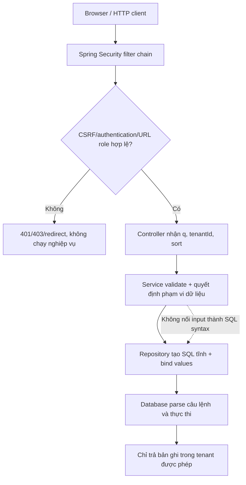

# SQL injection và truy vấn tham số hóa ở tầng dữ liệu

Trong module `SPRING_SECURITY_HTTP_PROTECTION`, Spring Security giúp bảo vệ request HTTP và trình duyệt bằng authentication, authorization, CSRF, CORS, security headers, CSP, HSTS, HTTP firewall và session protection. Tuy nhiên, khi một request đã vượt qua các filter bảo mật rồi đi vào repository, **Spring Security không tự biến câu SQL do mã ứng dụng xây dựng thành câu truy vấn an toàn**.

Bài thuộc chương **Ranh giới bảo vệ**, tập trung vào **SQL injection (SQLi)** và cách phân tách **cú pháp SQL do lập trình viên kiểm soát** khỏi **giá trị dữ liệu do người dùng cung cấp**. Biện pháp cốt lõi là **truy vấn tham số hóa (parameterized queries)**, được triển khai qua JDBC `PreparedStatement`, Spring `JdbcTemplate` / `NamedParameterJdbcTemplate`, Spring Data JPA/JPA `Query` và R2DBC `DatabaseClient`. Bài cũng phân tích những phần *không thể bind như một giá trị*, chẳng hạn tên bảng, tên cột và hướng `ORDER BY`, cũng như cách chống truy cập dữ liệu sai tenant ngay cả khi đã chống được SQLi.

Một request ví dụ:

```text
GET /invoices?tenantId=10&q=báo%20cáo&sort=NEWEST
Cookie: JSESSIONID=...
```

có thể hoàn toàn hợp lệ về HTTP, user có `ROLE_ANALYST` và session chưa hết hạn. Nhưng nếu repository nối trực tiếp `q` vào SQL, chính câu truy vấn có nguy cơ thay đổi ý nghĩa. Ngược lại, nếu SQL đã tham số hóa đúng nhưng thiếu điều kiện tenant/owner, người dùng vẫn có thể đọc hóa đơn của khách hàng khác. **SQLi prevention và business authorization là hai điều kiện độc lập.**

Các ví dụ dùng Java 17+, Spring Boot 3.x và Spring Security 6.x, nêu riêng mô hình **Servlet/Spring MVC** và **Reactive/WebFlux**. SQL demo dùng cú pháp có thể áp dụng trên PostgreSQL và nhiều RDBMS phổ biến; khi đổi dialect cần kiểm tra lại các chi tiết `LIKE`, `LIMIT`, kiểu dữ liệu và driver. Đây là bài hướng dẫn viết và kiểm thử, **không khởi chạy dự án hay database**.

## 1. Mục tiêu học tập

Sau bài, người học có thể:

- Giải thích SQL injection như một lỗi **vượt ranh giới giữa dữ liệu và cú pháp truy vấn**, không chỉ là “người dùng nhập dấu nháy đơn”.
- Phân biệt điều Spring Security bảo vệ ở HTTP boundary với trách nhiệm của controller, service, ORM, repository và database.
- Dùng `PreparedStatement` / bind parameters để giữ input dưới dạng **giá trị**, kể cả khi input chứa dấu quote, khoảng trắng, ký tự SQL hoặc Unicode.
- Dùng `NamedParameterJdbcTemplate` với tham số đặt tên, kiểm tra kiểu dữ liệu và phân biệt truy vấn đọc/ghi.
- Biết tại sao placeholder **không thể thay tên bảng/cột, keyword hoặc nguyên mệnh đề SQL**; dùng allowlist cho các biến thể truy vấn.
- Viết điều kiện `LIKE` cho tìm kiếm literal an toàn, phân biệt chống SQLi với xử lý wildcard `%`, `_`.
- Kiểm soát `IN` lists, empty lists, `NULL`, phân trang và các trường hợp SQL động.
- Dùng Spring Data JPA `@Query`, `EntityManager.setParameter`, Criteria API và R2DBC `DatabaseClient.bind` đúng ngữ cảnh.
- Ràng buộc dữ liệu với owner/tenant ở tầng truy vấn, không lấy tenant identity từ input do client tự khai báo.
- Viết kiểm thử repository chống injection và kiểm thử HTTP xác minh authentication/authorization/CSRF vẫn hoạt động.
- Áp dụng least-privilege database credentials, error handling và log redaction như những lớp giảm thiểu bổ sung.

## 2. SQL injection là lỗi ở ranh giới nào?

SQL là một ngôn ngữ có cú pháp riêng: `SELECT`, `WHERE`, toán tử `OR`, literal và comment. Nếu chương trình xây câu SQL bằng cách **nối input chưa tin cậy vào chuỗi lệnh**, database có thể diễn giải một phần input thành cú pháp SQL thay vì thành dữ liệu.

### 2.1. Luồng request và hai quyết định bảo mật khác nhau



Spring Security có thể biết user là ai và route nào được phép truy cập. Nhưng nó **không tự xem xét câu SQL mà một JDBC driver gửi xuống database**. Muốn chống SQLi, tầng truy vấn phải tuân quy tắc tham số hóa và hạn chế SQL động; muốn chống IDOR/BOLA, tầng service/repository còn phải ràng buộc bản ghi với actor/tenant hợp lệ.

### 2.2. Ba kịch bản phải phân biệt

| Request | HTTP security | Câu SQL | Kết quả cần bảo đảm |
| --- | --- | --- | --- |
| User chưa đăng nhập gọi route yêu cầu auth | Từ chối trước controller | Không chạy | Không truy cập DB nghiệp vụ ngoài ý muốn. |
| User hợp lệ tìm kiếm với input chứa ký tự SQL | Cho qua theo policy | **Bind như dữ liệu** | Không làm thay đổi cấu trúc câu truy vấn. |
| User có role ANALYST tìm hóa đơn tenant của người khác | Role có thể cho qua | Truy vấn phải áp **tenant/owner constraint** | Không tiết lộ bản ghi trái quyền dù SQLi đã được ngăn. |

**Điểm quan trọng:** Một câu SQL không chứa SQL injection vẫn có thể gây **broken access control** nếu `WHERE tenant_id = :tenantId` dùng giá trị do client tự chọn mà không xác minh quyền. Ngược lại, một query có owner filter nhưng nối `q` không an toàn vẫn có thể bị thay đổi logic bởi input.

## 3. So sánh SQL nối chuỗi và SQL có placeholder

### 3.1. Anti-pattern: ghép dữ liệu vào cú pháp

Ví dụ một tính năng tìm hóa đơn bằng tiêu đề:

```java
// KHÔNG DÙNG: chỉ để minh họa lỗi injection.
String sql =
        "SELECT id, title FROM invoices " +
        "WHERE tenant_id = " + tenantId +
        " AND title LIKE '%" + searchText + "%'";

jdbcTemplate.query(sql, rowMapper);
```

Các giá trị `tenantId` và `searchText` do client cung cấp đã trở thành **một phần câu SQL**. Nếu `searchText` chứa dấu nháy, toán tử hay ký tự điều khiển cú pháp, query có thể lỗi hoặc mang ý nghĩa khác dự kiến.

**Không sửa bằng cách tự thay dấu nháy đơn, blacklist các từ `OR`/`UNION`/`DROP`, hoặc lọc dấu `;`.** Những cách này dễ thiếu trường hợp edge, khác biệt database dialect và có thể làm hỏng dữ liệu hợp lệ.

### 3.2. Cách đúng: cấu trúc SQL cố định, giá trị đi qua parameter

```java
String sql = """
    SELECT id, title
    FROM invoices
    WHERE tenant_id = ?
      AND title = ?
    """;

jdbcTemplate.query(
        sql,
        (rs, index) -> new InvoiceSummary(
                rs.getLong("id"), rs.getString("title")),
        tenantId,
        searchText
);
```

`?` là parameter marker. Các giá trị được driver bind tách khỏi cú pháp query; input không được diễn giải thành mệnh đề `WHERE` mới. Query ở đây tìm **title khớp chính xác**. Khi cần tìm kiếm substring, hãy xây một **giá trị pattern được bind** và xử lý wildcard theo nghiệp vụ (mục 8).

### 3.3. Prepared statements bảo vệ điều gì?

Với một lệnh SQL được cấu trúc cố định:

- SQL parser nhận các operator, keywords và identifiers do chương trình định nghĩa.
- Các parameter markers đại diện cho **giá trị**, không đại diện cho mã SQL tùy ý.
- Input như `' OR '1'='1` chỉ là một chuỗi dùng để so sánh, không trở thành phần `OR` trong `WHERE`.
- Kiểu dữ liệu có thể được chỉ định rõ (`setLong`, `setString`, `setBigDecimal`, `bindNull`...).
- DB vẫn phải thực hiện **authorization/data scope** do query cung cấp; prepared statement không tự thêm `tenant_id`.

Tùy DB và driver, thư viện có thể chuẩn bị lệnh trên server hay mô phỏng binding ở protocol/driver layer, nhưng **hợp đồng lập trình** vẫn là tách query structure khỏi parameter values. Không tự kết luận driver sẽ luôn dùng server-side prepared statement cho mọi truy vấn và mọi phiên bản.

### 3.4. Chuỗi có placeholder chưa chắc đã an toàn

Ví dụ **vẫn sai**:

```java
String sql =
        "SELECT * FROM invoices WHERE title = '" +
        searchText +
        "' AND tenant_id = ?";

jdbcTemplate.query(sql, rowMapper, tenantId);
```

Có placeholder cho `tenantId` nhưng `searchText` vẫn được nối vào cú pháp. Cần bind **mọi giá trị không tin cậy** có thể bind, không chỉ một phần.

Tương tự, **gọi `Connection.prepareStatement(sql)` sau khi đã nối input vào `sql` không xóa lỗi**. Chính quá trình tạo chuỗi SQL trước đó đã cho dữ liệu vượt khỏi ranh giới.

## 4. JDBC thuần: PreparedStatement và kiểu dữ liệu

Với JDBC, `PreparedStatement` là công cụ nền tảng. Ví dụ minh họa tìm một hóa đơn theo ID và tenant:

```java
import java.sql.Connection;
import java.sql.PreparedStatement;
import java.sql.ResultSet;
import javax.sql.DataSource;

public final class RawJdbcInvoiceDao {
    private final DataSource dataSource;

    public RawJdbcInvoiceDao(DataSource dataSource) {
        this.dataSource = dataSource;
    }

    public boolean existsInTenant(long invoiceId, long tenantId)
            throws Exception {
        String sql = """
                SELECT 1
                FROM invoices
                WHERE id = ? AND tenant_id = ?
                """;

        try (Connection connection = dataSource.getConnection();
             PreparedStatement statement =
                     connection.prepareStatement(sql)) {

            statement.setLong(1, invoiceId);
            statement.setLong(2, tenantId);

            try (ResultSet rows = statement.executeQuery()) {
                return rows.next();
            }
        }
    }
}
```

Các điểm cần nhớ:

- `setLong(1, invoiceId)` bind vị trí **thứ nhất**, JDBC index bắt đầu từ 1.
- `setLong(2, tenantId)` bind vị trí thứ hai, không phải nối vào `WHERE`.
- `try-with-resources` đóng statement/result set/connection; trong ứng dụng Spring thật thường ưu tiên `JdbcTemplate` để tránh quản lý connection thủ công và tích hợp transaction tốt hơn.
- `throws Exception` chỉ nhằm rút gọn ví dụ; ứng dụng thật cần phân loại lỗi database và không trả SQL stack trace cho HTTP client.
- Điều kiện tenant ở đây là giá trị đầu vào đã được xác thực ở service hoặc scope theo actor; nếu client tự chọn tenant tùy ý, vẫn có lỗi phân quyền.

### 4.1. Typing và NULL

Không tự biến giá trị null thành chuỗi `"NULL"` hoặc nối `IS NULL` từ input. Với JDBC:

```java
import java.sql.Types;

// Nếu parameter 3 là giá trị nullable kiểu VARCHAR:
if (note == null) {
    statement.setNull(3, Types.VARCHAR);
} else {
    statement.setString(3, note);
}
```

Trong SQL, `column = NULL` không có cùng semantics với `column IS NULL`. Khi cần lọc null/not-null, hãy **chọn một trong các query templates cố định** theo yêu cầu nghiệp vụ, vẫn bind phần giá trị còn lại. Đừng cho người dùng đưa nguyên mệnh đề `IS NULL` hoặc `OR...` vào query text.

### 4.2. Batch và update cũng phải bind

Prepared statements không chỉ bảo vệ `SELECT`:

```java
String sql = """
    UPDATE invoices
    SET title = ?
    WHERE id = ? AND tenant_id = ?
    """;

try (Connection connection = dataSource.getConnection();
     PreparedStatement ps = connection.prepareStatement(sql)) {
    ps.setString(1, newTitle);
    ps.setLong(2, invoiceId);
    ps.setLong(3, tenantId);

    int updated = ps.executeUpdate();
    // Kiểm tra updated == 1, quyền sở hữu và concurrency policy.
}
```

Với batch inserts/updates, vẫn dùng bind cho **từng row/từng parameter**. Không ghép nhiều `INSERT` statements chứa raw values thành một chuỗi SQL dài chỉ vì muốn tối ưu hiệu năng.

## 5. Mô hình dữ liệu cho ví dụ Spring JDBC

Để thấy rõ khác biệt giữa **chống SQLi** và **chống truy cập chéo tenant**, xét hệ thống hóa đơn với hai bảng (DDL minh họa tương thích một số RDBMS; điều chỉnh identity/sequence/index/precision cho database sản xuất):

```sql
CREATE TABLE tenant_memberships (
    tenant_id BIGINT NOT NULL,
    username VARCHAR(120) NOT NULL,
    PRIMARY KEY (tenant_id, username)
);

CREATE TABLE invoices (
    id BIGINT PRIMARY KEY,
    tenant_id BIGINT NOT NULL,
    title VARCHAR(200) NOT NULL,
    total DECIMAL(12, 2) NOT NULL,
    created_at TIMESTAMP NOT NULL
);

CREATE INDEX idx_invoices_tenant_created
    ON invoices (tenant_id, created_at);
```

Quy tắc nghiệp vụ:

- User đã authenticated và có role `ANALYST` có thể tìm kiếm hóa đơn.
- User chỉ được xem hóa đơn thuộc tenant mà **bản ghi `tenant_memberships`** cho thấy user là thành viên.
- Client có thể gửi `tenantId` làm lựa chọn giao diện, nhưng **không được coi tenantId do client gửi là bằng chứng có quyền**.
- `q` là từ khóa tìm kiếm trong `title`, giới hạn tối đa 100 ký tự.
- `sort` chỉ được là `NEWEST` hoặc `AMOUNT_ASC`.
- `limit` phải ở khoảng 1–100, tránh query và response không giới hạn.
- Search là HTTP **GET đọc dữ liệu**, không tạo side effect; CSRF mặc định không đòi token cho GET, nhưng SQL vẫn phải tham số hóa và có authorization.

Có thể dùng actor ID bất biến thay username trong sản phẩm thật; ví dụ dùng username để code dễ đọc. Quy tắc membership phải lấy từ dữ liệu server kiểm soát, không từ query parameter `member=true`.

### 5.1. Phân chia trách nhiệm

| Thành phần | Trách nhiệm |
| --- | --- |
| Spring Security | Xác nhận principal và role để vào endpoint; giữ session/headers/CSRF policy. |
| Controller | Parse kiểu dữ liệu từ URL, không xây chuỗi SQL. |
| Service | Kiểm tra độ dài, limit và chính sách nghiệp vụ, gọi repository. |
| Repository | Dùng **bind parameters**, allowlist SQL fragments, scope dữ liệu theo membership. |
| Database | Parse/execute query, constraints, indexes và DB account permissions. |
| Hạ tầng | TLS/ingress limits, secret management, monitoring, query budget và log redaction. |

**Không có một lớp nào tự thay được tất cả các lớp còn lại.**


## 6. Spring JDBC: ví dụ tìm kiếm được tham số hóa hoàn chỉnh

Dùng `NamedParameterJdbcTemplate` của Spring JDBC để viết SQL với tên parameter dễ kiểm toán. Repository dưới đây vẫn cho phép thay đổi **thứ tự sắp xếp**, nhưng chỉ chọn giữa các **SQL fragments cố định trong source**.

Dependency của ví dụ Servlet:

```groovy
implementation 'org.springframework.boot:spring-boot-starter-web'
implementation 'org.springframework.boot:spring-boot-starter-security'
implementation 'org.springframework.boot:spring-boot-starter-jdbc'

runtimeOnly 'org.postgresql:postgresql'

testImplementation 'org.springframework.boot:spring-boot-starter-test'
testImplementation 'org.springframework.security:spring-security-test'
testRuntimeOnly 'com.h2database:h2'
```

PostgreSQL và H2 ở đây là **hai lựa chọn phục vụ những môi trường khác nhau**. Không cấu hình đồng thời hai JDBC URLs như một database chung; production cần migration, pool, credential và transaction setup thực tế.

### 6.1. Kiểu dữ liệu và danh sách sort cố định

```java
import java.math.BigDecimal;
import java.time.LocalDateTime;

public record InvoiceRow(
        long id,
        String title,
        BigDecimal total,
        LocalDateTime createdAt) {
}

public enum InvoiceSort {
    NEWEST,
    AMOUNT_ASC
}
```

`InvoiceSort` là enum, không phải đoạn SQL do client tự viết. Với Spring MVC, một giá trị `sort` không nằm trong enum có thể bị trả **400 Bad Request** do không thể bind tham số request.

### 6.2. Repository: scope theo membership và bind mọi giá trị

```java
import java.util.List;
import org.springframework.jdbc.core.namedparam.MapSqlParameterSource;
import org.springframework.jdbc.core.namedparam.NamedParameterJdbcTemplate;
import org.springframework.stereotype.Repository;

@Repository
public class InvoiceSearchRepository {

    private final NamedParameterJdbcTemplate jdbc;

    public InvoiceSearchRepository(
            NamedParameterJdbcTemplate jdbc) {
        this.jdbc = jdbc;
    }

    public List<InvoiceRow> search(
            long tenantId, String actor,
            String q, InvoiceSort sort, int limit) {

        // Chỉ lựa chọn các SQL fragments do developer định nghĩa.
        String orderBy = switch (sort) {
            case NEWEST ->
                    "i.created_at DESC, i.id DESC";
            case AMOUNT_ASC ->
                    "i.total ASC, i.id ASC";
        };

        String sql = """
                SELECT i.id, i.title, i.total, i.created_at
                FROM invoices i
                WHERE i.tenant_id = :tenantId
                  AND EXISTS (
                      SELECT 1
                      FROM tenant_memberships m
                      WHERE m.tenant_id = i.tenant_id
                        AND m.username = :actor
                  )
                  AND LOWER(i.title)
                      LIKE LOWER(:pattern) ESCAPE '!'
                ORDER BY
                """ + orderBy + "\nLIMIT :maxRows";

        MapSqlParameterSource parameters =
                new MapSqlParameterSource()
                        .addValue("tenantId", tenantId)
                        .addValue("actor", actor)
                        .addValue("pattern", containsLiteral(q))
                        .addValue("maxRows", limit);

        return jdbc.query(sql, parameters, (rs, index) ->
                new InvoiceRow(
                        rs.getLong("id"),
                        rs.getString("title"),
                        rs.getBigDecimal("total"),
                        rs.getTimestamp("created_at")
                                .toLocalDateTime()
                ));
    }

    private static String containsLiteral(String raw) {
        // Chọn ! làm LIKE ESCAPE character.
        String escaped = raw
                .replace("!", "!!")
                .replace("%", "!%")
                .replace("_", "!_");
        return "%" + escaped + "%";
    }
}
```

Phân tích ranh giới:

- `:tenantId`, `:actor`, `:pattern`, `:maxRows` đều là **bound values**.
- Điều kiện `EXISTS` đảm bảo actor có membership của tenant tương ứng. Đưa `tenantId=202` vào URL không tự làm user thành thành viên của tenant 202.
- `ORDER BY` không thể dùng `:sortColumn` như một SQL identifier nên code chỉ ghép **fragment đã được xác định ở switch**.
- `containsLiteral(...)` xử lý semantics của `LIKE` để `%` và `_` do người dùng gõ được hiểu là ký tự **literal**, không phải wildcard tự mở rộng phạm vi tìm kiếm.
- `LIMIT :maxRows` là giá trị số được bind và được service giới hạn hợp lệ; khả năng bind LIMIT phụ thuộc SQL dialect/driver, nên kiểm tra dialect đang dùng.
- `i.id` ở cuối mỗi order tạo thứ tự ổn định hơn khi các hóa đơn có cùng timestamp hoặc cùng tổng tiền.

**Không lấy `actor` từ query parameter `username` hay header tự khai**. Controller phải lấy từ principal do Spring Security xác thực; thực tế có thể sử dụng user ID bất biến thay tên đăng nhập.

### 6.3. Service: xác minh giới hạn mà repository cần

```java
import java.util.List;
import org.springframework.http.HttpStatus;
import org.springframework.stereotype.Service;
import org.springframework.transaction.annotation.Transactional;
import org.springframework.web.server.ResponseStatusException;

@Service
public class InvoiceSearchService {

    private final InvoiceSearchRepository repository;

    public InvoiceSearchService(
            InvoiceSearchRepository repository) {
        this.repository = repository;
    }

    @Transactional(readOnly = true)
    public List<InvoiceRow> search(
            long tenantId, String actor,
            String rawQuery, InvoiceSort sort, int limit) {

        if (tenantId <= 0 || actor == null || actor.isBlank()
                || rawQuery == null || rawQuery.length() > 100
                || sort == null || limit < 1 || limit > 100) {
            throw new ResponseStatusException(
                    HttpStatus.BAD_REQUEST, "Bộ lọc không hợp lệ");
        }

        return repository.search(
                tenantId, actor, rawQuery.strip(), sort, limit);
    }
}
```

Validation giới hạn kích thước, sorting và số hàng là **các biện pháp bổ sung**; chúng **không thay bind parameters**. Chuỗi có ký tự SQL vẫn có thể hoàn toàn hợp lệ theo quy tắc tìm kiếm; nó chỉ phải được xử lý như text, không phải cú pháp.

`@Transactional(readOnly = true)` mô tả mục đích giao dịch và có thể hỗ trợ tối ưu tùy transaction manager/database, nhưng **không tự bảo đảm DB user chỉ có quyền SELECT** và không thay SQLi prevention.

### 6.4. Spring Security bảo vệ route, controller không ghép SQL

```java
import org.springframework.context.annotation.Bean;
import org.springframework.context.annotation.Configuration;
import org.springframework.http.HttpMethod;
import org.springframework.security.config.Customizer;
import org.springframework.security.config.annotation.web.builders.HttpSecurity;
import org.springframework.security.web.SecurityFilterChain;

@Configuration
public class InvoiceHttpSecurityConfig {

    @Bean
    SecurityFilterChain securityFilterChain(
            HttpSecurity http) throws Exception {
        return http
                .authorizeHttpRequests(auth -> auth
                        .requestMatchers(HttpMethod.GET, "/invoices")
                            .hasRole("ANALYST")
                        .anyRequest().denyAll())
                .formLogin(Customizer.withDefaults())
                .csrf(Customizer.withDefaults())
                .build();
    }
}
```

```java
import java.util.List;
import org.springframework.http.MediaType;
import org.springframework.security.core.Authentication;
import org.springframework.web.bind.annotation.GetMapping;
import org.springframework.web.bind.annotation.RequestParam;
import org.springframework.web.bind.annotation.RestController;

@RestController
public class InvoiceController {

    private final InvoiceSearchService service;

    public InvoiceController(InvoiceSearchService service) {
        this.service = service;
    }

    @GetMapping(value = "/invoices",
            produces = MediaType.APPLICATION_JSON_VALUE)
    List<InvoiceRow> search(
            @RequestParam long tenantId,
            @RequestParam(defaultValue = "") String q,
            @RequestParam(defaultValue = "NEWEST")
                    InvoiceSort sort,
            @RequestParam(defaultValue = "25") int limit,
            Authentication authentication) {

        return service.search(
                tenantId,
                authentication.getName(),
                q, sort, limit);
    }
}
```

Request `GET /invoices` chỉ truy vấn dữ liệu, không ghi. Spring Security mặc định không bắt buộc CSRF token với GET; **điều đó hoàn toàn không có nghĩa query parameter có thể được nối vào SQL**. Route có authentication/role và repository có bind params + tenant membership là hai tầng độc lập.

**Điểm cần kiểm tra khi tích hợp:** `anyRequest().denyAll()` chủ ý chặn các route khác trong ví dụ; endpoint health, static resources hoặc login customization cần chính sách rõ, không sao chép nguyên cấu hình demo mà bỏ qua các route thực tế.

### 6.5. Một query an toàn vẫn cần hiệu năng và data minimization

Một truy vấn tham số hóa có thể vẫn rất chậm nếu:

- `LIKE '%text%'` không dùng được index B-tree thông thường trên nhiều DB.
- Không có pagination/cursor hợp lý.
- User nhập pattern khiến hàng triệu bản ghi được quét.
- Tìm kiếm/joins không có index tương ứng.
- Response chứa quá nhiều cột hoặc dữ liệu ngoài nhu cầu.

Cần query budget, indexes phù hợp, search service khi cần và response field selection. Không coi “đã dùng PreparedStatement” là bằng chứng an toàn trước **DoS hoặc data exposure**.

## 7. SQL động: placeholder không thay thế identifier hoặc keyword

Một lỗi phổ biến là cố bind thứ vốn là **cú pháp**, không phải **giá trị**:

```java
// Không hoạt động như mong đợi: placeholder là value,
// không phải tên cột SQL.
String sql = "SELECT * FROM invoices ORDER BY ?";
jdbcTemplate.query(sql, rowMapper, userSortColumn);
```

Tùy database, biểu thức `ORDER BY ?` có thể bị từ chối hoặc được xem như một **constant value**, không sắp xếp theo cột do người dùng chọn. Không sửa bằng cách ghép trực tiếp `userSortColumn` vào SQL.

### 7.1. Allowlist tên cột và hướng sort

Ví dụ user chọn `sort=TOTAL` và `direction=DESC`:

```java
public enum SortField {
    CREATED_AT,
    TOTAL
}

public enum SortDirection {
    ASC,
    DESC
}

static String trustedOrderBy(
        SortField field, SortDirection direction) {

    String column = switch (field) {
        case CREATED_AT -> "i.created_at";
        case TOTAL -> "i.total";
    };

    String dir = switch (direction) {
        case ASC -> "ASC";
        case DESC -> "DESC";
    };

    return column + " " + dir + ", i.id ASC";
}
```

Đây là phép nối SQL **có kiểm soát**: mọi giá trị có thể xuất hiện đều là chuỗi cố định được xác định trong source. Controller chuyển chuỗi từ request sang enum, giá trị không hợp lệ bị từ chối thay vì chèn vào SQL.

**Không làm kiểu này:**

```java
// KHÔNG DÙNG:
String sql = "SELECT ... ORDER BY " + request.getParameter("sort");
```

Cũng không dùng regex đơn giản “chỉ cho ký tự chữ/số/dấu gạch dưới” rồi tin mọi tên cột đó đều có quyền xem: một tên cột hợp lệ vẫn có thể là trường nhạy cảm hoặc không phù hợp cho sort.

### 7.2. Tên bảng, schema, JSON key và SQL clauses

Parameter markers không thể đại diện cho:

- Tên bảng và tên schema.
- Tên cột hoặc phép chiếu `SELECT`.
- SQL keywords như `ASC`/`DESC`.
- Tên hàm, toán tử, toàn bộ `WHERE` hoặc `JOIN` expression.
- Câu `LIMIT :value` nếu database/dialect cụ thể không hỗ trợ bind tại vị trí ấy.

Khi thực sự cần query structure thay đổi, hãy dùng **allowlist** ánh xạ lựa chọn nghiệp vụ sang một tập nhỏ **query templates** do developer viết, hoặc query builder/Criteria API đúng cách.

Ví dụ nhiều bảng theo tenant **không phải lựa chọn mặc định**; nếu ứng dụng chọn schema-per-tenant, việc tạo identifier yêu cầu cơ chế quote/validation chuyên dụng và quyền DB riêng. Đừng ghép một `tenantId` từ HTTP vào tên schema như `"tenant_" + tenantId` rồi xem đó là phân quyền.

### 7.3. SQL template và query builder vẫn có thể nguy hiểm

Một library giúp sinh SQL không tự bảo đảm an toàn nếu bạn truyền vào nó **raw SQL fragment** từ user. Các API hỗ trợ literal/raw string, custom expression hoặc native query phải được review riêng.

Hãy phân biệt rõ:

- **Bound value:** `where(title.eq(userText))` hoặc `setParameter("title", userText)` theo API query builder.
- **Raw expression:** `where("title = '" + userText + "'")` nếu thư viện chấp nhận text SQL trực tiếp.

Tên thư viện không thay thế nguyên tắc ranh giới dữ liệu/cú pháp.

## 8. LIKE, IN, NULL và phân trang: bind đúng chưa chắc đúng nghiệp vụ

### 8.1. `LIKE` chống injection và escaping wildcard là hai việc

Với SQL:

```sql
WHERE title LIKE :pattern ESCAPE '!'
```

Bind `pattern` qua prepared statement **ngăn nó trở thành SQL syntax**. Nhưng ký tự `%` và `_` có ý nghĩa **wildcard** trong `LIKE`. Nếu user đang tìm literal `50%`, việc bind `"%50%%"` sẽ cho phạm vi kết quả rộng hơn một phép tìm literal substring.

Vì thế helper `containsLiteral` trong mục 6 thay:

| Input của user | Ký tự được escape theo `LIKE ... ESCAPE '!'` | Pattern được bind |
| --- | --- | --- |
| `hello` | `hello` | `%hello%` |
| `50%` | `50!%` | `%50!%%` |
| `a_b` | `a!_b` | `%a!_b%` |
| `hello!` | `hello!!` | `%hello!!%` |

Trong trường hợp này, `!` là escape character do chương trình chọn, không phải input do user chọn. Cú pháp `ESCAPE '!'` được nhiều DB hỗ trợ nhưng cần xác minh dialect/collation; case-insensitive search thông qua `LOWER` cũng có giới hạn về locale/index.

**Nếu UI chủ ý cho người dùng wildcard search**, phải thiết kế language/grammar tìm kiếm và giới hạn chi phí riêng; không vô tình cho wildcard chỉ vì dùng `LIKE`.

### 8.2. `IN` lists bằng NamedParameterJdbcTemplate

Spring `NamedParameterJdbcTemplate` có thể mở rộng tham số dạng collection cho `IN` trong phạm vi được hỗ trợ:

```java
import java.util.List;
import java.util.Map;

public List<Long> findExistingIds(
        long tenantId, List<Long> ids) {

    if (ids == null || ids.isEmpty()) {
        return List.of(); // Tránh SQL IN () không portable.
    }
    if (ids.size() > 100) {
        throw new IllegalArgumentException("Quá nhiều ID");
    }

    String sql = """
            SELECT id
            FROM invoices
            WHERE tenant_id = :tenantId
              AND id IN (:ids)
            """;

    return jdbc.queryForList(
            sql,
            Map.of("tenantId", tenantId, "ids", ids),
            Long.class);
}
```

Đoạn method nằm trong repository có field `jdbc` tương ứng. Nó minh họa bind values và xử lý empty list, **chưa ràng buộc membership**. Trong ứng dụng đa tenant, phải bổ sung actor/membership như truy vấn ở mục 6, không coi `tenantId` do caller chọn là quyền truy cập.

Với danh sách lớn, nên dùng batch/chunk/temp tables theo driver/database và kiểm soát chi phí. Không nối `ids.join(",")` thành cú pháp SQL tự do.

### 8.3. NULL và toán tử động

Một query tùy chọn filter có thể được xây bằng vài **mệnh đề cố định** dựa trên boolean/enum, rồi bind giá trị. Chẳng hạn, lựa chọn có lọc ngày hay không:

```java
String sql = """
        SELECT id, title FROM invoices
        WHERE tenant_id = :tenantId
        """;

if (fromDate != null) {
    sql += " AND created_at >= :fromDate";
    params.addValue("fromDate", fromDate);
}
```

Phép nối ở đây chỉ thêm **SQL string do developer viết**, không đưa `fromDate` vào cú pháp. Một query builder/Criteria API phù hợp hơn khi có nhiều điều kiện và tránh ghép chuỗi dễ lỗi.

### 8.4. Phân trang và thứ tự ổn định

`LIMIT`/`OFFSET` hoặc cursor pagination cần giới hạn theo input đã validate. `OFFSET` rất lớn vẫn có thể tạo query tốn tài nguyên dù được bind hợp lệ. Với dữ liệu thay đổi liên tục, keyset pagination có thể giúp hiệu năng/độ nhất quán hơn, nhưng cursor cũng phải được kiểm tra tenant/actor và ký hoặc ràng buộc ngữ cảnh nếu cần.

Chống SQLi không thay thế **rate limiting, query timeout và giới hạn số hàng**.


## 9. Spring Data JPA và Hibernate: ORM không miễn trừ SQL injection

JPA/Hibernate chuyển JPQL, Criteria API hoặc derived queries thành SQL, nhưng **mã ứng dụng vẫn có thể tự tạo query động không an toàn** nếu ghép input vào JPQL/native SQL hoặc dùng raw expression APIs.

### 9.1. `@Query` với named parameter

Giả sử `InvoiceEntity` là một JPA entity có `tenantId` và `title`. Repository:

```java
import java.util.List;
import org.springframework.data.jpa.repository.JpaRepository;
import org.springframework.data.jpa.repository.Query;
import org.springframework.data.repository.query.Param;

public interface InvoiceJpaRepository
        extends JpaRepository<InvoiceEntity, Long> {

    @Query("""
            SELECT i
            FROM InvoiceEntity i
            WHERE i.tenantId = :tenantId
              AND i.title = :title
            """)
    List<InvoiceEntity> findExactTitle(
            @Param("tenantId") long tenantId,
            @Param("title") String title);
}
```

`:title` là **value parameter**, không được chuyển thành JPQL syntax. Tuy nhiên, query này chỉ ràng buộc `tenantId`, **chưa kiểm tra actor là thành viên tenant**. Service cần xác minh membership bằng dữ liệu tin cậy hoặc query phải đưa scope đó vào theo model/quan hệ được thiết kế.

Một method derived query như `findByTenantIdAndTitle` thường cũng được Spring Data/JPA chuyển thành parameterized query, nhưng tên method **không tạo thêm authorization theo owner** nếu nghiệp vụ chưa thiết kế ràng buộc.

### 9.2. `EntityManager` và `setParameter`

```java
import jakarta.persistence.EntityManager;
import java.util.List;

public class InvoiceEntitySearch {

    private final EntityManager em;

    public InvoiceEntitySearch(EntityManager em) {
        this.em = em;
    }

    public List<InvoiceEntity> exact(
            long tenantId, String userTitle) {

        return em.createQuery("""
                SELECT i
                FROM InvoiceEntity i
                WHERE i.tenantId = :tenantId
                  AND i.title = :title
                """, InvoiceEntity.class)
                .setParameter("tenantId", tenantId)
                .setParameter("title", userTitle)
                .getResultList();
    }
}
```

Không làm:

```java
// KHÔNG DÙNG: ghép input trực tiếp vào JPQL.
String jpql = "SELECT i FROM InvoiceEntity i "
        + "WHERE i.title = '" + userTitle + "'";

em.createQuery(jpql, InvoiceEntity.class).getResultList();
```

JPQL khác SQL về syntax nhưng vẫn là **một ngôn ngữ truy vấn có cú pháp**. Nguyên tắc tách cấu trúc khỏi dữ liệu áp dụng tương tự.

### 9.3. Criteria API: an toàn cho giá trị khi dùng đúng cách

```java
import jakarta.persistence.EntityManager;
import jakarta.persistence.criteria.CriteriaBuilder;
import jakarta.persistence.criteria.CriteriaQuery;
import jakarta.persistence.criteria.Root;
import java.util.List;

public class InvoiceCriteriaSearch {

    private final EntityManager em;

    public InvoiceCriteriaSearch(EntityManager em) {
        this.em = em;
    }

    public List<InvoiceEntity> find(
            long tenantId, String title) {

        CriteriaBuilder cb = em.getCriteriaBuilder();
        CriteriaQuery<InvoiceEntity> query =
                cb.createQuery(InvoiceEntity.class);
        Root<InvoiceEntity> invoice =
                query.from(InvoiceEntity.class);

        query.select(invoice).where(
                cb.equal(invoice.get("tenantId"), tenantId),
                cb.equal(invoice.get("title"), title));

        return em.createQuery(query).getResultList();
    }
}
```

`invoice.get("tenantId")` và `invoice.get("title")` là **tên thuộc tính cố định do lập trình viên viết**. Nếu một API cho phép user chọn field/sort, hãy ánh xạ enum/allowlist tới các thuộc tính này. Không cho client truyền nguyên tên property rồi coi mọi thuộc tính entity đều được phép truy vấn hoặc sort.

### 9.4. Derived methods, Pageable và Sort

Spring Data `Pageable` giúp giới hạn số bản ghi, nhưng:

- Phải cap `pageSize`, số trang hoặc cursor để tránh query quá lớn.
- Chỉ cho phép **sort fields được công bố** trong API. Không cho user tự tham chiếu trường nhạy cảm hoặc biểu thức SQL.
- Đặc biệt cẩn thận với API chủ ý cho phép raw/unsafe expression, ví dụ một số cách dùng `JpaSort.unsafe(...)`: không được truyền input HTTP vào đó.
- Khi query có nhiều tenant, điều kiện scope theo actor/tenant phải có ở repository/service, không chỉ nằm trong `PageRequest`.

Ví dụ tạo `Sort` từ một lựa chọn đã được allowlist:

```java
import org.springframework.data.domain.PageRequest;
import org.springframework.data.domain.Sort;

Sort safeSort = switch (sortOption) {
    case NEWEST ->
            Sort.by("createdAt").descending();
    case AMOUNT_ASC ->
            Sort.by("total").ascending();
};

var pageRequest = PageRequest.of(
        Math.max(0, pageIndex),
        Math.min(requestedSize, 100),
        safeSort);
```

Đoạn code giả định `sortOption` là enum đã được parse/validate, `requestedSize` phải được đảm bảo **lớn hơn 0** trước khi tạo `PageRequest`, và `pageIndex` phải được giới hạn phù hợp. Đây là ví dụ mapping sort, không phải bộ pagination validation đầy đủ.

### 9.5. Native queries trong ORM không tự an toàn hơn JDBC

JPA hỗ trợ native SQL:

```java
em.createNativeQuery("""
        SELECT id, title
        FROM invoices
        WHERE tenant_id = :tenantId
          AND title = :title
        """)
        .setParameter("tenantId", tenantId)
        .setParameter("title", userTitle)
        .getResultList();
```

Nó có thể an toàn đối với **bound values**. Nhưng `createNativeQuery("... " + userInput)` vẫn có thể gây SQLi. Với native queries, cú pháp `LIMIT`, `ILIKE`, JSON operators, array params và escaping phụ thuộc dialect/driver, nên cần integration tests với database thực hoặc tương thích.

### 9.6. SpEL, query fragments và dynamic projections

Spring Data có các tính năng biểu thức và dynamic query nâng cao. Không cho input HTTP kiểm soát **nguyên đoạn biểu thức truy vấn**. Truyền tham số qua framework binding API khác với việc evaluate một string rồi nối nó vào JPQL.

Hãy review đặc biệt:

- Những nơi tạo SQL/JPQL bằng string concatenation/interpolation.
- Method sử dụng native query với mệnh đề động.
- APIs cho phép literal/raw expression.
- Các đường build `ORDER BY`, `GROUP BY`, projections hoặc tên bảng.
- Query generation từ JSON filter DSL tự thiết kế.

Không dựa vào tên `Repository`, `EntityManager` hay `QueryDSL` để kết luận code an toàn nếu data vẫn có đường trở thành SQL syntax.

## 10. Stored procedures, database functions và dynamic SQL phía server

Gọi stored procedure bằng bind parameters **không tự bảo đảm procedure an toàn bên trong**. Procedure có thể tạo dynamic SQL bằng cách nối giá trị input ngay tại database.

Ví dụ SQL giả lập anti-pattern:

```sql
-- Minh họa ý tưởng KHÔNG AN TOÀN:
-- procedure nhận tên lọc rồi ghép trực tiếp thành query string.
-- dynamic_sql := 'SELECT ... WHERE title = ''' || user_title || '''';
-- EXECUTE dynamic_sql;
```

Ngay cả khi Java gọi procedure bằng `CallableStatement` và bind `user_title`, nếu procedure nối giá trị đó thành SQL text nội bộ, ranh giới dữ liệu/cú pháp vẫn bị phá.

Cách sửa:

- Ưu tiên SQL tĩnh trong procedure và bind variables cho dynamic statements.
- Với identifiers bắt buộc động, dùng allowlist và hàm quote identifier đúng dialect.
- Tránh các quyền execution quá rộng cho procedure, kiểm tra owner/schema/role.
- Theo dõi cả mã database: triggers, functions, migration scripts và legacy procedures, không chỉ code Java.

**Stored procedure không phải tấm chắn SQLi tự động**, cũng không thay quyền database account tối thiểu.

## 11. Spring WebFlux/R2DBC: nguyên tắc bind không đổi

Một ứng dụng Reactive dùng Spring WebFlux có thể truy cập relational database qua **R2DBC** thay vì JDBC. API cụ thể khác nhau nhưng ranh giới bất biến: **SQL structure cố định, values được bind; không xây SQL bằng input tùy ý**.

### 11.1. Dependencies cho ứng dụng WebFlux riêng

```groovy
implementation 'org.springframework.boot:spring-boot-starter-webflux'
implementation 'org.springframework.boot:spring-boot-starter-security'
implementation 'org.springframework.boot:spring-boot-starter-data-r2dbc'

runtimeOnly 'org.postgresql:r2dbc-postgresql'

testImplementation 'org.springframework.boot:spring-boot-starter-test'
testImplementation 'org.springframework.security:spring-security-test'
```

Đây là một ứng dụng **WebFlux/R2DBC riêng**; không dùng `DataSource`/`JdbcTemplate` đồng bộ của Servlet example trên Reactor event loop rồi cho rằng đã có non-blocking database I/O.

### 11.2. Repository Reactive với `DatabaseClient.sql(...).bind(...)`

```java
import java.math.BigDecimal;
import java.time.LocalDateTime;
import org.springframework.r2dbc.core.DatabaseClient;
import org.springframework.stereotype.Repository;
import reactor.core.publisher.Flux;

@Repository
public class ReactiveInvoiceRepository {

    private final DatabaseClient databaseClient;

    public ReactiveInvoiceRepository(
            DatabaseClient databaseClient) {
        this.databaseClient = databaseClient;
    }

    public Flux<InvoiceRow> findForActor(
            long tenantId, String actor, String q, int limit) {

        String pattern = "%" + q
                .replace("!", "!!")
                .replace("%", "!%")
                .replace("_", "!_") + "%";

        return databaseClient.sql("""
                SELECT i.id, i.title, i.total, i.created_at
                FROM invoices i
                WHERE i.tenant_id = :tenantId
                  AND EXISTS (
                      SELECT 1
                      FROM tenant_memberships m
                      WHERE m.tenant_id = i.tenant_id
                        AND m.username = :actor
                  )
                  AND LOWER(i.title)
                      LIKE LOWER(:pattern) ESCAPE '!'
                ORDER BY i.created_at DESC, i.id DESC
                LIMIT :maxRows
                """)
                .bind("tenantId", tenantId)
                .bind("actor", actor)
                .bind("pattern", pattern)
                .bind("maxRows", limit)
                .map((row, metadata) -> new InvoiceRow(
                        row.get("id", Long.class),
                        row.get("title", String.class),
                        row.get("total", BigDecimal.class),
                        row.get("created_at", LocalDateTime.class)
                ))
                .all();
    }
}
```

`.bind(...)` đưa giá trị qua database binding API. `DatabaseClient` có hỗ trợ named parameters qua Spring R2DBC client khi được cấu hình theo mặc định thích hợp; driver bên dưới có thể sử dụng marker native khác (`$1`, `?`...). Kiểm tra thư viện/driver cụ thể khi dùng SQL đặc biệt.

`row.get(...)` có thể trả null/kiểu driver khác; dữ liệu bảng demo có các cột NOT NULL, nhưng production cần mapper được kiểm thử với database thật. Nếu schema dùng `BIGINT`, đa số R2DBC driver map thành `Long`, song không nên suy kiểu ở mọi driver mà không test.

### 11.3. Phân biệt bind và SQL nối chuỗi trong Reactive

An toàn với bound value:

```java
databaseClient.sql("""
        SELECT id FROM invoices
        WHERE title = :title
        """)
        .bind("title", userTitle);
```

Không an toàn nếu tự ghép input thành query string:

```java
// KHÔNG DÙNG.
databaseClient.sql(
        "SELECT id FROM invoices WHERE title = '" +
        userTitle + "'");
```

Việc chuyển từ JDBC sang R2DBC **không tự sửa SQL injection**. Chỉ phương pháp xây query đúng mới giữ ranh giới dữ liệu/cú pháp.

### 11.4. Reactive HTTP security không thay repository policy

```java
import org.springframework.context.annotation.Bean;
import org.springframework.context.annotation.Configuration;
import org.springframework.http.HttpMethod;
import org.springframework.security.config.Customizer;
import org.springframework.security.config.web.server.ServerHttpSecurity;
import org.springframework.security.web.server.SecurityWebFilterChain;

@Configuration
public class ReactiveInvoiceHttpSecurity {

    @Bean
    SecurityWebFilterChain securityWebFilterChain(ServerHttpSecurity http) {
        return http
                .authorizeExchange(auth -> auth
                        .pathMatchers(HttpMethod.GET,
                                "/reactive/invoices")
                            .hasRole("ANALYST")
                        .anyExchange().denyAll())
                .formLogin(Customizer.withDefaults())
                .csrf(Customizer.withDefaults())
                .build();
    }
}
```

Controller nhận principal Reactive và dùng service validation:

```java
import org.springframework.security.core.context.ReactiveSecurityContextHolder;
import org.springframework.web.bind.annotation.GetMapping;
import org.springframework.web.bind.annotation.RequestParam;
import org.springframework.web.bind.annotation.RestController;
import reactor.core.publisher.Flux;
import reactor.core.publisher.Mono;
import java.security.Principal;

@RestController
public class ReactiveInvoiceController {

    private final ReactiveInvoiceRepository repository;

    public ReactiveInvoiceController(
            ReactiveInvoiceRepository repository) {
        this.repository = repository;
    }

    @GetMapping("/reactive/invoices")
    Flux<InvoiceRow> search(
            @RequestParam long tenantId,
            @RequestParam(defaultValue = "") String q,
            @RequestParam(defaultValue = "25") int limit,
            Mono<Principal> principal) {

        if (tenantId <= 0 || q.length() > 100
                || limit < 1 || limit > 100) {
            return Flux.error(new IllegalArgumentException(
                    "Bộ lọc không hợp lệ"));
        }

        return principal.flatMapMany(actor ->
                repository.findForActor(
                        tenantId, actor.getName(), q.strip(), limit));
    }
}
```

Đây là ví dụ Reactive tập trung binding và principal; production nên map validation exception thành **HTTP 400** qua `ResponseStatusException` hoặc exception handler thay vì để `IllegalArgumentException` rơi vào 500 mặc định.

`Mono<Principal>` được resolve trong pipeline, không dùng `block()` để lấy principal. Data access qua R2DBC non-blocking; trong sản phẩm thật, query timeout, backpressure và pool/concurrency limits cũng cần được cấu hình.

### 11.5. NULL trong R2DBC

Để bind `NULL`, API có `bindNull` với Java type:

```java
var spec = databaseClient.sql("""
        UPDATE invoices SET note = :note
        WHERE id = :id
        """).bind("id", invoiceId);

if (note == null) {
    spec = spec.bindNull("note", String.class);
} else {
    spec = spec.bind("note", note);
}
```

Đây là minh họa binding một cột nullable (bảng `invoices` ban đầu chưa khai báo `note`). Muốn chạy, phải có column tương ứng và **bổ sung tenant/actor condition** trước khi thực thi update. Code tránh giá trị null bị nối thành SQL literal, nhưng chưa phải một tác vụ ghi hoàn chỉnh hay đã phân quyền.

## 12. Đối chiếu Servlet JDBC và Reactive R2DBC

| Vấn đề | JDBC/Spring MVC | R2DBC/WebFlux |
| --- | --- | --- |
| Bind values | `PreparedStatement.setXxx`, `JdbcTemplate`, `NamedParameterJdbcTemplate` | `DatabaseClient.bind` / `bindNull`, R2DBC `Statement.bind` |
| Query execution | Đồng bộ, gọi JDBC từ thread request/worker | Trả Publisher; thực hiện trong reactive pipeline |
| SQLi rủi ro | Nối input thành query/JPQL/native SQL | Nối input vào `DatabaseClient.sql(...)` |
| Dynamic `ORDER BY` | Enum + trusted fragments | Enum + trusted fragments tương tự |
| Tenant/owner | Join/EXISTS hoặc policy trong service/repository | Tương tự, nhưng query/authorization dùng reactive operations |
| HTTP security | `HttpSecurity` / `SecurityFilterChain` | `ServerHttpSecurity` / `SecurityWebFilterChain` |
| CSRF | `CsrfFilter` (Servlet) | `CsrfWebFilter` (Reactive) |
| DB transaction | `@Transactional` + JDBC/JPA manager | Reactive transaction manager; không trộn sync transaction manager vào reactive workflow |
| Tests | Repository integration, MockMvc | R2DBC integration, WebTestClient |

**Bất biến giống nhau:** **Input không được tự tạo SQL syntax**, và query phải hạn chế dữ liệu theo principal/tenant/owner mà nghiệp vụ cho phép.


## 13. Bảo vệ thao tác ghi: parameterization + authorization + transaction

Một lỗi quan trọng khác là chỉ làm đúng truy vấn đọc nhưng **UPDATE/DELETE** vẫn lấy ID trực tiếp từ HTTP rồi thao tác không có scope. Ví dụ:

```java
// SQLi không xuất hiện ở đây nếu id được bind,
// nhưng vẫn có thể là lỗi IDOR/BOLA nếu thiếu owner/tenant.
jdbc.update(
        "DELETE FROM invoices WHERE id = :id",
        Map.of("id", invoiceId));
```

Query này tham số hóa **đúng về mặt SQLi**, nhưng user có thể thay `invoiceId` để tác động lên bản ghi không thuộc quyền.

### 13.1. Gắn scope vào cùng câu UPDATE

Với schema `tenant_memberships` ở mục 5, ví dụ update tiêu đề:

```java
import java.util.Map;
import org.springframework.jdbc.core.namedparam.NamedParameterJdbcTemplate;
import org.springframework.stereotype.Repository;

@Repository
public class InvoiceWriteRepository {

    private final NamedParameterJdbcTemplate jdbc;

    public InvoiceWriteRepository(NamedParameterJdbcTemplate jdbc) {
        this.jdbc = jdbc;
    }

    public int renameForActor(
            long id, long tenantId,
            String actor, String newTitle) {

        String sql = """
                UPDATE invoices
                SET title = :title
                WHERE id = :id
                  AND tenant_id = :tenantId
                  AND EXISTS (
                      SELECT 1 FROM tenant_memberships m
                      WHERE m.tenant_id = :tenantId
                        AND m.username = :actor
                  )
                """;

        return jdbc.update(sql, Map.of(
                "id", id,
                "tenantId", tenantId,
                "actor", actor,
                "title", newTitle));
    }
}
```

**Hai bảo đảm khác nhau:**

- `:title` được bind nên input không thể thoát thành SQL syntax.
- `WHERE id = :id AND tenant_id = :tenantId AND EXISTS (...)` giới hạn bản ghi bị sửa theo membership của **actor đã xác thực**, không tin toàn bộ input từ URL.

Controller phải lấy `actor` từ principal và service phải validate title, hạn chế độ dài, kiểm tra `updated` và xử lý audit/transaction. `updated == 0` có thể do ID không tồn tại hoặc không có quyền, tùy contract có thể trả 404 để tránh rò tồn tại bản ghi. Không tự diễn giải mọi `0 rows affected` thành thành công.

### 13.2. Transaction và optimistic locking

Khi nhiều request cùng sửa một bản ghi, việc tách “SELECT owner → kiểm tra → UPDATE” thành các thao tác không liên kết có thể sinh **race condition**. Trong nhiều hệ thống, đưa owner/tenant/version vào **điều kiện UPDATE** và kiểm tra số dòng ảnh hưởng sẽ đơn giản, nhất quán hơn.

Nếu có cột `version`:

```sql
UPDATE invoices
SET title = :title,
    version = version + 1
WHERE id = :id
  AND tenant_id = :tenantId
  AND version = :expectedVersion;
```

Đây là pattern optimistic locking **chưa có kiểm tra membership**: vẫn phải thêm actor/tenant authorization như mục 13.1. Các giá trị title, ID và expected version đều được bind. Nếu update ảnh hưởng 0 rows, xác định response theo contract (chẳng hạn 404 cho không thấy/không có quyền, 409 cho xung đột version).

SQL injection prevention không thay transaction, optimistic locking hay idempotency.

### 13.3. HTTP CSRF của POST/PATCH/DELETE vẫn phải hoạt động

Với browser cookie-session, một thao tác đổi tiêu đề nên dùng POST/PATCH/PUT theo hợp đồng, có CSRF token đúng khi chính sách yêu cầu. Ví dụ Spring MVC:

```java
@PostMapping("/invoices/{id}/rename")
ResponseEntity<Void> rename(@PathVariable long id,
                            @RequestParam long tenantId,
                            @RequestParam String title,
                            Authentication authentication) {
    service.renameOwned(
            id, tenantId,
            authentication.getName(), title);
    return ResponseEntity.noContent().build();
}
```

Đây là **đoạn controller bổ sung**: để chạy cần có `service.renameOwned` với validation/transaction và thêm matcher authorization cho POST route; không có trong demo `InvoiceSearchService` vốn chỉ tìm kiếm.

Trong ví dụ này, có thể có **bốn lớp kiểm tra**:

1. CSRF: request browser có token hợp lệ.
2. Authentication/URL authorization: user có quyền thao tác loại route này.
3. Domain authorization: bản ghi thuộc tenant/owner user được phép.
4. SQL parameterization + DB constraints: input không trở thành SQL syntax, update đúng state.

Một lớp pass không thay nghĩa vụ của các lớp còn lại.

## 14. Database credentials và nguyên tắc least privilege

Prepared statements là biện pháp cốt lõi chống SQLi, còn **database least privilege** giúp giới hạn hậu quả nếu một lỗi truy vấn khác lọt qua hoặc account bị lộ.

### 14.1. Phân tách tài khoản theo trách nhiệm

| Loại tài khoản | Quyền nên có | Quyền không nên có mặc định |
| --- | --- | --- |
| Runtime read-only/reporting | `SELECT` trên bảng/view cần đọc | `DROP`, `ALTER`, tạo users, grants, truy cập bảng bí mật ngoài scope. |
| Runtime ghi dữ liệu | `SELECT/INSERT/UPDATE/DELETE` có chọn lọc cho nghiệp vụ | DDL, superuser, thay đổi schema tùy ý, đọc dữ liệu không liên quan. |
| Migration/deployment | DDL cần cho migration trong bước triển khai kiểm soát | Không dùng làm credential runtime của ứng dụng. |
| Monitoring | Quyền quan sát tối thiểu theo DB | Không đọc dữ liệu khách hàng không cần thiết. |
| Backup/restore | Quyền đúng với backup workflow | Không dùng chung credential với ứng dụng web. |

Một Spring Boot app không nên dùng **DB superuser** chỉ để tránh lỗi permission. Cần quản lý secrets qua secret manager, rotation, TLS đến DB khi phù hợp, và hạn chế network access tới database.

### 14.2. Row-level security có ích nhưng không tự thay application policy

Một số database (ví dụ PostgreSQL) hỗ trợ **Row-Level Security (RLS)**. Với multi-tenancy, RLS có thể là defense in depth khi được thiết kế và kiểm thử chặt chẽ.

Tuy vậy, RLS cần:

- Cơ chế truyền tenant identity vào DB **từ nguồn tin cậy**, không nhận raw header/query của client.
- Kiểm soát connection pooling, context reset và transaction boundaries.
- Không dùng một DB role có khả năng bypass policy nếu kỳ vọng RLS có hiệu lực.
- Test cả SELECT/UPDATE/DELETE, bulk operations, views và function execution.
- Cập nhật policy khi quy tắc tenant/owner thay đổi.

RLS **không tự sửa SQL injection** trong câu lệnh dynamic, không thay CSRF và không tự hiểu business state ngoài các rule đã viết.

### 14.3. Không lộ SQL error và bind parameters trong log

Một lỗi database có thể chứa chi tiết schema/table/constraint/query. Với HTTP API:

- Trả status phù hợp (4xx cho validation/business conflicts, 5xx cho lỗi DB không mong đợi).
- Không gửi raw exception message, SQL statement đầy đủ, stack trace hoặc connection string cho client.
- Ghi correlation ID, loại lỗi và route được chuẩn hóa; hạn chế quyền xem log.
- Cẩn thận với logging TRACE của JDBC/Hibernate/R2DBC: nhiều cấu hình có thể ghi **giá trị bind** như email, số tài khoản, token.
- Không tự lưu full HTTP query/body/Authorization header để “điều tra SQL injection” nếu chúng chứa dữ liệu nhạy cảm.

**Không nhầm mã hóa log với việc dùng input làm SQL literal.** Audit query structure và bind metadata có thể hữu ích, nhưng nguyên tắc dữ liệu tối thiểu vẫn áp dụng.

## 15. Kiểm thử repository: chứng minh input chỉ là dữ liệu

Đây là bộ test quan trọng nhất cho SQLi: **thực sự gọi repository đã tham số hóa**, không chỉ mock service và assert 200. Một HTTP test pass có thể che giấu query sai nếu repository bị mock.

### 15.1. JDBC slice test với H2

Giả sử module thử nghiệm có `spring-boot-starter-jdbc` và `com.h2database:h2` trong test scope. `@JdbcTest` tạo JDBC test context và thường dùng database embedded, còn `@Import` đưa repository vào slice.

```java
import static org.junit.jupiter.api.Assertions.*;

import java.sql.Timestamp;
import java.util.List;
import org.junit.jupiter.api.BeforeEach;
import org.junit.jupiter.api.Test;
import org.springframework.beans.factory.annotation.Autowired;
import org.springframework.boot.test.autoconfigure.jdbc.JdbcTest;
import org.springframework.context.annotation.Import;
import org.springframework.jdbc.core.JdbcTemplate;

@JdbcTest
@Import(InvoiceSearchRepository.class)
class InvoiceSearchRepositoryTests {

    @Autowired JdbcTemplate jdbc;
    @Autowired InvoiceSearchRepository repository;

    @BeforeEach
    void seed() {
        jdbc.execute("""
                CREATE TABLE IF NOT EXISTS tenant_memberships (
                    tenant_id BIGINT NOT NULL,
                    username VARCHAR(120) NOT NULL,
                    PRIMARY KEY (tenant_id, username)
                )
                """);

        jdbc.execute("""
                CREATE TABLE IF NOT EXISTS invoices (
                    id BIGINT PRIMARY KEY,
                    tenant_id BIGINT NOT NULL,
                    title VARCHAR(200) NOT NULL,
                    total DECIMAL(12,2) NOT NULL,
                    created_at TIMESTAMP NOT NULL
                )
                """);

        jdbc.update("DELETE FROM invoices");
        jdbc.update("DELETE FROM tenant_memberships");

        jdbc.update("""
                INSERT INTO tenant_memberships(tenant_id, username)
                VALUES (?, ?)
                """, 10L, "alice");

        jdbc.update("""
                INSERT INTO tenant_memberships(tenant_id, username)
                VALUES (?, ?)
                """, 20L, "bob");

        jdbc.update("""
                INSERT INTO invoices
                    (id, tenant_id, title, total, created_at)
                VALUES (?, ?, ?, ?, ?)
                """, 1L, 10L, "Quarterly report",
                new java.math.BigDecimal("150.00"),
                Timestamp.valueOf("2026-01-02 00:00:00"));

        jdbc.update("""
                INSERT INTO invoices
                    (id, tenant_id, title, total, created_at)
                VALUES (?, ?, ?, ?, ?)
                """, 2L, 20L, "Quarterly report",
                new java.math.BigDecimal("250.00"),
                Timestamp.valueOf("2026-01-03 00:00:00"));

        jdbc.update("""
                INSERT INTO invoices
                    (id, tenant_id, title, total, created_at)
                VALUES (?, ?, ?, ?, ?)
                """, 3L, 10L, "Discount 50%",
                new java.math.BigDecimal("50.00"),
                Timestamp.valueOf("2026-01-04 00:00:00"));
    }

    @Test
    void quotedSqlLikeTextCannotAlterQueryStructure() {
        String suspicious = "' OR '1'='1";

        var result = repository.search(
                10L, "alice", suspicious, InvoiceSort.NEWEST, 25);

        assertTrue(result.isEmpty());
    }

    @Test
    void actorCannotReadAnotherTenantsRows() {
        var aliceLookingAtBob = repository.search(
                20L, "alice", "", InvoiceSort.NEWEST, 25);

        assertTrue(aliceLookingAtBob.isEmpty());

        var bobLookingAtBob = repository.search(
                20L, "bob", "", InvoiceSort.NEWEST, 25);

        assertEquals(List.of(2L),
                bobLookingAtBob.stream()
                        .map(InvoiceRow::id).toList());
    }

    @Test
    void percentAndUnderscoreCanBeLiteralSearchText() {
        var percent = repository.search(
                10L, "alice", "50%",
                InvoiceSort.NEWEST, 25);

        assertEquals(List.of(3L),
                percent.stream().map(InvoiceRow::id).toList());

        var underscore = repository.search(
                10L, "alice", "50_",
                InvoiceSort.NEWEST, 25);

        assertTrue(underscore.isEmpty());
    }

    @Test
    void sortChoiceCannotExpandScope() {
        var result = repository.search(
                10L, "alice", "", InvoiceSort.AMOUNT_ASC, 25);

        assertEquals(List.of(3L, 1L),
                result.stream().map(InvoiceRow::id).toList());
    }
}
```

**Test này kiểm tra nhiều tính chất cùng lúc:**

- Input giống cú pháp SQL vẫn được coi như text search.
- Một user không thể dùng `tenantId` của user khác để xem record.
- Ký tự `%` và `_` được escape theo semantics literal search.
- Sort enum chỉ ảnh hưởng thứ tự, không thay tenant scope.

Để có bằng chứng tương thích production, nên chạy thêm **integration test với chính dialect/driver của môi trường triển khai**, ví dụ PostgreSQL trong môi trường test cô lập. H2 không đảm bảo mọi cú pháp, collation, index behavior, SQL mode và error handling giống PostgreSQL/Oracle/MySQL/SQL Server.

### 15.2. Test mất scope nếu người viết repository sửa sai

Một regression hữu ích: nếu vô tình bỏ điều kiện `EXISTS tenant_memberships` khỏi repository, test `actorCannotReadAnotherTenantsRows()` phải thất bại. Nếu vô tình bỏ `containsLiteral`, test `percentAndUnderscoreCanBeLiteralSearchText` có thể phát hiện wildcard expansion.

Đặt tên test theo **security invariant**, tránh chỉ đặt tên kiểu `queryRuns`. Không cần thực hiện một cuộc tấn công vào database thật để chứng minh các bất biến này.

### 15.3. Các ca bổ sung nên có

| Nhóm | Input | Assertion |
| --- | --- | --- |
| Dấu nháy đơn / comment-like string | Chuỗi chứa `'`, `--`, khoảng trắng | Không đổi cấu trúc query; kết quả đúng như tìm text. |
| Dấu phần trăm/gạch dưới | `100%`, `a_b` | Nếu UI tìm literal thì wildcard không được tự mở rộng. |
| Chuỗi Unicode | Tiếng Việt, emoji, dấu kết hợp | Không lỗi encoding hay cắt xâu ngoài policy. |
| Empty query | `q=""` | Kết quả chỉ trong tenant và limit tối đa, không full-table dump. |
| Tenant ID khác | User A truyền tenant B | Không có row của B; không tiết lộ thông tin. |
| Unknown sort | Giá trị ngoài enum | HTTP 400/validation, không ghép SQL text. |
| Limit cực lớn/âm | `limit=-1` hoặc số khổng lồ | Service từ chối trước query. |
| Empty `IN` list | `[]` | Không tạo `IN ()` không portable, theo hợp đồng trả rỗng. |
| Large `IN` list | Hàng nghìn ID | Bị cap/chunk, không nổ bind parameters. |
| DML owner | Update ID khác tenant | 0 rows affected; không thay đổi dữ liệu. |
| Null value | Nullable field | Dùng typed bindNull/setNull và kết quả đúng. |
| SQL error | Invalid schema/connection failure | Không trả raw SQL/stack trace cho client. |
| Database role | Runtime account | Không thể chạy DDL/đọc bảng bí mật ngoài phạm vi. |

Không dựa vào một test string duy nhất để kết luận toàn bộ hệ thống hết SQLi; rà soát tất cả query entry points và raw SQL APIs.

## 16. Kiểm thử HTTP: Security pass chưa đủ để chứng minh SQL an toàn

Có thể viết test Spring MVC chỉ cho thấy:

- Role VIEWER không truy cập được route `GET /invoices`.
- Role ANALYST có thể gọi route.
- Chuỗi query từ HTTP tới service **không bị biến đổi thành SQL ở controller**.
- Input sai enum/limit trả lỗi validation.

Tuy nhiên, nếu service/repository bị mock, test chỉ xác minh **HTTP contract**. Bằng chứng chống SQLi phải nằm ở repository integration test mục 15.

### 16.1. MockMvc slice cho controller

Với Spring Boot 3.4+/Spring Framework 6.2+ có thể dùng `@MockitoBean` (trên phiên bản cũ dùng cơ chế mock bean tương ứng mà dự án hỗ trợ):

```java
import static org.mockito.ArgumentMatchers.*;
import static org.mockito.Mockito.*;
import static org.springframework.security.test.web.servlet.request
        .SecurityMockMvcRequestPostProcessors.user;
import static org.springframework.test.web.servlet.request.MockMvcRequestBuilders.get;
import static org.springframework.test.web.servlet.result.MockMvcResultMatchers.*;

import java.util.List;
import org.junit.jupiter.api.Test;
import org.springframework.beans.factory.annotation.Autowired;
import org.springframework.boot.test.autoconfigure.web.servlet.WebMvcTest;
import org.springframework.context.annotation.Import;
import org.springframework.test.context.bean.override.mockito.MockitoBean;
import org.springframework.test.web.servlet.MockMvc;

@WebMvcTest(InvoiceController.class)
@Import(InvoiceHttpSecurityConfig.class)
class InvoiceHttpBoundaryTests {

    @Autowired MockMvc mvc;
    @MockitoBean InvoiceSearchService service;

    @Test
    void analystPassesIdentityAndSearchTextAsData()
            throws Exception {
        String q = "' OR '1'='1";
        when(service.search(10L, "alice", q,
                InvoiceSort.NEWEST, 25))
                .thenReturn(List.of());

        mvc.perform(get("/invoices")
                        .with(user("alice").roles("ANALYST"))
                        .param("tenantId", "10")
                        .param("q", q))
                .andExpect(status().isOk());

        verify(service).search(
                10L, "alice", q, InvoiceSort.NEWEST, 25);
    }

    @Test
    void viewerCannotCallSearchEvenWithAValidQuery()
            throws Exception {
        mvc.perform(get("/invoices")
                        .with(user("viewer").roles("VIEWER"))
                        .param("tenantId", "10"))
                .andExpect(status().isForbidden());

        verifyNoInteractions(service);
    }

    @Test
    void invalidSortIsBadRequest() throws Exception {
        mvc.perform(get("/invoices")
                        .with(user("alice").roles("ANALYST"))
                        .param("tenantId", "10")
                        .param("sort", "RAW_SQL_TEXT"))
                .andExpect(status().isBadRequest());

        verifyNoInteractions(service);
    }
}
```

Test method trước xác minh controller truyền nguyên từ khóa như **dữ liệu**, không tự thao tác trên SQL. Nó không bảo đảm implementation repository đúng: cần kết hợp với `InvoiceSearchRepositoryTests`.

Ở Spring Boot 3.4+, `@MockitoBean` là cơ chế mới được khuyến nghị thay cho `@MockBean` cũ; nếu app đang ở Boot 3.2/3.3, dùng annotation/version phù hợp, không sao chép import không tồn tại.

### 16.2. GET không cần CSRF theo mặc định, POST vẫn cần

`GET /invoices` là read-only. Nếu thêm tính năng đổi tiêu đề qua `POST /invoices/{id}/rename`, phải có:

- CSRF token cho browser session theo default policy.
- Authorization route phù hợp role.
- Domain scope và state check.
- Update dùng bound values.

Không đổi POST ghi dữ liệu thành GET để “đỡ CSRF 403”. SQL parameterization không thay CSRF và CSRF không thay parameterization.

### 16.3. Khi nào cần end-to-end test có database thật?

Nếu ứng dụng dùng native SQL, JSON operators, database-specific stored procedures, `ILIKE`, array binds, schema-per-tenant hoặc RLS, cần integration tests đúng dialect (hoặc Testcontainers) ngoài H2.

Với WebFlux/R2DBC, có thể dùng `@DataR2dbcTest` và R2DBC driver thử nghiệm, đồng thời chạy test với database mục tiêu. Tách rõ:

1. **DB integration:** query thực sự bind đúng và scope theo tenant.
2. **Reactive HTTP test:** SecurityWebFilterChain quyết định auth/role đúng.
3. **Browser test:** CORS/cookie/session/proxy hoạt động đúng khi dùng frontend.

Một test đơn lẻ hiếm khi bao phủ mọi ranh giới này.


## 17. WebFlux: kiểm thử security boundary riêng với R2DBC repository

Với Reactive, có thể dùng `WebTestClient` để xác nhận role/route, nhưng nếu repository được mock thì test **không chứng minh SQL đã được bind đúng**. Đó là nhiệm vụ của test database integration riêng.

### 17.1. WebTestClient với `mockUser`

Ví dụ bên dưới dùng Spring Boot 3.4+/Spring Framework 6.2+ và Spring Security Test, tách thành một ứng dụng WebFlux riêng với `ReactiveInvoiceController`, `ReactiveInvoiceHttpSecurity` ở mục 11:

```java
import static org.mockito.Mockito.*;
import static org.springframework.security.test.web.reactive.server
        .SecurityMockServerConfigurers.mockUser;
import static org.springframework.security.test.web.reactive.server
        .SecurityMockServerConfigurers.springSecurity;

import java.math.BigDecimal;
import java.time.LocalDateTime;
import org.junit.jupiter.api.BeforeEach;
import org.junit.jupiter.api.Test;
import org.springframework.beans.factory.annotation.Autowired;
import org.springframework.boot.test.autoconfigure.web.reactive.WebFluxTest;
import org.springframework.context.ApplicationContext;
import org.springframework.context.annotation.Import;
import org.springframework.http.MediaType;
import org.springframework.test.context.bean.override.mockito.MockitoBean;
import org.springframework.test.web.reactive.server.WebTestClient;
import reactor.core.publisher.Flux;

@WebFluxTest(ReactiveInvoiceController.class)
@Import(ReactiveInvoiceHttpSecurity.class)
class ReactiveInvoiceHttpBoundaryTests {

    @Autowired ApplicationContext context;
    @MockitoBean ReactiveInvoiceRepository repository;

    private WebTestClient client;

    @BeforeEach
    void setup() {
        client = WebTestClient.bindToApplicationContext(context)
                .apply(springSecurity())
                .configureClient()
                .build();
    }

    @Test
    void analystCanSearchUsingBoundDataContract() {
        when(repository.findForActor(
                10L, "alice", "report", 25))
                .thenReturn(Flux.just(
                        new InvoiceRow(
                                1L, "Quarterly report",
                                new BigDecimal("150.00"),
                                LocalDateTime.of(2026, 1, 2, 0, 0))));

        client.mutateWith(mockUser("alice").roles("ANALYST"))
                .get()
                .uri("/reactive/invoices?tenantId=10&q=report")
                .accept(MediaType.APPLICATION_JSON)
                .exchange()
                .expectStatus().isOk()
                .expectBody()
                .jsonPath("$[0].title")
                    .isEqualTo("Quarterly report");

        verify(repository).findForActor(
                10L, "alice", "report", 25);
    }

    @Test
    void viewerCannotSearch() {
        client.mutateWith(mockUser("viewer").roles("VIEWER"))
                .get()
                .uri("/reactive/invoices?tenantId=10")
                .exchange()
                .expectStatus().isForbidden();

        verifyNoInteractions(repository);
    }
}
```

`mockUser` và `springSecurity()` trong đoạn này phù hợp với **WebTestClient bind vào application context**. Nếu bạn dùng HTTP client qua cổng ngẫu nhiên của server thật, test user cần được authenticated qua cơ chế HTTP phù hợp thay vì giả định mock mutator sẽ thay session/cookie ngoài tiến trình.

### 17.2. Reactive repository integration test cần kiểm tra gì?

Với R2DBC, tạo database test tương thích dialect, seed hai tenants và thực sự subscribe Publisher:

```java
// Đoạn assertion minh họa, dùng sau khi đã seed dữ liệu:
StepVerifier.create(
        repository.findForActor(
                20L, "alice", "", 25))
        .verifyComplete(); // Không phát row tenant 20 cho alice.

StepVerifier.create(
        repository.findForActor(
                20L, "bob", "", 25))
        .assertNext(row ->
                assertEquals(2L, row.id()))
        .verifyComplete();
```

Để chạy, cần test fixture/driver R2DBC, `reactor-test` (thường được kéo vào bởi `spring-boot-starter-test` khi phù hợp), import `StepVerifier` và JUnit, cùng bảng/dữ liệu seed trong database test. Đoạn này chỉ cho thấy **bất biến cần kiểm tra**, không phải một test class tự chạy mà không cần setup.

Đừng dùng `Flux.blockFirst()` trong WebFlux controller hoặc service để thực thi test cho nhanh; nếu test cần blocking để assert, có thể dùng `StepVerifier` tại tầng test, còn mã runtime giữ reactive pipeline.

## 18. Ranh giới với CSRF, CORS, CSP, HSTS, firewall và session

SQL injection thuộc **tầng truy vấn dữ liệu**. Các lớp Spring Security và browser vẫn rất cần nhưng xử lý những vấn đề khác.

| Biện pháp | Có thể làm | Không tự làm |
| --- | --- | --- |
| Authentication | Xác minh user/service identity | Không biến string nối SQL thành bound parameter. |
| URL/method authorization | Chặn user thiếu role trước controller | Không tự thêm owner/tenant `WHERE` vào mọi query. |
| CSRF | Chống một số unsafe browser requests giả mạo khi có cookie session | Không ngăn SQLi trong GET/POST đã vượt qua CSRF. |
| CORS | Browser kiểm soát cross-origin reads và preflight theo allowlist | Không kiểm tra/chuẩn hóa SQL và không thay authentication. |
| Security headers/CSP | Hạn chế một số browser behaviors, script execution và framing | Không sửa câu SQL mà backend xây bằng string concatenation. |
| HSTS/HTTPS | Bảo vệ transport giữa browser và origin theo chính sách | Không tách dữ liệu khỏi cú pháp SQL. |
| HTTP firewall | Giảm một số kiểu URL/path/method bất thường trước authorization | Không parse mọi query string/JSON/form và làm sạch SQL fragments. |
| Session management | Duy trì/authenticate context, chống session fixation tùy cấu hình | Không xác định quyền của user với từng hàng dữ liệu. |
| Method security | Có thể áp dụng annotation/custom authorization ở service | Không tự suy mọi quy tắc tenant trong database nếu không được định nghĩa. |
| Database privileges/RLS | Hạn chế phạm vi truy cập DB và hàng dữ liệu nếu cấu hình đúng | Không thay toàn bộ parameterization/validation. |

### 18.1. GET không có CSRF token vẫn có thể chứa input SQLi

Đây là hiểu nhầm đặc biệt phổ biến:

```text
GET /invoices?q=USER_INPUT
      |
      v
CSRF mặc định: GET không cần token
      |
      v
Authentication/authorization: user có role
      |
      v
Repository: PHẢI dùng bind parameters
```

CSRF mặc định bỏ qua GET vì GET phải là thao tác **đọc**; điều đó không biến `q` thành dữ liệu tin cậy. Mọi request parameter cần đi qua validation/parameterization dù HTTP method nào.

### 18.2. Không dùng HTTP firewall hoặc regex “lọc SQL keywords” làm biện pháp chính

`StrictHttpFirewall` chủ yếu kiểm soát URL/method normalization và những request bất thường theo policy. Nó không được thiết kế để chặn mọi SQL payload trong search field hoặc JSON body.

Blacklist như “cấm dấu quote, dấu chấm phẩy, `SELECT`, `OR`” không có tính đầy đủ, có thể phá chức năng tìm kiếm hợp lệ và không thay query binding. Web application firewall tại ingress có thể là defense in depth, nhưng **không phải bằng chứng SQL injection đã hết**.

### 18.3. XSS và SQLi cũng là hai lỗi khác nhau

XSS xảy ra khi dữ liệu đi vào **HTML/JavaScript parser** như mã; SQLi xảy ra khi dữ liệu đi vào **SQL parser** như cú pháp. Cùng một giá trị từ database có thể cần **cả hai**:

- Khi tìm kiếm: dùng bind parameters để tránh SQLi.
- Khi hiển thị kết quả: dùng HTML output encoding (`th:text` / `textContent`) hoặc sanitizer HTML nếu cố ý cho rich text.

Không HTML-escape chuỗi `q` rồi đưa vào SQL và hy vọng bảo vệ được; HTML encoding không phải SQL parameterization. Ngược lại, kết quả từ truy vấn tham số hóa **không tự an toàn khi render bằng `innerHTML`**.

## 19. Chẩn đoán lỗi thường gặp

| Dấu hiệu | Lý do có thể xảy ra | Cách xác minh và sửa |
| --- | --- | --- |
| Input chứa dấu `'` khiến SQL lỗi | Query ghép input vào literal SQL | Kiểm tra source query builder, đổi sang bound parameter. |
| Request trả 403 nhưng SQLi scanner vẫn báo nguy cơ ở route khác | Authorization chỉ bao phủ một đường; query khác còn nối chuỗi | Rà mọi entry points, không chỉ một HTTP status. |
| GET search có SQLi dù CSRF bật | GET không yêu cầu token mặc định; repository vẫn sai | Fix query tại DAO/JPA/R2DBC, không cố bật CSRF cho GET để sửa SQLi. |
| `PreparedStatement` tồn tại nhưng vẫn bị injection | Query text đã chứa raw input trước `prepareStatement` | Audit quá trình tạo query, bind mọi value. |
| `ORDER BY ?` không sort đúng | Placeholder đại diện value, không đại diện identifier | Enum/allowlist chuyển sang trusted SQL fragments. |
| Sort parameter trở thành raw SQL | Nối userSort vào clause | Map selection từ enum, không nhận expression string. |
| `LIKE` trả quá nhiều bản ghi khi q có `%` | Wildcard chưa được escape theo business semantics | Bind pattern + escape wildcard và `ESCAPE` đúng dialect. |
| `IN ()` gây syntax error | List đầu vào rỗng | Trả empty result hoặc chọn query template riêng. |
| Named parameter `:x` bị từ chối ở native query | Driver/provider/dialect xử lý placeholder khác | Kiểm tra Spring/JPA binding API, dialect; không nối giá trị để né lỗi. |
| User đổi `tenantId` xem được dữ liệu khác | Query chỉ lọc tenant ID do client chọn | Ràng buộc actor membership/tenant trong SQL và test cross-tenant. |
| Prepared SELECT đúng nhưng UPDATE sai ID | DML thiếu owner/tenant condition | UPDATE/DELETE scope theo actor, kiểm tra rows affected. |
| SQL error bị trả nguyên cho client | Exception handler lộ query/schema | Trả lỗi chuẩn không nhạy cảm, log nội bộ có redaction. |
| Dashboard chậm với `q=""` | Query unbounded hoặc leading wildcard scan | Limit, index/query budget, paginate, rate limit. |
| H2 tests pass nhưng production PostgreSQL fail | Khác dialect, collation, types, RLS hoặc native SQL | Thêm integration tests với DB/driver mục tiêu. |
| WebFlux vẫn có SQLi | `DatabaseClient.sql` nhận SQL đã ghép input | Dùng `bind`/`bindNull`, kiểm thử R2DBC repository thật. |
| WebFlux bị chặn event loop | Dùng blocking JDBC trong reactive handler | Dùng R2DBC hoặc bố trí blocking work đúng scheduler khi bắt buộc. |
| Có role hợp lệ nhưng không có quyền xem record | Role là quyền route, không phải owner | Bổ sung service/repository object authorization. |
| Log có mật khẩu/token cùng bind values | SQL/bind TRACE logging hoặc request logging quá rộng | Giảm mức log, lọc dữ liệu, kiểm soát retention. |

Đừng dùng câu “SQL query đã chuẩn hóa” để thay điều tra. Hãy chỉ ra **input nào**, **được dùng ở đâu**, **SQL structure đến từ đâu**, **parameter values được bind qua API nào** và **scope tenant/owner có thật trong query hay không**.

## 20. Checklist trước khi đưa lên production

### 20.1. Tầng truy vấn

- [ ] Không có raw input nối vào `SELECT`, `WHERE`, `JOIN`, `ORDER BY`, `INSERT`, `UPDATE` hoặc `DELETE`.
- [ ] JDBC dùng `PreparedStatement` / Spring JDBC named parameters cho mọi values.
- [ ] JPA/JPQL/native queries dùng `@Param`/`setParameter`; raw expressions được review riêng.
- [ ] R2DBC dùng `DatabaseClient.bind`/`bindNull`, không ghép values thành SQL strings.
- [ ] Dynamic identifier/field/sort/SQL clauses dùng allowlist hoặc query templates do code kiểm soát.
- [ ] `LIKE` wildcard semantics được thiết kế chủ đích; escape literal `%`/`_` khi cần.
- [ ] `IN` lists xử lý empty/large input; max rows/limit và pagination có bound.
- [ ] SQL exception không được trả raw query, schema, secret hoặc connection string ra client.

### 20.2. Quyền dữ liệu và domain

- [ ] Controller lấy actor/tenant từ **authentication + server-side membership**, không tin header hoặc body do client tự gửi.
- [ ] Mọi query nhạy cảm có điều kiện owner/tenant hoặc authorization tương đương đã kiểm thử.
- [ ] UPDATE/DELETE ràng buộc bản ghi theo owner/tenant và kiểm tra rows affected.
- [ ] Truy vấn nhiều tenant không dùng DB superuser cho runtime.
- [ ] RLS (nếu có) được kiểm tra với connection pool và DB role thật.
- [ ] Transaction/optimistic locking và idempotency được thiết kế cho nghiệp vụ ghi.
- [ ] Kết quả trả về chỉ chứa fields user cần và có quyền đọc.

### 20.3. HTTP, Reactive và hạ tầng

- [ ] Spring Security filter chain bao phủ đúng routes, mặc định từ chối route nhạy cảm không khai báo.
- [ ] Unsafe browser requests giữ CSRF theo threat model; không đổi POST ghi dữ liệu thành GET.
- [ ] CORS, CSP, HSTS, HTTP firewall và session được cấu hình đúng nhưng không coi là SQLi prevention.
- [ ] Application DB credentials được tách khỏi migration/admin credentials và cấp quyền tối thiểu.
- [ ] Connection pool, query timeout, request size, concurrency và rate limiting được cấu hình theo tải thực.
- [ ] Log/query tracing không lưu credentials, session token, dữ liệu nhạy cảm hoặc quá nhiều bind values.
- [ ] Với WebFlux, đường dữ liệu dùng Reactive driver hoặc kiểm soát blocking rõ ràng.

### 20.4. Bằng chứng kiểm thử

- [ ] Có repository integration test cho input giống SQL syntax vẫn là dữ liệu.
- [ ] Có test literal `LIKE` wildcard, sort allowlist, empty `IN`, limit không hợp lệ.
- [ ] Có test user A không đọc/sửa được record tenant B.
- [ ] Có test authorization route và CSRF của DML riêng, không gộp vào SQLi test.
- [ ] Có test cả code path JPA/native SQL/procedure/R2DBC nếu chúng tồn tại.
- [ ] Có regression tests với database dialect mục tiêu, không chỉ database embedded.
- [ ] Có test update không ảnh hưởng row khi thiếu quyền hoặc version mismatch.
- [ ] Có giám sát query latency, failures và phần dữ liệu bị tiết lộ qua logs/errors.

## 21. Bài thực hành: điều tra và sửa tìm kiếm hóa đơn đa tenant

**Bối cảnh:** Ứng dụng có endpoint `GET /invoices?tenantId=...&q=...&sort=...`. Người dùng cần role ANALYST, nhưng code legacy nối `q` và `sort` vào SQL. Một nhóm khác báo cáo user có thể chọn tenant ID của tổ chức không thuộc quyền, và query tìm kiếm rất chậm khi nhập `%`.

### 21.1. Nhiệm vụ

1. **Vẽ ranh giới:** browser → SecurityFilterChain → controller → service → repository → database; chỉ ra nơi có CSRF, authentication, URL authorization và SQL parameterization.
2. **Nhận diện lỗi:** tìm mọi chỗ nối `q`, `tenantId` hoặc `sort` thành SQL string. Phân biệt values với identifiers.
3. **Thay `q` bằng bind parameter** qua `NamedParameterJdbcTemplate` và giữ cấu trúc SQL cố định.
4. **Thiết kế literal search:** escape `%`, `_` và escape character theo `LIKE ... ESCAPE '!'`; test query với dữ liệu có dấu phần trăm.
5. **Định nghĩa enum sort:** NEWEST và AMOUNT_ASC; tạo SQL fragment từ switch, từ chối lựa chọn khác.
6. **Ràng buộc tenant:** viết điều kiện membership theo principal do Spring Security xác thực, không tin `tenantId` riêng lẻ.
7. **Giới hạn đầu vào:** tối đa 100 ký tự tìm kiếm, 1–100 records; kiểm soát pagination/latency.
8. **Kiểm thử database:** seed Alice và Bob ở hai tenant, gửi query giống cú pháp SQL, chứng minh kết quả không thoát ra ngoài phạm vi.
9. **Kiểm thử HTTP:** user không có role ANALYST nhận 403; user có role truy cập được GET; kiểm tra input từ request tới service không bị dùng làm SQL syntax.
10. **Thêm thao tác ghi:** triển khai đổi tiêu đề bằng POST/PATCH có CSRF + role + owner, UPDATE bind parameters và điều kiện tenant trong cùng câu SQL.
11. **Mở rộng JPA:** viết cùng tìm kiếm bằng `@Query`/`setParameter`, giới hạn sort theo allowlist.
12. **Mở rộng WebFlux:** triển khai R2DBC `DatabaseClient.bind`, WebTestClient test role và repository integration test trên R2DBC driver.
13. **Đánh giá production:** DB role runtime tối thiểu, query timeout, logs không chứa bind values nhạy cảm, test với DB dialect mục tiêu.

### 21.2. Ma trận đánh giá

| Ca | Kết quả đạt yêu cầu |
| --- | --- |
| Từ khóa có dấu quote/toán tử SQL | Được bind như dữ liệu, không đổi câu truy vấn. |
| Từ khóa có `%` hoặc `_` | Tìm literal nếu UI yêu cầu, không mở wildcard ngoài ý muốn. |
| Sort ngoài enum | Bị từ chối, không đi vào câu `ORDER BY`. |
| User Alice chọn tenant Bob | Không đọc được bản ghi của Bob. |
| User VIEWER gọi search | Bị từ chối bởi authorization. |
| User ANALYST gọi search hợp lệ | Chỉ trả các hóa đơn thuộc tenant được phép, có limit. |
| POST rename thiếu CSRF | Bị chặn trước thao tác ghi theo default policy. |
| POST rename đủ token nhưng tenant sai | Không thay đổi bản ghi không thuộc quyền. |
| R2DBC search | Query dùng `bind`, không dùng string concatenation; chỉ phát rows đúng scope. |
| SQL error xảy ra | Response không lộ schema/query/connection string. |
| Database role runtime | Không có quyền DDL/admin thừa. |

**Đạt yêu cầu** khi người học có thể chỉ ra ranh giới giữa **HTTP security**, **query parameterization**, **business authorization** và **DB least privilege**, đồng thời chứng minh từng ranh giới bằng kiểm thử riêng.

## 22. Tổng kết

Năm nguyên tắc quan trọng nhất:

1. **SQLi là lỗi trộn dữ liệu với cú pháp SQL.** Sửa bằng bind parameters/typed query APIs, không bằng blacklist keyword hay escape chuỗi thủ công.
2. **Mọi values đều cần bind.** PreparedStatement, Spring JDBC, JPA và R2DBC có API thích hợp; gọi một API “prepare” sau khi ghép input vào SQL vẫn sai.
3. **Cú pháp SQL động cần allowlist.** Tên cột, bảng, `ORDER BY` và các fragments không thể bind như values; chỉ cho các lựa chọn đã được định nghĩa trong code.
4. **Truy vấn an toàn chưa chắc có phân quyền đúng.** Tenant/owner scope phải được thiết kế và kiểm tra ở tầng dữ liệu, kể cả khi user đã xác thực và có role.
5. **Bảo vệ theo nhiều lớp.** Spring Security giữ CSRF, CORS, headers, firewall, session và authorization ở HTTP boundary; service/repository giữ validation/query scope; database và hạ tầng thực thi least privilege, transaction, limits và monitoring.

Câu hỏi review hữu ích cho mọi truy vấn là: **“Có bất kỳ byte nào từ input HTTP hoặc dữ liệu ngoài hệ thống có thể trở thành cú pháp SQL, hay tất cả chỉ đi vào các vị trí giá trị được bind?”** Sau đó hỏi tiếp: **“Người dùng này có thật sự được phép đọc/sửa những hàng mà câu SQL trả về?”**

## Tài liệu tham khảo

- [OWASP — SQL Injection Prevention Cheat Sheet](https://cheatsheetseries.owasp.org/cheatsheets/SQL_Injection_Prevention_Cheat_Sheet.html): prepared statements, allowlist identifiers và least privilege.
- [OWASP — Query Parameterization Cheat Sheet](https://cheatsheetseries.owasp.org/cheatsheets/Query_Parameterization_Cheat_Sheet.html): parameterized queries ở nhiều ngôn ngữ và database frameworks.
- [OWASP — Authorization Cheat Sheet](https://cheatsheetseries.owasp.org/cheatsheets/Authorization_Cheat_Sheet.html): object-level access control và least privilege.
- [Spring Framework — JDBC Core](https://docs.spring.io/spring-framework/reference/data-access/jdbc/core.html): `JdbcTemplate`, `NamedParameterJdbcTemplate`, binding và query execution.
- [Spring Framework — JDBC Parameter Handling](https://docs.spring.io/spring-framework/reference/data-access/jdbc/parameter-handling.html): tham số đặt tên, collection parameters và JDBC typing.
- [Spring Framework — R2DBC Core](https://docs.spring.io/spring-framework/reference/data-access/r2dbc.html): `DatabaseClient`, named parameters và Reactive data access.
- [Spring Data JPA — Query Methods](https://docs.spring.io/spring-data/jpa/reference/jpa/query-methods.html): derived queries, `@Query`, named parameters, Sort và native SQL.
- [Jakarta Persistence — Query API](https://jakarta.ee/specifications/persistence/): `EntityManager`, `Query.setParameter` và Criteria API.
- [Spring Security — Servlet Authorization](https://docs.spring.io/spring-security/reference/servlet/authorization/authorize-http-requests.html): request matchers và role authorization.
- [Spring Security — Servlet CSRF](https://docs.spring.io/spring-security/reference/servlet/exploits/csrf.html): unsafe HTTP requests, CSRF protection và session integration.
- [Spring Security — WebFlux Security](https://docs.spring.io/spring-security/reference/reactive/configuration/webflux.html): `SecurityWebFilterChain` và reactive authorization.
- [Spring Security — Reactive CSRF](https://docs.spring.io/spring-security/reference/reactive/exploits/csrf.html): `CsrfWebFilter` và token handling.
- [Spring Security — MockMvc CSRF Testing](https://docs.spring.io/spring-security/reference/servlet/test/mockmvc/csrf.html): kiểm thử CSRF trên HTTP boundary.
- [PostgreSQL — Row Security Policies](https://www.postgresql.org/docs/current/ddl-rowsecurity.html): RLS như defense in depth cho multi-tenancy.
- [PostgreSQL — SQL PREPARE](https://www.postgresql.org/docs/current/sql-prepare.html): prepared statements ở PostgreSQL.
