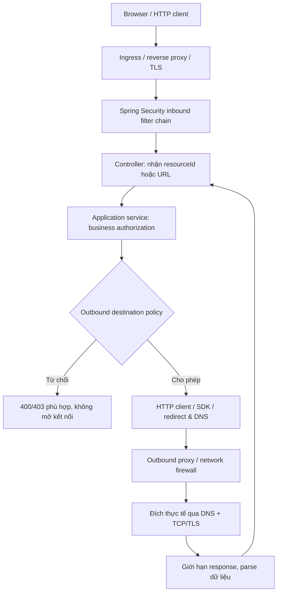
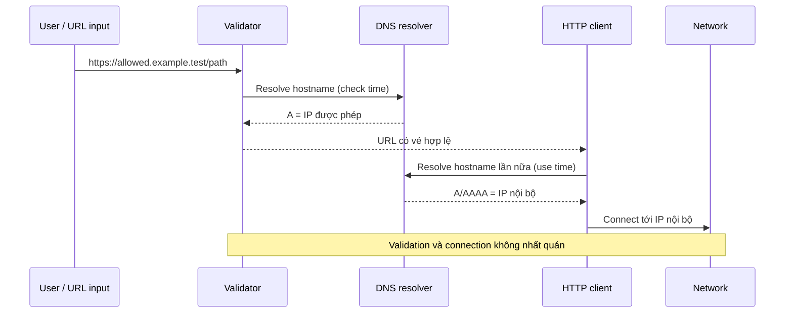
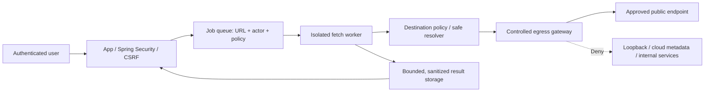

# SSRF và kiểm soát đích kết nối ra ngoài

Trong module `SPRING_SECURITY_HTTP_PROTECTION`, Spring Security bảo vệ các request **đi vào** ứng dụng bằng authentication, authorization, CSRF, CORS, security headers, CSP, HSTS, HTTP firewall và quản lý session. Tuy nhiên, nhiều ứng dụng còn có khả năng **chủ động gửi request đi ra**: tải ảnh từ URL, dựng link preview, gọi webhook, nhập tài liệu từ cloud storage, đọc metadata một trang, xác minh callback hoặc tải tập tin để chuyển đổi.

Nếu người dùng có thể điều khiển **đích mà server kết nối**, kẻ tấn công có thể lợi dụng quyền truy cập mạng của chính server để tiếp cận tài nguyên vốn không truy cập được từ bên ngoài. Đây là **Server-Side Request Forgery (SSRF)**. Bật Spring Security không tự thêm kiểm soát egress cho `HttpClient`, `RestClient`, `WebClient`, SDK của nhà cung cấp hoặc các thư viện tải URL khác.

Bài thuộc chương **Ranh giới bảo vệ**, tập trung câu hỏi:

> **Khi mã ứng dụng được quyền tạo một request outbound, ai quyết định scheme, hostname, IP thực tế, port, đường redirect và dữ liệu được phép gửi/nhận?**

Ví dụ, user có role hợp lệ gửi:

```text
POST /link-previews
Content-Type: application/x-www-form-urlencoded
Cookie: JSESSIONID=...

url=http://169.254.169.254/latest/meta-data/
```

Nếu backend gọi thẳng URL này, request có thể nhắm tới một dịch vụ metadata nội bộ của môi trường cloud thay vì tới website công khai. Đây là ví dụ **đích phải bị từ chối**, không phải URL để thử trên hạ tầng thật. Hệ thống cloud khác nhau có chính sách metadata riêng, nên không mặc định ví dụ đó hoạt động trên mọi môi trường.

Đường phòng vệ ưu tiên là **không nhận URL tùy ý**: cho user chọn ID hoặc tên tài nguyên, còn server tự dựng URL tới **origin do tổ chức kiểm soát**. Nếu nghiệp vụ bắt buộc chấp nhận URL động, cần phối hợp validation, DNS/connection policy, kiểm soát redirect, TLS, quyền mạng và hạn chế tải/response. Chỉ dùng một regex hoặc kiểm tra “host không chứa localhost” là không đủ.

Các ví dụ theo phong cách Java 17+, Spring Boot 3.x, Spring Security 6.x; phần Servlet dùng JDK `java.net.http.HttpClient`, phần Reactive dùng Spring `WebClient` với Reactor Netty. Các địa chỉ `*.example.test` chỉ là host minh họa và cần thay bằng hostname thực của tổ chức. Phần lớn code là ví dụ có chủ đích phạm vi hẹp, không đại diện một URL-fetch service cho phép internet tùy ý.

## 1. Mục tiêu học tập

Sau bài này, người học có thể:

- Nhận diện SSRF trong URL preview, webhook, import-from-URL, tải ảnh, PDF/HTML renderer, OAuth/JWKS integration và các SDK thực hiện outbound requests.
- Phân biệt **inbound HTTP authorization** của Spring Security với **outbound destination authorization** của ứng dụng và hạ tầng.
- Nêu rõ tại sao CORS, CSRF, CSP, HSTS, HTTP firewall và `ROLE_USER` không tự ngăn server truy cập địa chỉ nội bộ.
- Thiết kế API **chỉ nhận resource ID**, ghép với fixed origin ở server thay vì chấp nhận full URL.
- Kiểm tra scheme, host, port, userinfo, URL parsing và redirect theo **allowlist**, không dùng blacklist đơn lẻ.
- Hiểu DNS rebinding và sai lệch **TOCTOU** giữa lần kiểm tra DNS với lần HTTP client kết nối.
- Nêu được yêu cầu xử lý IPv4/IPv6, nhiều kết quả DNS, địa chỉ loopback/link-local/private/reserved và IP được dùng thực tế.
- Cấu hình JDK `HttpClient` và Reactor Netty `WebClient` không tự động follow redirects, có timeouts và giới hạn response.
- Tránh forward cookie, `Authorization`, metadata nhạy cảm và raw response từ outbound service không tin cậy.
- Viết test URL policy, MockMvc/WebTestClient, fake upstream và thử nghiệm mạng để xác minh cả application rule lẫn egress rule.
- Xây checklist production bao gồm firewall/proxy, IAM, secrets, rate/size limits, tracing và phát hiện hành vi bất thường.

## 2. Ranh giới SSRF: request đi vào và request đi ra là hai việc khác nhau



Những bước khác nhau trả lời những câu hỏi khác nhau:

| Ranh giới | Câu hỏi | Thành phần thực thi |
| --- | --- | --- |
| **Inbound** | User có được gọi chức năng preview/import này không? | Spring Security authn/authz, CSRF với unsafe browser requests |
| **Business** | User có quyền tạo preview cho document này không? Có vượt quota không? | Service/domain policy |
| **Destination** | Server được gọi hostname, scheme, port nào? | Application destination policy + cấu hình HTTP client |
| **Resolution/connection** | IP và cổng **thực tế** được mở TCP/TLS có được phép không? | DNS/connector có kiểm soát + egress proxy/firewall |
| **Outbound identity** | Có gửi token/cookie/secret nào, cho đúng đối tác nào? | Application secret policy, outbound client config |
| **Response** | Có được đọc body, redirect, parse và xuất nội dung ra cho client không? | Bounded response processing + content validation |
| **Operations** | Tần suất, thời gian, log và chi phí outbound có được giới hạn không? | Service quotas, circuit breaker, metrics, infra |

**CSRF 403 ở request inbound không đồng nghĩa mọi chi phí outbound đã bị kiểm soát** nếu ứng dụng hoặc filter nào đó tạo request trước security. Ngược lại, user đã authenticated và có CSRF token đúng **không được quyền chọn mọi đích mạng mà server có thể tiếp cận**.

### 2.1. Vì sao SSRF nguy hiểm ngay cả khi không trả response?

Hai dạng thường gặp:

- **SSRF có phản hồi:** backend fetch URL rồi đưa status/body hoặc một phần dữ liệu tới user. Nếu đích là nội bộ, dữ liệu nội bộ có thể bị lộ trực tiếp.
- **Blind SSRF:** backend không trả body, nhưng vẫn gửi request đi. Kẻ tấn công có thể quan sát ảnh hưởng khác như callback tới hệ thống họ kiểm soát, thay đổi trạng thái ở endpoint nội bộ hoặc khác biệt timing. Không trả raw body **giảm rủi ro tiết lộ trực tiếp**, nhưng không xóa SSRF.

Ngoài việc truy cập dữ liệu, một server có thể có mạng nội bộ, DNS riêng, service identity và cloud permissions mà client bên ngoài không có. Vì vậy SSRF còn có thể tạo **confused deputy**: user thấp quyền khiến một service nhiều quyền thực hiện request thay mình.

### 2.2. Tính năng dễ có outbound request ẩn

| Tính năng | Đầu vào bị điều khiển | Outbound xảy ra ở đâu? |
| --- | --- | --- |
| Link preview | URL bài viết | HTML/metadata fetcher ở backend |
| Import image | `imageUrl` | Image downloader/thumbnailer |
| PDF từ HTML | Các URL trong `img`, `link`, CSS `url(...)` | HTML renderer tải phụ thuộc |
| Webhook | Callback URL | HTTP sender/queue worker |
| URL screenshot | Địa chỉ trang | Headless browser chạy trên server |
| SSO/OIDC/JWKS | Issuer/JWKS URL | Identity integration |
| Document converter | Link hoặc embedded resources | Converter, parser, renderer |
| Feed/RSS reader | Feed URL | Scheduler/worker |
| Object-storage import | Bucket/key/URL | Storage SDK hoặc presigned URL downloader |
| Image proxy/CDN transform | URL ảnh bên ngoài | Image fetcher/cache |
| WebSocket/server-side callback | Host/path do client chọn | Outbound socket client |

Đừng chỉ grep code có chữ `new URL`. SDK, HTML parser, XML library, headless browser, media thumbnailer và storage adapter cũng có thể mở kết nối mạng khi xử lý nội dung không tin cậy.

## 3. Mục tiêu mà kẻ tấn công có thể cố hướng tới

SSRF là vấn đề **đích kết nối**, không phụ thuộc vào một payload cố định. Các đích cần hạn chế thường bao gồm:

- **Loopback:** `127.0.0.0/8` và `::1` — dịch vụ chỉ mở cho máy cục bộ.
- **Mạng riêng:** `10.0.0.0/8`, `172.16.0.0/12`, `192.168.0.0/16`, IPv6 ULA `fc00::/7`.
- **Link-local:** `169.254.0.0/16`, IPv6 `fe80::/10`; nhiều nền tảng cloud có metadata endpoint tại vùng này hoặc endpoint riêng.
- **Các đích special-use khác:** unspecified, multicast, carrier-grade NAT, ranges dành riêng, địa chỉ IPv4-mapped IPv6 và các dạng biểu diễn khác của cùng một IP.
- **Internal DNS names:** `db.internal`, `service.namespace.svc.cluster.local` hoặc host nội bộ riêng của tổ chức.
- **Service port nội bộ:** API quản trị, cache, queue, search cluster, admin UI, debug endpoints, metadata service, sidecar.
- **External host không được phép:** URL của bên thứ ba chưa được tổ chức chấp thuận, có thể nhận dữ liệu/credential nếu backend tự gửi.

Danh sách này **chỉ để nhận diện nhóm rủi ro**, không phải danh sách CIDR đầy đủ để copy thành một `isSafeIp` tự chế. Một rule production cần hiểu phân loại IPv4/IPv6 theo môi trường, bao gồm toàn bộ special-use ranges, và quan trọng hơn là **chỉ cho phép chính những đích cần thiết**.

### 3.1. Thí dụ đường đi có rủi ro

```text
POST /preview?url=https://untrusted.example.test/redirect
        |
        v
Backend kiểm tra URL ban đầu có scheme HTTPS
        |
        v
HTTP client tự theo response Location
        |
        v
Location: http://127.0.0.1:8080/admin
        |
        v
Backend gửi request tới dịch vụ nội bộ
```

Đây là một **kiểu chuyển hướng nguy hiểm**. Nếu chỉ validate URL đầu tiên, nhưng tự follow redirect đến đích mới, policy bị bỏ qua ở hop sau.

### 3.2. Những lỗi tư duy dễ dẫn tới SSRF

- “User đã đăng nhập, có role PREVIEWER nên URL họ gửi đáng tin.”
- “CORS đã chặn website khác nên backend không thể gọi host ngoài.”
- “Chỉ cho URL bắt đầu `https://trusted.example.test` là đủ.” — prefix string có thể chấp nhận authority sai.
- “Chặn chuỗi `localhost` là đủ.” — có IP literals, DNS names, IPv6 và nhiều dạng biểu diễn khác.
- “Tôi resolve DNS rồi kiểm tra private IP một lần là xong.” — có thể xảy ra thay đổi DNS giữa validate và connect.
- “Response không được hiển thị nên không có SSRF.” — blind SSRF vẫn gây side effects.
- “Không có `RestTemplate` trong codebase nên không có outbound request.” — SDK và thư viện khác cũng có thể fetch.

## 4. Chiến lược ưu tiên: **không cho user chọn origin**

Thay vì API nhận:

```json
{
  "url": "https://some-host.example.test/v1/documents/123"
}
```

hãy để user chọn **một định danh tài nguyên**:

```json
{
  "documentId": "doc_123"
}
```

Ứng dụng tự quyết định đích:

```text
Origin do cấu hình server quản lý:
https://api.partner.example.test

Route do developer định nghĩa:
/v1/documents/{documentId}

Giá trị user được nhận:
doc_123    (được validate là identifier, không phải URL)
```

**Lợi ích bảo mật:** user không được chọn hostname, scheme, port, userinfo hoặc endpoint nội bộ. Đây là thiết kế loại bỏ phần lớn bề mặt SSRF do user-controlled arbitrary URL. Tuy nhiên, vẫn cần trust DNS của đối tác, bảo vệ kết nối thực tế, timeout, egress restriction và xác minh credential vì cả host cố định cũng có thể bị cấu hình/DNS/proxy sai.

### 4.1. Chỉ nhận identifier có grammar chặt

```java
import java.util.regex.Pattern;

public final class DocumentIdPolicy {

    private static final Pattern VALID =
            Pattern.compile("[A-Za-z0-9_-]{1,40}");

    private DocumentIdPolicy() {}

    public static String requireValid(String value) {
        if (value == null || !VALID.matcher(value).matches()) {
            throw new IllegalArgumentException(
                    "documentId không hợp lệ");
        }
        return value;
    }
}
```

Regex ở đây dùng để **kiểm tra grammar của resource ID**, không dùng để phân tích arbitrary URL. Khi ID chỉ chứa ASCII letters/digits/`_`/`-`, nó không thể chứa `/`, `?`, `#`, `@`, dấu `:` hay ký tự URL delimiter làm thay đổi origin.

Trong hệ thống thật, yêu cầu về ID có thể khác (UUID, opaque slug, số nguyên). Khi có slash hoặc Unicode, dùng URL builder/encoding theo path segment, nhưng vẫn **không chấp nhận full authority của user**.

### 4.2. Không giải quyết SSRF bằng cách “làm sạch URL” như HTML

HTML escaping, SQL parameterization hay CSRF token không phải URL destination authorization. Một URL có thể an toàn để **render như text** mà không an toàn để **backend mở kết nối** tới host của nó.

Tương tự, output encoding cần thiết khi đưa preview title vào HTML, nhưng không thay việc kiểm soát nơi server đã fetch. Các ranh giới phải tách biệt trong thiết kế và kiểm thử.


## 5. Servlet: gọi một đối tác cố định bằng Java HttpClient

Ví dụ ứng dụng có chức năng xem trước thông tin tài liệu đối tác. User chỉ cung cấp `documentId`; hostname và route do **cấu hình tin cậy của server** chọn. HTTP client không mang cookie phiên inbound sang đối tác, không tự chuyển hướng và có timeouts/giới hạn response.

### 5.1. Khởi tạo outbound client độc lập

```java
import com.fasterxml.jackson.databind.ObjectMapper;
import java.net.URI;
import java.net.http.HttpClient;
import java.time.Duration;
import org.springframework.context.annotation.Bean;
import org.springframework.context.annotation.Configuration;

@Configuration
public class PartnerClientConfiguration {

    @Bean
    HttpClient partnerHttpClient() {
        return HttpClient.newBuilder()
                .connectTimeout(Duration.ofSeconds(2))
                .followRedirects(HttpClient.Redirect.NEVER)
                .build();
    }

    @Bean
    PartnerDocumentGateway partnerGateway(
            HttpClient partnerHttpClient,
            ObjectMapper objectMapper) {

        // Chỉ cấu hình/deploy kiểm soát được đích này.
        // Không lấy URL gốc từ HTTP request.
        URI trustedBase = URI.create(
                "https://api.partner.example.test/");

        return new PartnerDocumentGateway(
                partnerHttpClient, objectMapper, trustedBase);
    }
}
```

JDK `HttpClient` mặc định không follow redirects; code nêu rõ `Redirect.NEVER` để hợp đồng dễ review. HTTP client Java cũng có **proxy selector mặc định** hoặc cấu hình `ProxySelector` riêng. Nếu hệ thống định tuyến outbound qua egress proxy, phải kiểm tra proxy thực tế, đường bypass, danh sách hostname và policy của gateway; không coi cấu hình trong lớp này là chặn mọi đích mạng.

Không tự tắt TLS certificate/hostname verification để giao tiếp với server thử nghiệm. Production phải dùng TLS xác thực host đúng và trust store được vận hành. Nếu đối tác yêu cầu mTLS hoặc bearer token, cấu hình riêng **cho đúng client đối tác** và tránh forward inbound credentials.

### 5.2. DTO chỉ chứa dữ liệu cần thiết

```java
public record PartnerPreview(
        String title,
        String summary) {
}
```

Chúng ta **không trả nguyên HTML body** hoặc response headers của đối tác tới browser. Chỉ trích xuất những trường cần thiết trong JSON, giới hạn kích thước response và render text dưới dạng text trong giao diện.

### 5.3. Gateway: fixed origin, bounded response, no redirect

```java
import com.fasterxml.jackson.databind.ObjectMapper;
import java.io.IOException;
import java.io.InputStream;
import java.net.URI;
import java.net.http.HttpClient;
import java.net.http.HttpRequest;
import java.net.http.HttpResponse;
import java.time.Duration;
import java.util.Locale;
import java.util.Objects;

public final class PartnerDocumentGateway {

    private static final int MAX_BYTES = 64 * 1024;

    private final HttpClient client;
    private final ObjectMapper json;
    private final URI trustedBase;

    public PartnerDocumentGateway(
            HttpClient client,
            ObjectMapper json,
            URI trustedBase) {
        this.client = Objects.requireNonNull(client);
        this.json = Objects.requireNonNull(json);
        this.trustedBase = Objects.requireNonNull(trustedBase);

        if (!trustedBase.isAbsolute()
                || trustedBase.getHost() == null
                || !trustedBase.getPath().endsWith("/")) {
            throw new IllegalArgumentException(
                    "Trusted base phải là absolute origin/path có '/' cuối");
        }

        // Cấu hình này phải được cố định ở nơi deploy tin cậy.
        // Trong production cần xác minh scheme HTTPS và exact
        // hostname đã được tổ chức phê duyệt.
    }

    public PartnerPreview preview(String documentId)
            throws IOException, InterruptedException {

        String id = DocumentIdPolicy.requireValid(documentId);

        // ID không có / ? # @ : nên không thể đổi authority.
        URI target = trustedBase.resolve("v1/documents/" + id);

        HttpRequest request = HttpRequest.newBuilder(target)
                .GET()
                .timeout(Duration.ofSeconds(4))
                .header("Accept", "application/json")
                .build();

        HttpResponse<InputStream> response = client.send(
                request, HttpResponse.BodyHandlers.ofInputStream());

        try (InputStream stream = response.body()) {
            // Bao gồm 301, 302, 303, 307, 308: không theo Location.
            if (response.statusCode() != 200) {
                throw new IOException("Upstream status không mong đợi");
            }

            String contentType = response.headers()
                    .firstValue("Content-Type")
                    .orElse("")
                    .toLowerCase(Locale.ROOT);

            if (!contentType.startsWith("application/json")) {
                throw new IOException("Upstream content type không hợp lệ");
            }

            // Đọc tối đa MAX_BYTES + 1; vượt giới hạn thì từ chối.
            byte[] body = stream.readNBytes(MAX_BYTES + 1);
            if (body.length > MAX_BYTES) {
                throw new IOException("Upstream response quá lớn");
            }

            PartnerPreview result =
                    json.readValue(body, PartnerPreview.class);

            if (result == null
                    || result.title() == null
                    || result.title().length() > 200
                    || result.summary() == null
                    || result.summary().length() > 2_000) {
                throw new IOException("Upstream data không hợp lệ");
            }

            return result;
        }
    }
}
```

Điểm phòng vệ trong đoạn code:

1. `documentId` chỉ là một chuỗi có grammar chặt; nó không thể đưa `http://...`, `//host` hoặc path traversal vào đường dẫn.
2. `trustedBase` chỉ do **config/deploy** tạo, không phải chuỗi đến từ form/query/header hoặc bản ghi do user tự tạo. Thực tế nên validate exact origin khi startup, không cho runtime input thay thế.
3. `Redirect.NEVER` bảo đảm response 3xx **không tự phát sinh request thứ hai**. Gateway cũng từ chối status khác 200.
4. `connectTimeout` và request `timeout` tránh chờ vô hạn trong những trường hợp phổ biến.
5. Response là JSON có giới hạn kích thước, không chuyển raw HTTP body/headers cho user.
6. Không copy `Cookie`, `Authorization`, `Host`, `Forwarded` hay các request headers inbound vào outbound request.
7. Dùng `try-with-resources` để đóng input stream, kể cả khi nhận redirect/error/oversize.
8. Phải có egress network policy: fixed hostname **không bảo vệ được nếu DNS, route hoặc outbound proxy bị điều khiển để nối tới IP bị cấm**.

**Giới hạn có chủ đích:** Constructor trong ví dụ cho phép truyền `trustedBase` từ code để viết test với fake server. Ở runtime production, bean factory phải nhận đúng một URI cố định đã phê duyệt, với scheme HTTPS và exact host được kiểm tra ngay khi cấu hình. Đừng biến constructor parameter đó thành `@RequestParam url`. Nếu business cần nhiều đối tác, dùng một enum/registry nguồn cấu hình đáng tin thay vì nhận URL tùy ý.

### 5.4. Controller chỉ nhận ID và không lộ lỗi upstream

```java
import java.io.IOException;
import org.springframework.http.HttpStatus;
import org.springframework.web.bind.annotation.PostMapping;
import org.springframework.web.bind.annotation.RequestParam;
import org.springframework.web.bind.annotation.RestController;
import org.springframework.web.server.ResponseStatusException;

@RestController
public class PartnerPreviewController {

    private final PartnerDocumentGateway gateway;

    public PartnerPreviewController(
            PartnerDocumentGateway gateway) {
        this.gateway = gateway;
    }

    @PostMapping("/partner-previews")
    PartnerPreview preview(
            @RequestParam String documentId) {

        try {
            return gateway.preview(documentId);
        } catch (IllegalArgumentException e) {
            throw new ResponseStatusException(
                    HttpStatus.BAD_REQUEST, "documentId không hợp lệ");
        } catch (InterruptedException e) {
            Thread.currentThread().interrupt();
            throw new ResponseStatusException(
                    HttpStatus.SERVICE_UNAVAILABLE,
                    "Không thể lấy preview lúc này");
        } catch (IOException e) {
            throw new ResponseStatusException(
                    HttpStatus.BAD_GATEWAY,
                    "Đối tác không phản hồi theo hợp đồng");
        }
    }
}
```

Không đưa `e.getMessage()` hoặc nội dung response của đích vào lỗi HTTP cho user. Các lỗi trong log cần được phân loại (timeout, invalid content type, 3xx blocked, response too big) nhưng không chứa token, credential hoặc raw body.

Với Servlet, `client.send(...)` là blocking I/O. Cần giới hạn concurrency/thread utilization và bổ sung rate/quotas. Không gọi phương thức này từ Reactor event loop ở ứng dụng WebFlux.

### 5.5. Spring Security bảo vệ quyền kích hoạt preview

```java
import org.springframework.context.annotation.Bean;
import org.springframework.context.annotation.Configuration;
import org.springframework.http.HttpMethod;
import org.springframework.security.config.Customizer;
import org.springframework.security.config.annotation.web.builders.HttpSecurity;
import org.springframework.security.web.SecurityFilterChain;

@Configuration
public class PreviewHttpSecurityConfig {

    @Bean
    SecurityFilterChain securityFilterChain(HttpSecurity http)
            throws Exception {
        return http
                .authorizeHttpRequests(auth -> auth
                        .requestMatchers(HttpMethod.POST,
                                "/partner-previews")
                            .hasRole("PREVIEWER")
                        .anyRequest().denyAll())
                .formLogin(login -> login.permitAll())
                .csrf(Customizer.withDefaults())
                .build();
    }
}
```

Dùng **POST** thay vì GET khi chức năng có thể gây chi phí outbound đáng kể hoặc tạo trạng thái nghiệp vụ, và bảo vệ bằng CSRF khi frontend sử dụng cookie-session. Điều này không thay dest policy: user có `ROLE_PREVIEWER` không được chọn máy chủ để gọi.

Cấu hình bảo mật demo từ chối các route chưa khai báo. Khi tích hợp thật, hãy xét login/logout, static assets, health checks và các security chains khác. Không tạo hai catch-all chains độc lập chỉ vì copy nhiều ví dụ trong bài.

### 5.6. Cơ chế phân quyền theo tài nguyên vẫn cần

Nếu `documentId` là ID tài liệu của từng tenant trong ứng dụng, trước khi gọi đối tác còn phải kiểm tra:

- Actor có quyền xem tài liệu đó không?
- ID có thuộc tổ chức/tenant của actor không?
- Đã vượt số lượt preview trong kỳ chưa?
- Có ràng buộc dữ liệu nào không được phép gửi sang đối tác?

`ROLE_PREVIEWER` kiểm tra loại chức năng, **không tự cấp quyền đối với mọi record**. Đây là chính sách nghiệp vụ service/repository phải thực thi trước outbound.

## 6. Khi bắt buộc nhận URL động: kiểm tra syntax và allowlist hostname

Một số sản phẩm thật sự cần import URL hoặc định nghĩa webhook endpoint. Khi ấy, không thể chỉ dùng fixed origin. Mỗi **URL nguồn/đích** phải được xem như một capability có giới hạn, không phải một chuỗi tự do.

Phân loại hai mô hình:

- **Allowlist đối tác biết trước:** user được chọn một trong số host/endpoint đã được duyệt. Có thể parse URL rồi so sánh exact host, scheme, port, path theo hợp đồng.
- **Arbitrary internet URL:** user có thể chọn nhiều host không biết trước. Đây là bài toán khó hơn nhiều; **validation ở application layer phải kết hợp resolver/connector có kiểm soát, pin kết nối và network egress deny-by-default**. Một mẫu regex hoặc `InetAddress.getAllByName` kiểm tra trước khi fetch không đủ.

### 6.1. Mẫu kiểm tra URL ban đầu theo exact allowlist

Ví dụ dưới chỉ là **bước kiểm tra cú pháp/authority** cho hai hostname đối tác cố định; chưa phải một trình chống SSRF đầy đủ vì **chưa kiểm soát IP thực tế lúc TCP/TLS connect**.

```java
import java.net.URI;
import java.net.URISyntaxException;
import java.util.Locale;
import java.util.Set;

public final class ApprovedUrlSyntax {

    private static final Set<String> ALLOWED_HOSTS =
            Set.of(
                    "feeds.partner.example.test",
                    "cdn.partner.example.test");

    private ApprovedUrlSyntax() {}

    public static URI parseAndCheck(String raw) {
        if (raw == null || raw.length() > 2048) {
            throw new IllegalArgumentException(
                    "URL không hợp lệ");
        }

        try {
            URI uri = new URI(raw);
            String host = uri.getHost();

            if (!uri.isAbsolute() || uri.isOpaque()
                    || !"https".equalsIgnoreCase(uri.getScheme())
                    || host == null
                    || !ALLOWED_HOSTS.contains(
                            host.toLowerCase(Locale.ROOT))
                    || uri.getRawUserInfo() != null
                    || uri.getRawFragment() != null
                    || (uri.getPort() != -1 && uri.getPort() != 443)) {
                throw new IllegalArgumentException(
                        "Destination không được phép");
            }

            return uri;
        } catch (URISyntaxException ex) {
            throw new IllegalArgumentException(
                    "URL syntax không hợp lệ");
        }
    }
}
```

**Chính sách của mẫu:** HTTPS; exact host ở allowlist; cổng mặc định hoặc 443; không có userinfo hay fragment; URL phải parse thành URI tuyệt đối có host. Tên host chỉ dùng ASCII ở allowlist. Nếu tổ chức cần IDN, Unicode hoặc IP literals, phải đưa ra quy tắc canonicalization cụ thể và kiểm thử tương ứng trước khi so sánh.

**Những điều còn thiếu:**

- Chưa kiểm soát **địa chỉ A/AAAA thực tế** mà connector sẽ sử dụng.
- Chưa chống DNS rebinding hay resolver/proxy không nhất quán.
- Chưa kiểm tra path/query theo business contract; nhiều API đòi hỏi route allowlist riêng.
- Chưa áp policy cho các redirects/retries/subrequests.
- Chưa giới hạn bytes, redirects, concurrency, request methods hoặc credentials.
- Chưa áp firewall outbound để chặn đích mạng không được phép.

Vì vậy **không đưa thẳng `parseAndCheck(raw).toURL().openStream()` vào production rồi gọi đó là SSRF-safe**.

### 6.2. Vì sao exact host tốt hơn string prefix/suffix tùy tiện?

Ví dụ sai về mặt thiết kế:

```java
// KHÔNG DÙNG để quyết định destination authority:
if (rawUrl.startsWith("https://trusted.example.test")) {
    fetch(rawUrl);
}
```

Chuỗi bắt đầu đúng có thể vẫn chứa authority khác hoặc userinfo/đường dẫn khiến parser/redirect hiểu khác. Tương tự, `host.contains("trusted.example.test")` chấp nhận những host không tương đương; `endsWith("trusted.example.test")` có thể nhận hostname kết thúc giống nhưng không có ranh giới nhãn đúng.

Khi nghiệp vụ chỉ cần vài host, so sánh **exact canonical hostname** là hướng tốt. Nếu cần subdomain allowlist, phải xét dấu chấm phân cách nhãn, public suffix, IDN và ownership thực, không đơn thuần substring. Và dù hostname đúng, DNS vẫn có thể trỏ sai IP tại thời điểm kết nối.

### 6.3. URL parsing edge cases cần chú ý

Một số biến thể phải có test tùy parser/network stack:

- Userinfo `user@host` và authority có nhiều dấu phân cách.
- IPv6 bracket literals, IPv4-mapped IPv6 và IPv6 zone identifiers.
- Host mixed case, dấu chấm cuối, IDN/punycode và Unicode confusables.
- URL encoded delimiters, backslashes, percent-encoded host/path characters.
- Decimal/octal/hex-like IPv4 biểu diễn khác nhau ở các library.
- `http`/`https` mixed scheme hoặc downgrade redirect.
- Cổng không mong đợi, protocol-relative URL `//host/path` và opaque URI.
- Redirect response có `Location` tương đối hoặc tuyệt đối.
- DNS trả nhiều A/AAAA records và client thử địa chỉ khác sau lần đầu lỗi.

Không tự viết URL parser bằng regex. **Parser dùng để kiểm tra nên có cùng semantics với client thực hiện kết nối**, còn policy mạng phải kiểm tra destination IP thực tế để tránh các khoảng trống còn lại.


## 7. DNS rebinding và ranh giới **validate–connect**

Ngay cả khi URL ban đầu chứa hostname thuộc allowlist, **địa chỉ IP thực tế** vẫn có thể thay đổi theo DNS hoặc đường proxy. Một lỗi điển hình là kiểm tra DNS ở thời điểm A, rồi để HTTP client tự resolve hostname thêm lần nữa ở thời điểm B.

### 7.1. TOCTOU: hai lần resolve, hai kết quả khác nhau



Đây là **Time-of-Check to Time-of-Use (TOCTOU)**. Nếu code thực hiện:

```java
// Chưa đủ để chống SSRF:
var addresses = java.net.InetAddress.getAllByName(host);
checkAddresses(addresses);

// Sau đó client tự DNS lookup lại; không có liên kết
// giữa IP đã kiểm tra và socket thực tế.
httpClient.send(requestToHost, bodyHandler);
```

thì policy không bảo đảm client dùng chính những địa chỉ vừa được kiểm tra. DNS rebinding, kết quả nhiều A/AAAA, cache, retry, DNS proxy hay cấu hình resolver khác nhau có thể dẫn tới IP khác.

### 7.2. Bảo đảm cần có ở đường kết nối

Với service bắt buộc fetch URL động, kiến trúc mạnh hơn phải bảo đảm:

1. **Parse authority** qua URL parser phù hợp HTTP client; allowlist scheme/hostname/port theo nghiệp vụ.
2. Resolve tất cả A/AAAA được cân nhắc, kiểm tra mỗi địa chỉ theo **network destination policy** (không chỉ IPv4).
3. **Chỉ mở kết nối tới địa chỉ đã được chấp thuận**, không làm một DNS lookup không kiểm soát ở bước connect.
4. Giữ nguyên hostname logic để thực hiện HTTP `Host`, TLS **SNI và certificate hostname verification** chính xác. Không tự tắt hostname verification khi kết nối theo IP.
5. Nếu client thử IP khác, retry, redirect hoặc reconnect, **mỗi kết nối mới** tiếp tục tuân policy.
6. Kiểm tra IP/port **trên socket hoặc egress gateway thực sự**. Application-level DNS check là defense in depth, không thay network enforcement.

Để thực hiện chính xác ở Java cần **HTTP connector hoặc egress proxy có khả năng pin điểm kết nối đã kiểm tra**. API thông thường của `HttpClient.send(URI)` hay `WebClient.get().uri(URI)` không tự cung cấp bảo đảm này chỉ vì trước đó ứng dụng gọi `InetAddress.getAllByName`.

**Không tự viết một lớp fetch arbitrary URL đơn giản với `URL.openStream` + regex + `getAllByName` rồi công bố là SSRF-safe.** Nếu không có connector kiểm soát connect-time IP, hãy giới hạn chức năng về fixed origins hoặc gửi toàn bộ request qua egress gateway được vận hành chuyên biệt.

### 7.3. Không chỉ có `isSiteLocalAddress()`

Các hàm như `InetAddress.isSiteLocalAddress()` chỉ phân loại một số địa chỉ theo API Java; chúng **không phải bộ phát hiện mọi special-use/reserved IP**. Một policy chống SSRF cần tính đến:

- IPv4 loopback, private, link-local, unspecified, multicast và các special-use ranges khác.
- IPv6 loopback, link-local, unique-local, multicast, unspecified và scope identifiers.
- Địa chỉ IPv4-mapped IPv6, NAT64 hoặc các biểu diễn dẫn về cùng đích.
- Cả hostname nội bộ lẫn tên miền ngoài trả về IP nội bộ.
- IP/port mà proxy hoặc connector thật sự lựa chọn, không chỉ IP đầu tiên trong DNS answer.
- Những mạng **riêng của tổ chức** không thuộc các dải private phổ biến nhưng vẫn không được user service kết nối tới.

Không biến tập CIDR demo ở mục 3 thành denylist duy nhất. **Allowlist đúng những mạng/đích cần thiết** và chặn mọi tuyến khác ở egress có phạm vi kiểm soát mạnh hơn.

### 7.4. Domain đã nằm trong allowlist vẫn cần DNS monitoring

Với các đối tác cố định, doanh nghiệp có thể chủ động kiểm soát DNS/egress:

- Giám sát host đối tác có thay đổi sang IP bất thường, link-local hoặc loopback không.
- Kiểm soát DNS resolver mà workload được dùng và cache/TTL.
- Áp firewall/gateway policy tại thời điểm **connect**, bao gồm cả IPv4/IPv6.
- Ghi nhận hostname được yêu cầu và IP cuối cùng được kết nối, nhưng **không log credential hoặc query bí mật**.
- Xác nhận certificate, SNI và service identity của đối tác.

DNS monitoring giúp phát hiện nhưng **không thay kết nối được pin/kiểm tra**. Đặc biệt, một IP public bất kỳ cũng chưa chắc được phê duyệt; việc không thuộc RFC1918 không tự khiến host đáng tin.

## 8. Network egress: tuyến phòng vệ đáng tin hơn blacklist URL

Khi workload phải tải URL theo yêu cầu user, nên đặt chức năng đó trong một **khu vực mạng ít quyền**, thay vì cho nó hoạt động từ application server có quyền tới database, metadata và quản trị nội bộ.

### 8.1. Kiến trúc outbound worker tách biệt



Một outbound worker có thể được thiết kế với:

- **Không có quyền mạng** tới DB nội bộ, admin ports, metadata endpoint và subnet nhạy cảm; deny-by-default ở egress.
- **Không có service credentials** dùng cho tác vụ khác; IAM rất hẹp.
- Chỉ outbound qua egress proxy/gateway biết apply hostname/IP/port rules ở thời điểm kết nối.
- Chỉ cho HTTP/HTTPS và những method được phép; nếu không cần HTTP thì dùng SDK/service-specific protocol riêng.
- CPU/memory/disk limits, response-size cap, concurrency, rate limiting và queue quotas.
- Audit/metrics để biết actor và destination policy đã áp dụng, không ghi token/cookie/query nhạy cảm.

Sự tách biệt này đặc biệt hữu ích cho **headless browser, HTML/PDF renderer, ảnh/crawler** vì chúng có thể tự tải subresources vượt ngoài URL đầu tiên.

### 8.2. Kiểm soát metadata và cloud identity

Nhiều môi trường cloud cung cấp **instance/workload metadata** hoặc credential helpers qua mạng nội bộ, link-local hay socket riêng. Khi SSRF cho phép server truy cập những dịch vụ đó, rủi ro có thể vượt khỏi dữ liệu web.

Phòng vệ:

- Chặn outbound tới metadata endpoints theo môi trường triển khai; xác định chính xác endpoint của cloud đang dùng.
- Không cấp IAM/role quyền rộng cho fetcher.
- Dùng các cơ chế bảo vệ metadata của cloud khi có (ví dụ yêu cầu token/session cho metadata service), nhưng không coi đó là thay thế **network isolation và destination validation**.
- Không deploy generic URL fetcher trong cùng runtime có quyền lấy secret hoặc quản trị hạ tầng nếu không cần.
- Kiểm tra cả container host network, sidecar, node metadata proxy và service mesh routing.

Một endpoint metadata có thể tồn tại ở địa chỉ khác ví dụ `169.254.169.254`. Danh sách cụ thể phải theo cloud và kiến trúc, không hardcode một IP là đã đầy đủ.

### 8.3. Service mesh, proxy và DNS không tự SSRF-safe

Đi qua proxy hoặc service mesh **chỉ hữu ích khi chính policy của nó từ chối đích không được phép**. Một forward proxy mở cho mọi IP có thể chỉ chuyển rủi ro từ application node sang proxy.

Cần kiểm tra:

- Có đường direct-connect bypass proxy không?
- Proxy resolve DNS hay client resolve DNS? Ai kiểm tra IP sau resolve?
- Có support IPv6/IPv4-mapped/NAT64 và mọi network routes không?
- Có cho CONNECT tunnel tới cổng tùy ý không?
- Với redirects, connector có gửi request mới tới host ngoài allowlist không?
- Sidecar/service mesh có default-allow outbound cho services nội bộ không?
- TLS verification và hostname policy được thực thi ở đâu?

Một mạng không mở route tới internal destination thực sự là lớp bảo vệ quan trọng ngay cả khi application có lỗi parser.

## 9. Redirects: mỗi hop là một yêu cầu outbound mới

HTTP redirect không chỉ là thông tin trình bày. Nếu client tự theo `Location`, nó có thể thay đổi **scheme, host, port, đường dẫn, method và nơi gửi headers**.

### 9.1. Các mã redirect cần kiểm tra

| Status | Ý nghĩa thường gặp | Vấn đề SSRF |
| --- | --- | --- |
| 301 Moved Permanently | Tài nguyên chuyển vĩnh viễn | Có thể hướng tới origin khác. |
| 302 Found | Chuyển hướng tạm thời | Client thường tạo request tới Location mới. |
| 303 See Other | Client theo redirect bằng GET | Vẫn có thể kết nối tới origin/IP không được phép. |
| 307 Temporary Redirect | Giữ method/body | Có thể chuyển cả body tới đích mới nếu tự follow. |
| 308 Permanent Redirect | Giữ method/body và chuyển vĩnh viễn | Rủi ro tương tự, cộng thêm cache/redirect dài hạn. |

### 9.2. Chính sách đơn giản nhất: không tự follow

Servlet:

```java
HttpClient client = HttpClient.newBuilder()
        .followRedirects(HttpClient.Redirect.NEVER)
        .build();
```

Reactor Netty:

```java
reactor.netty.http.client.HttpClient client =
        reactor.netty.http.client.HttpClient.create()
                .followRedirect(false);
```

Ở mức application, **mọi 3xx phải được coi là kết quả không hợp lệ hoặc xử lý riêng**; không tùy tiện trả nguyên `Location` của upstream cho browser như một redirect của ứng dụng.

### 9.3. Nếu nghiệp vụ bắt buộc đi theo redirect

Phải tạo **hop loop có kiểm soát**, không chỉ bật auto-follow rồi hy vọng client tự an toàn:

1. Bắt đầu từ URL đã parse và được policy duyệt.
2. Nhận response 3xx, trích `Location` theo HTTP semantics, resolve relative URL với base của **hop trước**.
3. Parse/validate lại scheme, exact host/port, path và **connect-time IP** của hop mới.
4. Giới hạn số hop (chẳng hạn tối đa 2–3) và tổng elapsed time.
5. Không tự forward `Authorization`, `Cookie`, `Proxy-Authorization` hay body sang origin mới; xác định policy riêng nếu đúng là cùng origin/đối tác.
6. Chặn downgrade HTTPS → HTTP.
7. Mọi retry/fallback kết nối tiếp tục kiểm tra cùng policy.
8. Không phát nội dung hoặc response headers từ đích bị từ chối về client.

**Nếu không kiểm soát được IP kết nối thực tế cho mỗi hop, không nên triển khai auto-follow cho arbitrary URLs.** Một redirect từ host công khai tới địa chỉ loopback/private có thể bypass toàn bộ host validation chỉ áp dụng ở request đầu.

### 9.4. Redirect cũng có thể làm lộ secrets

Giả sử backend gửi partner API token trong `Authorization`. Nếu request chuyển hướng đến origin khác và client/logic application vô tình gửi lại header, credential có thể bị lộ.

Không đặt bearer token, session cookie hoặc API key trong URL query vì URL có thể xuất hiện trong logs, analytics, Referer và redirect history. Dùng **một client/credential scope cho một dịch vụ xác định**; mọi origin mới cần quyết định trust độc lập.

Reactor Netty có cơ chế loại một số sensitive headers khi redirect cross-domain trong các cách cấu hình, nhưng **không dựa vào hành vi mặc định của một version làm chính sách xuất thông tin bí mật**. Chủ động không tự follow và không copy inbound credentials vẫn là cách dễ review nhất.

## 10. Không chỉ scheme HTTP: hạn chế protocol và khả năng đọc file

Nếu ứng dụng cho phép “nhập URL” rồi mở qua nhiều thư viện khác nhau, không phải API nào cũng chỉ hỗ trợ HTTP/HTTPS. Một số library xử lý `file:`, `ftp:`, custom schemes hoặc liên kết tới local resources.

Nguyên tắc:

- Nếu tính năng là web preview, chỉ nhận **HTTPS** (HTTP nếu thật sự cần và được phê duyệt riêng).
- Không cho `file:`, `jar:`, `ftp:`, `gopher:`, `data:` hoặc custom protocol từ input user cho generic fetcher.
- Không nhận network paths/UNC hay local filesystem paths làm “URL internet”.
- Không nhúng URL đã nhận vào shell command, browser automation flags hoặc command-line converters mà không có boundary riêng.
- Với XML/HTML/PDF import, kiểm soát **external entities, subresources, includes, fonts, CSS và fetches phụ** trong parser/renderer.
- Nếu ứng dụng cần file import nội bộ, dùng endpoint riêng nhận **file upload/storage key** và policy truy cập file, không để user tùy ý chọn file URI của server.

**Một URL parser chấp nhận scheme không có nghĩa scheme đó phù hợp nghiệp vụ.** Scheme/port là một phần của allowlist, không phải tùy chọn bị bỏ qua.

## 11. Response body, resource exhaustion và exfiltration

SSRF không chỉ là “kết nối tới host nào”. Một server fetcher còn có thể trở thành công cụ tải không giới hạn hoặc kênh **chuyển dữ liệu nhạy cảm** nếu code trả nguyên body của remote endpoint.

### 11.1. Những giới hạn nên có

| Giới hạn | Mục đích | Ví dụ policy |
| --- | --- | --- |
| Connect timeout | Không chờ TCP connect vô hạn | Vài giây theo service SLO |
| Total/response timeout | Không đợi response hoặc stream kéo dài | Timeout riêng mỗi request và tổng job |
| Max response bytes | Chặn body quá lớn | 64 KiB cho preview JSON |
| Content type | Chỉ parse loại được kỳ vọng | `application/json` cho partner API |
| Decompressed size | Chặn decompression bomb | Limit sau giải nén, không chỉ Content-Length |
| Redirect count | Tránh redirect loop/đổi origin | Zero hoặc một số hop nhỏ có policy |
| Concurrency/rate | Tránh user biến backend thành crawler/DoS tool | Quota theo actor/tenant |
| Retry budget | Tránh khuếch đại tải và mở kết nối ngoài ý muốn | Có giới hạn, backoff và re-validate |
| Pool/connection limits | Tránh cạn file descriptors/threads | Tách pool và quotas cho client outbound |
| Resource authorization | Tránh fetch tài liệu không thuộc quyền user | Owner/tenant check trước request |

`Content-Length` có thể thiếu hoặc sai; **không chỉ kiểm tra header rồi đọc vô hạn**. Nếu sử dụng streaming, phải giới hạn bytes trong quá trình đọc và đóng stream khi vượt giới hạn. Với compression, cần giới hạn kích thước **sau giải nén** khi thư viện tự decompress.

### 11.2. Không trả raw upstream response cho browser

Ví dụ nguy hiểm:

```java
// KHÔNG DÙNG cho arbitrary URL:
String body = remoteHttpClientFetch(userUrl);
return ResponseEntity.ok(body);
```

Dù đã fix DNS, việc chuyển raw HTML/headers có thể dẫn tới **XSS**, lộ dữ liệu nội bộ hoặc phản hồi sai content type nếu code không có output policy. Với preview, trích title/summary từ JSON theo schema và **render như text** trong template hoặc DOM `textContent`.

Nếu business thực sự làm image proxy, cần riêng:

- Content type/signature/size/dimensions validation.
- Cách lưu cache và tên file an toàn, kiểm soát quyền truy cập.
- `Content-Disposition`/`X-Content-Type-Options: nosniff` phù hợp.
- Chặn active HTML/SVG khi không có yêu cầu rõ.
- Không tải subresources ngoài policy.

Bảo vệ outbound destination và bảo vệ **nội dung đem vào browser** là hai ranh giới độc lập.

### 11.3. Giảm khả năng lộ thông tin qua phản hồi lỗi

Nếu API trả về “timeout, connection refused, HTTP 403, IP 10.x.y.z” chi tiết theo mọi đích user chọn, nó có thể cung cấp tín hiệu thăm dò mạng nội bộ.

Thiết kế lỗi:

- Trả một nhóm lỗi chung cho user khi đích không được phép hoặc upstream thất bại.
- Phân biệt lỗi nội bộ bằng metrics/log đã kiểm soát, không lộ host/IP riêng hoặc cấu trúc mạng.
- Không ghi nguyên URL có access token, query nhạy cảm hoặc response body vào log.
- Rate-limit các thử nghiệm thất bại và giám sát tần suất destination blocked.

**Không nói “ẩn lỗi là đủ”**: blind SSRF vẫn có thể gây side effects; lỗi chung chỉ giảm một kênh thông tin.


## 12. WebFlux/Reactive: WebClient vẫn cần destination policy

Spring WebFlux dùng `SecurityWebFilterChain` cho request inbound. Khi controller gửi request outbound qua `WebClient`, **SecurityWebFilterChain không tự kiểm soát hostname hoặc IP của kết nối đó**. Chính service, client connector và egress policy chịu trách nhiệm tương tự phía Servlet.

Đoạn code sau là **ứng dụng WebFlux riêng**, không trộn `HttpSecurity`/Servlet `FilterRegistrationBean` với `ServerHttpSecurity`.

### 12.1. Client Reactor Netty: no redirect, connect/response timeout, body cap

```java
import io.netty.channel.ChannelOption;
import java.time.Duration;
import org.springframework.context.annotation.Bean;
import org.springframework.context.annotation.Configuration;
import org.springframework.http.HttpHeaders;
import org.springframework.http.MediaType;
import org.springframework.http.client.reactive.ReactorClientHttpConnector;
import org.springframework.web.reactive.function.client.WebClient;
import reactor.netty.http.client.HttpClient;

@Configuration
public class ReactivePartnerClientConfig {

    @Bean
    WebClient partnerWebClient() {
        HttpClient netty = HttpClient.create()
                .followRedirect(false)
                .option(ChannelOption.CONNECT_TIMEOUT_MILLIS, 2_000)
                .responseTimeout(Duration.ofSeconds(3));

        return WebClient.builder()
                // Origin cấu hình server, không nhận URL từ client.
                .baseUrl("https://api.partner.example.test")
                .clientConnector(
                        new ReactorClientHttpConnector(netty))
                .defaultHeader(HttpHeaders.ACCEPT,
                        MediaType.APPLICATION_JSON_VALUE)
                .codecs(config -> config.defaultCodecs()
                        .maxInMemorySize(64 * 1024))
                .build();
    }
}
```

- `followRedirect(false)` ghi rõ quyết định **không tự theo Location**.
- `CONNECT_TIMEOUT_MILLIS` giới hạn thời gian TCP connection establishment; `responseTimeout` giới hạn phần thời gian nhận response theo Reactor Netty.
- `maxInMemorySize` giới hạn buffering của WebClient codecs cho response đã decode qua cơ chế tương ứng. Với streaming/đường decode khác, phải giới hạn bytes/chunks riêng; không coi đây là giới hạn tuyệt đối cho mọi đường dữ liệu.
- Không tạo `WebClient` bằng cách sao chép tùy tiện toàn bộ request headers của browser inbound.
- Khi có proxy outbound, cần xác minh **proxy và connector thực sự** tuân network policy; `baseUrl` và timeouts không thay connect-time IP enforcement.

Chỉ cho fixed origin giúp giảm nhiều bề mặt lỗi, nhưng **DNS của host cố định và egress path vẫn phải được bảo vệ**.

### 12.2. Reactive gateway chỉ nhận resource ID

```java
import java.time.Duration;
import org.springframework.http.HttpStatusCode;
import org.springframework.stereotype.Service;
import org.springframework.web.reactive.function.client.WebClient;
import reactor.core.publisher.Mono;

@Service
public class ReactivePartnerGateway {

    private final WebClient client;

    public ReactivePartnerGateway(WebClient partnerWebClient) {
        this.client = partnerWebClient;
    }

    public Mono<PartnerPreview> preview(String rawId) {
        return Mono.defer(() -> {
            String id = DocumentIdPolicy.requireValid(rawId);

            return client.get()
                    .uri(builder -> builder
                            .pathSegment("v1", "documents",
                                    "{documentId}")
                            .build(id))
                    .retrieve()
                    .onStatus(
                            HttpStatusCode::is3xxRedirection,
                            response -> Mono.error(
                                    new IllegalStateException(
                                            "Upstream redirect bị từ chối")))
                    .bodyToMono(PartnerPreview.class)
                    .filter(result ->
                            result.title() != null
                            && result.summary() != null
                            && result.title().length() <= 200
                            && result.summary().length() <= 2_000)
                    .switchIfEmpty(Mono.error(
                            new IllegalStateException(
                                    "Upstream data không hợp lệ")))
                    .timeout(Duration.ofSeconds(5));
        });
    }
}
```

`DocumentIdPolicy.requireValid` từ mục 4 cấm URL delimiter trong ID. `WebClient` ở đây chỉ được dùng với **path segments do developer định nghĩa**, không gọi `.uri(userSuppliedFullUrl)`. Các phương thức dùng URI tuyệt đối có thể bỏ qua `baseUrl` của WebClient; vì vậy **tính an toàn nằm ở hợp đồng cách dùng**, không chỉ ở cấu hình baseUrl.

`Mono.defer` trì hoãn khởi tạo outbound request đến khi được subscribe, và không block event loop. Khi cần chặn response có body quá lớn, codec buffer cap kết hợp timeout giúp hạn chế tiêu thụ bộ nhớ; cần đánh giá kỹ nếu API dùng streaming/compressed content.

Trong mã production, hãy map lỗi WebClient/timeout thành lỗi API **không lộ URL/response body** và gắn metrics ở tầng service. Không tự log toàn bộ `WebClientResponseException.getResponseBodyAsString()` vì upstream có thể chứa dữ liệu nhạy cảm.

### 12.3. WebFlux HTTP security và controller

```java
import org.springframework.context.annotation.Bean;
import org.springframework.context.annotation.Configuration;
import org.springframework.http.HttpMethod;
import org.springframework.security.config.Customizer;
import org.springframework.security.config.web.server.ServerHttpSecurity;
import org.springframework.security.web.server.SecurityWebFilterChain;

@Configuration
public class ReactivePreviewHttpSecurityConfig {

    @Bean
    SecurityWebFilterChain securityWebFilterChain(
            ServerHttpSecurity http) {

        return http
                .authorizeExchange(auth -> auth
                        .pathMatchers(HttpMethod.POST,
                                "/reactive/partner-previews")
                            .hasRole("PREVIEWER")
                        .anyExchange().denyAll())
                .formLogin(Customizer.withDefaults())
                .csrf(Customizer.withDefaults())
                .build();
    }
}
```

```java
import org.springframework.http.HttpStatus;
import org.springframework.web.bind.annotation.PostMapping;
import org.springframework.web.bind.annotation.RequestParam;
import org.springframework.web.bind.annotation.RestController;
import org.springframework.web.server.ResponseStatusException;
import reactor.core.publisher.Mono;

@RestController
public class ReactivePartnerPreviewController {

    private final ReactivePartnerGateway gateway;

    public ReactivePartnerPreviewController(
            ReactivePartnerGateway gateway) {
        this.gateway = gateway;
    }

    @PostMapping("/reactive/partner-previews")
    Mono<PartnerPreview> preview(
            @RequestParam String documentId) {

        try {
            DocumentIdPolicy.requireValid(documentId);
        } catch (IllegalArgumentException invalid) {
            throw new ResponseStatusException(
                    HttpStatus.BAD_REQUEST,
                    "documentId không hợp lệ");
        }

        return gateway.preview(documentId);
    }
}
```

Đây là route POST có cookie-session/form login, nên CSRF cần được kiểm tra như mọi unsafe browser request. Trong ứng dụng thật, xử lý timeout/upstream errors bằng `onErrorMap` hoặc exception handler trả status chung (502/503) mà không lộ thông tin hạ tầng.

**Lưu ý tên bean:** Ví dụ giả định duy nhất một bean `WebClient` được sử dụng, hoặc injection được ràng buộc bằng `@Qualifier("partnerWebClient")` nếu ứng dụng có nhiều clients. Không cho route nhận một parameter `url` rồi chuyển thẳng cho `client.get().uri(url)`.

### 12.4. Kết nối thực tế với R2DBC/session context không đổi sự thật SSRF

Đừng trộn lẫn ba vấn đề:

- `CsrfWebFilter` xem **request browser → server** có hợp lệ về CSRF không.
- `ReactiveSecurityContextHolder` / authorization xem actor có quyền gọi chức năng không.
- `WebClient` và egress infrastructure quyết định **server → destination** có được phép hay không.

Nếu WebFlux service truy cập R2DBC và outbound HTTP trong cùng pipeline, các network routes vẫn phải bị giới hạn riêng. **Reactive không đồng nghĩa với SSRF-safe.**

## 13. Kiểm thử URL policy: từ chối input không được phép **trước** outbound

Với `ApprovedUrlSyntax` ở mục 6, viết unit tests tập trung vào **authority policy**. Những test này không tạo request mạng nên chạy nhanh và minh bạch.

### 13.1. Unit test allowlist scheme/host/port

```java
import static org.junit.jupiter.api.Assertions.*;

import java.net.URI;
import org.junit.jupiter.api.Test;

class ApprovedUrlSyntaxTests {

    @Test
    void acceptsExpectedHttpsAuthority() {
        URI uri = ApprovedUrlSyntax.parseAndCheck(
                "https://feeds.partner.example.test/news");

        assertEquals("https", uri.getScheme());
        assertEquals("feeds.partner.example.test", uri.getHost());
    }

    @Test
    void rejectsNonHttps() {
        assertThrows(IllegalArgumentException.class, () ->
                ApprovedUrlSyntax.parseAndCheck(
                        "http://feeds.partner.example.test/news"));
    }

    @Test
    void rejectsLookalikeHostname() {
        assertThrows(IllegalArgumentException.class, () ->
                ApprovedUrlSyntax.parseAndCheck(
                        "https://feeds.partner.example.test.evil.test/news"));
    }

    @Test
    void rejectsUserInfo() {
        assertThrows(IllegalArgumentException.class, () ->
                ApprovedUrlSyntax.parseAndCheck(
                        "https://user@feeds.partner.example.test/news"));
    }

    @Test
    void rejectsUnexpectedPort() {
        assertThrows(IllegalArgumentException.class, () ->
                ApprovedUrlSyntax.parseAndCheck(
                        "https://feeds.partner.example.test:8080/news"));
    }

    @Test
    void rejectsIpLiteralAndLoopback() {
        assertThrows(IllegalArgumentException.class, () ->
                ApprovedUrlSyntax.parseAndCheck(
                        "https://127.0.0.1/admin"));
        assertThrows(IllegalArgumentException.class, () ->
                ApprovedUrlSyntax.parseAndCheck(
                        "https://[::1]/admin"));
    }

    @Test
    void rejectsNonWebSchemes() {
        assertThrows(IllegalArgumentException.class, () ->
                ApprovedUrlSyntax.parseAndCheck(
                        "file:///etc/passwd"));
    }

    @Test
    void rejectsFragmentAndOpaqueUrl() {
        assertThrows(IllegalArgumentException.class, () ->
                ApprovedUrlSyntax.parseAndCheck(
                        "https://feeds.partner.example.test/x#fragment"));
        assertThrows(IllegalArgumentException.class, () ->
                ApprovedUrlSyntax.parseAndCheck(
                        "data:text/plain,hello"));
    }
}
```

Đây là test **syntax/hostname allowlist**. Nó **không chứng minh** IP thực tế ở connect-time được phép, cũng không kiểm thử redirect hoặc network egress. Đừng đưa unit test pass vào báo cáo là “SSRF đã được giải quyết hoàn toàn”.

### 13.2. Test grammar của document ID

```java
import static org.junit.jupiter.api.Assertions.*;
import org.junit.jupiter.api.Test;

class DocumentIdPolicyTests {

    @Test
    void acceptsDocumentId() {
        assertEquals("doc_123",
                DocumentIdPolicy.requireValid("doc_123"));
    }

    @Test
    void rejectsUrlAndPathDelimiters() {
        assertThrows(IllegalArgumentException.class, () ->
                DocumentIdPolicy.requireValid(
                        "http://127.0.0.1/admin"));

        assertThrows(IllegalArgumentException.class, () ->
                DocumentIdPolicy.requireValid(
                        "../admin"));

        assertThrows(IllegalArgumentException.class, () ->
                DocumentIdPolicy.requireValid(
                        "doc?redirect=other"));

        assertThrows(IllegalArgumentException.class, () ->
                DocumentIdPolicy.requireValid(
                        "doc#fragment"));
    }
}
```

Vì input chỉ dùng làm **ID trong fixed route**, dạng validation này hiệu quả và dễ audit hơn việc cố xác định mọi URL có thể có trên internet.

## 14. Test client bằng mock upstream: redirect và response size

Một test quan trọng là quan sát rằng **khi đối tác trả redirect, HTTP client không tự gửi request tới destination thứ hai**. Để không tạo request tới mạng nội bộ thật, dùng hai test HTTP servers **chạy trong test environment cô lập**.

### 14.1. Dependency mock upstream

```groovy
testImplementation 'com.squareup.okhttp3:mockwebserver:4.12.0'
testImplementation 'org.springframework.boot:spring-boot-starter-test'
```

Phiên bản trên minh họa dependency thuộc OkHttp MockWebServer; dự án cần quản lý version và tương thích với test toolchain của chính mình.

### 14.2. Redirect bị từ chối, không mở kết nối thứ hai

```java
import static org.junit.jupiter.api.Assertions.*;

import com.fasterxml.jackson.databind.ObjectMapper;
import java.io.IOException;
import java.net.http.HttpClient;
import java.time.Duration;
import okhttp3.mockwebserver.MockResponse;
import okhttp3.mockwebserver.MockWebServer;
import org.junit.jupiter.api.Test;

class PartnerDocumentGatewayTests {

    @Test
    void doesNotFollowRedirectToAnotherTestServer()
            throws Exception {

        try (MockWebServer partner = new MockWebServer();
             MockWebServer forbidden = new MockWebServer()) {

            partner.start();
            forbidden.start();

            partner.enqueue(new MockResponse()
                    .setResponseCode(302)
                    .addHeader("Location",
                            forbidden.url("/internal").toString()));

            HttpClient http = HttpClient.newBuilder()
                    .connectTimeout(Duration.ofSeconds(2))
                    .followRedirects(HttpClient.Redirect.NEVER)
                    .build();

            // Chỉ trong test: trustedBase trỏ tới server giả
            // đang chạy trên loopback được kiểm soát.
            var gateway = new PartnerDocumentGateway(
                    http,
                    new ObjectMapper(),
                    partner.url("/").uri());

            assertThrows(IOException.class, () ->
                    gateway.preview("doc_123"));

            assertEquals(1, partner.getRequestCount());
            assertEquals(0, forbidden.getRequestCount());

            var outbound = partner.takeRequest();
            assertEquals("/v1/documents/doc_123",
                    outbound.getPath());

            // Không forward credentials của user inbound.
            assertNull(outbound.getHeader("Cookie"));
            assertNull(outbound.getHeader("Authorization"));
        }
    }

    @Test
    void rejectsOversizedUpstreamResponse() throws Exception {
        try (MockWebServer partner = new MockWebServer()) {
            partner.start();
            partner.enqueue(new MockResponse()
                    .setResponseCode(200)
                    .addHeader("Content-Type", "application/json")
                    .setBody("x".repeat(64 * 1024 + 5)));

            var client = HttpClient.newBuilder()
                    .followRedirects(HttpClient.Redirect.NEVER)
                    .build();

            var gateway = new PartnerDocumentGateway(
                    client, new ObjectMapper(), partner.url("/").uri());

            assertThrows(IOException.class, () ->
                    gateway.preview("doc_123"));
        }
    }

    @Test
    void acceptsBoundedJsonResponse() throws Exception {
        try (MockWebServer partner = new MockWebServer()) {
            partner.start();
            partner.enqueue(new MockResponse()
                    .setResponseCode(200)
                    .addHeader("Content-Type", "application/json")
                    .setBody("""
                            {"title":"Bản tin",
                             "summary":"Thông tin hợp lệ"}
                            """));

            var client = HttpClient.newBuilder()
                    .followRedirects(HttpClient.Redirect.NEVER)
                    .build();

            var gateway = new PartnerDocumentGateway(
                    client, new ObjectMapper(), partner.url("/").uri());

            var response = gateway.preview("doc_123");
            assertEquals("Bản tin", response.title());
        }
    }
}
```

**Giới hạn của test:** Trong unit/integration test, loopback là **máy chủ giả do test tạo và sở hữu**. Điều này không cho phép runtime production fetch loopback. Production bean ở mục 5 phải dùng exact trusted HTTPS origin và network egress restrictions.

Test này chứng minh với **cấu hình HttpClient đã dùng** client không follow redirect và đọc body có giới hạn; nó **không chứng minh** firewall production chặn loopback/private IP nếu một code path khác bỏ qua gateway. Cần kiểm tra mạng triển khai thực sự.

### 14.3. Những lỗi cần kiểm tra thêm ở mock upstream

| Fake server trả về | Kết quả mong đợi |
| --- | --- |
| 200 + JSON nhỏ đúng schema | DTO được parse, chỉ dữ liệu cần thiết được trả. |
| 302 + `Location` sang server giả thứ hai | Không phát request thứ hai. |
| 307/308 | Không tự replay method/body. |
| 200 + HTML thay JSON | Bị từ chối theo content type. |
| 200 + body trên giới hạn | Từ chối và đóng stream. |
| 200 + JSON thiếu trường | Bị từ chối theo schema. |
| 401/403/500 upstream | Không trả raw body/headers cho client inbound. |
| Delay hoặc response chậm | Timeout, không giữ tài nguyên vô hạn. |
| Nhiều request liên tiếp | Concurrency/rate limit từ tầng service hoạt động. |

Nếu client có retry policy, test cũng phải kiểm tra retry **không mở thêm destination** hoặc biến một GET thành nhiều request không giới hạn.

## 15. Kiểm thử inbound Servlet/MockMvc: quyền gọi preview

MockMvc tập trung kiểm tra user có được **kích hoạt chức năng outbound** hay không. Để cô lập HTTP security, ta mock gateway và bảo đảm request bị từ chối không gọi nó.

Ví dụ Spring Boot 3.4+ / Spring Framework 6.2+ dùng `@MockitoBean`; với Boot cũ hơn phải dùng annotation mock bean phù hợp phiên bản.

```java
import static org.mockito.Mockito.*;
import static org.springframework.security.test.web.servlet.request
        .SecurityMockMvcRequestPostProcessors.csrf;
import static org.springframework.security.test.web.servlet.request
        .SecurityMockMvcRequestPostProcessors.user;
import static org.springframework.test.web.servlet.request.MockMvcRequestBuilders.post;
import static org.springframework.test.web.servlet.result.MockMvcResultMatchers.*;

import org.junit.jupiter.api.Test;
import org.springframework.beans.factory.annotation.Autowired;
import org.springframework.boot.test.autoconfigure.web.servlet.WebMvcTest;
import org.springframework.context.annotation.Import;
import org.springframework.test.context.bean.override.mockito.MockitoBean;
import org.springframework.test.web.servlet.MockMvc;

@WebMvcTest(PartnerPreviewController.class)
@Import(PreviewHttpSecurityConfig.class)
class PreviewInboundSecurityTests {

    @Autowired MockMvc mvc;
    @MockitoBean PartnerDocumentGateway gateway;

    @Test
    void missingCsrfDoesNotStartOutboundCall() throws Exception {
        mvc.perform(post("/partner-previews")
                        .with(user("alice").roles("PREVIEWER"))
                        .param("documentId", "doc_123"))
                .andExpect(status().isForbidden());

        verifyNoInteractions(gateway);
    }

    @Test
    void viewerCannotStartOutboundCallEvenWithCsrf()
            throws Exception {

        mvc.perform(post("/partner-previews")
                        .with(user("alice").roles("VIEWER"))
                        .with(csrf())
                        .param("documentId", "doc_123"))
                .andExpect(status().isForbidden());

        verifyNoInteractions(gateway);
    }

    @Test
    void invalidDocumentIdFailsBeforeGateway() throws Exception {
        mvc.perform(post("/partner-previews")
                        .with(user("alice").roles("PREVIEWER"))
                        .with(csrf())
                        .param("documentId",
                                "https://127.0.0.1/admin"))
                .andExpect(status().isBadRequest());

        verifyNoInteractions(gateway);
    }

    @Test
    void approvedRequestCallsGatewayById() throws Exception {
        when(gateway.preview("doc_123"))
                .thenReturn(new PartnerPreview(
                        "Tài liệu", "Mô tả"));

        mvc.perform(post("/partner-previews")
                        .with(user("alice").roles("PREVIEWER"))
                        .with(csrf())
                        .param("documentId", "doc_123"))
                .andExpect(status().isOk())
                .andExpect(jsonPath("$.title")
                        .value("Tài liệu"));

        verify(gateway).preview("doc_123");
    }
}
```

Test trên chỉ xác nhận **controller/security** thực thi contract và không gọi gateway khi user không đủ quyền. Vì gateway được mock, test này không chứng minh DNS, redirect, response size hoặc egress firewall. Đó là lý do cần kết hợp test ở mục 13–14 với thử nghiệm mạng của môi trường thật.

## 16. Kiểm thử WebFlux với WebTestClient

Với WebFlux, `spring-security-test` cung cấp `SecurityMockServerConfigurers.mockUser` và `csrf`. Ví dụ trong một test slice Reactive:

```java
import static org.mockito.Mockito.*;
import static org.springframework.security.test.web.reactive.server
        .SecurityMockServerConfigurers.csrf;
import static org.springframework.security.test.web.reactive.server
        .SecurityMockServerConfigurers.mockUser;
import static org.springframework.security.test.web.reactive.server
        .SecurityMockServerConfigurers.springSecurity;

import org.junit.jupiter.api.BeforeEach;
import org.junit.jupiter.api.Test;
import org.springframework.beans.factory.annotation.Autowired;
import org.springframework.boot.test.autoconfigure.web.reactive.WebFluxTest;
import org.springframework.context.ApplicationContext;
import org.springframework.context.annotation.Import;
import org.springframework.test.context.bean.override.mockito.MockitoBean;
import org.springframework.test.web.reactive.server.WebTestClient;
import reactor.core.publisher.Mono;

@WebFluxTest(ReactivePartnerPreviewController.class)
@Import(ReactivePreviewHttpSecurityConfig.class)
class ReactivePreviewInboundTests {

    @Autowired ApplicationContext context;
    @MockitoBean ReactivePartnerGateway gateway;

    private WebTestClient client;

    @BeforeEach
    void setup() {
        client = WebTestClient.bindToApplicationContext(context)
                .apply(springSecurity())
                .configureClient()
                .build();
    }

    @Test
    void invalidCsrfBlocksPreview() {
        client.mutateWith(mockUser("alice").roles("PREVIEWER"))
                .post()
                .uri("/reactive/partner-previews?documentId=doc_123")
                .exchange()
                .expectStatus().isForbidden();

        verifyNoInteractions(gateway);
    }

    @Test
    void validCsrfButViewerRoleIsForbidden() {
        client.mutateWith(mockUser("alice").roles("VIEWER"))
                .mutateWith(csrf())
                .post()
                .uri("/reactive/partner-previews?documentId=doc_123")
                .exchange()
                .expectStatus().isForbidden();

        verifyNoInteractions(gateway);
    }

    @Test
    void approvedRequestInvokesFixedOriginGateway() {
        when(gateway.preview("doc_123"))
                .thenReturn(Mono.just(
                        new PartnerPreview("Tài liệu", "Mô tả")));

        client.mutateWith(mockUser("alice").roles("PREVIEWER"))
                .mutateWith(csrf())
                .post()
                .uri("/reactive/partner-previews?documentId=doc_123")
                .exchange()
                .expectStatus().isOk()
                .expectBody()
                .jsonPath("$.title").isEqualTo("Tài liệu");

        verify(gateway).preview("doc_123");
    }
}
```

Đoạn test dùng `WebTestClient` gắn trực tiếp application context với `springSecurity()`, không phải một client đi qua external ingress/proxy thật. Nếu dùng `RANDOM_PORT`/HTTP client tới server ngoài JVM, mock principal cần được thay bằng authentication/session thực. **WebTestClient test pass không chứng minh egress rules của cluster đúng.**

### 16.1. Integration tests cho Reactive outbound client

Khi kiểm thử `WebClient` thật với fake upstream, cần xác nhận:

- Response 302/307/308 không kích hoạt request tới server đích thứ hai khi `followRedirect(false)`.
- Bộ decode JSON bị giới hạn `maxInMemorySize`; oversized body báo lỗi và không phá tiến trình.
- Connect/response timeouts hoạt động theo hợp đồng.
- URI builder chỉ tạo path segments đã dự kiến, không cho `documentId` đổi host.
- Header `Authorization`/`Cookie` inbound không bị forward theo mặc định.
- Lỗi upstream không lộ raw body/headers về API response.

Không mock chính `WebClient` rồi kết luận redirect policy đã được test; hãy dùng fake upstream và connector thật, hoặc network integration môi trường test.

## 17. Thử nghiệm network egress trong môi trường cách ly

Application tests ở trên kiểm tra behavior của code. Kiểm soát IP ở thời điểm connect lại phụ thuộc vào **hạ tầng**, nên cần thử nghiệm riêng trong một staging/test namespace được phép kiểm tra.

### 17.1. Ma trận test hạ tầng

| Trường hợp | Kỳ vọng ở egress |
| --- | --- |
| Host đối tác exact allowlist → IP/range được phép | Connect thành công; TLS/SNI/certificate đúng. |
| Host ngoài allowlist | Không mở outbound socket hoặc bị gateway từ chối. |
| Host allowlist nhưng DNS trả loopback/private/link-local | Block ở kết nối, kể cả khi hostname ban đầu hợp lệ. |
| DNS trả hỗn hợp A/AAAA, một địa chỉ không được phép | Không fallback sang IP bị cấm. |
| Host đổi DNS giữa validation và connect | Không nối sang IP chưa được chấp thuận. |
| Redirect public → internal | Không theo redirect hoặc chặn ở hop mới. |
| Kết nối IPv6 và IPv4-mapped variants | Áp cùng policy, không bypass qua IPv6. |
| Non-HTTP scheme hoặc port khác 443 | Bị từ chối theo chính sách. |
| Proxy được đặt nhưng có đường direct outbound | Không có bypass route. |
| Destination metadata/cloud identity | Bị chặn theo policy, không đọc credentials. |
| DNS resolution thất bại hoặc timeout | Fail closed, không fallback host ngoài policy. |
| Outbound request với secret của đối tác | Secret chỉ gửi đến exact origin đã phê duyệt. |
| Job vượt số redirect/hop, byte/time quota | Dừng và thu hồi tài nguyên. |

**Không thực hiện thử nghiệm trên metadata service nội bộ thật bằng cách cố đọc token/credential.** Dùng địa chỉ dịch vụ giả có quyền sở hữu và quan sát việc route bị chặn; kiểm tra rule bằng logs/metrics của gateway hoặc network controls. Với cloud policy, kiểm thử bằng các phương pháp được đội hạ tầng cho phép.

### 17.2. Quan sát socket cuối cùng, không chỉ URL ban đầu

Log policy nên có:

- Actor/tenant/job ID, tên chức năng và quyết định allow/deny.
- Destination **hostname** sau canonicalization, port, scheme.
- IP cuối kết nối (nếu được phép log), gateway rule ID và redirect count.
- HTTP status class, bytes tải, elapsed time, timeout/error category.
- Correlation ID để nối inbound request với outbound attempts.

Không ghi access token, cookie, full URL query nhạy cảm, redirect body hoặc nội dung metadata vào log. Quan sát egress thất bại có thể hữu ích để phát hiện SSRF attempts nhưng không được biến logging thành kênh lộ secrets.


## 18. SSRF khác CSRF, CORS, CSP và HTTP firewall như thế nào?

Vì cùng xuất hiện trong module **SPRING_SECURITY_HTTP_PROTECTION**, các lớp này dễ bị nhầm lẫn. Một cách đơn giản là nhìn vào **hướng request và parser chịu trách nhiệm**.

| Vấn đề | Hướng/đối tượng chính | Spring Security hỗ trợ | Phần ứng dụng/hạ tầng vẫn phải làm |
| --- | --- | --- | --- |
| **CSRF** | Browser của nạn nhân gửi **inbound unsafe request** ngoài ý muốn | `CsrfFilter` / `CsrfWebFilter`, token repository | Form/JS token, không ghi dữ liệu qua GET, owner authorization |
| **CORS** | Browser script origin A truy cập response origin B | CORS integration/preflight theo policy | Allowlist origins/credentials; không coi CORS là outbound firewall |
| **XSS/CSP** | Browser hiểu dữ liệu như mã, chạy script | CSP/header writers giảm một số khả năng thực thi | Output encoding/sanitization và safe DOM APIs |
| **HSTS** | Browser đến server qua HTTPS | HSTS header khi cấu hình/secure request | TLS/proxy/certificates, không quyết định IP outbound |
| **HTTP firewall** | URL/method bất thường **đi vào Servlet chain** | `HttpFirewall`/`StrictHttpFirewall` | URL destination validation của outbound client riêng |
| **Session** | Cookie và authentication state inbound | Fixation/logout/session integration | Giới hạn quyền actor, không tự cho actor chọn mọi host |
| **SSRF** | Server/worker gửi **outbound connection** tới đích bị user ảnh hưởng | Không có blanket outbound destination allowlist trong `SecurityFilterChain` | Fixed origin, destination policy, DNS/connect-time enforcement, egress gateway, quotas |

### 18.1. Có CSRF token đúng vẫn có thể gây SSRF

```text
User đã đăng nhập + CSRF token hợp lệ
       |
       v
POST /fetch-url với arbitrary URL
       |
       v
Spring Security: AUTH/CSRF PASS
       |
       v
Controller: gọi HTTP client tới URL user chọn
       |
       v
SSRF xảy ra nếu thiếu outbound destination policy
```

Trong tình huống này, CSRF đang làm **đúng nhiệm vụ**: request đến từ người được xác thực với token hợp lệ. Lỗi nằm ở **quyền mạng** mà ứng dụng cấp cho input user, không phải ở CSRF validation.

### 18.2. CORS không cấm Java server gọi host khác

CORS là một cơ chế được **trình duyệt** áp dụng cho script cross-origin và preflight. Java `HttpClient` hoặc Reactor Netty `WebClient` không tự hỏi browser CORS policy trước khi mở kết nối.

Vì vậy, server có thể gửi outbound request ngay cả khi browser của user không được phép đọc response từ host đó. Đừng dùng `Access-Control-Allow-Origin` làm chính sách egress.

### 18.3. Spring Security headers không phải mạng outbound policy

CSP như `connect-src 'self'` có thể hạn chế một số kết nối **do script trong browser** phát sinh. Nó **không tự cấm** Java backend dùng `WebClient` gọi host/IP khác. HSTS bảo vệ đường HTTPS của trình duyệt theo host policy, không cấm server mở HTTP tới nội bộ.

Nếu trang HTML do người dùng nhập có link tới ảnh hoặc stylesheet, CSP trên browser có thể áp hạn chế khi browser tải resource. Nhưng khi **backend PDF renderer** tải các URL đó trên server, nó cần **một cơ chế outbound policy riêng**, dù trang cuối cùng có CSP.

### 18.4. HTTP firewall chỉ biết request mà nó nhìn thấy

`StrictHttpFirewall` giúp xử lý URL/method bất thường ở ranh giới inbound Servlet. Nó không tự chạy trên mọi `HttpClient.send`, `WebClient.retrieve`, SDK call hay headless-browser network request phát từ trong ứng dụng.

Một URL dùng để kết nối ra ngoài phải được **parse, authorize destination và kiểm soát socket** độc lập với URL mapping của request inbound.

## 19. Tình huống nâng cao: webhook, URL preview và renderer

### 19.1. Webhook callback do tenant đăng ký

Giả sử một tổ chức có quyền khai báo webhook để nhận sự kiện thanh toán. Đây là trường hợp URL động có giá trị nghiệp vụ thật và cần chú ý:

1. **Đăng ký:** chỉ user có quyền cấu hình webhook của tenant được phép, qua authenticated request/CSRF khi browser sử dụng cookie session.
2. **Destination policy:** validate scheme HTTPS, host/port, URL form và chặn đích nội bộ; không chỉ chấp nhận URL có “định dạng hợp lệ”.
3. **Ownership/verification:** nếu nghiệp vụ cần xác minh tenant sở hữu endpoint, có thể thực hiện challenge có giới hạn trong policy an toàn; không gửi dữ liệu nhạy cảm chỉ để verify.
4. **Lưu cấu hình:** ghi canonical URL, tenant, policy version, trạng thái verify và thời điểm cập nhật. Không log token trong URL.
5. **Tại lúc dispatch:** **re-validate** theo policy hiện hành, kiểm tra DNS/connect-time IP của kết nối được dùng và chặn redirect/retry vượt đích.
6. **Credential scope:** ký payload webhook bằng secret riêng mỗi tenant/endpoint nếu cần; không gửi session cookie của browser, OAuth admin token hoặc token của dịch vụ khác.
7. **Retry:** giới hạn số lần gửi, backoff và tổng budget; không dùng redirect để tự thay endpoint.
8. **Tắt endpoint:** user/tenant quản lý trạng thái, có thể thu hồi secret và khóa URL; background worker phải tôn trọng thay đổi đó.

Kẻ tấn công có thể thay đổi DNS của hostname **sau lúc đăng ký thành công**. Vì vậy không coi kết quả verify ở ngày đầu là giấy phép mạng vĩnh viễn.

### 19.2. Link preview với arbitrary internet URL

Nếu sản phẩm yêu cầu xem trước **bất kỳ website công khai** nào, exact hostname allowlist không còn đủ dùng. Kiến trúc hợp lý hơn là **isolated fetch service** kết nối qua safe outbound gateway:

- User chỉ được xin preview theo quota; service không nhận auth headers/cookies từ browser.
- Gateway kiểm soát IP thực tế, DNS, redirect, port, scheme, TLS.
- Fetcher chỉ tải loại tài liệu mà policy cho phép và giới hạn response trước/sau decompress.
- HTML được xử lý như dữ liệu không tin cậy, không thực thi JavaScript mặc định nếu không cần.
- Chỉ trích xuất metadata cần thiết, sanitize/encode output cho UI.
- Cache theo khóa/tenant/chính sách hợp lý; không cache/serve dữ liệu nhạy cảm từ destination bị cấm.
- Nếu cần screenshot qua headless browser, browser phải chạy trong network namespace **có egress policy áp cho mọi subrequest**.

Không nên triển khai arbitrary preview bằng `new URL(input).openStream()` trực tiếp trong ứng dụng đang giữ DB/cloud credentials.

### 19.3. HTML-to-PDF hoặc SVG/image processing

Một PDF renderer có thể nhận HTML được phép ở frontend nhưng tự tải font, CSS, image, SVG và các tài nguyên liên kết khác. Dù bạn validate URL **tài liệu đầu**, các URL trong markup có thể tạo request outbound **phụ**.

Kiểm soát:

- Chặn network loading mặc định hoặc chỉ phục vụ asset qua storage proxy được kiểm soát.
- Không cho renderer đọc file hệ thống hoặc metadata service.
- Áp destination/connection policy cho **mọi resource request** của renderer.
- Cấp sandbox/OS/network permissions tối thiểu; không chạy cùng quyền với application server chính.
- Giới hạn pages, render time, font/image size và memory.
- Sanitize rich HTML khi dùng làm đầu vào renderer, nhưng đừng coi HTML sanitizer là giải pháp SSRF đầy đủ cho URL loading.

Một tool có thể **không dùng WebClient của Spring** nhưng vẫn là outbound fetcher và cần policy mạng.

### 19.4. SSO/JWKS/OAuth dynamic configuration

Nếu một hệ thống đa tenant cho phép đăng ký `issuer` hoặc `jwks_uri`, thư viện xác thực có thể tự tải tài liệu metadata hoặc keys. User-controlled identity endpoints cũng là nguồn SSRF tiềm năng.

- Chỉ cho các identity providers/issuers được phê duyệt theo chính sách.
- Kiểm tra exact HTTPS origin, path, redirects và DNS/connect-time IP.
- Không cho arbitrary JWT header `jku`/`x5u` hoặc metadata claim điều khiển URL tải khóa mà không có allowlist.
- Cache key material có TTL, validate signatures/issuer/audience và chống poisoning.
- Tách credentials/network access của identity integration với generic fetch features.

**SSRF trong cơ chế authentication nguy hiểm hơn một preview lỗi**, vì nó có thể xảy ra trước khi user được xác thực hoặc trong nhiều request tới token/metadata.

## 20. Bảng chẩn đoán và cách xác định lớp bị thủng

| Triệu chứng | Giả thuyết cần kiểm tra | Hướng xử lý |
| --- | --- | --- |
| Backend gọi được `127.0.0.1` qua endpoint preview | Ứng dụng nhận arbitrary URL hoặc thiếu egress block | Fixed origin hoặc destination+connect policy; chặn loopback tại egress. |
| Host đã allowlist nhưng IP kết nối là private | DNS rebinding, resolver/proxy khác nhau, kiểm tra trước connect | Connect-time IP enforcement và egress firewall. |
| URL ban đầu HTTPS nhưng sau đó gọi HTTP nội bộ | Client tự theo 30x redirect | Tắt auto-follow, chỉ follow với revalidation từng hop nếu thật cần. |
| App đã chặn localhost nhưng vẫn có request nội bộ | Chỉ blacklist text, IPv6/alternate IP/DNS bị bỏ qua | Parse URL đúng, allowlist và kiểm soát IP thực tế. |
| Worker tải được cloud metadata | Metadata egress chưa chặn, workload quá nhiều quyền | Chặn route/endpoint metadata, tách worker, giảm IAM quyền. |
| Preview bị chậm/treo khi host không trả data | Thiếu connect/response/overall timeout | Set timeouts và tổng job budget. |
| Server hết RAM khi tải URL | Unbounded buffering hoặc decompression bomb | Giới hạn bytes sau decode, stream bounded, file quotas. |
| Endpoint báo 200 nhưng trả HTML lạ | Content type/schema không được kiểm soát | Xác minh response content type và parse DTO; không trả raw body. |
| User thiếu role nhưng vẫn kích hoạt fetch | Spring Security matcher sai hoặc code gọi outbound trước filter | Kiểm tra chain/order, method match, tests `verifyNoInteractions`. |
| POST từ browser khác vẫn tạo preview | CSRF route tắt/ignore hoặc session/cookie policy sai | Giữ CSRF cho unsafe browser requests, test token thiếu/sai. |
| Frontend CSP có `connect-src 'self'` nhưng backend vẫn gọi ngoại mạng | Nhầm CSP của browser với outbound HTTP policy | Cấu hình connector và egress gateway riêng. |
| Server gửi bearer token tới host không mong đợi | Header/credential bị forward hoặc redirect sang origin mới | Dùng client riêng cho từng đối tác, tắt redirects, scope secrets. |
| Backend log lộ URL có token | URL query/raw response bị ghi vào tracing | Redact URL/query/headers, hạn chế log và retention. |
| Test unit URI pass nhưng staging vẫn bị SSRF | Unit test không kiểm tra socket, DNS, proxy | Egress integration test quan sát IP/route thực tế. |
| WebClient `baseUrl` đúng nhưng một code path vẫn gọi arbitrary host | Dùng `uri(absoluteUrl)` có thể override base URL | Chỉ truyền path/ID và audit mọi outbound call sites. |
| Một request làm nhiều callback bất ngờ | Retry, redirects hoặc subresources | Quản lý hop/retry budgets và network policies. |
| Redirect bị chặn làm partner integration hỏng | Đối tác thực sự dùng redirect nhưng chưa có hợp đồng | Thống nhất endpoint cố định với partner, hoặc xây validated redirect hop loop. |
| 403 được trả nhưng body đã bị tải trước đó | Code/phần khác thực hiện outbound trước auth hoặc rate check | Dời fetch sau authorization và quota; đo network calls thực. |
| Có hostname ngoài allowlist nhưng kết nối thành công | Egress proxy default-allow, direct-connect bypass | Deny-by-default và kiểm tra policy trên socket cuối. |

**Quy trình truy lỗi:** xác định nguồn URL → parser/normalizer → người/tenant có quyền → DNS/redirect policy → connector/proxy thực tế → remote IP/port → response processing → log/metrics. Không chỉ sửa một regex rồi kết luận đã hết SSRF.

## 21. Checklist trước production

### 21.1. Thiết kế API và ứng dụng

- [ ] Mọi tính năng tạo outbound request đã được liệt kê: preview, webhook, import, renderer, SDK và background jobs.
- [ ] Ưu tiên **fixed origin + resource ID**; không nhận full URL nếu không thật sự có nhu cầu.
- [ ] Input ID, route selection và destination được validate theo grammar/allowlist rõ.
- [ ] Nếu chấp nhận URL động, exact scheme/host/port/authority được parse bằng thư viện chuẩn; không dùng prefix/substring/regex làm chính sách chính.
- [ ] Cấm userinfo, fragment và scheme ngoài hợp đồng; path/query cũng được kiểm tra theo nghiệp vụ.
- [ ] HTTP client không tự follow redirect; nếu cần follow thì có hop budget và revalidation đầy đủ.
- [ ] Retry/fallback/DNS refresh tiếp tục tuân destination policy.
- [ ] Không forward inbound cookies, auth headers, `Host` hoặc request body tùy ý sang outbound.
- [ ] Outbound secrets chỉ được gửi tới đúng service identity đã phê duyệt.
- [ ] Response phải có size/content-type/schema limits; không trả raw HTML/headers về browser mà chưa xử lý.

### 21.2. Network, cloud và vận hành

- [ ] IP cuối được kết nối phải được policy cho phép ở connect time, gồm A/AAAA và các retry.
- [ ] Cấu hình DNS/cache/proxy không làm validation và connection khác nhau.
- [ ] Egress deny-by-default, không có direct bypass; bảo vệ loopback/private/link-local/special-use/metadata networks.
- [ ] Fetcher có network namespace hoặc worker riêng ít quyền, không tiếp cận DB/admin services không cần thiết.
- [ ] IAM/cloud role của fetcher tối thiểu; metadata endpoint có lớp bảo vệ phù hợp.
- [ ] TLS certificate/hostname verification và SNI được giữ; không disable TLS verify.
- [ ] HTTP method/port/scheme được allowlist, có connect/response/overall timeout.
- [ ] Request bytes/decompression/output size, rate/concurrency/pool limits và retry budgets được cấu hình.
- [ ] Metrics ghi destination decision, kết nối cuối và loại lỗi nhưng không log credentials/query nhạy cảm.
- [ ] Background jobs, sidecars, renderer và URL-based SDKs chịu **cùng egress policy**.

### 21.3. Spring Security và kiểm thử

- [ ] Request inbound vào tính năng fetch được authentication/authorization theo role/tenant/owner.
- [ ] POST/PUT/PATCH/DELETE từ browser cookie-session giữ CSRF theo threat model.
- [ ] CORS, CSP, HSTS, HTTP firewall và session không bị dùng nhầm làm outbound protection.
- [ ] Unit test URL authority và resource-ID grammar có cases không hợp lệ.
- [ ] Mock upstream test redirect 30x không gửi request thứ hai, response oversized bị từ chối.
- [ ] MockMvc/WebTestClient test user/CSRF sai không gọi outbound gateway.
- [ ] Network integration test xác minh **IP socket thực tế** bị chặn/được phép, kể cả DNS thay đổi và IPv6.
- [ ] E2E test kiểm tra preview content không trở thành XSS khi render và không lộ upstream errors.
- [ ] Có định kỳ rà soát policy khi thêm SDK, image/PDF renderer hoặc đối tác mới.

## 22. Bài thực hành: thiết kế lại dịch vụ link preview có nguy cơ SSRF

**Bối cảnh:** Ứng dụng ban đầu cho user nhập arbitrary URL trong form rồi gọi Java HTTP client để lấy trang. User có session hợp lệ. Một tester báo rằng URL ban đầu có thể redirect đến địa chỉ nội bộ, và hệ thống không giới hạn body hoặc timeout. Nhóm còn muốn hỗ trợ nhiều tenant và phiên bản WebFlux.

### 22.1. Nhiệm vụ

1. **Lập sơ đồ trust boundary** từ browser tới Spring Security, controller, service, HTTP client, DNS, proxy, socket và response renderer.
2. **Liệt kê bề mặt SSRF** của tính năng, bao gồm redirects, DNS, URI parsing, proxy, subresource fetching và credential forwarding.
3. **Thay arbitrary URL bằng fixed origin** khi business chỉ cần tài liệu của một partner: request chỉ nhận `documentId`, validate grammar, server tự dựng URI.
4. **Cấu hình Java HttpClient** với `Redirect.NEVER`, connect/request timeout, bounded body và JSON schema validation.
5. **Thiết lập route POST** có `ROLE_PREVIEWER`, CSRF và actor/tenant quotas. Chứng minh user không có role hoặc thiếu token không tạo outbound call.
6. **Viết unit tests** cho resource ID; thử URL text, path traversal và delimiters.
7. **Viết mock-upstream integration test** cho 302 tới một fake server thứ hai: request thứ hai phải không xảy ra.
8. **Chứng minh body limit** với fake server trả nội dung trên ngưỡng; server từ chối và đóng stream.
9. **Nếu business bắt buộc arbitrary URL**, mô tả policy exact scheme/host/port và một outbound gateway có connect-time IP filtering. Giải thích tại sao `getAllByName` một lần trước fetch là không đủ.
10. **Tách outbound worker** khỏi runtime có quyền DB/cloud metadata, thiết kế firewall policy và logging không lộ secrets.
11. **Triển khai WebFlux** với `WebClient` fixed baseUrl, `followRedirect(false)`, Reactor Netty timeouts và `maxInMemorySize`.
12. **Viết WebTestClient tests** cho missing CSRF, missing role và happy path qua mocked gateway; ghi rõ vì sao không thay được network integration test.
13. **Mở rộng webhook**: đăng ký URL, owner authorization, connection-time revalidation tại dispatch, retry budgets và token scope.
14. **Viết bảng chẩn đoán** cho redirect, DNS rebinding, IPv6 và response quá lớn; nêu rõ thành phần sở hữu mỗi biện pháp.

### 22.2. Tiêu chí đánh giá

| Tình huống | Kỳ vọng |
| --- | --- |
| User gửi `http://127.0.0.1` làm document ID | Bị validation từ chối trước outbound. |
| User chọn document ID hợp lệ | Client gọi fixed partner route theo HTTPS. |
| Partner trả 302 sang fake internal test server | Không gửi request tới server thứ hai. |
| Upstream body vượt giới hạn | Dừng/đóng response, không giữ vô hạn trong RAM. |
| Không có ROLE_PREVIEWER | 403 authorization, gateway không được gọi. |
| Thiếu/sai CSRF với POST browser | Request bị từ chối trước gateway. |
| Dynamic URL có host ngoài allowlist | Bị từ chối ở application policy. |
| DNS hostname đúng nhưng trả IP nội bộ | Bị chặn tại connect-time/egress, không chỉ log cảnh báo. |
| Retry/redirect tạo hop mới | Mỗi kết nối mới tiếp tục tuân destination policy. |
| Cloud metadata hoặc admin endpoint | Không thể tiếp cận từ worker theo network policy. |
| WebFlux WebClient | Không tự redirect, không block event loop, có timeout/body cap. |
| Preview trả JSON title chứa markup | UI render như text, không tạo active HTML. |
| Production observability | Có audit/metrics không chứa credential hoặc raw response. |

**Đạt yêu cầu** khi người học có thể chứng minh từng ranh giới riêng: **inbound security**, **application destination policy**, **DNS/connect-time egress enforcement**, **outbound secret scope** và **bounded response**. Một unit test URL hợp lệ hoặc response 403 đơn lẻ không đủ làm bằng chứng SSRF-safe.

## 23. Tổng kết

Năm nguyên tắc cần ghi nhớ:

1. **SSRF là vấn đề server được phép kết nối đi đâu.** Spring Security bảo vệ HTTP inbound, không tự chặn mọi socket outbound của Java/SDK/renderer.
2. **Đừng nhận URL nếu không cần.** Fixed HTTPS origin và resource ID do server ghép là lựa chọn dễ kiểm toán nhất cho tích hợp đối tác.
3. **Nếu buộc dùng URL động, URL parsing không đủ.** DNS rebinding, redirect và kết quả A/AAAA đòi hỏi kiểm soát **IP thực tế ở thời điểm kết nối** cùng egress deny-by-default.
4. **Không để outbound request vượt phạm vi dữ liệu và tài nguyên.** Tắt auto-redirect, giữ TLS verification, hạn chế credentials, timeout, bytes, retries, concurrency và raw response exposure.
5. **Kiểm thử theo từng tầng.** Unit test validate syntax, mock upstream test redirects/size, MockMvc/WebTestClient test auth/CSRF, network integration test egress. Không đánh đồng một test pass với bảo vệ hệ thống hoàn chỉnh.

Câu hỏi thiết kế nên đặt cho mỗi tính năng có request outbound là: **“Ai quyết định hostname và IP cuối cùng mà server kết nối, và policy đó có thực sự được thực thi trên socket cuối cùng — kể cả sau DNS lookup, redirect hay retry?”**

## Tài liệu tham khảo

- [OWASP — Server Side Request Forgery Prevention Cheat Sheet](https://cheatsheetseries.owasp.org/cheatsheets/Server_Side_Request_Forgery_Prevention_Cheat_Sheet.html): allowlist, DNS rebinding, redirect và network-layer defenses.
- [OWASP — Server Side Request Forgery Prevention (project)](https://owasp.org/www-community/attacks/Server_Side_Request_Forgery): các kiểu SSRF và bề mặt web backend.
- [MDN — Server-Side Request Forgery (SSRF)](https://developer.mozilla.org/en-US/docs/Web/Security/Attacks/SSRF): destination policy và redirect risks.
- [Java SE 17 — HttpClient](https://docs.oracle.com/en/java/javase/17/docs/api/java.net.http/java/net/http/HttpClient.html): redirect policy, proxy/default settings và client behavior.
- [Java SE 17 — HttpClient.Builder](https://docs.oracle.com/en/java/javase/17/docs/api/java.net.http/java/net/http/HttpClient.Builder.html): connect timeout, redirect và TLS/proxy configuration.
- [Java SE 17 — HttpRequest.Builder](https://docs.oracle.com/en/java/javase/17/docs/api/java.net.http/java/net/http/HttpRequest.Builder.html): per-request timeout và request headers.
- [Spring Framework — WebClient](https://docs.spring.io/spring-framework/reference/web/webflux-webclient.html): reactive HTTP client và response processing.
- [Spring Framework — WebClient Configuration](https://docs.spring.io/spring-framework/reference/web/webflux-webclient/client-builder.html): connector, codecs và max in-memory size.
- [Reactor Netty — HTTP Client](https://projectreactor.io/docs/netty/release/reference/http-client.html): `followRedirect`, connection/response timeouts và reactor-netty HTTP behavior.
- [Spring Security — Servlet Authorization](https://docs.spring.io/spring-security/reference/servlet/authorization/authorize-http-requests.html): inbound route authorization.
- [Spring Security — Servlet CSRF](https://docs.spring.io/spring-security/reference/servlet/exploits/csrf.html): browser unsafe request CSRF protection.
- [Spring Security — Reactive WebFlux Security](https://docs.spring.io/spring-security/reference/reactive/configuration/webflux.html): `SecurityWebFilterChain`.
- [Spring Security — Reactive CSRF](https://docs.spring.io/spring-security/reference/reactive/exploits/csrf.html): `CsrfWebFilter` và Reactive token handling.
- [OWASP — Authorization Cheat Sheet](https://cheatsheetseries.owasp.org/cheatsheets/Authorization_Cheat_Sheet.html): per-resource permission và least privilege.
- [OWASP — File Upload Cheat Sheet](https://cheatsheetseries.owasp.org/cheatsheets/File_Upload_Cheat_Sheet.html): content type, file size/scan và storage isolation.
