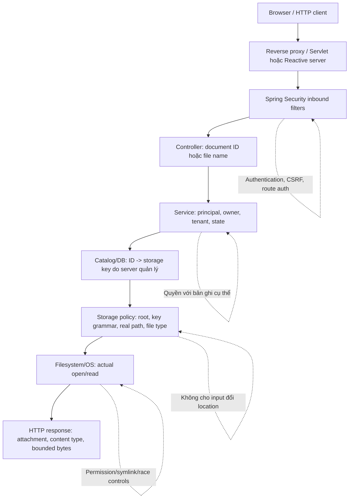

# Path traversal khi đọc tệp và kiểm tra đường dẫn nghiệp vụ

Trong module `SPRING_SECURITY_HTTP_PROTECTION`, Spring Security bảo vệ request HTTP và trình duyệt bằng authentication, authorization, CSRF, CORS, security headers, Content Security Policy (CSP), HSTS, HTTP firewall và session protection. Những cơ chế này hoạt động ở ranh giới HTTP, nhưng **không tự biết file nào trong hệ điều hành được phép mở** khi controller hoặc service gọi Java NIO, đọc file upload, giải nén ZIP, render template hay cung cấp tệp tải về.

**Path traversal** xuất hiện khi dữ liệu chưa tin cậy có thể ảnh hưởng đường dẫn mà ứng dụng dùng để truy cập tệp, khiến thao tác vượt ngoài vị trí hoặc phạm vi nghiệp vụ dự kiến. Một người dùng chỉ được tải hóa đơn của mình có thể thay tham số file name, tài liệu ID hoặc một đoạn đường dẫn để tìm cách đọc dữ liệu ngoài thư mục hoặc ngoài tenant được cấp quyền. Đây không chỉ là chuyện ngăn chuỗi `../`: còn có absolute paths, path normalization, symbolic links, Windows path semantics, archive entry names, mount points và quyền của tiến trình.

Bài thuộc chương **Ranh giới bảo vệ**, tập trung câu hỏi:

> **Ứng dụng quyết định file nào được mở bằng cách nào, và bằng chứng nào cho thấy file thực tế vẫn thuộc phạm vi lưu trữ *và* quyền nghiệp vụ của người gọi?**

Ví dụ nguy hiểm:

```java
// KHÔNG DÙNG: dữ liệu từ HTTP trở thành đường dẫn hệ thống.
@GetMapping("/download")
byte[] download(@RequestParam String name) throws IOException {
    return Files.readAllBytes(
            Path.of("/srv/app/documents", name));
}
```

Request như `/download?name=../../config/application.yml` nhằm khiến thành phần đọc tệp đi ra ngoài thư mục documents. Nó chỉ là một ví dụ phòng thủ để nhận diện lỗi; file thực tế và cách xử lý URL phụ thuộc OS, container, framework và cấu hình. Thậm chí nếu Spring Security từ chối những URL path bất thường, tham số `name` có thể vẫn được chuyển nguyên vào `Path.of(...)` khi request URL bình thường.

**Thiết kế ưu tiên** trong bài: client chỉ gửi **document ID**; server kiểm tra authentication + quyền sở hữu/tenant; database ánh xạ ID sang **storage key do server sinh**; storage service đọc file từ thư mục private do tiến trình quản lý, không nhận đường dẫn tùy ý do client cung cấp. Nếu nghiệp vụ bắt buộc dùng tên file hoặc thư mục động, cần validation và filesystem containment theo đường dẫn *thực*, đồng thời giới hạn quyền OS và xử lý race conditions.

Ví dụ theo Java 17+, Spring Boot 3.x và Spring Security 6.x, bao gồm Servlet/Spring MVC, Reactive/WebFlux, unit/integration tests và checklist. Một số ví dụ tách thành từng class/file như mô tả; không phải nguyên một chương trình có thể ghép tất cả các đoạn vào một source file. Bài STEP 4 là nội dung học thuật; việc chạy bài tập và đánh giá chuyên môn thuộc bước kiểm thử/QA tiếp theo.

## 1. Mục tiêu học tập

Sau bài học, người học có thể:

- Phân biệt **path traversal**, **local file inclusion**, **archive traversal (Zip Slip)** và **IDOR/BOLA** khi tải tài liệu.
- Chỉ ra ranh giới giữa URL parsing, Spring Security HTTP firewall, controller, service, filesystem và OS permissions.
- Tránh đưa user input trực tiếp vào `Path.of`, `Paths.get`, `Files.readAllBytes` hoặc template/file-resource loaders.
- Thiết kế API chỉ nhận **opaque ID**, ánh xạ sang **server-generated storage key** và giữ tên file hiển thị tách khỏi tên file thật.
- Dùng Java `Path.normalize`, `toAbsolutePath`, `startsWith(Path)`, `toRealPath` và `NOFOLLOW_LINKS` đúng mục đích, hiểu giới hạn của từng bước.
- Giải thích vì sao `String.startsWith` khác `Path.startsWith`; vì sao lexical containment không ngăn mọi symbolic-link traversal.
- Nhận diện TOCTOU khi file/symlink bị thay giữa thời điểm kiểm tra và thời điểm mở, và biết khi nào cần `SecureDirectoryStream` hay isolation ở OS.
- Kiểm tra quyền owner/tenant và business state **trước khi đọc file**, kể cả khi đường dẫn vẫn nằm trong thư mục được phép.
- Trả tệp download qua Servlet hoặc WebFlux với content type/disposition phù hợp, giới hạn kích thước và không rò cấu trúc đường dẫn.
- Phòng ngừa path traversal khi upload, giải nén archive, import/export, static resources và storage key/object storage.
- Viết test cho traversal inputs, symlinks, thư mục cùng prefix, file không thuộc quyền, malformed URL và file bị thay đổi.
- Phân biệt các lớp bảo vệ HTTP (CSRF/CORS/CSP/HSTS/firewall/session) với filesystem access control của ứng dụng.

## 2. Path traversal là lỗi ở ranh giới nào?



Có **ít nhất hai điều kiện độc lập** để một file được tải:

1. **Phạm vi đường dẫn:** file nằm trong storage zone được phép, không đi qua link hoặc cơ chế filesystem để tới vị trí ngoài vùng.
2. **Phạm vi nghiệp vụ:** người gọi có quyền đọc *file cụ thể*, thuộc đúng tenant/owner, trạng thái (đã duyệt, chưa bị thu hồi, không bị cách ly) và mục đích sử dụng.

Một file nằm hoàn toàn trong `/srv/app-private/documents` **vẫn không được phép trả về** nếu nó thuộc tài khoản khác. Ngược lại, user có quyền xem record trong database **không có nghĩa** được cung cấp path tuyệt đối tuỳ ý để đọc filesystem.

### 2.1. Các nguồn đường dẫn không tin cậy

| Nguồn | Dữ liệu có thể bị điều khiển | Điểm dễ xảy ra lỗi |
| --- | --- | --- |
| Query parameter | `?name=...`, `?path=...` | `Path.of(base, name)`, `new File(base, name)` |
| URL path variable | `/files/{name}`, wildcard routes | Path resolver ghép với thư mục |
| JSON body | `{"template":"..."}`, `{"filePath":"..."}` | Đọc config/template/file do client chọn |
| Multipart upload | `getOriginalFilename()` | Lưu hoặc overwrite file theo tên client khai |
| Database record | `attachmentPath` do user từng cập nhật | File đọc ở bước sau trở thành stored traversal |
| ZIP/TAR archive | Tên entry như `../...` | Giải nén vượt thư mục đích |
| File link/shortcut | Symbolic link, junction, mount | Đường dẫn nhìn ở trong root nhưng điểm đến nằm ngoài |
| Object storage | Blob key do user gửi | Truy cập object khác tenant/prefix |
| Template/PDF engine | Include/file URL/static resource | Đọc file không qua service authorization |

Dữ liệu đến từ **database, job queue hoặc cấu hình tenant** vẫn có thể không tin cậy nếu ban đầu được viết bởi user khác. Đừng coi “đọc từ DB” là bằng chứng an toàn như một hằng số được quản lý bởi developer.

### 2.2. Path traversal không chỉ dùng `../`

Những nhóm input cần được xét ở các tầng parse khác nhau:

- **Parent traversal:** `../` và các đường dẫn lồng nhiều cấp.
- **Absolute paths:** `/etc/...`, `C:\\...`, Windows UNC như `\\\\server\\share\\...`.
- **Tên thư mục cùng prefix:** `/srv/uploads-old` không phải con của `/srv/uploads`.
- **Separator khác nhau:** slash, backslash và kiểu OS filesystems.
- **URL encoding:** `%2e%2e%2f`, encoded separators, double-decoding nếu các tầng giải mã nhiều lần.
- **Trung gian là symbolic link:** `root/shared` trỏ tới thư mục ngoài `root`.
- **Archive entry:** `../secret.txt` hoặc absolute entry name sau khi unzip.
- **Tên đặc biệt:** `.`, `..`, ký tự control, NUL, reserved names/NTFS alternate data streams trên Windows.
- **Race:** file hoặc symlink đổi ngay sau bước kiểm tra trước khi mở.

Đây là **nhóm rủi ro cần kiểm tra trong môi trường thử nghiệm**, không phải giả định mọi chuỗi đều được OS/container hiện tại chấp nhận. Ví dụ đường dẫn Windows và Linux có semantics khác nhau; không dựa vào việc test pass trên một OS để kết luận code portable an toàn.

## 3. Những lỗi kiểm tra đường dẫn thường gặp

### 3.1. Nối chuỗi rồi kiểm tra tiền tố bằng String

```java
// KHÔNG DÙNG: so sánh chuỗi không hiểu ranh giới path segment.
String root = "/srv/app/documents";
String result = root + "/" + suppliedName;

if (result.startsWith(root)) {
    return Files.readAllBytes(Path.of(result));
}
```

`result.startsWith(root)` chỉ kiểm tra **ký tự đầu**, không hiểu `..` và không phân biệt `/srv/app/documents` với `/srv/app/documents-archive`. Một lexical string prefix không bảo đảm filesystem containment.

### 3.2. `Path.normalize()` là cần nhưng chưa đủ

```java
Path root = Path.of("/srv/app/documents")
        .toAbsolutePath().normalize();
Path candidate = root.resolve(suppliedName)
        .toAbsolutePath().normalize();

if (!candidate.startsWith(root)) {
    throw new SecurityException("Path vượt root");
}
```

Đoạn này tốt hơn về **lexical containment**:

- `normalize` xử lý `.` và `..` ở mức thành phần đường dẫn.
- `Path.startsWith(Path)` so sánh các thành phần đường dẫn, không phải chuỗi ký tự trần.
- `root.resolve(...)` ghép đường dẫn; nếu input là absolute path, kết quả có thể là input absolute tùy file system provider — containment vẫn cần được kiểm tra.
- Điều kiện so sánh có ý nghĩa khi **root và candidate dùng cùng filesystem provider và representation**.

Nhưng đoạn code **chưa kiểm tra symbolic links**. `root/shortcut/file.txt` có thể thỏa lexical containment dù `shortcut` là symlink trỏ ra ngoài. Cũng chưa có **owner authorization** và chưa bảo vệ khỏi thay đổi file/symlink giữa check và open.

### 3.3. `toRealPath()` kiểm tra đường dẫn thật, nhưng có thời điểm

```java
Path trustedRoot = Path.of("/srv/app/documents").toRealPath();
Path candidate = trustedRoot.resolve(suppliedName).normalize();
Path realFile = candidate.toRealPath();

if (!realFile.startsWith(trustedRoot)) {
    throw new SecurityException("File ngoài storage root");
}
```

Ở đây `toRealPath()` mặc định **theo symbolic links**, cần file tồn tại và trả về đường dẫn thực theo provider. Nếu file trỏ ra ngoài, `realFile` có thể nằm ngoài trustedRoot, giúp phát hiện lối đi qua symlink.

**Điểm hạn chế:** kiểm tra này tạo ra kết luận **tại thời điểm resolve**. Nếu attacker có thể đổi symlink/file sau đó, `Files.newInputStream(candidate)` thực hiện một bước path lookup mới có thể đi tới đích khác. Vì vậy không chỉ “gọi `toRealPath`” rồi tuyên bố chống được mọi traversal/race.

### 3.4. Đừng tự URL-decode nhiều lần

Spring MVC/WebFlux/container thường đã parse và decode tham số theo giao thức. Nếu một layer tự gọi `URLDecoder.decode(...)` một hoặc nhiều lần trên chuỗi đã được decode, các dấu `%2f`, `%2e` hoặc tương tự có thể đổi nghĩa **sau khi bước validate đã chạy**.

Quy tắc:

- Định rõ **tầng sở hữu decode** (container/framework/URL parser), không decode lại tùy tiện.
- Validate trên **giá trị cuối cùng sẽ dùng để tạo đường dẫn**.
- Không “sanitize” bằng cách xóa literal `../` trước khi một layer khác tiếp tục decode hoặc normalize.
- Với API chỉ nhận ID, dùng grammar không chứa path separator/URL delimiter, loại bỏ cả nhu cầu giải mã phức tạp.
- Có test qua HTTP server/proxy thật để kiểm tra encoded path variants mà framework có thể xử lý khác với unit test string.

Không khuyến khích cố nới `StrictHttpFirewall` để cho encoded slashes hoặc dot segments đi qua chỉ vì code download muốn nhận đường dẫn từ URL. **Thay URL API** thường là cách ít rủi ro hơn.

## 4. Cách thiết kế ưu tiên: public ID khác storage path

Thay vì:

```text
GET /download?path=customers/acme/contracts/2026.pdf
```

hãy thiết kế:

```text
GET /documents/37a41e70-74e0-4b49-9817-b3ad20d2397c/download
```

Controller chỉ nhận `UUID documentId`. Service tìm metadata ở database:

| Trường | Nguồn và ý nghĩa | Có đưa thẳng từ HTTP vào filesystem không? |
| --- | --- | --- |
| `id` | Opaque public document ID | Không. Dùng để lookup metadata. |
| `ownerUsername` | Owner/tenant từ database | Không. Dùng authorization. |
| `storageKey` | Key ngẫu nhiên do server sinh, ví dụ `6a...f.blob` | Chỉ sau validation và map từ metadata tin cậy. |
| `originalName` | Tên hiển thị do upload client đề nghị | **Không.** Chỉ dùng cho header download sau khi validate. |
| `mediaType` | Media type đã xác minh hoặc chuẩn hóa | Không quyết định đường dẫn. |
| `size` | Số byte đã biết/giới hạn | Dùng quota và download guard. |
| `state` | ACTIVE/QUARANTINED/REVOKED | Dùng domain authorization. |

Giả sử mọi `storageKey` được sinh theo grammar `[a-f0-9]{32}\\.blob`, chỉ dùng **một thư mục phẳng** do hệ thống kiểm soát. Không cho user chọn tên thư mục, đường dẫn tuyệt đối, symlink hoặc tên file OS.

### 4.1. Phân biệt filename hiển thị và tên file lưu trữ

Tên do client upload như `invoice.pdf` có thể hữu ích khi người dùng download, nhưng:

- Có thể chứa `../`, backslash, control characters hoặc tên thiết bị reserved theo OS.
- Có thể trùng với file người khác và gây overwrite nếu dùng làm storage key.
- Có thể chứa ký tự làm sai HTTP `Content-Disposition` nếu tự nối header string.
- Không chứng minh nội dung file đúng MIME/extension hoặc file đã được scan.

**Tên hiển thị** phải được validate, chuẩn hóa và encode cho header qua API chuyên dụng. **Tên lưu trữ** do server sinh và không phụ thuộc raw original filename. Không dùng `MultipartFile.getOriginalFilename()` hoặc `FilePart.filename()` làm argument trực tiếp của `Path.resolve(...)`.

### 4.2. ID khó đoán không phải authorization

UUID/opaque ID giúp giảm khả năng đoán tuần tự, nhưng nếu ID bị chia sẻ hoặc lộ qua log/link, user khác vẫn có thể gọi endpoint. Phải kiểm tra owner/tenant/quyền với record tương ứng **ở thời điểm download**, không chỉ khi upload.

Ví dụ logic:

```text
Document ID -> database lookup
            -> document exists and ACTIVE?
            -> actor owns it or has tenant grant?
            -> storageKey server-generated/validated?
            -> filesystem file allowed/readable?
            -> download
```

Đừng lấy `ownerId` từ query/body để thay principal. Cũng không cho client tự gửi `storageKey` để bỏ qua bước tra metadata.

## 5. Bảng trách nhiệm: Spring Security, domain và hệ điều hành

| Lớp | Có thể bảo vệ | Không thể tự suy ra |
| --- | --- | --- |
| `SecurityFilterChain` / `SecurityWebFilterChain` | Authentication, route/method authorization, CSRF, headers | File nào thuộc user nào; storage root và symlink |
| Servlet `HttpFirewall` | Từ chối URL path/method có dạng bất thường theo policy | Giá trị query/body được nối vào filesystem path, ZIP entry, symlink |
| Controller | Parse UUID, ánh xạ lỗi HTTP và response headers | Không nên tự tạo storage path từ input |
| Application service | Owner/tenant/state, quota, authorization theo record | Không tự kiểm soát quyền OS nếu filesystem cho phép rộng |
| Catalog/repository | ID -> metadata/key đã kiểm soát | Không biến record do user nhập thành trusted path nếu schema sai |
| Storage service | Key grammar, trusted root, containment, nofollow, bounded reads | Không thay quyền nghiệp vụ nếu được gọi ngoài service |
| Filesystem/OS | Permissions, ownership, mount/read-only/sandbox, race-resilient APIs | Không tự biết user HTTP đang đăng nhập |
| Reverse proxy/server | URL parsing, body/rate limits, TLS | Không thay domain authorization hoặc Java NIO path validation |
| Browser headers/CSP | Hạn chế thực thi nội dung file trong browser | Không chặn Java backend đọc file ngoài phạm vi |

**Quy tắc tổng hợp:** chỉ khi các điều kiện **quyền với record**, **phạm vi storage**, **quyền đọc của tiến trình** và **policy trả nội dung** cùng thỏa mới phát dữ liệu về client.


## 6. Mô hình metadata và thư mục private

Để thiết kế đường đọc an toàn, sử dụng **hai tên khác nhau**: public `documentId` và internal `storageKey`. Chúng được nối với nhau bằng catalog do server quản lý.

```java
import java.util.UUID;

public record DocumentMeta(
        UUID id,
        String ownerUsername,
        String storageKey,
        String originalName,
        String state) {
}
```

```java
import java.util.Optional;
import java.util.UUID;

public interface DocumentCatalog {
    Optional<DocumentMeta> findById(UUID id);
}
```

Ứng dụng thật hiện thực `DocumentCatalog` bằng Spring Data JPA, JDBC hoặc backend metadata riêng. `storageKey` phải được sinh bởi server khi upload:

```java
String key = UUID.randomUUID()
        .toString().replace("-", "") + ".blob";
```

Tệp thật được lưu trong một thư mục **không được web server công khai**, chẳng hạn `/srv/app-private/documents`. Thư mục chứa file phải do dịch vụ kiểm soát và **không cho actor không tin cậy tạo/đổi file, symlink, subdirectory hay mount**. Một key được đoán ra cũng không cấp quyền xem file: mọi download phải kiểm tra owner/tenant trong catalog.

### 6.1. Tên hiển thị không phải tên lưu trữ

`originalName` chỉ là gợi ý filename cho người tải về; nó **không bao giờ** được dùng làm path trên disk. Một tên upload có thể chứa `../`, backslash, dấu CR/LF hoặc tên đặc biệt trên Windows. Tên hiển thị phải được kiểm tra riêng trước khi đưa vào `Content-Disposition`; tuyệt đối không nối raw string vào header.

### 6.2. Quyền hệ điều hành là phòng vệ bổ sung

- Service đọc file chỉ có quyền filesystem tối thiểu. Nếu có thể, tách tài khoản đọc và ghi.
- Không sử dụng thư mục world-writable, `/tmp` dùng chung, web root hoặc vùng mà user khác được tạo link.
- Tránh mount volume chứa secrets/config vào cùng container của dịch vụ chỉ cần serve tài liệu.
- Kiểm tra quyền thực tế của volume, ACL, symlink và container user ID trên môi trường triển khai.
- Giới hạn số lượng file, kích thước và chi phí truy xuất; không dựa vào UUID khó đoán để thay authorization.

## 7. Java NIO: service đọc file trong thư mục phẳng được kiểm soát

Ví dụ cố tình giới hạn: chỉ file thường ở **một cấp ngay dưới root**, key gồm 32 ký tự hex + đuôi `.blob`, không symlink, file nhỏ tối đa 256 KiB. Đây không phải file browser tổng quát hay giải pháp cho thư mục user có quyền thay đổi.

### 7.1. Kết quả tải về

```java
public record DownloadPayload(byte[] bytes, String downloadName) {
}
```

### 7.2. Service đọc theo ID và owner

```java
import java.io.IOException;
import java.io.InputStream;
import java.nio.channels.Channels;
import java.nio.channels.SeekableByteChannel;
import java.nio.file.Files;
import java.nio.file.LinkOption;
import java.nio.file.Path;
import java.nio.file.StandardOpenOption;
import java.util.Set;
import java.util.UUID;
import java.util.regex.Pattern;
import org.springframework.beans.factory.annotation.Value;
import org.springframework.http.HttpStatus;
import org.springframework.stereotype.Service;
import org.springframework.web.server.ResponseStatusException;

@Service
public class PrivateDocumentReader {

    private static final int MAX_BYTES = 256 * 1024;
    private static final Pattern STORAGE_KEY =
            Pattern.compile("[a-f0-9]{32}\\.blob");

    private final DocumentCatalog catalog;
    private final Path root;

    public PrivateDocumentReader(
            DocumentCatalog catalog,
            @Value("${app.storage.document-root}") String configuredRoot)
            throws IOException {

        this.catalog = catalog;
        // Giá trị này chỉ do deployment cấu hình, không từ HTTP.
        this.root = Path.of(configuredRoot).toRealPath();

        if (!Files.isDirectory(root, LinkOption.NOFOLLOW_LINKS)) {
            throw new IllegalStateException("Storage root không hợp lệ");
        }
    }

    public DownloadPayload readOwned(UUID id, String actor)
            throws IOException {

        DocumentMeta meta = catalog.findById(id)
                .orElseThrow(PrivateDocumentReader::notFound);

        // Từ chối trước khi tạo hoặc mở đường dẫn.
        if (actor == null
                || !actor.equals(meta.ownerUsername())
                || !"ACTIVE".equals(meta.state())) {
            throw notFound();
        }

        String key = meta.storageKey();

        if (key == null || !STORAGE_KEY.matcher(key).matches()) {
            throw new IllegalStateException(
                    "Metadata chứa storage key sai định dạng");
        }

        // Key chỉ là một filename, không bao gồm subdirectory.
        Path candidate = root.resolve(key).normalize();

        if (!candidate.startsWith(root)
                || candidate.equals(root)) {
            throw new IllegalStateException("File vượt root");
        }

        Path real = candidate.toRealPath(LinkOption.NOFOLLOW_LINKS);

        if (!real.startsWith(root)
                || !Files.isRegularFile(
                        real, LinkOption.NOFOLLOW_LINKS)) {
            throw notFound();
        }

        // Nofollow ở chính bước mở, không chỉ ở bước kiểm tra.
        try (SeekableByteChannel channel = Files.newByteChannel(
                    real,
                    Set.of(StandardOpenOption.READ,
                           LinkOption.NOFOLLOW_LINKS));
             InputStream input = Channels.newInputStream(channel)) {

            byte[] bytes = input.readNBytes(MAX_BYTES + 1);

            if (bytes.length > MAX_BYTES) {
                throw new ResponseStatusException(
                        HttpStatus.PAYLOAD_TOO_LARGE,
                        "File vượt giới hạn của bài mẫu");
            }

            return new DownloadPayload(
                    bytes, safeDownloadName(meta.originalName()));
        }
    }

    private static ResponseStatusException notFound() {
        return new ResponseStatusException(
                HttpStatus.NOT_FOUND, "Không tìm thấy tài liệu");
    }

    private static String safeDownloadName(String name) {
        // Tên gợi ý tải về, không ảnh hưởng vị trí lưu trữ.
        if (name == null
                || !name.matches("[A-Za-z0-9][A-Za-z0-9._-]{0,79}")
                || name.endsWith(".")
                || name.equals(".")
                || name.equals("..")) {
            return "document.bin";
        }
        return name;
    }
}
```

Phân tích biện pháp bảo vệ:

1. Catalog tra ID, rồi service kiểm tra **owner và trạng thái** trước khi đụng tới filesystem.
2. `STORAGE_KEY` không cho dấu `/`, `\\`, `.` đứng riêng, colon hoặc absolute path, và chỉ có một file ngay dưới root.
3. Root được xác định từ deployment và chuẩn hóa bằng `toRealPath()` tại startup, không được ghi đè bằng input HTTP.
4. `Path.startsWith(Path)` thêm một kiểm tra theo path segments, dù grammar của key đã loại traversal.
5. `NOFOLLOW_LINKS` trên đường dẫn file đích và ở `newByteChannel` hạn chế mở symbolic link ở entry cuối.
6. `Files.isRegularFile` loại directory và một số loại file đặc biệt; giới hạn `readNBytes(MAX_BYTES+1)` không đọc toàn bộ file khổng lồ.
7. Tên download **không tham gia** vào việc tạo candidate path.

**Giới hạn quan trọng:** Code dựa vào điều kiện **root phẳng, server-owned và không thể bị actor không tin cậy thay entry**. Kiểm tra `toRealPath`, `isRegularFile`, rồi mở file vẫn là các thao tác tách biệt; nếu người tấn công có quyền rename/thay inode, một số TOCTOU vẫn tồn tại. `NOFOLLOW_LINKS` bảo vệ khỏi final-component symlink, nhưng không thay khả năng giữ an toàn toàn bộ cây thư mục mutable. Với file lớn hoặc vùng storage user-writable, dùng thiết kế mạnh hơn ở mục 10.

### 7.3. Cấu hình root ở phía server

```yaml
# application.yml minh họa trong một ứng dụng Spring Boot
app:
  storage:
    document-root: /srv/app-private/documents
```

Đây chỉ là ví dụ cấu hình của ứng dụng, **không phải YAML metadata của bài học**. Trên Windows hoặc khi chạy test cần thay path phù hợp và cấp quyền đúng. Nếu thư mục không tồn tại hoặc sai quyền, hãy fail closed thay vì tạo một root tùy ý từ input HTTP.

## 8. Spring MVC/Servlet: kiểm tra route và trả file

Một user có `ROLE_DOCUMENT_READER` được phép gọi loại chức năng tải tài liệu, nhưng chỉ service mới xác định **tài liệu cụ thể có thuộc user không**.

### 8.1. SecurityFilterChain

```java
import org.springframework.context.annotation.Bean;
import org.springframework.context.annotation.Configuration;
import org.springframework.http.HttpMethod;
import org.springframework.security.config.Customizer;
import org.springframework.security.config.annotation.web.builders.HttpSecurity;
import org.springframework.security.web.SecurityFilterChain;

@Configuration
public class DocumentDownloadSecurity {

    @Bean
    SecurityFilterChain securityFilterChain(HttpSecurity http)
            throws Exception {
        return http
                .authorizeHttpRequests(auth -> auth
                        .requestMatchers(HttpMethod.GET,
                                "/documents/*/download")
                            .hasRole("DOCUMENT_READER")
                        .anyRequest().denyAll())
                .formLogin(login -> login.permitAll())
                .csrf(Customizer.withDefaults())
                .build();
    }
}
```

GET ở đây chỉ **đọc file**, không tạo/xóa tài liệu. Spring Security mặc định không yêu cầu CSRF cho GET; điều đó không làm ID hoặc filename đáng tin. Nếu ứng dụng còn POST upload, PATCH rename hoặc DELETE, giữ CSRF với browser cookie-session theo threat model và viết policy tương ứng cho từng route.

### 8.2. Controller chỉ nhận UUID

```java
import java.io.IOException;
import java.nio.charset.StandardCharsets;
import java.nio.file.NoSuchFileException;
import java.util.UUID;
import org.springframework.http.CacheControl;
import org.springframework.http.ContentDisposition;
import org.springframework.http.HttpHeaders;
import org.springframework.http.HttpStatus;
import org.springframework.http.MediaType;
import org.springframework.http.ResponseEntity;
import org.springframework.security.core.Authentication;
import org.springframework.web.bind.annotation.GetMapping;
import org.springframework.web.bind.annotation.PathVariable;
import org.springframework.web.bind.annotation.RestController;
import org.springframework.web.server.ResponseStatusException;

@RestController
public class DocumentDownloadController {

    private final PrivateDocumentReader reader;

    public DocumentDownloadController(PrivateDocumentReader reader) {
        this.reader = reader;
    }

    @GetMapping("/documents/{id}/download")
    ResponseEntity<byte[]> download(
            @PathVariable UUID id,
            Authentication authentication) {

        try {
            DownloadPayload payload = reader.readOwned(
                    id, authentication.getName());

            ContentDisposition disposition =
                    ContentDisposition.attachment()
                            .filename(payload.downloadName(),
                                    StandardCharsets.UTF_8)
                            .build();

            return ResponseEntity.ok()
                    .contentType(MediaType.APPLICATION_OCTET_STREAM)
                    .header(HttpHeaders.CONTENT_DISPOSITION,
                            disposition.toString())
                    .cacheControl(CacheControl.noStore())
                    .header("X-Content-Type-Options", "nosniff")
                    .body(payload.bytes());

        } catch (NoSuchFileException missing) {
            throw new ResponseStatusException(
                    HttpStatus.NOT_FOUND, "Không tìm thấy tài liệu");
        } catch (IOException storageError) {
            throw new ResponseStatusException(
                    HttpStatus.INTERNAL_SERVER_ERROR,
                    "Không thể tải tài liệu");
        }
    }
}
```

Không trả đường dẫn absolute hoặc root thực qua API response/header. `ContentDisposition.attachment()` tránh tạo header bằng cách nối chuỗi filename chưa tin cậy. `application/octet-stream` và `nosniff` giảm nguy cơ browser diễn giải một số nội dung active, nhưng **không chứng minh file sạch**; loại nội dung phải được kiểm tra từ bước upload.

Một lỗi 404 cho record không tồn tại hoặc khác owner có thể giúp tránh xác nhận sự tồn tại của record thuộc người khác. Một lỗi I/O bất ngờ nên được log theo correlation ID, không lộ filesystem path hoặc stack trace cho user.

### 8.3. File lớn và streaming

`ResponseEntity<byte[]>` là ví dụ cố tình giới hạn 256 KiB. Khi tài liệu có thể lớn:

- Kiểm tra owner và file type trước khi mở.
- Ưu tiên một **file handle đã được mở an toàn** để stream, tránh validate một Path rồi bất chợt mở lại sau race.
- Đặt giới hạn stream bytes/concurrency, cancellation và response timeouts.
- Dọn tài nguyên khi user ngắt download.
- Nếu dùng object storage, tạo signed download URLs thời hạn ngắn từ **object key do server kiểm soát**, ràng buộc quyền và không cho client chọn tùy ý bucket/key.

Đừng tăng `MAX_BYTES` lên vài GiB rồi tiếp tục dùng `readNBytes` vào RAM.

## 9. Khi nghiệp vụ phải dùng đường dẫn tương đối

Một số phần mềm phải chọn file trong cây thư mục có sẵn (template, hồ sơ batch, báo cáo từ thư mục chung). **Allowlist template ID** vẫn ưu tiên; nếu phải dùng relative path, cần kiểm tra lexical và thực tế.

### 9.1. Resolver mẫu cho file đã tồn tại

```java
import java.io.IOException;
import java.nio.file.Files;
import java.nio.file.LinkOption;
import java.nio.file.Path;

public final class RelativePathGuard {

    private final Path trustedRoot;

    public RelativePathGuard(Path configuredRoot)
            throws IOException {
        this.trustedRoot = configuredRoot.toRealPath();
    }

    public Path resolveExisting(String rawRelative)
            throws IOException {

        if (rawRelative == null || rawRelative.isBlank()) {
            throw new IllegalArgumentException("Path rỗng");
        }

        Path relative = trustedRoot.getFileSystem()
                .getPath(rawRelative);

        if (relative.isAbsolute()) {
            throw new SecurityException(
                    "Không chấp nhận absolute path");
        }

        Path candidate = trustedRoot.resolve(relative).normalize();

        if (!candidate.startsWith(trustedRoot)
                || candidate.equals(trustedRoot)) {
            throw new SecurityException("Path vượt root");
        }

        // Theo symbolic links để so sánh vị trí thật.
        Path real = candidate.toRealPath();

        if (!real.startsWith(trustedRoot)
                || !Files.isRegularFile(
                        real, LinkOption.NOFOLLOW_LINKS)) {
            throw new SecurityException(
                    "Không phải file nằm trong root");
        }

        return real;
    }
}
```

**Mẫu này chỉ phù hợp với cây file không bị actor không tin cậy sửa trong lúc đọc.** `return real` không giữ file descriptor; một sự thay đổi symlink/path sau kiểm tra vẫn có thể khiến bước open sau đó đọc đối tượng khác. Nếu file tree mutable, cần các cơ chế mở theo directory handle như `SecureDirectoryStream` hoặc thực thi trong vùng OS bị sandbox.

### 9.2. String prefix khác Path prefix

Với root `/srv/documents` và sibling `/srv/documents-backup`, `String.startsWith("/srv/documents")` có thể trả true trong khi `Path.startsWith(Path)` trả false vì so sánh thành phần đường dẫn. Nhưng `Path.startsWith` **vẫn không tự xử lý symlink**.

### 9.3. Cẩn thận với Windows và URL decode

Windows có drive letters, drive-relative paths, UNC paths, reserved device names, trailing spaces/periods và NTFS alternate data streams. Không suy rằng một bộ test Linux là đủ để công bố path policy portable. Các tầng HTTP có thể đã URL-decode input; **không decode lần hai** sau validation. Nếu cần file upload/import theo tên, hãy tránh đưa tên ấy vào filesystem path, thay vì cố bao phủ mọi trường hợp OS bằng regex tự viết.

### 9.4. Đuôi file không làm phần đầu đường dẫn an toàn

```java
// KHÔNG DÙNG: nối suffix vẫn nhận raw path từ user.
Path path = root.resolve(userInput + ".pdf");
```

Dù chuỗi có `.pdf` ở cuối, `userInput` vẫn có thể chứa path separators hoặc semantic đặc biệt. Chọn template ID hoặc storage key do server sinh, và xác minh nội dung file độc lập với extension.


## 10. Symbolic links, TOCTOU và `SecureDirectoryStream`

Một kiểm tra “đường dẫn an toàn” thường gồm các bước:

```text
1. Input được validate
2. Path được normalize/resolve
3. Kiểm tra real path thuộc trustedRoot
4. Files.newInputStream(path) mở file
```

Nếu một actor khác có thể thay đổi filesystem trong khoảng 3 → 4, đây là **Time-of-Check to Time-of-Use (TOCTOU)**. File hoặc thư mục được mở có thể không còn là đối tượng đã được kiểm tra.

### 10.1. Vì sao `NOFOLLOW_LINKS` không phải giải pháp đầy đủ cho mọi cây file?

`LinkOption.NOFOLLOW_LINKS` và `Files.newByteChannel(..., NOFOLLOW_LINKS)` có ích để không đi theo symlink ở bước thao tác tương ứng. Nhưng khi một path gồm nhiều thư mục, cần bảo đảm **từng thành phần và cách OS resolve chúng**. Chỉ cấm symlink ở file cuối không ngăn một parent directory là symlink trỏ ra ngoài, và một quy trình check–open tách biệt vẫn có cửa sổ race.

Tóm tắt:

| Biện pháp | Bảo đảm chính | Giới hạn |
| --- | --- | --- |
| `Path.normalize` | Loại `.` và `..` ở mức lexical | Không hỏi filesystem về symlink/mount. |
| `Path.startsWith` | So sánh path components | Không biết file thực sau link. |
| `Path.toRealPath()` | Resolve đường dẫn thật tại thời điểm gọi | File phải tồn tại; có thể đổi trước open. |
| `isRegularFile(... NOFOLLOW_LINKS)` | Kiểm tra file type tại thời điểm gọi | Có race với open; không giữ handle. |
| `newByteChannel(... NOFOLLOW_LINKS)` | Mở file không theo final symlink ở bước mở | Chưa phải sandbox cho mọi parent path có thể bị sửa. |
| `SecureDirectoryStream` | Thao tác relative theo directory handle mở sẵn, giảm race | Tùy filesystem provider; không tự làm owner/tenant check. |
| OS permissions/sandbox | Không cho actor thay entries hoặc đọc file ngoài phạm vi | Phải cấu hình/giám sát; không thay business authorization. |

### 10.2. Mở entry phẳng theo directory handle

Java NIO có `SecureDirectoryStream` cho filesystem provider hỗ trợ thao tác **relative với directory đã mở**, nhằm giảm các race khi directory path bị đổi. Đây là một API chuyên dụng, không phải mọi OS/provider đều trả về `SecureDirectoryStream`.

Ví dụ dưới chỉ minh họa **mở một entry theo tên phẳng**, sau khi service đã kiểm tra quyền và key grammar:

```java
import java.io.IOException;
import java.io.InputStream;
import java.nio.channels.Channels;
import java.nio.channels.SeekableByteChannel;
import java.nio.file.DirectoryStream;
import java.nio.file.Files;
import java.nio.file.LinkOption;
import java.nio.file.OpenOption;
import java.nio.file.Path;
import java.nio.file.SecureDirectoryStream;
import java.nio.file.StandardOpenOption;
import java.util.Set;

public final class DirectoryHandleReader {

    private DirectoryHandleReader() {}

    public static byte[] readSmallFile(
            Path trustedRoot, String serverGeneratedKey)
            throws IOException {

        // Caller đã kiểm tra:
        // 1. owner/tenant;
        // 2. serverGeneratedKey có grammar một filename;
        // 3. root thuộc môi trường được quản lý.
        try (DirectoryStream<Path> opened =
                     Files.newDirectoryStream(trustedRoot)) {

            if (!(opened instanceof SecureDirectoryStream<?>)) {
                // Fail closed: không âm thầm fallback sang check-then-open
                // nếu threat model yêu cầu race-resistant operations.
                throw new IOException(
                        "Filesystem không hỗ trợ SecureDirectoryStream");
            }

            @SuppressWarnings("unchecked")
            SecureDirectoryStream<Path> secure =
                    (SecureDirectoryStream<Path>) opened;

            try (SeekableByteChannel channel = secure.newByteChannel(
                         Path.of(serverGeneratedKey),
                         Set.<OpenOption>of(
                                 StandardOpenOption.READ,
                                 LinkOption.NOFOLLOW_LINKS));
                 InputStream input = Channels.newInputStream(channel)) {

                byte[] bytes = input.readNBytes(256 * 1024 + 1);
                if (bytes.length > 256 * 1024) {
                    throw new IOException("File quá lớn");
                }
                return bytes;
            }
        }
    }
}
```

Đoạn này **không phải một filesystem API cho đường dẫn bất kỳ**. Nó dựa vào việc key là **một tên entry**, root do deployment quản lý, và caller đã kiểm tra owner trước khi mở. Nếu mở chuỗi nhiều subdirectories, phải mở **từng thư mục con qua `SecureDirectoryStream.newDirectoryStream(..., NOFOLLOW_LINKS)`** và giữ các handles thích hợp.

Cũng phải phân biệt symbolic link với **hard link, mount alias hoặc volume**: `NOFOLLOW_LINKS` không phát hiện mọi tình huống một entry trỏ đến dữ liệu nhạy cảm. Không cho actor không tin cậy tạo những entries đó, cô lập storage và giới hạn quyền OS.

### 10.3. Khi provider không hỗ trợ SecureDirectoryStream?

Nếu yêu cầu bảo mật chống race là bắt buộc, cần **fail closed hoặc thay kiến trúc** (storage tách biệt, object storage theo key, OS-native handle-based API được kiểm soát). Không tự chuyển về `normalize + startsWith + open` rồi tuyên bố khả năng bảo vệ không đổi.

Trong trường hợp hệ thống có **file tree bất biến do server sở hữu**, threat model có thể chấp nhận Java NIO check–open kết hợp quyền OS, dù không có `SecureDirectoryStream`. Phải ghi lại giả định này và test rằng user không có đường tạo symlink/hard link/rename trong root.

## 11. Đường upload: không dùng original filename làm storage path

Path traversal không chỉ xảy ra khi **đọc**. Nếu upload dùng tên client gửi để ghi file, attacker có thể khiến ứng dụng ghi đè hoặc đặt file ngoài thư mục dự kiến. Tệp vừa bị ghi sai đó có thể được các luồng đọc khác tin tưởng sau này.

### 11.1. Anti-pattern với MultipartFile

```java
// KHÔNG DÙNG:
@PostMapping("/upload")
void upload(@RequestParam MultipartFile file) throws IOException {
    Path destination = uploadRoot.resolve(
            file.getOriginalFilename());
    file.transferTo(destination);
}
```

`getOriginalFilename()` do client khai, có thể chứa ký tự đặc biệt hoặc tên trùng lặp. Không nên tin tên ấy ngay cả khi browser thông thường chỉ gửi basename.

### 11.2. Quy trình upload đúng trách nhiệm

1. **Authentication, CSRF và permission:** user có được phép upload vào tài liệu/tenant này không?
2. **Quota và body limits:** giới hạn request size, số parts, streaming/temp storage, tổng dung lượng mỗi user/tenant.
3. **File type validation:** extension allowlist nếu phù hợp, MIME/content signature và malware scanning theo threat model. Không tin `MultipartFile.getContentType()` một mình.
4. **Server-generated key:** `UUID.randomUUID()` hoặc storage ID đủ ngẫu nhiên; không dùng raw original filename.
5. **Private staging/quarantine:** upload tới thư mục ít quyền, không vào static web root, không được execute.
6. **Safe write:** tạo file mới độc quyền, không overwrite file tồn tại; không theo symlink; tránh user-writable parent dirs.
7. **Commit metadata:** gắn owner, tenant, state, key, size và kiểm tra transaction/cleanup nếu lưu DB và file có bước không nguyên tử.
8. **Download path:** dùng public document ID → metadata → owner → storage key; không trả path thật cho client.

Ví dụ **tạo key nội bộ**, không phải upload handler hoàn chỉnh:

```java
import java.util.UUID;
import java.util.regex.Pattern;

String key = UUID.randomUUID()
        .toString().replace("-", "") + ".blob";

if (!Pattern.matches("[a-f0-9]{32}\\.blob", key)) {
    throw new IllegalStateException("Unexpected storage key");
}
```

Nếu storage service thực sự ghi file, nên dùng `StandardOpenOption.CREATE_NEW` thay vì `CREATE`/`TRUNCATE_EXISTING` cho tên file mới, và kiểm soát hành vi ghi/move trên cùng filesystem. **Không biến một ví dụ key generator thành pipeline an toàn đầy đủ** khi chưa có scanning, owner checks và quota.

### 11.3. Multipart parsing có thể xảy ra trước CSRF

Trong Servlet, việc đặt `MultipartFilter` trước Spring Security để đọc CSRF parameter từ multipart có thể khiến body được parse hoặc file tạm được tạo trước khi `CsrfFilter` từ chối request. Trong WebFlux, multipart readers/codecs có cơ chế riêng.

Khi có JavaScript upload, CSRF token trong header có thể giúp framework xác minh token mà không cần parse toàn bộ multipart body chỉ để tìm form parameter. Nhưng **proxy/container upload limits vẫn phải có**, vì băng thông/buffering có thể tiêu thụ trước bất kỳ filter nào.

## 12. Giải nén ZIP/TAR: Zip Slip là path traversal trong archive

Một ZIP entry có tên `../secrets.txt` hoặc absolute path có thể khiến code giải nén đơn giản ghi ra ngoài thư mục extraction. Đây thường được gọi là **Zip Slip**.

### 12.1. Anti-pattern

```java
// KHÔNG DÙNG khi entry name chưa tin cậy:
Path target = extractionRoot.resolve(zipEntry.getName());
Files.copy(zipInputStream, target);
```

`ZipEntry.getName()` lấy từ archive do user cung cấp; tên entry không có quyền chọn đường dẫn trên host.

### 12.2. Lựa chọn đơn giản: chỉ file phẳng có grammar chặt

Giả sử import chỉ cho file `.txt` và `.pdf`, không cần subdirectory:

```java
import java.io.IOException;
import java.io.InputStream;
import java.io.OutputStream;
import java.nio.channels.Channels;
import java.nio.channels.SeekableByteChannel;
import java.nio.file.Files;
import java.nio.file.LinkOption;
import java.nio.file.OpenOption;
import java.nio.file.Path;
import java.nio.file.StandardOpenOption;
import java.util.Set;
import java.util.regex.Pattern;
import java.util.zip.ZipEntry;
import java.util.zip.ZipInputStream;

public final class RestrictedZipExtractor {

    private static final int MAX_ENTRIES = 20;
    private static final long MAX_ENTRY_BYTES = 2L * 1024 * 1024;
    private static final long MAX_TOTAL_BYTES = 8L * 1024 * 1024;

    private static final Pattern ENTRY_NAME = Pattern.compile(
            "[A-Za-z0-9_-]{1,60}\\.(txt|pdf)");

    public static void extract(
            InputStream archive, Path privateExtractionRoot)
            throws IOException {

        // Root phải được server tạo và không user-writable.
        Path root = privateExtractionRoot.toRealPath();
        int entryCount = 0;
        long totalBytes = 0;

        try (ZipInputStream zip = new ZipInputStream(archive)) {
            ZipEntry entry;

            while ((entry = zip.getNextEntry()) != null) {
                if (++entryCount > MAX_ENTRIES) {
                    throw new IOException("Quá nhiều ZIP entries");
                }

                String name = entry.getName();

                if (entry.isDirectory()
                        || !ENTRY_NAME.matcher(name).matches()) {
                    throw new IOException(
                            "ZIP entry path không được phép");
                }

                Path target = root.resolve(name).normalize();

                if (!target.startsWith(root)
                        || target.equals(root)) {
                    throw new IOException(
                            "ZIP entry vượt extraction root");
                }

                // CREATE_NEW ngăn ghi đè; NOFOLLOW_LINKS
                // để không mở symlink là entry cuối.
                try (SeekableByteChannel ch = Files.newByteChannel(
                             target,
                             Set.<OpenOption>of(
                                     StandardOpenOption.CREATE_NEW,
                                     StandardOpenOption.WRITE,
                                     LinkOption.NOFOLLOW_LINKS));
                     OutputStream out = Channels.newOutputStream(ch)) {

                    byte[] buffer = new byte[8192];
                    long currentEntry = 0;
                    int count;

                    while ((count = zip.read(buffer)) != -1) {
                        currentEntry += count;
                        totalBytes += count;

                        if (currentEntry > MAX_ENTRY_BYTES
                                || totalBytes > MAX_TOTAL_BYTES) {
                            throw new IOException(
                                    "ZIP vượt giới hạn giải nén");
                        }
                        out.write(buffer, 0, count);
                    }
                }
                zip.closeEntry();
            }
        }
    }
}
```

Đây là ví dụ **có chủ đích không hỗ trợ thư mục lồng nhau**; một archive hợp lệ với cấu trúc folder sẽ bị từ chối. Ngoài số entry/byte limits cần giới hạn **compressed upload size, CPU time, recursion/decompression ratios**, kiểm tra file type và malware, và xóa thư mục staging chưa hoàn tất khi giải nén thất bại.

**Không chạy extraction trực tiếp vào kho tài liệu đang phục vụ người dùng.** Dùng thư mục quarantine riêng, cấp quyền tối thiểu, duyệt nội dung và chỉ publish sau khi import toàn bộ thành công.

### 12.3. Nếu cần giữ cấu trúc thư mục của archive

Phải xác định chính sách về depth, số entry, separators, absolute paths, symlink/hardlink entries (đặc biệt với TAR), permissions, tên trùng, case-folding và max expanded bytes. Chuẩn hóa rồi so sánh containment trên từng entry là cần thiết, nhưng với directory mutable vẫn phải kiểm soát symlink/TOCTOU như mục 10. Khi có thể, chuyển mọi entry thành **storage keys phẳng do server sinh**, lưu cấu trúc logic trong DB thay vì dùng raw archive paths làm OS paths.

## 13. Object storage và signed URLs: không có filesystem path vẫn có IDOR

Với S3-compatible storage, GCS hoặc Azure Blob, code có thể không gọi `Path.of(...)` mà truy cập object bằng **bucket + key**. Tuy vậy, nếu client được tự gửi key hoặc bucket, vẫn có nguy cơ đọc object thuộc tenant khác hoặc prefix không được cấp quyền.

### 13.1. Mẫu thiết kế phù hợp

```text
GET /documents/{opaqueId}/download
     |
     v
Authenticated principal
     |
     v
Catalog: record exists + owner/tenant ACTIVE?
     |
     v
Server obtains trusted bucket/key from metadata
     |
     v
Storage SDK fetch object or issue short-lived download URL
```

Đừng nhận:

```text
GET /download?bucket=company-secrets&key=tenant-b/private.pdf
```

rồi dùng cloud credentials của server để tải trực tiếp. Bucket/key không phải user-facing path được phép chọn tùy ý.

### 13.2. Signed download URLs cần ràng buộc

Nếu dùng signed URL:

- Chỉ tạo URL **sau khi** đã xác minh quyền record.
- Thời hạn ngắn, bucket/key và operation cụ thể.
- Không phát signed URL vào log công khai hoặc Referer của trang bên thứ ba.
- Xét tác động của việc chia sẻ URL và thu hồi quyền; signed URL có thể còn dùng được đến khi hết hạn.
- Giới hạn CDN cache và content type/disposition; không phục vụ active HTML ở origin đáng tin nếu không có policy.
- Dùng IAM/bucket policy chặn mọi object ngoài vùng ứng dụng được phép.

Một object key như `tenant-a/reports/x.pdf` chỉ là một convention nếu backend không kiểm tra tenant một cách tin cậy. **Prefix string không thay authorization**.


## 14. WebFlux/Reactive: không được block event loop khi đọc filesystem

Trong Spring WebFlux, Spring Security dùng `SecurityWebFilterChain` và `CsrfWebFilter`, thay cho Servlet `SecurityFilterChain` và `CsrfFilter`. Tuy nhiên, việc xác minh **storage key/owner/path** vẫn thuộc service; đổi sang Reactive không tự giải quyết path traversal.

Ví dụ tiếp tục dùng `PrivateDocumentReader` của mục 7 để tái sử dụng logic security. Vì `Files.newByteChannel` và `readNBytes` là **blocking I/O**, không gọi chúng trực tiếp trên Reactor event loop.

### 14.1. Reactive adapter cho file nhỏ

```java
import java.io.IOException;
import java.nio.file.NoSuchFileException;
import java.util.UUID;
import org.springframework.http.HttpStatus;
import org.springframework.stereotype.Service;
import org.springframework.web.server.ResponseStatusException;
import reactor.core.publisher.Mono;
import reactor.core.scheduler.Schedulers;

@Service
public class ReactiveDocumentDownloadService {

    private final PrivateDocumentReader blockingReader;

    public ReactiveDocumentDownloadService(
            PrivateDocumentReader blockingReader) {
        this.blockingReader = blockingReader;
    }

    public Mono<DownloadPayload> readOwned(
            UUID id, String actor) {

        return Mono.fromCallable(() ->
                blockingReader.readOwned(id, actor))
                .subscribeOn(Schedulers.boundedElastic())
                .onErrorMap(
                        NoSuchFileException.class,
                        ex -> new ResponseStatusException(
                                HttpStatus.NOT_FOUND,
                                "Không tìm thấy tài liệu"))
                .onErrorMap(
                        IOException.class,
                        ex -> new ResponseStatusException(
                                HttpStatus.INTERNAL_SERVER_ERROR,
                                "Không thể tải tài liệu"));
    }
}
```

`Mono.fromCallable` trì hoãn I/O đến khi subscriber thực sự cần kết quả; `subscribeOn(Schedulers.boundedElastic())` chuyển blocking operation sang worker scheduler phù hợp cho I/O đồng bộ. Đây là **cầu nối khi chưa chuyển được toàn bộ storage sang Reactive**, không phải một API filesystem non-blocking thực sự.

- Đặt size cap thấp (256 KiB như ví dụ), kiểm soát concurrency và boundedElastic saturation.
- Với file lớn, dùng streaming có file handle/connector bảo đảm quyền và path, đồng thời đo backpressure/cancellation.
- Đừng gọi `Files.readAllBytes` trực tiếp trong `map`/`flatMap` trên event loop; cũng không gọi `block()` trong handler.
- Nếu muốn dùng `DataBufferUtils.read(path, factory, bufferSize)`, vẫn phải kiểm tra ownership, canonical path và threat model symlink trước; việc tạo Flux từ Path không tự giữ ranh giới filesystem hay loại TOCTOU.

### 14.2. Reactive HTTP security chain

```java
import org.springframework.context.annotation.Bean;
import org.springframework.context.annotation.Configuration;
import org.springframework.http.HttpMethod;
import org.springframework.security.config.Customizer;
import org.springframework.security.config.web.server.ServerHttpSecurity;
import org.springframework.security.web.server.SecurityWebFilterChain;

@Configuration
public class ReactiveDocumentDownloadSecurity {

    @Bean
    SecurityWebFilterChain securityWebFilterChain(
            ServerHttpSecurity http) {

        return http
                .authorizeExchange(auth -> auth
                        .pathMatchers(HttpMethod.GET,
                                "/reactive/documents/*/download")
                            .hasRole("DOCUMENT_READER")
                        .anyExchange().denyAll())
                .formLogin(Customizer.withDefaults())
                .csrf(Customizer.withDefaults())
                .build();
    }
}
```

Cấu hình này dành cho **một ứng dụng WebFlux riêng**; không sao chép `HttpSecurity`, Servlet `FilterRegistrationBean` hoặc `StrictHttpFirewall` vào WebFlux và coi chúng là cùng API.

### 14.3. Controller Reactive chỉ nhận UUID và principal

```java
import java.nio.charset.StandardCharsets;
import java.security.Principal;
import java.util.UUID;
import org.springframework.http.CacheControl;
import org.springframework.http.ContentDisposition;
import org.springframework.http.HttpHeaders;
import org.springframework.http.MediaType;
import org.springframework.http.ResponseEntity;
import org.springframework.web.bind.annotation.GetMapping;
import org.springframework.web.bind.annotation.PathVariable;
import org.springframework.web.bind.annotation.RestController;
import reactor.core.publisher.Mono;

@RestController
public class ReactiveDownloadController {

    private final ReactiveDocumentDownloadService reader;

    public ReactiveDownloadController(
            ReactiveDocumentDownloadService reader) {
        this.reader = reader;
    }

    @GetMapping("/reactive/documents/{id}/download")
    Mono<ResponseEntity<byte[]>> download(
            @PathVariable UUID id,
            Mono<Principal> principal) {

        return principal
                .flatMap(actor ->
                        reader.readOwned(id, actor.getName()))
                .map(payload -> {
                    ContentDisposition disposition =
                            ContentDisposition.attachment()
                                    .filename(
                                            payload.downloadName(),
                                            StandardCharsets.UTF_8)
                                    .build();

                    return ResponseEntity.ok()
                            .contentType(
                                    MediaType.APPLICATION_OCTET_STREAM)
                            .header(HttpHeaders.CONTENT_DISPOSITION,
                                    disposition.toString())
                            .cacheControl(CacheControl.noStore())
                            .header("X-Content-Type-Options", "nosniff")
                            .body(payload.bytes());
                });
    }
}
```

Controller không nhận path hoặc storage key do user gửi; quyền owner tiếp tục được kiểm tra trong reader khi Publisher được subscribe. Download nhỏ và giữ attachment semantics như phía Servlet.

**Giới hạn:** Ràng buộc principal/owner chỉ là điều kiện tại thời điểm read. Nếu cần thu hồi quyền ngay trong một stream rất dài, phải thiết kế chính sách expiration/cancellation/handle riêng; không suy từ một lần `findOwned` rằng mọi byte tiếp theo đã được authorize mãi mãi.

### 14.4. Content-type và active documents

Dù Servlet hay Reactive, việc serve file PDF/HTML/SVG do user nhập **có thể tạo một ranh giới XSS khác** nếu browser mở inline ở origin đáng tin. Dùng `Content-Disposition: attachment`, MIME được kiểm tra, `nosniff`, và cân nhắc origin tách biệt hoặc sandbox khi sản phẩm cho phép preview trực tuyến. Không coi URL path được bảo vệ là đủ để làm sạch nội dung file.

## 15. Unit tests với thư mục tạm: file thật, không mock Files

Trước khi viết HTTP tests, cần test service với **filesystem thực trong vùng tạm do test sở hữu**. Các test này kiểm tra đúng logic metadata/OS path trên máy chạy test, nhưng chưa thay được kiểm thử container mounts, ACL hoặc symlink behavior trên production OS.

### 15.1. Fixture cho PrivateDocumentReader

Đoạn test dùng JUnit 5 `@TempDir`, lưu file trong temp directory riêng và tạo catalog đơn giản. Không yêu cầu database:

```java
import static org.junit.jupiter.api.Assertions.*;

import java.nio.file.Files;
import java.nio.file.Path;
import java.util.Optional;
import java.util.UUID;
import org.junit.jupiter.api.Test;
import org.junit.jupiter.api.io.TempDir;
import org.springframework.http.HttpStatus;
import org.springframework.web.server.ResponseStatusException;

class PrivateDocumentReaderTests {

    @TempDir
    Path temp;

    private static final String KEY =
            "0123456789abcdef0123456789abcdef.blob";

    private PrivateDocumentReader reader(
            Path root, DocumentMeta meta) throws Exception {

        DocumentCatalog catalog = id ->
                id.equals(meta.id())
                        ? Optional.of(meta) : Optional.empty();

        return new PrivateDocumentReader(
                catalog, root.toString());
    }

    @Test
    void ownerCanReadStoredFile() throws Exception {
        Path root = Files.createDirectory(temp.resolve("storage"));
        Files.writeString(root.resolve(KEY), "Nội dung hợp lệ");

        UUID id = UUID.randomUUID();
        DocumentMeta meta = new DocumentMeta(
                id, "alice", KEY, "report.txt", "ACTIVE");

        DownloadPayload payload =
                reader(root, meta).readOwned(id, "alice");

        assertEquals("report.txt", payload.downloadName());
        assertEquals("Nội dung hợp lệ",
                new String(payload.bytes(),
                        java.nio.charset.StandardCharsets.UTF_8));
    }

    @Test
    void wrongOwnerCannotReadEvenInsideStorageRoot()
            throws Exception {

        Path root = Files.createDirectory(temp.resolve("storage"));
        Files.writeString(root.resolve(KEY), "Bí mật của Alice");

        UUID id = UUID.randomUUID();
        var meta = new DocumentMeta(
                id, "alice", KEY, "report.txt", "ACTIVE");

        var exception = assertThrows(
                ResponseStatusException.class,
                () -> reader(root, meta).readOwned(id, "bob"));

        assertEquals(HttpStatus.NOT_FOUND,
                exception.getStatusCode());
    }

    @Test
    void untrustedStorageKeyIsNeverResolved()
            throws Exception {

        Path root = Files.createDirectory(temp.resolve("storage"));
        UUID id = UUID.randomUUID();

        var meta = new DocumentMeta(
                id, "alice", "../secret.txt",
                "secret.txt", "ACTIVE");

        assertThrows(IllegalStateException.class,
                () -> reader(root, meta).readOwned(id, "alice"));
    }

    @Test
    void oversizedFileIsRejected() throws Exception {
        Path root = Files.createDirectory(temp.resolve("storage"));

        Files.write(root.resolve(KEY),
                new byte[256 * 1024 + 1]);

        UUID id = UUID.randomUUID();
        var meta = new DocumentMeta(
                id, "alice", KEY, "big.bin", "ACTIVE");

        var ex = assertThrows(ResponseStatusException.class,
                () -> reader(root, meta).readOwned(id, "alice"));

        assertEquals(HttpStatus.PAYLOAD_TOO_LARGE,
                ex.getStatusCode());
    }

    @Test
    void nonActiveFileIsNotReadable() throws Exception {
        Path root = Files.createDirectory(temp.resolve("storage"));
        Files.writeString(root.resolve(KEY), "Bản nháp");

        UUID id = UUID.randomUUID();
        var meta = new DocumentMeta(
                id, "alice", KEY, "draft.txt", "QUARANTINED");

        var ex = assertThrows(ResponseStatusException.class,
                () -> reader(root, meta).readOwned(id, "alice"));

        assertEquals(HttpStatus.NOT_FOUND,
                ex.getStatusCode());
    }
}
```

Các assertions không phải “gõ `../` thì Spring Security trả 403”; chúng kiểm tra **storage service đã không sử dụng metadata sai** và không có cách đọc tệp khác owner. Trong sản phẩm thật, không để actor có API cập nhật `storageKey` trực tiếp.

### 15.2. Kiểm thử symlink — có điều kiện theo hệ điều hành

Có thể bổ sung method sau vào test class phía trên:

```java
import java.io.IOException;
import org.junit.jupiter.api.Assumptions;

@Test
void finalComponentSymlinkDoesNotEscapeRoot() throws Exception {
    Path root = Files.createDirectory(temp.resolve("storage"));
    Path outside = Files.writeString(
            temp.resolve("outside.txt"), "Không được đọc");

    try {
        Files.createSymbolicLink(root.resolve(KEY), outside);
    } catch (IOException | UnsupportedOperationException
             | SecurityException unsupported) {
        Assumptions.assumeTrue(
                false, "Filesystem test không hỗ trợ symlink");
    }

    UUID id = UUID.randomUUID();
    var meta = new DocumentMeta(
            id, "alice", KEY, "report.txt", "ACTIVE");

    assertThrows(ResponseStatusException.class,
            () -> reader(root, meta).readOwned(id, "alice"));
}
```

Một số Windows environments yêu cầu quyền đặc biệt để tạo symbolic link. Test có thể được **skip có điều kiện**, nhưng pipeline CI/staging nên có ít nhất một môi trường hỗ trợ symlink để kiểm tra kỳ vọng. Một test symlink bị skip không phải bằng chứng symlink policy đã được kiểm chứng.

### 15.3. Kiểm thử sibling prefix và đường dẫn tương đối

Với `RelativePathGuard` ở mục 9:

```java
import static org.junit.jupiter.api.Assertions.*;
import java.nio.file.Files;
import java.nio.file.Path;
import org.junit.jupiter.api.Test;
import org.junit.jupiter.api.io.TempDir;

class RelativePathGuardTests {

    @TempDir
    Path temp;

    @Test
    void siblingDirectoryWithSimilarPrefixIsNotInsideRoot()
            throws Exception {

        Path root = Files.createDirectory(temp.resolve("docs"));
        Path sibling = Files.createDirectory(
                temp.resolve("docs-backup"));
        Files.writeString(
                sibling.resolve("hidden.txt"), "Nội dung riêng");

        var guard = new RelativePathGuard(root);

        assertThrows(SecurityException.class, () ->
                guard.resolveExisting(
                        "../docs-backup/hidden.txt"));
    }

    @Test
    void ordinaryFileInRootCanBeResolved()
            throws Exception {

        Path root = Files.createDirectory(temp.resolve("docs"));
        Path expected = Files.writeString(
                root.resolve("public.txt"), "Public");

        var guard = new RelativePathGuard(root);

        assertEquals(expected.toRealPath(),
                guard.resolveExisting("public.txt"));
    }
}
```

Test này cho thấy `Path.startsWith` phân biệt đúng segment `docs` và `docs-backup`, đồng thời `toRealPath` xác minh file đã tồn tại. Nó **không kiểm tra mọi Windows path alias hoặc symlink race**.

### 15.4. Những test còn thiếu so với môi trường production

| Điều kiện | Cần kiểm tra ở đâu? |
| --- | --- |
| Symlink final và parent components | Unit filesystem trên provider hỗ trợ + integration OS |
| Hard link hoặc bind mount | OS/filesystem integration, permissions và deployment review |
| Windows UNC/device/trailing-dot semantics | Windows CI hoặc staging nếu deploy Windows |
| Container volume permission | Integration trên container/cluster thật |
| Read-after-revoke | Domain/service tests với trạng thái metadata bị thay |
| Storage object thay đổi khi stream | Test file handle/stream lifecycle và concurrency |
| File cực lớn/sparse/special file | Resource-limit tests trên storage cô lập |
| Static route expose private root | HTTP integration tests trên app đã deploy |
| Data rollback/cleanup khi upload/unzip lỗi | Service/job integration tests với staging directory |


## 16. MockMvc: HTTP security không được thay thế bằng file-path test

Unit test `PrivateDocumentReader` chứng minh logic đọc file với owner/key/root. HTTP test lại cần chứng minh **Spring Security chặn request không có role trước khi gọi reader** và controller không cho client cung cấp raw path.

Ví dụ dùng Spring Boot 3.4+ / Spring Framework 6.2+ với `@MockitoBean`. Nếu dự án dùng Boot 3.2/3.3, cần thay bằng annotation mock bean tương ứng của version đó.

### 16.1. MockMvc với security chain và mocked reader

```java
import static org.hamcrest.Matchers.startsWith;
import static org.mockito.Mockito.*;
import static org.springframework.security.test.web.servlet.request
        .SecurityMockMvcRequestPostProcessors.user;
import static org.springframework.test.web.servlet.request
        .MockMvcRequestBuilders.get;
import static org.springframework.test.web.servlet.result
        .MockMvcResultMatchers.*;

import java.nio.charset.StandardCharsets;
import java.util.UUID;
import org.junit.jupiter.api.Test;
import org.springframework.beans.factory.annotation.Autowired;
import org.springframework.boot.test.autoconfigure.web.servlet.WebMvcTest;
import org.springframework.context.annotation.Import;
import org.springframework.http.HttpHeaders;
import org.springframework.http.HttpStatus;
import org.springframework.test.context.bean.override.mockito.MockitoBean;
import org.springframework.test.web.servlet.MockMvc;
import org.springframework.web.server.ResponseStatusException;

@WebMvcTest(DocumentDownloadController.class)
@Import(DocumentDownloadSecurity.class)
class DocumentDownloadHttpTests {

    @Autowired
    MockMvc mvc;

    @MockitoBean
    PrivateDocumentReader reader;

    private static final UUID ID = UUID.fromString(
            "37a41e70-74e0-4b49-9817-b3ad20d2397c");

    @Test
    void viewerCannotReachFileReader() throws Exception {
        mvc.perform(get("/documents/" + ID + "/download")
                        .with(user("bob").roles("VIEWER")))
                .andExpect(status().isForbidden());

        verifyNoInteractions(reader);
    }

    @Test
    void allowedRouteStillRequiresDocumentOwnership()
            throws Exception {

        when(reader.readOwned(ID, "bob"))
                .thenThrow(new ResponseStatusException(
                        HttpStatus.NOT_FOUND));

        mvc.perform(get("/documents/" + ID + "/download")
                        .with(user("bob").roles("DOCUMENT_READER")))
                .andExpect(status().isNotFound());

        verify(reader).readOwned(ID, "bob");
    }

    @Test
    void allowedOwnerDownloadsAsAttachment()
            throws Exception {

        byte[] content = "Tài liệu".getBytes(
                StandardCharsets.UTF_8);

        when(reader.readOwned(ID, "alice"))
                .thenReturn(new DownloadPayload(
                        content, "report.txt"));

        mvc.perform(get("/documents/" + ID + "/download")
                        .with(user("alice")
                                .roles("DOCUMENT_READER")))
                .andExpect(status().isOk())
                .andExpect(header().string(
                        HttpHeaders.CONTENT_DISPOSITION,
                        startsWith("attachment;")))
                .andExpect(header().string(
                        "X-Content-Type-Options", "nosniff"))
                .andExpect(content().bytes(content));

        verify(reader).readOwned(ID, "alice");
    }

    @Test
    void malformedDocumentIdNeverCallsReader() throws Exception {
        mvc.perform(get("/documents/not-a-uuid/download")
                        .with(user("alice")
                                .roles("DOCUMENT_READER")))
                .andExpect(status().isBadRequest());

        verifyNoInteractions(reader);
    }
}
```

**Giới hạn:** `reader` bị mock, nên test này không mở file thật, không kiểm tra symlink và không tự chứng minh tenant scope. Kết hợp với `PrivateDocumentReaderTests` và production-like storage tests.

### 16.2. Đừng coi một 403 bất kỳ là bằng chứng chống traversal

Nếu Spring Security từ chối `/documents/../../...` trước controller, đó là bằng chứng **HTTP URL path** không qua filter với cấu hình test. Nhưng lỗi có thể vẫn nằm ở API khác nhận `?name=...` hoặc JSON `{"filePath":"..."}` mà URL request trông hoàn toàn bình thường.

Test nên phân biệt:

- **HTTP 403:** route authorization hoặc firewall từ chối.
- **HTTP 400:** UUID/path grammar không hợp lệ.
- **HTTP 404:** document không tồn tại/khác owner/không ACTIVE.
- **Storage error:** file bị mất, volume lỗi hoặc permission sai.
- **Traversal blocked:** service không mở đường dẫn ngoài storage root, kể cả input bị giấu trong metadata.

Thứ tự filter và cách container normalize path khác nhau nên **không hardcode một status duy nhất** cho mọi encoded traversal URL ở mọi deployment. Kiểm thử trên stack HTTP thực, sau đó xác minh **không có side effect đọc file nhạy cảm**.

## 17. WebTestClient cho WebFlux: security và reactive file read

Phía Reactive, `WebTestClient` có thể dùng `SecurityMockServerConfigurers.mockUser` khi được bind trực tiếp vào application context.

```java
import static org.mockito.Mockito.*;
import static org.springframework.security.test.web.reactive.server
        .SecurityMockServerConfigurers.mockUser;
import static org.springframework.security.test.web.reactive.server
        .SecurityMockServerConfigurers.springSecurity;

import java.nio.charset.StandardCharsets;
import java.util.UUID;
import org.junit.jupiter.api.BeforeEach;
import org.junit.jupiter.api.Test;
import org.springframework.beans.factory.annotation.Autowired;
import org.springframework.boot.test.autoconfigure.web.reactive.WebFluxTest;
import org.springframework.context.ApplicationContext;
import org.springframework.context.annotation.Import;
import org.springframework.http.HttpHeaders;
import org.springframework.test.context.bean.override.mockito.MockitoBean;
import org.springframework.test.web.reactive.server.WebTestClient;
import reactor.core.publisher.Mono;

@WebFluxTest(ReactiveDownloadController.class)
@Import(ReactiveDocumentDownloadSecurity.class)
class ReactiveDocumentHttpTests {

    @Autowired
    ApplicationContext context;

    @MockitoBean
    ReactiveDocumentDownloadService reader;

    private WebTestClient client;

    private static final UUID ID = UUID.fromString(
            "37a41e70-74e0-4b49-9817-b3ad20d2397c");

    @BeforeEach
    void setup() {
        client = WebTestClient.bindToApplicationContext(context)
                .apply(springSecurity())
                .configureClient()
                .build();
    }

    @Test
    void viewerCannotRead() {
        client.mutateWith(mockUser("viewer").roles("VIEWER"))
                .get()
                .uri("/reactive/documents/" + ID + "/download")
                .exchange()
                .expectStatus().isForbidden();

        verifyNoInteractions(reader);
    }

    @Test
    void permittedUserDownloadsOnlyThroughReader() {
        byte[] file = "File nhỏ".getBytes(
                StandardCharsets.UTF_8);

        when(reader.readOwned(ID, "alice"))
                .thenReturn(Mono.just(new DownloadPayload(
                        file, "report.txt")));

        client.mutateWith(mockUser("alice")
                        .roles("DOCUMENT_READER"))
                .get()
                .uri("/reactive/documents/" + ID + "/download")
                .exchange()
                .expectStatus().isOk()
                .expectHeader()
                    .valueMatches(
                            HttpHeaders.CONTENT_DISPOSITION,
                            "attachment;.*")
                .expectBody()
                    .isEqualTo(file);

        verify(reader).readOwned(ID, "alice");
    }
}
```

**WebTestClient mock** không thay thế permission tests ở OS, file handle race tests hay real HTTP server/proxy tests. Nếu dùng một client qua `RANDOM_PORT` tới server thật, cấu hình test authentication phải phù hợp session/cookie HTTP; `mockUser` trong bound application context không tự chèn principal vào một network server bên ngoài JVM.

### 17.1. CSRF trong GET download và các thao tác ghi

GET download thông thường là thao tác **đọc** và không cần CSRF token theo mặc định. Nếu ứng dụng thực hiện audit hay count download, đó là side effect phụ cần đánh giá nhưng không nên dùng GET để **xóa, đổi tên hoặc cấp quyền tài liệu**.

Các thao tác POST/PATCH/DELETE dùng browser cookie-session phải giữ CSRF theo threat model và có file authorization riêng. Không tắt CSRF toàn hệ thống chỉ vì một upload/download test bị 403.

## 18. URL normalization và Spring Security HTTP firewall

`StrictHttpFirewall` của Servlet giúp từ chối nhiều URL/path/method có biểu diễn bất thường nhằm giảm sự khác biệt khi security matchers và container diễn giải cùng request.

Tuy vậy, **file-path policy là trách nhiệm riêng**:

- Firewall có thể từ chối dot segments hoặc encoded slashes trong *request path*, nhưng **không đọc nội dung database** và không tự giới hạn mọi `@RequestParam fileName`.
- Servlet container, reverse proxy và app có thể normalize/decode khác nhau. Không nới firewall để cho path tùy ý đi vào download controller.
- Với WebFlux, filter chain và route parsing sử dụng cơ chế Reactive tương ứng, không thể copy nguyên `StrictHttpFirewall` Servlet để coi đã bảo vệ toàn bộ app.
- Security matcher `hasRole("DOCUMENT_READER")` bảo vệ **loại endpoint**, không kiểm tra owner/tenant hoặc symlink.
- `permitAll()` giữ request trong security chain; `web.ignoring()` loại nó khỏi chain, có thể làm mất headers/filter. Dù vậy, cả hai không thay filesystem authorization.

### 18.1. Không expose private root qua static resource configuration

Ví dụ nguy hiểm trong một ứng dụng có thư mục riêng tư:

```java
// KHÔNG DÙNG cho kho tài liệu cần phân quyền theo từng record.
@Override
public void addResourceHandlers(ResourceHandlerRegistry registry) {
    registry.addResourceHandler("/private-files/**")
            .addResourceLocations(
                    "file:/srv/app-private/documents/");
}
```

Spring resource handlers và path resolvers có cơ chế giới hạn vị trí tài nguyên trong handler theo cấu hình; điều đó **không tự kiểm tra owner/tenant của từng bản ghi**. Nếu cấu hình private root là nơi static/public resources được phục vụ hoặc route bị `permitAll`/ignore, file có thể bị lộ cho người không có quyền.

Để download dữ liệu riêng, dùng **controller/service authorization** như ví dụ, hoặc một storage gateway biết kiểm tra quyền. Với assets thật sự public, dùng classpath/static resource locations riêng và chính sách rõ ràng.

### 18.2. Local template includes và file resources

Ngoài download, kiểm tra những nơi ứng dụng dùng:

- `FileSystemResource(userPath)` hoặc `PathResource(userPath)`.
- `ResourceLoader.getResource("file:" + userInput)`.
- Template resolvers, mail/PDF templates và `include` lấy file name từ request.
- Config/export/import services mở `FileInputStream` hoặc `RandomAccessFile` với tên do client chọn.
- Plugin loaders hoặc dynamic template names.
- XML/Markdown/PDF converters đọc file referenced từ nội dung user.

Những đường này có thể có traversal ngay cả khi không có `/download` endpoint. Ưu tiên **mapping từ template ID sang một danh sách tài nguyên được deploy và review**, không tự ghép file path từ user.

### 18.3. Path traversal và SSRF là hai ranh giới khác nhau

- **Path traversal:** chương trình đọc/ghi sai **file trong filesystem** hoặc object key.
- **SSRF:** chương trình kết nối sai **network destination** do input user ảnh hưởng.
- Một API mở URL từ input có thể hỗ trợ `file:` hoặc library render HTML có thể tải URL bên ngoài; lúc đó hai ranh giới giao nhau.

Một file URL hoặc include path không được coi là network URL an toàn, cũng không được đem ra validate bằng danh sách host giống SSRF. Mỗi cơ chế cần parse, allowlist và quyền truy cập riêng.

## 19. Tình huống nghiệp vụ thường gặp

### 19.1. Tài liệu theo tenant, một thư mục lưu nhiều tổ chức

Hệ thống lưu tất cả file trong một root vì vận hành thuận tiện:

```text
/srv/app-private/documents/
  0123456789abcdef0123456789abcdef.blob
  bbbbbbbbbbbbbbbbbbbbbbbbbbbbbbbb.blob
  cccccccccccccccccccccccccccccccc.blob
```

Tất cả file trên đều **nằm trong root**, không có traversal. Nhưng nếu user tenant A gửi document ID thuộc tenant B và service chỉ kiểm tra `root.resolve(key)` rồi đọc, đó là **broken object-level authorization**.

Cách sửa: metadata phải gắn tenant/owner; controller lấy actor từ Spring Security; service tra membership/grants từ nguồn tin cậy; chỉ sau đó lấy key. Có thể bổ sung row-level security trong DB hoặc bucket policy như defense in depth, nhưng không được lấy `tenantId` do client tự chọn làm bằng chứng quyền.

### 19.2. Tệp đã bị thu hồi quyền nhưng còn URL tải trực tiếp

Một link tải có ID ngẫu nhiên vẫn có thể bị lưu trong bookmark hoặc log. Nếu user bị xóa khỏi tenant nhưng endpoint chỉ kiểm tra file tồn tại, người đó có thể tiếp tục tải.

Mỗi request cần xác minh **quyền hiện tại**, trạng thái record và TTL/revocation policy. Nếu dùng signed object URL, URL có thể còn hữu hiệu tới khi hết hạn — hãy chọn TTL ngắn và cơ chế thu hồi phù hợp.

### 19.3. Archive được import bằng job nền

Job nhận một ZIP từ API, ghi vào staging, sau đó xuất file cho người xem. Dù HTTP upload đã qua CSRF, entry names vẫn không đáng tin. Quá trình giải nén phải:

- Cấm traversal/absolute entries, symlink/hardlink nếu không hỗ trợ.
- Giới hạn entry count, uncompressed size, depth và thời gian xử lý.
- Không ghi đè tệp khác, không làm việc trực tiếp trên production storage root.
- Quét nội dung theo loại file và xác minh metadata/owner trước publish.
- Dọn staging directory nếu job thất bại hoặc bị hủy.

Job nền không đi qua HTTP security chain khi chạy, nên **không thể dựa vào CSRF ở thời điểm upload** để bảo vệ thao tác đọc/ghi trong job.

### 19.4. Tên file hợp lệ nhưng chứa nội dung active

Tệp có tên `help.html` nằm trong allowed root, owner hợp lệ, nhưng nếu trình duyệt hiển thị inline như HTML từ origin của ứng dụng, nó có thể tạo XSS. Dù không có path traversal, vẫn phải có **content type validation, response headers và origin isolation** theo sản phẩm.

Một hệ thống an toàn cần đồng thời kiểm soát **file nào được đọc** và **trình duyệt sẽ làm gì với những byte đó**.


## 20. Chẩn đoán khi download hoặc import bị lỗi bảo mật

| Hiện tượng | Nguyên nhân cần xem xét | Cách xác minh và sửa |
| --- | --- | --- |
| `?name=../../...` có thể đọc file ngoài root | Controller/service dùng raw path từ request | Đổi sang opaque document ID và catalog; giới hạn key + filesystem root. |
| Chặn `../` nhưng vẫn có lỗi path | Regex/string filter chưa xử lý OS/encoding/symlink | Ngừng tự viết sanitizer đường dẫn; dùng ID mapping, `Path` và root ownership. |
| `startsWith` báo true với thư mục gần giống | So sánh `String.startsWith` thay vì `Path.startsWith` | So sánh path components; dùng real-path containment khi cần. |
| `normalize()` pass nhưng file ở ngoài root | Symlink nằm trong đường dẫn | Kiểm tra real path, symlink policy, chặn write vào tree. |
| `toRealPath` pass nhưng open đọc file khác | Có thể xảy ra check–open race | Mở qua directory handle nếu hỗ trợ; immutable root và OS isolation. |
| `NOFOLLOW_LINKS` ở file cuối nhưng parent link trỏ ra ngoài | Chỉ bảo vệ final component | Không cho parent dirs user-writable; mở từng directory bằng handle-based API. |
| User không có role vẫn tải được file | Security matcher/chain thiếu hoặc resource bị expose trực tiếp | Kiểm tra HTTP chains, static resource mapping, route tests. |
| Có role nhưng tải được tài liệu user khác | Thiếu owner/tenant check trong service | Ràng buộc record với principal server-side, test cross-user. |
| UUID khó đoán nhưng link cũ vẫn hoạt động sau revoke | Endpoint chỉ kiểm tra ID tồn tại | Kiểm tra trạng thái/grants mỗi lần tải; thiết kế TTL và revocation. |
| File `QUARANTINED` vẫn tải được | Service không áp state check | Từ chối trước open; chỉ cho ACTIVE theo contract. |
| `MockMvc` pass nhưng production lộ file | Test reader bị mock, static handler/proxy/volume sai | Kết hợp filesystem unit, app integration và deployment tests. |
| File không tồn tại trả 500 với path đầy đủ | IOException bị đưa nguyên ra HTTP | Map not-found hợp lý; log có redaction/correlation ID. |
| File lớn làm server hết RAM | `readAllBytes` hoặc không có size cap | Bounded reads/streaming, quotas và concurrency limits. |
| Browser hiển thị file HTML chạy script | Inline content không kiểm soát | Attachment, content type, `nosniff`, isolation/sandbox khi preview. |
| ZIP giải nén ra ngoài staging | Dùng raw entry name làm destination | Allowlist entry grammar/normalize/containment, OS isolation, bounds. |
| Archive tạo nhiều file trùng tên | Dùng overwrite hoặc không kiểm tra duplicate entries | `CREATE_NEW`, staging riêng, giới hạn và rollback. |
| File upload ghi đè file khác | Dùng `getOriginalFilename()` làm disk key | Server-generated key, exclusive create, private root, owner mapping. |
| Linux tests pass nhưng Windows gặp lỗi | Drive-relative, UNC, reserved names, ADS hoặc case-folding | Test trên OS deployment, dùng provider-aware checks/ID mapping. |
| File trong S3 bị truy cập chéo tenant | Bucket/key lấy trực tiếp từ client | Catalog lookup và authorization trước SDK access/signed URL. |
| GET download bị yêu cầu CSRF bất ngờ | Custom CSRF matcher hoặc request method không phải GET | Xem method/chain/CSRF policy; không disable toàn hệ thống. |
| Multipart POST thiếu CSRF vẫn tạo file tạm | Multipart parsing chạy trước security | Filter ordering/header token và proxy/container upload limits. |
| Log có đường dẫn chứa secrets | File exception hoặc request logging ghi raw path | Không trả absolute path, log ID/error class, redaction. |

### 20.1. Quy trình tìm ranh giới bị phá

Khi có cảnh báo path traversal hoặc đọc tệp trái phép, theo dõi tuần tự:

1. **Nguồn input:** URL path/query, form, JSON, multipart filename, record DB hay archive entry?
2. **Tầng parse:** URL đã được decode bao nhiêu lần, có normalizer nào chạy sau validation không?
3. **Định danh nghiệp vụ:** API nhận document ID hay raw path? ID có ánh xạ tới catalog do server quản lý không?
4. **Authorization:** actor có quyền đối với record cụ thể? Có kiểm tra tenant, owner, state và revoke không?
5. **Filesystem root:** root từ cấu hình tin cậy? Có static/public mappings khác tới cùng volume không?
6. **Path composition:** dùng `Path`, grammar của storage key, real path containment và nofollow thế nào?
7. **Đối tượng thực mở:** symlink/hard link/mount/race có thể đổi file đích không?
8. **Response:** file được download hay render inline? Có lộ path trong error/header/log không?
9. **Deployment:** OS permissions, container mounts và URL proxy rules có đúng không?
10. **Bằng chứng:** test nào chứng minh file không bị mở và không có dữ liệu bị trả về?

Một `403` từ security matcher và một `404` từ service owner policy có thể đều đúng nhưng **bảo vệ khác nhau**. Đừng sửa lỗi filesystem bằng cách tắt HTTP firewall hoặc bỏ authentication.

## 21. Checklist review trước khi phát hành

### 21.1. API, domain và database

- [ ] Không nhận full filesystem path từ client nếu có thể thay bằng **opaque document ID**.
- [ ] ID được map server-side sang storage key/metadata; không dùng tên upload làm key.
- [ ] User principal/tenant được lấy từ authentication và membership tin cậy, không từ header/body không xác thực.
- [ ] Quyền owner, tenant, document state và mục đích download được kiểm tra trước khi đọc.
- [ ] File khác owner trả lỗi phù hợp và không tiết lộ đường dẫn/hệ thống lưu trữ.
- [ ] Quyền bị thu hồi được áp dụng khi truy cập lại; signed URLs có TTL ngắn và policy chia sẻ rõ.
- [ ] Truy cập từ job/batch/admin endpoint cũng đi qua domain authorization, không chỉ HTTP controller.

### 21.2. Filesystem và storage

- [ ] Storage root là cấu hình deployment tin cậy, được chuẩn hóa và kiểm tra khi startup.
- [ ] File không nằm trong public static resources; không có web handler serve private root trực tiếp.
- [ ] Storage key grammar loại separators/absolute paths và không cho subdirectories nếu không cần.
- [ ] Khi phải nhận relative path, có canonical/real-path containment và tài liệu về giới hạn TOCTOU.
- [ ] Không có thư mục/entry do user không tin cậy có quyền rename, tạo symlink, hardlink hoặc thay mount.
- [ ] Với threat model race-sensitive, dùng directory-handle APIs hoặc sandbox phù hợp và fail closed nếu provider không hỗ trợ.
- [ ] Giới hạn file size, max bytes đọc, concurrency và streaming timeouts.
- [ ] Chỉ đọc file type phù hợp và làm rõ chính sách về symlink, hardlink, special files.
- [ ] Upload dùng server-generated key, exclusive creation, private staging/quarantine và cleanup.
- [ ] ZIP/TAR extraction chặn traversal, absolute entries, symlink/hardlink không được phép, zip bombs và overwrite.
- [ ] Object storage bucket/key được xác định từ catalog có phân quyền; IAM/policy không quá rộng.
- [ ] OS account và container volumes có quyền tối thiểu; không mount secrets vào storage reader nếu không cần.

### 21.3. HTTP, session và trình duyệt

- [ ] Servlet/WebFlux route matchers bảo vệ đúng download/upload/export/import endpoints.
- [ ] GET download không thực hiện thao tác phá hủy; unsafe browser requests có CSRF theo threat model.
- [ ] Không nới `StrictHttpFirewall` để “cho phép traversal URL” hoặc bỏ security chain cho download.
- [ ] Thông số query/path được framework parse đúng một lần; không tự decode sau validation.
- [ ] Download response có `Content-Disposition` an toàn, type phù hợp, `nosniff` và cache policy theo dữ liệu.
- [ ] File HTML/SVG/active documents không được render như trusted application content ngoài chính sách.
- [ ] CORS, CSP, HSTS và session cookie được cấu hình đúng nhưng không coi là filesystem path sandbox.
- [ ] Không lộ absolute path, user secrets hoặc raw exception details trong HTTP response và logs.

### 21.4. Kiểm thử và quan sát

- [ ] Test service bằng file thật trong `@TempDir` cho owner đúng/sai, key sai, state và size limit.
- [ ] Có test traversal, sibling-prefix, absolute paths, symlink final/parent ở môi trường hỗ trợ.
- [ ] Có integration tests trên OS và filesystem provider giống production, không chỉ unit Windows/Linux khác.
- [ ] Có MockMvc/WebTestClient tests xác minh thiếu role không gọi reader; ID sai không đi vào file API.
- [ ] Có tests với các encoding/normalization variants qua actual HTTP stack/proxy.
- [ ] Có tests upload/ZIP thất bại không ghi ra ngoài staging và dọn dữ liệu dang dở.
- [ ] Có test static mapping không expose private root.
- [ ] Có audit event theo document ID, actor và kết quả, không ghi raw private path.
- [ ] Có monitoring permission denials, download size, lỗi storage và số request bị từ chối.

## 22. Bài thực hành: sửa tính năng tải tài liệu và nhập ZIP

**Bối cảnh:** Ứng dụng quản lý tài liệu Spring Boot ban đầu có `GET /download?name=...`. Controller nối `name` vào `/srv/documents` và gọi `Files.readAllBytes`. User nào có role `USER` cũng tải được mọi file trong thư mục. Ngoài ra, tính năng import ZIP dùng `ZipEntry.getName()` làm tên file đích. Nhóm dự định chuyển một phần API sang WebFlux.

### 22.1. Các bước thực hiện

1. **Vẽ sơ đồ trust boundary**: browser → HTTP security → controller → service → catalog → OS storage; chỉ ra nơi cần CSRF, role, owner và path containment.
2. **Tái hiện lỗi trong test fixture:** tạo thư mục tài liệu và một file riêng ở sibling root; dùng input giống traversal để xác minh code legacy có nguy cơ đọc sai đường dẫn. Không dùng file bí mật thật.
3. **Thay API bằng ID:** chuyển GET thành `/documents/{uuid}/download`, bỏ query `name` hoặc `path`; client không biết storage key.
4. **Tạo catalog metadata:** ID, owner, storageKey, state, originalName. Key sinh bởi server, file lưu private flat root.
5. **Kiểm tra owner:** Alice được đọc tài liệu Alice; Bob không được đọc dù biết UUID của Alice. File `QUARANTINED` cũng bị từ chối.
6. **Thêm storage guard:** root canonical, key grammar, `Path.startsWith`, regular-file/no-follow policy. Giải thích giả định root không user-writable.
7. **Kiểm tra symlink:** trên filesystem test có hỗ trợ, tạo symbolic link từ key trong root tới file giả bên ngoài và xác nhận read bị từ chối.
8. **Xử lý file lớn:** giữ giới hạn nhỏ bằng bounded read; mô tả cách thay bằng streaming qua file handle và kiểm soát cancellation.
9. **Định dạng download:** Content-Disposition attachment, no-store, nosniff và generic MIME/định dạng đã xác minh.
10. **Giải nén ZIP:** chỉ cho entry name theo allowlist; giới hạn count/bytes, không chấp nhận directory traversal, dùng `CREATE_NEW` và staging private.
11. **Test HTTP Servlet:** role VIEWER không được gọi reader; DOCUMENT_READER đúng role vẫn phải qua owner check; ID sai bị từ chối.
12. **Test WebFlux:** triển khai reactive adapter trên boundedElastic cho small files; WebTestClient kiểm tra route/role/response, không block event loop.
13. **Kiểm tra private static mappings:** bảo đảm không có `addResourceLocations("file:/srv/app-private/documents/")` public.
14. **Đánh giá môi trường:** ghi rõ permission/mount/OS, symlink support, nơi có thể có TOCTOU và biện pháp isolation hoặc `SecureDirectoryStream` khi cần.
15. **Viết báo cáo:** nêu rõ test nào chỉ kiểm tra HTTP, test nào mở file thật và test nào kiểm chứng hạ tầng.

### 22.2. Tiêu chí đánh giá

| Tình huống | Kết quả cần thấy |
| --- | --- |
| Input `../` hoặc absolute path được dùng làm storage key | Bị từ chối trước khi file được mở. |
| ID hợp lệ thuộc Alice | Có thể download đúng file nếu còn ACTIVE. |
| Bob biết ID tài liệu Alice | Không xem được dữ liệu; owner check quyết định. |
| Key chứa ký tự ngoài grammar | Không chuyển thành filesystem path hợp lệ. |
| Symlink file đích trỏ ngoài root | Không được đọc khi filesystem hỗ trợ scenario test. |
| File lớn hơn limit | Được từ chối, không đọc toàn bộ vào RAM. |
| Viewer thiếu role tải file | Bị chặn ở SecurityFilterChain, reader không được gọi. |
| File name upload chứa separators | Không trở thành đường dẫn lưu trữ; server tạo key độc lập. |
| ZIP có entry không được phép | Không được ghi ra ngoài staging. |
| WebFlux request | Thực thi file I/O trên scheduler phù hợp, giữ owner check. |
| Browser download | Có attachment/content type/header đúng và không lộ root path. |
| Production filesystem | Process quyền tối thiểu, private storage, không public static mapping. |

**Đạt yêu cầu** khi người học giải thích được rằng một path có thể **lexically nằm trong root** nhưng thực tế thoát ra ngoài qua symlink; và một file có thể **thực sự nằm trong root** nhưng vẫn không thuộc quyền của người dùng. Để an toàn cần đồng thời bảo vệ **filesystem boundary** và **business authorization boundary**.

## 23. Tổng kết

Năm nguyên tắc cốt lõi:

1. **Đừng để client chọn đường dẫn hệ điều hành.** Ưu tiên public document ID → metadata → storage key do server sinh. Tên upload hiển thị không được trở thành file path.
2. **Path validation là nhiều tầng.** `normalize`, `Path.startsWith`, `toRealPath` và `NOFOLLOW_LINKS` có vai trò khác nhau; không một phép kiểm tra đơn lẻ nào bảo vệ được cây thư mục mutable khỏi mọi race.
3. **Phân quyền theo record độc lập với vị trí file.** Authentication và role authorization chỉ cho phép loại endpoint; owner/tenant/state phải được kiểm tra trước mỗi lần download.
4. **Kiểm soát cả thao tác ghi và nhập liệu.** Upload, unzip và object storage có thể tạo path/key traversal hoặc overwrite; staging, exclusive creation, quotas và cleanup là thiết yếu.
5. **Bảo vệ theo nhiều lớp.** Spring Security hỗ trợ HTTP/browser policy; application service và filesystem/OS chịu trách nhiệm path containment, file access, response behavior và quyền tối thiểu. Servlet hay Reactive đều phải giữ các ranh giới ấy.

Câu hỏi review nên đặt cho mọi tính năng đọc file là:

> **“Giá trị nào quyết định file thật được mở, ai đã cấp quyền cho tài liệu ấy, và hệ thống có giữ được bảo đảm đó cho đến đúng thời điểm mở file không?”**

## Tài liệu tham khảo

- [OWASP — Path Traversal Prevention Cheat Sheet](https://cheatsheetseries.owasp.org/cheatsheets/Path_Traversal_Prevention_Cheat_Sheet.html): ưu tiên ID mapping, containment, filesystem caveats.
- [OWASP — Path Traversal Attack](https://owasp.org/www-community/attacks/Path_Traversal): mô hình tấn công, decode và đường dẫn.
- [OWASP — File Upload Cheat Sheet](https://cheatsheetseries.owasp.org/cheatsheets/File_Upload_Cheat_Sheet.html): upload filename, quotas, storage và content checks.
- [OWASP — Authorization Cheat Sheet](https://cheatsheetseries.owasp.org/cheatsheets/Authorization_Cheat_Sheet.html): owner/tenant/object-level access control.
- [OWASP — Insecure Direct Object Reference Prevention](https://cheatsheetseries.owasp.org/cheatsheets/Insecure_Direct_Object_Reference_Prevention_Cheat_Sheet.html): ID mapping và giới hạn quyền trên từng object.
- [MITRE — CWE-22 Improper Limitation of a Pathname to a Restricted Directory](https://cwe.mitre.org/data/definitions/22.html): định nghĩa, nguyên nhân và giảm thiểu traversal.
- [MITRE — CWE-23 Relative Path Traversal](https://cwe.mitre.org/data/definitions/23.html): traversal qua relative path.
- [MITRE — CWE-59 Improper Link Resolution Before File Access](https://cwe.mitre.org/data/definitions/59.html): link/symlink và rủi ro mở file.
- [Java SE 17 — Path](https://docs.oracle.com/en/java/javase/17/docs/api/java.base/java/nio/file/Path.html): `normalize`, `resolve`, `startsWith` và `toRealPath`.
- [Java SE 17 — Files](https://docs.oracle.com/en/java/javase/17/docs/api/java.base/java/nio/file/Files.html): `isRegularFile`, `newByteChannel` và link options.
- [Java SE 17 — SecureDirectoryStream](https://docs.oracle.com/en/java/javase/17/docs/api/java.base/java/nio/file/SecureDirectoryStream.html): directory-handle-relative operations và race-resistant file access.
- [Java SE 17 — LinkOption](https://docs.oracle.com/en/java/javase/17/docs/api/java.base/java/nio/file/LinkOption.html): `NOFOLLOW_LINKS`.
- [Spring Security — HTTP Firewall](https://docs.spring.io/spring-security/reference/servlet/exploits/firewall.html): phạm vi URL normalization và request rejection.
- [Spring Security — Servlet Authorization](https://docs.spring.io/spring-security/reference/servlet/authorization/authorize-http-requests.html): URL/method/role authorization.
- [Spring Security — Servlet CSRF](https://docs.spring.io/spring-security/reference/servlet/exploits/csrf.html): bảo vệ unsafe browser requests.
- [Spring Security — Reactive WebFlux Security](https://docs.spring.io/spring-security/reference/reactive/configuration/webflux.html): `SecurityWebFilterChain`.
- [Spring Security — Reactive CSRF](https://docs.spring.io/spring-security/reference/reactive/exploits/csrf.html): `CsrfWebFilter`.
- [Spring Framework — WebFlux](https://docs.spring.io/spring-framework/reference/web/webflux.html): WebFlux controllers, Reactive model.
- [Spring Framework — Data Buffers and Codecs](https://docs.spring.io/spring-framework/reference/core/databuffer-codec.html): reactive buffer lifecycle và streaming considerations.
- [Spring Security — MockMvc Testing](https://docs.spring.io/spring-security/reference/servlet/test/mockmvc/index.html): servlet HTTP security test integration.
- [Spring Security — WebTestClient Testing](https://docs.spring.io/spring-security/reference/reactive/test/web/index.html): reactive HTTP security test integration.
