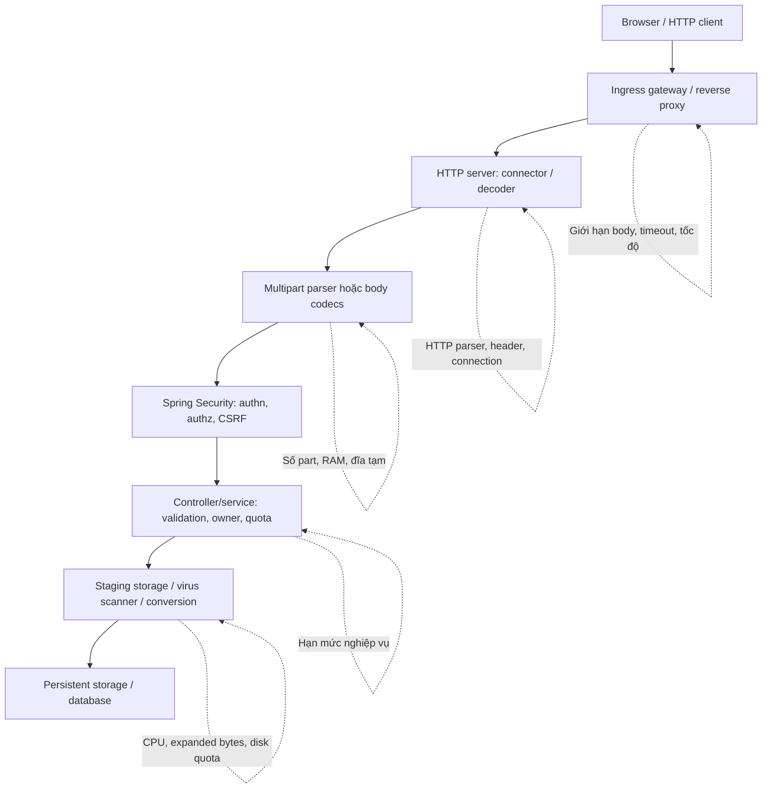
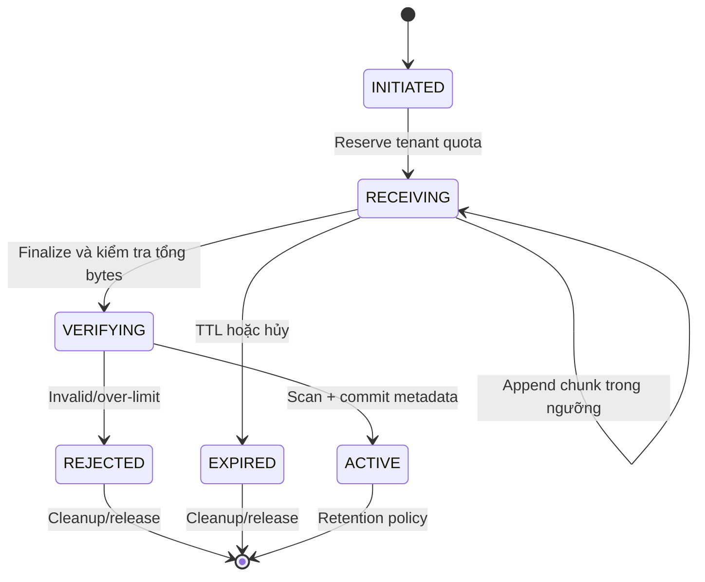

# Ràng buộc kích thước request, multipart và giới hạn tài nguyên

Trong module `SPRING_SECURITY_HTTP_PROTECTION`, Spring Security bảo vệ ứng dụng trước nhiều nguy cơ HTTP và trình duyệt: CSRF, CORS, security headers, CSP, HSTS, HTTP firewall và session protection. Tuy nhiên, **một request hợp lệ về authentication và CSRF vẫn có thể làm cạn bộ nhớ, đĩa tạm, CPU, thread, kết nối hoặc băng thông** nếu ứng dụng nhận và xử lý lượng dữ liệu vượt khả năng dự kiến.

Bài thuộc chương **Ranh giới bảo vệ** và tập trung vào **ràng buộc kích thước request, multipart và tài nguyên tiêu thụ** trong Servlet/Spring MVC và Reactive/Spring WebFlux. Tình huống xuyên suốt là chức năng tải tài liệu lên:

```text
POST /api/attachments
Content-Type: multipart/form-data; boundary=...

part "file"  : báo cáo PDF
part "title" : tiêu đề
Cookie       : JSESSIONID=...
X-CSRF-TOKEN : ...
```

Một người dùng có `ROLE_UPLOADER` và CSRF token hợp lệ vẫn có thể vô tình hoặc cố ý gửi file rất lớn, hàng nghìn part nhỏ, request đọc chậm, dữ liệu nén có tỷ lệ giải nén bất thường, hoặc liên tục tạo những upload hợp lệ khiến đĩa tạm đầy. Các lỗi đó **không nhất thiết là lỗi vượt quyền** theo nghĩa thông thường; chúng là lỗi về **resource exhaustion** và giới hạn nghiệp vụ.

Nguyên tắc chính:

> **Giới hạn ở nhiều tầng và theo nhiều đơn vị khác nhau:** số byte truyền, tổng request, mỗi file, số part, header/field, bytes sau giải nén, lượng lưu trữ, tốc độ, concurrency, số tác vụ nền và thời gian xử lý.

Không một cấu hình như `spring.servlet.multipart.max-file-size` hoặc `spring.codec.max-in-memory-size` có thể bao trùm tất cả các đại lượng đó. Một hệ thống an toàn phải biết **tầng nào có khả năng từ chối sớm**, tầng nào có thể đã buffer/parse một phần dữ liệu, và **ai chịu trách nhiệm giải phóng tài nguyên khi request bị hủy**.

Các ví dụ theo Java 17+, Spring Boot 3.x và Spring Security 6.x. Giới hạn có đơn vị `MB`, `MiB`, số byte được nêu rõ theo ngữ cảnh và cần thống nhất khi triển khai thực tế. Thuộc tính cấu hình có thể khác nhau theo servlet container, HTTP server, Spring Framework/Spring Boot version và reactive connector; hãy xác minh tài liệu đúng phiên bản đang dùng trước khi áp dụng production.

## 1. Mục tiêu học tập

Sau bài học, người học có thể:

- Giải thích vì sao HTTP authentication, authorization, CSRF và HTTP firewall **không tự cấp hạn mức bộ nhớ, đĩa hoặc CPU** cho request đã được phép.
- Phân biệt `Content-Length`, transfer-encoding/chunked upload, tổng số byte thực nhận, kích thước part, số part và kích thước sau giải nén.
- Chọn hạn mức cho gateway/reverse proxy, servlet container, multipart parser, application service và storage.
- Cấu hình `spring.servlet.multipart.max-file-size`, `max-request-size`, `file-size-threshold`, `location` trong ứng dụng Spring MVC.
- Hiểu điểm khác nhau giữa `server.tomcat.max-http-form-post-size` và **giới hạn body upload tổng quát**.
- Phân biệt `spring.codec.max-in-memory-size` và giới hạn **tổng request body** trong WebFlux.
- Thiết kế multipart endpoints có xác thực, CSRF, validation, quotas và staging riêng thay vì tin metadata từ browser.
- Cấu hình và kiểm soát temp disk, file handles, concurrency, request timeouts và cleanup khi lỗi/hủy.
- Xử lý HTTP `413 Content Too Large` (tên lịch sử: *Payload Too Large*), `400`, `401`, `403`, `415` và `429` theo nguyên nhân, không lộ dữ liệu nhạy cảm.
- Viết kiểm thử MockMvc/WebTestClient cho nghiệp vụ và kiểm thử HTTP thực để xác minh các giới hạn do container/proxy thực thi.
- Chẩn đoán file hợp lệ bị từ chối, request lớn trả lỗi sai, upload chậm, lệch cấu hình và file tạm không được xóa.

## 2. Threat model: một request hợp lệ vẫn có thể quá tốn tài nguyên

Ví dụ user đã qua `SecurityFilterChain`:



**Sơ đồ biểu diễn trách nhiệm logic, không cam kết thứ tự tuyệt đối:** trong Servlet, Spring Security filter thường thực thi trước MVC controller, nhưng **multipart parsing có thể xảy ra trước hoặc trong bước filter** tùy `MultipartFilter`, `DispatcherServlet` và các integration. Reverse proxy và server có thể đã đọc/buffer dữ liệu trước khi request tới security chain. Trong WebFlux, HTTP server, codec, WebFilters và reactive body consumption cũng có trình tự riêng.

Vì vậy, đừng suy “request không qua CSRF thì không tốn tài nguyên”. Một kết nối đã chiếm socket/bandwidth, một proxy có thể đã ghi request body vào đĩa và một multipart parser có thể đã tạo file tạm trước khi nhận `403`.

### 2.1. Những loại tiêu thụ cần tách riêng

| Loại tài nguyên | Kịch bản gây quá tải | Ràng buộc cần thiết |
| --- | --- | --- |
| **Băng thông/connection** | Tải body rất lớn hoặc gửi rất chậm | Ingress body limit, read timeout, minimum-rate/rate policy nếu hạ tầng hỗ trợ |
| **RAM** | `readAllBytes`, `getBytes`, `bodyToMono(byte[])` không cap | Per-request decoded bytes, bounded buffering, concurrency cap |
| **Đĩa tạm** | Multipart parser ghi nhiều file tạm | Temp directory riêng, disk quota, cleanup, số part/file |
| **CPU** | Parse JSON/XML, quét malware, OCR, PDF, giải nén | Kích thước input, timeout, worker queue và concurrency |
| **File descriptors** | Nhiều stream/channel chưa đóng | Bounded concurrency, try-with-resources, cancellation |
| **Thread pool** | Nhiều blocking uploads trong Servlet hoặc Reactor event loop | Worker pool limit; không block WebFlux event loop |
| **Persistent storage** | Upload nhiều file hợp lệ qua nhiều request | Quota per user/tenant và global capacity |
| **Database** | Multipart fields tạo hàng loạt inserts | Max field count, batch cap, idempotency, transaction |
| **Downstream services** | Một upload kích hoạt nhiều render/scan/webhook | Job quota, retry budget, backpressure |
| **Response** | API trả file hoặc lỗi khổng lồ | Response size cap, content policy và streaming |

### 2.2. Kích thước file khác tổng request

Một multipart request gồm body boundary, headers cho từng part, các field và dữ liệu từng file:

```text
HTTP request total
  ├── multipart boundaries
  ├── part headers (name, filename, content type)
  ├── file A data
  ├── file B data
  └── form fields (title, description...)
```

Nếu hai file đều dưới 5 MiB nhưng tổng cộng vượt 8 MiB, `max-file-size=5MB` **không đủ**. Cần `max-request-size` hoặc giới hạn tổng request tại lớp hỗ trợ, cộng với hạn mức **số part** để tránh hàng nghìn field nhỏ.

### 2.3. `Content-Length` không phải giới hạn đáng tin

Một request có thể:

- Có `Content-Length` và khai lớn hơn giới hạn: reverse proxy hoặc HTTP server có thể từ chối sớm.
- Không có `Content-Length` khi dùng chunked transfer encoding: phải **đếm byte thực nhận**.
- Có metadata không khớp thực tế hoặc request malformed: HTTP server phải áp quy tắc giao thức; không dùng header làm bằng chứng duy nhất về kích thước.
- Bị nén hoặc chứa archive nhỏ: bytes truyền và bytes giải nén/đã parse khác nhau.

**Không xây security policy bằng cách chỉ kiểm tra `request.getContentLengthLong()` rồi cho parse vô hạn.** Giá trị âm (không xác định) không được mặc định coi bằng 0 hoặc “không cần limit”.

### 2.4. Các lớp giới hạn có thể có đơn vị khác nhau

Một cấu hình theo `MB` có thể được framework hiểu theo đơn vị riêng; một quota theo bytes phải được quy đổi nhất quán. Chẳng hạn:

- 5 MiB = 5 × 1.048.576 = 5.242.880 bytes.
- 5 MB theo hệ thập phân = 5.000.000 bytes.

Khi có reverse proxy, container và application cùng đặt hạn mức, cần **đặt margin phù hợp cho multipart overhead** và đo bằng test thật để tránh “file đúng 5 MB nhưng bị proxy chặn vì request lớn hơn file”.

## 3. Chính sách kích thước phải là một bảng hợp đồng

Trước khi viết code, liệt kê **danh mục request** và giới hạn tương ứng. Ví dụ minh họa:

| Endpoint | Mục đích | Giới hạn cho mỗi request | Giới hạn nghiệp vụ bổ sung |
| --- | --- | --- | --- |
| `POST /api/attachments` | 1 PDF | Tổng multipart tối đa 8 MiB | File tối đa 5 MiB, 1 file, title 120 ký tự |
| `POST /api/profile/avatar` | 1 ảnh | Tổng tối đa 2 MiB | Image ≤ 1 MiB, pixel dimensions, content signature |
| `POST /api/comments` | Form nhỏ | Tổng ≤ 64 KiB | Text ≤ 4.000 ký tự |
| `POST /api/search` | JSON search | Tổng ≤ 32 KiB | 20 filters tối đa, depth/count cap |
| `POST /api/import` | Archive | Tổng ≤ 10 MiB | Expanded bytes ≤ 100 MiB, ≤ 100 entries |
| `GET /api/attachments/{id}` | Download | Không có request body | Owner/tenant, quota băng thông và response streaming |

Đây là **hạn mức thiết kế**, không phải những giá trị phù hợp mặc định cho mọi ứng dụng. Các con số phải xuất phát từ UX, kích thước dữ liệu thực tế, khả năng xử lý, số user đồng thời, storage capacity, độ nhạy dữ liệu và SLO.

### 3.1. Cần xét đồng thời **per request** và **over time**

Một user upload 1 file 4 MiB mỗi lần, 1.000 lần, vẫn có thể làm đầy storage dù request nào cũng hợp lệ. Vì vậy:

- **Per-file/per-request limits:** ngăn một request vượt khả năng.
- **Rate limits:** số request hoặc byte upload trong một khoảng thời gian.
- **Concurrency limits:** số upload đang xử lý đồng thời theo user/tenant/global.
- **Capacity quotas:** tổng dung lượng lưu trữ theo tenant/user và global.
- **Background-job limits:** số file cần scan/OCR/convert và chi phí retry.
- **Retention/cleanup:** tệp tạm và bản lỗi không tồn tại vô hạn.

Một số tình huống cần tính cả **băng thông và số byte mỗi khoảng thời gian**, không chỉ số request/giây. Upload 5 MiB khác đáng kể so với GET nhỏ dù đều là “1 request”.

### 3.2. Phân vùng endpoint thay vì một limit toàn ứng dụng quá rộng

Nếu chỉ một endpoint import cần cho phép request 100 MiB, không nên tự nâng giới hạn **toàn bộ routes** lên 100 MiB nếu các form khác chỉ cần vài KiB. Có thể thực hiện:

- Route policy ở reverse proxy/API gateway.
- Servlet/container cấu hình và controller/service validation theo endpoint.
- Dedicated upload service/subdomain/worker khi file lớn hoặc rủi ro cao.
- Object-storage direct upload bằng signed URL có scope/quota, với bước commit metadata sau đó.

**Tránh có một “max body” rất lớn cho toàn hệ thống rồi nghĩ mọi route đã được bảo vệ.**

## 4. Nhiều lớp thực thi giới hạn: ingress → parser → nghiệp vụ

Một chính sách bền vững thường cần các lớp:

1. **Ingress/API gateway:** giới hạn kích thước body, connection/read timeouts, request rate, concurrent requests, TLS/HTTP protocol. Đây là nơi có thể từ chối sớm **trước khi body tới ứng dụng** trong nhiều kiến trúc.
2. **HTTP server/connector:** các giới hạn về header, request parsing, form parameters, connections và timeouts tùy Tomcat, Jetty, Undertow hoặc Reactor Netty.
3. **Multipart/message codec:** giới hạn file/request/part, buffering vào RAM hay đĩa, kích thước field và codec aggregate.
4. **Controller/service:** validation theo endpoint, quota actor/tenant, file count, media-type, business state, xử lý side effects.
5. **Storage/worker:** temp disk quotas, file-descriptor/CPU limits, malware scanner, decompression/PDF/OCR quotas, cancellation và cleanup.
6. **Response/observability:** mapping status, log redaction, metrics chi phí và kiểm thử trên stack deploy.

Một tầng có thể từ chối trước các tầng sau, nhưng **không phải lúc nào cũng sớm hơn toàn bộ I/O**. Cần kiểm tra cách proxy buffer và thứ tự filter/parser trên hệ thống thật.

### 4.1. Ví dụ NGINX ở ingress

```nginx
server {
    listen 443 ssl;
    server_name app.example.test;

    # Ví dụ cho upload endpoint; đây là giới hạn tổng HTTP body
    # do NGINX áp dụng, không phải per-file trong multipart.
    location /api/attachments {
        client_max_body_size 8m;
        client_body_timeout 15s;

        proxy_pass http://spring_backend;
        proxy_read_timeout 30s;
    }
}
```

Cấu hình minh họa này cần kết hợp với server/TLS, routing và error handling đầy đủ của deployment. `client_max_body_size` hạn chế **request body** tại NGINX. Nó **không biết nội dung bên trong multipart part nào là “file chính”**, không tự tính quota tenant và không kiểm tra decompressed bytes của ZIP.

Đối với chính sách app cho phép tổng multipart 8 MiB, nếu NGINX cũng đặt đúng 8 MiB, overhead/boundaries có thể khiến một file gần mức tối đa bị chặn ở NGINX. Nên cân chỉnh gateway limit và app limit theo **tổng request đã tính overhead**, không chỉ kích thước payload do UI báo.

Nếu NGINX đang **buffer request body**, dữ liệu có thể ghi tạm vào đĩa proxy trước khi vào Spring. Thư mục tạm của ingress, disk quota, timeout và cleaning là trách nhiệm vận hành riêng.

### 4.2. Reverse proxy trả 413 không đồng nghĩa Spring Controller được gọi

Nếu ingress chặn sớm, request có thể **không tới Spring Security** và controller advice trong Spring không nhận được exception. Đó là trạng thái bình thường. Cần thiết kế error page/API response phù hợp ở **tầng trả lỗi**, giữ message nhất quán cho frontend.

Bảng phân loại:

| Tầng chặn | Ví dụ | Nơi xử lý |
| --- | --- | --- |
| Ingress | Body vượt `client_max_body_size` | Gateway/proxy config, 413 và log ingress |
| Container | Header/form parser vượt giới hạn | Container/server error mapping |
| Spring multipart | File vượt `max-file-size` | Multipart resolution/exception, có thể qua ControllerAdvice |
| Spring service | File/field vi phạm nghiệp vụ | Controller/service validation, 400/413/415 theo contract |
| Scanner/worker | PDF/ZIP sau giải nén vượt quota | Job failure/state và cleanup |
| Quota tenant | Tổng storage vượt hạn mức | 409/413/429 hoặc domain error theo hợp đồng |

Không ép tất cả lỗi resource thành `403 Forbidden`. `403` thường thuộc authorization/CSRF policy, không phải byte limits.

## 5. Servlet/Spring MVC: các giới hạn multipart chính

Spring Boot cung cấp các thuộc tính thông dụng cho Servlet multipart:

```yaml
spring:
  servlet:
    multipart:
      enabled: true
      max-file-size: 5MB
      max-request-size: 8MB
      file-size-threshold: 0B
      location: /srv/app-upload-tmp
```

Phân tích từng thuộc tính:

| Thuộc tính | Phạm vi chủ yếu | Điều cần lưu ý |
| --- | --- | --- |
| `enabled` | Bật hỗ trợ multipart | Không thay authentication/CSRF/size limit riêng. |
| `max-file-size` | Kích thước tối đa cho **một file** | Không bảo đảm tổng request hoặc số part bị cap. |
| `max-request-size` | Kích thước tối đa **multipart request** | Tầng proxy/container vẫn có hạn mức độc lập. |
| `file-size-threshold` | Ngưỡng phần file có thể được buffer trong memory trước khi ghi đĩa | Không phải giới hạn file tối đa; `0B` ưu tiên dùng disk cho file data. |
| `location` | Thư mục tạm xử lý upload | Phải tồn tại, có quyền thích hợp, quota và cleanup. |

`0B` không có nghĩa upload không dùng RAM: parser, headers, fields, metadata và application code vẫn tiêu thụ memory. Nó cũng **không tự bảo đảm temp disk sẽ có đủ chỗ** khi nhiều upload đồng thời.

Trong Servlet, auto-configuration thường sử dụng servlet multipart configuration và `StandardServletMultipartResolver`. Limit có thể được thực thi **khi container parse request**, có thể trước khi method controller chạy. Spring MVC có thể bọc lỗi thành `MultipartException`/`MaxUploadSizeExceededException` tùy container và thời điểm phân giải.

### 5.1. Đừng nhầm Tomcat form limit với tổng HTTP body limit

Có thể gặp thuộc tính:

```yaml
server:
  tomcat:
    max-http-form-post-size: 2MB
```

Nó liên quan đến giới hạn dữ liệu form POST mà Tomcat parse theo cơ chế tương ứng; **không được coi là một giới hạn tổng quát thay cho mọi request body, JSON, streaming upload và multipart limits**. Cần xem đúng phiên bản Tomcat/Spring Boot về phạm vi áp dụng. Một JSON body lớn không tự bị cap chỉ vì cấu hình thuộc tính “form-post-size”.

Tương tự:

```yaml
server:
  max-http-request-header-size: 16KB
```

giới hạn **HTTP request headers**, không phải file data/body. Đặt header limit nhỏ không thay phần body sẽ được decode và ghi tạm.

### 5.2. Temp location phải là private storage

Thư mục `/srv/app-upload-tmp` trong ví dụ phải:

- Do deployment quản lý, không nằm trong web root hoặc thư mục public.
- Không cho actor không tin cậy đọc file tạm hoặc tạo symlink/hardlink gây trỏ sai.
- Có quota dung lượng/inode phù hợp với concurrency thực tế.
- Có khả năng cleanup khi request thành công, lỗi, timeout hoặc worker crash.
- Không chứa secrets hoặc thông tin người dùng có quyền rộng hơn request owner.
- Có quyền OS/container thích hợp; tránh container image read-only khiến upload lỗi bất ngờ.

**File tạm multipart không phải file lưu trữ vĩnh viễn.** Nếu nghiệp vụ muốn giữ file, service phải sao chép/di chuyển vào private staging/storage key do server sinh, có owner metadata, scanning và transaction/cleanup đúng. Đừng phụ thuộc file tạm còn tồn tại sau khi HTTP request kết thúc.


## 6. Servlet: upload service kiểm soát byte thực đọc

Cấu hình multipart là **giới hạn đầu vào của framework**, còn service phải đảm bảo dữ liệu **được lưu** tuân chính sách nghiệp vụ. Không chỉ kiểm tra `MultipartFile.getSize()` rồi copy vô hạn: một luồng dữ liệu hoặc adapter tùy biến có thể không cung cấp độ dài tin cậy; kiểm tra số byte **trong quá trình đọc** làm rõ ràng buộc ở storage boundary.

### 6.1. Model: file gốc không được quyết định tên lưu trữ

```java
import java.util.UUID;

public record StoredAttachment(
        UUID id,
        String ownerUsername,
        String storageKey,
        String title,
        long byteCount) {
}
```

Giữ `originalFilename` (nếu thực sự cần) làm **metadata hiển thị được kiểm tra riêng**, tuyệt đối không dùng nó trong `Path.resolve(...)`. Chọn tên file nội bộ do server sinh, khác với ID mà client dùng để tham chiếu.

### 6.2. Service mẫu: bounded copy và cleanup

```java
import java.io.IOException;
import java.io.InputStream;
import java.io.OutputStream;
import java.nio.file.Files;
import java.nio.file.LinkOption;
import java.nio.file.Path;
import java.nio.file.StandardOpenOption;
import java.util.UUID;
import org.springframework.beans.factory.annotation.Value;
import org.springframework.http.HttpStatus;
import org.springframework.stereotype.Service;
import org.springframework.web.multipart.MultipartFile;
import org.springframework.web.server.ResponseStatusException;

@Service
public class AttachmentStorageService {

    private static final long MAX_FILE_BYTES = 5L * 1024 * 1024;
    private static final int BUFFER_BYTES = 8192;

    private final Path privateRoot;

    public AttachmentStorageService(
            @Value("${app.upload.private-root}") String rootSetting)
            throws IOException {

        // Root được quản lý trong deployment, không lấy từ HTTP request.
        this.privateRoot = Path.of(rootSetting).toRealPath();

        if (!Files.isDirectory(
                privateRoot, LinkOption.NOFOLLOW_LINKS)) {
            throw new IllegalStateException("Upload root không hợp lệ");
        }
    }

    public StoredAttachment store(
            MultipartFile file, String title, String actor)
            throws IOException {

        if (actor == null || actor.isBlank()) {
            throw new ResponseStatusException(
                    HttpStatus.FORBIDDEN, "Không có người dùng hợp lệ");
        }
        if (title == null || title.isBlank()
                || title.length() > 120) {
            throw new ResponseStatusException(
                    HttpStatus.BAD_REQUEST, "Tiêu đề không hợp lệ");
        }
        if (file == null || file.isEmpty()) {
            throw new ResponseStatusException(
                    HttpStatus.BAD_REQUEST, "Thiếu tệp");
        }
        if (file.getSize() > MAX_FILE_BYTES) {
            throw tooLarge();
        }

        UUID id = UUID.randomUUID();
        String key = UUID.randomUUID()
                .toString().replace("-", "") + ".blob";

        Path destination = privateRoot.resolve(key).normalize();
        if (!destination.startsWith(privateRoot)
                || destination.equals(privateRoot)) {
            throw new IllegalStateException(
                    "Storage key vượt private root");
        }

        boolean completed = false;
        boolean createdByThisRequest = false;
        long count = 0;

        try {
            // CREATE_NEW: không overwrite, kể cả khi tên bị trùng.
            try (InputStream source = file.getInputStream();
                 OutputStream target = Files.newOutputStream(
                         destination,
                         StandardOpenOption.CREATE_NEW,
                         StandardOpenOption.WRITE,
                         LinkOption.NOFOLLOW_LINKS)) {

                // Chỉ cleanup khi CREATE_NEW đã tạo file thành công.
                createdByThisRequest = true;
                byte[] buffer = new byte[BUFFER_BYTES];
                int n;

                while ((n = source.read(buffer)) != -1) {
                    count += n;
                    if (count > MAX_FILE_BYTES) {
                        throw tooLarge();
                    }
                    target.write(buffer, 0, n);
                }
            }

            if (count == 0) {
                throw new ResponseStatusException(
                        HttpStatus.BAD_REQUEST, "Tệp rỗng");
            }

            // Bước kế tiếp trong hệ thống thật:
            // validate file signature/type, scan, commit metadata/owner,
            // reserve/commit quotas và publish khi đã được phép.
            completed = true;
            return new StoredAttachment(
                    id, actor, key, title, count);
        } finally {
            if (!completed && createdByThisRequest) {
                Files.deleteIfExists(destination);
            }
        }
    }

    private static ResponseStatusException tooLarge() {
        return new ResponseStatusException(
                HttpStatus.PAYLOAD_TOO_LARGE,
                "Tệp vượt giới hạn");
    }
}
```

**Giới hạn an toàn của ví dụ:** Root là thư mục private được server sở hữu, actor không thể tạo/rename/symlink trong đó. `CREATE_NEW`, `NOFOLLOW_LINKS` và key ngẫu nhiên giảm rủi ro overwrite/path manipulation. Nhưng đây **chưa phải pipeline upload production đầy đủ**: hàm mới tạo file trong private storage và trả metadata, chưa ghi catalog bền vững, chưa commit quota atomically, chưa scan hoặc bảo đảm crash recovery. Khi triển khai thật, lưu tệp vào quarantine/staging, hoàn tất kiểm tra rồi mới gắn trạng thái `ACTIVE`. Nếu transaction metadata thất bại, phải xóa/đánh dấu orphan và có reconciliation job.

**Tại sao vừa kiểm tra `getSize()` vừa đếm bytes?** `getSize()` cho phép từ chối sớm nếu parser đã biết kích thước, nhưng **byte counter trong vòng lặp** là lớp bảo vệ ở thời điểm copy. Không dùng `MultipartFile.getBytes()` để nhận file lớn vì nó tạo một mảng chứa toàn bộ nội dung trong memory.

**Điểm cần test:** Nếu lần ghi bị hủy giữa chừng hoặc byte count vượt ngưỡng, file chưa hoàn tất phải bị xóa. Khi việc xóa cũng thất bại, cần metrics/orphan cleanup; không bỏ qua lỗi để mặc định vẫn thành công.

### 6.3. Phân biệt kiểm tra kích thước và xác minh nội dung

Một file có dung lượng 3 MiB có thể vẫn là:

- File HTML/SVG active nhưng được đặt tên `report.pdf`.
- Archive giải nén tới nhiều GiB.
- File PDF có cấu trúc khiến parser/thumbnailer tốn CPU.
- Tệp chứa malware hoặc dữ liệu không phù hợp mục đích nghiệp vụ.
- Tệp đã được gửi nhiều lần để vượt quota tổng.

Hạn mức byte là **điều kiện cần**, không phải xác nhận nội dung an toàn. Sau upload cần kiểm tra magic bytes/content parser, scanning theo threat model và file type allowlist; **không tin `getContentType()` hoặc phần đuôi tên file làm bằng chứng duy nhất**.

## 7. Spring MVC controller: authorization, validation và response nhỏ

```java
import java.io.IOException;
import org.springframework.http.HttpStatus;
import org.springframework.http.MediaType;
import org.springframework.http.ResponseEntity;
import org.springframework.security.core.Authentication;
import org.springframework.web.bind.annotation.PostMapping;
import org.springframework.web.bind.annotation.RequestParam;
import org.springframework.web.bind.annotation.RequestPart;
import org.springframework.web.bind.annotation.RestController;
import org.springframework.web.multipart.MultipartFile;
import org.springframework.web.server.ResponseStatusException;

@RestController
public class AttachmentUploadController {

    private final AttachmentStorageService storage;

    public AttachmentUploadController(
            AttachmentStorageService storage) {
        this.storage = storage;
    }

    @PostMapping(
            value = "/api/attachments",
            consumes = MediaType.MULTIPART_FORM_DATA_VALUE)
    ResponseEntity<AttachmentCreated> upload(
            @RequestPart("file") MultipartFile file,
            @RequestParam("title") String title,
            Authentication actor) throws IOException {

        StoredAttachment saved = storage.store(
                file, title, actor.getName());

        return ResponseEntity.status(HttpStatus.CREATED)
                .body(new AttachmentCreated(
                        saved.id(), "PENDING_SCAN", saved.byteCount()));
    }
}
```

Đây là **mẫu nhỏ** để người học thấy điểm đặt validation/byte count. Controller chỉ trả DTO công khai; `StoredAttachment` có `storageKey` nội bộ và **không được trả trực tiếp cho client**. Trong ứng dụng thật, trạng thái `PENDING_SCAN` phải phản ánh catalog/staging workflow có thực, không chỉ là chuỗi đặt vào response.

Ví dụ DTO an toàn hơn:

```java
import java.util.UUID;

public record AttachmentCreated(
        UUID id,
        String state,
        long byteCount) {
}
```

DTO này được dùng trực tiếp trong controller ở trên. Mẫu còn thiếu catalog/scanner nên **chưa thể xem là pipeline lưu trữ hoàn chỉnh**, nhưng không đưa storage key ra ngoài qua HTTP.

### 7.1. Một `MultipartFile` không giới hạn số part của request

`@RequestPart("file") MultipartFile` chỉ nói rằng controller **cần một file với tên field đó**. Nó không chứng minh request không chứa thêm 1.000 part khác; parser/container có thể đã xử lý các part ấy trước khi controller chạy.

Vì vậy có nhiều mức:

- **Mức container/parser:** giới hạn số parts, tổng headers/fields và kích thước mỗi part nếu server hỗ trợ.
- **Mức contract:** service chỉ chấp nhận 1 file, field `title`, file type/size, owner.
- **Mức ingress:** tổng HTTP body và tốc độ/connection quotas.
- **Mức thử nghiệm:** gửi multipart có nhiều part nhỏ để xác minh parser có chặn thật không.

Nếu muốn đếm `request.getParts()` trong controller, điều đó có thể dùng để kiểm tra **contract**, nhưng **đã quá muộn để ngăn mọi chi phí parse**. Hơn nữa, form có hidden CSRF field và fields bổ sung có thể khiến `parts.size()` khác với số file; cần phân biệt file parts và form fields theo schema.

### 7.2. Response sau upload không nên chứa raw metadata

Không echo nguyên `getOriginalFilename()`, full file path, parser exception hoặc thông tin virus scanner vào HTTP response. Nếu UI cần tên file, dùng text encoding trong HTML/DOM và API field được normalize. Không đưa file vào public static folder trước khi scan/authorization xong.

## 8. CSRF, authentication và thứ tự multipart parsing

Spring Security mặc định bảo vệ unsafe browser requests như POST bằng CSRF (khi có cấu hình session/browser thích hợp), nhưng **multipart file parsing có thể tốn tài nguyên trước khi token được xác minh**, tùy cách filter được sắp xếp.

### 8.1. Hidden token trong form upload

```html
<form method="post"
      action="/api/attachments"
      enctype="multipart/form-data">
  <label for="title">Tiêu đề</label>
  <input id="title" name="title" maxlength="120" required>
  <label for="file">Tài liệu</label>
  <input id="file" name="file" type="file" accept=".pdf" required>
  <button type="submit">Tải lên</button>
  <!-- Có thể cần hidden CSRF field theo cách render template. -->
</form>
```

Nếu dùng Thymeleaf `th:action="@{/api/attachments}"`, trong cấu hình tích hợp phù hợp framework có thể tự render hidden CSRF field. Cần **kiểm tra HTML thực tế**, không mặc định mọi static form đều có token. Browser `accept=".pdf"` là UX hint, không thay validation trên server.

Nếu CSRF token nằm **trong multipart body**, application/container có thể cần parse form parts để đọc token. Một số cấu hình Servlet dùng `MultipartFilter` trước Spring Security tạo khả năng file tạm được tạo ngay cả khi CSRF cuối cùng từ chối request. Đây là lý do phải có ingress body/timeouts/temporary disk limits độc lập với CSRF.

### 8.2. Gửi CSRF token trong header khi upload bằng JavaScript

Một cách thực tế cho `fetch + FormData` là để frontend nhận token và **gửi trong HTTP header** thay vì buộc security filter đọc multipart body chỉ để tìm token.

Ví dụ Thymeleaf render metadata:

```html
<meta name="_csrf" th:content="${_csrf.token}">
<meta name="_csrf_header" th:content="${_csrf.headerName}">
```

Script được tải từ file JavaScript riêng (thuận tiện cho CSP không cho inline script):

```javascript
async function uploadAttachment(form) {
    const token = document.querySelector(
        'meta[name="_csrf"]').content;
    const headerName = document.querySelector(
        'meta[name="_csrf_header"]').content;

    const file = form.querySelector(
        'input[name="file"]').files[0];

    if (!file || file.size > 5 * 1024 * 1024) {
        throw new Error("Tệp không hợp lệ hoặc vượt 5 MiB");
    }

    const body = new FormData(form);
    const response = await fetch("/api/attachments", {
        method: "POST",
        credentials: "same-origin",
        headers: { [headerName]: token },
        body
    });

    if (response.status === 413) {
        throw new Error("File hoặc request vượt giới hạn");
    }
    if (response.status === 403) {
        throw new Error("Phiên/CSRF/authorization không hợp lệ");
    }
    if (!response.ok) {
        throw new Error("Không tải lên được");
    }

    return response.json();
}
```

**Không tự đặt header `Content-Type: multipart/form-data` khi gửi `FormData`**: browser cần tự thêm `boundary` tương ứng; nếu đặt thủ công, multipart parser có thể không đọc được body.

CSRF trong header **không thay** ingress request size, file size, virus scanning hoặc quotas. Ngoài ra, proxy có thể buffer body trước Spring Security và một middleware khác có thể parse trước filter; cần đo thứ tự thật thay vì cam kết request thiếu token sẽ không bao giờ đụng đĩa.

### 8.3. CSRF, CORS và cookie session không phải rate limiting

- **CSRF:** request unsafe có token hợp lệ theo browser/session threat model.
- **Authentication/authorization:** ai được upload vào tài liệu/tenant nào.
- **CORS:** browser từ origin khác có được đọc response / gửi preflight được chấp nhận không.
- **Rate/quota:** một actor được tạo bao nhiêu upload, bao nhiêu byte và job.
- **Ingress/multipart limits:** byte request/part, parser memory/disk/time.

Một user có token đúng không được dùng vô hạn tài nguyên chỉ vì vượt qua `CsrfFilter`. Ngược lại, rate limit không thay authentication/CSRF và không biết nội dung file có an toàn hay không.

## 9. Xử lý lỗi upload và HTTP status phù hợp

### 9.1. `MaxUploadSizeExceededException` trong Spring MVC

Khi multipart resolver/container báo upload vượt limit, Spring MVC có thể phát `MaxUploadSizeExceededException`; tùy container, thời điểm và cách request bị ngắt, lỗi có thể xuất hiện ở parser/connector/ingress **trước** khi controller advice hoạt động.

Ví dụ handler cho trường hợp exception **được Spring MVC chuyển tới advice**:

```java
import java.util.Map;
import org.springframework.http.HttpStatus;
import org.springframework.http.ResponseEntity;
import org.springframework.web.bind.annotation.ExceptionHandler;
import org.springframework.web.bind.annotation.RestControllerAdvice;
import org.springframework.web.multipart.MaxUploadSizeExceededException;

@RestControllerAdvice
public class UploadExceptionHandler {

    @ExceptionHandler(MaxUploadSizeExceededException.class)
    ResponseEntity<Map<String, String>> tooLarge(
            MaxUploadSizeExceededException exception) {

        return ResponseEntity.status(HttpStatus.PAYLOAD_TOO_LARGE)
                .body(Map.of(
                        "code", "UPLOAD_TOO_LARGE",
                        "message", "Dung lượng vượt giới hạn"));
    }
}
```

Không trả `exception.getMessage()` hoặc thông tin đường dẫn tạm/log parser cho browser. Cần kiểm tra các lỗi `MultipartException`, malformed boundary, missing part, media type sai và storage failure để đưa ra status/error code phù hợp, thay vì bắt mọi lỗi thành 500 hoặc 413.

### 9.2. Bảng status và tầng sở hữu

| Status | Tình huống | Lưu ý |
| --- | --- | --- |
| `400 Bad Request` | Multipart thiếu field, boundary sai, title không hợp lệ | Không đồng nhất với file quá lớn. |
| `401 Unauthorized` | Chưa xác thực (API theo policy) | Với form login có thể redirect thay vì 401. |
| `403 Forbidden` | Role/owner/CSRF không hợp lệ | Không thay byte limits. |
| `413 Content Too Large` | Tổng body/file vượt giới hạn | Lỗi có thể từ gateway, container, codec hoặc service. |
| `415 Unsupported Media Type` | `Content-Type` request hoặc file type không được hỗ trợ theo contract | MIME từ client không đủ xác minh file signature. |
| `429 Too Many Requests` | Vượt rate/concurrency policy theo thời gian | Có thể thêm `Retry-After` nếu policy xác định. |
| `409 Conflict` | Bản ghi/quota/state xung đột theo domain contract | Không dùng cho mọi lỗi byte limit. |
| `500/502/503` | Đĩa/scan/upstream hỏng hoặc service quá tải | Trả thông tin tối thiểu và dọn file dở. |

**Một 413 từ proxy không chạy `@RestControllerAdvice` của Spring.** Cần test frontend xử lý mã status và body có thể khác nhau theo tầng, không assume mọi 413 là một JSON response có cấu trúc giống nhau.

### 9.3. Không buộc HTTP connection luôn tái sử dụng được sau khi từ chối

Khi server hoặc proxy từ chối request có body lớn, tùy giao thức, connector và cấu hình swallow/drain, kết nối có thể bị đóng thay vì giữ-alive. Client nên xử lý kết quả HTTP hoặc network failure, không retry vô hạn một upload quá lớn. Đây là hành vi vận hành cần đo chứ không phải lỗi chắc chắn của CSRF/controller.

### 9.4. Dọn dữ liệu ở mọi nhánh lỗi

Khi upload bị hủy:

- Parser/container cần cleanup temporary multipart parts theo lifecycle.
- Service cần xóa file staging chưa hoàn tất; dùng `try/finally` hoặc trạng thái job.
- Scanner/thumbnailer/quarantine jobs cần cleanup hoặc retry có giới hạn.
- Database transaction thất bại cần gỡ metadata/file orphan qua reconciliation.
- Client disconnect cần propagate cancellation/close trong reactive pipelines nếu có streaming.

Cleanup không nên dựa duy nhất vào “request thành công” hoặc timeout của frontend.


## 10. WebFlux/Reactive: giới hạn codec không đồng nghĩa giới hạn toàn request

Trong ứng dụng WebFlux, request có thể đi qua Reactor Netty, WebFilters, multipart readers và message codecs trước khi vào controller. Sử dụng Reactive streams **không tự biến một upload lớn thành upload có hạn mức**: vẫn phải cấu hình chỗ buffer, số part, disk usage và lượng dữ liệu mà service được phép giữ.

### 10.1. `spring.codec.max-in-memory-size` giới hạn điều gì?

Ví dụ cấu hình:

```yaml
spring:
  codec:
    max-in-memory-size: 256KB
```

Thuộc tính này điều chỉnh **giới hạn bộ nhớ khi các codecs tổng hợp dữ liệu vào memory** trong các trường hợp được hỗ trợ. Khi dữ liệu được aggregate bằng một decoder, vượt ngưỡng có thể dẫn đến `DataBufferLimitException`.

Nhưng cần phân biệt:

- **Không phải “mọi HTTP request phải nhỏ hơn 256 KiB”.**
- Không áp **quota tổng request body** cho mọi dạng streaming chỉ bằng một cấu hình.
- Không bảo đảm một upload `FilePart` có tổng dung lượng nhỏ hơn 256 KiB nếu multipart reader có cơ chế buffer/spool ra đĩa.
- Không thay giới hạn số phần multipart, field headers hoặc bytes sau giải nén.
- Không ngăn code tự gom dữ liệu qua một collection không giới hạn bên ngoài codec.

Một file lớn có thể stream qua server mà không được giữ toàn bộ trong memory, nhưng **vẫn tiêu thụ băng thông, đĩa hoặc công việc I/O**. Giải quyết “không OOM” không đồng nghĩa giải quyết exhaustion của tài nguyên khác.

### 10.2. Cấu hình multipart reader cho WebFlux

Ở các phiên bản Spring Boot có hỗ trợ các thuộc tính dưới đây, có thể cấu hình giới hạn cho multipart parsing:

```yaml
spring:
  codec:
    max-in-memory-size: 256KB
  webflux:
    multipart:
      max-in-memory-size: 64KB
      max-disk-usage-per-part: 5MB
      max-parts: 10
      file-storage-directory: /srv/reactive-upload-tmp
```

Các thuộc tính multipart tương ứng với các khả năng của Spring Framework multipart readers, chẳng hạn `DefaultPartHttpMessageReader`. **Tên thuộc tính, availability, default và cách tác động tới streaming multipart phải được xác minh theo chính xác Spring Boot/Spring Framework version** đang chạy.

Ý nghĩa theo lớp:

- `max-in-memory-size` của multipart reader: giới hạn buffer trong bộ nhớ theo cơ chế của reader; với file part lớn hơn threshold, reader có thể spool xuống disk.
- `max-disk-usage-per-part`: giới hạn lượng disk usage của **từng part được ghi xuống disk**, không thay limit **tổng request**.
- `max-parts`: hạn chế số phần multipart được reader chấp nhận; không phải quota số HTTP requests.
- `file-storage-directory`: nơi lưu multipart part được spool, cần quyền/quota/cleanup như Servlet temp directory.
- `spring.codec.max-in-memory-size`: codec aggregation budget ở phạm vi liên quan, **không cộng hoặc thay thế** tất cả multipart settings.

**Quan trọng:** Các cấu hình này có thể không áp dụng giống nhau khi dùng **streaming multipart part-event reader** hoặc code tùy chỉnh. Luôn thử đúng API (ví dụ `@RequestPart FilePart` so với `Flux<PartEvent>`), đúng phiên bản và connector.

### 10.3. Điểm khác giữa Servlet và Reactive

| Khía cạnh | Servlet MVC | WebFlux |
| --- | --- | --- |
| Multipart model | `MultipartFile`, servlet `Part`, multipart resolver | `FilePart`, `FormFieldPart`, `PartEvent` |
| Đọc file | Thường là blocking `InputStream` | Reactive `Flux<DataBuffer>` hoặc `FilePart.transferTo` |
| Cấu hình thông dụng | `spring.servlet.multipart.*` | `spring.webflux.multipart.*` + `spring.codec.*` theo version |
| Memory/disk | Container multipart temp storage | Multipart reader buffering + disk spool/streaming |
| Hạn mức byte business | Đếm bytes trong copy loop | Bounded `Flux<DataBuffer>`/`DataBufferUtils.join(..., maxByteCount)` hoặc streaming guard |
| Quyền user | `Authentication`/Servlet security context | Reactive `Principal`/security context |
| CSRF | `CsrfFilter` | `CsrfWebFilter` |
| Cancellation | Request/thread/stream lifecycle | Publisher cancellation và data buffer lifecycle |
| File lớn | Streaming blocking với workers + quotas | Reactive streaming/storage connector + quotas |

### 10.4. Memory budget phải xét concurrency

Giả sử một request có thể buffer tối đa 1 MiB dữ liệu, nhưng có 500 request upload chạy đồng thời:

\[
500 \times 1\,\text{MiB} = 500\,\text{MiB}
\]

Đó mới chỉ là bộ nhớ giữ file, chưa gồm object overhead, multipart parser, TLS/network buffers, JSON metadata, JVM heap và background jobs. Vì vậy **per-request memory cap phải kết hợp concurrency cap**, không chỉ đặt `max-in-memory-size` rồi bỏ qua tổng tài nguyên.

## 11. WebFlux: ví dụ upload file nhỏ có byte limit rõ ràng

Để tránh một ví dụ phức tạp về streaming file lớn, xét endpoint Reactive **chỉ nhận file tối đa 1 MiB**. `DataBufferUtils.join(publisher, maxByteCount)` cho phép tổng hợp một dòng `DataBuffer` với **ngưỡng byte** và báo lỗi nếu dữ liệu vượt ngưỡng. Đây là lựa chọn phù hợp cho file nhỏ, không dùng cho file nhiều GiB.

### 11.1. Service mẫu chỉ lưu byte array nhỏ

```java
import java.util.UUID;
import org.springframework.http.HttpStatus;
import org.springframework.stereotype.Service;
import org.springframework.web.server.ResponseStatusException;
import reactor.core.publisher.Mono;
import reactor.core.scheduler.Schedulers;

@Service
public class ReactiveAttachmentService {

    public record Created(UUID id, String state, long bytes) {}

    public Mono<Created> create(
            String actor, String title, byte[] content) {

        return Mono.fromCallable(() -> {
            if (actor == null || actor.isBlank()
                    || title == null || title.isBlank()
                    || title.length() > 120
                    || content == null || content.length == 0
                    || content.length > 1024 * 1024) {
                throw new ResponseStatusException(
                        HttpStatus.BAD_REQUEST,
                        "Dữ liệu tải lên không hợp lệ");
            }

            // Demo: tạo public ID; production phải lưu vào
            // private storage do server kiểm soát, có owner,
            // scan/quota/state và cleanup. Không dùng filename input.
            return new Created(
                    UUID.randomUUID(), "PENDING_SCAN", content.length);
        }).subscribeOn(Schedulers.boundedElastic());
    }
}
```

Service trên **chỉ minh họa validation/response**, chưa lưu file thật. Nó không cấp quyền upload theo tenant hoặc ghi vào database; cần triển khai domain authorization, quota và storage persistence trước khi đưa vào sản phẩm.

### 11.2. Controller Reactive với `FilePart.content()` và bounded join

```java
import java.security.Principal;
import org.springframework.core.io.buffer.DataBufferUtils;
import org.springframework.core.io.buffer.DataBufferLimitException;
import org.springframework.http.HttpStatus;
import org.springframework.http.MediaType;
import org.springframework.http.ResponseEntity;
import org.springframework.http.codec.multipart.FilePart;
import org.springframework.http.codec.multipart.FormFieldPart;
import org.springframework.web.bind.annotation.PostMapping;
import org.springframework.web.bind.annotation.RequestPart;
import org.springframework.web.bind.annotation.RestController;
import org.springframework.web.server.ResponseStatusException;
import reactor.core.publisher.Mono;

@RestController
public class ReactiveAttachmentController {

    private static final int MAX_FILE_BYTES = 1024 * 1024;

    private final ReactiveAttachmentService service;

    public ReactiveAttachmentController(
            ReactiveAttachmentService service) {
        this.service = service;
    }

    @PostMapping(
            value = "/reactive/api/attachments",
            consumes = MediaType.MULTIPART_FORM_DATA_VALUE)
    Mono<ResponseEntity<ReactiveAttachmentService.Created>> upload(
            @RequestPart("file") FilePart file,
            @RequestPart("title") FormFieldPart title,
            Mono<Principal> principal) {

        if (title.value().isBlank()
                || title.value().length() > 120) {
            return Mono.error(new ResponseStatusException(
                    HttpStatus.BAD_REQUEST,
                    "Tiêu đề không hợp lệ"));
        }

        return principal.flatMap(actor ->
                DataBufferUtils.join(
                            file.content(), MAX_FILE_BYTES)
                        .flatMap(joined -> {
                            // Buffer giới hạn 1 MiB.
                            // Release đúng một lần trong mọi nhánh.
                            byte[] content;
                            try {
                                content = new byte[
                                        joined.readableByteCount()];
                                joined.read(content);
                            } finally {
                                DataBufferUtils.release(joined);
                            }

                            return service.create(
                                    actor.getName(),
                                    title.value(), content);
                        }))
                .map(created -> ResponseEntity
                        .status(HttpStatus.CREATED)
                        .body(created))
                .onErrorMap(
                        DataBufferLimitException.class,
                        ex -> new ResponseStatusException(
                                HttpStatus.PAYLOAD_TOO_LARGE,
                                "Tệp vượt giới hạn"));
    }
}
```

Những điều cần xác minh:

1. Controller chỉ nhận `FilePart` và `FormFieldPart`, nhưng multipart reader vẫn có thể đã xử lý **các part khác**; áp `max-parts` và ingress body limit.
2. `DataBufferUtils.join(..., MAX_FILE_BYTES)` giới hạn **tổng số byte của file stream được join**. Đây là ngưỡng bổ sung cho tầng business, không thay disk/parsing limits của reader.
3. `DataBufferUtils.release(joined)` giải phóng `DataBuffer` gộp sau khi sao chép bytes. Không giữ buffer hoặc dùng buffer lại sau khi release.
4. Nếu publisher vượt giới hạn, quá trình join có thể ném `DataBufferLimitException`; adapter chuyển thành `413`. Lỗi phát sinh **trước khi method controller được gọi** cần handler chung hoặc HTTP server xử lý.
5. Ví dụ dùng `byte[]` có giới hạn cố định 1 MiB, phù hợp file nhỏ; nếu nâng giới hạn lên vài GiB sẽ không còn phù hợp.
6. `FilePart.filename()` không được dùng làm storage path. Filename chỉ là client metadata cần kiểm tra nếu hiển thị.
7. Ứng dụng còn cần quota/concurrency, content signature, media-type policy, scanning, private storage, owner và cancellation behavior.

**Lưu ý resource lifecycle:** Các toán tử Reactive và các codecs quản lý một phần buffer lifecycle, nhưng **code tự xử lý `DataBuffer` phải hiểu trách nhiệm release tương ứng**. Không tự gom `Flux<DataBuffer>` bằng `collectList()` rồi quên release; cũng không giữ `DataBuffer` sau khi đã phát nó qua một operator có ownership riêng.

### 11.3. Với file lớn, không `join` toàn bộ nội dung

Khi file 100 MiB hoặc lớn hơn, hướng thiết kế đúng là **stream vào private storage** với:

- Destination key do server sinh và quyền write phù hợp.
- Byte-counting khi stream, không chỉ kiểm tra `Content-Length`.
- Multipart parser/gateway limit tổng request và số part.
- Backpressure phù hợp với storage sink, không buffer toàn bộ body.
- Cleanup nếu client cancel/timeout, disk full, scan fail hoặc service lỗi.
- Hạn mức đồng thời, total bytes tenant/global và disk capacity.
- Nếu dùng `DataBufferUtils.write`, nắm rõ overload đang sử dụng và trách nhiệm `DataBuffer` release trong Spring Framework version tương ứng.
- Nếu dùng `FilePart.transferTo(Path)`, không suy rằng method tự enforce **quota theo actor, max total request hay owner authorization**.

Một ví dụ tưởng là “reactive streaming” nhưng dùng `file.content().collectList()` để chờ tất cả buffers là không còn memory-bounded. Tính non-blocking không đồng nghĩa lượng bộ nhớ tiêu thụ có giới hạn.

## 12. Spring Security WebFlux: upload và CSRF

```java
import org.springframework.context.annotation.Bean;
import org.springframework.context.annotation.Configuration;
import org.springframework.http.HttpMethod;
import org.springframework.security.config.Customizer;
import org.springframework.security.config.web.server.ServerHttpSecurity;
import org.springframework.security.web.server.SecurityWebFilterChain;

@Configuration
public class ReactiveUploadSecurity {

    @Bean
    SecurityWebFilterChain securityWebFilterChain(
            ServerHttpSecurity http) {

        return http
                .authorizeExchange(auth -> auth
                        .pathMatchers(HttpMethod.POST,
                                "/reactive/api/attachments")
                            .hasRole("UPLOADER")
                        .anyExchange().denyAll())
                .formLogin(Customizer.withDefaults())
                .csrf(Customizer.withDefaults())
                .build();
    }
}
```

Khi frontend dùng session cookie, POST multipart vẫn là unsafe request cần CSRF theo policy. Với JavaScript client, CSRF token qua header tránh buộc token được truy xuất từ multipart body chỉ để xác minh. Nhưng **proxy/HTTP decoder có thể đọc một phần request trước WebFilter**, nên phải giữ size/timeouts độc lập.

### 12.1. Servlet và Reactive không dùng chung security chain

- Servlet: `HttpSecurity` → `SecurityFilterChain`, `CsrfFilter`, servlet multipart resolver.
- Reactive: `ServerHttpSecurity` → `SecurityWebFilterChain`, `CsrfWebFilter`, reactive multipart reader.

Đừng sao chép trực tiếp servlet `MultipartFilter` vào WebFlux để “sửa thứ tự CSRF”, vì hai programming models có multipart infrastructure khác nhau.

### 12.2. Mapping `DataBufferLimitException` trong API Reactive

Một `DataBufferLimitException` có thể phát sinh khi codecs aggregate dữ liệu; nếu muốn API trả một mã lỗi ổn định, có thể bổ sung `@RestControllerAdvice`:

```java
import java.util.Map;
import org.springframework.core.io.buffer.DataBufferLimitException;
import org.springframework.http.HttpStatus;
import org.springframework.http.ResponseEntity;
import org.springframework.web.bind.annotation.ExceptionHandler;
import org.springframework.web.bind.annotation.RestControllerAdvice;

@RestControllerAdvice
public class ReactiveBodyLimitErrorHandler {

    @ExceptionHandler(DataBufferLimitException.class)
    ResponseEntity<Map<String, String>> bodyLimit() {
        return ResponseEntity.status(HttpStatus.PAYLOAD_TOO_LARGE)
                .body(Map.of(
                        "code", "REQUEST_BODY_TOO_LARGE",
                        "message", "Dữ liệu vượt giới hạn"));
    }
}
```

Đây là handler **cho những exception được framework truyền tới advice**. Nếu Netty/ingress từ chối kết nối sớm hoặc một decoder chọn exception khác, advice có thể không được gọi. Test trên đường đi thực và không mặc định mọi 413 là một JSON response.

## 13. Upload quota theo actor/tenant và giới hạn cạnh tranh

Các giới hạn theo request chỉ bảo đảm **một request đơn lẻ không vượt ngưỡng**. Một người có thể gửi nhiều request hợp lệ đồng thời hoặc trong nhiều ngày.

### 13.1. Các hạn mức nên quản lý riêng

| Loại quota | Ví dụ minh họa | Vì sao cần |
| --- | --- | --- |
| Per-file | 5 MiB | File không quá lớn cho parser/scanner. |
| Per-multipart-request | 8 MiB | Chặn nhiều file/fields gộp quá mức. |
| Parts/fields | 10 parts | Tránh lạm dụng part headers/object overhead. |
| Active uploads/user | 2 | Chống một user chiếm hết workers. |
| Active uploads/tenant | 10 | Chặn noisy neighbor ở môi trường nhiều tenant. |
| Upload bytes/day/user | 500 MiB | Ngăn vượt băng thông/chi phí theo thời gian. |
| Stored bytes/tenant | 20 GiB | Giới hạn tổng storage sau nhiều request. |
| Scan/convert jobs | 5 đang chạy/tenant | Bảo vệ CPU và downstream. |
| Retry budget | 3 retries/job | Tránh khuếch đại lỗi và chi phí. |
| Staging retention | Ví dụ 24 giờ theo policy | Dọn tệp không bao giờ được publish. |

**Các con số chỉ minh họa.** Quota nên phù hợp dữ liệu thực, gói dịch vụ, peak traffic và nguồn lực hạ tầng.

### 13.2. Reserve → commit → release thay vì chỉ `COUNT(*)`

Một cách quản lý quota có race:

```text
Request A: đọc storedBytes = 19.9 GiB
Request B: đọc storedBytes = 19.9 GiB
Cả hai cùng thấy còn 0.1 GiB, cùng chấp nhận
=> vượt quota sau commit
```

Thiết kế vững hơn:

1. Xác minh principal/tenant và quyền upload.
2. **Reserve** dung lượng/concurrency slot bằng thao tác atomic có tính đến các requests đang chạy.
3. Nhận và kiểm tra body trong giới hạn, ghi file vào private staging.
4. Quét nội dung, xác minh owner/quota một lần nữa khi commit nếu business cần.
5. **Commit** số byte thực nhận và metadata hoặc **release** reservation nếu thất bại/hủy.
6. Dùng TTL/reconciliation cho reservation bị bỏ lại do crash.
7. Kiểm tra đồng thời trên nhiều app instances, không chỉ dùng `synchronized` của một JVM.

Một storage quota thường cần **database transaction/conditional update** hoặc distributed atomic mechanism phù hợp; `ConcurrentHashMap` trong một server không đủ khi hệ thống có nhiều node.

### 13.3. Rate limit khác concurrency limit

- **Rate limit:** request/byte trong khoảng thời gian; ví dụ 20 lượt upload/phút.
- **Concurrency limit:** số request đang hoạt động cùng lúc; ví dụ 2 uploads/user.
- **Quota:** tổng dung lượng hoặc công việc đã tích lũy.

Một request upload chậm có thể chiếm connection lâu dù request/second thấp. Một request tốc độ cao có thể làm cạn băng thông dù chưa vượt concurrency cap. Cần cả hai theo threat model.

### 13.4. Ước lượng dung lượng temp disk

Nếu một request có thể chiếm tối đa 8 MiB trong multipart staging và 50 upload đồng thời:

\[
8\ \mathrm{MiB/request} \times 50\ \mathrm{requests}
= 400\ \mathrm{MiB}
\]

Đó là **ước lượng lý thuyết cho payload**, chưa tính overhead, files đang scan, retries, duplicate staging và inode consumption. Cần dự phòng capacity, quotas và cảnh báo theo filesystem/volume. Với proxy buffer riêng và app temp disk riêng, một upload có thể **được ghi tạm ở hơn một nơi**.

### 13.5. Không lưu trữ mọi thứ trước khi từ chối theo quota

Nếu chỉ kiểm tra quota sau khi upload thành công, user có thể bắt server ghi 5 MiB vào disk rồi trả lỗi quota hết cho hàng nghìn request. Với những trường hợp có thể, **reserve quota trước khi nhận/ghi body**, và cập nhật theo số byte thực tế; tuy nhiên gateway hoặc HTTP server vẫn có thể đã buffer một phần body trước khi business service chạy.

Đây là lý do cần **quota ở gateway và backend**, và những chính sách có thể đánh giá từ headers/principal cần thực hiện càng sớm càng tốt mà không phá request body lifecycle.


## 14. Kiểm thử Servlet: unit test service khác test multipart container

Một nhầm lẫn phổ biến là tạo `MockMultipartFile` 20 MiB, gọi `MockMvcRequestBuilders.multipart(...)` và mặc định tin rằng bài test sẽ kiểm tra đúng `spring.servlet.multipart.max-request-size`. **MockMvc dựng mock servlet request**, không gửi dữ liệu qua network connector và không nhất thiết gọi cùng đường parsing/giới hạn mà container thật thực thi. Cần tách:

- **Unit tests:** validation, byte counter, cleanup, đường lưu key/owner.
- **MockMvc:** Spring Security, CSRF, role, controller contract, response status khi service từ chối.
- **Live-server integration:** Tomcat/Jetty/Undertow thật, multipart parser, ingress (nếu có), chunked/content-length/overhead.
- **Deployment tests:** proxy/temp disk/concurrency quotas, slow clients, job pipeline.

### 14.1. Test storage service bằng `MockMultipartFile`

Với Java/JUnit 5, Spring Test:

```java
import static org.junit.jupiter.api.Assertions.*;

import java.nio.file.Files;
import java.nio.file.Path;
import org.junit.jupiter.api.Test;
import org.junit.jupiter.api.io.TempDir;
import org.springframework.http.HttpStatus;
import org.springframework.mock.web.MockMultipartFile;
import org.springframework.web.server.ResponseStatusException;

class AttachmentStorageServiceTests {

    @TempDir
    Path temp;

    @Test
    void writesOnlyServerGeneratedStorageKey() throws Exception {
        Path root = Files.createDirectory(
                temp.resolve("private"));
        var service = new AttachmentStorageService(
                root.toString());

        var file = new MockMultipartFile(
                "file",
                "../outside.pdf",
                "application/pdf",
                "small demo".getBytes(
                        java.nio.charset.StandardCharsets.UTF_8));

        StoredAttachment saved =
                service.store(file, "Bản báo cáo", "alice");

        assertEquals("alice", saved.ownerUsername());
        assertTrue(saved.storageKey()
                .matches("[a-f0-9]{32}\\.blob"));
        assertTrue(Files.exists(
                root.resolve(saved.storageKey())));
        assertFalse(Files.exists(
                temp.resolve("outside.pdf")));
    }

    @Test
    void refusesOversizedFileBeforePersisting() throws Exception {
        Path root = Files.createDirectory(
                temp.resolve("private"));
        var service = new AttachmentStorageService(
                root.toString());

        byte[] bytes = new byte[5 * 1024 * 1024 + 1];
        var file = new MockMultipartFile(
                "file", "big.pdf",
                "application/pdf", bytes);

        var failure = assertThrows(
                ResponseStatusException.class,
                () -> service.store(
                        file, "Báo cáo", "alice"));

        assertEquals(HttpStatus.PAYLOAD_TOO_LARGE,
                failure.getStatusCode());

        try (var entries = Files.list(root)) {
            assertEquals(0, entries.count());
        }
    }

    @Test
    void refusesInvalidTitleWithoutWriting() throws Exception {
        Path root = Files.createDirectory(
                temp.resolve("private"));
        var service = new AttachmentStorageService(
                root.toString());

        var file = new MockMultipartFile(
                "file", "small.pdf",
                "application/pdf", new byte[] {1, 2, 3});

        assertThrows(ResponseStatusException.class,
                () -> service.store(
                        file, "x".repeat(121), "alice"));

        try (var entries = Files.list(root)) {
            assertEquals(0, entries.count());
        }
    }
}
```

**Ý nghĩa test `../outside.pdf`:** Tên file nguy hiểm được client khai báo, nhưng service sinh key riêng nên nó **không thành đường dẫn lưu trữ**. Test này không chứng minh nội dung là PDF an toàn; code demo chưa có file signature validation/scan, phải bổ sung trước production.

Test quá giới hạn xác minh nhánh `getSize()`. Muốn kiểm tra nhánh **đếm byte trong khi copy**, tạo test double có `getSize()` nhỏ nhưng `getInputStream()` phát nhiều byte hơn (không phải cách browser bình thường hoạt động) hoặc kiểm thử một storage adapter stream riêng. Hai nhánh phải bảo đảm file bị xóa khi bị từ chối.

### 14.2. SecurityFilterChain và MockMvc multipart

Ví dụ chain cho ứng dụng Servlet upload:

```java
import org.springframework.context.annotation.Bean;
import org.springframework.context.annotation.Configuration;
import org.springframework.http.HttpMethod;
import org.springframework.security.config.Customizer;
import org.springframework.security.config.annotation.web.builders.HttpSecurity;
import org.springframework.security.web.SecurityFilterChain;

@Configuration
public class AttachmentUploadHttpSecurity {

    @Bean
    SecurityFilterChain securityFilterChain(HttpSecurity http)
            throws Exception {
        return http
                .authorizeHttpRequests(auth -> auth
                        .requestMatchers(HttpMethod.POST,
                                "/api/attachments")
                            .hasRole("UPLOADER")
                        .anyRequest().denyAll())
                .formLogin(login -> login.permitAll())
                .csrf(Customizer.withDefaults())
                .build();
    }
}
```

```java
import static org.mockito.ArgumentMatchers.*;
import static org.mockito.Mockito.*;
import static org.springframework.security.test.web.servlet.request
        .SecurityMockMvcRequestPostProcessors.csrf;
import static org.springframework.security.test.web.servlet.request
        .SecurityMockMvcRequestPostProcessors.user;
import static org.springframework.test.web.servlet.request
        .MockMvcRequestBuilders.multipart;
import static org.springframework.test.web.servlet.result
        .MockMvcResultMatchers.*;

import java.util.UUID;
import org.junit.jupiter.api.Test;
import org.springframework.beans.factory.annotation.Autowired;
import org.springframework.boot.test.autoconfigure.web.servlet.WebMvcTest;
import org.springframework.context.annotation.Import;
import org.springframework.mock.web.MockMultipartFile;
import org.springframework.test.context.bean.override.mockito.MockitoBean;
import org.springframework.test.web.servlet.MockMvc;

@WebMvcTest(AttachmentUploadController.class)
@Import(AttachmentUploadHttpSecurity.class)
class AttachmentUploadHttpTests {

    @Autowired MockMvc mvc;
    @MockitoBean AttachmentStorageService storage;

    private final MockMultipartFile file =
            new MockMultipartFile(
                    "file", "demo.pdf",
                    "application/pdf", new byte[]{1, 2, 3});

    @Test
    void missingCsrfDoesNotReachStorage() throws Exception {
        mvc.perform(multipart("/api/attachments")
                        .file(file)
                        .with(user("alice").roles("UPLOADER"))
                        .param("title", "Báo cáo"))
                .andExpect(status().isForbidden());

        verifyNoInteractions(storage);
    }

    @Test
    void missingRoleDoesNotReachStorage() throws Exception {
        mvc.perform(multipart("/api/attachments")
                        .file(file)
                        .with(user("alice").roles("VIEWER"))
                        .with(csrf())
                        .param("title", "Báo cáo"))
                .andExpect(status().isForbidden());

        verifyNoInteractions(storage);
    }

    @Test
    void permittedRequestCallsStorage() throws Exception {
        UUID id = UUID.randomUUID();

        when(storage.store(
                any(), eq("Báo cáo"), eq("alice")))
                .thenReturn(new StoredAttachment(
                        id, "alice",
                        "0123456789abcdef0123456789abcdef.blob",
                        "Báo cáo", 3L));

        mvc.perform(multipart("/api/attachments")
                        .file(file)
                        .with(user("alice").roles("UPLOADER"))
                        .with(csrf())
                        .param("title", "Báo cáo"))
                .andExpect(status().isCreated())
                .andExpect(jsonPath("$.id")
                        .value(id.toString()));

        verify(storage).store(
                any(), eq("Báo cáo"), eq("alice"));
    }
}
```

Ví dụ dùng `@MockitoBean` có trong Spring Framework 6.2+/Spring Boot 3.4+. Với version thấp hơn, dùng annotation mock bean mà dự án hỗ trợ. Đây là một **test suite tập trung HTTP Security**; `storage` bị mock nên không hề chạm filesystem.

**Không kết luận từ các test này rằng container chặn upload > 5 MiB.** Với real servlet container, request có thể bị từ chối ngay trong parsing và không có cơ hội gọi controller/mock service. Cần test gửi multipart qua cổng HTTP thật, không chỉ MockMvc.

### 14.3. Ma trận live-server HTTP tests

Khi chạy `@SpringBootTest(webEnvironment = RANDOM_PORT)` hoặc staging, gửi request qua một **HTTP client thật** có test account/CSRF session hợp lệ. Test với limit app đã cấu hình và ghi lại status từ proxy, container và controller.

| Request thực tế | Kết quả kỳ vọng |
| --- | --- |
| 1 file 1 MiB, title hợp lệ, user có quyền/token | Upload được nhận theo contract; file lưu trong private staging. |
| File vừa dưới 5 MiB, multipart overhead nhỏ | Thường thành công khi tổng request dưới 8 MiB và proxy limit phù hợp. |
| 1 file vượt 5 MiB | Bị chặn ở multipart/service; không commit file. |
| Hai file, mỗi file dưới 5 MiB nhưng tổng > 8 MiB | Bị chặn ở tổng request limit. |
| Nhiều part rỗng/vài byte | Bị giới hạn theo part count/header limits, không tiêu thụ vô hạn. |
| Field title rất lớn | Bị giới hạn ở parser/service dù file nhỏ. |
| Thiếu `Content-Length`/chunked upload quá lớn | Giới hạn vẫn áp theo byte thực nhận; không đợi vô hạn. |
| Boundary sai hoặc part thiếu | 400/4xx phù hợp, không commit metadata. |
| Không có CSRF hoặc role | 403/401 theo security policy; không tạo file bền vững. |
| Client ngắt kết nối giữa upload | Temp/staging được giải phóng theo policy; không publish file thiếu. |
| Nhiều upload đồng thời hợp lệ | Concurrency quota, temp disk và worker budget giữ ổn định. |
| Header quá lớn | HTTP parser từ chối theo header limit độc lập với body. |

**Vấn đề test quan trọng:** Kết quả có thể là `413`, connection close hoặc lỗi network tùy proxy/container và hành vi drain; đừng hardcode rằng mọi triển khai phải trả JSON `413` qua controller advice. Quan sát request có vào application hay không, temp disk peak, active connections và cleanup.

## 15. Kiểm thử WebFlux: kiểm soát Reactive body và HTTP security

Tương tự, cần tách **DataBuffer quota** khỏi **HTTP security** và **Reactor Netty/multipart reader limits**.

### 15.1. Unit test ngưỡng của `DataBufferUtils.join`

```java
import static org.junit.jupiter.api.Assertions.*;
import org.junit.jupiter.api.Test;
import org.springframework.core.io.buffer.DataBufferLimitException;
import org.springframework.core.io.buffer.DataBufferUtils;
import org.springframework.core.io.buffer.DefaultDataBufferFactory;
import reactor.core.publisher.Flux;
import reactor.test.StepVerifier;

class ReactiveBufferLimitTests {

    @Test
    void rejectsMoreBytesThanJoinLimit() {
        var factory = new DefaultDataBufferFactory();

        var source = Flux.just(
                factory.wrap(new byte[] {1, 2, 3, 4}),
                factory.wrap(new byte[] {5, 6, 7, 8, 9}));

        StepVerifier.create(
                DataBufferUtils.join(source, 8))
                .expectError(DataBufferLimitException.class)
                .verify();
    }

    @Test
    void smallContentCanBeJoinedAndReleased() {
        var factory = new DefaultDataBufferFactory();
        var source = Flux.just(
                factory.wrap(new byte[] {1, 2, 3}));

        StepVerifier.create(
                DataBufferUtils.join(source, 8))
                .assertNext(joined -> {
                    try {
                        assertEquals(3, joined.readableByteCount());
                    } finally {
                        DataBufferUtils.release(joined);
                    }
                })
                .verifyComplete();
    }
}
```

Test này xác minh **ngưỡng của toán tử trong Reactive service**; nó không gửi multipart thực hay đo temp disk của reader. `DataBufferUtils.join` có cơ chế release các buffers đã accumulate khi có lỗi; khi join thành công, code nhận buffer phải release đúng ownership.

### 15.2. WebTestClient kiểm tra role/CSRF với multipart

Giả sử sử dụng Spring Boot 3.4+, Reactive controller và security chain ở mục 11–12:

```java
import static org.mockito.ArgumentMatchers.*;
import static org.mockito.Mockito.*;
import static org.springframework.security.test.web.reactive.server
        .SecurityMockServerConfigurers.csrf;
import static org.springframework.security.test.web.reactive.server
        .SecurityMockServerConfigurers.mockUser;
import static org.springframework.security.test.web.reactive.server
        .SecurityMockServerConfigurers.springSecurity;

import java.util.UUID;
import org.junit.jupiter.api.BeforeEach;
import org.junit.jupiter.api.Test;
import org.springframework.beans.factory.annotation.Autowired;
import org.springframework.boot.test.autoconfigure.web.reactive.WebFluxTest;
import org.springframework.context.ApplicationContext;
import org.springframework.context.annotation.Import;
import org.springframework.core.io.ByteArrayResource;
import org.springframework.http.MediaType;
import org.springframework.http.client.MultipartBodyBuilder;
import org.springframework.test.context.bean.override.mockito.MockitoBean;
import org.springframework.test.web.reactive.server.WebTestClient;
import org.springframework.web.reactive.function.BodyInserters;
import reactor.core.publisher.Mono;

@WebFluxTest(ReactiveAttachmentController.class)
@Import(ReactiveUploadSecurity.class)
class ReactiveAttachmentHttpTests {

    @Autowired ApplicationContext context;
    @MockitoBean ReactiveAttachmentService service;

    private WebTestClient client;

    @BeforeEach
    void setup() {
        client = WebTestClient.bindToApplicationContext(context)
                .apply(springSecurity())
                .configureClient()
                .build();
    }

    private MultipartBodyBuilder requestBody() {
        var form = new MultipartBodyBuilder();
        form.part("title", "Báo cáo");
        form.part("file", new ByteArrayResource(
                new byte[]{1, 2, 3}) {
            @Override
            public String getFilename() {
                return "demo.pdf";
            }
        });
        return form;
    }

    @Test
    void noCsrfDoesNotInvokeStorage() {
        var form = requestBody();

        client.mutateWith(mockUser("alice").roles("UPLOADER"))
                .post()
                .uri("/reactive/api/attachments")
                .contentType(MediaType.MULTIPART_FORM_DATA)
                .body(BodyInserters.fromMultipartData(form.build()))
                .exchange()
                .expectStatus().isForbidden();

        verifyNoInteractions(service);
    }

    @Test
    void rightRoleAndCsrfCanUpload() {
        var form = requestBody();
        var id = UUID.randomUUID();

        when(service.create(
                eq("alice"), eq("Báo cáo"), any()))
                .thenReturn(Mono.just(
                        new ReactiveAttachmentService.Created(
                                id, "PENDING_SCAN", 3L)));

        client.mutateWith(mockUser("alice").roles("UPLOADER"))
                .mutateWith(csrf())
                .post()
                .uri("/reactive/api/attachments")
                .contentType(MediaType.MULTIPART_FORM_DATA)
                .body(BodyInserters.fromMultipartData(form.build()))
                .exchange()
                .expectStatus().isCreated()
                .expectBody()
                .jsonPath("$.id").isEqualTo(id.toString());

        verify(service).create(
                eq("alice"), eq("Báo cáo"), any());
    }
}
```

`springSecurity()` và `mockUser` ở đây áp dụng cho `WebTestClient` **bind trực tiếp vào application context**. Với `RANDOM_PORT`/real HTTP client, không suy rằng test principal tự được chèn vào server qua mạng; phải sử dụng authentication/session thực.

**Mức giới hạn test này chứng minh:** role/CSRF và controller-to-service contract. Nó **không thay** live Reactor Netty integration test về tổng bytes, số multipart parts, staging disk, chunked transfer hoặc client cancellation. Không để `service` mock pass rồi đánh dấu toàn bộ upload subsystem đã được kiểm chứng an toàn.

### 15.3. Live-server WebFlux test phải kiểm tra cả codec và reader

| Kịch bản | Điểm cần quan sát |
| --- | --- |
| Part file 1 MiB hợp lệ | Không buffer vượt mức thiết kế, trả created/accepted. |
| File > ngưỡng `join` | `DataBufferLimitException`/413 theo error contract, không commit. |
| Part lớn hơn `max-disk-usage-per-part` | Multipart reader từ chối nếu property có hiệu lực ở mode đang dùng. |
| Nhiều part hơn `max-parts` | Multipart parser từ chối trước nghiệp vụ. |
| JSON `@RequestBody` vượt codec budget | Decoder limit có hiệu lực; không nhầm với multipart file cap. |
| Request body quá lớn qua NGINX | Proxy chặn trước Reactive controller theo policy. |
| Client cancel giữa lúc stream | Buffers/stream/staging được cleanup. |
| Hàng chục request đồng thời | CPU/RAM/temp disk không tăng vô hạn, quota hoạt động. |
| Role/CSRF sai | Không commit file, dù ingress có thể nhận/buffer body trước. |

Không mặc định `spring.codec.max-in-memory-size` là **max multipart total bytes** chỉ vì một test JSON lớn phát `DataBufferLimitException`. Từng decoder/reader có ranh giới riêng, phải test đúng đường code production.


## 16. Nội dung nhỏ vẫn có thể tạo công việc khổng lồ

Giới hạn request/file là **giới hạn dữ liệu đầu vào**, chưa phải giới hạn mọi tài nguyên khi nội dung được xử lý. Một file 2 MiB có thể khiến ứng dụng giải nén, giải mã hoặc render lượng dữ liệu rất lớn.

### 16.1. ZIP/ TAR và decompression bombs

Ví dụ nghiệp vụ cho phép import một ZIP 5 MiB nhưng chứa:

- 10.000 entries nhỏ, gây hàng nghìn file operations.
- Một entry nén tốt thành hàng GiB sau giải nén.
- Nhiều lớp archive lồng nhau (nested ZIP).
- Tên file traversal hoặc symlink entries (với loại archive hỗ trợ).
- File đúng dung lượng nhưng làm scanner/parser tốn CPU.

Vì vậy cần **nhiều ngưỡng độc lập**:

| Hạn mức | Ví dụ minh họa |
| --- | --- |
| HTTP request body | ≤ 8 MiB |
| File ZIP nén | ≤ 5 MiB |
| Số entries | ≤ 100 |
| Dung lượng sau giải nén mỗi entry | ≤ 20 MiB |
| Tổng dung lượng sau giải nén | ≤ 100 MiB |
| Độ sâu giải nén lồng nhau | Không hỗ trợ hoặc depth cap nhỏ |
| Thời gian parse/scan | Có worker timeout và cancellation |
| File được publish | Chỉ sau validation/scan/owner check |

**Đừng dùng `ZipEntry.getSize()` làm nguồn giới hạn duy nhất:** size có thể không biết, bị khai báo sai hoặc chỉ được xác định khi stream. Phải đếm **bytes thực giải nén** từng entry và tổng toàn bộ trong khi đọc, và dừng ngay khi vượt ngưỡng.

### 16.2. Ví dụ byte counter sau giải nén

Đây là **đoạn helper giới hạn bytes của một input stream đã giải nén**, không phải code extractor đầy đủ (chưa xử lý entry paths, symlink hoặc malware):

```java
import java.io.IOException;
import java.io.InputStream;
import java.io.OutputStream;

public final class BoundedCopy {

    private BoundedCopy() {}

    public static long copyAtMost(
            InputStream input, OutputStream output, long maxBytes)
            throws IOException {

        if (maxBytes < 0) {
            throw new IllegalArgumentException("maxBytes âm");
        }

        byte[] buffer = new byte[8192];
        long seen = 0;
        int n;

        while ((n = input.read(buffer)) != -1) {
            // Không cộng trước để tránh overflow nếu maxBytes cực lớn.
            if (n > maxBytes - seen) {
                throw new IOException(
                        "Expanded content vượt giới hạn");
            }

            seen += n;
            output.write(buffer, 0, n);
        }

        return seen;
    }
}
```

Khi dùng cho ZIP:

- Tăng thêm **global expanded counter** cho mọi entries, không chỉ cho mỗi entry.
- Giới hạn số entries và depth, đảm bảo file paths không thoát extraction root.
- Ghi vào private staging với exclusive creation, không overwrite production files.
- Dọn mọi entry đã ghi nếu import thất bại.
- Đo thời gian CPU và áp job budget; byte counter không ngăn parser tiêu tốn CPU trước khi phát byte.

### 16.3. JSON, XML, ảnh, PDF cũng có giới hạn riêng

- **JSON:** giới hạn HTTP body và độ sâu lồng nhau, số phần tử/list, kích thước string, complexity của validation/JSON mapping.
- **XML:** cấu hình parser không mở external entities theo threat model, hạn chế entity expansion, depth và dung lượng sau parse. XXE và entity explosion là rủi ro khác nhưng có thể cùng gây tiêu thụ tài nguyên.
- **Ảnh:** byte nén nhỏ nhưng số pixel cực lớn; kiểm tra chiều rộng/cao, tổng pixels, format support, memory cần cho decode.
- **PDF:** số trang, kích thước hình ảnh nhúng, font, render time và job concurrency.
- **Video:** duration, frame size, transcoding CPU/GPU, temp storage và queue budgets.
- **CSV:** số hàng/cột/cell, formula injection khi export, số đối tượng được tạo trong DB.

**Đừng kết luận input an toàn chỉ vì `MultipartFile.getSize() <= 5 MiB`**. Chọn giới hạn cho **tài nguyên mà bước xử lý thực sự tiêu thụ**.

### 16.4. Không parse file nguy hiểm trực tiếp trong request thread

Malware scanning, thumbnailing, OCR, PDF rendering và decompression có thể cần CPU/disk lớn. Với hệ thống có tải:

1. Ingress và multipart parser chặn dữ liệu ngoài giới hạn.
2. Service kiểm tra role, owner, quota và ghi file vào **quarantine**.
3. Tạo job trạng thái `PENDING_SCAN` có quota.
4. Worker riêng ít quyền thực hiện scanner/converter với CPU/memory/time limits.
5. Nếu file đạt policy, chuyển trạng thái `ACTIVE` và publish.
6. Nếu thất bại, ghi lỗi chung, hủy/quarantine và cleanup theo retention.

Không cho client download/preview file chưa qua kiểm tra nếu business yêu cầu scanning. Dùng trạng thái bền vững và idempotency để xử lý retry, crash và duplicate requests.

## 17. Chunked upload, resumable upload và quota tổng hợp

Một giao thức upload chia khúc có thể cho mỗi chunk ≤ 8 MiB, nhưng nếu server chấp nhận vô hạn chunk, **tổng upload vẫn không bị giới hạn**. Cần quản lý **upload session** riêng.

### 17.1. State machine khuyến nghị



Mỗi upload session nên gắn:

- ID upload không đoán được và **owner/tenant** được xác minh ở mọi request chunk.
- `maxTotalBytes` và `maxChunks`; không tin khai báo total size của client mà không kiểm tra bytes nhận thật.
- Thứ tự/offset/checksum khi business cần; không cho chunk ghi chồng tùy ý làm sai dữ liệu.
- Thời hạn session và cleanup của upload bỏ dở.
- Chống duplicate/replay chunks theo idempotency, không tính quota sai khi retry.
- Concurrency budget cho mỗi upload/session và cho toàn tenant.
- Quota reservation trước khi tạo nhiều file tạm.
- Trạng thái `ACTIVE` chỉ sau finalize và kiểm tra nội dung đầy đủ.

**Giới hạn từng chunk không thay tổng hạn mức toàn tài liệu.** Đây cũng là lý do gateway có thể chấp nhận các chunk nhỏ nhưng backend service vẫn phải đếm tổng nhiều request.

### 17.2. Upload trực tiếp tới object storage

Một phương án cho file lớn là browser gửi file **trực tiếp tới object storage** bằng một signed upload policy do backend cấp; backend không phải đọc toàn bộ byte nội dung qua application server.

Nhưng vẫn phải có:

- Authentication/authorization và quota khi cấp upload grant.
- Signed policy giới hạn object key/bucket, operation, thời hạn và kích thước khi storage provider hỗ trợ.
- Object key do server sinh, không dùng raw filename để cho phép ghi đè hoặc ghi chéo tenant.
- Vùng staging/quarantine, chưa public và chưa ACTIVE cho đến bước verify.
- Kiểm tra kích thước **thực tế tại storage**, checksum/content type và scanner sau upload.
- Quota commit/release và cleanup các object không finalize.
- IAM/bucket policy tối thiểu, không cho client tự chọn object ngoài phạm vi.
- Test cả multipart-upload sessions của storage provider; số parts và total object size phải được cap.

Không mặc định signed PUT URL nào cũng có ràng buộc **max bytes** như signed POST policy; khả năng enforce phụ thuộc nhà cung cấp và cách cấp quyền. Backend phải xác minh kích thước/metadata sau upload trước khi publish.

## 18. Phối hợp với các lớp bảo vệ HTTP và trình duyệt

Giới hạn kích thước và tài nguyên thuộc **availability/resource boundary**. Các lớp trong Spring Security vẫn cần thiết nhưng không có cùng mục đích.

| Lớp | Bảo vệ chính | Không tự bảo đảm |
| --- | --- | --- |
| Authentication | Ai đang gọi endpoint | Một user hợp lệ dùng ít RAM/CPU/disk. |
| Role/owner authorization | Ai được upload vào record/tenant | Hạn mức byte tổng hoặc số job. |
| CSRF | Ngăn unsafe browser request giả mạo theo threat model | Không chặn upload lớn từ user có token hợp lệ. |
| CORS | Browser cross-origin read/preflight policy | Không giới hạn body của curl, Java client hay same-origin request. |
| CSP | Browser được thực thi/tải resource nào | Không giới hạn parser multipart trên server. |
| HSTS/HTTPS | Transport và downgrade theo host | Không thay traffic shaping hoặc disk quotas. |
| HTTP firewall | Request URL/method bất thường ở Servlet layer | Không là general-purpose body limiter. |
| Session management | Session lifecycle và cookie semantics | Không cấp storage quota theo tenant. |
| Ingress/API gateway | Chặn body/connection lớn và rate sớm | Không hiểu file-type, scanner hoặc domain owner. |
| Multipart reader | Giới hạn file/request/part và buffering | Không tự xác minh storage ownership, total tenant quota. |
| Application service | Business validation, reservation, limits | Không thay gateway/connector limits khi body đã được buffer. |
| OS/storage | Disk quota, file permissions, worker limits | Không tự biết principal HTTP nào được upload. |

### 18.1. CSRF có thể bị từ chối nhưng body đã tiêu tốn chi phí

Trong Servlet, khi CSRF token nằm trong hidden multipart field, parser có thể phải đọc một phần body để lấy token. Nếu `MultipartFilter` chạy trước security, file tạm có thể xuất hiện trước `CsrfFilter`. Header token giúp giảm nhu cầu đó trong nhiều kiến trúc, nhưng **ingress proxy vẫn có thể buffer body trước request đến app**.

Chính sách hiệu quả là:

- Gateway/request-body limits và timeouts bất kể token.
- CSRF header với JS upload khi phù hợp.
- Security chain và owner check càng sớm càng có thể.
- Per-actor quota/concurrency.
- Temp storage có quota riêng và cleanup test.

**Không tắt CSRF để “tăng tốc upload”**; sửa cách client gửi token/filter order và cấu hình parser/ingress theo threat model.

### 18.2. HTTP 413 và Spring Security 403 là hai câu chuyện

- `403` do role/CSRF nói **người gọi hoặc request không được phép**.
- `413` nói **request vượt ngưỡng kích thước mà một tầng thực thi**.
- `429` nói người dùng vượt **tần suất/quota theo thời gian**.
- `503` có thể biểu thị **hệ thống tạm quá tải** dù request riêng lẻ đúng kích thước.

Không “sửa” `413` bằng cách nới toàn bộ limits mà chưa hiểu tầng nào chặn. Không đổi mọi lỗi upload thành `403` để che vị trí enforcement; frontend và vận hành cần phân biệt các nguyên nhân.

### 18.3. Download cũng là hoạt động tiêu thụ tài nguyên

Một user có quyền đọc file vẫn có thể tải liên tục hàng nghìn file lớn, chiếm băng thông, network egress, file handles và compute (nếu generate-on-demand). Cần:

- Per-user/tenant download rate/byte quotas nếu nghiệp vụ yêu cầu.
- Streaming response, không `readAllBytes` cho file lớn.
- Signed URLs/CDN phù hợp quyền và retention khi tải trực tiếp.
- File handle cleanup khi client disconnect.
- Cache controls và content disposition phù hợp dữ liệu nhạy cảm.
- Limit cho report generation, PDF conversion và export jobs.

Resource exhaustion là vấn đề **cả chiều upload lẫn download**.

## 19. Chẩn đoán sự cố multipart và resource limits

| Triệu chứng | Nguyên nhân khả dĩ | Cách kiểm tra và xử lý |
| --- | --- | --- |
| File 5 MiB hợp lệ bị 413 | Tổng multipart gồm headers/boundaries vượt proxy/app limit | So sánh **request bytes** với per-file/total limits; dự phòng overhead. |
| Không thấy log controller nhưng client nhận 413 | Proxy/container chặn trước Spring | Xem ingress/container metrics và error mapping. |
| ControllerAdvice không bắt lỗi vượt limit | Exception từ connector trước MVC hoặc proxy | Test live HTTP; xử lý ở tầng phát lỗi. |
| `spring.servlet.multipart.max-file-size` không chặn JSON lớn | Thuộc tính dành cho multipart file | Bổ sung body/codec/gateway limit cho JSON. |
| `server.tomcat.max-http-form-post-size` không chặn upload như mong đợi | Nhầm form parsing limit với tổng request | Dùng multipart settings và ingress tổng body limit. |
| `spring.codec.max-in-memory-size` thấp nhưng upload vẫn ghi đĩa lớn | Codec memory limit khác disk/total request limit | Kiểm tra multipart max-disk/parts, temp directory và ingress. |
| WebFlux `DataBufferLimitException` khi đọc JSON | Codec đang aggregate vượt memory cap | Giảm payload/stream có limit; map lỗi hợp lý. |
| Nhiều part 0 byte làm tăng memory/CPU | Thiếu max parts/field headers | Parser part count/header limits và gateway quotas. |
| Request thiếu CSRF vẫn tạo file tạm | Multipart parsing hoặc proxy buffering xảy ra trước CSRF | Kiểm tra filter order; dùng CSRF header, giới hạn temp disk. |
| Đĩa tạm đầy dù file nhỏ | Nhiều concurrent requests, orphan/temp cleanup lỗi | Quota/cleanup/reconciliation, metrics temp disk/inodes. |
| Service đã kiểm tra `Content-Length` nhưng nhận payload khổng lồ | Chunked hoặc metadata không tin cậy | Đếm bytes thực trong stream, áp ingress limit. |
| `MultipartFile.getBytes()` gây OOM | Gom toàn bộ file vào RAM | Dùng bounded streaming/copy, file size limit, concurrency cap. |
| WebFlux event loop bị block | Dùng blocking file I/O trong Reactor pipeline | BoundedElastic hoặc asynchronous storage connector, đo latency. |
| File dưới max-file-size nhưng scan quá chậm | PDF/image/ZIP có complexity cao | CPU/time/pixel/expanded byte budgets, worker isolation. |
| File upload thành công nhưng tenant vượt storage quota | Chỉ check per-request, thiếu atomic reservation | Reserve/commit/release theo user/tenant và multi-node. |
| Một request có nhiều retries tạo nhiều files | Không có idempotency/cleanup | Idempotency key, upload session state, orphan cleanup. |
| Upload bị reset connection thay vì JSON 413 | Proxy/container đóng kết nối khi từ chối body | Test HTTP behavior thực; client xử lý network error/413 an toàn. |
| Browser gửi multipart nhưng server nói thiếu boundary | JS tự đặt `Content-Type` | Không set header thủ công cho `FormData`. |
| Upload dữ liệu hợp lệ vẫn bị 415 | MIME/schema policy hoặc content type sai | Phân biệt request-level type và file-content verification. |
| App trả 200 sau khi scanner thất bại | Metadata publish trước kiểm tra | Quarantine + explicit PENDING_SCAN/ACTIVE state. |
| Client hủy upload nhưng file staging còn mãi | Không cleanup khi cancel/disconnect | Test cancellation, finally/doFinally và TTL cleanup job. |
| Nhiều request nhỏ gây DB quá tải | Chỉ cap bytes, không cap request/part/job count | Rate/concurrency/part limits và batch quotas. |
| 403 upload trên WebFlux khác Servlet | CSRF repo/session/header handling khác | Kiểm tra Reactive `CsrfWebFilter`, token lifecycle và credentials. |

### 19.1. Quy trình điều tra theo tầng

Khi có báo cáo upload lỗi hoặc quá tải:

1. **Xác định request path, method và loại body:** JSON, form-urlencoded, multipart hay streaming.
2. **Xác định tầng trả lỗi:** ingress, connector, multipart parser, controller/service, storage hay worker.
3. **Đối chiếu tất cả limits:** body, file, total request, part count, headers, codec memory, temp disk, quota actor.
4. **Đo bytes ở từng tầng:** Content-Length nếu có, bytes thực nhận, bytes spool, bytes sau decode/giải nén và bytes committed.
5. **Xác minh thứ tự auth/CSRF/body parsing:** đã tạo tệp tạm trước `403` chưa, đã có side effect nghiệp vụ chưa?
6. **Quan sát concurrency:** bao nhiêu uploads đang chạy, rate theo tenant, memory/temp disk peak, queue jobs.
7. **Kiểm tra cleanup:** file tạm, reservations, partially written data, orphan metadata và scan jobs.
8. **So sánh với môi trường triển khai:** proxy buffering, HTTP/2, Netty/Tomcat, container filesystem và disk quotas.
9. **Bổ sung regression test** ở tầng thực sự sai, không chỉ thêm một assertion HTTP status.

Không dùng một request test thành công để kết luận khả năng chịu tải. Một hệ thống cần biết giới hạn khi **nhiều request đồng thời**, và có phương án graceful rejection/cleanup trước khi tài nguyên cạn.


## 20. Checklist triển khai production

### 20.1. Hợp đồng kích thước và schema

- [ ] Mỗi endpoint có mục đích rõ: JSON nhỏ, form, multipart, streaming upload hoặc download.
- [ ] Có giới hạn **tổng request**, **mỗi file**, **số files/parts**, **kích thước fields** và **header size** phù hợp.
- [ ] Không chỉ dựa vào `Content-Length` hoặc filename/Content-Type do client khai.
- [ ] Các ngưỡng được ghi với đơn vị rõ ràng (bytes, MB, MiB); đã tính multipart overhead.
- [ ] Hạn mức codec/memory khác hạn mức disk/temp storage và khác quota lưu trữ bền vững.
- [ ] Với ZIP/PDF/image/XML/JSON, có depth/count/expanded bytes/CPU/time limits theo parser thực.
- [ ] Với chunked upload, có max total bytes, chunk count, TTL, idempotency và finalize/cleanup policy.

### 20.2. Ingress, container và multipart parsing

- [ ] Reverse proxy/API gateway có body limit và timeouts theo route, không chỉ default chung quá lớn.
- [ ] Proxy temp directory có quota/inode monitoring, cleanup và không lộ dữ liệu cho user khác.
- [ ] HTTP server có header/form/connection limits và cấu hình đúng với Servlet container hoặc Reactor Netty.
- [ ] Servlet multipart có `max-file-size`, `max-request-size`, `file-size-threshold` và `location` phù hợp.
- [ ] Không dùng `server.tomcat.max-http-form-post-size` làm giả định max body cho mọi request.
- [ ] WebFlux codecs/multipart readers có memory/disk/part limits theo đúng mode và version thực dùng.
- [ ] Test chunked, missing Content-Length, malformed boundary và nhiều part nhỏ trên **real HTTP server**.
- [ ] Test gateway 413 trước Spring và parser 413 trong Spring, không phụ thuộc cùng một response body.
- [ ] Giới hạn file/part/header đã được đối chiếu khi nâng Spring Boot/server/connector.

### 20.3. Spring Security và nghiệp vụ

- [ ] Route upload chỉ dành cho user/role/tenant phù hợp; xác minh quyền với tài liệu đích trước khi commit.
- [ ] Browser cookie-session POST giữ CSRF; frontend gửi token đúng (ưu tiên header khi upload JS phù hợp).
- [ ] Không vô hiệu CSRF toàn cục để xử lý multipart 403.
- [ ] Không coi CORS/CSP/HSTS/HTTP firewall là rate limiter hoặc memory limiter.
- [ ] Chỉ cho file types được phê duyệt; kiểm tra signature/content thực, không tin MIME/extension một mình.
- [ ] Filename do client khai chỉ làm metadata hiển thị; storage key/file path được server sinh và kiểm soát.
- [ ] File ban đầu nằm trong private staging/quarantine; publish sau khi scan/validation hoàn tất.
- [ ] Quota bytes/time/concurrency được áp theo actor, tenant và global, có atomic reserve/commit/release.
- [ ] Scanner/transcoder/OCR/background jobs có queue, timeout, CPU/RAM/disk budgets và retry caps.
- [ ] Response không lộ storage key, raw filename nguy hiểm, absolute temp path hoặc parser errors nhạy cảm.

### 20.4. Availability, cleanup và quan sát

- [ ] Đã dự toán worst-case temp disk: concurrent request × max request size cộng overhead/staging.
- [ ] Có disk space/inode alarms; tránh upload làm đầy volume chứa logs hoặc database.
- [ ] Mỗi luồng I/O có close/release/cancel behavior đúng; WebFlux `DataBuffer` ownership được kiểm thử.
- [ ] Có cleanup khi request timeout, client disconnect, scan fail, quota reject và process crash.
- [ ] Có TTL/reconciliation cho file/metadata/reservation mồ côi.
- [ ] Error mapping phân biệt 400/401/403/413/415/429/503 theo nguyên nhân.
- [ ] Logs/metrics ghi actor/tenant ID theo policy, request size, reject reason, latency và peak resource usage, không log file body/secret/CSRF token.
- [ ] Có load tests với nhiều request hợp lệ đồng thời, không chỉ gửi một file vượt ngưỡng.
- [ ] Có runbook tăng/giảm limit, dọn temp files và xử lý worker backlog mà không nới toàn hệ thống vô kiểm soát.

## 21. Bài thực hành: xây upload PDF có hạn mức nhiều tầng

**Bối cảnh:** Một ứng dụng nghiệp vụ dùng Spring Security với browser cookie-session. User có vai trò `UPLOADER` được gửi một PDF, kèm tiêu đề, vào kho tài liệu riêng của tenant. Ứng dụng ban đầu chỉ kiểm tra `file.isEmpty()` rồi gọi `file.getBytes()`. Sau khi triển khai, có lần lỗi OOM khi nhiều người cùng upload, và có lúc request thiếu CSRF vẫn tạo file tạm trước khi nhận 403.

### 21.1. Đề bài

1. **Lập sơ đồ request path**: browser → ingress proxy → Tomcat hoặc Reactor Netty → multipart reader → Spring Security → controller → storage/worker.
2. **Đặt ngân sách**: file ≤ 5 MiB, multipart tổng ≤ 8 MiB, 1 file, title ≤ 120 ký tự, ≤ 10 parts, concurrent uploads/tenant ≤ 10. Viết rõ ngưỡng nào do lớp nào enforce.
3. **Cấu hình ingress** với body timeout và per-route body size cap. Giải thích vì sao tổng multipart overhead khác kích thước file.
4. **Cấu hình Servlet multipart** bằng `spring.servlet.multipart.max-file-size`, `max-request-size`, `file-size-threshold` và `location`.
5. **Viết controller/service MVC** nhận `MultipartFile`, kiểm tra actor/owner/title, tạo storage key phía server, copy có byte counter và dọn file khi thất bại.
6. **Sửa frontend** gửi `FormData` với CSRF token trong HTTP header, không tự đặt multipart Content-Type.
7. **Thêm error contract** cho 400/403/413/415/429; demo `MaxUploadSizeExceededException` khi nó đi qua MVC handler.
8. **Viết unit tests** với `MockMultipartFile` cho file hợp lệ, file quá lớn, title sai, key server sinh; verify không commit file khi từ chối.
9. **Viết MockMvc tests** cho thiếu CSRF, thiếu role và happy path; giải thích vì sao MockMvc không xác minh container upload cap.
10. **Viết real-server tests** cho file vừa dưới/trên max-file-size, tổng multipart vượt max-request-size và request nhiều part rỗng; đo temp-disk peak.
11. **Triển khai WebFlux riêng** dùng `SecurityWebFilterChain`, cấu hình codec/multipart reader và `DataBufferUtils.join(..., maxByteCount)` cho file nhỏ.
12. **Viết WebTestClient tests** cho role/CSRF và `DataBufferLimitException`; chạy live Netty test để xác minh multipart part count/disk limits.
13. **Thiết kế quota tenant**: atomic reserve/commit/release cho bytes, concurrency slots và TTL của upload chưa hoàn tất.
14. **Mô phỏng lỗi**: client cancel giữa upload, disk full hoặc scanner timeout. Kiểm tra file tạm, quota reservations và metadata orphan được dọn.
15. **Thêm import ZIP**: tính tổng expanded bytes và số entries độc lập với file ZIP nén; cấm traversal và scan trước publish.
16. **Thử tải đồng thời**: mô phỏng nhiều user upload file hợp lệ, ghi nhận memory/CPU/temp disk/threads, tuning hạn mức mà không gây OOM.

### 21.2. Ma trận chấm kết quả

| Tình huống | Kết quả đạt yêu cầu |
| --- | --- |
| 1 file hợp lệ, token/role đúng, dưới mọi giới hạn | Endpoint trả created/accepted, lưu private staging với owner. |
| File lớn hơn `max-file-size` | Bị chặn theo policy, không commit. |
| Tổng multipart vượt `max-request-size` | Bị chặn ở tầng hỗ trợ, kể cả mỗi file riêng lẻ không vượt cap. |
| Multipart có số part vượt limit | Parser/controller không chấp nhận, không làm cạn tài nguyên. |
| Thiếu CSRF hoặc thiếu role | Bị từ chối, không có side effect lưu trữ bền vững. |
| `Content-Length` không xác định | Byte-counting và ingress limits vẫn có hiệu lực. |
| File type giả `.pdf` | Được kiểm tra signature/parser trước khi publish. |
| WebFlux file stream vượt `maxByteCount` | Join từ chối/release buffers, trả 413 theo contract nếu lỗi được map. |
| Chunked upload vượt total quota | Không finalize; release reservation và dọn staging. |
| Nhiều request hợp lệ đồng thời | Rate/concurrency/quota giữ tổng tài nguyên trong budget. |
| ZIP nén nhỏ nhưng expanded bytes lớn | Bị chặn ở worker theo expanded-byte/entry/time budgets. |
| Client hủy request hoặc server restart | Không có file/metadata/quota orphan tồn tại vô hạn. |
| Proxy trả 413 trước Spring | Frontend xử lý lỗi đúng dù không có JSON body từ controller. |
| Temp disk đạt ngưỡng nguy hiểm | Cơ chế fail/reject/alert hoạt động, không làm sập volume dùng chung. |

**Đạt yêu cầu** khi người học giải thích được *mỗi giới hạn thực thi ở đâu*, và khi test thất bại có thể xác định **tầng chịu trách nhiệm** thay vì chỉ nâng `max-file-size` cho đến khi upload chạy được.

## 22. Tổng kết

Năm nguyên tắc chính:

1. **HTTP request hợp lệ không có nghĩa chi phí hợp lệ.** CSRF, authentication và authorization xử lý quyền, không tự giới hạn RAM, đĩa, CPU hoặc số job.
2. **Hạn mức phải nhiều tầng và đa chiều.** Tổng request khác mỗi file; multipart overhead, số parts, codecs, temp disk và bytes sau parse/giải nén đều cần chính sách riêng.
3. **Servlet và WebFlux có API khác nhau nhưng cùng trách nhiệm.** `spring.servlet.multipart.*` và `spring.webflux.multipart.*`/`spring.codec.*` không thay ingress, quota và giới hạn xử lý trong service.
4. **Mọi upload phải có lifecycle.** Validate → reserve → staging → scan → commit/publish, hoặc reject/cancel → cleanup/release. Không tin raw filename/Content-Length và không đọc file lớn vào RAM vô hạn.
5. **Kiểm thử đúng ranh giới.** MockMvc/WebTestClient giúp kiểm tra security/controller; unit tests giúp kiểm tra byte-counting và cleanup; chỉ live-server/ingress/integration/load tests mới kiểm chứng chính xác network/connector/multipart/temp quotas.

Một câu hỏi review hữu ích cho mọi API nhận dữ liệu lớn:

> **“Nếu 100 người dùng hợp lệ cùng gửi request lớn nhất mà policy cho phép, những byte ấy đi qua bao nhiêu bộ đệm, chiếm bao nhiêu RAM/đĩa/CPU và có được dọn sạch khi tất cả đồng thời hủy upload không?”**

## Tài liệu tham khảo

- [Spring Boot — Common Application Properties](https://docs.spring.io/spring-boot/appendix/application-properties/index.html): `spring.servlet.multipart.*`, `spring.webflux.multipart.*`, `spring.codec.max-in-memory-size` và server properties theo version.
- [Spring Framework — Multipart Forms trong Spring MVC](https://docs.spring.io/spring-framework/reference/web/webmvc/mvc-servlet/multipart.html): servlet multipart configuration, resolver và form handling.
- [Spring Framework — Multipart Forms trong WebFlux](https://docs.spring.io/spring-framework/reference/web/webflux/controller/ann-methods/multipart-forms.html): `FilePart`, `PartEvent`, multipart processing.
- [Spring Framework — WebFlux Codecs](https://docs.spring.io/spring-framework/reference/web/webflux/config.html#webflux-config-message-codecs): codec configuration và memory limits.
- [Spring Framework — DataBufferUtils Javadoc](https://docs.spring.io/spring-framework/docs/current/javadoc-api/org/springframework/core/io/buffer/DataBufferUtils.html): bounded join, streaming/write và buffer release.
- [Spring Security — Servlet CSRF](https://docs.spring.io/spring-security/reference/servlet/exploits/csrf.html): CSRF token, multipart forms, JavaScript header transport.
- [Spring Security — Reactive CSRF](https://docs.spring.io/spring-security/reference/reactive/exploits/csrf.html): `CsrfWebFilter` và token lifecycle.
- [Spring Security — Servlet Authorization](https://docs.spring.io/spring-security/reference/servlet/authorization/authorize-http-requests.html): role/method security ở route.
- [Spring Security — WebFlux Security](https://docs.spring.io/spring-security/reference/reactive/configuration/webflux.html): `SecurityWebFilterChain`.
- [NGINX — ngx_http_core_module: client_max_body_size](https://nginx.org/en/docs/http/ngx_http_core_module.html#client_max_body_size): request body limit ở ingress.
- [OWASP — File Upload Cheat Sheet](https://cheatsheetseries.owasp.org/cheatsheets/File_Upload_Cheat_Sheet.html): file type validation, size limits, storage, malware và quotas.
- [OWASP — Denial of Service Cheat Sheet](https://cheatsheetseries.owasp.org/cheatsheets/Denial_of_Service_Cheat_Sheet.html): request/resource exhaustion và tầng giảm thiểu.
- [OWASP — Unrestricted Resource Consumption (API4:2023)](https://owasp.org/API-Security/editions/2023/en/0xa4-unrestricted-resource-consumption/): quotas, giới hạn CPU/memory/storage và abuse cases.
- [OWASP — Path Traversal](https://owasp.org/www-community/attacks/Path_Traversal): giới hạn đường dẫn khi lưu/giải nén file.
- [Java SE 17 — Files](https://docs.oracle.com/en/java/javase/17/docs/api/java.base/java/nio/file/Files.html): storage file I/O, options và resource cleanup.
- [Project Reactor — Reference Guide](https://projectreactor.io/docs/core/release/reference/): backpressure, cancellation và resource management trong Reactive streams.
