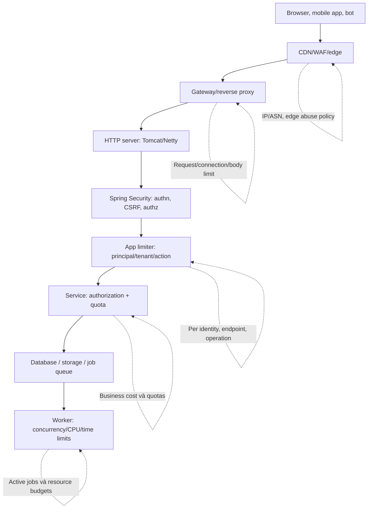
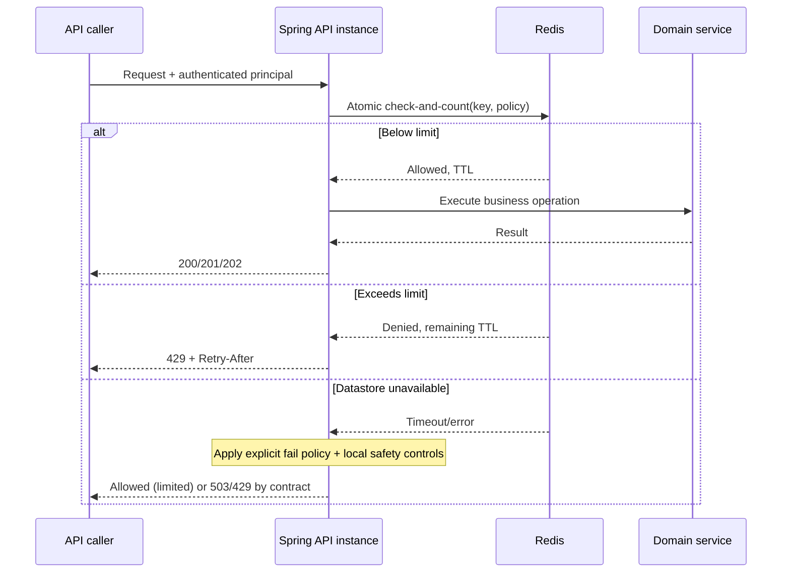

# Rate limiting ở ứng dụng, gateway hoặc hạ tầng

Trong module `SPRING_SECURITY_HTTP_PROTECTION`, Spring Security bảo vệ các yêu cầu HTTP và trình duyệt bằng authentication, authorization, CSRF, CORS, security headers, CSP, HSTS, HTTP firewall và bảo vệ session. Tuy nhiên, một request **hợp lệ về danh tính, vai trò và CSRF** vẫn có thể lạm dụng tài nguyên nếu được gửi quá nhiều lần. Ngược lại, request **chưa được xác thực** cũng có thể chiếm kết nối, CPU hoặc băng thông trước khi tới Spring Security.

**Rate limiting** là chính sách kiểm soát số lần thực hiện một hành động trong khoảng thời gian hoặc theo một tốc độ nhất định. Nó thường hoạt động cùng **concurrency limiting** (giới hạn số tác vụ đang chạy), **quotas** (hạn mức tổng lượng sử dụng), **timeouts**, **request-body limits** và **circuit breakers**. Không nên dùng một trong những cơ chế đó như từ đồng nghĩa của tất cả cơ chế còn lại.

Bài thuộc chương **Ranh giới bảo vệ** và trả lời câu hỏi:

> **Giới hạn nào nên đặt ở gateway, ở Spring Security/application, hay ở hạ tầng — và làm sao để nó vẫn đúng khi chạy nhiều instance, có proxy và có lưu lượng tấn công?**

Bài xuyên suốt ví dụ một hệ thống Spring Boot có những endpoint:

```text
POST /api/login                 # Đăng nhập
POST /api/attachments           # Upload tài liệu
GET  /api/search?q=...          # Tra cứu
POST /api/reports               # Yêu cầu xuất báo cáo
GET  /api/reports/{id}          # Xem trạng thái
```

Người dùng có thể hợp lệ khi upload nhưng vẫn gửi 100 request/giây, tạo hàng nghìn báo cáo hoặc chiếm mọi worker đang scan. Một IP có thể có hàng nghìn tài khoản sau NAT; một user có thể dùng nhiều IP. Vì vậy **chọn khóa giới hạn (key)**, **đơn vị chi phí**, **cửa sổ thời gian** và **vị trí enforcement** quan trọng không kém con số ngưỡng.

Ví dụ dùng Java 17+, Spring Boot 3.x, Spring Security 6.x; minh họa riêng Servlet MVC và Reactive WebFlux. Các hạn mức trong bài là **giá trị thiết kế để học**, không phải mặc định an toàn cho mọi hệ thống. Đặc biệt, thuật toán chạy cục bộ trên một JVM chỉ có giá trị trong instance đó; production nhiều node thường cần một gateway hoặc bộ đếm phân tán đủ tin cậy.

## 1. Mục tiêu học tập

Sau bài, người học có thể:

- Phân biệt **rate limiting**, **request-size limiting**, **quota**, **concurrency limiting**, **load shedding** và **circuit breaking**.
- Giải thích điểm đặt enforcement ở CDN/WAF, gateway/ingress, reverse proxy, Spring Security filter/WebFilter, service và backend worker.
- So sánh fixed window, sliding window, token bucket, leaky bucket và giới hạn số công việc đang chạy.
- Chọn key theo IP, principal, API key, tenant, endpoint và operation; biết rủi ro spoof IP khi đọc `X-Forwarded-For`.
- Thiết kế chính sách cho login, upload, search, report generation, webhook và API nhiều tenant.
- Cấu hình NGINX `limit_req`, `limit_conn` và phân biệt chúng với byte/body limits.
- Viết limiter **đơn instance** có clock monotonic, dùng được trong Servlet filter và Reactive WebFilter với giới hạn rõ ràng.
- Hiểu tại sao multi-instance không thể bảo đảm global quota nếu mỗi node giữ bộ đếm riêng; áp dụng bộ đếm phân tán atomically hoặc hạn mức tại gateway.
- Trả HTTP `429 Too Many Requests` và `Retry-After` phù hợp; không nhầm `403` do CSRF/authorization với `429`, và `503` do quá tải hệ thống.
- Kiểm thử burst, refill, key isolation, retry, trusted proxy, nhiều instance và resource exhaustion mà không dựa vào `Thread.sleep()`.
- Xử lý fail-open/fail-closed có chủ đích, lưu trữ key giới hạn, log redaction, observability và trải nghiệm người dùng.

## 2. Ranh giới bảo vệ và đường đi request



Sơ đồ mô tả **trách nhiệm**, không phải thứ tự filter tuyệt đối của mọi cấu hình. Reverse proxy có thể đọc/buffer một phần body trước khi chuyển tiếp; container có thể chiếm socket trước khi bất kỳ Java filter nào chạy; một parser multipart có thể tạo file tạm trước khi controller quyết định từ chối.

### 2.1. So sánh những biện pháp thường bị gọi nhầm là “rate limit”

| Biện pháp | Đếm gì? | Ví dụ | Không thay cho |
| --- | --- | --- | --- |
| **Rate limit** | Số hành động theo thời gian | 30 lần search/phút/user | File-size, quota storage, concurrency |
| **Token bucket** | Token tiêu hao và bổ sung theo tốc độ | Burst 10, refill 1 token/giây | Giới hạn công việc đang chạy nếu request rất chậm |
| **Concurrency limit** | Tác vụ đang hoạt động | Tối đa 2 upload/user | Tổng request/ngày hoặc giới hạn bytes |
| **Quota** | Tổng lượng đã sử dụng hoặc đã dành chỗ | 1 GiB upload/ngày/tenant | Ngăn 100 requests cùng một giây |
| **Request-size limit** | Số byte mỗi request/part | File tối đa 5 MiB | Ngăn 100 file hợp lệ/phút |
| **Timeout** | Thời gian một tác vụ/connection | Scan tối đa 20 giây | Quota số scan hoặc số lần retry |
| **Circuit breaker** | Tạm ngừng gọi dependency đang lỗi | Dừng gọi payment service khi lỗi lan rộng | Fairness giữa những người dùng |
| **Load shedding** | Từ chối công việc khi tải thật quá mức | Trả 503 khi worker queue đầy | Các giới hạn lạm dụng theo actor |

Một API cần nhiều giới hạn cùng lúc. Ví dụ mỗi request upload 4 MiB, tổng body dưới 8 MiB, nhưng user gửi 100 request/giây: **per-file size limit đúng mà hệ thống vẫn có thể quá tải**.

### 2.2. Kiểm soát trước và sau authentication

- **Trước auth:** không có principal đáng tin, thường giới hạn theo địa chỉ client do **hạ tầng xác thực**, route, connection và tổng tải; bảo vệ login/token endpoints, TLS/HTTP decoding.
- **Sau auth:** dùng principal ID/API key identity/tenant từ security context, không lấy `userId` do client tự khai; kiểm soát fairness và business cost.
- **Trước công việc đắt:** đặt quota và concurrency guard **trước** parse/render/scan/DB query khi khả thi; đừng tính limit sau khi đã tạo report.
- **Sau enqueue:** background jobs phải có worker/queue limits, không coi HTTP 202 đã giải quyết mọi chi phí.

Spring Security cho biết **ai được gọi endpoint**; rate limiter quyết định **bao nhiêu lần và trong ngân sách nào**. Hai câu hỏi độc lập.

## 3. Chính sách mẫu cho từng endpoint

Không chọn một mức “100 requests/phút” áp dụng mù quáng cho mọi chức năng.

| Endpoint | Key chính | Hạn mức minh họa | Giới hạn khác |
| --- | --- | --- | --- |
| `POST /api/login` | Trusted client IP + account identifier **đã chuẩn hóa** theo nhóm rủi ro | 10 attempts/phút/IP; mức khác theo account | Chống account enumeration, anomaly detection, CAPTCHA khi hợp lý |
| `POST /api/attachments` | Authenticated principal + tenant | Burst 2, refill 1/10 giây | Max 2 uploads đang chạy/user; bytes/day; file/part/body limits |
| `GET /api/search` | Principal + tenant + operation | Burst 20, refill 5/giây | Query complexity, result count, DB timeout |
| `POST /api/reports` | Tenant + actor | 5 jobs/giờ/user | Active jobs/tenant, queue size, export rows, idempotency |
| `GET /api/reports/{id}` | Principal + operation | 30 requests/phút | Owner authorization, caching, polling backoff |
| Webhook outbound | Partner/tenant + event type | 10 requests/giây/partner | Concurrency, timeout, retries, SSRF destination policy |
| Health check | Trusted monitoring caller | Chính sách riêng | Không để public endpoint quá đắt hoặc bypass toàn bộ controls |

**Các con số chỉ là ví dụ.** User dùng mobile NAT, doanh nghiệp chung IP, public event hoặc crawler được cấp quyền có pattern khác nhau. Chính sách cần được thiết kế theo business SLO, chi phí, khách hàng hợp lệ và tải thực tế, rồi đo false positives.

### 3.1. Nhiều khóa cần áp đồng thời

Một request có thể cần vượt qua **tất cả**:

1. Global/edge limit cho ứng dụng.
2. Limit theo trusted IP/network.
3. Limit theo principal/API client.
4. Limit theo tenant.
5. Limit theo operation hoặc resource class.
6. Concurrency/quota cho công việc thực hiện.

Nếu chỉ giới hạn theo IP, hàng trăm user ở một văn phòng NAT có thể bị chặn cùng nhau. Nếu chỉ giới hạn theo user, kẻ xấu có thể tạo nhiều accounts. Nếu chỉ giới hạn theo tenant, một actor gây ồn có thể làm những người khác trong tenant bị chặn. Cần chọn chính sách **cân bằng fairness và chống abuse**, với thông báo lỗi có ích.

### 3.2. Đơn vị chi phí không luôn là 1 request

Một `GET /api/search` có lọc đơn giản khác với một query quét hàng triệu rows. Một report export 10 dòng khác 10 triệu dòng. Một POST upload 1 KiB khác 100 MiB. Có thể dùng **weighted token cost** thay vì tiêu 1 token/request:

```text
Simple search          : 1 token
Complex search         : 5 tokens
Generate PDF report    : 10 tokens
Upload 1 MiB           : 1 token theo MiB (ví dụ minh họa)
```

Chi phí phải được tính từ thông tin server đáng tin, có kiểm tra bằng dữ liệu thực, không tin tham số `cost=1` do client gửi. **Quota tổng bytes** và **weighted rate** vẫn có vai trò riêng.

## 4. Các thuật toán rate limiting phổ biến

### 4.1. Fixed window counter

Ý tưởng: đếm số request trong một cửa sổ cố định, ví dụ từ phút 12:00:00 đến 12:00:59.

```text
Limit: 5 requests mỗi phút
12:00:58: 5 requests được phép
12:01:01: 5 requests được phép
=> Có thể nhận 10 requests gần nhau quanh ranh giới
```

**Ưu:** dễ triển khai bằng Redis counter + TTL, chi phí nhỏ. **Nhược:** burst ở ranh giới cửa sổ; không phản ánh chính xác “5 trong mọi khoảng 60 giây liên tiếp”.

### 4.2. Sliding window log

Lưu thời điểm từng request; trước khi quyết định, loại thời điểm cũ hơn khoảng thời gian cho phép.

**Ưu:** giới hạn đúng hơn theo cửa sổ di động. **Nhược:** nhiều entries, memory/Redis operations và cleanup; cần atomicity khi nhiều instances cùng ghi.

### 4.3. Sliding window counter

Dùng số đếm của window hiện tại và window trước, ước lượng theo mức overlap. Ít bộ nhớ hơn log, trơn hơn fixed window nhưng **là phép xấp xỉ**; cần hiểu cách tính và sai số để chọn ngưỡng.

### 4.4. Token bucket

Bucket có sức chứa tối đa `capacity`; token được bổ sung theo `refillRate`, request phải có đủ token trước khi chạy.

```text
capacity = 5 tokens
refill   = 1 token/second

t=0: bucket full: 5
5 requests ngay: tất cả đi qua, bucket = 0
request thứ 6 ngay: từ chối
sau 2 seconds: có ~2 tokens, được phép 2 requests nữa
```

**Ưu:** hỗ trợ burst ngắn có kiểm soát và mức trung bình dài hạn. **Nhược:** cần state/timestamp chính xác cho từng key, quyết định atomically, và xử lý time skew/multi-node.

### 4.5. Leaky bucket và hàng đợi

Với leaky bucket kiểu hàng đợi, requests được đưa vào queue có sức chứa giới hạn rồi xử lý ở tốc độ gần đều. Đây là cách **làm mượt** lưu lượng cho backend, nhưng không phải “queue vô hạn”:

- Queue cần `maxDepth`, `maxWaitTime` và cancellation.
- Request có deadline ngắn không nên chờ đến khi quá hạn.
- Khi queue đầy, từ chối có chủ đích, không giữ socket/thread mãi.
- Với tác vụ dài, trả job ID và xử lý asynchronous nếu nghiệp vụ hỗ trợ.

### 4.6. Concurrency semaphore

Một limiter “2 uploads đang chạy/user” không biết mỗi upload mất bao lâu. Semaphore hoặc leased slots kiểm soát **số công việc đang hoạt động**, bổ sung cho rate. Với distributed services, semaphore cục bộ không đảm bảo global concurrency.

### 4.7. Chọn thuật toán theo nhu cầu

| Nhu cầu | Phù hợp | Lưu ý |
| --- | --- | --- |
| Dễ triển khai, burst chấp nhận được | Fixed window | Cẩn thận ranh giới phút |
| Gần chính xác theo cửa sổ bất kỳ | Sliding window log | Chi phí state lớn |
| Ít state, mềm hơn fixed window | Sliding window counter | Có sai số ước lượng |
| Cho burst nhỏ, tốc độ dài hạn ổn định | Token bucket | Dễ giải thích cho API khách hàng |
| Bảo vệ worker xử lý theo tốc độ cố định | Queue/leaky bucket | Cần backpressure/queue cap |
| Công việc lâu giữ tài nguyên | Concurrency guard | Nhả slot trên success/error/cancel |
| Tổng dung lượng/credit theo kỳ | Quota counter/reservation | Atomic accounting, reset/rollover |

## 5. Những điều rate limiting **không tự sửa**

- **SQL injection/XSS/SSRF/path traversal:** 1 request duy nhất có thể đã khai thác lỗ hổng; phải sửa trust boundary tương ứng.
- **Authentication bypass:** giảm số lần tấn công không thay kiểm tra danh tính và mật khẩu.
- **CSRF:** user hoặc browser bị ép gửi 1 unsafe request vẫn có thể gây hại; CSRF token có chức năng riêng.
- **Broken authorization/IDOR:** user có 1 request sai quyền vẫn có thể đọc tài liệu khác nếu service thiếu owner check.
- **Cạn RAM do body quá lớn:** một request vượt byte cap vẫn có thể làm OOM; phải có request/multipart limits và streaming.
- **DoS phân tán quy mô lớn:** app-level limiter chỉ chạy **sau khi** đã tiêu tốn network/socket/TLS; cần edge/network protections.
- **Lộ key trong log:** limiter không tự bảo vệ secret, raw API keys hoặc IP trong telemetry.

Rate limiting là một **lớp bảo vệ khả dụng và chống abuse**, không được trình bày như biện pháp sửa lỗi parsing hoặc phân quyền.

## 6. Edge, reverse proxy và API gateway: chặn trước Java khi có thể

Gateway/edge thích hợp để giới hạn những tác động xảy ra **trước khi Spring Security filter chạy**: số connections, requests theo trusted client IP, request-body size, read timeouts và một số patterns của bot.

Lợi ích:

- Không cần mở connection đến backend cho mọi request.
- Có thể kiểm soát lưu lượng từ user chưa authenticated.
- Nhiều backend instances cùng được bảo vệ bởi một điểm thực thi chung khi routing/cluster policy được cấu hình phù hợp.
- Giảm chi phí TLS termination, HTTP parsing và network I/O trên app nodes.
- Có metrics hỗ trợ nhận diện traffic spikes theo source/route.

Giới hạn:

- Gateway thường không hiểu **owner/tenant/domain operation** sâu như application.
- Nếu chạy nhiều gateway replicas với state local, “10 requests/giây/IP” có thể là **10 trên mỗi gateway**, không phải global 10.
- IP-based fairness bị ảnh hưởng bởi NAT, mobile, corporate proxy, IPv6 privacy addresses và botnets.
- Không thay quota dung lượng, số active jobs, authorization và giới hạn SQL/scan workload.
- Không bảo vệ được những đường bypass đi thẳng tới app origin nếu chúng còn mở.

### 6.1. Ví dụ NGINX giới hạn request và kết nối

Cấu hình dưới minh họa cú pháp NGINX core modules với hai zones lưu state trong shared memory của **một NGINX instance**:

```nginx
http {
    # State theo $binary_remote_addr, bộ nhớ dùng chung
    # giữa NGINX worker processes của instance này.
    limit_req_zone $binary_remote_addr
        zone=per_ip_requests:10m rate=5r/s;

    limit_conn_zone $binary_remote_addr
        zone=per_ip_connections:10m;

    server {
        listen 443 ssl;
        server_name app.example.test;

        # Mã trả về khi bị rate-limit.
        limit_req_status 429;
        limit_conn_status 429;

        location /api/login {
            # Có thể nhận burst ngắn, không để queue trì hoãn
            # vô hạn cho đăng nhập.
            limit_req zone=per_ip_requests burst=10 nodelay;
            limit_conn per_ip_connections 5;

            client_max_body_size 16k;
            client_body_timeout 10s;

            proxy_pass http://spring_backend;
        }
    }
}
```

Giải thích:

- `limit_req_zone` khai báo một zone để đếm request theo key và tốc độ `5r/s`.
- `limit_req` áp chính sách cho location, `burst=10` cho phép một số request vượt tốc độ trung bình theo cơ chế module. `nodelay` không làm chậm các request được phép trong burst; request vượt ngưỡng vẫn bị từ chối.
- `limit_conn` là một **giới hạn kết nối** theo key, không phải “5 công việc scan/upload trong ứng dụng”. Theo semantics của NGINX, số connection được đếm phụ thuộc trạng thái request/headers và HTTP/2/HTTP/3 có quy tắc riêng; không dùng nó thay business concurrency.
- `client_max_body_size` và `client_body_timeout` là **các biện pháp riêng** chống request lớn/chậm, không thuộc rate counter.
- `limit_req_status 429` chủ động chọn mã `429`, trong khi default limit module có thể khác nếu không khai báo.
- Shared memory zone áp dụng giữa các worker **của instance NGINX đó**, không tự đồng bộ giữa các máy NGINX độc lập.

Cấu hình là đoạn minh họa, **chưa bao gồm** certificate/TLS đầy đủ, upstream block, health routes, trusted proxy handling hay operational tuning. Khi deploy cần đo fairness, latency và mức request hợp lệ bị từ chối.

### 6.2. Cẩn trọng với client IP và trusted proxy

Tại backend, `request.getRemoteAddr()` có thể là IP của load balancer, không phải của browser. Nếu gateway dùng `X-Forwarded-For`/`Forwarded` nhưng cấu hình trust sai, client có thể tự khai một IP mới ở mỗi request để thay key rate limit.

**Anti-pattern:**

```java
// KHÔNG DÙNG để xác định client identity từ request internet:
String ip = request.getHeader("X-Forwarded-For");
rateLimiter.take(ip);
```

Một header từ internet là **dữ liệu có thể bị giả mạo**, không phải chứng thực nguồn. Có thể tồn tại nhiều hop và chuỗi IP, IPv4/IPv6. Truyền header raw làm key còn tạo cardinality không giới hạn và nguy cơ memory exhaustion.

Khi proxy đứng trước ứng dụng:

1. Chỉ tin các forward headers khi request **đến từ một proxy/edge nằm trong mạng tin cậy**.
2. Gateway ở biên phải **loại bỏ/ghi đè forwarded headers không tin cậy** thay vì nối chuỗi mù quáng.
3. Cấu hình dải IP nguồn của trusted proxies bằng chính sách hạ tầng, không dùng địa chỉ minh họa làm production.
4. Dùng cơ chế real-IP/trusted-forwarded support của proxy/server/framework, không tự lấy “phần tử đầu tiên” ở mọi triển khai.
5. Áp IP-based rate limit ở edge nếu có thể; ở app sau authentication ưu tiên **principal/tenant ID đáng tin**.
6. Test trường hợp client tự gửi `X-Forwarded-For: 203.0.113.99` nhưng kết nối thực tới edge từ một nguồn khác; key phải theo chain tin cậy, không theo text do client chọn.

**Lưu ý:** Một cấu hình Spring Boot như `server.forward-headers-strategy` ảnh hưởng cách request biết scheme/host/client address trong ngữ cảnh được hỗ trợ, **không tự tạo ra danh sách trusted proxies** và không thay ingress sanitation. Chỉ bật khi chuỗi proxy được kiểm soát và xác minh.

### 6.3. Không chỉ dựa vào IP

Các tình huống IP key gây khó:

- Một văn phòng chung public IP → nhiều user hợp lệ bị block cùng nhau.
- Một botnet có nhiều IP → dễ phân tán dưới ngưỡng mỗi IP.
- Một IPv6 client có thể có nhiều temporary addresses → thay đổi key.
- Một mobile client chuyển mạng → key thay đổi giữa session.
- Một API client có nhiều nodes → một API key tạo lưu lượng từ nhiều IP.
- User chưa login nhưng tự khai username nhiều kiểu → cardinality/lockout abuse.

Phối hợp identity-level và network-level policies. Với IPv6, subnet prefix grouping có thể có ích tùy threat model nhưng **không mặc định /64 luôn đúng** vì privacy, mạng doanh nghiệp và cấp phát thực tế khác nhau.

### 6.4. Đảm bảo không bypass gateway

Nếu application server vẫn public trực tiếp tại một origin khác hoặc một port/debug interface, kẻ tấn công có thể gửi requests thẳng đến app để né rate limits ở NGINX/CDN. Cần:

- Chặn direct public ingress tới app nodes bằng firewall/security group.
- Chỉ cho network traffic từ trusted load balancers/gateways.
- Kiểm tra đường WebSocket/gRPC, actuator, admin endpoints và callbacks riêng.
- Đồng bộ chính sách trong nhiều regions hoặc hiểu rõ **per-region vs global**.
- Test request tới backend direct address bị chặn; không chỉ kiểm tra public hostname.

## 7. Chọn key: principal, tenant, operation và trusted client address

Một rate-limit key nên là **định danh nhỏ, ổn định, do hệ thống tin cậy xác định**.

### 7.1. Không dùng URI đầy đủ làm key

Ví dụ sai:

```java
// KHÔNG DÙNG:
String key = request.getRequestURI()
        + "?" + request.getQueryString();
```

Request `/api/search?q=1` và `/api/search?q=2` có thể trở thành hai buckets riêng; attacker chỉ cần thay query để nhận bucket mới. Hơn nữa, raw query có thể chứa token, email hoặc PII và tạo hàng triệu keys.

Nên dùng **operation class** cố định:

```text
key namespace    : api-search
actor identity    : authenticated user id from SecurityContext
tenant identity   : verified membership/server-side tenant
route group       : search
result            : "rl:v2:<stable actor digest>:search"
```

Nếu muốn đưa tenant vào key, tenant ID phải đến từ nguồn đáng tin (DB/security claims đã xác minh), **không từ query parameter `tenantId` tự do**. Có thể dùng hash/HMAC của identity để tránh lộ raw IDs trong Redis key/metrics, nhưng đừng tự xây một hệ thống bảo mật chỉ dựa vào che tên key.

### 7.2. Prefix và version policy

Phân tách namespaces giúp không trộn các cửa sổ:

```text
rl:v2:user:<digest>:search
rl:v2:user:<digest>:upload
rl:v2:tenant:<digest>:reports
rl:v2:ip:<normalized-address>:login
```

- Version policy rõ để thay cách đếm mà không dùng lại state cũ sai.
- Normalize IP theo dạng canonical trước khi làm key; chú ý IPv6 format.
- Không lấy giá trị tùy ý dài hàng KiB từ body/header làm một key.
- Có TTL/eviction cho keys và cardinality limit để limiter không bị biến thành một điểm DoS bộ nhớ.
- Metrics nên gắn **policy ID**, không đưa mỗi raw user/IP làm label gây time-series cardinality vô hạn.

### 7.3. Multi-dimensional quotas

Giả sử một upload có ba guard:

```text
user "alice": <= 2 upload requests/10s
tenant "acme": <= 10 upload requests/10s
global       : <= 200 active uploads
```

Một request chỉ được chạy khi các guard cần thiết đều cho phép. Nếu cập nhật bộ đếm phân tán của user xong nhưng tenant guard từ chối, hệ thống cần biết:

- Token ở user bucket có bị **tiêu** không?
- Có hoàn token hoặc gộp check vào atomic operation không?
- Có cho phép “có một lần thử nhưng bị từ chối” tính vào abuse budget không?

Đây là **quy tắc policy**, không nên xảy ra ngẫu nhiên do thứ tự filter. Với nhiều keys trong Redis Cluster, atomically check tất cả keys có thể bị ràng buộc bởi hash slots và transaction model; cần thiết kế trước, không mặc định một Lua script cập nhật tùy ý mọi slot.

### 7.4. Login endpoints khác authenticated API endpoints

Với login, chưa có authenticated principal. Nếu giới hạn **chỉ theo username mà client gõ**, attacker có thể khóa nhiều tài khoản bằng cách liên tục gửi sai mật khẩu đến từng username. Đó là **denial-of-service bằng chức năng khóa tài khoản**.

Chiến lược thận trọng hơn:

- Kết hợp trusted IP/device signals, account-level risk và global anomaly.
- Chọn ngưỡng và backoff theo rủi ro; không lộ rõ “account tồn tại” qua response/timing.
- Theo dõi credential stuffing phân tán từ nhiều IP.
- Tránh permanent hard lockouts dễ bị lạm dụng; có recovery và human support.
- Không cho phép một CAPTCHA không đáng tin thay authentication hoặc IP/network protections.
- Authentication failures cần được đo tại đúng nơi chạy login/token flow; một filter **chỉ chạy sau authenticated authorization** không thể kiểm soát login attempts trước auth.

## 8. Local token bucket ở tầng ứng dụng (minh họa đơn JVM)

Để học rõ thuật toán, triển khai một limiter Java thread-safe **trong một tiến trình** với **clock monotonic**. Code chỉ dùng một map trong RAM, phù hợp demo hoặc hệ thống single-instance có key cardinality thấp được kiểm soát. Với production multi-instance, cần shared-state/gateway policy ở các mục sau.

### 8.1. Bản thân bộ đếm không phụ thuộc Servlet/WebFlux

```java
import java.util.concurrent.ConcurrentHashMap;
import java.util.function.LongSupplier;

public final class LocalTokenBucket {

    public record Decision(boolean allowed, long retryAfterSeconds) {}

    private static final long NANOS_PER_SECOND = 1_000_000_000L;

    private static final class Bucket {
        private double tokens;
        private long updatedNanos;

        private Bucket(int capacity, long now) {
            this.tokens = capacity;
            this.updatedNanos = now;
        }

        synchronized Decision take(
                int capacity,
                double refillPerSecond,
                int cost,
                long now) {

            // Nếu một call được lập lịch trễ, không cho thời gian
            // đi lùi so với state mới hơn của cùng bucket.
            long effectiveNow = Math.max(now, updatedNanos);
            long elapsed = effectiveNow - updatedNanos;

            tokens = Math.min(
                    capacity,
                    tokens + (elapsed / (double) NANOS_PER_SECOND)
                            * refillPerSecond);
            updatedNanos = effectiveNow;

            if (tokens >= cost) {
                tokens -= cost;
                return new Decision(true, 0);
            }

            double secondsToRefill =
                    (cost - tokens) / refillPerSecond;
            long waitSeconds = Math.max(
                    1L, (long) Math.ceil(secondsToRefill));

            return new Decision(false, waitSeconds);
        }
    }

    private final int capacity;
    private final double refillPerSecond;
    private final LongSupplier nanoClock;
    private final ConcurrentHashMap<String, Bucket> buckets =
            new ConcurrentHashMap<>();

    public LocalTokenBucket(
            int capacity,
            double refillPerSecond,
            LongSupplier nanoClock) {

        if (capacity < 1
                || !Double.isFinite(refillPerSecond)
                || refillPerSecond <= 0
                || nanoClock == null) {
            throw new IllegalArgumentException(
                    "Cấu hình limiter không hợp lệ");
        }
        this.capacity = capacity;
        this.refillPerSecond = refillPerSecond;
        this.nanoClock = nanoClock;
    }

    public Decision tryConsume(String key, int cost) {
        if (key == null || key.isBlank()
                || cost < 1 || cost > capacity) {
            throw new IllegalArgumentException("Key/cost không hợp lệ");
        }

        long now = nanoClock.getAsLong();
        Bucket bucket = buckets.computeIfAbsent(
                key, k -> new Bucket(capacity, now));

        return bucket.take(
                capacity, refillPerSecond, cost, now);
    }

    public static LocalTokenBucket demoSearchLimiter() {
        return new LocalTokenBucket(5, 1.0, System::nanoTime);
    }
}
```

Giải thích:

- `capacity=5` cho phép burst tối đa 5 tokens nếu bucket đầy.
- `refillPerSecond=1` bổ sung tốc độ trung bình 1 token/giây.
- `System.nanoTime` đo **khoảng thời gian monotonic trong tiến trình**; không dùng `System.currentTimeMillis()` để cộng refill theo các lần chỉnh đồng hồ hệ thống.
- `synchronized` giữ phép đọc–tính–ghi atomically **cho cùng bucket trong một JVM**.
- `ConcurrentHashMap.computeIfAbsent` tạo một bucket cho key trong một map; chưa đồng bộ giữa hai app instances.
- `retryAfterSeconds` là ước lượng thời gian để đủ tokens theo tốc độ refill, làm tròn lên cho `Retry-After`; không bảo đảm request tiếp theo sẽ được nhận nếu các request khác cùng key tiêu token trước.

**Giới hạn quan trọng của code demo:** Map `buckets` **không có TTL/eviction, không cap số lượng key**. Một hệ thống cho user tạo nhiều identities/keys có thể làm đầy heap. Trong production phải dùng triển khai quản lý vòng đời key và bộ nhớ, hoặc datastore/gateway được cấu hình capacity/TTL; không dùng class này trực tiếp cho traffic Internet không kiểm soát.

### 8.2. Không reset bucket theo restart mà coi như đã thực thi global policy

Mỗi lần app restart, bucket local rỗng → các key có toàn bộ burst capacity. Nếu load balancer chuyển cùng actor qua ba instances, actor có thể nhận ba buckets riêng. Đây không phải bug Java memory model; nó là **sai ranh giới triển khai** so với chính sách global.

```text
Rate policy mong muốn:
alice <= 5 requests ngay, sau đó 1 request/s toàn hệ thống

Nếu local per node và có 3 nodes:
node A: 5 requests
node B: 5 requests
node C: 5 requests
=> có thể nhận 15 requests khi burst đi qua nhiều node
```

Sticky sessions có thể giảm phân tán trong một số tình huống nhưng không phải giải pháp correctness: failover, rolling deploy, multi-device và routing changes vẫn có thể đưa request tới node khác.

## 9. Servlet: áp limiter sau authorization, trước controller

Khi cần giới hạn một route **đã xác thực** trong Servlet, có thể đặt một `OncePerRequestFilter` **sau `AuthorizationFilter`** bên trong Spring Security filter chain, để chỉ tính những request đã qua URL authorization và CSRF theo chain. Đây không phải cách duy nhất; với nhiều policy hoặc xử lý phức tạp có thể dùng service-level enforcement hoặc gateway. Điều thiết yếu là **thứ tự phải được kiểm chứng bằng test**.

### 9.1. Filter cho endpoint tìm kiếm

```java
import java.io.IOException;
import jakarta.servlet.FilterChain;
import jakarta.servlet.ServletException;
import jakarta.servlet.http.HttpServletRequest;
import jakarta.servlet.http.HttpServletResponse;
import org.springframework.http.HttpHeaders;
import org.springframework.security.core.Authentication;
import org.springframework.security.core.context.SecurityContextHolder;
import org.springframework.web.filter.OncePerRequestFilter;

public final class SearchRateLimitFilter
        extends OncePerRequestFilter {

    private final LocalTokenBucket limiter;

    public SearchRateLimitFilter(LocalTokenBucket limiter) {
        this.limiter = limiter;
    }

    @Override
    protected void doFilterInternal(
            HttpServletRequest request,
            HttpServletResponse response,
            FilterChain chain)
            throws ServletException, IOException {

        if (!"GET".equals(request.getMethod())
                || !"/api/search".equals(request.getServletPath())) {
            chain.doFilter(request, response);
            return;
        }

        Authentication authentication =
                SecurityContextHolder.getContext()
                        .getAuthentication();

        // Route này bắt buộc ROLE_SEARCHER; chỉ dùng principal
        // đã được Spring Security xác thực để tạo key.
        if (authentication == null
                || !authentication.isAuthenticated()) {
            chain.doFilter(request, response);
            return;
        }

        String key = "search:user:" + authentication.getName();
        LocalTokenBucket.Decision decision =
                limiter.tryConsume(key, 1);

        if (!decision.allowed()) {
            response.setStatus(429);
            response.setHeader(
                    HttpHeaders.RETRY_AFTER,
                    Long.toString(decision.retryAfterSeconds()));
            response.setHeader(
                    HttpHeaders.CACHE_CONTROL, "no-store");
            response.setContentType("application/problem+json");
            response.getWriter().write("""
                    {"type":"about:blank",
                     "title":"Too Many Requests",
                     "status":429}
                    """);
            return;
        }

        chain.doFilter(request, response);
    }
}
```

**Điều kiện sử dụng:** `authentication.getName()` ở đây là một ví dụ định danh ổn định được xác thực. Với production multi-tenant, ưu tiên một **user ID bất biến** và tenant ID đã được xác minh, không tin nickname/header do client gửi. Nếu authentication là anonymous tại một route public, cần chính sách key khác từ trusted source; không mặc định anonymous name là user identity đã được xác thực.

### 9.2. SecurityFilterChain tích hợp filter

```java
import org.springframework.context.annotation.Bean;
import org.springframework.context.annotation.Configuration;
import org.springframework.http.HttpMethod;
import org.springframework.security.config.Customizer;
import org.springframework.security.config.annotation.web.builders.HttpSecurity;
import org.springframework.security.web.SecurityFilterChain;
import org.springframework.security.web.access.intercept.AuthorizationFilter;

@Configuration
public class SearchHttpSecurity {

    @Bean
    LocalTokenBucket searchLimiter() {
        return LocalTokenBucket.demoSearchLimiter();
    }

    @Bean
    SecurityFilterChain securityFilterChain(
            HttpSecurity http,
            LocalTokenBucket searchLimiter) throws Exception {

        return http
                .authorizeHttpRequests(auth -> auth
                        .requestMatchers(
                                HttpMethod.GET, "/api/search")
                            .hasRole("SEARCHER")
                        .anyRequest().denyAll())
                .formLogin(login -> login.permitAll())
                .csrf(Customizer.withDefaults())
                .addFilterAfter(
                        new SearchRateLimitFilter(searchLimiter),
                        AuthorizationFilter.class)
                .build();
    }
}
```

Điểm đáng chú ý:

- Filter được khởi tạo **bên trong security chain** ở đây, không đồng thời gắn `@Component` hoặc khai báo một Servlet `FilterRegistrationBean` nữa; tránh chạy **hai lần** theo hai registration paths.
- `AuthorizationFilter` xác minh route trước khi limiter chạy. Vì vậy request thiếu role bị `403`, không được tính như một lần sử dụng search đã được phép.
- `CsrfFilter` xử lý unsafe methods như POST theo policy; route demo là GET đọc dữ liệu nên không bắt buộc CSRF token mặc định.
- `OncePerRequestFilter` thường tránh gọi lặp ở một số dispatch, nhưng **async servlet processing** có lifecycle khác. Nếu rate guard phải tính theo *job thực* hoặc cần giữ concurrency slot đến khi async hoàn tất, phải xử lý async lifecycle riêng; đừng dùng mỗi một filter sync rồi cho rằng “active jobs” đã được cap.
- `getServletPath()` phụ thuộc mapping/context path; khi ứng dụng dùng dispatcher mapping đặc biệt hoặc multi-chain, nên dùng `RequestMatcher` đã kiểm thử phù hợp và không chỉ sao chép literal route ở nhiều lớp.
- Filter dùng local bucket chỉ là **bản học thuật single-instance**, không bảo đảm policy chung khi load balancer điều phối nhiều JVM.

### 9.3. Controller có nhiệm vụ riêng

```java
import org.springframework.web.bind.annotation.GetMapping;
import org.springframework.web.bind.annotation.RestController;

@RestController
public class SearchController {

    @GetMapping("/api/search")
    public String search() {
        // Trong ứng dụng thật: validate q, phân quyền dữ liệu,
        // query đã tham số hóa, giới hạn rows/timeout.
        return "ok";
    }
}
```

Không thay parameterized SQL, row authorization hoặc bounded query bằng “đã chặn 5 lần search”. **Một request** vẫn có thể là một câu query rất đắt hoặc lỗ hổng SQLi nếu service/repository xử lý sai.

## 10. Reactive WebFlux: WebFilter và vòng đời request

WebFlux dùng `WebFilter` và `SecurityWebFilterChain`. Không thể dùng Servlet `OncePerRequestFilter` cho Reactive, cũng không được block event loop để chờ Redis/database vì “cần rate limiter”.

### 10.1. SecurityWebFilterChain cho route search

```java
import org.springframework.context.annotation.Bean;
import org.springframework.context.annotation.Configuration;
import org.springframework.http.HttpMethod;
import org.springframework.security.config.Customizer;
import org.springframework.security.config.web.server.ServerHttpSecurity;
import org.springframework.security.web.server.SecurityWebFilterChain;

@Configuration
public class ReactiveSearchHttpSecurity {

    @Bean
    SecurityWebFilterChain securityWebFilterChain(
            ServerHttpSecurity http) {
        return http
                .authorizeExchange(auth -> auth
                        .pathMatchers(
                                HttpMethod.GET, "/reactive/api/search")
                            .hasRole("SEARCHER")
                        .anyExchange().denyAll())
                .formLogin(login -> login.permitAll())
                .csrf(Customizer.withDefaults())
                .build();
    }
}
```

### 10.2. WebFilter đơn instance không block

```java
import java.security.Principal;
import org.springframework.core.Ordered;
import org.springframework.core.annotation.Order;
import org.springframework.context.annotation.Bean;
import org.springframework.context.annotation.Configuration;
import org.springframework.http.HttpHeaders;
import org.springframework.http.HttpMethod;
import org.springframework.http.HttpStatus;
import org.springframework.http.MediaType;
import org.springframework.web.server.WebFilter;
import reactor.core.publisher.Mono;

@Configuration
public class ReactiveSearchRateLimitConfig {

    @Bean
    LocalTokenBucket reactiveSearchLimiter() {
        // Tách ứng dụng Reactive khỏi ứng dụng Servlet ví dụ.
        return new LocalTokenBucket(
                5, 1.0, System::nanoTime);
    }

    @Bean
    @Order(Ordered.LOWEST_PRECEDENCE)
    WebFilter reactiveSearchRateFilter(
            LocalTokenBucket reactiveSearchLimiter) {

        return (exchange, chain) -> {
            if (exchange.getRequest().getMethod()
                    != HttpMethod.GET
                    || !"/reactive/api/search".equals(
                            exchange.getRequest()
                                    .getPath().pathWithinApplication()
                                    .value())) {
                return chain.filter(exchange);
            }

            // Lấy identity qua principal do framework cung cấp.
            // defaultIfEmpty dùng TRƯỚC flatMap để không vô tình
            // kích hoạt chain lần hai khi Mono<Void> hoàn tất.
            return exchange.getPrincipal()
                    .map(Principal::getName)
                    .defaultIfEmpty("anonymous")
                    .flatMap(name -> {
                        String key = "reactive-search:user:" + name;

                        var decision = reactiveSearchLimiter
                                .tryConsume(key, 1);

                        if (!decision.allowed()) {
                            var response = exchange.getResponse();
                            response.setStatusCode(
                                    HttpStatus.TOO_MANY_REQUESTS);
                            response.getHeaders().set(
                                    HttpHeaders.RETRY_AFTER,
                                    Long.toString(
                                            decision.retryAfterSeconds()));
                            response.getHeaders().setCacheControl(
                                    "no-store");
                            return response.setComplete();
                        }

                        return chain.filter(exchange);
                    });
        };
    }
}
```

Mẫu này có dụng ý:

- `@Order(Ordered.LOWEST_PRECEDENCE)` cho `WebFilter` chạy muộn hơn các filters mặc định có độ ưu tiên cao; với security chain do framework cấu hình chuẩn, mục tiêu là identity đã được xác lập trước limiter. **Kiểm chứng thứ tự thực tế bằng WebTestClient**, nhất là khi có nhiều custom `WebFilter`.
- `defaultIfEmpty(...)` được đặt **trên `Mono<Principal>`**, trước khi chuyển sang `Mono<Void>` trả bởi `chain.filter(...)`. Nếu viết `flatMap(principal -> chain.filter(exchange)).switchIfEmpty(chain.filter(exchange))` thì luồng đã chạy có thể phát **empty completion** và gây **gọi chain lần hai**.
- `LocalTokenBucket.tryConsume` chỉ cập nhật RAM nhanh, không I/O; tạm phù hợp event loop. **Không thay bằng Redis client blocking trực tiếp trong `flatMap`**. Khi dùng Redis, dùng non-blocking reactive client hoặc xử lý đúng scheduling/timeouts.
- Với public route hoặc khi cần giới hạn trước authentication, không nên dựa vào tên `"anonymous"` chung: cần policy edge/trusted IP riêng; route này đòi `ROLE_SEARCHER` nên request vô danh phải bị security từ chối trước khi gọi application handler.
- Response ở mẫu Reactive **chỉ trả status + headers** không có JSON body. Nếu muốn `application/problem+json`, mã hóa một body nhỏ bằng `DataBuffer` đúng lifecycle hoặc dùng một error-handler nhất quán.
- Cũng như Servlet, limiter này **không có TTL cho keys, không chia sẻ state giữa instances**.

### 10.3. Handler Reactive

```java
import org.springframework.web.bind.annotation.GetMapping;
import org.springframework.web.bind.annotation.RestController;
import reactor.core.publisher.Mono;

@RestController
public class ReactiveSearchController {

    @GetMapping("/reactive/api/search")
    Mono<String> search() {
        return Mono.just("ok");
    }
}
```

Nếu search thực tế dùng R2DBC, WebClient hoặc gọi service nặng, rate limiter chỉ giới hạn **frequency**; vẫn cần query timeout, concurrency pool, cancellation và size budget.

### 10.4. Khi cần rate limiting tại service thay vì WebFilter

Có những operation không khớp một-một với HTTP request: một request tạo 10 background jobs, một job được retry nhiều lần, hoặc một event từ queue không đi qua HTTP. Khi đó phải giữ **service/domain quota** ngay nơi tác vụ được tạo.

Ví dụ nguyên tắc:

```text
HTTP: POST /api/reports
    Spring Security: user có quyền tạo báo cáo?
    Service: tenant còn quota báo cáo trong ngày?
    Service: reserve job slot atomically?
    Queue: enqueue idempotently
    Worker: concurrency/CPU/time limits
    Response: 202 + jobId
```

Không đếm “một HTTP request = một report” nếu code có retries, scheduled jobs hay admin API khác cũng tạo report. Tất cả các luồng tạo cùng một tài nguyên phải đi qua cùng **domain admission policy**.

## 11. Giới hạn số tác vụ đồng thời: khác hẳn token bucket

Giả sử 2 request upload kéo dài 5 phút, nhưng user chỉ được phép 2 upload cùng lúc. Token bucket cho phép 2 request/giây **không chặn** trường hợp cả trăm uploads đã được chấp nhận và còn đang chạy.

Một cơ chế concurrency có thể sử dụng `Semaphore` cục bộ (demo single-JVM), hoặc distributed leases/semaphores có TTL và recovery.

### 11.1. Reactive global in-flight cap minh họa

```java
import java.util.concurrent.Semaphore;
import org.springframework.http.HttpMethod;
import org.springframework.http.HttpStatus;
import org.springframework.web.server.WebFilter;
import reactor.core.publisher.Mono;

// Trong cấu hình WebFlux ứng dụng: tạo 1 WebFilter bean.
// Ví dụ tập trung vào in-flight limiter, route và thứ tự
// security cần được cấu hình tương tự mục 10.
Semaphore activeUploads = new Semaphore(2);

WebFilter uploadConcurrency = (exchange, chain) -> {
    if (exchange.getRequest().getMethod() != HttpMethod.POST
            || !"/reactive/api/attachments".equals(
                    exchange.getRequest().getPath()
                            .pathWithinApplication().value())) {
        return chain.filter(exchange);
    }

    return Mono.defer(() -> {
        if (!activeUploads.tryAcquire()) {
            exchange.getResponse().setStatusCode(
                    HttpStatus.TOO_MANY_REQUESTS);
            return exchange.getResponse().setComplete();
        }

        // Giữ permit đến complete, error hoặc cancel.
        return Mono.defer(() -> chain.filter(exchange))
                .doFinally(signal -> activeUploads.release());
    });
};
```

Đoạn là **mã minh họa đặt trong một bean factory/config method**, không phải Java statement ở top level của class. `Semaphore(2)` giới hạn **2 request đang chạy trong một JVM**, không phải 2/user hay 2/tenant. Nếu muốn per-user, cần map key → semaphores và **cleanup/TTL an toàn**, tránh leak và race khi xóa entry có permit đang được giữ.

`doFinally` giúp nhả permit khi publisher complete, error hoặc cancel. Nhưng thời gian được tính là **request publisher lifecycle**, không nhất thiết toàn bộ thời gian xử lý job nền sau khi response `202 Accepted`. Muốn cap job, đặt semaphore ở worker queue hoặc distributed job scheduler.

**Cẩn trọng:** Nếu deployment có nhiều instances, semaphore mỗi instance có 2 permits, tổng concurrency có thể là 2 × số nodes. Khi phải đảm bảo global limit, dùng distributed coordination/queue capacity/capacity ở service sở hữu tài nguyên.

### 11.2. Quota và concurrency cho upload

Một chính sách điển hình:

```text
Request body max       : 8 MiB (ingress/parse)
Single file max        : 5 MiB (multipart/service)
Request rate           : 10 uploads/min/user
Concurrent uploads     : 2/user
Concurrent scans       : 5/tenant
Upload bytes per day   : 500 MiB/tenant
Persistent storage cap : 20 GiB/tenant
```

Mỗi giới hạn xử lý **một loại rủi ro khác nhau**. Kiểm soát concurrency trước khi chấp nhận file khi có thể; nhưng proxy hoặc multipart parser vẫn có thể tiêu thụ I/O trước application guard, nên cần giới hạn sớm ở ingress.

## 12. Rate limiting phân tán: khi một user đi qua nhiều application instances

Trong triển khai nhiều node, nếu chính sách là **10 requests/phút/tenant cho toàn hệ thống**, state cần được quản lý ở tầng có phạm vi tương ứng:

- Một gateway thực thi chung với shared state phù hợp.
- Distributed datastore như Redis (có atomic operations) cho request admission.
- Một service/worker scheduler tập trung cho những quotas/công việc đắt.
- Hệ thống rate limiting chuyên biệt của API gateway/service mesh nếu đáp ứng yêu cầu định danh và consistency.

**Điều quan trọng không phải tên công nghệ mà là tính nhất quán của phép kiểm tra và cập nhật**. Nếu hai nodes cùng đọc “9 trên 10 còn 1” rồi mỗi node cho một request trước khi ghi, hạn mức đã bị vượt. Bộ đếm phải có **atomic check-and-consume** theo ranh giới đã định.

### 12.1. Tránh check rồi INCR tách thành hai lệnh

Mẫu sai:

```text
Node A: GET rl:user:alice => 9
Node B: GET rl:user:alice => 9
Node A: 9 < 10, cho chạy
Node B: 9 < 10, cho chạy
Node A: INCR => 10
Node B: INCR => 11
```

Một limiter phân tán cần thực hiện tăng/kiểm tra atomically qua script, transaction/conditional write hoặc data structure hỗ trợ.

### 12.2. Redis Lua ví dụ: bộ đếm cửa sổ đơn giản có TTL

Đây là **bản minh họa cho một key**, nhằm cho thấy thao tác atomically. Mỗi key có thời hạn kể từ lần request đầu khi chưa tồn tại.

```lua
-- KEYS[1]: key do backend dựng từ actor/tenant và route-group
-- ARGV[1]: windowMillis, số dương do config cung cấp
-- Result: {count, remainingTtlMillis}
local windowMillis = tonumber(ARGV[1])

if not windowMillis or windowMillis < 1 then
    return redis.error_reply("Invalid window")
end

local count = redis.call("INCR", KEYS[1])
if count == 1 then
    redis.call("PEXPIRE", KEYS[1], windowMillis)
end

local ttl = redis.call("PTTL", KEYS[1])
return {count, ttl}
```

Phía application đọc response atomically và áp:

```text
limit = 10 per 60_000 ms

count <= 10:
    cho phép
count > 10:
    trả 429
    Retry-After = max(1, ceil(remainingTtlMillis / 1000))
```

Tính chất:

- Redis thực hiện script atomically trên một instance xử lý key, tránh race giữa `INCR` và `PEXPIRE` cho key đó.
- TTL giúp key biến mất sau cửa sổ, tránh bộ đếm tồn tại vĩnh viễn trong trường hợp thông thường.
- Window **được neo theo request đầu tiên của key khi key chưa tồn tại**. Đây là kiểu non-overlapping window theo key, không phải sliding window chính xác và không nhất thiết là các phút lịch cố định.
- Một user vẫn có thể gửi nhiều requests gần ranh giới TTL để đạt burst trên một khoảng ngắn hơn thời lượng cửa sổ.
- Count có thể tiếp tục tăng khi request đã bị từ chối. Đây là policy “mọi attempt đều được đếm”; nó khác limiter chỉ tiêu token khi request được chấp nhận.
- Script chỉ giải quyết một key. Nhiều quotas (user + tenant + global) có thể đòi một phép admission atomically nhiều keys; phải thiết kế theo khả năng Redis Cluster/hash slots và policy có tính đến thất bại giữa chừng.

**Điểm vận hành:** Redis key có TTL vẫn có thể tạo lượng state rất lớn nếu client được phép tạo vô số identity keys. Cần **cardinality controls, namespace design, memory quotas, eviction policy và network-level abuse protections**. Đừng đưa raw token, password, email hoặc full URL vào Redis key.

### 12.3. Từ Lua script sang Spring

Trong Spring Data Redis có thể gọi server-side script qua `RedisTemplate.execute(...)` hoặc reactive API phù hợp với WebFlux. Một application adapter có nhiệm vụ:

1. Tạo key từ authenticated identity hoặc trusted IP, route/operation cố định, policy version.
2. Đảm bảo window TTL/limit hợp lệ từ **cấu hình server**, không nhận input của client.
3. Gọi script atomically; parse count và TTL.
4. Trả `allowed` hoặc `retryAfterSeconds`, không trực tiếp viết vào `HttpServletResponse` từ data layer.
5. Map lỗi Redis/timeouts theo **fail-open hoặc fail-closed policy đã quyết định**.
6. Ghi metrics latency, denied count và datastore errors mà không lộ identity thô.

Sơ đồ:



### 12.4. Multi-region, replication và consistency

Một Redis primary + replicas, Redis Cluster hoặc multi-region deployment có những mô hình consistency khác nhau:

- Nếu hai regions dùng bộ đếm độc lập, hạn mức có thể bị nhân đôi.
- Nếu request đọc replica stale để quyết định, bộ đếm có thể bị vượt.
- Nếu key bị mất/evicted hoặc failover không đồng bộ hết writes, burst capacity có thể khôi phục.
- Nếu cluster time/client clocks lệch, các thuật toán dựa vào timestamp của clients có thể tính sai refill/window.
- Nếu network partition, một số requests có thể không được kiểm tra hoặc bị từ chối theo fail policy.

**Không hứa mức global “exactly 10 requests” khi kiến trúc không cung cấp consistency đủ mạnh.** Với những operation có chi phí hoặc tính pháp lý nghiêm ngặt (ví dụ phát hành voucher, tạo giao dịch có tiền), dùng một **business quota transaction** ở datastore sở hữu nghiệp vụ thay vì chỉ dựa vào best-effort API rate limiter.

### 12.5. Limiter nhiều keys và tính công bằng

Nếu bạn kiểm tra tuần tự:

```text
check user-key: cho phép, tiêu 1 token
check tenant-key: từ chối
=> user bị mất token dù request không chạy
```

Điều này có thể phù hợp nếu policy tính **attempt**, nhưng không phù hợp nếu business cam kết “chỉ trừ credit cho request thành công”. Khi ấy cần atomic multi-bucket admission hoặc reserve/rollback có idempotency, cùng tài liệu về race/failure.

Giới hạn request frequency không nên dùng làm kế toán tài chính hoặc kiểm soát dung lượng **bền vững**. Credit, stored bytes và số job active cần cơ chế transaction/lease phù hợp với vòng đời công việc.

## 13. Redis/gateway lỗi: fail-open, fail-closed và degraded mode

Khi rate limiter phụ thuộc external store bị timeout, ứng dụng phải trả lời một câu hỏi khó: **cho request đi tiếp hay từ chối?**

| Chính sách | Ưu điểm | Rủi ro | Khi cân nhắc |
| --- | --- | --- | --- |
| Fail-open | Giữ availability cho traffic hợp lệ | Abuse có thể tràn backend nếu limiter mất | Read-only endpoints ít tốn tài nguyên, còn gateway/global guard |
| Fail-closed | Giữ budget, hạn chế abuse | Lỗi Redis thành outage của mọi request liên quan | Chức năng chi phí cao, nhạy cảm hoặc có yêu cầu quota nghiêm ngặt |
| Degraded local limit | Có guard dự phòng trong JVM | Không bảo đảm global quota; key cardinality | Kết hợp gateway với ngưỡng thận trọng để hạn chế thác lỗi |
| Static fallback | Chặn/hạn chế riêng route tốn tài nguyên | Có thể từ chối khách hợp lệ | Reports, video transcode, imports |
| Queue with cap | Giữ công việc trong mức có thể xử lý | Tăng latency, phải expire/cancel | Background operations có SLA phù hợp |

**Không mặc định Redis lỗi → bypass vô hạn**. Nếu cho fail-open, phải có independent edge/body/concurrency safeguards. Nếu fail-closed, cần SLO/HA/timeout rõ và cơ chế xử lý trải nghiệm người dùng.

### 13.1. Đừng coi mọi lỗi Redis là 429

`429` thông báo **caller vượt hạn mức**. Khi bộ đếm hỏng, ứng dụng thực chất **không biết** caller có vượt limit không. Nếu từ chối vì dependency unavailable, `503 Service Unavailable` có thể mô tả đúng hơn, trừ khi hợp đồng/API gateway có chính sách riêng khác. Metric cũng nên tách `rate_limited` khỏi `limiter_unavailable`.

### 13.2. Timeout và retry budget của chính limiter

Đừng để request chờ Redis vô hạn chỉ để quyết định limit. Cần:

- Connection/command timeout nhỏ theo budget endpoint.
- Không retry vô hạn phép **INCR/consume** vì lệnh có thể đã được áp dụng trước khi client mất response.
- Nếu retry sau timeout, cần hiểu **double count** hoặc idempotency.
- Tách pool/connection budget của limiter để tránh kéo sập database hay ứng dụng.
- Quan sát latency p95/p99 của limiter và tỷ lệ lỗi theo shard/region.
- Giới hạn số keys/bộ nhớ để Redis không hết memory do traffic bị tấn công.

### 13.3. Redis không thay xử lý tải thực tế

Một rate-limit datastore hoạt động hoàn hảo vẫn cho 10 requests/giây nếu policy nói vậy, nhưng mỗi request có thể ngốn CPU 30 giây. **Concurrency control, resource budgets và backpressure** vẫn phải có ở service/worker.

Ngược lại, server quá tải do dependency bên ngoài có thể cần trả `503` ngay cả khi rate limit của caller chưa bị vượt.

## 14. HTTP 429, Retry-After và thông tin hạn mức

Khi vượt hạn mức theo caller, phản hồi phổ biến là:

```http
HTTP/1.1 429 Too Many Requests
Retry-After: 12
Cache-Control: no-store
Content-Type: application/problem+json

{
  "type": "about:blank",
  "title": "Too Many Requests",
  "status": 429,
  "detail": "Đã vượt số lượt tìm kiếm cho phép."
}
```

`429 Too Many Requests` được định nghĩa trong HTTP bổ sung (RFC 6585), còn `Retry-After` là một header theo HTTP semantics cho biết khi nào client nên thử lại. Ví dụ `Retry-After: 12` nghĩa là **đợi ít nhất khoảng 12 giây** theo hướng dẫn server, không phải lời hứa token chắc chắn còn khi tới lượt.

### 14.1. `Retry-After` có hai dạng

Có thể là:

- `delta-seconds`: số giây nguyên không âm, ví dụ `Retry-After: 12`.
- HTTP-date: ngày/giờ theo định dạng HTTP date, ví dụ `Retry-After: Wed, 21 Oct 2015 07:28:00 GMT`.

Chọn dạng phù hợp client và policy. Với bucket có refill theo giây, delta-seconds thường dễ dùng. Đừng trả số milliseconds dưới dạng giây mà không đổi đơn vị; `Retry-After: 1000` mang nghĩa 1000 giây chứ không phải 1000 ms.

### 14.2. RateLimit response fields

Một số hệ thống gửi những trường hạn mức như `RateLimit-Limit`, `RateLimit-Remaining`, `RateLimit-Reset` theo một số quy ước/đặc tả HTTP, nhưng **tên và semantics phụ thuộc chuẩn/phiên bản gateway mà tổ chức áp dụng**.

Nếu chọn công bố, tài liệu API phải nói rõ:

- Field dùng giới hạn **nào** khi có nhiều bucket (IP + actor + tenant)?
- Remaining là quota của bucket nào?
- Reset là độ trễ hay timestamp? Theo đơn vị gì?
- Có exposed route nào không nên công bố chính xác các hạn mức vì hỗ trợ abuse enumeration không?
- Hệ thống có thể tự từ chối vì quá tải dù `Remaining > 0` không?
- Proxy/gateway có ghi đè hoặc thêm các fields này không?

**Không hứa “Remaining > 0 thì chắc chắn request kế tiếp được chấp nhận”.** Race, quotas khác và admission policy có thể thay đổi trong lúc client đợi.

### 14.3. 429 khác 403, 413 và 503

| Status | Ý nghĩa trong ngữ cảnh | Hướng xử lý client |
| --- | --- | --- |
| 401 | Chưa xác thực hợp lệ theo API policy | Đăng nhập/refresh theo flow được phép |
| 403 | Thiếu quyền hoặc CSRF token sai | Sửa quyền/token/session, **không retry liên tục** |
| 413 | Request body/file vượt giới hạn bytes | Chọn file nhỏ hơn hoặc workflow hỗ trợ chunking hợp lệ |
| **429** | Vượt rate/usage policy của caller | Respect `Retry-After`, backoff + jitter |
| 503 | Tạm quá tải/không khả dụng | Retry có giới hạn khi idempotent và phù hợp contract |

Một hệ thống có thể trả `429` cho concurrency quota theo actor, nhưng nên mô tả rõ “quá nhiều tác vụ đồng thời” thay vì một rate-window không tồn tại. Với global overload do server không thể xử lý bất kỳ ai, `503` thường giúp chẩn đoán đúng hơn.

### 14.4. Client backoff, idempotency và retry amplification

Nếu 1.000 clients cùng nhận `Retry-After: 10` và tất cả thử lại đúng ở giây thứ 10, traffic sẽ có một spike mới. Nên:

- Dùng exponential backoff có **jitter**, honor Retry-After như mức tối thiểu.
- Cap số retries và tổng elapsed time; không thử lại vô hạn.
- Với POST tạo resource, dùng **idempotency key** và server-side de-duplication nếu muốn retry an toàn.
- Tránh retry đồng thời ở browser, SDK, proxy và worker khiến một action bị thực hiện nhiều lần.
- Không đổi POST thành GET để né CSRF hoặc limiter.
- Khi thiếu capacity, queue có bound hoặc thông báo người dùng thử lại, không spam hàng đợi.

`Retry-After` là chỉ dẫn **thời điểm**, còn idempotency bảo đảm **ngữ nghĩa thao tác** khi retry. Chúng giải quyết hai vấn đề khác nhau.

## 15. Kiểm thử thuật toán: dùng clock giả thay vì ngủ chờ

Một rate limiter có yếu tố thời gian rất dễ gặp **flaky tests** nếu dùng `Thread.sleep(1000)` rồi giả định scheduler/CI sẽ trả đúng sau một giây. Ở `LocalTokenBucket`, clock được inject dưới dạng `LongSupplier` để có thể tự tăng tick.

### 15.1. Unit tests cho refill, burst, key isolation và weighted cost

```java
import static org.junit.jupiter.api.Assertions.*;
import java.util.concurrent.atomic.AtomicLong;
import org.junit.jupiter.api.Test;

class LocalTokenBucketTests {

    @Test
    void allowsBurstThenRejectsUntilRefill() {
        AtomicLong ticks = new AtomicLong(0L);
        var limiter = new LocalTokenBucket(
                3, 1.0, ticks::get);

        assertTrue(limiter.tryConsume("user:alice", 1).allowed());
        assertTrue(limiter.tryConsume("user:alice", 1).allowed());
        assertTrue(limiter.tryConsume("user:alice", 1).allowed());

        var denied = limiter.tryConsume("user:alice", 1);
        assertFalse(denied.allowed());
        assertEquals(1, denied.retryAfterSeconds());

        // Mô phỏng 1 giây, không Thread.sleep().
        ticks.addAndGet(1_000_000_000L);
        assertTrue(limiter.tryConsume("user:alice", 1).allowed());
        assertFalse(limiter.tryConsume("user:alice", 1).allowed());
    }

    @Test
    void differentUsersHaveIndependentBuckets() {
        AtomicLong ticks = new AtomicLong(0L);
        var limiter = new LocalTokenBucket(
                1, 1.0, ticks::get);

        assertTrue(limiter.tryConsume("user:alice", 1).allowed());
        assertFalse(limiter.tryConsume("user:alice", 1).allowed());

        // Bob có key riêng, vẫn có 1 token lúc đầu.
        assertTrue(limiter.tryConsume("user:bob", 1).allowed());
    }

    @Test
    void weightedOperationsConsumeMoreTokens() {
        AtomicLong ticks = new AtomicLong(0L);
        var limiter = new LocalTokenBucket(
                5, 1.0, ticks::get);

        assertTrue(limiter.tryConsume("tenant:acme", 4).allowed());
        assertFalse(limiter.tryConsume("tenant:acme", 2).allowed());

        ticks.addAndGet(1_000_000_000L);
        assertTrue(limiter.tryConsume("tenant:acme", 2).allowed());
    }

    @Test
    void costCannotExceedBucketCapacity() {
        var limiter = new LocalTokenBucket(
                5, 1.0, () -> 0L);

        assertThrows(IllegalArgumentException.class, () ->
                limiter.tryConsume("user:alice", 6));
    }
}
```

Các test làm rõ **bất biến**:

- Burst bằng capacity được chấp nhận ngay.
- Token thiếu dẫn đến từ chối, không cho số dư âm.
- Refill phụ thuộc elapsed time, không phụ thuộc clock tường được đồng bộ NTP.
- State theo user/tenant khác nhau được cách ly.
- Weighted cost cao không tự được chấp nhận nếu lớn hơn capacity.

### 15.2. Concurrent unit test: không vượt capacity trong một JVM

Nhiều threads có thể cùng tranh token của một key. Test sau đảm bảo code demo không có race làm hơn 5 calls được nhận khi clock đứng yên:

```java
import static org.junit.jupiter.api.Assertions.*;
import java.util.ArrayList;
import java.util.concurrent.Callable;
import java.util.concurrent.Executors;
import java.util.concurrent.TimeUnit;
import org.junit.jupiter.api.Test;

class LocalTokenBucketConcurrencyTests {

    @Test
    void atMostCapacityAcceptedWhenConcurrent()
            throws Exception {

        var limiter = new LocalTokenBucket(
                5, 1.0, () -> 0L);

        var executor = Executors.newFixedThreadPool(8);
        try {
            var attempts = new ArrayList<Callable<Boolean>>();

            for (int i = 0; i < 30; i++) {
                attempts.add(() ->
                        limiter.tryConsume("user:alice", 1).allowed());
            }

            var results = executor.invokeAll(attempts);

            long accepted = 0;
            for (var future : results) {
                if (future.get()) {
                    accepted++;
                }
            }

            assertEquals(5, accepted);
        } finally {
            executor.shutdownNow();
            executor.awaitTermination(5, TimeUnit.SECONDS);
        }
    }
}
```

Test này chỉ chứng minh **thread safety trong một JVM**. Nó không tạo nhiều processes, Redis instances hoặc gateways.

### 15.3. Không được dùng fake clock làm security signal trong runtime

`System.nanoTime()` có tính chất phù hợp để đo khoảng thời gian trong JVM, nhưng:

- Không so sánh trực tiếp giá trị `nanoTime` giữa **hai machines**.
- Không dùng monotonic ticks làm timestamp bền vững để ghi Redis giữa restarts.
- Đừng tạo các token/signed URLs có thời hạn bằng `nanoTime` rồi đưa qua processes; dùng đồng hồ/thời gian theo protocol phù hợp.
- Với Redis token bucket phân tán, chọn một nguồn thời gian/policy tương thích giữa nodes (chẳng hạn datastore-side time nếu giải pháp hỗ trợ) và test clock skew.

## 16. MockMvc: tách authorization và response 429

Các test HTTP cho Servlet kiểm tra:

1. User thiếu `ROLE_SEARCHER` nhận `403`, không được tính như search được phép.
2. User hợp lệ gửi hai requests đầu được nhận với capacity = 2.
3. Request thứ ba của cùng user nhận `429` và header `Retry-After`.
4. User khác có bucket riêng.

Để tránh timing flakiness, **override bean limiter bằng một clock đứng yên** trong test.

```java
import static org.springframework.security.test.web.servlet.request
        .SecurityMockMvcRequestPostProcessors.user;
import static org.springframework.test.web.servlet.request
        .MockMvcRequestBuilders.get;
import static org.springframework.test.web.servlet.result
        .MockMvcResultMatchers.*;

import org.junit.jupiter.api.Test;
import org.springframework.beans.factory.annotation.Autowired;
import org.springframework.boot.test.autoconfigure.web.servlet.WebMvcTest;
import org.springframework.boot.test.context.TestConfiguration;
import org.springframework.context.annotation.Bean;
import org.springframework.context.annotation.Import;
import org.springframework.context.annotation.Primary;
import org.springframework.http.HttpHeaders;
import org.springframework.test.web.servlet.MockMvc;

@WebMvcTest(SearchController.class)
@Import({
        SearchHttpSecurity.class,
        SearchHttpRateLimitTests.TestLimiterConfig.class
})
class SearchHttpRateLimitTests {

    @TestConfiguration
    static class TestLimiterConfig {
        @Bean
        @Primary
        LocalTokenBucket deterministicSearchLimiter() {
            return new LocalTokenBucket(2, 0.000001, () -> 0L);
        }
    }

    @Autowired MockMvc mvc;

    @Test
    void roleThenRateLimitThenIndependentIdentity()
            throws Exception {

        mvc.perform(get("/api/search")
                        .with(user("viewer").roles("VIEWER")))
                .andExpect(status().isForbidden());

        mvc.perform(get("/api/search")
                        .with(user("alice").roles("SEARCHER")))
                .andExpect(status().isOk());

        mvc.perform(get("/api/search")
                        .with(user("alice").roles("SEARCHER")))
                .andExpect(status().isOk());

        mvc.perform(get("/api/search")
                        .with(user("alice").roles("SEARCHER")))
                .andExpect(status().isTooManyRequests())
                .andExpect(header().exists(HttpHeaders.RETRY_AFTER));

        mvc.perform(get("/api/search")
                        .with(user("bob").roles("SEARCHER")))
                .andExpect(status().isOk());
    }
}
```

`@TestConfiguration` cung cấp bean `@Primary` trong test, bảo đảm filter dùng local bucket với capacity = 2 và clock không tăng. Code demo chỉ khai một SecurityFilterChain cho app Servlet mẫu; nếu dự án có thêm chains, đảm bảo request thực sự đi vào chain chứa limiter.

**Test này không chứng minh** bộ đếm Redis/gateway hoặc IP normalization; nó kiểm tra integration **Spring Security + filter + controller** trong MockMvc.

### 16.1. Những ca MockMvc nên bổ sung

| Ca | Kết quả |
| --- | --- |
| Missing authentication | Bị xử lý theo authentication entry point, không bypass route. |
| User thiếu role | 403; không tiêu search tokens nếu filter sau authorization. |
| User có role, chưa vượt limit | Controller được gọi. |
| User vượt limit | 429; controller không được gọi, có Retry-After. |
| User khác | Không chia sẻ bucket ngoài policy tenant/global. |
| Request sang route khác | Không bị count như search nếu policy riêng. |
| Query thay đổi liên tục | Không có key mới nếu operation key cố định. |
| Filter được đăng ký hai lần | Test phát hiện request hợp lệ bị tiêu hai tokens. |
| Servlet async re-dispatch | Không đếm hai lần do dispatch; test theo async lifecycle thực. |
| App có context path khác | RequestMatcher/key vẫn chọn đúng route. |

## 17. WebTestClient: kiểm tra Reactive security, key isolation và 429

Với WebFlux, có thể dùng `WebTestClient` bind vào application context cùng `spring-security-test`. Để làm test deterministic, override `LocalTokenBucket` như Servlet.

```java
import static org.springframework.security.test.web.reactive.server
        .SecurityMockServerConfigurers.mockUser;
import static org.springframework.security.test.web.reactive.server
        .SecurityMockServerConfigurers.springSecurity;

import org.junit.jupiter.api.BeforeEach;
import org.junit.jupiter.api.Test;
import org.springframework.beans.factory.annotation.Autowired;
import org.springframework.boot.test.autoconfigure.web.reactive.WebFluxTest;
import org.springframework.boot.test.context.TestConfiguration;
import org.springframework.context.ApplicationContext;
import org.springframework.context.annotation.Bean;
import org.springframework.context.annotation.Import;
import org.springframework.context.annotation.Primary;
import org.springframework.http.HttpHeaders;
import org.springframework.test.web.reactive.server.WebTestClient;

@WebFluxTest(ReactiveSearchController.class)
@Import({
        ReactiveSearchHttpSecurity.class,
        ReactiveSearchRateLimitConfig.class,
        ReactiveSearchHttpTests.TestLimiterConfig.class
})
class ReactiveSearchHttpTests {

    @TestConfiguration
    static class TestLimiterConfig {
        @Bean
        @Primary
        LocalTokenBucket deterministicReactiveLimiter() {
            return new LocalTokenBucket(2, 0.000001, () -> 0L);
        }
    }

    @Autowired ApplicationContext context;
    private WebTestClient client;

    @BeforeEach
    void setup() {
        client = WebTestClient.bindToApplicationContext(context)
                .apply(springSecurity())
                .configureClient()
                .build();
    }

    @Test
    void verifiedUserIsRateLimitedWithoutBlocking() {
        client.mutateWith(mockUser("alice").roles("SEARCHER"))
                .get().uri("/reactive/api/search")
                .exchange().expectStatus().isOk();

        client.mutateWith(mockUser("alice").roles("SEARCHER"))
                .get().uri("/reactive/api/search")
                .exchange().expectStatus().isOk();

        client.mutateWith(mockUser("alice").roles("SEARCHER"))
                .get().uri("/reactive/api/search")
                .exchange()
                .expectStatus().isEqualTo(429)
                .expectHeader().exists(HttpHeaders.RETRY_AFTER);

        client.mutateWith(mockUser("bob").roles("SEARCHER"))
                .get().uri("/reactive/api/search")
                .exchange().expectStatus().isOk();
    }

    @Test
    void missingRoleIsForbidden() {
        client.mutateWith(mockUser("viewer").roles("VIEWER"))
                .get().uri("/reactive/api/search")
                .exchange().expectStatus().isForbidden();
    }
}
```

**Tách test state:** Vì `LocalTokenBucket` là singleton bean trong test context, nhiều test methods có thể chia sẻ map/buckets. Test này dùng một method duy nhất cho chuỗi request của Alice/Bob và method khác chỉ kiểm tra VIEWER (không tiêu tokens nếu security chặn trước). Với test suite lớn hơn, tạo/reset limiter độc lập cho từng test hoặc dùng test application context tách biệt để tránh order-dependent failures.

Test bind application context dùng mock principal, không mô phỏng network ingress thật. Nếu chạy server ở `RANDOM_PORT` và gửi HTTP qua mạng, cần authentication/session thật; `mockUser` trong test binding không tự chuyển thành cookie/principal trên một server ngoài JVM.

### 17.1. Reactive WebFilter order là một bất biến cần test

Nếu rate WebFilter vô tình chạy **trước** Spring Security mà lại lấy `exchange.getPrincipal()` để phân bucket, có thể:

- Gộp mọi request vào `anonymous`, làm user khác ảnh hưởng nhau.
- Count request thiếu quyền rồi gây denial-of-service cho user hợp lệ.
- Quá tải limiter cho requests lẽ ra nên bị chặn sớm.
- Lỡ bỏ qua authentication error khi filter xử lý sai pipeline.

Vì vậy ngoài test 429, phải **kiểm tra 403 không tiêu tokens** và khi đổi phiên bản Spring Security hoặc thêm custom filters cần chạy regression tests cho thứ tự thực tế.

### 17.2. Không làm blocking Redis operation trên event loop

Với Redis/reactive store, ứng dụng nên dùng Reactive client có non-blocking I/O, ví dụ `ReactiveStringRedisTemplate` và reactive script execution khi hỗ trợ. Nếu chỉ có một thư viện blocking, không gọi trực tiếp trong WebFilter trên Reactor Netty event loop; phải quản lý scheduler/pool, timeout và hệ quả concurrency, hoặc di chuyển limiter sang gateway.

Vẫn phải đo **chi phí một lần kiểm tra limit**. Một request đơn giản đi qua Redis mỗi lần có thể khiến chính limiter trở thành điểm nghẽn; cân nhắc edge limits, local safeguards và distributed state theo mục tiêu consistency.

## 18. Kiểm thử multi-node/gateway: bằng chứng khác hẳn unit tests

Một unit test đồng bộ map không bảo đảm global rate. Cần **integration tests với kiến trúc phân tán thực** khi yêu cầu chung cho nhiều nodes.

### 18.1. Phân loại bằng chứng

| Test | Kiểm tra được | Không chứng minh |
| --- | --- | --- |
| LocalTokenBucket + fake clock | Refill, burst, atomicity trong JVM | Multi-node, Redis, ingress |
| MockMvc | Chain order, auth/role + 429 | Network IP, gateway, proxy, Redis |
| WebTestClient bind context | Reactive WebFilter/chain integration | Reverse proxy, Reactor Netty network |
| Redis integration | Script atomicity, TTL, limits | Source IP trust, user auth, gateway routing |
| Two-instance integration | Một key có bị dùng chung counter không | Multi-region partition nếu không test |
| Gateway test | NGINX/Envoy rate/conn limits, 429 response | Domain quota/tenant owner |
| Load test | Tải cao, latency, fairness, utilization | Correctness của every authorization rule |
| Network security test | Không có đường bypass gateway | Logic session/quota nếu backend có bug |

### 18.2. Ma trận live-server với nhiều app nodes

| Kịch bản | Kỳ vọng |
| --- | --- |
| 1 user gửi 20 requests qua 2 nodes với global limit 10 | Không được nhận > 10 theo window/policy đã chọn nếu datastore healthy. |
| Load balancer chuyển node giữa các requests | Counter toàn hệ thống vẫn chung, không reset per node. |
| 2 users dùng chung public IP | Per-principal API fairness không gộp nhầm khi authenticated. |
| Một user gửi từ 2 IP | Per-user limiter vẫn nhận cùng principal identity. |
| Client tự khai `X-Forwarded-For` khác nhau | Trusted-IP limiter không thay key theo header giả. |
| Redis mất kết nối | Ứng dụng theo đúng fail-open/fail-closed/degraded policy. |
| Redis key hết TTL | Budget reset/refill theo thuật toán documented. |
| Redis failover hoặc key evicted | Behavior/metrics và cảnh báo được ghi nhận; không lặng lẽ vượt quota nghiêm ngặt. |
| Endpoint trả 429 | Header Retry-After đúng đơn vị; không chạy nghiệp vụ. |
| Tác vụ dài | Concurrency slot giữ đến khi job/request hoàn tất. |
| Client hủy request Reactive | Slot/buffer/stream được giải phóng. |
| Upload body lớn | Ingress/multipart byte limit vẫn hoạt động dù request rate thấp. |
| Direct-to-backend request | Bị chặn ở network/firewall để không bypass edge. |
| Nhiều clients cùng retry | Backoff/jitter không tạo thêm spike quá tải. |

### 18.3. Load tests phải được ủy quyền và cô lập

Khi thử tải, dùng test/staging environment được phép, tài khoản kiểm thử và giới hạn sức chứa/chi phí rõ. Không thử gửi lượng lớn vào hệ thống production hoặc dịch vụ không sở hữu chỉ vì muốn “xem limit có chặn không”.

Một script k6 nhỏ minh họa ý tưởng **đo phản hồi**, không phải công cụ tấn công:

```javascript
import http from "k6/http";
import { check, sleep } from "k6";

export const options = {
    vus: 3,
    duration: "10s"
};

export default function () {
    // TEST_URL và TEST_TOKEN chỉ dùng trong staging được phép.
    const response = http.get(__ENV.TEST_URL, {
        headers: {
            Authorization: "Bearer " + __ENV.TEST_TOKEN
        }
    });

    check(response, {
        "200 hoặc 429 theo policy": r =>
            r.status === 200 || r.status === 429
    });

    sleep(0.5);
}
```

Test cần thêm kiểm tra **số 200 thực tế** trong từng window, Retry-After, metrics load balancer/backend và phân phối giữa nodes. Chỉ assert “200 hoặc 429” không chứng minh limit có đúng. Không để access tokens xuất hiện trong logs/artifacts công khai.

### 18.4. Từ “limit đúng” tới “hệ thống ổn định”

Khi tăng tải trong môi trường cho phép, đo:

- Accepted/rejected requests theo policy/route.
- Latency p50/p95/p99 của các requests được phép.
- CPU, heap, GC, event-loop lag, threads, open connections.
- Redis command latency/timeouts/memory/key count.
- Database pool, lock waits, query timeouts, downstream errors.
- Upload temp disk/inodes/throughput và số active jobs.
- Fairness: khách hàng hợp lệ sau NAT có bị block nhiều bất thường không?
- Error distribution: 401/403/413/429/503 rõ nguyên nhân.
- Gateway/app states có chênh lệch do retries/multiple instances không?
- Số request bị từ chối **sau khi** đã bắt đầu công việc đắt — dấu hiệu đặt limiter quá muộn.

Một limiter “chặn đủ nhiều request” vẫn có thể **gây outage** nếu bản thân phép kiểm tra kéo dài hoặc tạo quá nhiều state.

## 19. Bảo vệ đăng nhập, API keys và các luồng nhạy cảm

Các chức năng nhạy cảm với lạm dụng không nhất thiết đều có cùng mô hình rate limiting.

### 19.1. Login và credential stuffing

Login chưa có principal đáng tin ở thời điểm kiểm tra mật khẩu. Một hệ thống chỉ rate-limit `POST /login` theo IP có thể không đủ trước những chiến dịch từ nhiều địa chỉ; nhưng chỉ theo username có thể cho attacker khả năng **khóa một tài khoản nạn nhân**.

Phòng vệ có thể phối hợp:

- Rate limit theo **trusted source IP** và global login traffic.
- Giới hạn theo **account identifier đã chuẩn hóa** nhưng có chiến lược chống lockout abuse và account enumeration.
- Phát hiện phân phối failed attempts qua nhiều IP/ASN/device.
- Tăng độ trễ hoặc yêu cầu xác minh bổ sung khi risk score tăng, nhưng không tạo permanent lockout tùy tiện.
- MFA, passkeys và các cơ chế chống credential stuffing khác theo risk model.
- Logging có kiểm soát: không ghi passwords, raw tokens hoặc nguyên request body.
- Phân biệt error 401/429/503 theo contract và không vô tình tiết lộ account existence.

Thời điểm áp rate limit có thể ở **login authentication flow**, không phải một filter đặt **sau authorization của một route đòi người dùng đã login**. Với Spring Security form login, endpoint xử lý bởi authentication filter có thể không đi qua MVC controller, nên phải cấu hình enforcement đúng vị trí theo authentication mechanism đang dùng.

### 19.2. API keys, OAuth2 tokens và machine clients

Với API clients:

- Khi token/API key đã được **xác minh**, limit theo stable client ID hoặc token subject phù hợp; không đưa raw API key làm key/metric label.
- Nên tính tổng ở tenant/app credential nếu một đối tác dùng nhiều workers.
- Client credential rotation không nên tự cấp thêm quota nếu policy là theo một application/tenant.
- Resource server dùng JWT phải xác minh signature, issuer, audience và claims trước khi tin identity làm key.
- Token scopes/roles kiểm soát quyền; rate limiter kiểm soát số lần/cost, không thay scope validation.
- Với mTLS/gateway identity, xác định rõ thành phần nào chứng thực client và nơi nào áp policy.

Một API consumer không nên có thể gửi header `X-Client-Id: premium` chưa được xác thực rồi nhận quota cao hơn.

### 19.3. Phát OTP, email hoặc SMS

Endpoint gửi mã xác thực có thể bị abuse làm tăng chi phí hoặc quấy rối một số điện thoại/email. Thường cần **nhiều giới hạn**:

- Theo authenticated user/session hoặc trusted IP.
- Theo **đích nhận đã được chuẩn hóa** và theo account để tránh spam.
- Theo device/risk group khi phù hợp.
- Theo nhà cung cấp SMS/email trong giờ/ngày, với global spend budget.
- Cooldown và số lần cấp lại, idempotency/risk controls.

Không cho mỗi input “recipient mới” một quota độc lập nếu attacker có thể tạo vô số aliases. Đừng trả thông điệp giúp dò biết một email có tồn tại trong hệ thống hay không.

### 19.4. Webhook và callback

Một webhook handler có thể bị gọi từ đối tác ngoài, hoặc app gửi webhook tới bên thứ ba:

- **Inbound webhook:** xác minh chữ ký/timestamp/replay trước domain processing; rate limit theo đối tác/secret đã xác minh hoặc trusted network, tùy nhà cung cấp.
- **Outbound webhook:** giới hạn số request/partner, concurrency, timeouts, retries và SSRF destination policy.
- Đừng tin một header `partner-id` tự khai nếu chưa xác minh signature/mTLS.
- Một event có thể bị retry nhiều lần; idempotency cần giữ business side effect một lần, nhưng rate limit có thể vẫn tính attempts để chống overload.
- Quotas của background queue hoạt động ngoài HTTP filter và phải được quản lý ở worker.

### 19.5. Không coi CAPTCHA là rate limiter duy nhất

CAPTCHA hoặc challenge giúp tăng chi phí một số hành vi tự động nhưng không thay:

- Resource/connection/body limits.
- Rate/concurrency caps.
- Authentication và anti-CSRF.
- Quotas theo user/tenant.
- Server-side abuse monitoring.
- Truy cập dễ dàng cho người dùng hợp lệ, bao gồm accessibility concerns.

Challenge có thể bị giải bởi người thật hoặc dịch vụ thuê, có thể tạo UX friction và các vấn đề về quyền riêng tư. Sử dụng như một lớp bổ sung dựa trên rủi ro, không làm đường duy nhất để bảo vệ tài nguyên backend.

## 20. Rollout, tuning và giám sát

Một chính sách rate limit đặt quá thấp có thể trở thành **denial-of-service do chính hệ thống gây ra** đối với khách hàng hợp lệ. Nên rollout có quan sát, phân tầng và khả năng điều chỉnh.

### 20.1. Shadow mode trước khi chặn

Trong giai đoạn đầu, có thể **tính limit nhưng chưa từ chối**, chỉ ghi metrics `would_have_limited` theo policy/version. Mục tiêu:

1. Đo phân phối request thực tế theo route, actor và tenant.
2. Phát hiện legitimate bursts như người dùng mở dashboard hoặc client khởi động đồng loạt.
3. Ước lượng false positive cho NAT, mobile hoặc API batch clients.
4. So sánh chính sách theo user/tenant với chính sách theo IP.
5. Xác định hoạt động có thể chậm/thực hiện async để giảm chi phí.
6. Chuyển sang enforcement từng nhóm/route rồi quan sát lỗi 429/complaints.

**Shadow mode không phải một lớp bảo vệ thực** khi đã có tấn công cạn kiệt tài nguyên; vẫn cần gateway/global load shedding. Nếu threat model đang có abuse cấp thiết, bật một giới hạn bảo thủ ở edge trong khi tuning chi tiết.

### 20.2. Version và thay đổi ngưỡng

Một thay đổi từ `10/min` thành `5/min` có thể ảnh hưởng Redis keys hiện có và client expectation. Vì vậy:

- Có policy ID/version để phân biệt state hoặc migrations.
- Dùng configuration được review/rollout, không hardcode riêng từng node.
- Đồng bộ gateway, ứng dụng và docs API để không có ngưỡng mâu thuẫn vô cớ.
- Có kế hoạch rollback nếu 429 tăng bất thường.
- Quy định cách tính thời gian khi thay window/algorithm.
- Kiểm tra việc reload config có reset burst bucket hoặc tạo spike không.

### 20.3. Metrics cần giữ tính riêng tư và cardinality

Nên đo:

| Metric/log | Dùng để | Không nên ghi |
| --- | --- | --- |
| `requests_allowed_total{policy,route}` | Traffic được nhận | Raw token, full URL/query |
| `requests_limited_total{policy,reason}` | 429 theo policy | Mỗi user ID làm một metric label |
| `limiter_errors_total{backend}` | Redis/gateway errors | Secrets, exception body nhạy cảm |
| `limiter_latency_ms` | Chi phí admission check | Full keys hoặc credentials |
| `active_uploads`, `active_reports` | Concurrency thực | Metadata file nhạy cảm |
| `queue_depth`, `job_wait_time` | Load shedding và worker pressure | Nội dung job/customer payload |
| `temp_disk_bytes`, `heap_used_bytes` | Resource exhaustion | Tên tệp riêng tư |
| `429_rate_by_route` | UX và false positives | IP cá nhân ở metrics label cardinality cao |

Khi cần điều tra user cụ thể, có thể ghi **identifier đã được pseudonymize/hash phù hợp** trong audit logs truy cập hạn chế; không tạo time-series label cho mỗi user. Đặt retention và quyền truy cập phù hợp với chính sách dữ liệu.

### 20.4. Alerts và mục tiêu

Một alert chỉ dựa vào “429 tăng” chưa đủ: khi có một chiến dịch bot bị chặn đúng, 429 tăng là **tín hiệu defense đang hoạt động**. Cần xét đồng thời:

- Tỷ lệ requests hợp lệ bị chặn và feedback từ khách hàng.
- App/gateway CPU, connections và latency.
- Redis health, TTL/key cardinality và memory.
- Tỷ lệ 503 do overload so với 429 do caller rate.
- Queue backlog và số active jobs.
- Có actor/tenant nào chiếm disproportionate budget không.
- Chính sách có áp quá rộng với người dùng chung NAT không.

Phân biệt **abuse bị chặn thành công** và **fairness regression** trước khi tự động tăng limit.

## 21. Chẩn đoán sự cố thường gặp

| Triệu chứng | Nguyên nhân khả dĩ | Kiểm chứng và sửa |
| --- | --- | --- |
| Rate 10/min nhưng user gửi 20 requests thành công qua 2 nodes | Mỗi JVM giữ bucket local | Dùng shared gateway/distributed atomic limiter; test multi-node. |
| Sau deploy có burst requests vượt limit | Local state reset khi restart | Dùng shared state theo SLO hoặc chấp nhận burst có ghi policy. |
| Ai cũng bị 429 khi ở sau một proxy | Key lấy IP load balancer cho mọi user | Trusted real-IP configuration; authenticated principal/tenant key. |
| Attacker đổi `X-Forwarded-For` để né limit | Trust forward header từ internet | Sanitize tại edge, only trusted proxy chain, test spoof. |
| Người dùng chung Wi-Fi/NAT bị block liên tục | Chỉ key theo public IP | Kết hợp identity-level và risk policies, tune IP threshold. |
| Một user đổi q/filter để nhận thêm quota | Dùng raw URI/query string làm key | Dùng route class và stable user/tenant key. |
| Login bypass limiter của MVC filter | Form login do Spring Security auth filter xử lý | Đặt limit ở gateway/authentication mechanism đúng thứ tự. |
| Login bị attacker khóa account người khác | Hard lock theo username | Kết hợp network/risk, tránh permanent lock, recovery flow. |
| Key count Redis/heap tăng vô hạn | Mỗi input tạo key mới, không có TTL/cardinality cap | Canonical keys, TTL/eviction, giới hạn identity dimension. |
| Redis timeout làm toàn bộ API chậm | Limiter blocking hoặc không có timeout | Small timeout, reactive client, pool budget/fail policy. |
| 429 tăng nhưng không có traffic spike | Policy đổi/clock/key merge sai | Kiểm tra config/version, refills, key namespace và metrics. |
| `Retry-After: 1000` dù chỉ cần 1 giây | Gửi millis như seconds | Đổi đơn vị đúng theo HTTP semantics. |
| Client retry đồng loạt gây spike mới | Không jitter, retry ở nhiều tầng | Exponential backoff + jitter + retries cap. |
| Một request tìm kiếm tốn CPU quá lớn | Frequency limit không tính query cost | Query timeout/cost budget, size limits, weighted rate. |
| Upload được nhận nhưng temp disk đầy | Rate limit không giới hạn bytes/concurrency | Multipart body/file caps, disk quotas, in-flight guard, cleanup. |
| Reports queue tăng mãi dù POST bị limit | Worker ngoài HTTP, retries tạo jobs | Job quota/queue cap/idempotency; kiểm tra các code paths. |
| WebFlux 429 nhưng controller vẫn chạy | WebFilter order/double chain invocation | Test WebFilter với Spring Security, không `switchIfEmpty` sai trên `Mono<Void>`. |
| Client thiếu quyền nhận 429 thay vì 403 | Limiter chạy trước authorization, hoặc global edge policy | Xác định thứ tự và contract; security-first cho per-principal rate. |
| Gateway trả 503 chứ không phải 429 | Default limiter status hoặc global overload | Đặt status rõ; phân biệt overload và rate limit. |
| `limit_req_zone` không chia sẻ giữa hai gateways | Shared memory chỉ ở từng instance | Gateway cluster/shared backend coordination. |
| App-origin direct traffic không bị limit | Bypass gateway bằng network route | Firewall chặn direct access tới backend nodes. |
| Script Redis tăng count hai lần | Retry lệnh INCR sau timeout | Thiết kế retry/idempotency và telemetry; không retry mù. |
| Hai quotas user/tenant không nhất quán | Consume tuần tự, một guard từ chối | Ghi rõ policy attempt hoặc thiết kế atomic multi-key admission. |
| Async report vượt concurrency dù HTTP limit đúng | Slot chỉ giữ tới khi response 202 | Giữ slot ở worker/job lifecycle, không chỉ HTTP publisher. |
| Rate limiter bị tấn công làm CPU/memory tăng | Cardinality lớn/lock contention | Edge caps, key limits, bounded structures, SLO/HA cho limiter. |

### 21.1. Quy trình debug theo ranh giới

1. **Xác định nguồn response:** 429 từ edge, gateway, Spring filter/WebFilter hay service quota? Không phải mọi 429 đều do cùng một policy.
2. **Nhận diện key thực:** trusted IP, principal, API client, tenant hay operation? Có raw headers/URL không?
3. **Đọc thuật toán và window:** capacity/refill, fixed-window TTL, burst, sliding window hay concurrency?
4. **Kiểm tra phạm vi state:** per thread, per JVM, per gateway, Redis cluster hay global database?
5. **Xem request có qua authentication/authorization chưa:** 403/401 trước 429 có theo thiết kế không?
6. **Đối chiếu Retry-After và rate fields:** đơn vị, làm tròn, bucket khác có chặn không?
7. **Kiểm tra infra/dependencies:** Redis timeouts, proxy real-IP config, route bypass, gateway replication.
8. **Đo tải thực tế:** active connections/jobs, CPU/heap/DB, temp disk, slow requests, cancellation.
9. **Kiểm tra retry/batch:** client hay worker có khuếch đại traffic không?
10. **Thêm regression test** ở đúng tầng hỏng: unit, Servlet/WebFlux integration, multi-node hoặc network/gateway.

Không “sửa” mọi 429 bằng cách tăng limit hoặc tắt filter. Nếu hệ thống đang quá tải, tăng limit chỉ giúp tài nguyên cạn nhanh hơn.

## 22. Checklist production

### 22.1. Thiết kế policy

- [ ] Có danh sách tất cả các endpoint có chi phí cao hoặc có rủi ro abuse: login, search, upload, report, export, OTP, webhook.
- [ ] Phân biệt rate, concurrency, byte quota, storage quota và worker queue.
- [ ] Có key đáng tin theo operation + principal/API client/tenant/trusted IP phù hợp.
- [ ] Không dùng raw query/full URL/unchecked header làm key.
- [ ] Có chính sách riêng cho anonymous và authenticated traffic.
- [ ] Hạn mức burst/refill/window được đo theo UX và service capacity, không chọn tùy tiện.
- [ ] Có chính sách đa chiều (user + tenant + global) cho operation đắt.
- [ ] Có cách xử lý retries, idempotency, chunked uploads và multi-step workflows.
- [ ] Policy documented: allowed rate, burst, Retry-After, scope và behavior khi limit service lỗi.

### 22.2. Gateway và mạng

- [ ] Edge/NGINX/WAF có body/timeouts/request/connection limits cho routes cần thiết.
- [ ] Origin nodes không public direct, không có route bypass gateway policy.
- [ ] Chuỗi trusted proxies và forwarded headers đã được kiểm thử spoofing.
- [ ] Không gộp mọi user sau NAT thành một key khi cần fairness theo identity.
- [ ] Nhiều gateway instances không bị hiểu nhầm là cùng shared counter nếu state chưa chia sẻ.
- [ ] Load shedding, rate limit và circuit breaker có policy riêng khi hệ thống thật quá tải.
- [ ] Config phù hợp HTTP/2, WebSocket/gRPC, long polling và health endpoints.
- [ ] Gateway limit không vô tình ẩn hoặc thay thế API domain quotas.

### 22.3. Servlet, WebFlux và dữ liệu

- [ ] Security chain/WebFilter order đã được xác minh bằng test; limiter không bị đăng ký hai lần.
- [ ] Authenticated key lấy từ security principal/claims đã xác minh.
- [ ] Unauthenticated login/token traffic được bảo vệ ở một điểm chạy **trước hoặc trong** authentication.
- [ ] Không làm blocking Redis I/O trên Reactor event loop.
- [ ] Local map có TTL/cap; production multi-node dùng shared state hoặc chấp nhận/document per-node policy.
- [ ] Redis/limiter updates atomic, xử lý retries/timeouts/failover có chủ đích.
- [ ] Có fail-open/fail-closed/degraded policy rõ cho từng route.
- [ ] Các thao tác tạo resource sử dụng transactional quota/reservation phù hợp, không chỉ request counter.
- [ ] Worker queue và active jobs có concurrency cap, cancellation/recovery/cleanup.
- [ ] Có request/multipart/file limits để tránh một request duy nhất gây resource exhaustion.
- [ ] Logs không ghi raw auth token, API key, user identity nhạy cảm hoặc full query như metric label.

### 22.4. API response, tests và vận hành

- [ ] 429 có contract rõ và Retry-After đúng đơn vị khi có thể ước lượng.
- [ ] Phân biệt 401/403/413/429/503 và tầng tạo response.
- [ ] Client dùng backoff + jitter, retry cap và idempotency cho unsafe operations.
- [ ] Unit test thuật toán với fake clock và concurrent access.
- [ ] MockMvc/WebTestClient kiểm tra role/429 và key isolation; không đếm double filter.
- [ ] Integration test thực Redis TTL/atomicity, nhiều instances và failover behavior nếu policy yêu cầu.
- [ ] Egress/ingress integration test chống direct-to-app bypass và forged forwarded IP.
- [ ] Load tests staging có xác nhận và ghi accepted/rejected latency/CPU/Redis metrics.
- [ ] Shadow rollout/feature flags, thresholds tuning và rollback plan.
- [ ] Alerts phân biệt abuse bị chặn với false positives của khách hàng hợp lệ.
- [ ] Có tài liệu vận hành về tăng hạn mức cho đối tác tin cậy và giám sát hậu quả.

## 23. Bài thực hành: bảo vệ hệ thống upload và tìm kiếm nhiều tenant

**Bối cảnh:** Spring Boot phục vụ 100 tenants, mỗi tenant có nhiều users. Search khá nhẹ nhưng một số truy vấn phức tạp tốn nhiều CPU; upload giới hạn 5 MiB/file, 8 MiB/request; report exports chạy trong queue riêng. Hệ thống chạy hai app nodes sau một NGINX gateway. Người dùng ở một văn phòng chia sẻ IP công khai. Một tester nhận thấy có thể né rate limit khi thay query string liên tục.

### 23.1. Nhiệm vụ

1. Vẽ sơ đồ Browser → NGINX → Spring Security (Servlet hoặc WebFlux) → App limiter → DB/storage/jobs.
2. Xác định các **chiều giới hạn** cho login, search, upload và report: IP, principal, tenant, operation, bytes và active jobs.
3. Tạo `LocalTokenBucket` (burst 5, refill 1/s), test bằng fake clock và concurrent unit test.
4. Viết một filter Servlet chạy sau role authorization cho `GET /api/search`, trả `429` + `Retry-After` mà không gọi controller khi hết token.
5. Viết WebFilter Reactive với cùng chính sách, giữ non-blocking và tránh double-chain invocation khi Publisher trống.
6. Viết MockMvc/WebTestClient tests cho user thiếu role, user vượt limit, và hai users có buckets riêng.
7. Giải thích tại sao hai app nodes với state local **không thực thi global cap**.
8. Thiết kế Redis Lua atomic counter hoặc một rate limit store phù hợp, test nhiều clients cùng tăng một key.
9. Cấu hình NGINX `limit_req_zone`/`limit_req` cho `POST /api/login`, mô tả trusted-real-IP policy và hạn chế NAT.
10. Thử request tự thêm `X-Forwarded-For` và xác minh không thể thay key trusted-IP.
11. Thêm per-tenant report quota và **queue concurrency**, không chỉ limit request tạo report.
12. Với upload, giữ file/request byte limits, temp-disk quotas và in-flight cap; không coi frequency cap là đủ.
13. Thiết kế error contract 401/403/413/429/503 và client Retry-After + jitter.
14. Mô phỏng Redis outage: chọn fail policy cho search vs report, đo latency/error.
15. Thử điều phối qua hai nodes: cùng principal không nhận vượt quota khi shared store healthy.
16. Chạy load test **chỉ trên staging được phép**: quan sát 429, DB saturation, Redis latency, fairness và accepted rate.
17. Đặt metrics có policy/version labels cardinality thấp, không để PII hoặc raw API key làm label.
18. Viết runbook xử lý false positives khi nhiều nhân viên dùng chung NAT hoặc khi một partner cần burst hợp pháp.

### 23.2. Tiêu chí đánh giá

| Tình huống | Kết quả mong đợi |
| --- | --- |
| Alice gửi 5 search requests nhanh | Được phép nếu bucket đầy. |
| Alice gửi request thứ 6 ngay | 429 + Retry-After, không chạy search. |
| Sau 1 giây không có request khác | Một token có thể được refill theo policy. |
| Bob gửi search trong lúc Alice bị chặn | Bucket độc lập nếu policy theo user. |
| Alice đổi `q` liên tục | Không nhận nhiều buckets vì key không chứa raw query. |
| User thiếu `ROLE_SEARCHER` | 403 hoặc response auth phù hợp, không bypass auth vì limiter. |
| Alice gửi qua hai app nodes | Shared policy không nhân đôi quota khi datastore khỏe. |
| Forged X-Forwarded-For | Không thay trusted client IP ở gateway. |
| User chung NAT | Authenticated rate limit không gộp nhầm các user. |
| Redis timeout | Theo fail policy có ghi nhận, không đợi vô hạn và không retry mù. |
| Report queue đã đầy | Công việc bị từ chối/hoãn theo policy, không tăng queue vô hạn. |
| Upload 20 MiB một request | Bị request/file byte cap chặn dù rate còn token. |
| 100 clients retry đồng loạt | Backoff/jitter và global safeguards hạn chế spike. |
| Gateway trực tiếp bypass | Network chặn direct-to-origin route. |
| K6/Load test | Accepted/rejected count, latency và state consistency được đo thực. |

**Đạt yêu cầu** khi người học có thể trả lời bằng test và sơ đồ: **hạn mức áp cho ai, hoạt động nào, ở tầng nào, trên những app nodes nào, mất state thì xử lý thế nào và nó thực sự bảo vệ loại tài nguyên gì**.

## 24. Tổng kết

Năm nguyên tắc chính:

1. **Rate limiting là kiểm soát tần suất/chi phí, không phải cơ chế xác thực, CSRF hay giải pháp cho mọi resource exhaustion.** Một request vẫn cần được validate, authorize và có byte/time/CPU budget.
2. **Đặt giới hạn ở nhiều tầng phù hợp.** Gateway chặn thô trước Java; Spring Security/application dùng principal/tenant đáng tin; service/worker bảo vệ công việc và quota bền vững.
3. **Thuật toán và phạm vi state phải khớp hợp đồng.** Token bucket cho burst/refill, sliding window cho giới hạn theo khoảng, semaphore cho in-flight jobs, quota transactional cho dung lượng/credit. Per-JVM state không tự trở thành global state.
4. **Identity key và fail policy là phần bảo mật.** Không tin forwarded headers từ internet, không lấy raw URL làm key, không để limiter mất TTL/cardinality controls, và không biến Redis outage thành bypass không kiểm soát.
5. **Kiểm thử đúng tầng.** Fake clock và unit concurrency tests chứng minh thuật toán cục bộ; MockMvc/WebTestClient chứng minh chain/order/429; Redis/multi-node/network/load tests chứng minh enforcement phân tán và tác động vận hành.

Câu hỏi review hữu ích nhất:

> **“Nếu một khách hàng hợp lệ gửi request ở mức tối đa được phép, trong lúc một đối tượng khác cố phân tán lưu lượng qua nhiều IP/nodes, ai đang giữ state và điểm nào thật sự từ chối trước khi tài nguyên đắt bị tiêu thụ?”**

## Tài liệu tham khảo

- [Spring Security — Servlet Authorization](https://docs.spring.io/spring-security/reference/servlet/authorization/authorize-http-requests.html): phân quyền URL/method và `AuthorizationFilter`.
- [Spring Security — Servlet Security Architecture](https://docs.spring.io/spring-security/reference/servlet/architecture.html): filter chain và vị trí custom filters.
- [Spring Security — Reactive WebFlux Security](https://docs.spring.io/spring-security/reference/reactive/configuration/webflux.html): `SecurityWebFilterChain`.
- [Spring Security — Reactive Authorization](https://docs.spring.io/spring-security/reference/reactive/authorization/authorize-http-requests.html): authorization trong WebFlux.
- [Spring Security — Servlet CSRF](https://docs.spring.io/spring-security/reference/servlet/exploits/csrf.html): csrf token handling trong ứng dụng browser.
- [Spring Security — Reactive CSRF](https://docs.spring.io/spring-security/reference/reactive/exploits/csrf.html): `CsrfWebFilter` và token.
- [Spring Framework — WebFilter](https://docs.spring.io/spring-framework/docs/current/javadoc-api/org/springframework/web/server/WebFilter.html): hợp đồng filter Reactive.
- [Spring Framework — OncePerRequestFilter](https://docs.spring.io/spring-framework/docs/current/javadoc-api/org/springframework/web/filter/OncePerRequestFilter.html): Servlet filters và async dispatch.
- [NGINX — ngx_http_limit_req_module](https://nginx.org/en/docs/http/ngx_http_limit_req_module.html): `limit_req_zone`, `limit_req`, burst và status.
- [NGINX — ngx_http_limit_conn_module](https://nginx.org/en/docs/http/ngx_http_limit_conn_module.html): limits theo connection key.
- [NGINX — ngx_http_realip_module](https://nginx.org/en/docs/http/ngx_http_realip_module.html): trusted source IP và forwarded client addresses.
- [Redis — Scripting with Lua](https://redis.io/docs/latest/develop/programmability/eval-intro/): atomic script execution và các giới hạn.
- [Redis — INCR command](https://redis.io/docs/latest/commands/incr/): atomic counter, rate limiter patterns.
- [HTTP — RFC 6585, Additional HTTP Status Codes](https://www.rfc-editor.org/rfc/rfc6585): `429 Too Many Requests`.
- [HTTP Semantics — RFC 9110](https://www.rfc-editor.org/rfc/rfc9110): `Retry-After` và status semantics.
- [IETF — RateLimit Fields for HTTP, RFC 9333](https://www.rfc-editor.org/rfc/rfc9333): các trường thông tin hạn mức HTTP (đối chiếu phiên bản/spec khi triển khai).
- [OWASP — Denial of Service Cheat Sheet](https://cheatsheetseries.owasp.org/cheatsheets/Denial_of_Service_Cheat_Sheet.html): resource exhaustion và bảo vệ nhiều tầng.
- [OWASP — Credential Stuffing Prevention Cheat Sheet](https://cheatsheetseries.owasp.org/cheatsheets/Credential_Stuffing_Prevention_Cheat_Sheet.html): throttling và chống lạm dụng login.
- [OWASP — Authentication Cheat Sheet](https://cheatsheetseries.owasp.org/cheatsheets/Authentication_Cheat_Sheet.html): login throttling và tránh account enumeration.
- [OWASP — API Security 2023: Unrestricted Resource Consumption](https://owasp.org/API-Security/editions/2023/en/0xa4-unrestricted-resource-consumption/): quota, cost và tài nguyên APIs.
- [Project Reactor — Reactor 3 Reference Guide](https://projectreactor.io/docs/core/release/reference/): Reactive cancellation, `doFinally` và non-blocking pipelines.
- [Spring Security — Reactive Testing](https://docs.spring.io/spring-security/reference/reactive/test/web/index.html): WebTestClient security mutators.
- [Spring Security — MockMvc Testing](https://docs.spring.io/spring-security/reference/servlet/test/mockmvc/index.html): kiểm thử Spring Security Servlet filters.
