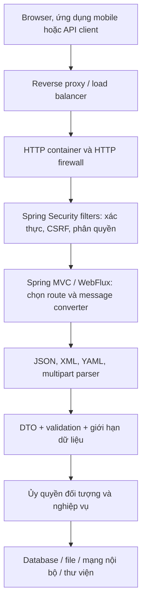

# Trình phân tích dữ liệu, deserialization và thư viện phụ thuộc

## Mục tiêu học tập

Trong module **SPRING_SECURITY_HTTP_PROTECTION**, Spring Security cung cấp các lớp phòng vệ HTTP và trình duyệt như CSRF, CORS, security headers, CSP, HSTS, HTTP firewall và bảo vệ session. Tuy vậy, một request có thể vượt qua xác thực, CSRF và firewall rồi vẫn gây sự cố khi ứng dụng **phân tích JSON, XML, YAML, multipart**, chuyển dữ liệu thành object Java hoặc gọi một thư viện có lỗ hổng.

Bài này thuộc chương **Ranh giới bảo vệ**. Mục tiêu là xác định rõ việc gì thuộc về Spring Security, việc gì thuộc về parser/serializer và thư viện, cũng như cách kiểm thử giao điểm giữa các lớp đó. Sau khi hoàn thành, bạn có thể:

- Vẽ được chuỗi ranh giới tin cậy từ client, proxy, HTTP firewall, Spring Security, parser tới nghiệp vụ.
- Phân biệt **kiểm soát truy cập** với **kiểm soát cấu trúc, kích thước và ngữ nghĩa dữ liệu**.
- Nhận diện deserialization không an toàn, XML external entity, YAML tag nguy hiểm, JSON polymorphism, mass assignment và parser differential.
- Thiết kế endpoint dùng DTO, Bean Validation, giới hạn bộ nhớ và lựa chọn định dạng được hỗ trợ.
- Kiểm soát thư viện phụ thuộc trực tiếp/transitive, theo dõi bản vá và viết bộ kiểm thử âm tính phù hợp.

Ví dụ chủ yếu dùng **Spring Boot 3.x, Spring Security 6.x, Spring MVC/Servlet và Jackson 2.15+**. Cuối bài chỉ rõ những điểm tương ứng và khác biệt khi dùng **Spring WebFlux/Reactive**.

## 1. Ranh giới tin cậy chạy xuyên suốt request

Hãy xem endpoint `POST /api/documents` cho phép thành viên tạo tài liệu trong một workspace. Client gửi JSON, có thể mang session cookie, bearer token và CSRF token tùy mô hình xác thực.



Mỗi lớp có câu hỏi bảo mật riêng:

| Lớp | Câu hỏi cần trả lời | Giới hạn trách nhiệm |
| --- | --- | --- |
| Proxy và HTTP server | Request có hợp lệ về framing, kích thước, đường dẫn và TLS không? | Không hiểu quyền với object nghiệp vụ |
| HTTP firewall | Method, URL path và request có rơi vào mẫu bất thường cần chặn không? | Không tự phân tích JSON/XML trong body |
| Spring Security | Client đã xác thực chưa, CSRF/CORS phù hợp chưa, endpoint có quyền truy cập không? | Không tự bảo đảm object được deserialize an toàn |
| Parser/message converter | Body thuộc định dạng nào, có đúng cú pháp và nằm trong giới hạn tài nguyên không? | Một JSON hợp lệ vẫn có thể chứa yêu cầu trái quyền |
| DTO và Bean Validation | Trường bắt buộc, định dạng ID, độ dài và số lượng phần tử có phù hợp không? | Không thay thế kiểm tra quyền theo workspace/tài nguyên |
| Tầng nghiệp vụ | Người dùng hiện tại có được thao tác trên tài nguyên cụ thể không? | Không sửa được lỗ hổng parser/thư viện nằm ở tầng trước |
| Thư viện phụ thuộc | Phiên bản parser, codec, upload, template, database driver có được cập nhật và dùng đúng không? | BOM/SBOM không tự ngăn khai thác nếu cấu hình hoặc cách dùng sai |

Ví dụ, tài khoản `alice` có quyền gọi endpoint tạo tài liệu nhưng chỉ là thành viên `workspace-a`. Request chứa `"workspaceId": "workspace-b"` có thể là **JSON hoàn toàn hợp lệ**, vượt qua HTTP firewall và được xác thực thành công. Ứng dụng vẫn phải từ chối ở tầng kiểm tra quyền đối tượng.

Ngược lại, một request JSON quá sâu có thể tiêu tốn CPU/bộ nhớ ngay tại parser **trước khi controller kịp xác minh quyền workspace**. Khi đó cần cả giới hạn payload ở proxy/codec lẫn giới hạn cấu trúc parser.

## 2. Phân loại rủi ro theo đầu vào

| Đầu vào hoặc tình huống | Rủi ro tiêu biểu | Hướng kiểm soát |
| --- | --- | --- |
| JSON có nhiều mức lồng nhau hoặc chuỗi khổng lồ | Cạn tài nguyên, parse tốn bộ nhớ/CPU | Giới hạn HTTP body, max depth, max string length, timeout |
| JSON chứa field thừa như `role`/`isAdmin` | Mass assignment, thay đổi thuộc tính không cho phép | DTO chỉ có trường được phép; mapping chủ động |
| JSON chứa field trùng tên | Hai thành phần hiểu dữ liệu khác nhau; giá trị bị ghi đè | Bật duplicate detection nếu giao thức yêu cầu duy nhất |
| JSON polymorphic dùng tên class từ client | Đối tượng ngoài dự kiến, gadget chain, hành vi nguy hiểm | Tránh deserialization theo tên class tùy ý; allowlist type cố định |
| XML có DTD/external entity | XXE, đọc file, truy cập mạng nội bộ, entity expansion | Vô hiệu DTD và external entity, chặn external access |
| YAML có custom tag/alias không giới hạn | Tạo class không mong muốn, alias expansion | Safe loader, giới hạn alias/size/depth, hoặc không nhận YAML từ Internet |
| Java native serialized object | Deserialization gadget, thực thi hành vi ngoài dự kiến | Không đọc stream Java serialization từ client; filter chỉ là biện pháp bổ sung |
| Upload file/archive | Zip bomb, path traversal, nội dung giả MIME | Giới hạn file/giải nén, kiểm tra đường dẫn chuẩn hóa, xử lý cô lập |
| Trường URL/hostname do user nhập | SSRF nếu server tự gọi ra mạng | Allowlist destination, xác minh DNS/IP sau phân giải, hạn chế egress |
| Header/path được proxy và app diễn giải khác nhau | HTTP request smuggling, bypass route/firewall | Đồng bộ quy tắc parsing và chuẩn hóa, từ chối request mơ hồ |
| Thư viện transitive lỗi thời | Parser/codec mang CVE hoặc mặc định kém an toàn | BOM, dependency inventory, SCA, SBOM, cập nhật có kiểm thử |

**Không đánh đồng “input validation” với “sanitization”.** Kiểm tra cấu trúc/giới hạn dữ liệu trước; khi dùng dữ liệu trong HTML, SQL, shell hoặc đường dẫn, còn cần cơ chế bảo vệ riêng cho **đích sử dụng**. Ví dụ: query parameter được phép chứa dấu nháy không có nghĩa phải xóa dấu nháy; truy vấn SQL cần parameter binding.

## 3. JSON: chuyển body thành object an toàn

### 3.1 Dùng DTO chuyên dụng thay vì deserialize thẳng entity

Sai lầm thường gặp là dùng ngay JPA entity hoặc object quản trị làm tham số `@RequestBody`. Khi thêm field `role`, `ownerId` hoặc `approved` vào model, endpoint cũ có thể vô tình nhận field đó từ client.

Ví dụ an toàn hơn là khai báo DTO chỉ gồm trường được phép và quyết định quyền tại server:

```java
import java.util.List;

import jakarta.validation.Valid;
import jakarta.validation.constraints.NotBlank;
import jakarta.validation.constraints.NotNull;
import jakarta.validation.constraints.Pattern;
import jakarta.validation.constraints.Size;

import org.springframework.http.HttpStatus;
import org.springframework.http.MediaType;
import org.springframework.security.access.AccessDeniedException;
import org.springframework.security.core.Authentication;
import org.springframework.web.bind.annotation.*;

record CreateDocumentRequest(
        @NotBlank @Size(max = 120) String title,
        @NotBlank @Pattern(regexp = "[a-z0-9-]{1,40}") String workspaceId,
        @NotNull @Size(max = 20) List<@NotBlank @Size(max = 60) String> labels
) {}

record DocumentResult(String id, String workspaceId) {}

interface WorkspacePermissionService {
    boolean canCreate(String username, String workspaceId);
}

interface DocumentService {
    DocumentResult create(String owner, CreateDocumentRequest request);
}

@RestController
@RequestMapping("/api/documents")
class DocumentController {
    private final WorkspacePermissionService permissions;
    private final DocumentService documents;

    DocumentController(WorkspacePermissionService permissions,
                       DocumentService documents) {
        this.permissions = permissions;
        this.documents = documents;
    }

    @PostMapping(consumes = MediaType.APPLICATION_JSON_VALUE,
                 produces = MediaType.APPLICATION_JSON_VALUE)
    @ResponseStatus(HttpStatus.CREATED)
    DocumentResult create(@Valid @RequestBody CreateDocumentRequest request,
                          Authentication authentication) {
        String username = authentication.getName();

        // Quyền được tra từ dữ liệu server; không tin field owner/role từ JSON.
        if (!permissions.canCreate(username, request.workspaceId())) {
            throw new AccessDeniedException("Workspace is not writable");
        }
        return documents.create(username, request);
    }
}
```

Ở ví dụ này, `title`, `workspaceId` và `labels` là những field được phép nhập. Server lấy người dùng từ `Authentication`, thay vì tin một giá trị `owner` do client gửi. Service tiếp tục dùng `workspaceId` đã được kiểm tra để ghi dữ liệu, không âm thầm đổi sang workspace lấy từ object khác.

**Lưu ý:** `@Valid` chỉ thực thi những ràng buộc đã khai báo và có Bean Validation provider hoạt động, thường thông qua `spring-boot-starter-validation`. `@Valid` không tự kiểm tra membership, không loại bỏ lỗ hổng Jackson polymorphism và cũng không giới hạn tổng số byte của HTTP request. `@Pattern` cho ID không phải cách duy nhất để bảo vệ đường dẫn hoặc query; xử lý ở đích sử dụng vẫn cần an toàn.

Để Spring Security quyết định quyền gọi endpoint, có thể kết hợp policy dưới đây cho ứng dụng **đăng nhập bằng cookie/session**, giữ CSRF được bật:

```java
import org.springframework.context.annotation.Bean;
import org.springframework.context.annotation.Configuration;
import org.springframework.http.HttpMethod;
import org.springframework.security.config.annotation.web.builders.HttpSecurity;
import org.springframework.security.web.SecurityFilterChain;

@Configuration
class DocumentHttpSecurityConfig {

    @Bean
    SecurityFilterChain documentsSecurity(HttpSecurity http) throws Exception {
        http
            .authorizeHttpRequests(authorize -> authorize
                .requestMatchers(HttpMethod.POST, "/api/documents")
                    .hasAuthority("ROLE_EDITOR")
                .anyRequest().authenticated());
        // Mặc định vẫn áp dụng CSRF cho POST khi dùng session/cookie.
        return http.build();
    }
}
```

Trong ví dụ, một người có `ROLE_EDITOR` mới qua được filter để gọi endpoint. Nhưng **một editor của workspace A vẫn không có quyền ghi workspace B** nếu `WorkspacePermissionService` trả về `false`. Với API bearer-token hoàn toàn stateless, chính sách CSRF có thể khác; phải phân tích cách browser tự động gửi thông tin xác thực trước khi thay đổi cấu hình.

### 3.2 Đặt giới hạn cấu trúc và hành vi parser

Giới hạn kích thước request ở **reverse proxy/gateway** giúp giảm payload quá lớn từ sớm. Đồng thời, parser cần giới hạn độ sâu, độ dài chuỗi và số chữ số; một payload nhỏ theo byte vẫn có thể gây áp lực xử lý do cách lồng nhau.

Với Jackson 2.15+, có thể cấu hình `StreamReadConstraints` cho `ObjectMapper` do Spring Boot quản lý. Đoạn sau minh họa một **Spring Boot Jackson customizer**, giữ cơ chế khởi tạo mapper của Boot:

```java
import com.fasterxml.jackson.core.JsonParser;
import com.fasterxml.jackson.core.StreamReadConstraints;
import org.springframework.boot.autoconfigure.jackson.Jackson2ObjectMapperBuilderCustomizer;
import org.springframework.context.annotation.Bean;
import org.springframework.context.annotation.Configuration;

@Configuration
class JsonParserLimitsConfig {

    @Bean
    Jackson2ObjectMapperBuilderCustomizer jsonParserLimits() {
        return builder -> builder.postConfigurer(mapper -> {
            mapper.getFactory().setStreamReadConstraints(
                StreamReadConstraints.builder()
                    .maxNestingDepth(64)
                    .maxStringLength(64_000)
                    .maxNumberLength(128)
                    .build());

            // Nếu giao thức không cho phép key trùng nhau.
            mapper.getFactory().enable(
                JsonParser.Feature.STRICT_DUPLICATE_DETECTION);
        });
    }
}
```

Đây là giá trị **ví dụ để bắt đầu kiểm thử**: một ứng dụng xử lý văn bản dài hoặc cấu trúc hợp lệ sâu hơn cần điều chỉnh theo hợp đồng dữ liệu thực tế. Customizer áp dụng cho mapper được builder này tạo; hãy kiểm tra nếu ứng dụng còn có `ObjectMapper` tự khai báo, custom converter hoặc parser nằm ngoài Spring MVC.

Quy tắc cho field không được khai báo cũng cần chủ động quyết định:

- **Fail on unknown properties:** trả lỗi khi client gửi field không có trong DTO; thích hợp khi API có hợp đồng chặt, giúp phát hiện payload sai sớm.
- **Ignore unknown properties:** cho phép client gửi field mới mà server cũ bỏ qua; thuận tiện cho tương thích nhưng cần xác minh các field nhạy cảm **không** được đưa vào entity bằng cơ chế mapping khác.

Không bật `FAIL_ON_UNKNOWN_PROPERTIES` toàn cục mà không thử lại các API có hợp đồng mở. Dù chọn chính sách nào, không được để input tự ghi vào các field quyền hạn, trạng thái phê duyệt hoặc owner nằm ngoài DTO.

### 3.3 Tránh polymorphic deserialization theo tên class do client chọn

Nếu client gửi dữ liệu kiểu sau, thiết kế yêu cầu server hiểu `"@class"` từ input là tên class Java cần tạo:

```json
{
  "@class": "example.internal.SomeJavaType",
  "payload": {}
}
```

Một ứng dụng dùng Jackson default typing hoặc `@JsonTypeInfo(use = JsonTypeInfo.Id.CLASS)` trên dữ liệu không tin cậy có thể tạo ra loại object ngoài dự kiến và, tùy classpath/configuration, dẫn đến chuỗi hành vi nguy hiểm. **Không dùng class name do client cung cấp làm allowlist tự động.**

Nếu cần phân biệt nhiều kiểu command, dùng discriminant nghiệp vụ giới hạn, ví dụ `"kind": "rename"` hoặc `"kind": "archive"`; map sang **những DTO đã định nghĩa sẵn**:

```java
record CommandEnvelope(String kind,
                       com.fasterxml.jackson.databind.JsonNode payload) {}

Object parseCommand(CommandEnvelope envelope,
                    com.fasterxml.jackson.databind.ObjectMapper mapper)
        throws com.fasterxml.jackson.core.JsonProcessingException {

    // Map cố định; không dùng Class.forName(envelope.kind()).
    return switch (envelope.kind()) {
        case "rename" -> mapper.treeToValue(
            envelope.payload(), RenameCommand.class);
        case "archive" -> mapper.treeToValue(
            envelope.payload(), ArchiveCommand.class);
        default -> throw new IllegalArgumentException("Unsupported command");
    };
}
```

`RenameCommand` và `ArchiveCommand` là DTO do ứng dụng định nghĩa, có validation riêng. Đoạn trên minh họa **hướng dispatch** và cần gắn với handler trả 400 khi `kind` không hợp lệ; nó không tự cấu thành một REST endpoint hoàn chỉnh. Nếu dùng `@JsonTypeInfo(use = Id.NAME)`, vẫn chỉ đăng ký các subtype đã duyệt và không bật cơ chế fallback tùy ý đến class name.

## 4. XML, YAML, Java serialization và file upload

### 4.1 XML: khóa DTD và truy cập tài nguyên ngoài

Khi parser XML cho phép external entity, tài liệu do client gửi có thể khiến ứng dụng đọc tài nguyên ngoài hoặc gây tải không mong muốn. Đối với XML **không cần DTD**, cấu hình JAXP theo nguyên tắc từ chối:

```java
import java.io.InputStream;
import javax.xml.XMLConstants;
import javax.xml.parsers.DocumentBuilderFactory;
import org.w3c.dom.Document;

Document parseTrustedShapeXml(InputStream boundedInput) throws Exception {
    DocumentBuilderFactory factory = DocumentBuilderFactory.newInstance();

    factory.setFeature(XMLConstants.FEATURE_SECURE_PROCESSING, true);
    factory.setFeature(
        "http://apache.org/xml/features/disallow-doctype-decl", true);
    factory.setAttribute(XMLConstants.ACCESS_EXTERNAL_DTD, "");
    factory.setAttribute(XMLConstants.ACCESS_EXTERNAL_SCHEMA, "");
    factory.setXIncludeAware(false);
    factory.setExpandEntityReferences(false);

    return factory.newDocumentBuilder().parse(boundedInput);
}
```

`boundedInput` phải là stream có giới hạn byte/tài nguyên theo chính sách; “đã khóa DTD” không có nghĩa toàn bộ XML được phép dài tùy ý. Nếu một parser/provider không hỗ trợ thuộc tính bảo vệ cần thiết, **fail closed** khi khởi tạo, ghi nhận lỗi cấu hình và thay parser hoặc điều chỉnh an toàn. Không nuốt exception rồi tiếp tục parse với cài đặt mặc định kém an toàn.

Nếu ứng dụng không có nhu cầu nhận XML, đừng thêm XML converter để “hỗ trợ sẵn”; xác minh endpoint chỉ nhận `application/json` và trả `415 Unsupported Media Type` cho kiểu khác. Việc vô tình thêm thư viện xử lý XML lên classpath có thể làm thay đổi danh sách message converter; cần kiểm thử lại sau khi nâng dependency.

### 4.2 YAML, Java serialization và cơ chế binder

YAML phù hợp với file cấu hình do đội vận hành kiểm soát, nhưng việc nhận YAML trực tiếp từ Internet cần cân nhắc kỹ. Loader cho phép custom tag, tham chiếu/alias hoặc tạo Java type theo tag có thể gây tạo object ngoài ý muốn hoặc tiêu tốn tài nguyên. Nếu bắt buộc parse YAML ngoài hệ thống, chọn **safe constructor/loader**, giới hạn aliases, chiều sâu và tổng input theo khả năng API của phiên bản SnakeYAML đang dùng.

Tương tự, tránh nhận stream Java serialization từ client và gọi `ObjectInputStream.readObject()`. Nội dung serialized có thể kích hoạt phương thức/đồ thị object trong quá trình khôi phục, trước khi business validation chạy. Nếu đang duy trì giao thức Java serialization cũ, Java `ObjectInputFilter` với allowlist class, giới hạn depth/references/bytes là lớp giảm rủi ro bổ sung; giải pháp lâu dài nên là giao thức chỉ có DTO và schema đã kiểm soát.

**Data binding/mass assignment:** các cơ chế gán property từ form, query hoặc JSON cần được ràng buộc vào model cho input. Không bind trực tiếp object có thể chứa `isAdmin`, `accountBalance`, `ownerId`, `tenantId` hay trạng thái duyệt. Khi cập nhật entity, dùng mapping tường minh từ field được phép và lấy các giá trị quyền hạn từ phiên xác thực hoặc database.

### 4.3 Multipart, archive và dữ liệu nhị phân

Request `multipart/form-data` có thể chứa filename, content type và body do client khai báo. Cả ba đều không đáng tin:

- Giới hạn **dung lượng từng file**, **tổng request**, **số lượng part/file**, thời gian xử lý và dung lượng lưu tạm. Trong Spring Boot Servlet, `spring.servlet.multipart.max-file-size` và `spring.servlet.multipart.max-request-size` là những cấu hình liên quan, nhưng vẫn nên giới hạn ở gateway.
- Không dùng trực tiếp `MultipartFile.getOriginalFilename()` để ghép path; chuẩn hóa tên file hoặc tự sinh storage key, kiểm tra đường dẫn thực nằm trong thư mục cho phép.
- Kiểm tra content type theo nghiệp vụ bằng cách phân tích định dạng thực; header do client gửi không chứng minh file hợp lệ.
- Với ZIP/tar hoặc format nén, giới hạn tổng byte sau giải nén, số entry, độ sâu, tỷ lệ nén và thời gian; chặn path traversal, symlink và đường dẫn tuyệt đối trong archive.
- Nếu hệ thống phân tích ảnh/PDF/Office bằng thư viện thứ ba, coi đây là **một ranh giới parser mới**. Chạy xử lý nặng trong môi trường hạn chế tài nguyên/quyền truy cập nếu phù hợp.

Ví dụ cấu hình kích thước upload của Spring Boot Servlet:

```properties
spring.servlet.multipart.max-file-size=5MB
spring.servlet.multipart.max-request-size=6MB
```

Hai thuộc tính trên **không giới hạn tổng byte cho mọi JSON request** và không tự chặn zip bomb sau giải nén. Cần phân biệt giới hạn tại từng tầng.

## 5. HTTP firewall và parser differential: cần cùng một cách hiểu request

HTTP firewall của Spring Security (ví dụ `StrictHttpFirewall` trong ứng dụng Servlet) có nhiệm vụ bảo vệ lớp request HTTP như từ chối một số URL bất thường, method không được cho phép hoặc chuỗi đường dẫn có nguy cơ gây nhầm lẫn. Nó không kiểm tra từng giá trị JSON, alias YAML, external entity XML hay thư viện parser có CVE.

Một nhóm rủi ro đặc biệt xuất hiện khi **reverse proxy, Servlet container và ứng dụng diễn giải request không giống nhau**:

- Proxy và backend không thống nhất xử lý framing liên quan `Content-Length` và `Transfer-Encoding`, tạo cơ hội request smuggling.
- Một thành phần chuẩn hóa `%2F`, `%2E`, dấu chấm phẩy hoặc slash kép trước khi định tuyến; thành phần khác giữ nguyên, khiến policy áp lên URL khác với handler thực tế.
- Gateway cho phép một loại content type hoặc method nhưng message converter phía sau xử lý khác dự kiến.
- Một hệ thống nhận hai header/key trùng tên và chọn giá trị đầu, hệ thống khác chọn giá trị cuối.

Hướng phòng vệ:

1. Dùng phiên bản proxy, HTTP server và Spring Framework/Security được hỗ trợ; cập nhật bản vá xử lý HTTP framing.
2. Chỉ có **một chính sách canonicalization rõ ràng** cho path và host qua các tầng; từ chối request mơ hồ thay vì cố đoán.
3. Định tuyến ở proxy và trong ứng dụng phải xét cùng method, scheme/host và path; không cho client tự giả mạo `Forwarded`/`X-Forwarded-*` từ Internet.
4. Giữ cấu hình HTTP firewall chặt chẽ; chỉ nới một quy tắc sau khi chứng minh endpoint cần và có kiểm thử bypass.
5. Kiểm thử trên HTTP server/proxy thực tế, vì unit test `MockMvc` không mô phỏng đầy đủ parser của proxy, HTTP/1.1 framing hoặc chuyển đổi HTTP/2.

Một request đã qua `StrictHttpFirewall` có nghĩa request không bị **các quy tắc firewall hiện có** từ chối; điều đó không chứng minh toàn bộ request an toàn.

## 6. Phụ thuộc trực tiếp và transitive là một phần của ranh giới bảo vệ

Thêm `spring-boot-starter-web` hoặc `spring-boot-starter-webflux` thường kéo theo nhiều thư viện phân tích dữ liệu và HTTP. Một dependency do dự án không import trực tiếp vẫn có thể xuất hiện trong runtime classpath và bị gọi qua auto-configuration hoặc một thư viện khác.

Vòng quản trị đề xuất:

| Bước | Thao tác | Đầu ra cần có |
| --- | --- | --- |
| Kiểm kê | Liệt kê dependency trực tiếp/transitive và phiên bản được resolve | Cây phụ thuộc runtime, test và plugin liên quan |
| Chuẩn hóa phiên bản | Dùng Spring Boot BOM/parent tương thích, xác định các override có chủ đích | Không vô tình trộn phiên bản Spring/Jackson lệch nhau |
| Phát hiện | Quét CVE/advisory theo SBOM, dependency scanner, vendor advisory | Danh sách thành phần cần đánh giá |
| Phân tích ảnh hưởng | Xác định parser nào có mặt, input nào kiểm soát được, tính năng nào bật | Mức rủi ro cụ thể trong ứng dụng; không chỉ điểm CVSS |
| Khắc phục | Cập nhật phiên bản có bản vá, bỏ dependency không dùng hoặc giảm exposure | PR thay đổi có kiểm thử hành vi/khả năng tương thích |
| Duy trì | Theo dõi advisory, tự động hóa SBOM/quét, có hạn xử lý và người phụ trách | Lịch cập nhật và bằng chứng kiểm soát |

Trong dự án Maven, một số lệnh kiểm kê thông dụng:

```bash
# Xem toàn bộ dependency đã được resolve.
./mvnw dependency:tree

# Thu hẹp về nhóm parser/serialization có liên quan.
./mvnw dependency:tree -Dincludes=com.fasterxml.jackson.core,org.yaml:snakeyaml

# Nếu dự án có thiết lập plugin OWASP Dependency-Check phù hợp:
./mvnw dependency-check:check
```

Các lệnh trên minh họa **quy trình vận hành** và không phải lệnh chạy trong phạm vi bài viết này. Plugin quét lỗ hổng cần được khai báo, cấu hình nguồn advisory và phiên bản phù hợp trong build. Với Gradle, dùng công cụ tương đương để kiểm kê dependency resolution và tích hợp scanner; không suy từ file `pom.xml` rằng đó là toàn bộ classpath runtime.

**SBOM** (ví dụ CycloneDX) nên được tạo từ build thực tế, lưu cùng release và dùng để biết thành phần nào có mặt khi một CVE mới được công bố. Đánh giá cả dependency trực tiếp, transitive, dependency đóng gói trong container và runtime JDK. Quét CVE chỉ là đầu vào quyết định: một cảnh báo không đồng nghĩa có đường khai thác, trong khi “scanner sạch” cũng không bảo đảm cấu hình deserialization đang an toàn.

### 6.1 Tình huống nâng version làm tăng bề mặt nhận input

Đội phát triển thêm thư viện XML để tạo báo cáo. Một dependency mới làm Spring MVC tìm thấy converter XML và có thể đọc request `application/xml` ở những endpoint cho phép mapping tương thích. Điều này có thể làm thay đổi **các định dạng thực tế mà endpoint chấp nhận**.

Việc cần làm sau thay đổi dependency không chỉ là chạy unit test cũ:

- Kiểm tra danh sách `HttpMessageConverter`/codec hiệu lực.
- Kiểm tra `consumes` ở endpoint, các media type cần chấp nhận và cần từ chối.
- Chạy lại ca XXE, field validation, size limit và phản hồi lỗi.
- So sánh phiên bản transitive với BOM, rà soát các override không cần thiết.

Tương tự, nâng Jackson có thể thay đổi giới hạn parser, lỗi duplicate key, module đăng ký hoặc hành vi type handling. Không mặc định rằng “cập nhật dependency là đủ” nếu ứng dụng đang bật một tính năng deserialization nguy hiểm.

## 7. Kiểm thử nhiều tầng và yêu cầu quan sát được

Cần hai nhóm kiểm thử:

- **Âm tính:** input bất thường bị từ chối bằng lỗi phù hợp **và không có side effect** (không ghi DB, không tạo file, không phát outbound request).
- **Dương tính:** request hợp lệ, được xác thực và có quyền vẫn xử lý thành công; giới hạn mới không phá luồng bình thường.

Với endpoint ví dụ ở mục 3, ứng dụng cần bật CSRF cho session-based authentication và có `ROLE_EDITOR`. Kiểm thử có thể dùng `@SpringBootTest` + `MockMvc` để đi qua filter chain và converter thật trong ứng dụng:

```java
import org.junit.jupiter.api.Test;
import org.springframework.beans.factory.annotation.Autowired;
import org.springframework.boot.test.autoconfigure.web.servlet.AutoConfigureMockMvc;
import org.springframework.boot.test.context.SpringBootTest;
import org.springframework.test.web.servlet.MockMvc;
import org.springframework.security.test.context.support.WithMockUser;

import static org.springframework.security.test.web.servlet.request.SecurityMockMvcRequestPostProcessors.csrf;
import static org.springframework.test.web.servlet.request.MockMvcRequestBuilders.post;
import static org.springframework.test.web.servlet.result.MockMvcResultMatchers.status;

@SpringBootTest
@AutoConfigureMockMvc
class DocumentInputBoundaryIT {

    @Autowired MockMvc mvc;

    @Test
    @WithMockUser(username = "alice", authorities = "ROLE_EDITOR")
    void postWithoutCsrfIsForbidden() throws Exception {
        mvc.perform(post("/api/documents")
                .contentType("application/json")
                .content("{\"title\":\"x\",\"workspaceId\":\"workspace-a\",\"labels\":[]}"))
            .andExpect(status().isForbidden());
    }

    @Test
    @WithMockUser(username = "alice", authorities = "ROLE_EDITOR")
    void malformedJsonIsBadRequest() throws Exception {
        mvc.perform(post("/api/documents")
                .with(csrf())
                .contentType("application/json")
                .content("{\"title\":"))
            .andExpect(status().isBadRequest());
    }

    @Test
    @WithMockUser(username = "alice", authorities = "ROLE_EDITOR")
    void unsupportedContentTypeIsRejected() throws Exception {
        mvc.perform(post("/api/documents")
                .with(csrf())
                .contentType("text/plain")
                .content("not-json"))
            .andExpect(status().isUnsupportedMediaType());
    }

    @Test
    @WithMockUser(username = "alice", authorities = "ROLE_EDITOR")
    void invalidDtoIsBadRequest() throws Exception {
        mvc.perform(post("/api/documents")
                .with(csrf())
                .contentType("application/json")
                .content("{\"title\":\"\",\"workspaceId\":\"x!\",\"labels\":[]}"))
            .andExpect(status().isBadRequest());
    }
}
```

Những test này giả định endpoint thật, validator, security chain và service fixture đã được cấu hình trong ứng dụng. Cần bổ sung test cho **quyền workspace**, sử dụng DB hoặc stub có quyền rõ ràng: `alice` được phép `workspace-a` nhưng không được phép `workspace-b`. Trường hợp bị từ chối phải đồng thời khẳng định **không có bản ghi được tạo** cho `workspace-b`.

Nếu có cấu hình giới hạn Jackson ở mục 3, kiểm tra riêng trên mapper đã được ứng dụng đăng ký:

```java
import com.fasterxml.jackson.core.exc.StreamConstraintsException;
import com.fasterxml.jackson.databind.ObjectMapper;
import org.junit.jupiter.api.Test;
import org.springframework.beans.factory.annotation.Autowired;
import org.springframework.boot.test.context.SpringBootTest;

import static org.assertj.core.api.Assertions.assertThatThrownBy;

@SpringBootTest
class JacksonDepthLimitTest {

    @Autowired ObjectMapper mapper;

    @Test
    void rejectExcessiveJsonNesting() {
        String deeplyNested = "[".repeat(70) + "0" + "]".repeat(70);
        assertThatThrownBy(() -> mapper.readTree(deeplyNested))
            .isInstanceOf(StreamConstraintsException.class);
    }
}
```

Nếu yêu cầu schema không cho phép key trùng, có thể thêm ca JSON chứa cùng tên field hai lần và kiểm tra parser từ chối theo `STRICT_DUPLICATE_DETECTION`. Với request multipart hoặc các parser nằm ngoài MVC, hãy test ở chính điểm parse tương ứng thay vì chỉ dùng endpoint JSON để suy ra toàn bộ hệ thống an toàn.

### 7.1 Ma trận kiểm thử bảo vệ

| ID | Kịch bản | Kỳ vọng và bằng chứng |
| --- | --- | --- |
| P01 | Client chưa xác thực gọi endpoint được bảo vệ | Bị từ chối/chuyển tới login theo cấu hình; handler không chạy |
| P02 | User có quyền endpoint nhưng thiếu CSRF ở request dùng session | Trả 403; không tạo tài liệu |
| P03 | Gửi `text/plain` vào endpoint chỉ nhận JSON | Trả 415; không gọi business service |
| P04 | JSON sai cú pháp | Trả 400; không ghi DB |
| P05 | JSON hợp lệ nhưng vi phạm `@NotBlank`/`@Size` | Trả 400; phản hồi không lộ stack trace |
| P06 | JSON vượt độ sâu/chuỗi/giới hạn byte | Bị chặn tại parser/proxy; tài nguyên vẫn trong ngưỡng; không có side effect |
| P07 | JSON có field trùng tên | Trả lỗi nếu chính sách duplicate detection được bật |
| P08 | JSON có field ngoài hợp đồng như `role=ADMIN` | Không nâng quyền; trả lỗi nếu chọn strict unknown-field policy |
| P09 | Editor của workspace A gửi yêu cầu cho B | Bị chặn theo quyền đối tượng, không tạo tài liệu ở B |
| P10 | XML chứa DTD/external entity | Bị từ chối khi XML không hỗ trợ hoặc parser khóa DTD; không truy cập file/mạng |
| P11 | Stream Java serialization hoặc YAML custom tag | Không được chuyển thành object tùy ý qua HTTP endpoint |
| P12 | Multipart/archive có path traversal hoặc dữ liệu giải nén khổng lồ | Bị chặn trước khi ghi ngoài nơi cho phép hoặc tiêu tốn quá ngân sách |
| P13 | Path/header mơ hồ qua proxy và app | Bị từ chối nhất quán; route của proxy và handler không bị lệch |
| P14 | Dependency transitive xuất hiện advisory nghiêm trọng | CI/đội vận hành có inventory, đánh giá exposure và xử lý phiên bản |
| P15 | JSON nhỏ, hợp lệ, đúng quyền, đúng CSRF | Thành công; bản ghi được tạo đúng workspace |

**Không hardcode mọi lỗi thành 403.** `400` thường liên quan dữ liệu sai; `401/403` liên quan xác thực/phân quyền, `413` liên quan payload quá lớn ở tầng thực thi chính sách, `415` là media type không hỗ trợ. Kết quả cuối phụ thuộc filter chain, exception handler và proxy; cần kiểm thử theo hợp đồng của chính ứng dụng. Một lỗi `500` kèm stack trace cho dữ liệu không tin cậy là dấu hiệu cần xử lý phản hồi lỗi an toàn.

### 7.2 Phân biệt Servlet và Reactive trong kiểm thử

| Mối quan tâm | Spring MVC/Servlet | Spring WebFlux/Reactive |
| --- | --- | --- |
| Bộ lọc Spring Security | `SecurityFilterChain`, `HttpSecurity`, Servlet filter | `SecurityWebFilterChain`, `ServerHttpSecurity`, WebFilter |
| Phân tích body | `HttpMessageConverter`, các Jackson converter | `HttpMessageReader`/codec, `Jackson2JsonDecoder` |
| HTTP firewall | `StrictHttpFirewall` ở Servlet | Không bê nguyên Servlet firewall; bảo đảm route/proxy/HTTP server nhất quán |
| Request body quá lớn | Proxy/container, multipart limit và JSON parser constraints | Proxy/server, codec buffer limit, decoder/parser constraints |
| Thư viện parser | Jackson/XML/YAML/file parsers tùy classpath | Tương tự nhưng đường xử lý phi đồng bộ và tài nguyên buffer khác |
| Test thông dụng | `MockMvc` + integration trên server thật | `WebTestClient` + integration trên server thật |

Ở WebFlux, cấu hình ví dụ `spring.codec.max-in-memory-size=256KB` có thể giới hạn lượng dữ liệu mà **một số codec** được phép gom vào bộ nhớ khi decode, nhưng không thay cho giới hạn tổng payload ở ingress và không giới hạn tất cả cơ chế streaming/upload. Các request phức tạp cần kiểm soát backpressure, số phần tử, bộ nhớ tích lũy và timeout ở đường xử lý thực tế.

Với cả Servlet lẫn Reactive, test trên proxy và HTTP server thật là cần thiết để phát hiện sự khác biệt parsing giữa tầng hạ tầng và framework. `MockMvc` hoặc `WebTestClient` chạy trong ứng dụng không đại diện đầy đủ cho HTTP/1.1 framing, HTTP/2 và normalization của gateway.

## 8. Chẩn đoán khi triển khai

Một số dấu hiệu thường bị gán nhầm cho Spring Security:

| Triệu chứng | Khả năng cao liên quan | Bằng chứng cần thu thập |
| --- | --- | --- |
| `403` ngay khi gọi POST bằng session | CSRF hoặc phân quyền endpoint | CSRF config, user authorities, filter trace đã ẩn thông tin nhạy cảm |
| `415` sau khi nâng dependency | `consumes` hoặc converter/media type thay đổi | Media type request, danh sách converter, dependency diff |
| `400` khi nâng Jackson | Ràng buộc JSON, trường lạ, duplicate key, giới hạn parser | Exception class đã chuẩn hóa; payload test rút gọn |
| `413` ở ingress nhưng local thành công | Giới hạn payload gateway khác server | Kích thước request và cấu hình proxy |
| `500` khi nhận XML/YAML bất thường | Parser không được khóa hoặc error mapping thiếu | Exception từ parser, không in toàn bộ payload ra log |
| Login thành công nhưng chỉ một route bị bypass ACL | Matcher/path normalization lệch giữa các lớp | URL được proxy chuyển tiếp và path Spring MVC nhìn thấy |
| CPU/RAM tăng khi parse tài liệu | Input lồng sâu, archive expansion, parser quá tải | Metrics kích thước, thời gian, số entry và memory |
| Có CVE trên thư viện transitive | Dependency và khả năng kích hoạt trên đường xử lý | Tree/SBOM, advisory, call site và parser config |

Log nên ghi **mã lỗi, loại parser, content type, kích thước, route chuẩn hóa, trace ID** và thời gian xử lý. Không log tràn lan body, cookie, token, session ID hay nội dung tài liệu nhạy cảm. Với dữ liệu lỗi lớn, chỉ lưu payload tối thiểu đã giảm nhạy cảm trong môi trường kiểm thử có kiểm soát.

## 9. Bài tập tình huống

Một API quản lý tài liệu đã có HTTPS, HSTS, CSRF và `StrictHttpFirewall`. Sau đợt thêm tính năng nhập tài liệu, hệ thống nhận JSON và XML; đội vận hành phát hiện:

1. Một file XML đặc biệt khiến server cố mở kết nối tới dịch vụ nội bộ.
2. Một JSON có `"ownerId"` làm tài liệu được gắn sang người dùng khác.
3. CPU tăng mạnh khi nhận một payload hợp lệ theo cú pháp nhưng lồng rất sâu.
4. Dependency scanner báo một lỗ hổng ở thư viện XML được kéo vào gián tiếp.

Hãy xác định **ranh giới bị vượt qua** trong từng hiện tượng và lập kế hoạch khắc phục.

Gợi ý lời giải:

- Hiện tượng 1: rà soát parser XML, chặn DTD/external entity, hạn chế egress và kiểm tra các endpoint thực sự cần XML.
- Hiện tượng 2: dùng DTO cho input, không nhận `ownerId` từ client, tra owner/permissions từ principal và dữ liệu server.
- Hiện tượng 3: giới hạn request tại proxy và độ sâu/độ dài tại parser, thiết lập ngân sách xử lý, test cả payload hợp lệ đối chứng.
- Hiện tượng 4: kiểm tra dependency tree/SBOM, xác định đường gọi parser dễ bị ảnh hưởng, cập nhật bản vá rồi chạy lại test JSON/XML/upload.

Bốn tình huống liên quan cùng một request pipeline nhưng yêu cầu **bốn biện pháp khác nhau**. Bổ sung nhiều HTTP security headers không tự sửa được XML parser hoặc cơ chế map quyền sở hữu.

## 10. Checklist để hoàn thành một ranh giới xử lý dữ liệu

1. **Hợp đồng input:** Endpoint xác định rõ method, `consumes`, schema DTO, validation và các field client được phép thay đổi.
2. **Giới hạn:** Có ngân sách request byte, độ sâu, chiều dài chuỗi, số phần tử, multipart và dữ liệu sau giải nén phù hợp.
3. **Deserialization:** Không dùng arbitrary Java class name/default typing trên input không tin cậy; khóa XML external entities và YAML tags khi cần.
4. **Quyền:** Xác thực/CSRF tại Spring Security; ủy quyền đến từng tài nguyên sau khi parse và trước khi có side effect.
5. **Hạ tầng:** Proxy, server, firewall và route thống nhất quy tắc parsing/normalization; từ chối input mơ hồ.
6. **Dependencies:** Kiểm kê transitive, áp dụng BOM và cập nhật parser; theo dõi advisory/SBOM theo release.
7. **Kiểm thử:** Có test âm tính lẫn dương tính ở parser, filter chain, business và hạ tầng; xác minh không có side effect.
8. **Giám sát:** Báo lỗi đúng tầng, không lộ stack trace hoặc dữ liệu nhạy cảm, có metrics phục vụ điều tra.

## Tài liệu tham khảo

- [Spring Security — HTTP firewall (Servlet)](https://docs.spring.io/spring-security/reference/servlet/exploits/firewall.html): phạm vi và cấu hình HTTP firewall.
- [Spring Security — CSRF protection](https://docs.spring.io/spring-security/reference/servlet/exploits/csrf.html): CSRF khi client dùng session/cookie.
- [Spring Framework — @RequestBody và Bean Validation](https://docs.spring.io/spring-framework/reference/web/webmvc/mvc-controller/ann-methods/requestbody.html): chuyển request body qua message converter và kiểm tra input.
- [Jackson Core — StreamReadConstraints](https://javadoc.io/doc/com.fasterxml.jackson.core/jackson-core/latest/com/fasterxml/jackson/core/StreamReadConstraints.html): các giới hạn đọc JSON.
- [OWASP — Deserialization of untrusted data](https://owasp.org/www-community/vulnerabilities/Deserialization_of_untrusted_data): rủi ro từ deserialize input không tin cậy.
- [Oracle — Java serialization filtering](https://docs.oracle.com/en/java/javase/17/core/serialization-filtering1.html): `ObjectInputFilter` và giới hạn serialization.
- [Maven Dependency Plugin — dependency:tree](https://maven.apache.org/plugins/maven-dependency-plugin/tree-mojo.html): kiểm kê dependency đã resolve.
- [CycloneDX — Software Bill of Materials](https://cyclonedx.org/capabilities/sbom/): SBOM cho quản trị thành phần phần mềm.
