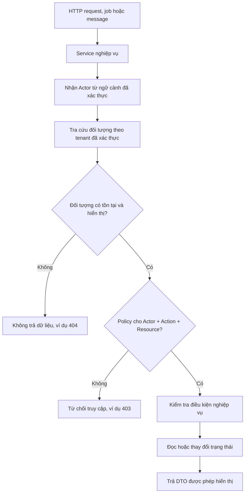

# Phân quyền đối tượng tại service để bảo vệ dữ liệu nghiệp vụ

Trong chương **Ranh giới bảo vệ** của `SPRING_SECURITY_HTTP_PROTECTION`, một nguyên tắc thiết kế quan trọng là **quyền truy cập một endpoint không đồng nghĩa với quyền truy cập mọi đối tượng mà endpoint đó xử lý**. Spring Security có thể xác thực người gọi, kiểm tra vai trò hoặc scope ở tầng HTTP, đồng thời bảo vệ CSRF, session, CORS, security headers và HTTP firewall. Nhưng hệ thống vẫn có thể lộ dữ liệu nếu service nhận một `invoiceId`, `orderId`, `documentId` hoặc `tenantId` từ client rồi truy vấn hoặc cập nhật đối tượng mà không kiểm tra quyền trên chính đối tượng đó.

Bài học này hướng dẫn đặt ranh giới phân quyền đối tượng tại **service** trong ứng dụng Spring Security Servlet và Reactive: xác định người dùng, tenant, đối tượng, hành động và điều kiện nghiệp vụ; chặn IDOR/BOLA; thiết kế kiểm tra quyền trước khi đọc, trả dữ liệu hoặc thay đổi trạng thái; đồng thời kiểm thử cả các luồng HTTP lẫn lời gọi nội bộ.

## 1. Vì sao kiểm tra quyền ở HTTP chưa đủ?

Giả sử một ứng dụng quản lý hóa đơn có endpoint:

```http
GET /api/invoices/6d7b6c00-0000-4000-8000-000000000002
Authorization: Bearer <access-token>
```

Người dùng Alice có quyền `invoice:read`, nhưng ID trên thuộc hóa đơn của Bob hoặc thuộc một khách hàng doanh nghiệp (tenant) khác. Cấu hình chỉ kiểm tra scope là chưa đủ:

```java
http.authorizeHttpRequests(auth -> auth
    .requestMatchers(HttpMethod.GET, "/api/invoices/**")
    .hasAuthority("invoice:read")
    .anyRequest().authenticated());
```

Vì Alice cũng có `invoice:read`, request qua được lớp kiểm tra này. Nếu service gọi `repository.findById(invoiceId)` và trả DTO ngay, Alice có thể thử ID khác để xem hóa đơn không thuộc quyền của mình. Lỗ hổng này thường được gọi là **IDOR (Insecure Direct Object Reference)** hoặc **BOLA (Broken Object Level Authorization)**. ID có dạng UUID khó đoán có thể giảm khả năng dò tìm hàng loạt nhưng **không thay thế phân quyền**: ID có thể bị lộ qua email, URL, log, lịch sử, referrer hoặc một API khác.

Điểm quyết định là server phải trả lời: **“Người dùng hiện tại có được thực hiện hành động này trên đối tượng cụ thể này, trong ngữ cảnh hiện tại không?”** Chỉ xác thực token và xác nhận người dùng có vai trò chung là chưa trả lời được câu hỏi đó.



Mô hình trên thể hiện một cách thiết kế thường dùng, không quy định bắt buộc trả `403` hay `404` cho mọi hệ thống. Trong một số miền dữ liệu nhạy cảm, cả đối tượng không tồn tại **và** đối tượng không được phép biết tới đều cần phản hồi `404` để giảm khả năng xác nhận sự tồn tại của đối tượng.

## 2. Phân biệt các lớp quyền và nguồn dữ liệu đáng tin

Tại service, quyết định quyền thường gồm năm thành phần:

| Thành phần | Ví dụ | Cách xác định đáng tin |
| --- | --- | --- |
| **Actor** — ai đang hành động? | Alice, service account, tác vụ nền | Identity đã xác thực từ Spring Security hoặc ngữ cảnh tác vụ nội bộ được thiết lập rõ ràng |
| **Action** — làm gì? | `invoice:read`, `invoice:cancel`, `invoice:export` | Lệnh nghiệp vụ mà service đang thực thi |
| **Resource** — đối tượng nào? | Hóa đơn `INV-2026-002` | Bản ghi thực tế từ nguồn dữ liệu tin cậy |
| **Tenant/scope** — thuộc vùng dữ liệu nào? | Công ty A, dự án P | Tenant được kiểm chứng từ token/principal và quyền thành viên; tenant của đối tượng lấy từ DB |
| **Điều kiện** — trong trạng thái nào? | Hóa đơn còn nháp, chưa khóa sổ | Trạng thái hiện tại và luật nghiệp vụ phía server |

Ví dụ chính sách đọc và hủy hóa đơn:

| Người gọi | Đối tượng | Đọc | Hủy |
| --- | --- | --- | --- |
| Chủ hóa đơn có quyền `invoice:read` | Cùng tenant, do mình sở hữu | Cho phép | Chỉ khi có thêm quyền `invoice:cancel` và trạng thái cho phép |
| Kế toán được phân công có `invoice:read` và `invoice:finance` | Cùng tenant, đúng tài khoản được phân công | Cho phép | Tùy chính sách hủy riêng |
| Người dùng cùng tenant nhưng không sở hữu/không được phân công | Hóa đơn của đồng nghiệp | Từ chối | Từ chối |
| Người dùng có role quản trị **của tenant A** | Hóa đơn thuộc tenant B | Từ chối | Từ chối |
| Người dùng chưa xác thực | Bất kỳ hóa đơn riêng tư nào | Từ chối | Từ chối |

Đây là ví dụ kết hợp **RBAC** (vai trò/quyền chung), **ABAC** (thuộc tính actor, resource, trạng thái) và kiểm tra **ownership/tenant**. Role `ADMIN` chỉ có ý nghĩa trong phạm vi được cấp. Không nên coi một role quản trị tenant là quyền toàn hệ thống nếu nghiệp vụ không định nghĩa như vậy.

**Ranh giới tin cậy:** `invoiceId` trong path, `ownerUserId` trong JSON, `X-Tenant-Id` hoặc `tenantId` trên query string đều do client điều khiển. Có thể dùng chúng để chỉ định đối tượng muốn thao tác, nhưng không được dùng làm bằng chứng quyền. Với ứng dụng đa tenant cho phép chuyển tenant, server phải kiểm tra người dùng là thành viên hợp lệ của tenant được chọn trước khi đưa tenant đó vào ngữ cảnh actor. Với Spring Security OAuth2 Resource Server, claim trong JWT chỉ nên được tin sau bước kiểm tra chữ ký, issuer, audience, thời hạn và ý nghĩa claim theo hệ thống; đôi khi vẫn phải tra cứu lại quyền thành viên còn hiệu lực.

## 3. Đặt kiểm tra ở service và thu hẹp truy vấn dữ liệu

Một controller được bảo vệ bằng `hasAuthority('invoice:read')` vẫn có thể bị gọi từ nhiều nguồn: REST API, GraphQL, message listener, tác vụ đồng bộ, batch job hoặc một service khác. Đặt policy ở service giúp mọi đường đi dùng chung một quy tắc. Tuy nhiên, kiểm tra thông qua annotation của Spring Security chỉ hoạt động khi lời gọi đi qua **Spring AOP proxy** tương ứng; sẽ xem kỹ giới hạn này ở phần sau.

Với Spring Security Servlet, trước hết bật method security:

```java
@Configuration
@EnableMethodSecurity
class MethodSecurityConfiguration {
}
```

Từ đây có thể dùng `@PreAuthorize` cho quyền mức chức năng. Ví dụ sau chỉ làm **điều kiện đầu vào**:

```java
@PreAuthorize("hasAuthority('invoice:read')")
public InvoiceView getInvoice(UUID invoiceId) {
    // BÊN TRONG vẫn phải kiểm tra invoice thuộc tenant/chủ sở hữu phù hợp.
    // @PreAuthorize ở đây chưa xác nhận quyền trên invoiceId cụ thể.
}
```

### Mẫu service kiểm tra tenant + quyền trên bản ghi

Giả sử tồn tại `Actor` đã được ánh xạ từ identity tin cậy, chứa `userId`, `tenantId` đã kiểm tra quyền thành viên và tập quyền ứng dụng. `ActorResolver.current()` lấy actor từ ngữ cảnh xác thực phía server (không lấy trực tiếp từ request body). `Invoice` có `id`, `tenantId`, `ownerUserId`, `accountId`, trạng thái và `@Version`. Các class bên dưới là **mẫu kiến trúc minh họa**; ứng dụng cần triển khai entity, DTO, resolver, exception mapping và repository theo mô hình dữ liệu của mình.

```java
public record Actor(UUID userId, UUID tenantId, Set<String> permissions) {
    public boolean has(String permission) {
        return permissions.contains(permission);
    }
}

public interface InvoiceRepository extends JpaRepository<Invoice, UUID> {
    Optional<Invoice> findByIdAndTenantId(UUID id, UUID tenantId);
}

@Service
public class InvoiceService {
    private final ActorResolver actors;
    private final InvoiceRepository invoices;
    private final InvoicePolicy policy;

    public InvoiceService(ActorResolver actors,
                          InvoiceRepository invoices,
                          InvoicePolicy policy) {
        this.actors = actors;
        this.invoices = invoices;
        this.policy = policy;
    }

    @Transactional(readOnly = true)
    @PreAuthorize("hasAuthority('invoice:read')")
    public InvoiceView getInvoice(UUID invoiceId) {
        Actor actor = actors.current();
        Invoice invoice = invoices
            .findByIdAndTenantId(invoiceId, actor.tenantId())
            .orElseThrow(InvoiceNotVisibleException::new);

        policy.assertCanRead(actor, invoice);
        return InvoiceView.from(invoice);
    }

    @Transactional
    @PreAuthorize("hasAuthority('invoice:cancel')")
    public void cancelInvoice(UUID invoiceId) {
        Actor actor = actors.current();
        Invoice invoice = invoices
            .findByIdAndTenantId(invoiceId, actor.tenantId())
            .orElseThrow(InvoiceNotVisibleException::new);

        policy.assertCanCancel(actor, invoice);
        invoice.cancelIfDraft(); // Entity áp dụng luật trạng thái, cập nhật có kiểm soát.
        // JPA dirty checking sẽ ghi trong transaction khi commit.
    }
}
```

Hai phương thức cùng bảo vệ bằng **ba tầng**: method security chặn thiếu quyền chung; truy vấn giới hạn theo tenant có hiệu lực; policy kiểm tra quan hệ actor–đối tượng. Kiểm tra trạng thái bên entity/domain (`cancelIfDraft`) là quy tắc nghiệp vụ bổ sung, không được coi là thay thế policy. Dùng `InvoiceView`/DTO giúp chủ động chọn trường trả về, tránh vô tình xuất dữ liệu nội bộ khi trả thẳng JPA entity.

Một policy điển hình:

```java
@Component
public class InvoicePolicy {
    private final AssignmentRepository assignments;

    public InvoicePolicy(AssignmentRepository assignments) {
        this.assignments = assignments;
    }

    public void assertCanRead(Actor actor, Invoice invoice) {
        requireSameTenant(actor, invoice);

        boolean owner = invoice.getOwnerUserId().equals(actor.userId());
        boolean assignedFinance = actor.has("invoice:finance")
            && assignments.existsByTenantIdAndAccountIdAndManagerUserId(
                actor.tenantId(), invoice.getAccountId(), actor.userId());

        if (!actor.has("invoice:read") || !(owner || assignedFinance)) {
            throw new AccessDeniedException("Không có quyền đọc hóa đơn");
        }
    }

    public void assertCanCancel(Actor actor, Invoice invoice) {
        requireSameTenant(actor, invoice);

        boolean owner = invoice.getOwnerUserId().equals(actor.userId());
        // Chính sách minh họa: chỉ chủ sở hữu có quyền hủy được hủy.
        if (!actor.has("invoice:cancel") || !owner) {
            throw new AccessDeniedException("Không có quyền hủy hóa đơn");
        }
    }

    private void requireSameTenant(Actor actor, Invoice invoice) {
        if (!invoice.getTenantId().equals(actor.tenantId())) {
            throw new AccessDeniedException("Không cùng phạm vi dữ liệu");
        }
    }
}
```

`AssignmentRepository` là nguồn kiểm tra phân công **phía server**, có lọc theo tenant; không nhận tuyên bố “tôi là người được phân công” từ client. Trong policy này, quyền đọc của kế toán được ràng buộc với đúng `accountId` của hóa đơn. Quyền hủy được định nghĩa chặt hơn quyền đọc. Tùy nghiệp vụ có thể cần bổ sung `invoice:finance` cho việc hủy, xác nhận hai người, giới hạn số tiền hoặc quy trình phê duyệt.

`InvoiceNotVisibleException` cần được map thành `404` ở HTTP adapter nếu hệ thống chọn quy ước “không có bản ghi trong tenant hiện tại”. `AccessDeniedException` thường dẫn đến `403` cho người dùng đã xác thực qua Spring Security web integration. Nếu chính sách yêu cầu **che cả sự tồn tại của hóa đơn thuộc cùng tenant**, hãy dùng phản hồi thống nhất cho cả trường hợp không tìm thấy và không có quyền; cần thiết kế thống nhất tại service và lớp xử lý lỗi, kể cả list/detail/report.

### Vì sao lọc tenant ngay tại repository?

Nếu service dùng `findById(invoiceId)` rồi mới so tenant, một lập trình viên khác có thể quên bước policy trong endpoint mới. Truy vấn `findByIdAndTenantId` thu hẹp phạm vi từ đầu, giảm khả năng đưa dữ liệu khác tenant vào bộ nhớ hoặc cache không phù hợp. Tuy nhiên truy vấn theo tenant **chưa đủ** để kiểm tra ownership hoặc phân công trong cùng tenant; policy vẫn cần thiết. Trong hệ thống nhạy cảm có thể bổ sung row-level security ở DB như một lớp bảo vệ độc lập, với ngữ cảnh kết nối/tenant được thiết lập và xóa đúng cách.

## 4. Lựa chọn giữa `@PreAuthorize`, `@PostAuthorize` và policy trong service

Spring Security hỗ trợ kiểm tra trước/sau method thông qua method security. Cách dùng cần phù hợp với lúc hệ thống biết đối tượng thực sự là gì:

| Cách làm | Thích hợp | Giới hạn cần nhận biết |
| --- | --- | --- |
| `@PreAuthorize("hasAuthority('invoice:read')")` | Chặn sớm người thiếu quyền chức năng | Không quyết định được ownership chỉ từ quyền chung |
| `@PreAuthorize("@invoiceAuthz.canRead(authentication, #id)")` | Kiểm tra quyền trên ID bằng bean chính sách trước khi vào method | Có thể phải đọc DB thêm lần; cần bảo đảm tenant, trạng thái và tính nhất quán với truy vấn nghiệp vụ |
| Policy sau khi load entity, **trước khi trả dữ liệu hoặc mutate** | Cần biết owner, tenant, account và trạng thái thực | Tất cả đường đi quan trọng phải gọi policy; không được bỏ qua trong method mới |
| `@PostAuthorize("@invoiceAuthz.canRead(authentication, returnObject)")` | Một số thao tác **chỉ đọc**, kết quả trả về chứa thông tin để quyết định quyền | Method đã chạy trước khi bị từ chối; không dùng như chốt bảo vệ duy nhất cho ghi dữ liệu hoặc side effect |
| `@PostFilter` | Lọc kết quả nhỏ trong trường hợp đặc thù | Có thể tải dữ liệu trái phép trước khi lọc; không giải quyết chi phí query, pagination, count hoặc cache |

Trong ví dụ đơn giản, có thể viết `@PreAuthorize("@invoiceAccess.canRead(authentication, #invoiceId)")`, nơi `invoiceAccess` là Spring bean tự kiểm tra quyền cho ID. Nhưng nếu bean kiểm tra một bản ghi rồi service sau đó tải lại bản ghi đã thay đổi, có thể xuất hiện khoảng hở **time-of-check/time-of-use (TOCTOU)**. Cân nhắc cùng một transaction, cơ chế khóa, optimistic version hoặc câu lệnh cập nhật có điều kiện khi yêu cầu nghiệp vụ đòi hỏi tính nhất quán cao. Đặc biệt, `@PostAuthorize` chạy **sau khi method thực thi**, vì vậy nếu method đã chuyển tiền, gửi email hoặc hủy hóa đơn thì một lỗi access denied sau đó không thể tự động hoàn tác mọi side effect.

Chú ý Spring AOP: lời gọi `this.cancelInvoice(id)` từ một method khác **trong cùng instance** thường bỏ qua proxy và vì thế bỏ qua `@PreAuthorize` của `cancelInvoice`; tương tự annotation trên private method không được bảo vệ theo kỳ vọng. Đặt các phương thức bảo vệ trên Spring bean được gọi qua proxy và giữ policy kiểm tra trực tiếp trong đường đi tới thao tác nhạy cảm. Khi chuyển sang AspectJ weaving, Kotlin hoặc các cấu hình proxy khác, hành vi intercept cần được xác minh riêng.

## 5. Bảo vệ mọi thao tác với dữ liệu nghiệp vụ

Phân quyền đối tượng cần xuất hiện nhất quán ở **đọc, ghi, liệt kê, tìm kiếm, xuất dữ liệu và thao tác theo lô**.

**Đọc chi tiết:** tra cứu theo tenant đáng tin; xác minh owner/phân công/nhóm; tạo DTO. Không cho phép chỉ dựa vào ID bí mật hoặc scope `read` chung.

**Cập nhật:** kiểm tra quyền trên entity hiện tại **trước** khi áp dụng thay đổi. Không cho mapper chép `tenantId`, `ownerUserId`, `approvalStatus` hoặc `createdBy` từ request mà không có luật riêng. Với đổi chủ sở hữu hay chuyển tenant, cần quyền **transfer** rõ ràng, kiểm tra cả phạm vi nguồn và đích.

**Xóa/hủy/duyệt:** xem xét trạng thái như `DRAFT`, `APPROVED`, `PAID`, giới hạn số tiền, chữ ký hai người hoặc phân tách nhiệm vụ. Kiểm tra quyền và domain invariant trước khi ghi; xử lý tranh chấp bằng transaction/version hoặc điều kiện cập nhật.

**Danh sách và báo cáo:** áp predicate quyền tại DB, ví dụ `WHERE tenant_id = :tenantId AND (owner_id = :userId OR ...)`. Lọc sau khi lấy toàn bộ bảng có thể lộ số lượng, làm sai phân trang và tốn tài nguyên. `count`, `search`, `aggregation`, `autocomplete`, dashboard, export CSV/PDF và các API gợi ý đều cần cùng phạm vi dữ liệu.

**Nested resource:** với `/projects/{projectId}/tasks/{taskId}`, bảo đảm task thực sự thuộc project đang truy cập, và người gọi được quyền đối với task/project liên quan. Không kiểm tra độc lập hai ID rồi ghép nhầm quan hệ của chúng.

**Bulk operations:** với danh sách `invoiceIds`, phải kiểm tra **từng bản ghi** hoặc dùng câu lệnh update/delete có predicate quyền tương đương. Quy định rõ toàn bộ batch phải được phép mới thực thi, hay chấp nhận kết quả từng phần; không cho một ID hợp lệ “che” các ID không được phép.

**Tác vụ nền và sự kiện:** một job thiếu HTTP request vẫn phải có actor/service principal và phạm vi tenant rõ ràng; quyền của tác vụ tự động là chính sách riêng. Không tự động dùng quyền quản trị toàn hệ thống cho mọi job vì không có người dùng đang đăng nhập. Khi đọc lại resource từ message queue, xác thực nguồn message và áp dụng policy cho ngữ cảnh chạy hiện tại.

### Cập nhật có điều kiện khi cạnh tranh đồng thời

Với nghiệp vụ hủy hóa đơn, `@Version` trên entity giúp phát hiện hai transaction ghi cùng phiên bản. Một hướng khác là câu lệnh cập nhật có điều kiện:

```sql
UPDATE invoice
SET status = 'CANCELLED', version = version + 1
WHERE id = :invoiceId
  AND tenant_id = :trustedTenantId
  AND owner_user_id = :trustedUserId
  AND status = 'DRAFT'
  AND version = :expectedVersion;
```

Số hàng cập nhật phải đúng `1`; `0` nghĩa là không có bản ghi phù hợp, trạng thái/version đã đổi hoặc người gọi không đáp ứng điều kiện. Không được kết luận ngay nguyên nhân để lộ sự tồn tại của bản ghi. Đây là **ví dụ SQL rút gọn**: tùy loại DB và nghiệp vụ, quyền có thể phụ thuộc bảng phân công, điều kiện phê duyệt hoặc trạng thái khác. Nếu việc thu hồi quyền và cập nhật đồng thời phải có hiệu lực tuyến tính, cần thiết kế giao dịch/khóa rõ ràng; riêng `@Version` trên hóa đơn không tự xử lý cuộc đua với thay đổi bảng thành viên/phân công.

## 6. Kiểm thử phân quyền đối tượng

Kiểm thử nên tập trung vào **đối tượng cụ thể và kết quả nghiệp vụ**, không chỉ việc method có annotation. Dùng ít nhất hai tenant, hai tài khoản trong cùng tenant, một tài khoản được phân công và một tài khoản không được phân công. Dữ liệu test có ID cố định hoặc fixtures đọc được để xác định chính xác bản ghi nào được thao tác.

| Ca kiểm thử | Input và điều kiện | Kỳ vọng |
| --- | --- | --- |
| Người sở hữu đọc hóa đơn | Alice đọc hóa đơn của Alice trong tenant A, có `invoice:read` | Được xem đúng DTO |
| Có quyền chung nhưng khác chủ | Bob cùng tenant A, không được phân công, có `invoice:read`, đọc hóa đơn của Alice | Bị từ chối, không nhận trường dữ liệu nào |
| Khác tenant | Alice ở tenant A đọc hóa đơn tenant B bằng ID thật | Không thấy bản ghi; ví dụ `404` |
| Kế toán được phân công | Kế toán có đúng quyền và phân công với account | Đọc được đúng hóa đơn thuộc account được phân công |
| Kế toán chưa phân công | Có `invoice:finance` nhưng không được phân công với account | Từ chối |
| Thiếu quyền chức năng | Chủ hóa đơn nhưng không có `invoice:read` | Method security/policy chặn |
| Ghi trái quyền | Bob gọi hủy hóa đơn của Alice | Bị từ chối, status/version/audit không đổi |
| Ghi sai trạng thái | Alice có quyền nhưng hóa đơn đã `PAID` | Không hủy, nhận lỗi nghiệp vụ phù hợp |
| Dùng tenant do client tự chọn | Alice tenant A tự truyền header/param `tenant B` | Server không đổi quyền thành viên theo input chưa xác minh |
| Trộn ID trong batch | 9 hóa đơn hợp lệ, 1 hóa đơn tenant B | Không thao tác ID ngoài quyền; xử lý cả batch theo chính sách công bố |
| Nhánh gọi nội bộ | Job/GraphQL/service gọi cùng tác vụ | Policy được áp dụng theo ngữ cảnh actor tương ứng |
| Quyền vừa bị thu hồi | Phân công của kế toán bị thu hồi trước yêu cầu mới | Yêu cầu mới bị chặn sau khi nguồn quyền cập nhật |

Ví dụ test tích hợp cho **service** (giả sử fixtures và `ActorResolver` của ứng dụng ánh xạ đúng tên principal `alice` sang tenant A):

```java
@SpringBootTest
class InvoiceAuthorizationIT {
    @Autowired InvoiceService invoiceService;
    @Autowired InvoiceRepository invoices;

    @Test
    @WithMockUser(username = "alice", authorities = "invoice:read")
    void cannotReadInvoiceFromAnotherTenant() {
        UUID otherTenantInvoiceId = Fixtures.TENANT_B_INVOICE_ID;

        assertThatThrownBy(() -> invoiceService.getInvoice(otherTenantInvoiceId))
            .isInstanceOf(InvoiceNotVisibleException.class);
    }

    @Test
    @WithMockUser(username = "bob", authorities = "invoice:cancel")
    void cannotCancelInvoiceOwnedByAlice() {
        UUID aliceInvoiceId = Fixtures.ALICE_DRAFT_INVOICE_ID;
        String initialStatus = invoices.findById(aliceInvoiceId)
            .orElseThrow().getStatus().name();

        assertThatThrownBy(() -> invoiceService.cancelInvoice(aliceInvoiceId))
            .isInstanceOf(AccessDeniedException.class);

        assertThat(invoices.findById(aliceInvoiceId).orElseThrow()
            .getStatus().name()).isEqualTo(initialStatus);
    }
}
```

Đoạn test dùng `@WithMockUser` từ `spring-security-test` và AssertJ, giả sử `ActorResolver` nhận identity đó trong test. Với hệ thống có principal JWT, OIDC hoặc cấu trúc actor tùy biến, phải xây dựng **security context đúng kiểu thực tế** (`jwt()` request post-processor hoặc factory cho principal, tùy loại test). Không mặc định rằng `@WithMockUser` mô phỏng được mọi thông tin tenant trong token. Các fixtures và exception trong ví dụ là tên minh họa, cần hiện thực trong ứng dụng.

Tại HTTP adapter, dùng `MockMvc` kết hợp cấu hình bảo mật đầy đủ để kiểm tra ánh xạ lỗi, ví dụ `404` cho ID khác tenant, `403` cho thiếu quyền trong cùng tenant và trạng thái DB trước/sau. Với cập nhật, kiểm tra cả audit/event/outbox; một `403` trong response **không đủ** nếu side effect đã xảy ra. Thử cả endpoint detail, list, tìm kiếm, export và bulk để phát hiện các đường đi bỏ sót policy.

### Kiểm tra bằng request tấn công có kiểm soát

Một bài thực hành dễ tái hiện trên môi trường test:

1. Đăng nhập Alice, tạo hóa đơn A và ghi nhận ID; đăng nhập Bob, tạo hóa đơn B và ghi nhận ID.
2. Dùng token/cookie Bob gọi `GET /api/invoices/{idA}`. Quan sát response và xác nhận thông tin hóa đơn A không xuất hiện trong body, header hoặc log trả về client.
3. Dùng Bob gọi `PATCH`/`DELETE`/`cancel` trên ID A; kiểm tra bản ghi A, phiên bản, lịch sử và audit không đổi.
4. Tạo tenant C, thử cùng request trên ID của tenant C. Đổi `X-Tenant-Id`/`tenantId` trong request nếu ứng dụng hỗ trợ chọn tenant và xác minh server kiểm tra quyền thành viên.
5. Truy vấn danh sách, search, export, tổng số bản ghi và resource lồng nhau; xác minh dữ liệu ngoài phạm vi không lọt ra qua từng kênh.

Chỉ dùng tài khoản và dữ liệu được cấp trong môi trường kiểm thử. Khi lưu báo cáo, loại bỏ token, session cookie và dữ liệu hóa đơn nhạy cảm khỏi log/HAR đã chia sẻ.

## 7. Áp dụng cho Spring Security Reactive (WebFlux)

Nguyên tắc actor–action–resource vẫn giữ nguyên với WebFlux, nhưng cách lấy ngữ cảnh xác thực và đọc repository phải phù hợp với pipeline bất đồng bộ. Thông tin bảo mật trong WebFlux được truyền trong **Reactor Context**; không nên dựa vào `SecurityContextHolder` kiểu `ThreadLocal` như ở Servlet để đọc identity trong một luồng reactive.

Kích hoạt method security dành cho Reactive:

```java
@Configuration
@EnableReactiveMethodSecurity
class ReactiveMethodSecurityConfiguration {
}
```

Ví dụ một service dùng `ReactiveInvoiceRepository` và `ReactiveActorResolver`, trong đó `current()` trả `Mono<Actor>` từ security context đã xác thực, `policy.canRead()` trả `Mono<Boolean>` và không thực hiện truy vấn blocking:

```java
@Service
public class ReactiveInvoiceService {
    private final ReactiveActorResolver actors;
    private final ReactiveInvoiceRepository invoices;
    private final ReactiveInvoicePolicy policy;

    // Constructor injection được lược bỏ để tập trung vào luồng quyền.

    @PreAuthorize("hasAuthority('invoice:read')")
    public Mono<InvoiceView> getInvoice(UUID invoiceId) {
        return actors.current().flatMap(actor ->
            invoices.findByIdAndTenantId(invoiceId, actor.tenantId())
                .switchIfEmpty(Mono.error(new InvoiceNotVisibleException()))
                .flatMap(invoice -> policy.canRead(actor, invoice)
                    .flatMap(allowed -> allowed
                        ? Mono.just(InvoiceView.from(invoice))
                        : Mono.error(new AccessDeniedException(
                            "Không có quyền đọc hóa đơn")))));
    }
}
```

`@PreAuthorize` kiểm tra quyền chức năng ở method; repository chỉ lấy dữ liệu theo tenant; policy bất đồng bộ kiểm tra ownership/phân công trước khi phát DTO. Trong ứng dụng thật, thêm constructor và triển khai `ReactiveActorResolver`, `ReactiveInvoicePolicy`, repository và ánh xạ exception. Không dùng `block()` để chờ DB trong event-loop, không đẩy `SecurityContext` sang một tác vụ ngoài Reactor pipeline mà không có cơ chế truyền ngữ cảnh phù hợp. Với cập nhật Reactive, cần xem xét transaction reactive, optimistic locking và side effect bất đồng bộ tương tự Servlet.

Kiểm thử bằng `WebTestClient` với các identity khác nhau; kiểm tra 403/404, dữ liệu trả về và trạng thái repository. Với phương thức bảo vệ bằng method security, phải bảo đảm bean được Spring quản lý, context xác thực có mặt trong subscription và `Mono/Flux` thật sự được subscribe khi test.

## 8. Những lỗi thực tế và cách chẩn đoán

| Dấu hiệu | Gốc lỗi thường gặp | Hướng khắc phục |
| --- | --- | --- |
| `hasRole('USER')` đúng nhưng vẫn đọc dữ liệu người khác | Chỉ có phân quyền vai trò, thiếu chính sách trên object | Gắn kiểm tra tenant/owner/assignment tại service |
| HTTP controller trả `403`, gọi service trực tiếp lại ghi được | Chỉ bảo vệ request matcher/controller; lời gọi khác bỏ qua | Đặt policy trong service, test gọi trực tiếp và qua HTTP |
| `@PreAuthorize` không chạy khi method gọi nội bộ | Self-invocation bỏ qua Spring proxy | Chuyển lời gọi qua Spring bean/proxy phù hợp; giữ kiểm tra policy trực tiếp |
| Truy vấn detail đúng nhưng search/export bị lộ | Đường query khác không có predicate quyền | Dùng scope query chung cho detail, list, count, export và batch |
| Chỉ cần sửa `tenantId` trên request là xem được dữ liệu | Tenant lấy từ input chưa xác minh | Lấy từ ngữ cảnh trusted, kiểm tra membership với nguồn quyền server |
| Người đã bị gỡ phân công vẫn xem dữ liệu | Cache quyền/DTO không hết hạn hoặc policy tin claim quá cũ | Xem lại revocation, freshness, invalidation và khóa cache theo phạm vi |
| Update bị cấm nhưng audit/event vẫn phát | Kiểm tra quyền sau khi side effect xảy ra | Đưa policy trước mutate, dùng transaction/outbox và kiểm thử side effect |
| `@PostFilter` trả trang rỗng dù dữ liệu hợp lệ tồn tại | Lọc sau pagination | Đưa predicate quyền vào query DB trước phân trang |
| `403` hay `404` không nhất quán | Các adapter/service ánh xạ lỗi khác nhau | Quy định hợp đồng lộ thông tin và áp dụng đồng bộ |

Hai vùng đặc biệt cần lưu ý:

- **Cache:** nếu DTO hoặc kết quả query được cache chỉ bằng `invoiceId`, người dùng khác có thể nhận dữ liệu từ cache mà không chạy lại policy. Quyết định cache theo tenant, identity/nhóm quyền, hiệu lực phân công và vị trí kiểm tra; khi quyền đổi phải có cơ chế invalidation phù hợp.
- **Ghi log và audit:** ghi actor ID, tenant, action, resource ID, kết quả cho phép/từ chối và correlation ID theo chính sách bảo mật; hạn chế dữ liệu nghiệp vụ nhạy cảm, access token và cookie. Audit từ chối giúp phát hiện thử ID lặp lại, nhưng phải quản lý khối lượng log và quyền xem log.

## 9. Checklist thiết kế và tiêu chí hoàn thành

Trước khi kết luận một service đã bảo vệ dữ liệu nghiệp vụ, hãy xác minh:

1. Identity và tenant lấy từ **ngữ cảnh đã xác thực/ủy quyền**; mọi lựa chọn tenant do client gửi đều được kiểm tra membership.
2. Mỗi thao tác có policy rõ ràng cho **actor + action + resource + tenant + trạng thái**; mặc định từ chối nếu thiếu thông tin cần thiết.
3. Truy vấn DB giới hạn theo tenant và, khi có thể, theo ownership/assignment; policy vẫn kiểm tra điều kiện chỉ có thể biết khi đọc đối tượng.
4. Kiểm tra quyền xảy ra **trước khi lộ dữ liệu, thay đổi trạng thái hoặc thực hiện side effect**. Những đường gọi khác HTTP cũng nằm trong phạm vi bảo vệ.
5. Detail, nested resource, list, search, count, export, update và bulk sử dụng cùng quy tắc; DTO chỉ chứa trường được phép.
6. Tranh chấp đồng thời, cache, thay đổi quyền và mapping `403`/`404` được xử lý theo chính sách công khai và nhất quán.
7. Test bao phủ **cùng tenant khác chủ, khác tenant, phân công đúng/sai, thiếu quyền, thay đổi quyền, trạng thái bất hợp lệ và side effect khi bị từ chối**, trên cả Servlet/MockMvc hoặc WebFlux/WebTestClient tùy stack.

Phân quyền tại service là nơi nối lớp phòng vệ HTTP của Spring Security với quy tắc sở hữu dữ liệu thực tế. Một request đã qua authentication, CSRF, CORS và filter chain vẫn chỉ được đọc hoặc sửa đối tượng khi **policy nghiệp vụ tại server** cho phép hành động đó trong đúng tenant và đúng trạng thái.
