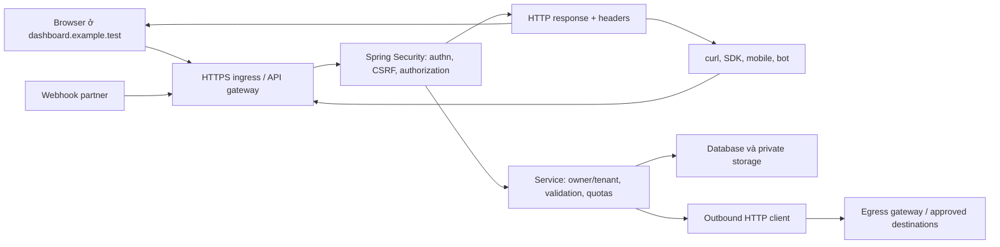

# Giới hạn của CORS hoặc response header với client ngoài trình duyệt

Trong module **SPRING_SECURITY_HTTP_PROTECTION**, chúng ta cấu hình CSRF, CORS, security headers, CSP, HSTS, HTTP firewall và session protection để bảo vệ ứng dụng Spring Security. Một sai lầm có thể dẫn đến lỗ hổng nghiêm trọng là **nhầm cơ chế được browser thực thi với chính sách bảo mật được server cưỡng chế cho mọi HTTP client**.

Ví dụ một API chỉ cho phép JavaScript chạy từ `https://dashboard.example.test` đọc response bằng CORS. Điều đó **không** có nghĩa `curl`, Postman, một mobile app, một Java `HttpClient` hoặc một bot sẽ bị cấm gọi API từ nơi khác. Nếu API trả dữ liệu bí mật chỉ vì `Origin` trông đúng, hoặc nếu nó thiếu authentication/authorization, CORS không thể cứu hệ thống.

Ngược lại, cũng không nên kết luận “mọi response header đều vô nghĩa ngoài browser”. `Cache-Control` là chỉ dẫn có thể được HTTP caches và intermediaries tuân thủ; `WWW-Authenticate` dùng cho authentication challenge; `Retry-After` có ý nghĩa với HTTP clients; `Content-Type` và `Content-Disposition` ảnh hưởng cách nhiều client xử lý nội dung. Cần phân biệt **chuẩn giao thức**, **hành vi của client cụ thể** và **điểm thực thi chính sách bảo mật**.

Bài thuộc chương **Ranh giới bảo vệ**, tập trung vào các câu hỏi:

- CORS thực sự bảo vệ điều gì, và tại sao một request không có `Origin` vẫn có thể hợp lệ?
- Những security response headers nào chủ yếu hướng dẫn browser, và những header nào có tác động qua HTTP caches/proxies hoặc SDKs?
- Với client ngoài browser, đâu mới là lớp bảo vệ bắt buộc ở server, API gateway, mạng và service?
- Trong Spring Security Servlet và WebFlux, cấu hình và kiểm thử thế nào để **không biến CORS hoặc header policy thành authorization**?

Các ví dụ dùng Java 17+, Spring Boot 3.x, Spring Security 6.x; code Servlet và Reactive là các **phương án độc lập**. Origin, route, user và host có hậu tố `example.test` chỉ là dữ liệu minh họa, không phải endpoint được triển khai.

## 1. Mục tiêu học tập

Sau bài, người học có thể:

1. Giải thích **Same-Origin Policy (SOP)**, CORS preflight, CORS response validation và ý nghĩa của `Origin`/`Access-Control-*`.
2. Phân biệt **khả năng gửi HTTP request** với **quyền JavaScript đọc response** trong browser.
3. Nêu đúng giới hạn của CORS với `curl`, Postman, Java/Go/Python SDKs, máy chủ gọi máy chủ, mobile apps và bot.
4. Hiểu rằng `Origin`, `Referer`, `Sec-Fetch-*` có ý nghĩa khi được browser hợp lệ phát sinh nhưng **không phải chứng thực danh tính của một arbitrary HTTP client**.
5. Phân biệt CORS với authentication, authorization, CSRF, SameSite cookies, CSP, HSTS, X-Frame-Options và HTTP firewall.
6. Mô tả mức thực thi của `Content-Security-Policy`, `X-Frame-Options`, `Strict-Transport-Security`, `X-Content-Type-Options`, `Referrer-Policy`, `Permissions-Policy` và các cross-origin isolation headers.
7. Tránh kết luận quá mức: một số clients có HSTS/cookie/cache behavior, còn HTTP caches không nhất thiết là browser.
8. Thiết kế API bảo vệ bằng **credentials đã xác minh, scope/role, owner/tenant authorization, input validation, quotas** và network policy.
9. Cấu hình CORS có allowlist chính xác, credential policy, preflight integration trong Spring Security Servlet và WebFlux.
10. Kiểm thử bằng MockMvc/WebTestClient, browser thật và non-browser clients để chứng minh khác biệt giữa CORS và server-side permission.
11. Chẩn đoán 401/403 từ authorization/CSRF, CORS error trong console, 429 từ rate limit, 413 từ body limit và 503 từ quá tải.
12. Giải thích vì sao WebSocket, SSE, webhook, server-side HTTP fetch và reverse proxy phải được threat-model riêng.

## 2. Bắt đầu từ ranh giới tin cậy, không bắt đầu từ tên header

Giả sử DocumentHub có các luồng:



Có **ít nhất bốn ranh giới khác nhau**:

1. **Internet → ingress:** ai được mở kết nối, gửi bao nhiêu bytes, tần suất nào, qua TLS/HTTP parser nào?
2. **Request → Spring Security:** credential có hợp lệ không, caller có role/scope cần thiết không, unsafe browser request có CSRF token không?
3. **Security context → tài nguyên nghiệp vụ:** user có quyền với *document ID cụ thể* và tenant nào, hay chỉ có quyền sử dụng một loại endpoint?
4. **Response → client:** client/browser sẽ diễn giải nội dung như script, tài liệu, file download hay data? Những response headers nào có hiệu lực ở client đó?

CORS và phần lớn browser security headers chủ yếu nằm **ở ranh giới 4**, dù server cần cấu hình để phát chúng. Authentication, authorization, quotas và request parsing thường nằm **ở ranh giới 1–3**. Không thể lấy một cơ chế ở ranh giới 4 làm thay thế toàn bộ ranh giới 1–3.

### 2.1. Phân biệt ba hành động

| Hành động | Ai có thể làm? | Cơ chế chính quyết định |
| --- | --- | --- |
| **Gửi request** tới URL public trên mạng | Browser, HTTP clients, bots trong khả năng networking của chúng | Network controls, TLS, ingress, server route; browser có thêm restrictions riêng |
| **Được server thực hiện nghiệp vụ hoặc trả dữ liệu** | Caller được server chấp nhận | Authentication, authorization, validation, request-size/quota policy |
| **Browser JavaScript được đọc response cross-origin** | Script ở origin được cho phép theo SOP/CORS | Browser enforcement dựa vào CORS policy của server |

Một response `403` là quyết định từ server/filter về quyền/CSRF hoặc chính sách khác. Một **CORS error trong DevTools** có thể có nghĩa browser không cho JavaScript đọc response — **không chứng minh server không nhận request hoặc không gây side effect**.

### 2.2. Ví dụ threat scenario

User Alice đăng nhập ở `https://api.example.test` bằng session cookie. Một trang khác `https://promo.example.test` cố phát POST đổi địa chỉ thanh toán.

- CORS có thể ngăn script ở `promo` đọc response.
- Browser có thể **vẫn gửi một số cross-origin requests**, đặc biệt các “simple requests”, tùy browser rules và cookie policy.
- Nếu API dùng ambient session cookies và thiếu CSRF protection, request có thể tạo side effect dù JavaScript không đọc được response.
- CSRF token/SameSite/Origin or Fetch Metadata checks theo threat model bảo vệ hành động giả mạo.
- Authorization vẫn phải kiểm tra Alice có quyền đổi địa chỉ thanh toán của record nào.

Ở chiều ngược lại, một service nội bộ dùng `HttpClient` gọi `https://api.example.test` thường không bị browser SOP/CORS áp dụng; API phải dùng authn/authz độc lập.

## 3. Same-Origin Policy và CORS thực sự hoạt động thế nào?

**Origin** gồm **scheme, hostname và port**. Ví dụ:

| URL | So với `https://dashboard.example.test` |
| --- | --- |
| `https://dashboard.example.test/home` | Cùng origin |
| `https://dashboard.example.test:443/home` | Cùng origin theo default HTTPS port |
| `http://dashboard.example.test/home` | Khác origin vì scheme |
| `https://api.example.test/data` | Khác origin vì host |
| `https://dashboard.example.test:8443/data` | Khác origin vì port |
| `https://other.example.test/data` | Khác origin dù có thể cùng site |

**Site** trong SameSite cookies không hoàn toàn giống **origin** trong CORS. Hai subdomains cùng site vẫn là hai origins khác nhau.

### 3.1. SOP không cấm toàn bộ cross-origin network traffic

Browser đã có các tương tác cross-origin từ lâu, như điều hướng trang, liên kết, image tags, forms và một số resource loads. SOP chủ yếu giới hạn việc một origin **đọc dữ liệu/DOM nhạy cảm của origin khác**. CORS là cơ chế cho phép server mở rộng quyền đọc cross-origin cho browser scripts theo chính sách.

Vì vậy, câu “không có CORS thì trang web khác không thể gửi request đến API” là **sai**.

### 3.2. CORS request và response thường gặp

Giả sử frontend hợp lệ ở `https://dashboard.example.test` gọi:

```http
GET /api/me HTTP/1.1
Host: api.example.test
Origin: https://dashboard.example.test
Cookie: JSESSIONID=...
```

Server có thể trả:

```http
HTTP/1.1 200 OK
Access-Control-Allow-Origin: https://dashboard.example.test
Access-Control-Allow-Credentials: true
Vary: Origin
Content-Type: application/json
Cache-Control: no-store

{"displayName":"Alice"}
```

Nếu request dùng `fetch(..., { credentials: "include" })`, browser chỉ cho script đọc credentialed CORS response khi điều kiện CORS tương ứng được đáp ứng. **Server vẫn phải xác minh session và quyền truy cập**, dù origin được allowlist.

### 3.3. Preflight chỉ xảy ra khi browser policy yêu cầu

Với một POST có `Content-Type: application/json` và custom CSRF header, browser thường gửi preflight:

```http
OPTIONS /api/documents HTTP/1.1
Host: api.example.test
Origin: https://dashboard.example.test
Access-Control-Request-Method: POST
Access-Control-Request-Headers: content-type,x-csrf-token
```

Phản hồi cho phép có thể là:

```http
HTTP/1.1 200 OK
Access-Control-Allow-Origin: https://dashboard.example.test
Access-Control-Allow-Methods: GET,POST
Access-Control-Allow-Headers: content-type,x-csrf-token
Access-Control-Allow-Credentials: true
Access-Control-Max-Age: 600
Vary: Origin, Access-Control-Request-Method, Access-Control-Request-Headers
```

Browser xét preflight trước khi gửi **request thực tế** cho kiểu request cần preflight. Preflight thường không mang credentials của request nghiệp vụ; Spring Security cần xử lý CORS preflight theo thứ tự phù hợp. Nhưng **mọi POST thực tế vẫn phải qua session/authentication, CSRF và object authorization**.

Không phải mọi request cross-origin đều preflight: phương thức/header/content type phù hợp nhóm “simple request” có thể được gửi thẳng, rồi browser mới kiểm tra quyền đọc response.

### 3.4. CORS không làm request server-to-server “hợp lệ” hoặc “không hợp lệ”

Một Java HTTP client không có khái niệm một script đang chạy trong trang web tại origin A và bị SOP của browser B ràng buộc. Nó có thể gửi request trực tiếp mà không cần preflight; có thể bỏ header `Origin` hoặc tự đặt giá trị bất kỳ.

Điều đó **không có nghĩa server không được phép yêu cầu Origin cho một luồng browser cụ thể**. Origin/Fetch Metadata checks có thể là lớp chống CSRF ở một endpoint được thiết kế cho browser. Nhưng nếu client ngoài browser cố tình gửi header giả, **header không chứng minh nó là browser hoặc một origin đã được kiểm soát**. Không dùng Origin làm phương thức xác thực máy chủ hay giấy phép truy cập dữ liệu.

## 4. Thí nghiệm tư duy: cùng một API từ browser và từ curl

Giả sử DocumentHub trả tài liệu chỉ khi caller có Bearer token hợp lệ, nhưng CORS chỉ cho một dashboard origin. Các thử nghiệm sau **chỉ là minh họa dùng máy chủ test do mình sở hữu/được phép**.

### 4.1. Native HTTP client không cần CORS preflight

```bash
# Chưa xác thực: có thể nhận 401 từ API thật.
curl -i "https://api.example.test/api/private/documents/42"

# Có Bearer token hợp lệ (được cấp trong môi trường test).
# Không cần gửi Origin hay thực hiện OPTIONS preflight.
curl -i \
  -H "Authorization: Bearer $TOKEN" \
  "https://api.example.test/api/private/documents/42"
```

Giả sử `TOKEN` là credential hợp lệ **và có quyền với document 42**, API có thể trả 200; nếu thiếu quyền với document, vẫn phải trả 403/404 theo policy. Không gửi `Origin` **không phải lý do mặc định để từ chối mọi non-browser API**.

### 4.2. Native client có thể gửi Origin giả

```bash
curl -i \
  -H "Origin: https://untrusted.example.test" \
  -H "Authorization: Bearer $TOKEN" \
  "https://api.example.test/api/private/documents/42"
```

Spring CORS có thể không thêm `Access-Control-Allow-Origin` hoặc từ chối request theo cách resolver cấu hình. Nhưng **ngay cả khi server có xử lý Origin để từ chối một request cụ thể**, đây vẫn không phải cơ chế xác thực identity. Client có thể **không gửi Origin** hoặc gửi một Origin allowlisted:

```bash
curl -i \
  -H "Origin: https://dashboard.example.test" \
  -H "Authorization: Bearer $TOKEN" \
  "https://api.example.test/api/private/documents/42"
```

Client tự chọn header text không chứng minh request thực sự được script của `dashboard.example.test` phát ra. Nếu server chỉ dựa vào header này để mở dữ liệu nhạy cảm, thiết kế đang đặt primary control sai ranh giới.

### 4.3. Không có ACAO không đồng nghĩa response vô hình với curl

Một response không có `Access-Control-Allow-Origin` có thể khiến JavaScript của trang khác **không đọc được** response, nhưng `curl` vẫn nhận status, headers và body thông thường nếu HTTP server đã gửi chúng. CORS chỉ được thực thi khi client là một user agent áp dụng browser CORS semantics.

### 4.4. Thêm OPTIONS thủ công không mô phỏng đúng browser

```bash
curl -i -X OPTIONS \
  -H "Origin: https://dashboard.example.test" \
  -H "Access-Control-Request-Method: POST" \
  -H "Access-Control-Request-Headers: content-type,x-csrf-token" \
  "https://api.example.test/api/documents"
```

Lệnh này hữu ích để **kiểm tra CORS headers của server**, nhưng `curl` không tự áp preflight decision để chặn POST tiếp theo như browser. Nếu test muốn chứng minh JavaScript bị SOP/CORS chặn, phải dùng **browser integration test** phù hợp, không chỉ `curl -X OPTIONS`.

## 5. Một số hiểu nhầm hay gặp về CORS

| Nhận định | Đúng hay sai? | Giải thích ngắn |
| --- | --- | --- |
| “CORS là authentication.” | **Sai** | Origin không phải user/service identity; có thể bị giả bởi non-browser client. |
| “CORS không cho origin X nên mọi HTTP client ở X không thể gọi API.” | **Sai** | CORS chủ yếu được browser thực thi, không phải network ACL. |
| “CORS preflight từ chối nghĩa là POST không thể có side effect trong mọi trường hợp.” | **Sai** | Nhiều cross-origin requests không cần preflight; CSRF là ranh giới riêng. |
| “Non-browser client không cần preflight.” | **Thường đúng** | Native HTTP libraries không bị browser CORS protocol ràng buộc. |
| “Cho phép CORS là cấp quyền xem tài liệu.” | **Sai** | Authn/authz/object permission vẫn phải có. |
| “`Access-Control-Allow-Credentials: true` tạo cookie session.” | **Sai** | Nó cho browser đọc credentialed CORS responses khi các điều kiện khác thỏa; không tự tạo authentication. |
| “`Access-Control-Allow-Origin: *` cùng `Allow-Credentials: true` phù hợp browser.” | **Sai** | Browser không chấp nhận wildcard origin với credentialed CORS response. |
| “Một API không dùng browser có thể không cần cấu hình CORS.” | **Đúng tùy kiến trúc** | Nếu API chỉ phục vụ server-to-server/mobile native, CORS không phải lớp bảo mật bắt buộc; vẫn cần authn/authz/TLS. |
| “CORS failed trong DevTools chứng minh response từ server là 403.” | **Sai** | Browser có thể chặn JS đọc response dù network status khác; cần xem server/ingress logs. |
| “CORS chặn SSRF của Java `WebClient`.” | **Sai** | SSRF liên quan kết nối outbound của server; browser CORS không quản lý socket đó. |
| “Một trang khác cùng site luôn cùng origin.” | **Sai** | SameSite cookie và SOP/CORS dùng khái niệm khác nhau. |
| “Response header chỉ là gợi ý không quan trọng.” | **Sai** | Browser/cache có thể thực thi rất mạnh; cần hiểu đúng client và semantics. |

## 6. Response header không có cùng phạm vi thực thi

Một response header là dữ liệu do server gửi cho client/intermediaries. **Nó không phải lệnh hệ điều hành có hiệu lực tuyệt đối đối với mọi phần mềm nhận response**. Một browser hiện đại có thể áp dụng chính sách mạnh, một CLI chỉ hiển thị header, một HTTP cache dùng header để quyết định lưu, còn một SDK có thể dùng hoặc bỏ qua tùy implementation.

Bảng sau phân biệt **nơi thực thi chủ yếu** và **giới hạn phải nhớ**:

| Header / nhóm header | Bên thường thực thi hoặc sử dụng | Mục đích chính | Không thể suy ra |
| --- | --- | --- | --- |
| `Access-Control-Allow-Origin`, `Allow-Methods`, `Allow-Headers`, `Allow-Credentials` | Browser CORS implementation | Quyền cross-origin JavaScript theo policy | Authn/authz, IP firewall hoặc ngăn `curl` gọi |
| `Content-Security-Policy` | Browser/CSP-aware user agents | Hạn chế tải/thực thi scripts, resources, framing và các hành vi browser được hỗ trợ | Server Java `HttpClient` bị giới hạn network; backend không có XSS/SSRF |
| `Content-Security-Policy-Report-Only` | Browser hỗ trợ CSP reports | Thu thập vi phạm trước khi enforce | Script thật sự bị chặn |
| `X-Frame-Options` | Browser/frame-aware clients | Chặn hoặc giới hạn framing ở những browser hỗ trợ | Backend authorization hoặc mọi UI redress |
| `Strict-Transport-Security` | Browser và HSTS-aware HTTP clients | Ghi nhớ policy ưu tiên HTTPS đối với hostname | Mọi client, proxy và backend hop tự động dùng TLS |
| `X-Content-Type-Options: nosniff` | Chủ yếu browser | Hạn chế một số hành vi MIME sniffing khi tải tài nguyên | File upload đã được kiểm tra content/malware |
| `Referrer-Policy` | Browser/user agents hỗ trợ | Kiểm soát thông tin Referer trong navigation/fetch | URL chứa secret sẽ không nằm trong logs/history |
| `Permissions-Policy` | Browser hỗ trợ | Giới hạn quyền dùng một số web platform features | Native app không thể dùng camera/microphone theo OS permissions |
| `Cross-Origin-Resource-Policy` (CORP) | Browser trong cross-origin/no-CORS loading contexts | Hạn chế một số cách nạp resource cross-origin | API server cấm mọi non-browser HTTP client đọc data |
| `Cross-Origin-Opener-Policy` (COOP) | Browser | Cô lập browsing context group, hạn chế một số cross-window interactions | Server process được sandbox |
| `Cross-Origin-Embedder-Policy` (COEP) | Browser | Quy tắc cross-origin resource embedding và isolation | Server-side HTTP clients bị ràng buộc |
| `Set-Cookie; Secure; HttpOnly; SameSite` | Browser/cookie-aware HTTP clients theo mức hỗ trợ | Phạm vi/vòng đời cookie và ambient credentials | Cookie là phương thức authentication an toàn tự thân; mọi SDK áp SameSite |
| `Cache-Control`, `Expires`, `ETag`, `Vary` | Browsers, HTTP caches, proxies, CDNs, SDK caches tuân HTTP semantics | Tính freshness, lưu cache, phân loại response variants | Dữ liệu đã tải được thu hồi; API đã authorize |
| `Content-Type` | Browsers và nhiều HTTP clients/parsers | Mô tả media type của representation | Server/client đã xác minh file an toàn |
| `Content-Disposition` | Browsers/download tools và một số clients | Gợi ý presentation, attachment hoặc filename | OS path/filename an toàn trên mọi client |
| `WWW-Authenticate` | Authentication-capable HTTP clients | Challenge scheme/realm khi cần xác thực | Credential được cấp tự động hoặc resource-level permission |
| `Retry-After` | Clients/proxies tự nguyện tuân thủ | Gợi ý thời gian thử lại sau một status phù hợp | Server tự enforce rate/concurrency quota |
| `RateLimit-*` theo profile được dùng | API consumers/SDKs nếu hiểu semantics | Thông báo quota/rate | Client gian lận không thể tiếp tục gửi requests |
| `Server` hoặc `X-Powered-By` | Client/diagnostics | Metadata phần mềm hoặc proxy | Có security enforcement; ẩn header đồng nghĩa hết lỗ hổng |

**Cần phân biệt “HTTP-compliant cache có thể hoặc phải tuân theo directive” với “mọi non-browser client sẽ làm đúng”.** Client độc lập có thể không dùng cache hoặc bỏ qua phần lớn headers; người phát triển không thể dựa vào tính tự nguyện đó để bảo vệ bí mật khỏi caller đã có quyền nhận body.

### 6.1. Headers là một phần của giao thức, nhưng bảo vệ thường là ở nơi nhận

Ví dụ response:

```http
HTTP/1.1 200 OK
Content-Security-Policy: default-src 'self'; script-src 'self'
Cache-Control: no-store
X-Content-Type-Options: nosniff
Content-Type: application/json

{"status":"ok"}
```

- Browser không dùng `Content-Security-Policy` này như một “firewall outbound của backend”. CSP thích hợp nhất khi **response là document/context mà browser thực thi policy**. Đặt CSP trên JSON API response **không thay CSP của trang HTML** ở frontend origin.
- Một cache tuân `Cache-Control: no-store` cần xử lý lưu trữ theo directive; một malicious client có thể tự lưu bytes đã nhận, bất kể header.
- `nosniff` có ý nghĩa đối với các loại load browser áp dụng; nó không khiến trình parse JSON trong Java từ chối payload độc hại theo business rules.
- `Content-Type: application/json` mô tả format, không thay schema validation, auth và data classification.

### 6.2. Bảo vệ bằng response header không tự chặn kết nối inbound

Khi server đã gửi response chứa dữ liệu private cho caller chưa đủ quyền, **thêm một header browser-only sau đó không thể lấy dữ liệu trở lại**. Lỗi đã xảy ra ở authentication/authorization/data boundary.

Một phép thử đáng giá hơn “header có tồn tại không?” là: **request từ caller không đủ quyền có khiến service đọc/trả private bytes không?** Cần quan sát server behavior, không chỉ DevTools console.

## 7. CSP: tác động chủ yếu tới browser execution context

Giả sử DocumentHub hiển thị tên tài liệu do user nhập. Nếu template/DOM xử lý dữ liệu như HTML/script, có thể phát sinh XSS. **Primary mitigation** là output encoding/sanitization đúng ngữ cảnh, safe DOM APIs và loại bỏ unsafe sinks. CSP bổ sung hạn chế nguồn/thực thi nội dung theo khả năng của browser.

### 7.1. CSP ví dụ cho trang HTML

```http
Content-Security-Policy: default-src 'self'; script-src 'self'; object-src 'none'; base-uri 'self'; frame-ancestors 'none'
```

Ý nghĩa:

- `default-src 'self'` đặt fallback cho nhiều resource types.
- `script-src 'self'` giới hạn nguồn scripts theo policy nhưng không loại trừ same-origin scripts/gadgets bị khai thác.
- `object-src 'none'` hạn chế object/plugin content.
- `base-uri 'self'` giới hạn nơi `<base>` được phép trỏ.
- `frame-ancestors 'none'` cấm trang bị nhúng làm frame trong các browser áp dụng policy.

Một frontend hiện đại có thể cần `connect-src`, `img-src`, `font-src`, `style-src`, hashes/nonces hoặc trusted partner frames. Policy production phải được thiết kế từ data flows thật và thử qua `Content-Security-Policy-Report-Only` trước khi enforce nếu ảnh hưởng lớn.

### 7.2. CSP không bảo vệ Java WebClient

Giả sử backend có:

```java
// Thiếu destination policy; KHÔNG dùng trực tiếp input Internet.
webClient.get()
         .uri(userProvidedUrl)
         .retrieve()
         .bodyToMono(String.class);
```

Kể cả frontend HTML có `connect-src 'self'`, đoạn backend code trên vẫn có thể kết nối địa chỉ mà Java network stack cho phép. **Browser CSP không được áp dụng cho socket của Spring WebClient**. Đây là threat **SSRF** và cần destination validation/egress network policy riêng.

### 7.3. CSP không phải mã hóa hoặc authorization

CSP không giấu JSON bytes đã trả cho một client có thể đọc HTTP, không ngăn database query trả document của tenant khác và không làm request trở thành trusted. Một native HTTP client có thể bỏ qua CSP và vẫn parse body theo cách của nó.

**Ngoại lệ cần nhớ:** Một headless browser như Chromium automation hoặc WebView dùng engine thực thi web có thể vẫn áp CSP/CORS theo engine và chế độ cấu hình. Không chia client thành “GUI browser” và “command line” quá cứng nhắc; tiêu chí chính là **user agent có thực thi browser security model đó hay không**.

## 8. Frame protection, CORP, COOP, COEP và Permissions-Policy

Các headers này điều chỉnh những hành vi cụ thể của **web platform**, không phải API authorization ở server.

### 8.1. X-Frame-Options và CSP frame-ancestors

```http
X-Frame-Options: DENY
Content-Security-Policy: frame-ancestors 'none'
```

Chúng nhằm chống clickjacking/UI redress bằng việc hạn chế trang bị embed trong frame. Nhưng một `curl` tải HTML vẫn nhận HTML; Java HTTP client không có “khung iframe” để chặn. Nếu sản phẩm phải được nhúng trong portal đối tác, policy cần quyết định ancestor origins hợp lệ, không tắt bảo vệ tùy tiện.

**Phân biệt:** `frame-src` là trang của bạn được **nhúng gì**; `frame-ancestors` là **ai được nhúng trang của bạn**. Hai directive khác nhau.

### 8.2. CORP, COOP, COEP có phạm vi hẹp hơn một server ACL

- **CORP (`Cross-Origin-Resource-Policy`):** browser có thể chặn một số tải resource cross-origin trong các ngữ cảnh phù hợp, không ngăn Java HTTP client gửi request.
- **COOP (`Cross-Origin-Opener-Policy`):** điều chỉnh mối quan hệ browsing context (chẳng hạn popup/window references).
- **COEP (`Cross-Origin-Embedder-Policy`):** yêu cầu điều kiện nhất định khi embed cross-origin resources và liên quan cross-origin isolation.

Chúng hữu ích cho web-app isolation với nguy cơ cụ thể. Nhưng **không cấp quyền theo document ID, không thay API Bearer verification, không bảo vệ file trên OS hoặc kiểm soát Java outbound**.

### 8.3. Permissions-Policy và tính năng phần cứng của browser

```http
Permissions-Policy: camera=(), microphone=(), geolocation=()
```

Một browser hỗ trợ có thể hạn chế các tính năng web platform tương ứng khi nhận policy. Một mobile native app dùng APIs của iOS/Android hoặc Java process không bị quản lý bởi header này; nó chịu OS permissions, app sandbox và chính sách riêng.

### 8.4. Nguy cơ “bật cho đẹp điểm đánh giá”

Không thêm COEP/COOP/CORP hoặc Permissions-Policy theo một bản mẫu mà không kiểm tra hợp đồng: chúng có thể làm mất khả năng embed/download/login qua partner hoặc phá resources cần thiết. Security review phải trả lời **nguy cơ gì**, **response nào**, **browser support nào** và **test nào chứng minh không phá nghiệp vụ**.

## 9. HSTS, TLS và những client không dựa vào browser HSTS state

`Strict-Transport-Security` giúp user agents hỗ trợ HSTS ghi nhớ rằng những lần truy cập hostname đó phải dùng HTTPS trong thời hạn chỉ định, sau khi nhận HSTS hợp lệ qua kết nối HTTPS.

```http
Strict-Transport-Security: max-age=31536000; includeSubDomains
```

### 9.1. Không suy từ HSTS rằng mọi HTTP client bị ép dùng TLS

- Browser có HSTS cache/policy có thể tự chuyển HTTP URL thành HTTPS cho host tương ứng.
- Một số non-browser clients **cũng có thể hỗ trợ HSTS nếu được cấu hình**; ví dụ thư viện/tool có tùy chọn HSTS state.
- Nhiều SDK/CLI không duy trì HSTS cache hoặc không áp dụng browser-like HSTS policy.
- Một raw TCP/HTTP client có thể cố gửi plain HTTP nếu server/network vẫn cho phép.
- Một server-to-server connection hoặc JDBC connection không được mã hóa chỉ vì trang HTML gửi HSTS.

Vì vậy, bắt buộc HTTPS ở **TLS terminator/ingress và client transport configuration**, không chỉ phát HSTS.

### 9.2. Chính sách TLS thực sự cần thực thi ở connection boundary

- Chỉ mở HTTPS cho dữ liệu nhạy cảm tại public edge; HTTP (nếu tồn tại) chỉ dùng redirect có kiểm soát và không phục vụ secrets.
- Cấp và kiểm tra certificates, hostname verification, TLS versions/cipher policy.
- API clients bắt buộc verify server cert; không tắt certificate validation để “chạy được”.
- Với service-to-service traffic, đánh giá mTLS hoặc gateway/service mesh identity nếu threat model cần.
- Kiểm tra TLS giữa proxy và backend khi mạng không hoàn toàn đáng tin; HTTPS chỉ ở browser-to-proxy không tự mã hóa hop tiếp theo.
- Khi sử dụng HSTS `includeSubDomains` hoặc `preload`, kiểm tra readiness của tất cả subdomains và chính sách rollback.

### 9.3. HSTS “lần truy cập đầu” và proxy trust

HSTS chỉ được browser ghi nhận khi nhận qua HTTPS đúng điều kiện; với host chưa có HSTS state/preload, lần truy cập HTTP đầu có thể cần redirect. Khi TLS kết thúc ở reverse proxy, app có thể thấy scheme nội bộ là HTTP; cấu hình security header generation và forwarded headers phải đúng **với trusted proxy chain**. Đừng cho Internet tự quyết định request là secure bằng header `X-Forwarded-Proto` giả.

HSTS không ngăn CSRF, XSS, BOLA, SQL injection hoặc một HTTP client native truy cập dữ liệu khi đã có credential hợp lệ.

## 10. Nosniff, Referrer-Policy, Content-Disposition và cookie directives

### 10.1. Nosniff chỉ giới hạn một số cách browser diễn giải MIME

```http
X-Content-Type-Options: nosniff
Content-Type: application/octet-stream
Content-Disposition: attachment; filename="report.pdf"
```

Khi trả file user upload, những header này có thể giảm một số rủi ro browser active content execution. Chúng không:

- Kiểm tra magic bytes hoặc file signature.
- Quét malware.
- Ngăn một native PDF/HTML parser có lỗ hổng riêng.
- Chứng minh người nhận có quyền đối với file.
- Ngăn attacker đã có bytes tự lưu hoặc mở file bằng công cụ khác.

Các primary controls là **file/content validation, malware scanning theo threat model, owner authorization, private storage và safe serving origins**.

### 10.2. Referrer-Policy điều chỉnh việc gửi Referer, không xóa token khỏi URL

`Referrer-Policy` có tác dụng khi client hỗ trợ chính sách ở các hoạt động navigation/fetch. Một native client không nhất thiết có khái niệm navigation history giống browser và có thể đặt `Referer` bất kỳ.

Nếu URL có `?access_token=...` hoặc `?_csrf=...`, secret vẫn có thể nằm trong access logs, history, CDN metrics hoặc analytics. **Không đặt secrets trong URL**, thay vì dựa hoàn toàn vào Referrer-Policy.

### 10.3. SameSite, Secure và HttpOnly là cookie policy của user agent

Một cookie:

```http
Set-Cookie: JSESSIONID=<opaque-session-id>; Path=/; Secure; HttpOnly; SameSite=Lax
```

Có các ý nghĩa khác nhau:

- `Secure`: trong user agents tuân thủ, giới hạn gửi cookie qua secure channels, có các chi tiết về localhost/browser behavior.
- `HttpOnly`: cấm JavaScript đọc cookie trực tiếp qua những APIs được browser áp dụng; **không cấm script XSS cùng origin gửi request mang cookie**.
- `SameSite`: ảnh hưởng gửi cookie trong cross-site contexts theo browser cookie semantics; không phải CORS và không tự thay CSRF token.
- `Path`/`Domain`: cookie scope, không phải business authorization.

Một native SDK có thể quản lý cookies, nhưng **không mặc định nó áp chính xác các quy tắc SameSite/HttpOnly của browser**; nhiều SDK cho phép đọc raw `Set-Cookie` và tự chọn cookie header. Server phải xác minh session hợp lệ, hạn dùng, logout/revocation, role và quyền tài nguyên.

### 10.4. Content-Disposition chỉ gợi ý hiển thị/download

`Content-Disposition: attachment` có thể khiến browser hỏi tải file, nhưng một HTTP client có thể xử lý header theo cách khác hoặc bỏ qua. Filename cũng không được lấy raw từ client input rồi nối vào OS path hoặc header chưa encode. Cần dùng server-generated storage key, filename sanitization/encoding phù hợp và path containment.

## 11. Cache-Control và Vary: trường hợp không thể nói “chỉ browser”

`Cache-Control` là thành phần của HTTP caching semantics và có ý nghĩa với nhiều bên trung gian:

- Browser cache.
- Shared HTTP caches/CDNs.
- Reverse proxies hoặc caching gateways.
- Một số SDK/client có cache layer hoặc HTTP cache implementation.

Do đó, **không đúng** nếu nói mọi response headers đều chỉ dành cho browser. Nhưng cũng **không đúng** nếu coi `Cache-Control: no-store` là biện pháp giữ bí mật tuyệt đối: caller đã được phép nhận body có thể tự lưu bytes, và một intermediary/configuration không tuân chuẩn vẫn có thể rò dữ liệu.

### 11.1. Dữ liệu riêng tư không được cache chéo user

Với `GET /api/me` hoặc `GET /api/documents/{id}` trả dữ liệu cá nhân, ví dụ:

```http
HTTP/1.1 200 OK
Cache-Control: no-store
Content-Type: application/json

{"tenant":"acme","documentId":"42","title":"Nội bộ"}
```

`no-store` yêu cầu caches tuân HTTP semantics không lưu request/response trong phạm vi directive, phù hợp với dữ liệu nhạy cảm trong nhiều trường hợp. Với public static assets, có thể dùng cache policy khác, ví dụ file versioned dài hạn để giảm tải. **Không biến toàn bộ responses thành một chính sách cache duy nhất** khi business requirements khác nhau.

### 11.2. Vary: Origin và cache variants

Nếu server phản hồi CORS theo exact allowlisted origin, có thể cần:

```http
Access-Control-Allow-Origin: https://dashboard.example.test
Vary: Origin
```

`Vary: Origin` thông báo cho HTTP caches rằng response có thể khác theo giá trị `Origin`. Với preflight responses, còn có các dimensions như `Access-Control-Request-Method` và `Access-Control-Request-Headers` khi cần.

**Không nhầm `Vary: Origin` với bảo vệ dữ liệu private.** Một cache có key chỉ theo URL và vô tình trả body của Alice cho Bob là lỗi lớn hơn CORS; cần `Cache-Control`, cache key/authorization context và edge policy phù hợp. Nếu body private đã bị cache shared và gửi cho caller không được phép, CORS không ngăn `curl` hoặc một server-side client đọc bytes ấy.

### 11.3. Access-Control-Expose-Headers không phải cơ chế bí mật hóa headers

Một browser script cross-origin không tự nhìn thấy mọi response header thông qua `fetch`; `Access-Control-Expose-Headers` có thể cho browser script đọc thêm những headers được phép khi CORS thành công:

```http
Access-Control-Allow-Origin: https://dashboard.example.test
Access-Control-Allow-Credentials: true
Access-Control-Expose-Headers: Content-Disposition, Retry-After
```

- Browser JavaScript ở origin được duyệt có thể cần `Content-Disposition` để hiển thị filename.
- SDK hoặc `curl -i` thường có thể đọc response headers mà HTTP client nhận được, không cần server “expose” qua CORS.
- Không gửi secrets trong HTTP headers với lý do “chưa có Expose-Headers nên đã an toàn”. Header vẫn có thể thấy qua network tooling, intermediary, logs hoặc non-browser clients nếu response được gửi.
- Đừng đưa raw tokens/API keys/credentials vào custom response headers để dựa vào CORS làm lớp che giấu.

### 11.4. CORS preflight cache không phải data cache

`Access-Control-Max-Age` cho browser biết có thể cache **kết quả preflight** trong giới hạn browser, không phải điều khiển cache của chính dữ liệu API theo cách giống `Cache-Control`. Một cached preflight success không làm những request tiếp theo bỏ qua authentication/authorization/CSRF trên server.

## 12. Origin, Referer và Fetch Metadata: tín hiệu browser, không phải danh tính đã chứng thực

Một số hệ thống dùng request headers như:

```http
Origin: https://dashboard.example.test
Referer: https://dashboard.example.test/documents
Sec-Fetch-Site: same-site
Sec-Fetch-Mode: cors
Sec-Fetch-Dest: empty
```

Trong browser bình thường, những header này có ý nghĩa về nguồn, context và loại fetch. `Sec-Fetch-*` thuộc nhóm Fetch Metadata request headers; JavaScript trên web page thông thường không được tự ý đặt một số `Sec-` headers bị browser bảo vệ.

Tuy nhiên, **một non-browser HTTP client có thể tự tạo request bytes và khai các giá trị tương tự**. Đây là lý do chúng hữu ích để phân loại browser requests và bổ sung CSRF/resource-isolation policy, nhưng không phải chứng minh caller là `dashboard.example.test` hoặc là user Alice.

### 12.1. Không dùng Origin thay authentication

Ví dụ nguy hiểm:

```java
// KHÔNG DÙNG: Origin không chứng minh quyền truy cập.
if ("https://dashboard.example.test".equals(
        request.getHeader("Origin"))) {
    return allPrivateDocuments();
}
```

Một native HTTP client có thể tự gửi header `Origin`. Không nên trả dữ liệu nhạy cảm chỉ vì allowlisted Origin. Thay bằng authentication thật, role/scope, tenant membership và owner check trên từng tài nguyên.

### 12.2. Fetch Metadata policy nên là defense in depth

Một chính sách Fetch Metadata có thể từ chối một số cross-site unsafe browser requests tùy route, mode và destination. Nhưng cần lưu ý:

- Không phải mọi HTTP client gửi `Sec-Fetch-*`; native SDK, một số browser/versions hoặc intermediaries có behavior khác.
- Không tự cho phép quyền truy cập khi thấy `Sec-Fetch-Site: same-origin`.
- Các giá trị thiếu hoặc không xác định phải có chính sách rõ để không khóa nhầm mobile/server clients.
- Các endpoint public, OAuth redirects, webhooks, CORS API và navigation flows có thể cần exceptions được review.
- Một browser XSS trong origin hợp lệ có thể phát request mang Fetch Metadata “đúng ngữ cảnh” nhưng vẫn gây hại.
- Các header không thay CSRF token, authentication hoặc domain permission.

### 12.3. IP headers và trusted proxies là bài toán khác nữa

`X-Forwarded-For`, `Forwarded`, `X-Real-IP` do hạ tầng sử dụng có thể chứa địa chỉ client sau proxy. Nếu server tin giá trị raw từ Internet rồi dùng để rate limit hoặc allowlist, attacker có thể khai một giá trị khác mỗi lần.

Cách đúng là xác định **chuỗi proxy đáng tin ở mạng**, ingress strip/overwrite các forwarded headers không tin cậy và backend chỉ tiêu thụ metadata sau trusted-proxy processing. Một header dù có tên “Real-IP” vẫn không phải chứng thực nguồn nếu client ngoài có thể tự đặt nó.

## 13. CORS và CSRF: hai lớp bảo vệ khác nhau

CORS chủ yếu điều tiết browser script **đọc response cross-origin** và preflight; CSRF nhằm giảm nguy cơ một browser có ambient credentials phát **unsafe request** ngoài ý định người dùng.

### 13.1. Tại sao không bật CORS rồi tắt CSRF?

Một form HTML có thể gửi POST từ origin khác trong những trường hợp **không cần CORS preflight**. Khi browser tự gắn cookie session theo điều kiện phù hợp, server có thể thấy session hợp lệ. Nếu API thiếu CSRF control, side effect có thể xảy ra dù JavaScript từ origin khác không đọc được response.

**Thực hành đúng:** với browser session/cookie credentials, giữ Spring Security CSRF protection cho unsafe methods, cung cấp token qua form field hoặc HTTP header đúng cơ chế và áp owner authorization.

### 13.2. SameSite cũng không phải CORS

Cookie `SameSite=Lax/Strict/None` liên quan bối cảnh site khi browser gửi cookie. `SameSite=None` thường cần `Secure` theo browser hiện đại. Hai subdomains cùng site vẫn khác origins đối với CORS; đừng suy từ việc một request là same-site rằng script được đọc response của origin khác hoặc CSRF đã được giải quyết trong mọi tình huống.

### 13.3. Browser SPA ở origin khác và cookie-session API

Giả sử frontend `https://dashboard.example.test` gọi `https://api.example.test` bằng session cookie:

```javascript
async function renameDocument(id, title, csrfHeaderName, csrfToken) {
  const response = await fetch(
    "https://api.example.test/api/documents/" +
      encodeURIComponent(id) + "/rename",
    {
      method: "POST",
      credentials: "include",
      headers: {
        "Content-Type": "application/json",
        [csrfHeaderName]: csrfToken
      },
      body: JSON.stringify({ title })
    }
  );

  if (!response.ok) {
    throw new Error("Không đổi tên được");
  }
}
```

Server phải đồng thời:

1. CORS allowlist đúng `https://dashboard.example.test`, credential policy phù hợp.
2. Cookie session Secure/SameSite được thiết kế theo site deployment.
3. CSRF token được phát và xác minh qua `CsrfTokenRepository`/handler tương ứng; frontend không tự bịa token.
4. Role `DOCUMENT_EDITOR` và owner/tenant permission cho document `id`.
5. Validation của title, request-size và rate/quota cho thao tác.

**Không tự đặt CSRF token trong URL query** để vượt CORS hoặc parser lỗi; URL có thể bị log/history/Referer thu thập.

### 13.4. API Bearer-only thật sự khác ở đâu?

Nếu một API chỉ chấp nhận `Authorization: Bearer ...` do client chủ động gửi và **không dùng cookie/Basic credentials tự đính kèm bởi browser**, nó không có cùng CSRF threat model của browser session. API đó vẫn phải chống credential theft, token replay theo threat model, scope/owner bypass, request-size/rate và network attacks.

Không tắt CSRF chỉ vì có chữ “REST”, “JSON” hay “SPA”. Nếu token được lưu trong cookie tự động gửi, CSRF threat vẫn có thể tồn tại.

### 13.5. Khi preflight bị 401/403

Spring Security cần xử lý CORS preflight đúng thời điểm; preflight thường không mang session cookie. Nếu authorization/CSRF chặn trước CORS processor, browser có thể báo lỗi dù origin hợp lệ.

Trong Servlet và Reactive, dùng CORS integration tương ứng và **kiểm thử preflight thật**. Nhưng đừng sửa bằng cách cấp `permitAll()` cho toàn bộ API POST hoặc tắt CSRF; preflight success không phải POST business permission.

## 14. HTTP clients ngoài trình duyệt cần những lớp bảo vệ gì?

Với `curl`, Postman, mobile SDKs, background workers và machine-to-machine APIs, server không thể dựa vào việc client tự nguyện áp browser CORS/CSP/HSTS headers.

### 14.1. Authentication và credentials đáng tin

Các lựa chọn tùy use case:

- OAuth2 Access Token/JWT Resource Server: xác minh chữ ký hoặc introspection, issuer, audience, expiry, scopes và token lifecycle.
- Opaque tokens qua introspection hoặc API keys được bảo vệ/rotated, đánh giá replay risk.
- mTLS để xác thực client/service trên network boundary có kiểm soát.
- HMAC signature + timestamp/nonce/replay protection cho webhook theo hợp đồng đối tác.
- Browser session cookie cho ứng dụng có UI/browser, với CSRF/session management theo threat model.

Một token chỉ có giá trị khi server **xác minh** nó, không chỉ khi header `Authorization` xuất hiện. Không cho người gọi tự chọn `X-User-ID` hoặc `X-Tenant-ID` rồi coi như đã được xác thực.

### 14.2. Authorization theo tài nguyên và hành động

`ROLE_DOCUMENT_READER` bảo vệ loại endpoint, chưa chứng minh người gọi có quyền với document 42. Domain/service/repository phải kiểm tra owner, tenant, record state và quyền operation trước khi trả bytes. Không dùng độ khó đoán UUID làm authorization.

### 14.3. Integrity, anti-replay và idempotency

Với webhook hoặc API tạo giao dịch:

- Xác minh chữ ký trên đúng message representation và thời gian/nonce theo giao thức.
- Có idempotency keys hoặc deduplication để retries không tạo tác dụng lặp.
- Dùng transport TLS và endpoint/partner identity.
- Không dựa vào `Origin`, `Referer` hoặc CORS như bằng chứng đối tác.

### 14.4. Giới hạn khả dụng và phòng vệ ở ingress

- Request/body/file/part size, header/connection timeouts.
- Rate limiting theo API client, tenant, trusted IP; không tin spoofed forwarded headers.
- Quota bytes, concurrency và background worker queue.
- Circuit breakers/retry caps khi gọi downstream.
- File/content validation, path traversal/ZIP slip, malicious input parsing.
- Authentication/authorization tại gateway **và** domain khi cần; không mở direct-to-origin bypass route.

Một non-browser client có thể bỏ qua mọi hướng dẫn `Retry-After` nếu cố tình spam. Server phải **cưỡng chế 429/503/quota**, chứ không chỉ gửi header rồi hy vọng client tự giảm tốc.

### 14.5. Outbound SSRF cần cơ chế network thực thi

Khi Java `WebClient`/`HttpClient` dùng URL do client gửi, CORS/CSP của response cho browser không chặn được socket outbound. Primary mitigations gồm fixed destination hoặc allowlist origins, safe URL parsing, DNS/connect-time IP/redirect policy và network egress deny-by-default. Đừng dùng allowlisted `Origin` của request như bằng chứng một URL outbound được phép.

## 15. Những client “lai”: headless browsers, WebViews và HTTP automation

Phân loại theo tên ứng dụng có thể gây sai:

| Client | CORS/CSP/HSTS có thể có tác động? | Cách thiết kế server |
| --- | --- | --- |
| Chrome/Firefox/Safari browser tab | Có, theo browser engine và policy | Vẫn xác thực và authorize |
| Playwright/Puppeteer dùng browser engine | Có nếu chạy bằng engine/chế độ áp rules; automation có thể điều khiển khác | Không dùng browser rules làm API access control |
| Mobile WebView | Có thể áp cùng web-platform policies; phụ thuộc engine/version và bridge | Kiểm tra origin, bridge, auth và native app security |
| Native mobile HTTP SDK | Không mặc định áp browser SOP/CORS; TLS/cookies/cache tùy library | Token/mTLS/authz và TLS validation |
| curl/Postman | Không có browser SOP/CORS enforcement; một số tùy chọn HSTS/cache có thể tồn tại | Authn/authz/quotas/network |
| Java `HttpClient`/Spring `WebClient` | Không áp browser SOP/CORS/CSP mặc định | TLS/HTTP client config, SSRF/egress |
| Inbound webhook client | Không có ý nghĩa browser origin | Verify signature, replay, partner identity |
| Proxy/CDN cache | Có thể tuân `Cache-Control`/`Vary`; không phải browser CORS engine | Cache keys, private data policy, auth |
| Browser extension/content script | Có browser model nhưng có thể có privileges/contexts riêng | Không coi extension là trusted API client |
| Electron desktop app | Có browser-rendered contexts và native/network APIs riêng | Phân biệt renderer vs main process; vẫn authorize tại server |

**Nguyên tắc:** khi client có thể thực hiện HTTP request trực tiếp hoặc qua network API không chịu SOP, server phải bảo vệ chính nó. Khi client là browser-like, các policy vẫn đáng dùng để giảm XSS/cross-origin exploitation, **nhưng không đủ để thay server authorization**.

## 16. WebSocket, SSE, GraphQL, gRPC và webhooks: đừng áp CORS máy móc

### 16.1. WebSocket có Origin nhưng không dùng CORS preflight giống fetch

Browser WebSocket handshake có thể gửi `Origin`. Nhưng WebSocket protocol và browser integration **không dùng CORS preflight/Access-Control-Allow-Origin như một fetch request thông thường**.

Nếu WebSocket server dựa vào cookie session, một website ngoài có thể cố mở WebSocket tới service; **Cross-Site WebSocket Hijacking** có thể xảy ra nếu server không kiểm tra Origin/credentials/authorization đúng threat model. Cần:

- Validate handshake `Origin` với allowlist server-side cho browser clients.
- Authentication/session/token mechanism phù hợp.
- Message-level authorization cho subscribe/publish đến resource/channel.
- Size/rate/concurrency limits cho connections và messages.
- CSRF-like threat analysis khi browser tự đính kèm cookies.
- Với non-browser WebSocket clients, Origin có thể tự khai; **không dùng Origin làm identity**.

Một WebSocket được mở thành công không cấp mọi quyền message; kiểm tra tenant/channel/message handlers ở application layer.

### 16.2. Server-Sent Events (SSE)

Browser `EventSource` fetch cross-origin có thể bị SOP/CORS ràng buộc theo mode/credentials; một native HTTP client đọc event stream có thể không. SSE endpoints cần authentication/authorization cho stream, giới hạn active subscriptions, keepalive/timeouts và cleanup khi disconnect.

### 16.3. GraphQL

GraphQL thường chạy qua POST/GET HTTP: browser fetch vẫn áp CORS theo context, nhưng server-to-server clients không bị CORS chặn. Cần authn/authz theo fields/resources, query depth/complexity budget, batch count, persisted-query policy và rate/concurrency. Không coi “GraphQL chỉ cho CORS dashboard” là bảo vệ query introspection hoặc dữ liệu riêng.

### 16.4. gRPC và gRPC-Web

Native gRPC clients không dùng browser CORS model. `gRPC-Web` đi qua browser/proxy có thể cần CORS ở layer tương ứng. Cả hai đều cần TLS/mTLS/token identity, message authorization, deadlines, size limits và quotas. Không suy chính sách gRPC-Web CORS là authz cho gRPC native transport.

### 16.5. Webhooks

Một đối tác gửi webhook thường không gửi Origin như browser. Dùng signatures/mTLS, timestamp/nonce/replay controls, input validation và idempotency; không thêm logic “thiếu Origin thì 403” cho mọi webhook nếu hợp đồng không yêu cầu. Ngược lại, không cấp quyền chỉ vì webhook có header `Origin: https://partner.example.test`.

## 17. Servlet/Spring MVC: CORS allowlist và authorization là hai quyết định

Ví dụ dưới là một ứng dụng **Spring MVC chạy bằng cookie-session**. Browser frontend ở `https://dashboard.example.test` được phép dùng CORS để gọi API; server vẫn phải kiểm tra role và quyền document. Các class minh họa dành cho **một ứng dụng Servlet độc lập**, không ghép với các class cấu hình WebFlux ở mục 19.

### 17.1. Cấu hình `CorsConfigurationSource` cho browser origin cố định

```java
import java.util.List;
import org.springframework.context.annotation.Bean;
import org.springframework.context.annotation.Configuration;
import org.springframework.web.cors.CorsConfiguration;
import org.springframework.web.cors.CorsConfigurationSource;
import org.springframework.web.cors.UrlBasedCorsConfigurationSource;

@Configuration
public class ServletCorsPolicy {

    @Bean
    CorsConfigurationSource corsConfigurationSource() {

        CorsConfiguration policy = new CorsConfiguration();

        // Exact origin allowlist; không phản chiếu Origin tùy ý.
        policy.setAllowedOrigins(
                List.of("https://dashboard.example.test"));

        // Cho phép đúng methods cần dùng từ browser.
        policy.setAllowedMethods(
                List.of("GET", "POST", "OPTIONS"));

        // Headers mà frontend gửi; nếu tên CSRF custom, cập nhật.
        policy.setAllowedHeaders(
                List.of("Content-Type", "X-CSRF-TOKEN"));

        // Browser cross-origin cần gửi session cookie.
        policy.setAllowCredentials(true);

        // Browser JS được đọc một số response headers đã cho phép.
        policy.setExposedHeaders(
                List.of("Content-Disposition", "Retry-After"));

        // Thời gian browser có thể cache kết quả preflight.
        policy.setMaxAge(600L);

        UrlBasedCorsConfigurationSource source =
                new UrlBasedCorsConfigurationSource();

        source.registerCorsConfiguration("/api/demo/**", policy);
        return source;
    }
}
```

**Giải thích ranh giới:**

- `allowedOrigins` là **origin cho browser script**, không phải danh sách mạng/IP khách được cấp quyền.
- `allowCredentials(true)` cần được dùng thận trọng khi server thật dùng cookies/credentials; không kết hợp với wildcard `*`.
- `allowedHeaders` có thể bao gồm `X-CSRF-TOKEN` để browser preflight thành công; **nó không cấp CSRF token hoặc tắt kiểm tra CsrfFilter**.
- `exposedHeaders` quyết định JS ở allowed origin có thể đọc những headers bổ sung; `curl` không cần cấu hình expose.
- `registerCorsConfiguration` giới hạn phạm vi áp dụng. Không đưa wildcard origin cho mọi path chỉ để frontend hoạt động.
- `setMaxAge` là preflight cache duration, **không phải token expiry, session timeout hay response data cache**.

### 17.2. Spring Security Servlet chain

```java
import org.springframework.context.annotation.Bean;
import org.springframework.context.annotation.Configuration;
import org.springframework.http.HttpMethod;
import org.springframework.security.config.Customizer;
import org.springframework.security.config.annotation.web.builders.HttpSecurity;
import org.springframework.security.web.SecurityFilterChain;

@Configuration
public class ServletCorsSecurity {

    @Bean
    SecurityFilterChain securityFilterChain(HttpSecurity http)
            throws Exception {

        return http
                // Tích hợp Spring Security với CORS processor.
                // Preflight hợp lệ được xử lý trước authn/authz
                // của request nghiệp vụ.
                .cors(Customizer.withDefaults())
                .authorizeHttpRequests(auth -> auth
                        .requestMatchers(HttpMethod.GET,
                                "/api/demo/public")
                            .permitAll()
                        .requestMatchers(HttpMethod.GET,
                                "/api/demo/private/*")
                            .hasRole("DOCUMENT_READER")
                        .requestMatchers(HttpMethod.POST,
                                "/api/demo/private/*/rename")
                            .hasRole("DOCUMENT_EDITOR")
                        .anyRequest().denyAll())
                .formLogin(login -> login.permitAll())
                // Với browser session, giữ CSRF trên unsafe methods.
                .csrf(Customizer.withDefaults())
                .build();
    }
}
```

**Những giả định cần kiểm chứng:**

1. `/api/demo/private/*` bảo vệ loại endpoint download/read; vẫn cần owner/tenant check ở service.
2. POST rename có CSRF token từ browser. Nếu CSRF bị từ chối, service không được thay dữ liệu.
3. `.cors(Customizer.withDefaults())` dùng policy bean phù hợp, giúp xử lý preflight trước authentication. Request GET/POST **thực** vẫn chịu authorization/CSRF.
4. `formLogin(...permitAll())` dành cho demo cookie-session. Trong ứng dụng SPA/API nhiều client cần quyết định authentication entry point, login redirects vs 401, session cookie/CORS policy.
5. Spring Security có một số default response headers, nhưng **CSP không tự bật mặc định** chỉ vì có filter chain. Nếu cần CSP cho HTML frontend, cấu hình trên **server thực sự trả HTML**.

**Không sử dụng `.authorizeHttpRequests(... permitAll())` cho toàn `/api/**` chỉ vì “đã có CORS”.**

### 17.3. Domain service bắt buộc kiểm tra document permission

Một contract nên rõ ràng:

```java
import java.util.UUID;

public interface DocumentAccessService {

    String readTitle(UUID documentId, String authenticatedActor);

    void rename(
            UUID documentId,
            String authenticatedActor,
            String title);
}
```

Cấu trúc implementation sản phẩm:

```text
UUID từ request
    |
Authenticated actor từ Spring Security
    |
Repository query theo documentId + verified tenant membership
    |
Access decision: owner/role/grant + document state
    |
Đọc dữ liệu/đổi tên/ghi audit
```

**Không tin `tenantId`, `owner`, `role` hoặc `isAdmin` do client gửi** để làm điều kiện cho phép. Nếu user đoán được UUID của tenant khác, kết quả phải là 403/404 theo API policy và **không gọi storage với key của người khác**. Điều này độc lập với việc client có gửi `Origin` hay không.

### 17.4. Controller nhận principal, không nhận origin làm identity

```java
import java.security.Principal;
import java.util.Map;
import java.util.UUID;
import org.springframework.http.HttpStatus;
import org.springframework.http.ResponseEntity;
import org.springframework.web.bind.annotation.GetMapping;
import org.springframework.web.bind.annotation.PathVariable;
import org.springframework.web.bind.annotation.PostMapping;
import org.springframework.web.bind.annotation.RequestBody;
import org.springframework.web.bind.annotation.RequestMapping;
import org.springframework.web.bind.annotation.RestController;

@RestController
@RequestMapping("/api/demo")
public class ServletCorsDemoController {

    private final DocumentAccessService documents;

    public ServletCorsDemoController(
            DocumentAccessService documents) {
        this.documents = documents;
    }

    public record RenameRequest(String title) {}

    @GetMapping("/public")
    Map<String, String> publicStatus() {
        return Map.of("status", "ok");
    }

    @GetMapping("/private/{id}")
    Map<String, String> privateDocumentTitle(
            @PathVariable UUID id, Principal principal) {

        return Map.of("title",
                documents.readTitle(id, principal.getName()));
    }

    @PostMapping("/private/{id}/rename")
    ResponseEntity<Void> rename(
            @PathVariable UUID id,
            @RequestBody RenameRequest body,
            Principal principal) {

        documents.rename(id, principal.getName(), body.title());
        return ResponseEntity.status(HttpStatus.NO_CONTENT).build();
    }
}
```

Ở đây controller chỉ xác định principal từ Spring Security, còn **DocumentAccessService phải thực hiện authorization theo record**. Nếu service chỉ trả theo UUID mà không xét actor, việc thêm CORS/CSP không sửa được BOLA.

### 17.5. Header bảo mật của HTML frontend có thể nằm ở một server khác

Nếu `dashboard.example.test` là một SPA được CDN phục vụ và `api.example.test` trả JSON, CSP của DocumentHub API JSON **không thay thế CSP trên HTML response từ CDN/dashboard origin**. Cần đặt:

- CSP, frame policy, secure cookies (nếu có), HSTS và cache policy ở đúng response/host.
- CORS configuration ở API origin khi frontend thật sự cross-origin.
- Authentication/authorization và body quotas ở API service.
- Private cache settings trên CDN/gateway để không trả chéo user.
- HTTPS/secure proxy configuration trên đường thực.

Đây là **một data-flow có nhiều owners**: frontend, backend và platform cần phối hợp, không chọn một nơi cấu hình rồi coi toàn bộ đã an toàn.

## 18. MockMvc: kiểm tra CORS không thay role/CSRF

Với Spring Boot 3.4+/Spring Framework 6.2+ và `spring-security-test`, có thể dùng `@MockitoBean` để mock service. Test slice dưới đây gồm Controller, Servlet Security và CORS policy. Nó **không thay integration test với database thật** về owner/tenant.

### 18.1. Một bộ test phân biệt bốn kết quả

```java
import static org.mockito.Mockito.*;
import static org.springframework.security.test.web.servlet.request
        .SecurityMockMvcRequestPostProcessors.csrf;
import static org.springframework.security.test.web.servlet.request
        .SecurityMockMvcRequestPostProcessors.user;
import static org.springframework.test.web.servlet.request
        .MockMvcRequestBuilders.get;
import static org.springframework.test.web.servlet.request
        .MockMvcRequestBuilders.options;
import static org.springframework.test.web.servlet.request
        .MockMvcRequestBuilders.post;
import static org.springframework.test.web.servlet.result
        .MockMvcResultMatchers.*;

import java.util.UUID;
import org.junit.jupiter.api.Test;
import org.springframework.beans.factory.annotation.Autowired;
import org.springframework.boot.test.autoconfigure.web.servlet.WebMvcTest;
import org.springframework.context.annotation.Import;
import org.springframework.http.HttpHeaders;
import org.springframework.http.MediaType;
import org.springframework.test.context.bean.override.mockito.MockitoBean;
import org.springframework.test.web.servlet.MockMvc;

@WebMvcTest(ServletCorsDemoController.class)
@Import({ServletCorsSecurity.class, ServletCorsPolicy.class})
class ServletCorsBoundaryTests {

    private static final UUID ID = UUID.fromString(
            "37a41e70-74e0-4b49-9817-b3ad20d2397c");

    @Autowired MockMvc mvc;

    @MockitoBean DocumentAccessService documents;

    @Test
    void approvedBrowserPreflightIsAllowed()
            throws Exception {

        mvc.perform(options("/api/demo/private/" + ID + "/rename")
                        .header(HttpHeaders.ORIGIN,
                                "https://dashboard.example.test")
                        .header(HttpHeaders.ACCESS_CONTROL_REQUEST_METHOD,
                                "POST")
                        .header(HttpHeaders.ACCESS_CONTROL_REQUEST_HEADERS,
                                "content-type,x-csrf-token"))
                .andExpect(status().isOk())
                .andExpect(header().string(
                        HttpHeaders.ACCESS_CONTROL_ALLOW_ORIGIN,
                        "https://dashboard.example.test"));

        verifyNoInteractions(documents);
    }

    @Test
    void deniedPreflightDoesNotCallBusinessService()
            throws Exception {

        mvc.perform(options("/api/demo/private/" + ID + "/rename")
                        .header(HttpHeaders.ORIGIN,
                                "https://untrusted.example.test")
                        .header(HttpHeaders.ACCESS_CONTROL_REQUEST_METHOD,
                                "POST"))
                .andExpect(status().isForbidden());

        verifyNoInteractions(documents);
    }

    @Test
    void nativeLikeRequestWithoutOriginCanSucceedWithRights()
            throws Exception {

        when(documents.readTitle(ID, "alice"))
                .thenReturn("Tài liệu của Alice");

        mvc.perform(get("/api/demo/private/" + ID)
                        .with(user("alice")
                                .roles("DOCUMENT_READER")))
                .andExpect(status().isOk())
                .andExpect(jsonPath("$.title")
                        .value("Tài liệu của Alice"));

        verify(documents).readTitle(ID, "alice");
    }

    @Test
    void forgedAllowedOriginDoesNotGrantMissingRole()
            throws Exception {

        mvc.perform(get("/api/demo/private/" + ID)
                        .header(HttpHeaders.ORIGIN,
                                "https://dashboard.example.test")
                        .with(user("bob").roles("VIEWER")))
                .andExpect(status().isForbidden());

        verifyNoInteractions(documents);
    }

    @Test
    void approvedOriginAndRoleDoNotBypassCsrf()
            throws Exception {

        mvc.perform(post("/api/demo/private/" + ID + "/rename")
                        .header(HttpHeaders.ORIGIN,
                                "https://dashboard.example.test")
                        .with(user("alice")
                                .roles("DOCUMENT_EDITOR"))
                        .contentType(MediaType.APPLICATION_JSON)
                        .content("""
                                {"title":"Bản mới"}
                                """))
                .andExpect(status().isForbidden());

        verifyNoInteractions(documents);
    }

    @Test
    void approvedOriginAndCsrfCanCallDomainService()
            throws Exception {

        mvc.perform(post("/api/demo/private/" + ID + "/rename")
                        .header(HttpHeaders.ORIGIN,
                                "https://dashboard.example.test")
                        .with(user("alice")
                                .roles("DOCUMENT_EDITOR"))
                        .with(csrf())
                        .contentType(MediaType.APPLICATION_JSON)
                        .content("""
                                {"title":"Bản mới"}
                                """))
                .andExpect(status().isNoContent());

        verify(documents).rename(
                ID, "alice", "Bản mới");
    }
}
```

**Ý nghĩa từng test:**

- `approvedBrowserPreflightIsAllowed` chứng minh CORS processor chấp nhận browser preflight hợp lệ; nó **không cấp quyền sửa tài liệu**.
- `deniedPreflightDoesNotCallBusinessService` chứng minh cấu hình hiện tại có thể trả 403 với Origin bị cấm. Một non-browser client có thể **bỏ header Origin hoặc giả origin được phép**, vì thế kết quả này **không phải authentication**.
- `nativeLikeRequestWithoutOriginCanSucceedWithRights` cho thấy server có thể phục vụ request hợp lệ không mang Origin.
- `forgedAllowedOriginDoesNotGrantMissingRole` chứng minh role check độc lập với allowlisted Origin.
- `approvedOriginAndRoleDoNotBypassCsrf` chứng minh CORS allowlist không thay CSRF trên cookie-session POST.
- `approvedOriginAndCsrfCanCallDomainService` mới cho phép gọi service; service vẫn phải tự xác minh owner/tenant.

### 18.2. Phạm vi và giới hạn kiểm thử

- `@MockitoBean` tồn tại ở Spring Framework 6.2+; dự án dùng phiên bản cũ cần dùng annotation phù hợp.
- `MockMvc` không chạy browser SOP hoặc browser CORS engine: nó chỉ kiểm tra **server response/filters**.
- `with(user(...))` đặt user giả trong test framework, **không chứng minh cookie-session thật hoạt động ngoài mạng**.
- Service bị mock nên không chứng minh owner/tenant DB; cần integration test document của Alice và Bob.
- Để chứng minh browser không đọc disallowed cross-origin response, cần **browser integration** (Playwright/Selenium hoặc công cụ tương đương được phép).
- Nếu thay `CorsConfigurationSource` hoặc có proxy chỉnh headers, test trên stack HTTP thực ở staging.

### 18.3. Một lỗi phổ biến khi chỉ test response header

Nếu một test chỉ kiểm tra:

```java
.andExpect(header().string(
        "Access-Control-Allow-Origin",
        "https://dashboard.example.test"));
```

mà không kiểm tra thiếu role/owner bị chặn, nó **không kiểm chứng bảo mật dữ liệu**. Header đúng chỉ là một điều kiện của browser integration, không phải bằng chứng authorization.

## 19. WebFlux/Reactive: CORS cùng nguyên tắc, API cấu hình khác Servlet

Trong ứng dụng WebFlux, Spring Security dùng `ServerHttpSecurity` và `SecurityWebFilterChain`; CORS có Reactive `CorsConfigurationSource`. Không lấy Servlet `UrlBasedCorsConfigurationSource` từ sai package rồi mặc định nó hoạt động giống hệt.

Mẫu này dành cho **một ứng dụng WebFlux riêng**. Browser frontend vẫn ở `https://dashboard.example.test`, API ở `/api/reactive/**`, dùng cookie-session để minh họa CSRF.

### 19.1. Reactive CORS source

```java
import java.util.List;
import org.springframework.context.annotation.Bean;
import org.springframework.context.annotation.Configuration;
import org.springframework.web.cors.CorsConfiguration;
import org.springframework.web.cors.reactive.CorsConfigurationSource;
import org.springframework.web.cors.reactive.UrlBasedCorsConfigurationSource;

@Configuration
public class ReactiveCorsPolicy {

    @Bean
    CorsConfigurationSource corsConfigurationSource() {

        CorsConfiguration policy = new CorsConfiguration();

        policy.setAllowedOrigins(
                List.of("https://dashboard.example.test"));
        policy.setAllowedMethods(
                List.of("GET", "POST", "OPTIONS"));
        policy.setAllowedHeaders(
                List.of("Content-Type", "X-CSRF-TOKEN"));
        policy.setAllowCredentials(true);
        policy.setExposedHeaders(
                List.of("Content-Disposition", "Retry-After"));
        policy.setMaxAge(600L);

        UrlBasedCorsConfigurationSource source =
                new UrlBasedCorsConfigurationSource();
        source.registerCorsConfiguration(
                "/api/reactive/**", policy);

        return source;
    }
}
```

`setAllowCredentials(true)` không phải authentication, mà là một phần browser CORS policy khi cookie credentials được dùng. Nếu API chỉ phục vụ bearer machine clients và không có browser UI cross-origin, có thể **không cần CORS cho use case đó**, nhưng vẫn cần JWT/mTLS/role/domain authorization.

### 19.2. Reactive SecurityWebFilterChain

```java
import org.springframework.context.annotation.Bean;
import org.springframework.context.annotation.Configuration;
import org.springframework.http.HttpMethod;
import org.springframework.security.config.Customizer;
import org.springframework.security.config.web.server.ServerHttpSecurity;
import org.springframework.security.web.server.SecurityWebFilterChain;

@Configuration
public class ReactiveCorsSecurity {

    @Bean
    SecurityWebFilterChain securityWebFilterChain(
            ServerHttpSecurity http) {

        return http
                .cors(Customizer.withDefaults())
                .authorizeExchange(auth -> auth
                        .pathMatchers(HttpMethod.GET,
                                "/api/reactive/public")
                            .permitAll()
                        .pathMatchers(HttpMethod.GET,
                                "/api/reactive/private/*")
                            .hasRole("DOCUMENT_READER")
                        .pathMatchers(HttpMethod.POST,
                                "/api/reactive/private/*/rename")
                            .hasRole("DOCUMENT_EDITOR")
                        .anyExchange().denyAll())
                .formLogin(Customizer.withDefaults())
                .csrf(Customizer.withDefaults())
                .build();
    }
}
```

Các điểm cần review giống Servlet:

1. CORS cho phép cross-origin browser integration theo allowlist; **không cấp quyền với document**.
2. CSRF được giữ cho unsafe cookie-session requests.
3. `SecurityWebFilterChain` đòi role cho API routes, nhưng owner/tenant vẫn do domain service quyết định.
4. Nếu login page/redirect/session cookies ở frontend origin khác API, phải điều chỉnh auth flow và test browser cross-origin cookie semantics; mẫu chỉ minh họa chain cơ bản.
5. Không gọi blocking HTTP/DB/filesystem operations trực tiếp trên Reactor Netty event loop; CORS không ảnh hưởng tính blocking/non-blocking của downstream.

### 19.3. Reactive service và controller

```java
import java.util.UUID;
import reactor.core.publisher.Mono;

public interface ReactiveDocumentAccessService {

    Mono<String> readTitle(UUID id, String authenticatedActor);

    Mono<Void> rename(
            UUID id, String authenticatedActor, String title);
}
```

```java
import java.security.Principal;
import java.util.Map;
import java.util.UUID;
import org.springframework.http.ResponseEntity;
import org.springframework.web.bind.annotation.GetMapping;
import org.springframework.web.bind.annotation.PathVariable;
import org.springframework.web.bind.annotation.PostMapping;
import org.springframework.web.bind.annotation.RequestBody;
import org.springframework.web.bind.annotation.RequestMapping;
import org.springframework.web.bind.annotation.RestController;
import reactor.core.publisher.Mono;

@RestController
@RequestMapping("/api/reactive")
public class ReactiveCorsDemoController {

    private final ReactiveDocumentAccessService documents;

    public ReactiveCorsDemoController(
            ReactiveDocumentAccessService documents) {
        this.documents = documents;
    }

    public record RenameRequest(String title) {}

    @GetMapping("/public")
    Mono<Map<String, String>> publicStatus() {
        return Mono.just(Map.of("status", "ok"));
    }

    @GetMapping("/private/{id}")
    Mono<Map<String, String>> privateTitle(
            @PathVariable UUID id,
            Mono<Principal> principal) {

        return principal.flatMap(actor ->
                documents.readTitle(id, actor.getName())
                        .map(title -> Map.of("title", title)));
    }

    @PostMapping("/private/{id}/rename")
    Mono<ResponseEntity<Void>> rename(
            @PathVariable UUID id,
            @RequestBody Mono<RenameRequest> request,
            Mono<Principal> principal) {

        return principal.flatMap(actor ->
                request.flatMap(body ->
                        documents.rename(
                                id, actor.getName(), body.title())
                                .thenReturn(
                                        ResponseEntity.noContent()
                                                .<Void>build())));
    }
}
```

**Điều kiện quan trọng:** Service phải thực hiện permission check **trước data read/update** trong Publisher thật; principal phải đến từ reactive security context do framework cung cấp, không từ `X-User-ID` do client tự khai.

`Mono` là một mô hình thực thi Reactive, không phải cơ chế authorization. Một Publisher có thể bị subscribe muộn, retry hoặc cancel; phải quản lý side effects, storage handles và quotas đúng lifecycle.

## 20. WebTestClient: xác minh CORS, role và CSRF trong WebFlux

Dùng `WebTestClient` bind vào application context với `spring-security-test`. Mẫu dùng Spring Framework 6.2+/Boot 3.4+ cho `@MockitoBean`; với version khác cần điều chỉnh.

```java
import static org.mockito.Mockito.*;
import static org.springframework.security.test.web.reactive.server
        .SecurityMockServerConfigurers.csrf;
import static org.springframework.security.test.web.reactive.server
        .SecurityMockServerConfigurers.mockUser;
import static org.springframework.security.test.web.reactive.server
        .SecurityMockServerConfigurers.springSecurity;

import java.util.UUID;
import org.junit.jupiter.api.BeforeEach;
import org.junit.jupiter.api.Test;
import org.springframework.beans.factory.annotation.Autowired;
import org.springframework.boot.test.autoconfigure.web.reactive.WebFluxTest;
import org.springframework.context.ApplicationContext;
import org.springframework.context.annotation.Import;
import org.springframework.http.HttpHeaders;
import org.springframework.http.MediaType;
import org.springframework.test.context.bean.override.mockito.MockitoBean;
import org.springframework.test.web.reactive.server.WebTestClient;
import reactor.core.publisher.Mono;

@WebFluxTest(ReactiveCorsDemoController.class)
@Import({ReactiveCorsSecurity.class, ReactiveCorsPolicy.class})
class ReactiveCorsBoundaryTests {

    private static final UUID ID = UUID.fromString(
            "37a41e70-74e0-4b49-9817-b3ad20d2397c");

    @Autowired ApplicationContext applicationContext;
    @MockitoBean ReactiveDocumentAccessService documents;

    private WebTestClient client;

    @BeforeEach
    void setup() {
        client = WebTestClient.bindToApplicationContext(
                        applicationContext)
                .apply(springSecurity())
                .configureClient()
                .build();
    }

    @Test
    void acceptedBrowserPreflightDoesNotCallService() {

        client.options()
                .uri("/api/reactive/private/" + ID + "/rename")
                .header(HttpHeaders.ORIGIN,
                        "https://dashboard.example.test")
                .header(HttpHeaders.ACCESS_CONTROL_REQUEST_METHOD,
                        "POST")
                .header(HttpHeaders.ACCESS_CONTROL_REQUEST_HEADERS,
                        "content-type,x-csrf-token")
                .exchange()
                .expectStatus().isOk()
                .expectHeader().valueEquals(
                        HttpHeaders.ACCESS_CONTROL_ALLOW_ORIGIN,
                        "https://dashboard.example.test");

        verifyNoInteractions(documents);
    }

    @Test
    void authorizedCallerWithoutOriginCanRead() {
        when(documents.readTitle(ID, "alice"))
                .thenReturn(Mono.just("Nội bộ"));

        client.mutateWith(
                        mockUser("alice").roles("DOCUMENT_READER"))
                .get()
                .uri("/api/reactive/private/" + ID)
                .exchange()
                .expectStatus().isOk()
                .expectBody()
                .jsonPath("$.title").isEqualTo("Nội bộ");

        verify(documents).readTitle(ID, "alice");
    }

    @Test
    void allowedOriginDoesNotGrantMissingRole() {

        client.mutateWith(
                        mockUser("viewer").roles("VIEWER"))
                .get()
                .uri("/api/reactive/private/" + ID)
                .header(HttpHeaders.ORIGIN,
                        "https://dashboard.example.test")
                .exchange()
                .expectStatus().isForbidden();

        verifyNoInteractions(documents);
    }

    @Test
    void allowedOriginAndRoleDoNotBypassCsrf() {

        client.mutateWith(
                        mockUser("alice").roles("DOCUMENT_EDITOR"))
                .post()
                .uri("/api/reactive/private/" + ID + "/rename")
                .header(HttpHeaders.ORIGIN,
                        "https://dashboard.example.test")
                .contentType(MediaType.APPLICATION_JSON)
                .bodyValue("""
                        {"title":"Bản mới"}
                        """)
                .exchange()
                .expectStatus().isForbidden();

        verifyNoInteractions(documents);
    }

    @Test
    void validCsrfAndRoleCallDomainService() {
        when(documents.rename(ID, "alice", "Bản mới"))
                .thenReturn(Mono.empty());

        client.mutateWith(
                        mockUser("alice").roles("DOCUMENT_EDITOR"))
                .mutateWith(csrf())
                .post()
                .uri("/api/reactive/private/" + ID + "/rename")
                .header(HttpHeaders.ORIGIN,
                        "https://dashboard.example.test")
                .contentType(MediaType.APPLICATION_JSON)
                .bodyValue("""
                        {"title":"Bản mới"}
                        """)
                .exchange()
                .expectStatus().isNoContent();

        verify(documents).rename(ID, "alice", "Bản mới");
    }
}
```

### 20.1. Giới hạn của WebTestClient bind-to-context

- Test chỉ kiểm tra **Reactive Spring Security + CORS integration + controller**.
- Nó không chứng minh browser thật không thể đọc disallowed response theo SOP/CORS.
- `mockUser` không thực hiện login/token validation thật qua một network server.
- Mock service không chứng minh tenant/owner logic ở DB; cần domain integration test.
- Nếu dùng `WebTestClient` qua server `RANDOM_PORT`/proxy thật, phải sử dụng authentication/session thật; test mutators gắn với mock server context không tự chuyển thành principal trên remote server.
- Phải test cả những trường hợp parser/HTTP server chặn request trước khi WebFilter/Controller chạy, nhất là uploads lớn và proxy normalization.

### 20.2. Kiểm thử CORS success không đủ để đóng security risk

Dù preflight hợp lệ và response có:

```http
Access-Control-Allow-Origin: https://dashboard.example.test
Access-Control-Allow-Credentials: true
```

server vẫn phải từ chối Alice khi cô ấy gửi UUID của Bob/tenant khác. Để chứng minh object authorization, dùng repository/service thực với dữ liệu hai tenants và verify không có protected bytes đi qua controller.

### 20.3. Khi client ngoài browser gửi Origin không hợp lệ

Một `CorsWebFilter` hoặc CORS processor trong WebFlux **có thể chủ động trả 403** cho request mang Origin không được phép. Nhưng attacker/native client **có thể bỏ Origin hoặc khai một Origin allowlisted**, nên việc CORS component từ chối một request cụ thể **không biến Origin thành identity**.

## 21. API Bearer-only hoặc machine-to-machine: CORS không phải giấy phép truy cập

Một backend có thể phục vụ cả browser-session frontend và machine clients. Nếu một route **chỉ dành cho machine/mobile client dùng Bearer token chủ động gửi**, không sử dụng cookie hoặc HTTP Basic credentials được browser tự gắn, có thể phân tách security chain theo **credential model**.

### 21.1. Servlet security chain cho Bearer API

Đoạn dưới là **cấu hình minh họa cho ứng dụng có Resource Server JWT đã được cung cấp `JwtDecoder`/issuer config**; nó không được copy bên cạnh một catch-all chain khác mà không kiểm tra matcher order.

```java
import org.springframework.context.annotation.Bean;
import org.springframework.context.annotation.Configuration;
import org.springframework.core.annotation.Order;
import org.springframework.http.HttpMethod;
import org.springframework.security.config.Customizer;
import org.springframework.security.config.annotation.web.builders.HttpSecurity;
import org.springframework.security.config.http.SessionCreationPolicy;
import org.springframework.security.web.SecurityFilterChain;

@Configuration
public class MachineApiSecurity {

    @Bean
    @Order(1)
    SecurityFilterChain machineBearerApi(HttpSecurity http)
            throws Exception {

        return http
                .securityMatcher("/api/machine/**")
                .authorizeHttpRequests(auth -> auth
                        .requestMatchers(HttpMethod.GET,
                                "/api/machine/catalog/**")
                            .hasAuthority("SCOPE_catalog.read")
                        .anyRequest().denyAll())
                .oauth2ResourceServer(oauth -> oauth
                        .jwt(Customizer.withDefaults()))
                .sessionManagement(session -> session
                        .sessionCreationPolicy(
                                SessionCreationPolicy.STATELESS))
                // Chỉ trong scope Bearer-only không ambient cookie auth.
                .csrf(csrf -> csrf.disable())
                .build();
    }
}
```

**Các điều kiện không được bỏ qua:**

- Token phải được xác minh signature/issuer/audience/expiry và scopes theo Resource Server/threat model; authorization theo resource cụ thể vẫn thuộc domain.
- Từ “machine” trong route không tự làm token an toàn. Client phải bảo vệ credential và sử dụng TLS/hostname validation.
- `STATELESS` không có nghĩa server không xử lý mọi cookie ở ứng dụng; cần xác minh không có cơ chế ambient credential khác đang cho phép trên matcher này.
- CSRF tắt **chỉ cho phạm vi đã review**, không tắt toàn browser-session chain.
- CORS có thể không cần cho machine-only route; nếu đồng thời muốn browser SPA gọi nó, phải review browser authentication/CSRF policy, không mở wildcard origin vì SDK gặp lỗi.
- Spring Security còn cần một chain khác bảo vệ các routes ngoài `/api/machine/**`; tránh matcher gaps. Không gộp config `MachineApiSecurity` với demo `ServletCorsSecurity` mà không chủ động thiết kế `@Order`.

### 21.2. WebFlux Bearer-only tương ứng

```java
import org.springframework.context.annotation.Bean;
import org.springframework.context.annotation.Configuration;
import org.springframework.core.annotation.Order;
import org.springframework.http.HttpMethod;
import org.springframework.security.config.Customizer;
import org.springframework.security.config.web.server.ServerHttpSecurity;
import org.springframework.security.web.server.SecurityWebFilterChain;
import org.springframework.security.web.server.util.matcher
        .PathPatternParserServerWebExchangeMatcher;

@Configuration
public class ReactiveMachineApiSecurity {

    @Bean
    @Order(1)
    SecurityWebFilterChain machineBearerApi(
            ServerHttpSecurity http) {

        return http
                .securityMatcher(
                        new PathPatternParserServerWebExchangeMatcher(
                                "/api/machine/**"))
                .authorizeExchange(auth -> auth
                        .pathMatchers(HttpMethod.GET,
                                "/api/machine/catalog/**")
                            .hasAuthority("SCOPE_catalog.read")
                        .anyExchange().denyAll())
                .oauth2ResourceServer(oauth -> oauth
                        .jwt(Customizer.withDefaults()))
                .csrf(csrf -> csrf.disable())
                .build();
    }
}
```

Reactive code là phương án độc lập với Servlet. Thêm catch-all `SecurityWebFilterChain` cho những routes còn lại, và test matcher order với toàn bộ authentication mechanisms thực tế.

### 21.3. Đừng “sửa” lỗi 401 bằng cách thêm Access-Control-Allow-Origin

Nếu non-browser SDK thiếu Bearer token hoặc token sai, kết quả `401` từ API là hợp lý bất kể `Access-Control-Allow-Origin`. Thêm CORS allowlist không biến token invalid thành valid. Với browser fetch, một CORS error có thể **che khuất** underlying 401/403 khiến frontend chỉ thấy network error; cần xem server logs/DevTools và xử lý cả CORS **và** authentication ở đúng tầng.

## 22. Những lớp bảo vệ mà server phải thực thi dù client bỏ qua mọi header

| Nguy cơ từ non-browser client | Primary server-side control | Tầng thực hiện | Test/invariant |
| --- | --- | --- | --- |
| Gọi API không có identity | Authentication: JWT/API key/mTLS/session theo model | Gateway/Spring Security | Thiếu hoặc sai credential không vào service |
| Có token nhưng thiếu quyền thao tác | Scope/role/method authorization | Security chain/service | 403, mutation không xảy ra |
| Đọc document tenant khác | Object/tenant authorization | Service/repository | Không đọc/trả private data dù UUID hợp lệ |
| Client tự khai `X-User-ID`/`Origin` | Không tin header làm identity | Auth/token validation | Header giả không cấp quyền |
| Injection trong SQL/filter | Parameter binding, allowlist identifiers | Repository/DB | Input không trở thành SQL syntax |
| Đọc file bằng `?path=...` | Server-generated storage key, path containment | File service/OS | Không mở file ngoài root |
| Backend fetch URL do caller chọn | Fixed destination/allowlist, connect-time IP/egress rules | HTTP client/network | Không kết nối private/metadata destinations |
| Một request quá lớn | Request/part/field/body limits | Ingress/server/parser | 413 hoặc đóng kết nối trước commit |
| Nhiều request hợp lệ quá nhanh | Rate/quota/concurrency | Gateway/service/worker | 429/503 và không tăng công việc vô hạn |
| DDoS phân tán | Edge/network mitigation, load shedding | CDN/WAF/ingress | Backend được bảo vệ trong tải cho phép |
| Replay webhook | Signature, timestamp/nonce, idempotency | Webhook/service | Cùng event không nhân đôi side effect |
| Credential leak | TLS, secret storage, rotation, no secret logging | Platform/client/server | Không truyền plain text/ghi secret trong logs |
| Dữ liệu nhạy cảm bị cache chéo user | Private response caching policy và cache key | API/CDN/gateway | Caller B không nhận response của A |
| Bot tải file hàng loạt | Per-actor bandwidth/byte quotas | API/storage/edge | Bytes/time được cap |
| Parser độc hại dẫn đến CPU exhaustion | Content validation, worker sandbox, CPU/time/expanded-byte limits | Worker | File nhỏ không tạo công việc vô hạn |

**CORS là một lớp bổ sung cho browser clients, không xuất hiện trong cột primary cho việc xác minh quyền truy cập dữ liệu của arbitrary HTTP clients.**

### 22.1. TLS cũng cần server-side enforcement

`Strict-Transport-Security` chỉ giúp HSTS-aware clients hành động đúng hơn. Để ngăn HTTP plaintext ở tầng mạng:

- Triển khai HTTPS trên public endpoints, không phục vụ credentials qua HTTP.
- Verify cert/hostname trong Java/mobile clients; không tắt xác thực TLS khi bị lỗi CA.
- Với internal traffic, đánh giá TLS/mTLS và IP/network controls phù hợp.
- Không cho backend origin lộ trên một cổng HTTP public khác để bypass gateway.
- Xác định đúng hops của CDN/proxy: browser-to-edge và edge-to-backend có thể là **hai kết nối riêng**.

### 22.2. Không dùng IP allowlist hoặc request headers làm thay token auth

IP filtering có thể hữu ích ở network boundary do platform quản lý, nhưng NAT/shared IP và proxy forwarding gây hạn chế. `Origin`/`X-Forwarded-For`/`User-Agent` do client tùy chọn không phải credential. Kết hợp mTLS/token identity và authorization theo operation/resource khi cần bảo vệ dữ liệu.

### 22.3. Server security vẫn cần bảo vệ khi client cố tình bỏ qua Retry-After

Một 429 với `Retry-After` hướng client hợp tác thực hiện backoff. Một bot có thể bỏ qua header và gửi tiếp. Cần **server-side limiter/queue caps/connection limits**; không dùng một header để thay việc từ chối request thật sự. Tương tự, client có thể bỏ qua `Content-Disposition` và tự lưu data; hạn chế quyền phải thực hiện trước khi gửi response.

## 23. Kiểm thử đối chứng: browser thật, curl và application logs

Để chứng minh CORS không phải authorization, cần tạo một bộ test trên **môi trường có quyền và dữ liệu giả**.

### 23.1. Ma trận test theo client và credential

| Trường hợp | Browser JS có thể đọc response? | Server có nên cho đọc private data? |
| --- | --- | --- |
| Allowed Origin + session/token hợp lệ + owner đúng | Có nếu CORS/credentials policy đúng | **Có** |
| Allowed Origin + thiếu credential | CORS có thể pass nhưng HTTP auth có thể 401/redirect | **Không** |
| Allowed Origin + credential đúng nhưng owner sai | CORS có thể pass, server phải 403/404 | **Không** |
| Disallowed Origin + credential đúng | Browser JS không đọc được theo CORS; server CORS processor có thể trả 403 | Domain permission vẫn phải tồn tại độc lập |
| curl không Origin + Bearer đúng + owner đúng | Không có browser-JS context | **Có**, nếu API contract cho phép |
| curl không Origin + Bearer đúng + owner sai | Không có browser-JS context | **Không** |
| curl tự đặt allowlisted Origin + không có credential | Không có browser-JS context | **Không** |
| curl tự đặt allowlisted Origin + Bearer đúng nhưng scope sai | Không có browser-JS context | **Không** |
| Cross-site browser POST cookie session thiếu CSRF | Browser có thể gửi loại request phù hợp rules | **Không được mutate** |
| Mobile SDK gửi POST signed webhook | Không có browser-JS context | Theo signature/authorization/idempotency |
| Browser ở origin đúng nhưng bị XSS | Browser có thể chạy dưới origin hợp lệ | Phải sửa XSS; CORS/CSRF không đủ |

**Chú ý:** Dấu “Browser có thể đọc” trong bảng chỉ là về khả năng browser-side CORS, **không cam kết server sẽ trả 2xx** nếu authentication/authorization/CSRF từ chối.

### 23.2. Kiểm tra network request với curl

Trong staging, sau khi cấp một account/token test không chứa dữ liệu thật:

```bash
# Không có Origin: kiểm tra server-side auth, status và body.
curl -i \
  -H "Authorization: Bearer $TEST_ACCESS_TOKEN" \
  "https://api.example.test/api/machine/catalog/42"

# Origin giả: server không được coi giá trị này là identity.
curl -i \
  -H "Origin: https://dashboard.example.test" \
  -H "Authorization: Bearer $TEST_ACCESS_TOKEN" \
  "https://api.example.test/api/machine/catalog/42"

# Credential thiếu/sai: không được cấp quyền nhờ Origin.
curl -i \
  -H "Origin: https://dashboard.example.test" \
  "https://api.example.test/api/machine/catalog/42"
```

Giá trị `$TEST_ACCESS_TOKEN` chỉ có trong môi trường test, tránh đặt token thật vào terminal history, CI artifact hoặc log. Với shell thực, đọc token từ secret store/biến môi trường theo cơ chế được tổ chức phê duyệt.

### 23.3. Kiểm thử qua browser thật

Dựng **hai origins do mình kiểm soát**:

- `https://dashboard.example.test`: được CORS allowlist.
- `https://untrusted.example.test`: không được CORS allowlist.

Thực hiện `fetch` từ từng origin tới API staging và kiểm tra:

1. Request được gửi hay bị preflight ngăn trước?
2. Server có nhận/ghi log request nghiệp vụ hay chỉ preflight?
3. Browser có cho JavaScript đọc response không?
4. Nếu POST mang cookie session, CSRF có từ chối khi thiếu token không?
5. Response 401/403/413/429 đến từ Spring, gateway hay CORS processor?
6. Khi JavaScript không đọc được response, **business state có bị thay đổi hay không**?
7. Với allowed Origin, một user không đủ quyền vẫn không đọc được record tenant khác?
8. Cookie `Secure`/`SameSite`/`HttpOnly` được gửi theo contract không?
9. Có response nào bị CDN/shared cache đưa chéo user không?
10. CSP của **trang frontend HTML** có chặn unsafe code và không phá app?

### 23.4. Đừng dùng curl để tuyên bố đã test CSP/iframe

`curl -I` có thể kiểm tra header được **phát ra**, không chứng minh browser **thực thi** CSP hay frame policy. Muốn kiểm tra CSP, dùng browser tests và kiểm tra cả scripts hợp lệ/bị chặn; muốn kiểm tra frame-ancestors, dùng trang test nhúng iframe. Ngược lại, browser test không thay Redis rate multi-node tests hoặc network ACL integration tests.

### 23.5. Test thực hiện sai quyền bằng hậu quả, không chỉ status

Với tài liệu thuộc tenant `beta`, test Alice tenant `acme` phải kiểm tra:

- Không có private data/body trong response.
- Không có storage key của `beta` được mở.
- Không ghi audit/mutation như một lần thành công.
- Không có dữ liệu được đưa vào CDN/shared cache.
- Với async job, không enqueue công việc thay đổi file tenant khác.

Một 403 đúng là quan trọng nhưng **chưa đủ** nếu side effect đã xảy ra trước khi bị từ chối.

## 24. Chẩn đoán lỗi CORS/headers theo ranh giới

| Hiện tượng | Diễn giải đúng | Nơi kiểm tra |
| --- | --- | --- |
| Browser DevTools báo CORS blocked | Browser không được đọc response hoặc preflight thất bại | Origin/method/headers/credentials, API CORS config |
| curl không Origin nhận 200 nhưng browser cross-origin bị block | Browser SOP/CORS khác native client | CORS intended, **không** tự kết luận API lộ nếu auth đúng |
| curl gửi Origin lạ nhận 403 | Server CORS processor có thể từ chối request đó | CORS processor; không coi Origin là identity |
| curl giả Origin hợp lệ cũng qua CORS | Origin text không chứng minh browser nguồn gốc | Authentication/token/scope |
| Browser CORS allowed nhưng GET trả 403 | Resource/role không đủ hoặc policy khác | Security chain + domain authorization |
| Browser POST allowed Origin nhưng 403 | Có thể thiếu CSRF token hoặc role | `CsrfFilter`/`CsrfWebFilter`, session, service |
| OPTIONS preflight trả 401 | Security kiểm tra auth trước CORS hoặc route mismatch | CORS integration/filter order |
| OPTIONS preflight pass nhưng POST thất bại | Preflight chỉ là browser transport check | Authn/authz/CSRF/body validation |
| `Access-Control-Allow-Origin: *` với credentials | Browser credentialed CORS sẽ không chấp nhận | Exact allowlist/credentials policy |
| Origin `null` được allow quá rộng | Opaque origins có thể tới từ sandbox/file contexts | Review policy, tránh cho `null` như trusted actor |
| CORS headers có trong JSON nhưng frontend CSP thiếu | CSP phải ở HTML response/đúng origin | CDN/frontend server |
| curl thấy CSP nhưng vẫn đọc body | CSP không phải native HTTP authorization | API authn/authz đúng chưa? |
| Java WebClient gọi metadata dù CSP connect-src self | Backend không chịu browser CSP | SSRF/egress |
| HSTS xuất hiện trong curl nhưng HTTP vẫn truy cập được | HSTS không cưỡng chế transport của mọi client | TLS terminator, public HTTP policy |
| Private data vẫn lưu trong logs dù Referrer-Policy strict | Referrer policy không xóa URL/logs | URL design, secret redaction |
| HTTP response có Cache-Control no-store nhưng dữ liệu lộ từ CDN | Shared caching/config sai hoặc caller đã được gửi bytes | CDN cache keys, authorization, origin policies |
| `X-Content-Type-Options: nosniff` nhưng file vẫn độc hại | MIME sniffing khác malware scanning | Upload validator/scanner, safe serving |
| WebSocket kết nối từ site khác | CORS fetch settings không tự xử lý WS | Handshake Origin, cookies, auth, message auth |
| SSE bị 403 từ browser nhưng native client đọc được | CORS/browser credential behavior khác | Stream auth, CORS, active connections |
| Browser 429 sau quá nhiều requests | Rate limiting của server/gateway | Rate policy, Retry-After, quotas |
| Browser 413 khi upload | Vượt body/file/part policy, không phải CORS | Ingress/container/multipart parser |
| Non-browser nhận 401 với token sai | Resource server xác thực đúng | Issuer/audience/expiry/signature, credentials |
| Một client tự gửi `Sec-Fetch-Site: same-origin` và lấy được dữ liệu | Fetch Metadata không phải auth | Authentication/authorization trước private data |

### 24.1. Chuỗi điều tra 10 bước

1. **Client là gì?** Browser tab, WebView, native SDK, curl, proxy cache, webhook hay Java WebClient?
2. **Hành vi thực sự bị chặn là gì?** Network request, server operation hay JavaScript đọc response?
3. **URL/method và Origin/Site khác nhau ra sao?** Không nhầm same-site với same-origin.
4. **Có preflight không?** Browser gửi OPTIONS hay request là simple request? Cấu hình method/header/credentials đúng?
5. **Server đã xác thực caller không?** Cookie session, Bearer, Basic, mTLS hay chữ ký webhook?
6. **Có quyền đúng tài nguyên không?** Owner/tenant/record state; đừng chỉ kiểm tra role ở URL.
7. **Có unsafe browser state change không?** CSRF token và cookie policy; CORS pass không thay CSRF.
8. **Header nào được client nào thực thi?** CSP/frames/browser vs HTTP caches/SDKs.
9. **Proxy/CDN có thay đổi không?** Cache, TLS/redirects, trusted headers, direct-to-origin route.
10. **Bằng chứng test ở tầng nào?** Browser engine, MockMvc/WebTestClient, network client, DB/storage integration hay load test?

### 24.2. Một vài quyết định sửa lỗi sai thường gặp

- **“CORS blocked → thêm `*`”**: có thể mở response không cần thiết và vẫn không sửa authentication/CSRF.
- **“Mobile app không gửi Origin → trả 403 mặc định”**: có thể phá API contract; nếu route dành cho mobile, dùng token/mTLS, không đòi browser identity giả.
- **“API có CSP nên curl không đọc được JSON”**: CSP không cấm native HTTP clients.
- **“Bật HSTS là đủ cho internal HTTP clients”**: cần TLS/hostname verification giữa các services.
- **“Thêm Retry-After là đã rate limit”**: cần server-side counter/admission.
- **“Bật Cache-Control no-store nghĩa là không ai lưu được”**: caller có thể lưu file đã nhận; phải authorize trước response.
- **“Cho Origin trusted là tự xác thực”**: Origin có thể spoof ngoài browser và không thuộc về một principal cụ thể.

## 25. Checklist review trước khi phát hành

### 25.1. Ranh giới browser và CORS

- [ ] Xác định rõ origin của **frontend HTML** và origin của API; không nhầm same-site với same-origin.
- [ ] Mọi browser API cross-origin có exact allowed origins, allowed methods, allowed headers và credential policy được review.
- [ ] Không phản chiếu Origin bất kỳ và không cấp credentialed CORS theo wildcard `*`.
- [ ] Không đưa `Origin`, `Referer`, `Sec-Fetch-*` hoặc `User-Agent` vào vai trò authentication credential.
- [ ] CORS preflight được xử lý trước authentication/authorization của request thực khi dùng Spring Security integration phù hợp.
- [ ] Preflight success không làm route POST/PUT/PATCH/DELETE được `permitAll`.
- [ ] Browser cookie-session unsafe methods có CSRF token đúng repository/handler; không tắt CSRF vì “API JSON”.
- [ ] Chính sách SameSite/Secure/HttpOnly được thử nghiệm với site/origin và login/SSO flow thực.
- [ ] `Vary: Origin` và preflight vary dimensions có hiệu lực khi responses phụ thuộc Origin.
- [ ] Response private không bị CDN/shared cache trả chéo user; `Cache-Control` và auth-related cache keys được review.
- [ ] Nếu frontend SPA ở một CDN/host riêng, CSP/frame policy được phát ở **HTML origin**, không chỉ JSON API.

### 25.2. Security response headers theo client/response class

- [ ] CSP bảo vệ HTML/browser execution context; đã sửa unsafe DOM sinks và contextual output encoding ở nguồn.
- [ ] CSP có nonce/hash/policy hợp lệ khi cần; Report-Only và browser regression tests đã thực hiện.
- [ ] `frame-ancestors`/X-Frame-Options khớp nhu cầu nhúng trang; không dùng `frame-src` thay `frame-ancestors`.
- [ ] HSTS chỉ bật sau khi xác minh HTTPS/redirect và subdomain readiness; `includeSubDomains`/`preload` có kế hoạch vận hành.
- [ ] TLS được enforce ở public edge và internal hops theo threat model, không dựa vào client tự áp HSTS.
- [ ] `nosniff` và Content-Disposition được dùng phù hợp, nhưng upload/file vẫn có type/signature/scan policy.
- [ ] `Referrer-Policy` phù hợp, đồng thời **không đặt token/secret vào URL**.
- [ ] `Cache-Control` được chọn theo public/private/download responses, hiểu rằng non-browser caches cũng có thể tham gia.
- [ ] CORP/COOP/COEP/Permissions-Policy chỉ bật khi có use case và đã test browser/resource compatibility.
- [ ] Không ghi raw tokens, cookies, document paths hoặc private body vào response headers/logs.
- [ ] Không dùng headers browser-only để tuyên bố non-browser clients bị cấm truy cập API.

### 25.3. Server authorization, gateway và hạ tầng

- [ ] Request thiếu/invalid credential bị từ chối theo endpoint contract ngay cả khi Origin được allowlist.
- [ ] Token validation có signature/issuer/audience/expiry/scopes phù hợp; mTLS/webhook signatures được kiểm tra khi áp dụng.
- [ ] Owner/tenant/record state được kiểm tra trước DB query/storage read/update theo contract.
- [ ] Route authorization không thay service-level object authorization.
- [ ] Resource Server Bearer-only và cookie-session browser routes được tách theo threat model; tắt CSRF có scope rõ.
- [ ] Không có private route mặc nhiên `permitAll` chỉ vì frontend bị CORS lỗi.
- [ ] Server-to-server Java HTTP clients có TLS certificate verification, destination policy/SSRF controls.
- [ ] WebSocket handshake/Origin, auth và message-level authorization được test riêng, không suy từ HTTP CORS.
- [ ] SSE streams có authentication, authorization và active connection budgets.
- [ ] Webhooks dùng signature/timestamp/replay/idempotency, không dùng Origin thay partner identity.
- [ ] Ingress áp request-body/header/rate/connection/timeouts; app origin không public direct bypass gateway.
- [ ] Trusted forwarded headers được sanitize/verified từ hạ tầng; không dùng raw `X-Forwarded-For` làm rate-limit identity.
- [ ] Storage/download APIs không lộ dữ liệu khác tenant dù client biết ID hoặc object key.
- [ ] Dữ liệu file lớn/ZIP/PDF có byte/CPU/concurrency budgets; header CSP không bảo vệ parser ở backend.

### 25.4. Kiểm thử và vận hành

- [ ] MockMvc chứng minh preflight hợp lệ nhưng missing role/CSRF vẫn bị chặn.
- [ ] WebTestClient chứng minh behavior tương đương ở WebFlux và không làm mất role/object checks.
- [ ] Test non-browser HTTP client **không có Origin** vẫn phải qua authn/authz.
- [ ] Test non-browser client **tự đặt Origin allowlisted** không được cấp quyền nếu thiếu token/role.
- [ ] Browser cross-origin test thực chứng minh JS không đọc disallowed response theo SOP/CORS.
- [ ] Test cross-site unsafe request chứng minh không có mutation nếu thiếu/sai CSRF.
- [ ] DB integration test chứng minh document tenant A không bị user tenant B đọc/update.
- [ ] Test CDN cache: Alice/Bob không nhận body của nhau bất kể CORS headers.
- [ ] TLS/HSTS/cookie/redirect tests chạy qua public ingress như production.
- [ ] SSRF network tests xác minh connect-time deny của private/link-local/metadata destinations.
- [ ] Test WebSocket/SSE/gRPC-Web nếu các protocol này được dùng.
- [ ] Logs phân biệt CORS rejection, auth failure, CSRF failure, business deny, 413, 429 và server overload.
- [ ] Metrics không gắn raw token/user/email đầy đủ làm labels cardinality cao.
- [ ] Header/security config changes có owner, version, regression/rollback plan.

## 26. Bài thực hành: browser không đọc được nhưng curl vẫn gọi được API?

**Bối cảnh:** DocumentHub được triển khai ở staging:

- Frontend: `https://dashboard.example.test`.
- API: `https://api.example.test`.
- API `GET /api/demo/public` trả trạng thái công khai.
- API `GET /api/demo/private/{uuid}` trả tiêu đề document khi user có quyền.
- API `POST /api/demo/private/{uuid}/rename` yêu cầu role `DOCUMENT_EDITOR` và CSRF token với browser session.
- Native/mobile API `GET /api/machine/catalog/{id}` dùng Bearer token chủ động gửi.
- File download có `Cache-Control: no-store` và `Content-Disposition: attachment`.
- Một partner gửi inbound webhook với HMAC signature.

### 26.1. Các bước cần làm

1. **Vẽ data-flow**: browser/frontend CDN → ingress → Spring Security → domain service/DB/storage; bổ sung native client và webhook.
2. **Ghi rõ origins** của frontend/API và giải thích site vs origin; chỉ ra client nào bị browser SOP/CORS ràng buộc.
3. **Cấu hình CORS** cho `dashboard.example.test` trên các browser routes. Không mở wildcard credentials.
4. **Tạo SecurityFilterChain** Servlet giữ CSRF cho browser cookie endpoints; route private yêu cầu roles và domain owner check.
5. **Tạo SecurityWebFilterChain** tương đương trong ứng dụng WebFlux riêng.
6. **Viết MockMvc tests**: approved preflight → pass; missing role → 403; thiếu CSRF → 403; native-like GET không Origin + role đúng → service được gọi.
7. **Viết WebTestClient tests** cho các hành vi tương ứng trên Reactive.
8. **Viết domain integration test** với Alice tenant `acme` và Bob tenant `beta`; Alice không đọc được file của Bob dù có role và đã CORS pass.
9. **Dùng curl** gửi request không Origin, sau đó gửi Origin giả allowlisted; kiểm tra credential vẫn là yếu tố quyết định quyền.
10. **Dùng browser thật** thử `fetch` từ origin được và không được duyệt; ghi lại CORS/preflight behavior và status từ server.
11. **Thử POST cross-site** với session cookie hợp lệ nhưng thiếu CSRF token (trên hệ thống test được phép); khẳng định không mutate document.
12. **Thêm Bearer Resource Server chain** chỉ áp trên `/api/machine/**`; thử token sai/thiếu scope/cross-tenant ID. Không bật CORS chỉ vì mobile client không có Origin.
13. **Thử response headers**: CSP trên HTML frontend, frame-ancestors, HSTS qua public TLS ingress, nosniff/attachment với download. Chú thích header nào do browser thực thi.
14. **Thử cache**: hai user tải hai tài liệu riêng; CDN/shared cache không được tráo response bất kể `Vary: Origin`.
15. **Thử WebSocket/SSE** nếu app có realtime: kiểm tra handshake/stream authorization, không chỉ CORS.
16. **Thử webhook** thiếu signature và signature hợp lệ nhưng replay; không dùng Origin để nhận diện partner.
17. **Dùng network tests có kiểm soát** cho SSRF outbound và trusted proxy header spoofing, không kiểm thử trên hệ thống không được phép.
18. **Viết báo cáo:** liệt kê mỗi threat, primary control ở ranh giới nào, secondary control, test proof và residual risk.

### 26.2. Ma trận kết quả

| Điều kiện test | Kết quả mong đợi |
| --- | --- |
| Browser ở allowed origin, user đúng quyền | JS đọc được response hợp lệ theo CORS policy. |
| Browser ở disallowed origin | JS không đọc response; server có thể từ chối sớm theo CORS processor. |
| curl không Origin, thiếu token/role | Server không trả private data. |
| curl tự khai Origin allowlisted, thiếu token/role | Server không trả private data. |
| curl có Bearer hợp lệ và permission đúng, không Origin | Machine API hoạt động nếu contract cho phép. |
| Bearer token hợp lệ nhưng document tenant khác | Server không trả bytes/metadata private. |
| Browser POST thiếu CSRF token | Không mutate tài liệu; CORS pass không thay kiểm tra CSRF. |
| CORS preflight OPTIONS hợp lệ | Thành công theo allowlist nhưng không gọi domain service. |
| Response CSP/XFO hiện diện | Browser tests xác minh thực thi, không dùng curl làm bằng chứng duy nhất. |
| HTML frontend không có CSP nhưng JSON API có | Kết quả được xem là **thiếu** CSP ở đúng HTML boundary. |
| HSTS header có nhưng HTTP public vẫn phục vụ secrets | Cần sửa TLS/ingress, không coi HSTS đã giải quyết. |
| `Cache-Control: no-store` trên private document | Cache policy phù hợp, nhưng download authorization vẫn bắt buộc. |
| WebSocket mở từ site ngoài với cookie session | Chặn nếu Origin/handshake/authorization policy không cho phép. |
| Webhook có Origin hợp lệ nhưng chữ ký sai | Bị từ chối. |
| Java WebClient gọi URL nội bộ do attacker chọn | Bị chặn bởi destination/egress policy, không dựa vào CSP. |

### 26.3. Câu hỏi đánh giá năng lực

Người học cần trả lời không chỉ “nên bật CORS hay không”, mà:

- **Nếu client không thực thi browser policy, server còn bảo vệ gì?**
- **Nếu Origin được phép nhưng người gọi thiếu quyền, dữ liệu có được trả không?**
- **Nếu browser không đọc được response, server có chắc chưa gây side effect không?**
- **Nếu CSP/HSTS/nosniff có trên API JSON, chúng có bảo vệ đúng HTML/TLS/file boundary không?**
- **Header nào có thể được HTTP caches/SDKs xử lý nên không thể coi mọi header là browser-only?**
- **Bằng chứng nào đến từ browser thật, server integration và network deployment?**

**Đạt yêu cầu** khi người học nêu đúng trust boundary, primary mitigation và test invariant cho từng câu, thay vì chỉ kiểm tra một dòng `Access-Control-Allow-Origin`.

## 27. Tổng kết

Năm kết luận quan trọng nhất:

1. **CORS không phải authentication hay firewall cho non-browser clients.** Nó hướng đến browser SOP/cross-origin JS access. Một client ngoài browser có thể không gửi preflight, bỏ Origin hoặc tự khai Origin; server vẫn phải xác minh credentials và permission.
2. **Response headers có nhiều mô hình thực thi khác nhau.** CSP, frame, nosniff, Referrer-Policy, CORP/COOP/COEP và Permissions-Policy chủ yếu dành cho browser contexts; HSTS có thể được HSTS-aware clients dùng; Cache-Control/Vary có ý nghĩa với HTTP caches; Retry-After/WWW-Authenticate có protocol-level semantics. Không gom tất cả thành “chỉ có tác dụng trong browser”.
3. **Không được dùng CORS để thay CSRF hoặc domain authorization.** Browser có thể gửi một số request cross-origin dù JS không đọc được response. Cookie-session unsafe actions cần CSRF theo threat model; document/tenant access cần service-level checks.
4. **Server-side controls phải độc lập với sự hợp tác của client.** Token validation, mTLS/signatures, role/scope/owner authorization, size/rate/concurrency quotas, TLS/egress và safe storage phải do server/hạ tầng cưỡng chế.
5. **Kiểm thử đúng môi trường thực thi.** MockMvc/WebTestClient kiểm tra server filters; browser integration chứng minh SOP/CORS/CSP/frames; curl/native tests chứng minh non-browser contract; CDN/network/DB tests kiểm tra caching, TLS và business boundaries.

Câu hỏi cuối cùng khi review một API:

> **“Nếu người gọi viết HTTP request trực tiếp mà không có browser, không gửi preflight và không tuân CSP/HSTS/cookie hints, cơ chế phía server nào vẫn bảo đảm họ không thể làm điều không được phép?”**

Nếu không có câu trả lời cụ thể bằng authentication, authorization và kiểm soát tài nguyên/network, hệ thống đang đặt niềm tin quá lớn vào response headers.

## Tài liệu tham khảo

- [MDN — CORS](https://developer.mozilla.org/en-US/docs/Web/HTTP/Guides/CORS): cơ chế browser cross-origin, simple requests, preflight, credentials.
- [MDN — Same-origin policy](https://developer.mozilla.org/en-US/docs/Web/Security/Same-origin_policy): ranh giới origin và quyền JavaScript.
- [MDN — Origin header](https://developer.mozilla.org/en-US/docs/Web/HTTP/Headers/Origin): ý nghĩa của request Origin.
- [MDN — Access-Control-Allow-Origin](https://developer.mozilla.org/en-US/docs/Web/HTTP/Headers/Access-Control-Allow-Origin): response CORS origin policy.
- [MDN — Access-Control-Allow-Credentials](https://developer.mozilla.org/en-US/docs/Web/HTTP/Headers/Access-Control-Allow-Credentials): credentialed CORS requirements.
- [MDN — Access-Control-Expose-Headers](https://developer.mozilla.org/en-US/docs/Web/HTTP/Headers/Access-Control-Expose-Headers): đọc response headers từ browser JS.
- [MDN — Fetch Metadata request headers](https://developer.mozilla.org/en-US/docs/Glossary/Fetch_metadata_request_header): nguồn và ngữ cảnh browser fetch.
- [MDN — Content Security Policy](https://developer.mozilla.org/en-US/docs/Web/HTTP/CSP): browser CSP scope và các directives.
- [MDN — Strict-Transport-Security](https://developer.mozilla.org/en-US/docs/Web/HTTP/Headers/Strict-Transport-Security): HSTS và client support.
- [MDN — X-Frame-Options](https://developer.mozilla.org/en-US/docs/Web/HTTP/Headers/X-Frame-Options): framing protections.
- [MDN — Cross-Origin Resource Policy](https://developer.mozilla.org/en-US/docs/Web/HTTP/Headers/Cross-Origin-Resource-Policy): browser resource loading constraints.
- [MDN — Referrer-Policy](https://developer.mozilla.org/en-US/docs/Web/HTTP/Headers/Referrer-Policy): Referer privacy controls.
- [HTTP Caching — RFC 9111](https://www.rfc-editor.org/rfc/rfc9111): HTTP cache semantics, Cache-Control và Vary.
- [HTTP Semantics — RFC 9110](https://www.rfc-editor.org/rfc/rfc9110): representations, authentication challenges và Retry-After.
- [Spring Security — Servlet CORS](https://docs.spring.io/spring-security/reference/servlet/integrations/cors.html): CorsConfigurationSource và preflight ordering.
- [Spring Security — Reactive CORS](https://docs.spring.io/spring-security/reference/reactive/integrations/cors.html): Reactive CORS integration.
- [Spring Framework — Web MVC CORS](https://docs.spring.io/spring-framework/reference/web/webmvc-cors.html): MVC CORS configuration.
- [Spring Framework — WebFlux CORS](https://docs.spring.io/spring-framework/reference/web/webflux-cors.html): WebFlux CORS configuration.
- [Spring Security — Servlet CSRF](https://docs.spring.io/spring-security/reference/servlet/exploits/csrf.html): unsafe browser requests và CSRF token.
- [Spring Security — Reactive CSRF](https://docs.spring.io/spring-security/reference/reactive/exploits/csrf.html): CsrfWebFilter.
- [Spring Security — Servlet Security Headers](https://docs.spring.io/spring-security/reference/servlet/exploits/headers.html): CSP/HSTS/frame/nosniff và defaults.
- [Spring Security — Reactive Security Headers](https://docs.spring.io/spring-security/reference/reactive/exploits/headers.html): Reactive security headers.
- [Spring Security — Servlet Authorization](https://docs.spring.io/spring-security/reference/servlet/authorization/authorize-http-requests.html): role và route authorization.
- [Spring Security — OAuth2 JWT Resource Server](https://docs.spring.io/spring-security/reference/servlet/oauth2/resource-server/jwt.html): Bearer token validation.
- [Spring Security — MockMvc Testing](https://docs.spring.io/spring-security/reference/servlet/test/mockmvc/index.html): Servlet security tests.
- [Spring Security — WebTestClient Testing](https://docs.spring.io/spring-security/reference/reactive/test/web/index.html): Reactive security tests.
- [OWASP — Cross-Site Request Forgery Prevention](https://cheatsheetseries.owasp.org/cheatsheets/Cross-Site_Request_Forgery_Prevention_Cheat_Sheet.html): phân biệt CSRF và CORS.
- [OWASP — HTTP Headers Cheat Sheet](https://cheatsheetseries.owasp.org/cheatsheets/HTTP_Headers_Cheat_Sheet.html): security header roles và pitfalls.
- [OWASP — Authorization Cheat Sheet](https://cheatsheetseries.owasp.org/cheatsheets/Authorization_Cheat_Sheet.html): deny-by-default, least privilege, object access.
- [OWASP — REST Security Cheat Sheet](https://cheatsheetseries.owasp.org/cheatsheets/REST_Security_Cheat_Sheet.html): API authn/authz, tokens và response design.
- [OWASP — WebSocket Security Cheat Sheet](https://cheatsheetseries.owasp.org/cheatsheets/WebSocket_Security_Cheat_Sheet.html): handshake/Origin, message-level auth và resource limits.
- [OWASP — Server-Side Request Forgery Prevention](https://cheatsheetseries.owasp.org/cheatsheets/Server_Side_Request_Forgery_Prevention_Cheat_Sheet.html): outbound destination/egress policies.
- [OWASP — API Security: Broken Object Level Authorization](https://owasp.org/API-Security/editions/2023/en/0xa1-broken-object-level-authorization/): role vs owner/tenant permission.
