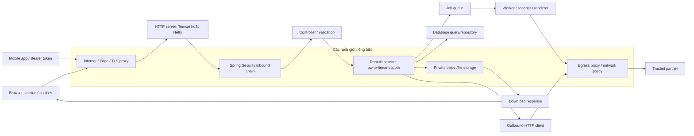
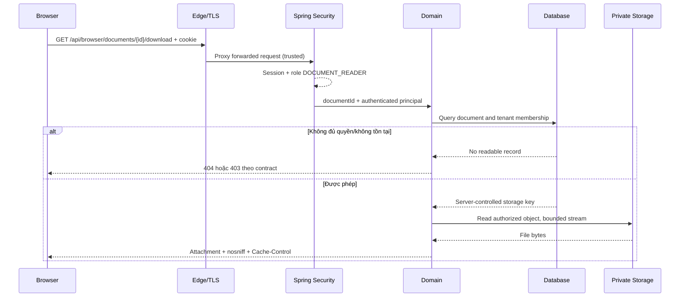
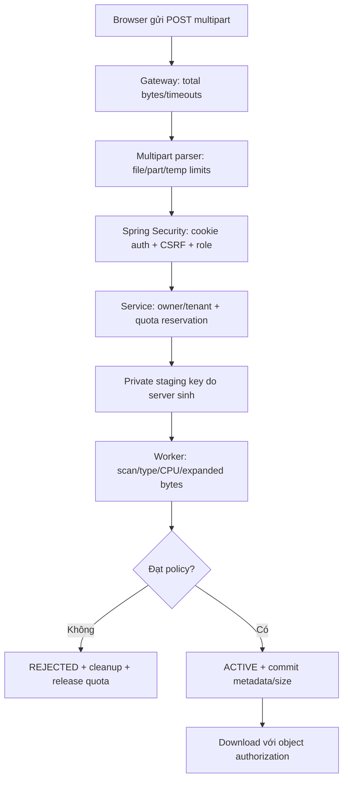

# Đặt từng lớp bảo vệ vào đúng mô hình nguy cơ của ứng dụng

Trong module `SPRING_SECURITY_HTTP_PROTECTION`, người học đã gặp nhiều cơ chế như CSRF, CORS, security headers, CSP, HSTS, HTTP firewall, cookie/session protection và bảo vệ HTTP cho Servlet lẫn Reactive. Khi triển khai thực tế, vấn đề khó không phải là bật thật nhiều cấu hình, mà là **biết mỗi cấu hình chống lại nguy cơ nào, ở ranh giới nào, dựa trên giả định gì và cần bằng chứng kiểm thử nào**.

Một ứng dụng có thể cấu hình CSP rất chặt nhưng vẫn có SQL injection; bật CSRF token đúng nhưng vẫn cho người dùng tải file thuộc tenant khác; từ chối URL bất thường bằng `StrictHttpFirewall` nhưng vẫn đọc file theo tham số `?path=...`; hoặc thêm rate limiting vào Controller nhưng vẫn để proxy ghi upload quá lớn vào đĩa trước khi request đến Spring Security. Tất cả đều là biểu hiện của **đặt biện pháp đúng kỹ thuật nhưng sai mô hình nguy cơ**.

Bài thuộc chương **Ranh giới bảo vệ**, hướng dẫn xây một **threat model có thể kiểm chứng** rồi ánh xạ cơ chế kỹ thuật vào đúng phạm vi. Mục tiêu không phải phủ nhận giá trị của Spring Security: nó rất hữu ích ở ranh giới inbound HTTP/browser, nhưng không thể tự đảm nhận authorization của mọi bản ghi nghiệp vụ, kiểm soát mọi SQL query, mọi file trên disk hoặc mọi socket outbound.

Câu hỏi trung tâm:

> **Đang bảo vệ tài sản gì, khỏi hành động cụ thể nào, do tác nhân nào gây ra, tại ranh giới nào — và lớp phòng vệ nào có thể chặn chính hành động đó trước khi tác hại xảy ra?**

Tình huống xuyên suốt là ứng dụng **DocumentHub**, một hệ thống quản lý hồ sơ cho nhiều tổ chức (tenant). Nó có giao diện browser dùng cookie session, API di động dùng Bearer token, chức năng upload/download tài liệu, tìm kiếm, tạo báo cáo, link preview, gọi đối tác và xử lý file nền. Các ví dụ mã minh họa Java 17+, Spring Boot 3.x và Spring Security 6.x. Các đoạn Servlet và Reactive là **hai biến thể triển khai độc lập**, không được trộn nguyên xi trong cùng một application context.

## 1. Kết quả học tập

Sau bài này, người học có thể:

- Mô tả được **asset, actor, entry point, data flow, trust boundary, threat, impact, mitigation, residual risk** bằng ngôn ngữ nghiệp vụ.
- Vẽ luồng từ browser/mobile client qua ingress, Spring Security, service, database, filesystem, job worker và HTTP client outbound.
- Phân biệt rủi ro **authentication, authorization, CSRF, CORS, XSS/CSP, clickjacking, HTTP downgrade, session theft/fixation, request smuggling/normalization, SQL injection, path traversal, SSRF và resource exhaustion**.
- Xác định rõ lớp nào thuộc trách nhiệm **Spring Security**, lớp nào thuộc service/repository, lớp nào thuộc ingress, OS/network và vận hành.
- Chọn security chains riêng cho browser session và machine/API bearer token khi khác threat model; tránh vô hiệu CSRF bừa bãi.
- Giải thích sự khác nhau giữa **CORS đọc response trong browser** và **server-side permission/network policy**.
- Ánh xạ security headers (CSP, frame protections, HSTS, nosniff, Referrer-Policy, Cache-Control) vào loại rủi ro chúng giảm; không dùng headers làm lời hứa chống mọi XSS hoặc dữ liệu bị lộ.
- Kiểm tra session/cookie settings, CSRF token lifecycle, login/logout và tác động của reverse proxy TLS.
- Thiết kế object-level authorization, data/query/file/network boundaries độc lập với URL-level role authorization.
- Chọn giới hạn request, rate, concurrency, bytes/quota và background jobs theo ngân sách tài nguyên.
- Viết verification plan: unit, MockMvc, WebTestClient, browser test, integration test với gateway/database/network và production observability.
- Trình bày risk register có owner, giả định, residual risk, bằng chứng, ưu tiên và điều kiện rollout.

## 2. Tình huống mẫu: DocumentHub có những tài sản nào?

Giả sử một tenant `acme` có tài liệu nội bộ, còn `beta` là tenant khác. Người dùng Alice có quyền `DOCUMENT_EDITOR` trong `acme` nhưng không có quyền ở `beta`. Một số tệp phải qua kiểm tra malware trước khi download. Service lưu bản ghi trong PostgreSQL, nội dung file ở private object storage, và gọi một external partner cố định để phân tích metadata.

### 2.1. Liệt kê tài sản thay vì liệt kê công nghệ trước

| Tài sản | Mục tiêu bảo mật | Hậu quả nếu bị xâm phạm |
| --- | --- | --- |
| Cookie session của Alice | Confidentiality, integrity, thời hạn hợp lý | Chiếm phiên, hành động dưới danh tính Alice |
| Tài liệu `acme` và `beta` | Confidentiality, authorization theo tenant | Lộ dữ liệu cross-tenant |
| API Bearer token của mobile client | Confidentiality, validation issuer/audience/expiry | Truy cập trái phép API |
| Database records và query results | Integrity, confidentiality | SQLi, sửa dữ liệu, đọc bản ghi khác quyền |
| Private storage files | Containment, owner control, integrity | Path traversal, mất/ghi đè file |
| Background scan/report queue | Availability, lifecycle | Queue quá tải, file chưa quét được publish |
| HTTP outbound capability | Destination authorization | SSRF tới internal/metadata services |
| UI trên browser | Script integrity, framing safety | XSS, clickjacking, exfiltration |
| Public ingress, sessions, worker pool | Availability | Exhaustion, denial of service |
| Secrets, signing keys, cloud credentials | Confidentiality, least privilege | Lateral movement và chiếm quyền diện rộng |
| Logs/metrics/traces | Integrity, confidentiality | Rò token, URL, dữ liệu nhạy cảm qua telemetry |

Một tài sản có thể cần nhiều **mục tiêu**. Ví dụ file có cả confidentiality (không lộ), integrity (không bị sửa) và availability (vẫn tải được khi có traffic xấu). Một cơ chế chống XSS không tự giải quyết availability của scanner.

### 2.2. Phân loại tác nhân và mức tin cậy

- **Người dùng ẩn danh:** chưa có danh tính được chứng thực; có thể gửi request đến public endpoints như login và landing page.
- **Người dùng đã đăng nhập trong tenant A:** được thực hiện một số việc nhưng **không đáng tin tuyệt đối**; có thể thử thao tác tới tenant B hoặc vượt quota.
- **Browser của người dùng:** có cookie tự động gửi theo điều kiện của browser; có thể bị dẫn tới trang độc hại khác.
- **Trang web bên thứ ba:** có thể khiến browser của user phát sinh request trong một số điều kiện, nhưng chịu Same Origin Policy/CORS khi đọc response.
- **Đối tác/API client:** có token, mTLS hay chữ ký theo hợp đồng; một đối tác được xác thực vẫn có thể gửi malformed payloads.
- **Background worker:** chạy không qua browser security filters; có credentials và network rights riêng, có thể bị ảnh hưởng bởi dữ liệu từ queue.
- **Người vận hành/configuration:** có quyền cao hơn nhưng vẫn cần change control, least privilege và audit.
- **Thư viện/SDK/parser:** không phải actor có ý chí, nhưng là **điểm thực thi hành vi** từ input chưa tin cậy.

Điểm quan trọng: **“đã đăng nhập” không đồng nghĩa “dữ liệu và yêu cầu của người dùng đáng tin”**. Authentication xác nhận danh tính, không cấp quyền cho tất cả bản ghi hoặc mọi đích mạng.

## 3. Vẽ luồng dữ liệu và ranh giới tin cậy trước khi chọn cơ chế



Sơ đồ cho thấy ít nhất sáu điểm phải đánh giá riêng:

1. **Internet → ingress:** TLS termination, host/proxy routing, request size/timeout, trusted client identity, DDoS/rate.
2. **HTTP server → Spring Security:** URL parsing, request matching, authentication, CSRF, authorization và response headers.
3. **Spring Security → domain service:** actor được phép làm loại hành động nào, **trên tài nguyên nào**, trong tenant nào?
4. **Service → database/file/object storage:** SQL binding, row authorization, key/path containment, storage rights, quota.
5. **Service/worker → outbound network:** ai quyết định URL/hostname/IP/port, credential được gửi đi và redirect?
6. **Server → browser:** nội dung được render như text hay script, có bị nhúng frame, tải qua HTTPS, cache và session cookie đúng không?

Nếu nhóm chỉ đặt một nhãn chung “Spring Security” phủ lên toàn sơ đồ, threat model sẽ bị thiếu. Nếu chỉ đặt CSP trên browser nhưng bỏ qua quyền đọc database, hệ thống vẫn có lỗ hổng dữ liệu phía server.

### 3.1. Data flow diagram không cần quá chi tiết nhưng cần kiểm chứng được

Mỗi mũi tên nên trả lời:

- Ai khởi tạo? Đã xác thực chưa?
- Dữ liệu gì đi qua (token, ID, file, URL, query, JSON)?
- Format/size/trust của dữ liệu được xác lập ở đâu?
- Có secret nào đi kèm không?
- Service đích có quyền nào mà bên khởi tạo không có?
- Chỗ nào có thể bị replay, redirect, retry hoặc chạy lại sau khi request kết thúc?
- Khi bị từ chối, đã tiêu tốn tài nguyên hay gây side effect gì chưa?

Ví dụ thao tác upload không chỉ là “browser gửi file cho Controller”: proxy có thể ghi file tạm, multipart parser có thể parse trước CSRF, scanner có thể chạy async, record chỉ được ACTIVE sau khi scan và quyền download được kiểm tra khi sử dụng.

## 4. Viết threat scenario cụ thể: ai làm gì, vào đâu, tác hại ra sao?

Một threat cần mô tả hành vi rõ ràng hơn câu “chống hack”. Ví dụ:

> **Actor:** user Alice đã đăng nhập ở tenant `acme`.  
> **Entry point:** `GET /api/documents/{id}/download`.  
> **Input:** `id` của một tài liệu thuộc `beta`.  
> **Trust boundary:** route authorization sang domain object authorization.  
> **Threat:** Broken Object Level Authorization (BOLA/IDOR).  
> **Impact:** lộ file tenant `beta`.  
> **Mitigation:** query theo `documentId` và quyền/tenant của principal được xác minh, không dùng tenantId do user tự khai.  
> **Evidence:** test Alice nhận 404/403 theo contract và service/storage không mở key của `beta`.

Lớp bảo vệ cần đặt ở **service/repository**. URL matcher `hasRole("DOCUMENT_READER")` có thể vẫn cần để bảo vệ loại endpoint, nhưng không giải quyết BOLA vì Alice có thể có role ấy.

### 4.1. Dùng STRIDE như bộ câu hỏi, không phải bộ đáp án tự động

| Nhóm STRIDE | Câu hỏi đặt cho DocumentHub | Một số kiểm soát liên quan |
| --- | --- | --- |
| **S — Spoofing** | Có thể giả danh user, API client, nguồn proxy không? | Authentication, token signature/issuer/audience, trusted proxy, session protection |
| **T — Tampering** | Có thể thay metadata, upload content, SQL query, object key không? | Authorization, input validation, parameterized SQL, integrity control |
| **R — Repudiation** | Có thể phủ nhận upload/delete hoặc thay đổi quyền không? | Audit có actor/tenant/correlation ID, log integrity |
| **I — Information Disclosure** | Có thể xem file của tenant khác, leak token, XSS hoặc SSRF metadata không? | BOLA checks, CSP/output encoding, storage/egress policy, secret handling |
| **D — Denial of Service** | Có thể gửi quá nhiều request, multipart parts, tạo quá nhiều report jobs không? | Rate limits, bytes/part limits, concurrency, quotas, load shedding |
| **E — Elevation of Privilege** | Có thể từ role Viewer thành Admin, khai thác confused deputy hoặc privilege gap không? | Fine-grained authorization, least privilege, service identities, audit |

STRIDE giúp nhớ những lớp câu hỏi khác nhau, nhưng **không tự chỉ ra đúng Spring Security API nào**. Cần nối từng scenario với asset, trust boundary, code path và test.

### 4.2. Abuse case và rủi ro còn lại

Ví dụ CSRF token có thể chặn form POST giả mạo từ site khác, nhưng nếu ứng dụng có **stored XSS**, script chạy cùng origin có thể hành động dưới phiên của user. CSRF vẫn quan trọng nhưng không phải biện pháp chính chống XSS. Ngược lại, CSP tốt có thể giảm một số cách khai thác XSS, nhưng không sửa việc query SQL nối chuỗi hoặc backend thiếu tenant checks.

Mô hình nguy cơ đúng phải ghi rõ cả **mitigation** và **residual risk**:

```text
Threat: cross-site POST đổi email
Primary: CSRF token trên unsafe cookie-auth requests
Complementary: SameSite cookie, Origin/Fetch Metadata checks khi hợp lý
Residual: same-origin XSS có thể lợi dụng phiên, API logic có thể lỗi
Verification: cross-site form bị từ chối; form hợp lệ hoạt động
```

## 5. Bảng ánh xạ phòng vệ với đúng loại nguy cơ

| Cơ chế | Đối tượng/hành vi bảo vệ chính | Vị trí thực thi | Không thay thế được |
| --- | --- | --- | --- |
| **Authentication** | Giả mạo danh tính người gọi | Spring Security filter/manager/resource server | Object authorization, request budget |
| **Route/method authorization** | Gọi endpoint không đúng vai trò | `SecurityFilterChain` / `SecurityWebFilterChain` | Quyền trên từng document/tenant/row |
| **Object-level authorization** | IDOR/BOLA, cross-tenant data | Service/repository/storage access layer | CSRF, HTTP firewall |
| **CSRF token** | Unsafe browser request dùng ambient cookie credentials không do user chủ ý | `CsrfFilter` / `CsrfWebFilter` | XSS, SQLi, SSRF, resource exhaustion |
| **SameSite cookie** | Giảm một số ngữ cảnh gửi cookie cross-site | Browser cookie policy | CSRF token trong mọi threat model |
| **CORS** | Browser script cross-origin đọc response và một số browser requests | Browser + CORS response/preflight handling | Authentication, CSRF, server-to-server egress control |
| **CSP** | Giảm khả năng chạy/tải active content không được phép trên browser | Browser nhận CSP header | Output encoding, loại bỏ XSS nguồn, authorization |
| **Frame protection** | Clickjacking/UI redress trong framing | `frame-ancestors`/`X-Frame-Options` trong browser | Phishing, authorization |
| **HSTS + TLS** | HTTP downgrade/transport insecurity trên browser và host | Browser/HTTPS termination | CSRF, XSS, backend-to-backend TLS |
| **Nosniff / download policy** | Một số MIME confusion và active file rendering | Browser response handling | File content validation/malware scanning |
| **Referrer-Policy** | Điều tiết dữ liệu URL truyền trong Referer | Browser navigation/fetch | Ngăn token URL xuất hiện trong logs/history |
| **Cache-Control** | Giảm lưu cache nhầm dữ liệu nhạy cảm | Browser/intermediary cache (tùy directives) | Server authorization hoặc revoke data |
| **HTTP firewall** | Request method/path có representation nguy hiểm ở inbound Servlet chain | `HttpFirewall` / `StrictHttpFirewall` | Path traversal trong file service, SQL injection |
| **Session fixation/protection** | Session lifecycle và cookie credential misuse | Session/authentication infrastructure | BOLA, malware, network isolation |
| **Parameterized queries** | SQL injection | JDBC/JPA/R2DBC/repository | CSRF, route authorization, tenant checks |
| **File/path containment** | Traversal, symlink, file outside storage root | File service + OS | Quyền đọc một file của tenant khác trong cùng root |
| **Outbound destination policy** | SSRF, egress tới internal/cloud metadata | HTTP client/egress gateway | Inbound CORS/CSP |
| **Rate/concurrency/size limits** | Resource exhaustion, abuse | Edge, HTTP server, app, worker | Injection, authn/authz |
| **Audit/monitoring** | Phát hiện, truy vết, chứng minh hành vi | Tất cả tầng | Ngăn request sai nếu không có enforcement |

Không phải mọi hàng đều cần áp cho mọi endpoint. Tài liệu tĩnh công khai không cần cùng logic object authorization như tài liệu riêng; API bearer machine-to-machine không có cùng CSRF risk như browser dùng cookie; webhook cần signature/replay validation mà form login không giải quyết.

### 5.1. Tập kiểm soát tối thiểu phải phụ thuộc use case

- **Browser session / POST đổi trạng thái:** authentication, authorization, CSRF token, cookie settings, TLS, input validation, quota.
- **Public read-only API:** request size/timeouts, rate/connection limits, content validation, cache/privacy policy; authentication tùy dữ liệu.
- **Bearer-token API không dùng ambient cookies:** token validation, scope/tenant authorization, request limits và logging; CSRF threat model khác browser session.
- **Upload PDF:** per-file/total multipart/part limits, private storage, owner rights, scanning, rate/concurrency, CSRF khi cookie browser.
- **Download riêng tư:** object authorization, private key mapping, Content-Disposition/nosniff/cache policy, download bandwidth quotas.
- **Outbound link preview:** HTTPS destination policy, DNS/connect-time IP/redirect control, egress isolation, bytes/time limit.
- **Tạo report/job:** owner/tenant authorization, idempotency, queue/concurrency budgets, bounded data export, audit.

### 5.2. Nguyên tắc “chặn trước tác hại”, nhưng không ngầm tin thứ tự

Một request có thể bị Spring Security chặn `403` nhưng reverse proxy đã buffer body, hoặc multipart parser đã tạo file tạm. Do đó, với availability, giới hạn body, connection và temp disk cần nằm **trước hoặc độc lập** với domain processing. Với object authorization, kiểm tra trước khi query/export/bắt đầu phát file. Với SSRF, phải kiểm tra **đích kết nối thực tế**, không chỉ parse URL ban đầu.

## 6. Quy trình threat modeling có thể lặp lại

Threat modeling không nên chỉ là sơ đồ tạo một lần trước khi phát hành. Mỗi thay đổi về route, authentication, storage, partner hoặc infrastructure có thể tạo **ranh giới mới**.

1. **Đặt phạm vi:** route, actor, tài sản, Servlet/Reactive, production deployment.
2. **Liệt kê data flows:** browser/session, bearer API, file upload, DB, job queue, outbound integrations.
3. **Đánh dấu boundaries:** Internet → edge; HTTP request → security chain; security → domain service; service → DB/storage; worker → network; response → browser.
4. **Mô tả threat scenario cụ thể:** actor gửi input nào vào entry point nào để gây hại tới tài sản gì?
5. **Xác định primary mitigation:** đặt tại lớp có đủ ngữ cảnh và khả năng chặn hành vi sai **trước tác hại**.
6. **Bổ sung defense in depth:** giảm xác suất thành công, phạm vi blast radius và khả năng tái diễn.
7. **Ghi assumptions/residual risk:** proxy đáng tin? File root immutable? Browser có ambient cookies? Backend có network egress nào?
8. **Chọn bằng chứng:** unit, security slice, browser, DB/file/network integration, staging load test.
9. **Gán owner và ngày review:** backend domain, frontend, platform, SRE hoặc security reviewer.
10. **Cập nhật khi thay đổi:** thêm SPA origin, chuyển từ session sang JWT, thêm partner URL, upgrade HTTP server hoặc đổi CDN.

### 6.1. Risk register mẫu

| ID | Threat scenario | Tài sản và impact | Owner chính | Primary mitigation | Bằng chứng |
| --- | --- | --- | --- | --- | --- |
| T-01 | Website khác POST đổi email bằng cookie của Alice | Integrity hồ sơ | Auth/backend | CSRF token ở browser session flow | MockMvc + browser cross-site test |
| T-02 | Alice tải document của tenant `beta` | Confidentiality cross-tenant | Domain | Owner/tenant check tại service/repository | Integration test 2 tenants |
| T-03 | Preview URL trỏ vào cloud metadata | Secrets và network | Integration/platform | Fixed origin, network egress deny-by-default | Fake upstream + network test |
| T-04 | PDF upload gây CPU scan quá tải | Availability | Worker/platform | Size limit, worker CPU/time/concurrency budgets | File parser/load tests |
| T-05 | Preview title bị render như script | Browser integrity | Frontend | Contextual encoding, safe DOM APIs, CSP bổ sung | Browser XSS regression |
| T-06 | Cookie session truyền qua HTTP | Session confidentiality | Platform/auth | TLS + Secure cookie + HSTS | TLS/cookie/header tests |
| T-07 | Cùng API bị abuse qua nhiều app instances | Availability/fairness | Gateway/backend | Distributed limiter và quota/concurrency | Two-node/load tests |

**Một risk có thể có nhiều owner phối hợp**, nhưng phải có một người chịu trách nhiệm đóng/kiểm chứng. Ví dụ T-03 vừa cần application URL policy vừa cần hạ tầng egress rules.

### 6.2. Đánh giá ưu tiên theo hậu quả, không theo số cơ chế

Xem xét: mức nhạy cảm của tài sản, số tenant bị ảnh hưởng, exposure public hay authenticated, độ khó khai thác, quyền của process, khả năng phát hiện và business context. Severity cao không đồng nghĩa “bật thêm security headers”; phải sửa nguyên nhân ở boundary tương ứng.

## 7. CSRF: yêu cầu giả mạo qua browser dùng ambient credentials

### 7.1. Tình huống CSRF

Alice đã đăng nhập bằng cookie session. Một website khác cố khiến browser gửi:

```http
POST /account/change-email HTTP/1.1
Host: app.example.test
Cookie: JSESSIONID=<cookie được browser tự gắn nếu điều kiện cookie cho phép>
Content-Type: application/x-www-form-urlencoded

email=unapproved@example.test
```

Nguy cơ là browser mang phiên hợp lệ nhưng **Alice không chủ động gửi thao tác đổi trạng thái này**. Spring Security có `CsrfFilter` (Servlet) và `CsrfWebFilter` (Reactive) nhằm xác minh token cho unsafe methods theo policy.

### 7.2. Authentication/role không ngăn giả mạo ý định

Alice có role `ACCOUNT_EDITOR` nghĩa là **Alice được quyền** đổi email. Nó không chứng minh request thật sự đến từ hành động Alice đã chọn. Với browser cookie session, CSRF token giúp chống **forged unsafe request**. Không chuyển đổi email/xóa file thành GET để né CSRF; GET phải giữ safe semantics.

### 7.3. Token trong form và HTTP header

```http
POST /api/documents HTTP/1.1
Cookie: JSESSIONID=...
X-CSRF-TOKEN: <token do server cung cấp cho phiên>

{"title":"Hồ sơ"}
```

- Dùng đúng tên token/header và `CsrfTokenRepository`/handler được cấu hình; đừng hardcode nếu integration thay đổi.
- Không đưa token vào URL query vì logs, Referer và history có thể lưu nó.
- Khi upload multipart bằng JavaScript, CSRF header có thể tránh phải parse body chỉ để tìm token ở một số cấu hình; ingress/proxy vẫn có thể buffer body trước khi Spring Security kiểm tra.
- Phải xử lý token/session hết hạn, login/logout và vòng đời token trong frontend.
- `SameSite` cookie và `Origin`/Fetch Metadata checks giúp defense in depth tùy threat model, **không thay CSRF token** trong flow dùng ambient cookie.

### 7.4. Stateless Bearer API không giống browser cookie API

Một resource server mà client gửi token chủ động trong `Authorization: Bearer ...`, **không dùng cookies hoặc browser tự gắn credentials**, có threat model khác. Có thể dùng một security chain riêng và cân nhắc tắt CSRF **chỉ cho phạm vi thực sự không dùng ambient credentials**.

Không suy rằng “API JSON/REST” là lý do tắt CSRF toàn hệ thống. SPA vẫn có thể dùng `JSESSIONID` hoặc cookie tự động gắn Bearer; trong trường hợp đó CSRF vẫn có thể áp dụng.

### 7.5. Những gì CSRF không giải quyết

| Hành vi | CSRF có phải primary mitigation? | Lớp cần thiết |
| --- | --- | --- |
| Website khác giả POST đổi email bằng cookie Alice | **Có** | CSRF token, cookie, Origin checks bổ sung |
| Alice tự gửi ID của tenant `beta` | Không | Object-level authorization |
| Stored XSS cùng origin của DocumentHub | Không đủ | Output encoding, CSP hỗ trợ |
| File upload 100 lần/phút | Không | Rate, quotas, size/concurrency |
| User nhập URL outbound tới metadata nội bộ | Không | SSRF egress policy |
| SQL query nối chuỗi user input | Không | Parameterized queries |

**Primary boundary của CSRF:** browser → inbound HTTP request, không phải quyền trên đối tượng hoặc outbound network.

## 8. CORS: quyền truy cập response bởi browser script, không phải authentication

Frontend `https://app.example.test` gọi API `https://api.example.test` là cross-origin. Browser có thể gửi preflight và xét CORS headers khi quyết định JavaScript có được truy cập response.

### 8.1. CORS trả lời câu hỏi gì?

> **Script chạy từ origin nào được browser cho phép tương tác cross-origin và đọc response theo CORS policy?**

CORS không tự quyết định actor có được download document, request có phải CSRF, Java server có được gọi mạng nội bộ hay một client không phải browser có được gửi HTTP hay không.

### 8.2. Một cấu hình phản chiếu Origin tùy ý rất nguy hiểm

```http
Access-Control-Allow-Origin: *
Access-Control-Allow-Credentials: true
```

Browser credentialed CORS không chấp nhận wildcard origin theo semantics chuẩn. Nhưng lỗi thực tế thường là server **phản chiếu bất kỳ Origin từ request** rồi cho credentials — vô tình mở response cho website không đáng tin.

Cần exact origin allowlist, methods/headers cần thiết, credential policy rõ. Đừng dùng một regex domain quá rộng hoặc cho mọi subdomain nếu một subdomain có thể bị takeover.

### 8.3. Preflight trước authentication khi đúng integration

```http
OPTIONS /api/documents HTTP/1.1
Origin: https://app.example.test
Access-Control-Request-Method: POST
Access-Control-Request-Headers: content-type,x-csrf-token
```

Preflight không giống request POST thực và thường không mang cookie phiên. Nếu security kiểm tra authentication trước CORS handling, có thể xuất hiện 401/403 giả. Dùng Spring Security CORS integration thích hợp; dù preflight được chấp nhận, **POST thật vẫn phải qua auth, CSRF và domain authorization**.

### 8.4. SameSite khác Same Origin Policy

Hai subdomain có thể cùng “site” nhưng khác “origin”. `SameSite` liên quan việc browser gửi cookie trong ngữ cảnh site, còn CORS xét origin. Một SPA cross-origin dùng cookie session có thể đồng thời cần CORS allowlist, credentialed fetch, cookie attributes và CSRF token; không lấy một lớp làm bằng chứng lớp khác đã được xử lý.

## 9. XSS: output encoding là lớp chính; CSP là lớp hỗ trợ

Ví dụ `title` tài liệu do user nhập:

```text

```

Nếu render nó bằng DOM `innerHTML` hoặc template không escape đúng ngữ cảnh, browser có thể hiểu dữ liệu thành mã thực thi. Nguy cơ nằm ở **untrusted data → browser execution context**.

**Primary mitigations:** context-aware output encoding, template autoescaping, DOM `textContent` cho text, sanitization phù hợp với rich HTML, tránh eval và unsafe DOM sinks. Cần test HTML body, attribute, URL, script và style contexts riêng; HTML escaping không đồng nghĩa an toàn trong mọi context.

### 9.1. CSP mẫu và phạm vi

```http
Content-Security-Policy: default-src 'self'; script-src 'self'; object-src 'none'; base-uri 'self'; frame-ancestors 'none'
```

- `script-src` giới hạn nguồn script nhưng không sửa sink XSS gốc; same-origin gadgets hoặc assets bị chiếm vẫn có nguy cơ.
- `object-src 'none'` giảm khả năng tải plugin/object content.
- `base-uri 'self'` hạn chế thay đổi base URL qua HTML.
- `frame-ancestors 'none'` bảo vệ trang **không bị nhúng trong frame**, không phải cùng mục đích với `frame-src`.
- Policy cần mở rộng có kiểm soát cho img/font/connect/workers và nonce/hash nếu frontend yêu cầu.
- Nonce phải mới, không dự đoán được theo từng response; không hardcode trong config chung.
- CSP nên triển khai từng bước bằng `Content-Security-Policy-Report-Only` trước khi enforce, kiểm tra violations và tránh gửi nội dung nhạy cảm vào report.

**Đừng dùng `'unsafe-inline'` hoặc wildcard sources rộng bừa bãi** chỉ để cho ứng dụng chạy: điều đó giảm giá trị chống XSS. Nhưng cũng đừng triển khai một CSP làm hỏng login/script của người dùng mà không có regression/browser tests.

### 9.2. CSP của browser không chặn backend

`connect-src 'self'` có thể hạn chế kết nối do browser script phát sinh, **không chặn** `WebClient` hay Java `HttpClient` trên server gọi `http://127.0.0.1` hoặc metadata service. SSRF cần URL destination policy và network egress enforcement riêng.

### 9.3. CSP không bảo đảm không còn XSS

Các script đáng tin có thể xử lý input sai; DOM XSS có thể phát sinh qua unsafe sinks. Trusted Types, sandboxed preview origin và DOM policies có thể là defense in depth khi phù hợp browser support; không thay việc sửa nơi chèn input chưa tin cậy.

## 10. Security headers theo đúng threat và response class

### 10.1. Chống clickjacking

Nếu không cần frame, dùng CSP `frame-ancestors 'none'` và cân nhắc `X-Frame-Options: DENY` cho compatibility. Nếu portal đối tác cần iframe, lập allowlist origins thật sự được phép thay vì tắt mọi frame protection. `frame-src` kiểm soát **trang bạn nhúng**, còn `frame-ancestors` kiểm soát **ai được nhúng trang bạn**.

### 10.2. HTTPS/HSTS bảo vệ browser transport

```http
Strict-Transport-Security: max-age=31536000; includeSubDomains
```

HSTS chỉ nhận qua HTTPS hợp lệ và dùng theo browser host policy. `includeSubDomains` ảnh hưởng các subdomains; kiểm tra chúng hỗ trợ HTTPS trước khi áp. `preload` có điều kiện và vòng đời quản trị riêng, không tự thêm vào production vì muốn tăng điểm đánh giá header.

Nếu TLS terminate ở proxy nhưng Spring thấy `http` do forwarded headers sai, HSTS generation/redirect logic có thể lệch. **Chỉ tin forwarded headers từ proxy đáng tin**, cấu hình proxy/security group cho đúng. HSTS không ngăn CSRF, XSS, SQLi hoặc server outbound HTTP.

### 10.3. Nosniff và tải file

`X-Content-Type-Options: nosniff` giúp hạn chế một số MIME confusion, không chứng minh file upload là PDF sạch. Với tài liệu riêng tư, dùng `Content-Disposition: attachment`, content type đã xác minh, cache policy và owner authorization. Đừng serve arbitrary HTML/SVG của user dưới trusted application origin khi browser có thể thực thi active content.

### 10.4. Referrer-Policy không biến URL chứa token thành an toàn

`Referrer-Policy: strict-origin-when-cross-origin` hoặc policy chặt hơn giới hạn dữ liệu Referer trong những trường hợp browser tuân thủ, nhưng URL vẫn có thể vào logs, history, bookmarks, analytics và proxy traces. **Không đặt CSRF/access tokens trong query string** rồi dùng header để tự tin rằng secret không thể bị lộ.

### 10.5. Cache-Control phù hợp độ nhạy nội dung

```http
Cache-Control: no-store
Content-Disposition: attachment; filename="report.pdf"
X-Content-Type-Options: nosniff
```

`no-store` giảm khả năng cache lưu response theo directive, không thu hồi byte đã tải về. Với dữ liệu private, cache key phải xét authentication/cookies/tenant; với static public assets, cache hợp lý giúp giảm tải. Không đặt `no-store` bừa bãi lên mọi resource để rồi bỏ qua khả năng cache chéo user ở CDN.

### 10.6. Vì sao không có một bộ headers tối ưu cho mọi response?

- `frame-ancestors 'none'` bảo vệ trang riêng nhưng phá portal partner cần iframe.
- `Cache-Control: no-store` hợp dữ liệu riêng nhưng làm static content mất hiệu quả cache.
- HSTS `includeSubDomains` hữu ích khi mọi subdomain đã sẵn HTTPS, gây lỗi lớn nếu còn service HTTP legacy.
- CSP strict tốt khi frontend đã chuẩn bị, nhưng có thể chặn script tích hợp hợp lệ.
- COOP/COEP/CORP có semantics cô lập cross-origin riêng, cần đánh giá resource compatibility.

**Bộ header cần phân loại theo response class và threat scenario**, sau đó được browser-test. Một điểm số header cao không tự chứng minh ứng dụng không có lỗi truy cập dữ liệu.

## 11. Session, cookies, login/logout: bảo vệ danh tính mà không nhầm với dữ liệu

### 11.1. Session là một bearer credential do browser thường tự gửi

Cookie phiên là credential có giá trị: ai có thể sử dụng được cookie theo ngữ cảnh hợp lệ có thể hành động như người dùng đó cho đến khi bị hết hạn/thu hồi, tùy cơ chế xác thực. Vì vậy:

- Dùng HTTPS ở mọi hop ngoài mạng tin cậy theo threat model, cookie `Secure` cho kết nối HTTPS.
- Dùng `HttpOnly` để browser JavaScript không đọc cookie trực tiếp; điều này giảm một đường đánh cắp cookie từ XSS nhưng **không ngăn một script XSS cùng origin gửi request sử dụng phiên**.
- Chọn `SameSite=Lax/Strict/None` theo luồng frontend/SSO và cross-site requirements. `SameSite=None` cần `Secure` trên browser hiện đại; chính sách SameSite không tự thay CSRF token.
- Đổi/session fixation protection đúng khi authentication transition; Spring Security có các chiến lược mặc định và tùy chỉnh.
- Hết hạn idle/absolute session và invalidate logout phù hợp; quy định refresh/re-authentication cho thao tác nhạy cảm.
- Không ghi `JSESSIONID`, raw cookies hoặc tokens vào URL, logs, tracing, analytics.
- Không cấu hình shared session cookie quá rộng trên subdomains mà tổ chức không quản lý an toàn.

### 11.2. Cấu hình cookie/session ở ứng dụng Spring Boot Servlet

Ví dụ cấu hình **một ứng dụng cookie-session chạy HTTPS**:

```yaml
server:
  servlet:
    session:
      timeout: 30m
      cookie:
        http-only: true
        secure: true
        same-site: lax
```

Phạm vi và tác dụng thực tế phụ thuộc servlet container, reverse proxy và phiên bản Spring Boot. Khi TLS terminate tại ingress, phải cấu hình secure scheme/forwarded headers đúng nhưng **chỉ trust proxy được phê duyệt**, không nhận toàn bộ `Forwarded`/`X-Forwarded-*` từ Internet.

**Không dùng YAML này cho một API server thuần Bearer token rồi tưởng request tự trở thành stateless.** Cần phân biệt security chain, session creation policy, credentials và endpoints thực tế. Trong WebFlux, cookie/session infrastructure khác với Servlet và không copy nguyên `server.servlet.session.*` để coi như đã cấu hình Reactive.

### 11.3. Login/logout là thao tác có threat model riêng

- **Login CSRF** có thể ảnh hưởng việc browser bị đăng nhập vào tài khoản không mong đợi khi ứng dụng dựa vào phiên; không tùy tiện ignore login POST.
- **Logout** nên là unsafe method được xác minh phù hợp (ví dụ POST) thay vì mở GET logout state-changing.
- **Session fixation**: sau khi login, phiên cần được thay/rotated theo strategy để session ID cũ không tiếp tục làm credential như trước.
- **Concurrent sessions**: giới hạn số phiên có thể phục vụ một số risk models, nhưng không thay rate limits hay account security.
- **Session expiration**: frontend phải xử lý 401/redirect, token CSRF stale và form có dữ liệu chưa gửi một cách an toàn.

### 11.4. Session protection không tự cấp quyền trên tài liệu

Sau khi Alice đã login qua cookie bảo vệ tốt, Alice **vẫn không thể** đọc document của tenant `beta`. Session xác nhận danh tính/role; **domain authorization** phải kiểm tra quyền trên record. Đây là lỗi thuộc trust boundary giữa security context và domain data, không thể sửa chỉ bằng cookie flags.

## 12. HTTP firewall và URL normalization: bảo vệ cách request được diễn giải

Trong Servlet, `StrictHttpFirewall` (thường được Spring Security sử dụng mặc định) giúp từ chối một số biểu diễn URL/method có thể gây bất nhất giữa container, security matcher và application, như semicolon, encoded path segments, repeated separators hoặc phương thức bất thường theo policy/version.

### 12.1. Kịch bản nguy hiểm là lệch cách parse/match

```text
Ingress proxy thấy URL dạng A
        |
        v
Servlet container normalize thành B
        |
        v
Security matcher xem route C
        |
        v
Controller/resource resolver xử lý path D
```

Nếu bốn cách hiểu khác nhau, một URL có thể được bảo vệ bởi matcher sai hoặc dẫn đến tài nguyên không mong đợi. HTTP firewall giúp giảm một số khác biệt **ở request inbound Servlet**; không phải mọi URL/parsing issue đều giải quyết xong.

### 12.2. Đừng nới HTTP firewall chỉ để một URL lỗi “chạy được”

Nếu ứng dụng cần ID tài liệu, nhận `GET /documents/{uuid}` tốt hơn nhận raw paths chứa `..`, encoded slash hoặc semicolon. Nếu frontend cần query phức tạp, dùng query/body schema hợp lệ; không biến URL path thành filesystem path.

Một thay đổi như `setAllowSemicolon(true)` hoặc cho encoded slash cần threat model, lý do tương thích, routing tests và review tất cả proxy/container matchers. Đừng bật vì một test bất kỳ bị 400/RequestRejectedException rồi bỏ qua ranh giới.

### 12.3. Vì sao HTTP firewall không giải quyết path traversal trong service?

```http
GET /download?name=../../secret.yml HTTP/1.1
Host: app.example.test
```

Request URL path `/download` trông bình thường; dữ liệu nguy hiểm nằm trong **query parameter** hoặc JSON/DB record. `HttpFirewall` không biết service có gọi `Path.resolve(name)` hay không. Cần **document ID → server-controlled storage key → owner checks → filesystem containment** và OS permissions.

Tương tự, SQL injection không biến mất vì query string chứa ký tự được firewall chấp nhận hay từ chối; service/repository phải dùng **parameterized queries** đúng.

### 12.4. Reactive không dùng Servlet StrictHttpFirewall nguyên xi

WebFlux có Netty/reactive HTTP request processing, WebFilters và `SecurityWebFilterChain`; Servlet `HttpFirewall` không tự được áp như một firewall chung cho mọi Reactive connector. Khi port logic security từ MVC sang WebFlux, phải đánh giá lại path matching, decoding, request parsing, filter order và viết **WebTestClient + real HTTP proxy tests** riêng.

### 12.5. Lưu ý về reverse proxies và forwarded headers

Nếu application tin header `X-Forwarded-Proto: https` do client tự gửi khi ingress không sanitize, nó có thể quyết định sai redirects, secure context hoặc URL generation. Không dùng `X-Forwarded-For` raw làm identity cho rate limiting; có thể bị spoof và tạo key vô hạn. **Nguồn tin cậy là chain proxy đã cấu hình và bảo vệ ở mạng**, không phải một chuỗi header chỉ vì nó có tên quen thuộc.

## 13. Authorization ba tầng: route, object, storage

### 13.1. Route authorization chỉ trả lời câu hỏi loại hành động

```java
http.authorizeHttpRequests(auth -> auth
        .requestMatchers(HttpMethod.GET,
                "/api/documents/*/download")
            .hasRole("DOCUMENT_READER")
        .anyRequest().denyAll());
```

Rule trên có thể đúng: viewer không có role không được gọi download. Nhưng Alice có role `DOCUMENT_READER` trong tenant `acme` vẫn **không có quyền** tải file thuộc `beta`.

### 13.2. Domain authorization theo record phải có dữ liệu nguồn tin cậy

Một pattern an toàn hơn:

```text
Incoming documentId (untrusted)
       |
       v
Authenticated principal / tenant membership from trusted store
       |
       v
Repository query constrained by documentId AND allowed tenant/owner
       |
       v
Service checks document ACTIVE and permission for operation
       |
       v
Storage key server-controlled, private storage
       |
       v
File response
```

Không lấy `tenantId` từ query/header rồi tin người dùng có quyền với tenant đó. Nếu ứng dụng hỗ trợ “switch tenant”, context hiện hành vẫn phải được **xác minh membership/role** trước khi dùng.

### 13.3. Ví dụ JDBC truy vấn theo document và membership

```java
import java.util.List;
import java.util.Optional;
import java.util.UUID;
import org.springframework.jdbc.core.JdbcTemplate;
import org.springframework.stereotype.Repository;

@Repository
public class DocumentAccessRepository {

    public record AllowedDocument(
            UUID id, UUID tenantId, String storageKey) {}

    private final JdbcTemplate jdbc;

    public DocumentAccessRepository(JdbcTemplate jdbc) {
        this.jdbc = jdbc;
    }

    public Optional<AllowedDocument> findReadable(
            UUID documentId, String authenticatedUsername) {

        List<AllowedDocument> found = jdbc.query("""
                SELECT d.id, d.tenant_id, d.storage_key
                FROM documents d
                JOIN tenant_memberships m
                  ON m.tenant_id = d.tenant_id
                WHERE d.id = ?
                  AND m.username = ?
                  AND m.can_read_documents = TRUE
                  AND d.state = 'ACTIVE'
                """,
                (rs, row) -> new AllowedDocument(
                        UUID.fromString(rs.getString("id")),
                        UUID.fromString(rs.getString("tenant_id")),
                        rs.getString("storage_key")),
                documentId, authenticatedUsername);

        return found.stream().findFirst();
    }
}
```

Đây là sơ đồ schema minh họa; app thật phải có model grants/roles theo tenant và lựa chọn SQL dialect đúng. Hai parameters `?` giữ `documentId` và username dưới dạng **bind values**, không nối chuỗi SQL. Nếu không có row nào, service trả lỗi không làm lộ tài liệu thuộc tenant khác. `storageKey` phải do server sinh/kiểm tra và được dùng với private storage client, không đưa thẳng từ HTTP vào filesystem.

**SQL parameterization giải quyết SQL injection, còn `JOIN tenant_memberships`/quyền record giải quyết object authorization.** Cần cả hai.

### 13.4. Method security là bổ sung, không thay service contract

Có thể thêm `@PreAuthorize` với `@EnableMethodSecurity` hoặc `@EnableReactiveMethodSecurity` theo programming model, nhưng annotation phải kiểm tra điều kiện đáng tin. Nếu method được gọi qua self-invocation không qua proxy phù hợp hoặc bypass qua job/adapter khác, chính sách có thể không chạy như dự kiến.

Thiết kế tốt là **service API đòi security context/actor và luôn áp policy**; method security hỗ trợ enforcement và review, không chỉ trang trí endpoint.

### 13.5. File nằm trong root vẫn có thể thuộc người khác

Path containment chặn traversal ra ngoài thư mục. Nó không kiểm soát owner/tenant khi tất cả files đều ở **trong cùng private root**. Một user có role đọc file không được tự truyền storage key của tenant khác. Tương tự, object storage signed URL chỉ được cấp sau khi app đã xác minh quyền đối với record cụ thể.

## 14. SQL injection, file traversal và SSRF: ba loại boundary khác nhau

### 14.1. SQL injection là input → SQL program boundary

Anti-pattern:

```java
// KHÔNG DÙNG: dữ liệu có thể thành cú pháp SQL.
String sql = "SELECT * FROM documents WHERE title = '"
        + title + "'";
```

Thay bằng bind parameters qua `PreparedStatement`, `JdbcTemplate`, Spring Data JPA query parameters hoặc R2DBC `DatabaseClient.bind`. Đối với `ORDER BY`, tên bảng/cột hoặc các SQL identifiers không bind như values thông thường; dùng **allowlist lựa chọn do server định nghĩa**, không nối raw input.

CORS, CSP, CSRF và HTTP firewall không thay đổi việc một SQL string được parser DB diễn giải ra sao.

### 14.2. Path traversal là input → filesystem path boundary

Nếu Controller nhận `?filename=...` rồi gọi `Files.readAllBytes(root.resolve(filename))`, SQL parameterization không liên quan. Ưu tiên **public UUID → metadata → server-generated key**; khi cần path tương đối, dùng `Path.normalize`/`startsWith(Path)`/`toRealPath` đúng mục đích và hiểu symbolic-link/TOCTOU. Khi filesystem tree mutable, cần handle-based access/OS isolation và file ownership policy.

`StrictHttpFirewall` không kiểm soát cách `Path.resolve` xử lý một tham số đã được decode trong service.

### 14.3. SSRF là input → outbound network destination boundary

Một service nhận `url` rồi gọi `WebClient.get().uri(url)` có thể để user ảnh hưởng hostname/IP/port của server connection. Primary mitigation là **không nhận arbitrary origin nếu business chỉ cần một partner**: dùng fixed base URL do server quản lý và resource ID. Nếu cần URL động, phải có scheme/host allowlist, redirect policy, DNS/connect-time IP enforcement và egress deny-by-default.

CSP `connect-src 'self'` **chỉ là browser policy**, không chặn Java backend. CORS cũng không phải firewall cho Java HTTP client.

### 14.4. Các ranh giới có thể kết hợp trong một endpoint

```text
POST /api/link-previews
       |
       v
CSRF/auth kiểm tra request từ browser
       |
       v
Role/tenant/quotas cho việc tạo preview
       |
       v
Destination allowlist + connect-time egress policy
       |
       v
Bounded HTTP fetch (timeout/body/redirect)
       |
       v
Safe HTML/JSON parse và DTO extraction
       |
       v
Output encoding + CSP trên response
```

**Một request có thể cần nhiều controls liên tiếp**, nhưng mỗi control chặn một nhóm hành vi khác nhau. Nếu thiếu egress policy, CSRF đúng không đủ; nếu thiếu encoding, egress policy đúng không ngăn XSS qua preview text.

## 15. Resource exhaustion và availability: đặt quota trước công việc đắt

Một người dùng hợp lệ có thể gửi file lớn, request chậm, hàng nghìn parts hoặc tạo nhiều PDF reports. Authentication và CSRF đều có thể **PASS** trong khi hệ thống cạn tài nguyên.

### 15.1. Phân biệt đơn vị bảo vệ

| Đơn vị | Ví dụ limit | Vị trí phù hợp |
| --- | --- | --- |
| HTTP body bytes | Multipart request tối đa 8 MiB | Gateway/HTTP server/multipart parser |
| Per-file bytes | Một PDF tối đa 5 MiB | Multipart/service bounded copy |
| Part count | Tối đa 10 parts | Multipart reader/container |
| Request frequency | 20 search/phút/user | Gateway/app distributed limiter |
| Concurrent work | Tối đa 2 uploads/user | Service admission/distributed slots |
| Expanded content | ZIP giải nén tối đa 100 MiB | Archive/scanner worker |
| CPU/time | Render PDF tối đa 20 giây | Worker OS quota/timeout |
| Stored bytes | Tenant tối đa 20 GiB | Transactional quota/storage |
| Queue depth | Tối đa 100 reports đang đợi | Queue/admission layer |

### 15.2. Rate limit không thay body/concurrency limit

Một request 5 GiB có thể làm hỏng server dù user mới gửi lần đầu. Một endpoint cho phép 10 requests/phút vẫn có thể có 10 request kéo dài hàng giờ giữ 10 worker slots. Do đó:

- Ingress body/connection/timeouts phải độc lập với app quota.
- Service phải đếm byte thực nhận, không chỉ tin `Content-Length`.
- Upload staging có disk/inode quotas, cleanup và file scan.
- Job admission có concurrency, retry budget và idempotency.
- Không tạo vô hạn key bộ đếm theo raw URL/IP header để limiter tự thành điểm DoS.
- Một 413 từ proxy có thể xảy ra **trước khi Spring ControllerAdvice chạy**; test đúng tầng.

### 15.3. Thứ tự CSRF và multipart parsing không tự bảo đảm không tốn tài nguyên

Với Servlet, nếu CSRF token nằm trong multipart form body và multipart filter/parser chạy sớm, server có thể tạo file tạm trước khi `CsrfFilter` trả 403. Header token trong JavaScript upload có thể giảm nhu cầu parse chỉ để đọc token, nhưng proxy/container vẫn có thể buffer request trước bất kỳ filter Java nào.

**Phòng vệ đúng:** ingress body cap + temp storage quotas + token validation + actor quota + cleanup. Không tắt CSRF để tăng hiệu năng upload.

## 16. Quy tắc chọn “primary” và “secondary” controls

Khi review một nguy cơ, hãy ghi:

- **Primary control:** thành phần trực tiếp ngăn điều kiện tấn công phát sinh tác hại, ví dụ service-level owner check ngăn đọc file tenant khác.
- **Secondary controls:** giảm xác suất/phạm vi nếu primary có lỗi, ví dụ DB row-level security hoặc storage IAM giới hạn tenant.
- **Detective controls:** audit/metrics/cảnh báo phát hiện hành vi bất thường, nhưng **không tự ngăn tác hại**.
- **Recovery controls:** session revoke, rollback, file quarantine, secret rotation, rate-policy rollback và incident response.

Ví dụ với SSRF: primary có thể là fixed origin + egress policy; secondary là worker isolation/least-privilege IAM; detective là outbound deny logs và destination anomalies; recovery là rotate credentials nếu bị lộ.

### 16.1. Đừng đặt primary control ở tầng không có thông tin

| Thiếu thông tin gì? | Vì sao tầng đó không đủ để làm primary? | Nơi có dữ liệu cần |
| --- | --- | --- |
| Gateway không biết document owner | Không thể quyết định user đọc đúng tenant | Domain/repository |
| Spring Security không thấy SQL AST/DB schema | Không thể bảo đảm query đã parameterize | Repository/DB |
| CSP không thấy socket Java outbound | Không thể chặn SSRF ở backend | HTTP connector/egress gateway |
| `StrictHttpFirewall` không thấy ZIP entry names | Không thể chặn Zip Slip trong extractor | Archive parser/storage |
| OS biết file path nhưng không biết principal HTTP | Không thể quyết định actor có quyền document ID | Service + OS least privilege |
| API rate limiter không biết report job còn chạy | Không bảo đảm active jobs cap | Queue/worker |
| CORS không xác minh quyền user | Không thể cấp object permission | Authentication/authorization |

### 16.2. Không dùng “defense in depth” để bỏ qua root cause

Khi một SQL query nối chuỗi nguy hiểm, không được đóng ticket chỉ vì WAF chặn một số input; khi file service dùng raw path, không coi request firewall là đủ; khi API thiếu owner check, không coi UUID khó đoán là authorization. Defense in depth là **bổ sung**, không phải lý do giữ nguyên primary vulnerability.

## 17. Thiết kế Servlet: tách browser session và Bearer API theo threat model

DocumentHub có hai loại client:

- **Browser UI** tại `https://app.example.test` dùng `JSESSIONID` và form login; unsafe browser requests cần CSRF protection.
- **Mobile/machine API** tại `/api/mobile/**`, được bảo vệ bởi OAuth2 Resource Server JWT qua `Authorization: Bearer ...`, không hỗ trợ cookie-session authentication và không dựa vào browser auto-attached credentials.

Dùng **hai `SecurityFilterChain` có thứ tự rõ**, thay vì một catch-all chain với `csrf.disable()`. Đây là một ví dụ sơ lược để thể hiện boundary; route thật phải được cập nhật theo permission matrix và mô hình login của sản phẩm.

### 17.1. Servlet chain cho Bearer API: không dùng ambient cookies

```java
import org.springframework.context.annotation.Bean;
import org.springframework.context.annotation.Configuration;
import org.springframework.core.annotation.Order;
import org.springframework.security.config.Customizer;
import org.springframework.security.config.annotation.web.builders.HttpSecurity;
import org.springframework.security.config.http.SessionCreationPolicy;
import org.springframework.security.web.SecurityFilterChain;

@Configuration
public class DocumentHubServletSecurity {

    @Bean
    @Order(1)
    SecurityFilterChain bearerApi(HttpSecurity http)
            throws Exception {

        return http
                .securityMatcher("/api/mobile/**")
                .authorizeHttpRequests(auth -> auth
                        .anyRequest().authenticated())
                // Chỉ áp cho scope Bearer-only đã được review:
                // không đọc session/cookies làm authentication.
                .csrf(csrf -> csrf.disable())
                .sessionManagement(session -> session
                        .sessionCreationPolicy(
                                SessionCreationPolicy.STATELESS))
                .oauth2ResourceServer(oauth -> oauth
                        .jwt(Customizer.withDefaults()))
                .build();
    }
}
```

**Giả định bắt buộc:** JWT được xác minh signature, issuer, audience, expiry và scopes phù hợp qua Resource Server configuration và domain authorization. `authenticated()` chỉ là mức tối thiểu; phải kiểm tra scopes/roles và quyền resource cụ thể ở service. Hệ thống không được âm thầm hỗ trợ cookie login trong phạm vi này; nếu có browser cookie credentials, quyết định CSRF phải được xem xét lại.

### 17.2. Servlet chain cho browser UI + API qua cookie session

```java
// Các import thêm cho class DocumentHubServletSecurity:
import org.springframework.http.HttpMethod;
import org.springframework.security.web.header.writers.ReferrerPolicyHeaderWriter;

// Thêm bean thứ hai trong class configuration ở trên:
@Bean
@Order(2)
SecurityFilterChain browserSession(HttpSecurity http)
        throws Exception {

    return http
            // Catch-all cho các request không match Bearer chain.
            .authorizeHttpRequests(auth -> auth
                    .requestMatchers("/login", "/assets/**")
                        .permitAll()
                    .requestMatchers(HttpMethod.GET,
                            "/api/browser/documents/*/download")
                        .hasRole("DOCUMENT_READER")
                    .requestMatchers(HttpMethod.POST,
                            "/api/browser/documents")
                        .hasRole("DOCUMENT_EDITOR")
                    .anyRequest().denyAll())
            .formLogin(login -> login.permitAll())
            .csrf(Customizer.withDefaults())
            .headers(headers -> headers
                    .contentSecurityPolicy(csp -> csp
                            .policyDirectives(
                                    "default-src 'self'; "
                                  + "script-src 'self'; "
                                  + "object-src 'none'; "
                                  + "base-uri 'self'; "
                                  + "frame-ancestors 'none'"))
                    .referrerPolicy(ref -> ref
                            .policy(ReferrerPolicyHeaderWriter
                                    .ReferrerPolicy
                                    .STRICT_ORIGIN_WHEN_CROSS_ORIGIN)))
            .build();
}
```

Điểm cần đọc kỹ:

1. `@Order(1)` match `/api/mobile/**` trước, sau đó `@Order(2)` xử lý các request khác. Thực tế hãy đảm bảo **không có endpoint không được bảo vệ vì matcher gap**.
2. Browser chain **giữ CSRF enabled**. Khi đã authenticated và có role, POST vẫn có thể bị `403` nếu thiếu token.
3. `formLogin(...permitAll())` cho phép cơ chế login phát sinh endpoints cần thiết; logout/session handling cần được cấu hình và kiểm thử theo business requirements.
4. `headers(...contentSecurityPolicy(...))` minh họa header policy theo response class. Nếu SPA/HTML thực tế được một server khác phát từ origin khác, **CSP phải được phát trên HTML response của origin ấy**; CSP trên JSON API response không thay policy của trang HTML ở host khác.
5. Header defaults của Spring Security có thể bao gồm `X-Content-Type-Options`, `X-Frame-Options`, cache controls và HSTS khi request được nhận diện secure. **CSP không được bật mặc định** chỉ vì bật Spring Security; phải cấu hình chủ động.
6. `anyRequest().denyAll()` là lựa chọn demo có chủ ý để không cho route mới tự được phép; sản phẩm phải bổ sung login pages, UI routes, health/static policy và API routes khác theo ma trận truy cập.
7. CORS **không bắt buộc** nếu UI gọi same-origin API. Với SPA khác origin, cần CORS allowlist và credential policy được cấu hình đúng *trên những routes thực sự phục vụ cross-origin*.

### 17.3. CORS allowlist cho browser API khi frontend ở origin khác

Nếu một frontend được phê duyệt ở `https://dashboard.example.test` gọi `https://app.example.test/api/browser/**` bằng cookie, có thể cung cấp `CorsConfigurationSource`:

```java
import java.util.List;
import org.springframework.context.annotation.Bean;
import org.springframework.context.annotation.Configuration;
import org.springframework.web.cors.CorsConfiguration;
import org.springframework.web.cors.UrlBasedCorsConfigurationSource;
import org.springframework.web.cors.CorsConfigurationSource;

@Configuration
public class BrowserCorsConfig {

    @Bean
    CorsConfigurationSource corsConfigurationSource() {
        CorsConfiguration config = new CorsConfiguration();
        config.setAllowedOrigins(
                List.of("https://dashboard.example.test"));
        config.setAllowedMethods(
                List.of("GET", "POST", "PUT", "PATCH", "DELETE"));
        config.setAllowedHeaders(
                List.of("Content-Type", "X-CSRF-TOKEN", "X-XSRF-TOKEN"));
        config.setAllowCredentials(true);
        config.setMaxAge(1800L);

        UrlBasedCorsConfigurationSource source =
                new UrlBasedCorsConfigurationSource();
        source.registerCorsConfiguration(
                "/api/browser/**", config);
        return source;
    }
}
```

Bổ sung `.cors(Customizer.withDefaults())` **vào browser chain** để Spring Security xử lý CORS integration; giữ CSRF cho unsafe browser requests. Không copy exact allowed origin từ ví dụ vào production khi host thật khác. Với `SameSite` và cross-site cookie credentials, phải chọn cookie policy theo browser/site relationships thực tế; hai subdomains có thể same-site nhưng vẫn cross-origin.

**CORS permit không phải domain authorization.** Nếu CORS preflight thành công, POST vẫn cần cookie/auth/CSRF token và owner check. Server-to-server HTTP clients không bị browser CORS kiểm soát.

### 17.4. Vì sao không dùng một global `csrf.disable()`?

Một thay đổi như:

```java
// KHÔNG DÙNG cho toàn hệ thống chứa browser cookie sessions:
http.csrf(csrf -> csrf.disable());
```

có thể làm browser endpoints POST mất CSRF protection chỉ vì một team mobile muốn gọi Bearer API. **Chọn theo credential/entry-point threat model**, không theo tên “REST API” hoặc loại Content-Type.

### 17.5. Không biến header policy thành security checklist vô điều kiện

Policy CSP trên `DocumentHub` chỉ là baseline demo. Nếu có iframe portal đối tác, charting scripts, WebSocket hay inline server-rendered scripts, cần lập whitelist/nonce/hash theo business và thử nghiệm trên browser. **Không tắt CSP toàn bộ chỉ vì một library cần chạy inline**, cũng không ép tất cả apps áp một policy không phù hợp.

## 18. WebFlux: cùng quyết định bảo mật, API cấu hình khác

Trong một ứng dụng WebFlux riêng, dùng `ServerHttpSecurity` và `SecurityWebFilterChain` thay cho Servlet `HttpSecurity`. Spring Security Reactive có `CsrfWebFilter`, reactive authorization và Resource Server support, nhưng không áp dụng `StrictHttpFirewall` Servlet theo cùng API.

### 18.1. Reactive Bearer API chain

```java
import org.springframework.context.annotation.Bean;
import org.springframework.context.annotation.Configuration;
import org.springframework.core.annotation.Order;
import org.springframework.security.config.Customizer;
import org.springframework.security.config.web.server.ServerHttpSecurity;
import org.springframework.security.web.server.SecurityWebFilterChain;
import org.springframework.security.web.server.util.matcher
        .PathPatternParserServerWebExchangeMatcher;

@Configuration
public class DocumentHubReactiveSecurity {

    @Bean
    @Order(1)
    SecurityWebFilterChain bearerApi(ServerHttpSecurity http) {

        return http
                .securityMatcher(
                        new PathPatternParserServerWebExchangeMatcher(
                                "/api/mobile/**"))
                .authorizeExchange(auth -> auth
                        .anyExchange().authenticated())
                // Chỉ với routes Bearer-only, không ambient-cookie auth.
                .csrf(csrf -> csrf.disable())
                .oauth2ResourceServer(oauth -> oauth
                        .jwt(Customizer.withDefaults()))
                .build();
    }
}
```

### 18.2. Reactive browser/session chain

```java
// Các import thêm cho DocumentHubReactiveSecurity:
import org.springframework.http.HttpMethod;

// Thêm vào class configuration trên, độc lập app Servlet:
@Bean
@Order(2)
SecurityWebFilterChain browserSession(ServerHttpSecurity http) {

    return http
            .authorizeExchange(auth -> auth
                    .pathMatchers("/login", "/assets/**")
                        .permitAll()
                    .pathMatchers(HttpMethod.GET,
                            "/api/browser/documents/*/download")
                        .hasRole("DOCUMENT_READER")
                    .pathMatchers(HttpMethod.POST,
                            "/api/browser/documents")
                        .hasRole("DOCUMENT_EDITOR")
                    .anyExchange().denyAll())
            .formLogin(Customizer.withDefaults())
            .csrf(Customizer.withDefaults())
            .build();
}
```

Phần Reactive tuân cùng threat model:

- Browser unsafe requests dùng cookie-session cần CSRF.
- Bearer API chỉ tắt CSRF trong scope non-ambient credentials đã được chứng minh.
- `authenticated()` và route roles không thay owner/tenant checks.
- CORS/preflight phải được cấu hình theo Reactive infrastructure với exact origin allowlist; không paste `UrlBasedCorsConfigurationSource` Servlet và mặc định nó hoạt động tương đương khi thiếu integration.
- Headers cần cấu hình trên chính server trả HTML; Reactivity không tự thêm CSP. HSTS vẫn phụ thuộc HTTPS/secure request và proxy trust.
- `WebClient` server outbound không bị CORS/CSP browser chặn; cần egress policy/SSRF controls riêng.
- Không gọi blocking database/`Files.readAllBytes` hoặc blocking Redis limiter trên Reactor Netty event loop.

### 18.3. Bảo vệ method và dữ liệu ở Reactive service

Reactive `@PreAuthorize`/`@EnableReactiveMethodSecurity` có thể hỗ trợ kiểm tra actor, nhưng domain service phải bảo đảm:

- tenant/owner được xét theo authenticated security context ở đúng subscriber context;
- service truy vấn R2DBC bằng **bind parameters** thay vì string concatenation;
- file/object keys không lấy từ request chưa kiểm soát;
- tạo job và quota được kiểm tra atomically tại component sở hữu tài nguyên;
- errors/cancellation không làm rơi permit, buffer hoặc file staging;
- endpoint test sử dụng `WebTestClient` và integration test có authentication/session thật khi đi qua network.

## 19. Một ví dụ cụ thể: phân tích request từ browser đến file download

Giả sử Alice mở trang `/ui/documents`, nhấn Download cho tài liệu thuộc tenant `acme`.



**Các câu hỏi khi review:**

1. Nếu Alice thay `{id}` bằng UUID của tenant `beta`, logic nào chặn? **Domain/repository.**
2. Nếu file có HTML/script, browser có chạy như app code? **Content-Disposition, content-type, isolation/CSP/encoding theo rendering.**
3. Nếu client tải hàng trăm file lớn? **Rate, bandwidth/concurrency, storage/network quotas.**
4. Nếu input là `../../secret`? Controller chỉ nhận UUID, storage key server-generated; **path containment/OS permissions** còn là defense in depth.
5. Nếu người dùng đã hết quyền sau khi URL được tạo? **Authorization tại lần download hiện tại**, không dựa vào lúc sinh link.
6. Nếu request là GET, CSRF có bắt buộc? GET đọc tài liệu **không nên thay đổi business state**; CSRF token mặc định nhằm unsafe methods, không bảo vệ confidentiality của data bị trả.
7. Nếu ingress đã TLS terminate, cookie HSTS/secure có đúng? **Proxy + session/headers config** được xác minh trên browser.

Đây là ví dụ của **nhiều lớp phù hợp, không thay thế nhau**. Một request GET có thể không cần CSRF token nhưng rất cần owner authorization, safe download headers và resource budgets.

## 20. Một ví dụ khác: upload và sinh preview từ tài liệu

Thao tác upload gồm nhiều lớp với rủi ro khác nhau:



Phòng vệ đúng ranh giới:

- **CSRF** chống browser cross-site POST không có token hợp lệ.
- **Authorization** kiểm tra actor có quyền upload vào tenant/record.
- **Ingress/part limits** chặn dữ liệu quá lớn hoặc hàng nghìn parts trước/độc lập với service.
- **Storage key** không lấy `MultipartFile.getOriginalFilename()`, tránh traversal/overwrite.
- **Worker sandbox** giới hạn CPU, RAM, expanded ZIP/PDF/image bytes.
- **Quota transaction** bảo đảm nhiều concurrent uploads không vượt tenant budget.
- **Malware scan** và trạng thái `PENDING_SCAN`/`ACTIVE` ngăn publish trước khi có kết quả.
- **Download policy** vẫn kiểm tra owner; upload thành công không trao quyền cho mọi user xem file.

### 20.1. Một lỗi cấu hình có thể đánh lừa cả nhóm

Nếu CSRF token nằm trong multipart form field và parser/`MultipartFilter` xử lý body **trước** CSRF filter, một request thiếu token vẫn có thể tạo file tạm. Đó **không** tự có nghĩa CSRF bị bypass: Spring Security có thể vẫn từ chối trước side effect nghiệp vụ. Nhưng availability boundary đã tiêu tốn đĩa. Cần **giới hạn ở proxy/parser và cleanup**, không đổ hết trách nhiệm lên CSRF.

### 20.2. Quyền lưu file không suy ra quyền kết nối ra mạng

Nếu worker sau upload còn tải font/ảnh ngoài từ HTML/PDF, đó là **outbound SSRF boundary** mới. Một file đạt size/type check vẫn có thể tham chiếu URL nội bộ. Cần tách renderer sandbox và egress network rules cho mọi subresource fetch, không chỉ URL chính.

## 21. Bằng chứng kiểm thử phải bám vào threat scenario

Kiểm thử bảo mật không chỉ là assert `200 OK` hoặc `403 Forbidden`. Cần chứng minh **đúng tài sản không bị lộ hoặc thao tác sai không được thực hiện**, ở tầng thực sự sở hữu threat.

### 21.1. Phân loại kiểm thử theo boundary

| Threat scenario | Test gần nhất | Test hệ thống cần thêm | Bằng chứng cần thấy |
| --- | --- | --- | --- |
| Thiếu CSRF khi POST browser | MockMvc `csrf()`/WebTestClient `csrf()` | Browser cross-site form | Request không thay state; đúng token hoạt động |
| CORS origin không được duyệt | CORS integration test | Browser preflight/fetch | JS origin không được phép không đọc response |
| CSP chặn unsafe script | Header assertion | Browser XSS/DOM regression + Report-Only data | XSS sink đã sửa; policy không phá chức năng |
| Clickjacking | Header test | Browser iframe test | Trang nhạy cảm không bị nhúng trái phép |
| HSTS/secure cookies | HTTPS server/proxy test | Browser network inspection | Secure/HSTS đúng trên HTTPS |
| URL role authorization | MockMvc/WebTestClient | E2E authentication | Thiếu role không gọi business service |
| BOLA/IDOR | Domain/repository integration test | E2E hai tenants | Không đọc, cập nhật, tải record khác tenant |
| SQL injection | Repository test với dữ liệu chứa SQL metacharacters | DB integration gần production | Query giữ parameter binding |
| Path traversal | Filesystem `@TempDir` test | OS/symlink/volume integration | Không mở file ngoài root |
| SSRF | Fake HTTP upstream, redirect tests | Egress/DNS/connect-time network tests | Không kết nối private/link-local/metadata |
| Multipart exhaustion | Service byte-count tests | Real HTTP gateway/connector/staging tests | Giới hạn file/part/request trước commit |
| Rate/concurrency abuse | Fake clock token bucket test | Multi-node load/Redis test | Toàn cluster thực thi budget |
| Session fixation/logout | Security slice | Browser session lifecycle | Session/CSRF credentials rotate/invalidate đúng |
| Audit/observability | Unit logger shape tests | Staging tracing review | Có event hữu ích mà không lộ secrets |

**Không dùng một test ở lớp khác để suy ra lớp cần kiểm tra đã được bảo vệ.** Ví dụ MockMvc không chứng minh proxy chặn upload > 8 MiB; WebTestClient gắn vào application context không chứng minh NGINX real-IP policy đúng; một test CORS preflight không chứng minh Alice không đọc record của Bob.

### 21.2. Một bộ invariant có thể đo được

Thay vì “CSRF an toàn”, viết:

- Với browser session hợp lệ, POST thiếu/sai CSRF token → bị từ chối và service mutation không được gọi.
- Với browser session hợp lệ, POST có token đúng + role phù hợp → được xử lý nếu domain authorization đồng ý.
- Với Alice tenant `acme`, GET document `beta` → không trả bytes hoặc metadata; không gọi storage key của `beta`.
- Với query đầu vào chứa ký tự SQL đặc biệt, repository sử dụng parameter binding và không mở rộng WHERE ngoài quyền.
- Với file name chứa traversal, storage key do server sinh, không mở file ngoài root.
- Với URL preview có redirect ra đích bị cấm, không có outbound TCP connection tới đích bị cấm.
- Với request upload vượt body/part budget, không publish file và có cleanup.
- Với nhiều instances, rate limiter shared-state không nhận vượt mức đã cam kết trong điều kiện datastore khỏe.
- Với response HTML chứa dữ liệu chưa tin cậy, text được render an toàn và CSP policy không phá hoạt động hợp lệ.

Mỗi invariant phải có **test có thể quan sát hậu quả**, không chỉ test số status code.

## 22. Ví dụ MockMvc: phân biệt route authorization, CSRF và object authorization

Để test ba tầng riêng, tạo một mini-controller không đọc file thật. Đây là fixture dùng trong **ứng dụng Servlet test độc lập**, không phải copy nguyên các security chains production ở mục 17.

### 22.1. Service contract có owner authorization

```java
import java.util.UUID;

public interface DocumentFacade {
    String readableTitle(UUID documentId, String actor);
    void rename(UUID documentId, String actor, String newTitle);
}
```

Trong production, implementation phải tra membership/record state ở repository trước khi trả title hoặc rename; example test có thể mock interface để chứng minh controller không bypass service.

### 22.2. Controller sử dụng principal do Spring Security cung cấp

```java
import java.security.Principal;
import java.util.Map;
import java.util.UUID;
import org.springframework.http.HttpStatus;
import org.springframework.http.ResponseEntity;
import org.springframework.web.bind.annotation.GetMapping;
import org.springframework.web.bind.annotation.PathVariable;
import org.springframework.web.bind.annotation.PostMapping;
import org.springframework.web.bind.annotation.RequestBody;
import org.springframework.web.bind.annotation.RequestMapping;
import org.springframework.web.bind.annotation.RestController;

@RestController
@RequestMapping("/api/browser/documents")
public class ThreatModelDocumentController {

    private final DocumentFacade documents;

    public ThreatModelDocumentController(DocumentFacade documents) {
        this.documents = documents;
    }

    public record RenameBody(String title) {}

    @GetMapping("/{id}/title")
    Map<String, String> title(
            @PathVariable UUID id, Principal principal) {

        return Map.of("title",
                documents.readableTitle(id, principal.getName()));
    }

    @PostMapping("/{id}/rename")
    ResponseEntity<Void> rename(
            @PathVariable UUID id,
            @RequestBody RenameBody body,
            Principal principal) {

        documents.rename(id, principal.getName(), body.title());
        return ResponseEntity.status(HttpStatus.NO_CONTENT).build();
    }
}
```

Controller không lấy `actorId`, `tenantId` hoặc `storageKey` từ client. Nó chuyển ID và authenticated principal tới facade; **facade vẫn phải enforce owner/tenant**, không được mặc định mọi người có role đều có quyền trên mọi ID.

### 22.3. Security chain cho fixture

```java
import org.springframework.context.annotation.Bean;
import org.springframework.context.annotation.Configuration;
import org.springframework.http.HttpMethod;
import org.springframework.security.config.Customizer;
import org.springframework.security.config.annotation.web.builders.HttpSecurity;
import org.springframework.security.web.SecurityFilterChain;

@Configuration
public class ThreatModelTestSecurity {

    @Bean
    SecurityFilterChain chain(HttpSecurity http) throws Exception {
        return http
                .authorizeHttpRequests(auth -> auth
                        .requestMatchers(HttpMethod.GET,
                                "/api/browser/documents/*/title")
                            .hasRole("DOCUMENT_READER")
                        .requestMatchers(HttpMethod.POST,
                                "/api/browser/documents/*/rename")
                            .hasRole("DOCUMENT_EDITOR")
                        .anyRequest().denyAll())
                .csrf(Customizer.withDefaults())
                .build();
    }
}
```

### 22.4. Test ba nguy cơ độc lập

```java
import static org.mockito.Mockito.*;
import static org.springframework.security.test.web.servlet.request
        .SecurityMockMvcRequestPostProcessors.csrf;
import static org.springframework.security.test.web.servlet.request
        .SecurityMockMvcRequestPostProcessors.user;
import static org.springframework.test.web.servlet.request
        .MockMvcRequestBuilders.get;
import static org.springframework.test.web.servlet.request
        .MockMvcRequestBuilders.post;
import static org.springframework.test.web.servlet.result
        .MockMvcResultMatchers.*;

import java.util.UUID;
import org.junit.jupiter.api.Test;
import org.springframework.beans.factory.annotation.Autowired;
import org.springframework.boot.test.autoconfigure.web.servlet.WebMvcTest;
import org.springframework.context.annotation.Import;
import org.springframework.http.HttpStatus;
import org.springframework.http.MediaType;
import org.springframework.test.context.bean.override.mockito.MockitoBean;
import org.springframework.test.web.servlet.MockMvc;
import org.springframework.web.server.ResponseStatusException;

@WebMvcTest(ThreatModelDocumentController.class)
@Import(ThreatModelTestSecurity.class)
class ThreatModelServletTests {

    @Autowired MockMvc mvc;
    @MockitoBean DocumentFacade documents;

    static final UUID ID = UUID.fromString(
            "37a41e70-74e0-4b49-9817-b3ad20d2397c");

    @Test
    void missingRoleStopsBeforeDomainService() throws Exception {
        mvc.perform(get("/api/browser/documents/" + ID + "/title")
                        .with(user("viewer").roles("VIEWER")))
                .andExpect(status().isForbidden());

        verifyNoInteractions(documents);
    }

    @Test
    void unsafePostMissingCsrfStopsBeforeMutation()
            throws Exception {

        mvc.perform(post("/api/browser/documents/" + ID + "/rename")
                        .with(user("alice").roles("DOCUMENT_EDITOR"))
                        .contentType(MediaType.APPLICATION_JSON)
                        .content("""
                                {"title":"Bản mới"}
                                """))
                .andExpect(status().isForbidden());

        verifyNoInteractions(documents);
    }

    @Test
    void validRoleAndCsrfStillRequireObjectAuthorization()
            throws Exception {

        doThrow(new ResponseStatusException(
                HttpStatus.NOT_FOUND, "Không thấy document"))
                .when(documents)
                .rename(ID, "alice", "Bản mới");

        mvc.perform(post("/api/browser/documents/" + ID + "/rename")
                        .with(user("alice").roles("DOCUMENT_EDITOR"))
                        .with(csrf())
                        .contentType(MediaType.APPLICATION_JSON)
                        .content("""
                                {"title":"Bản mới"}
                                """))
                .andExpect(status().isNotFound());

        verify(documents).rename(ID, "alice", "Bản mới");
    }

    @Test
    void validPermissionCanExecuteDomainOperation()
            throws Exception {

        mvc.perform(post("/api/browser/documents/" + ID + "/rename")
                        .with(user("alice").roles("DOCUMENT_EDITOR"))
                        .with(csrf())
                        .contentType(MediaType.APPLICATION_JSON)
                        .content("""
                                {"title":"Bản mới"}
                                """))
                .andExpect(status().isNoContent());

        verify(documents).rename(ID, "alice", "Bản mới");
    }
}
```

Các test chứng minh **Spring Security filter chain trước service**, còn test mô phỏng service từ chối một ID không hợp quyền. Vì `DocumentFacade` bị mock, **chưa thể kết luận domain/repository thật có object-level authorization**. Phải viết thêm integration test với Alice, Bob và hai tenant trong database thực hoặc test DB phù hợp. Đó là bằng chứng đóng T-02 trong risk register.

`@MockitoBean` thuộc Spring Framework 6.2+/Spring Boot 3.4+; với Boot 3.2/3.3 cần dùng annotation thay thế được dự án hỗ trợ. Không trộn class/config này với full production chains khi test slice mà không kiểm soát matcher order.

## 23. WebTestClient: kiểm tra bảo vệ tương ứng trong WebFlux

WebFlux security có cùng mục tiêu nghiệp vụ nhưng API/reactive lifecycle khác. Ví dụ fixture Reactive:

```java
import java.security.Principal;
import java.util.UUID;
import org.springframework.web.bind.annotation.GetMapping;
import org.springframework.web.bind.annotation.PathVariable;
import org.springframework.web.bind.annotation.PostMapping;
import org.springframework.web.bind.annotation.RequestBody;
import org.springframework.web.bind.annotation.RequestMapping;
import org.springframework.web.bind.annotation.RestController;
import reactor.core.publisher.Mono;

public interface ReactiveDocumentFacade {
    Mono<String> readableTitle(UUID id, String actor);
    Mono<Void> rename(UUID id, String actor, String title);
}

@RestController
@RequestMapping("/reactive/documents")
public class ReactiveDocumentController {

    private final ReactiveDocumentFacade documents;

    public ReactiveDocumentController(
            ReactiveDocumentFacade documents) {
        this.documents = documents;
    }

    public record RenameBody(String title) {}

    @GetMapping("/{id}/title")
    Mono<String> title(
            @PathVariable UUID id, Mono<Principal> principal) {

        return principal.flatMap(actor ->
                documents.readableTitle(id, actor.getName()));
    }

    @PostMapping("/{id}/rename")
    Mono<Void> rename(
            @PathVariable UUID id,
            @RequestBody Mono<RenameBody> body,
            Mono<Principal> principal) {

        return principal.flatMap(actor -> body.flatMap(value ->
                documents.rename(id, actor.getName(), value.title())));
    }
}
```

Tập security riêng cho fixture:

```java
import org.springframework.context.annotation.Bean;
import org.springframework.context.annotation.Configuration;
import org.springframework.http.HttpMethod;
import org.springframework.security.config.Customizer;
import org.springframework.security.config.web.server.ServerHttpSecurity;
import org.springframework.security.web.server.SecurityWebFilterChain;

@Configuration
public class ReactiveThreatModelTestSecurity {

    @Bean
    SecurityWebFilterChain chain(ServerHttpSecurity http) {
        return http
                .authorizeExchange(auth -> auth
                        .pathMatchers(HttpMethod.GET,
                                "/reactive/documents/*/title")
                            .hasRole("DOCUMENT_READER")
                        .pathMatchers(HttpMethod.POST,
                                "/reactive/documents/*/rename")
                            .hasRole("DOCUMENT_EDITOR")
                        .anyExchange().denyAll())
                .csrf(Customizer.withDefaults())
                .build();
    }
}
```

WebTestClient dùng security test mutators:

```java
import static org.mockito.Mockito.*;
import static org.springframework.security.test.web.reactive.server
        .SecurityMockServerConfigurers.csrf;
import static org.springframework.security.test.web.reactive.server
        .SecurityMockServerConfigurers.mockUser;
import static org.springframework.security.test.web.reactive.server
        .SecurityMockServerConfigurers.springSecurity;

import java.util.UUID;
import org.junit.jupiter.api.BeforeEach;
import org.junit.jupiter.api.Test;
import org.springframework.beans.factory.annotation.Autowired;
import org.springframework.boot.test.autoconfigure.web.reactive.WebFluxTest;
import org.springframework.context.ApplicationContext;
import org.springframework.context.annotation.Import;
import org.springframework.http.MediaType;
import org.springframework.test.context.bean.override.mockito.MockitoBean;
import org.springframework.test.web.reactive.server.WebTestClient;
import reactor.core.publisher.Mono;

@WebFluxTest(ReactiveDocumentController.class)
@Import(ReactiveThreatModelTestSecurity.class)
class ThreatModelReactiveTests {

    @Autowired ApplicationContext context;
    @MockitoBean ReactiveDocumentFacade documents;
    WebTestClient client;

    static final UUID ID = UUID.fromString(
            "37a41e70-74e0-4b49-9817-b3ad20d2397c");

    @BeforeEach
    void setup() {
        client = WebTestClient.bindToApplicationContext(context)
                .apply(springSecurity())
                .configureClient()
                .build();
    }

    @Test
    void missingCsrfCannotRename() {
        client.mutateWith(mockUser("alice").roles("DOCUMENT_EDITOR"))
                .post()
                .uri("/reactive/documents/" + ID + "/rename")
                .contentType(MediaType.APPLICATION_JSON)
                .bodyValue("""
                        {"title":"Bản mới"}
                        """)
                .exchange()
                .expectStatus().isForbidden();

        verifyNoInteractions(documents);
    }

    @Test
    void correctCsrfCallsDomainService() {
        when(documents.rename(ID, "alice", "Bản mới"))
                .thenReturn(Mono.empty());

        client.mutateWith(mockUser("alice").roles("DOCUMENT_EDITOR"))
                .mutateWith(csrf())
                .post()
                .uri("/reactive/documents/" + ID + "/rename")
                .contentType(MediaType.APPLICATION_JSON)
                .bodyValue("""
                        {"title":"Bản mới"}
                        """)
                .exchange()
                .expectStatus().isOk();

        verify(documents).rename(ID, "alice", "Bản mới");
    }

    @Test
    void missingRoleCannotRead() {
        client.mutateWith(mockUser("viewer").roles("VIEWER"))
                .get().uri("/reactive/documents/" + ID + "/title")
                .exchange().expectStatus().isForbidden();

        verifyNoInteractions(documents);
    }
}
```

Test bind application context với `mockUser`, không chạy qua reverse proxy/HTTP connector thật. Với `RANDOM_PORT` và real network client, authentication/session phải được thiết lập thật; mock principal trong test-context binding không tự chuyển sang một server độc lập.

### 23.1. Một lỗi Reactive thường gặp: “trả Mono” nhưng quyền nằm sai chỗ

Nếu controller tạo một publisher đọc dữ liệu **trước khi xác minh actor/tenant**, và chỉ sau đó lọc response, có thể phát sinh side effects hoặc leak thông qua logs/cache. Đặt owner checks tại service/repository **trước khi thực hiện query/storage access** và kiểm tra lazy subscription/cancellation.

Tương tự, một rate-limiting `WebFilter` dùng blocking Redis client có thể chặn Reactor Netty event loop; một `Mono<Void>` kết thúc rỗng không có nghĩa request chưa chạy, nên tránh dùng `switchIfEmpty(chain.filter(...))` sai chỗ tạo double execution.

### 23.2. Content QA của code mẫu không thay build/test thật

Những đoạn trong bài là các **ví dụ giảng dạy độc lập**. Khi ghép vào dự án, cần dependencies đúng phiên bản, security chain order, test server configuration và các services được implement. Bài STEP 4 không khẳng định đã compile/run toàn bộ mã; STEP 5 và STEP 6 có phạm vi riêng để tạo học liệu khác và QA chuyên môn.

## 24. Kiểm tra bảo vệ thực tế trên browser, gateway và môi trường triển khai

Các slice tests chạy trong JVM là cần thiết nhưng chưa đủ để đóng các nguy cơ phụ thuộc browser hoặc infrastructure.

### 24.1. Browser security tests

| Kịch bản | Thiết lập | Quan sát mong đợi |
| --- | --- | --- |
| Cross-site form submit | Mở một origin test khác, đăng nhập DocumentHub | POST thiếu token hợp lệ không đổi dữ liệu |
| Session expiration | Đăng nhập rồi để session hết hạn trong test | Form không vô tình dùng token stale mà vẫn thành công |
| CSP enforced | Load HTML với CSP policy thật | Script không hợp lệ bị chặn; luồng hợp lệ vẫn chạy |
| CSP Report-Only | Gửi response header Report-Only | Violation được thu thập, không tự chặn script trong giai đoạn đo |
| Clickjacking | Trang test cố nhúng UI vào iframe | Frame bị từ chối theo policy |
| HSTS | Request HTTPS qua public ingress | Header và Secure cookie phù hợp host/browser |
| CORS allowlist | Fetch từ origin được/không được phép | Origin đúng đọc response; origin sai không đọc được theo browser rules |
| Private file rendering | Tải HTML/SVG/PDF theo route download | File không trở thành script chạy cùng trusted UI origin trái policy |
| Cookie SameSite | Thử cross-site/same-site navigation và fetch | Cookie được gửi/không gửi theo contract đã thiết kế |

**Quan trọng:** Same Origin Policy/CORS chủ yếu quyết định browser JS được đọc response hay không; một attacker vẫn có thể khiến request xảy ra trong một số trường hợp. Vì vậy test CORS fail không thay test CSRF hoặc domain authorization.

### 24.2. Ingress và HTTP server tests

Một HTTP stack sau CDN/proxy cần kiểm thử **bằng HTTP request thật**:

- `Content-Length` lớn và chunked transfer không có length.
- Multipart request vượt tổng bytes hoặc số parts.
- Headers lớn và encoded URL variants.
- Cookie/redirect host/scheme khi TLS kết thúc ở proxy.
- Proxy buffer disk usage trước auth/CSRF.
- Client không được phép giả mạo `X-Forwarded-For`/`X-Forwarded-Proto`.
- Request truy cập app origin trực tiếp phải bị network policy từ chối.
- CORS preflight ở edge và Spring phải đồng nhất; không có proxy cache cross-tenant.
- HTTP/2, WebSocket/gRPC hoặc long polling nếu ứng dụng hỗ trợ: timeout/connection limits tương ứng.

MockMvc không gửi bytes qua Tomcat connector thật; WebTestClient bind application context không đi qua reverse proxy. Vì vậy không dùng chúng làm bằng chứng HTTP parser/network policy trong production đúng.

### 24.3. Kiểm tra storage và outbound networking

- File service: có test `Path.normalize`/`toRealPath`, symlink và quyền filesystem **trên OS tương tự production**.
- Object storage: tenant A không đọc bucket/key của B, dù user đoán được object ID.
- SSRF: HTTP client không tự theo redirect tới host bị cấm; DNS/connect-time IP thực tế bị policy chặn, kể cả IPv6, private và link-local ranges.
- Background renderer: mọi subresources cũng đi qua egress policy; worker không có secret/network access không cần thiết.
- Quota: nhiều app instances/requests không cùng reserve vượt budget; job bị hủy giải phóng resources.
- DB: query parameters không trở thành SQL syntax, owner check được áp trước data access/response.

Không thử đọc metadata credentials thật hoặc cố quét nội bộ production để “chứng minh an toàn”. Dùng fake endpoints/test networks do tổ chức kiểm soát và phương pháp xác nhận firewall được phép.

## 25. Logging và phát hiện: bằng chứng khác với biện pháp chặn

Một hệ thống có đủ controls nhưng không có quan sát có thể khó nhận biết misconfiguration, tấn công hoặc false positives. Tuy nhiên, log **không phải primary control**: biết một file bị lộ sau khi đã gửi response không thay được quyền truy cập bị thiếu.

### 25.1. Các sự kiện cần ghi theo loại threat

| Tình huống | Event có ích | Dữ liệu cần tránh ghi |
| --- | --- | --- |
| CSRF failure | policy/route/method, correlation ID, loại lỗi | Raw token, full session cookie |
| Authorization denied | actor/tenant pseudonym, resource type, reason code | Full tài liệu/private path |
| CORS preflight rejected | normalized Origin, route, policy version | Cookie/API secret |
| HTTP firewall rejection | loại path/method bị từ chối, server | Raw URL chứa secrets nếu có |
| CSP violation | directive, source class, frontend release | Sensitive sample payload trong report |
| Session anomaly | login/logout, credential rotation, risk indicators | Password, token, JSESSIONID |
| SSRF destination denied | hostname/port/IP class, egress rule | Query token, raw response body |
| Upload cap exceeded | size bucket, part count, cleanup outcome | File content/name riêng tư |
| Rate/concurrency denied | policy version, route, actor/tenant aggregate | Raw key/PII làm metric labels |
| DB/tenant access failure | query type, authenticated owner context | Raw SQL values/secrets không cần thiết |

Điểm lưu ý: CSP violation reports hoặc user-controlled URLs có thể chứa **dữ liệu chưa tin cậy**. Không tự log nguyên payload vào monitoring làm nơi lưu XSS strings, private data hoặc secrets. Áp redaction và retention phù hợp.

### 25.2. Correlation ID là cầu nối các ranh giới

Một request liên quan nhiều layers có thể có:

```text
traceId = 47...
POST /api/browser/documents
  edge: body 5.8 MiB -> allowed
  security: session OK, CSRF OK, role OK
  domain: tenant quota reserve OK
  storage: staging file created
  worker: scan rejected (unsupported format)
  domain: reservation released
  API: upload PENDING/REJECTED theo contract
```

Traces nên hỗ trợ liên kết route, policy decision, task ID và cleanup, nhưng không chứa raw document bytes, auth tokens hay unredacted URLs. Khi một risk xảy ra, log giúp trả lời **lớp nào đã chặn hoặc bị bypass**, không phải thay threat model.

### 25.3. Theo dõi thay đổi cấu hình

- Mọi cập nhật security chains, CORS origins, CSP, HSTS, firewall allowances và gateway rules có review và version.
- Không tắt security controls chỉ vì một e2e test lỗi khi chưa xác định nguyên nhân.
- Đối với headers, theo dõi differences giữa staging và public HTTPS ingress.
- Đối với path/egress, kiểm tra lại khi đổi OS, container base image, volume, DNS resolver hoặc outbound proxy.
- Đối với JWT/Bearer APIs, theo dõi issuer/audience/scopes và token rotation.
- Đối với multipart/rate, quan sát 413/429/503 và phần trăm người dùng hợp lệ bị chặn.

## 26. Những phản ví dụ: đặt đúng API nhưng sai lớp

### 26.1. Bật CORS để “chặn API bị tấn công”

```java
// Sai mô hình nguy cơ nếu kỳ vọng điều này ngăn curl/bot:
cors.setAllowedOrigins(List.of("https://app.example.test"));
```

CORS hạn chế browser script cross-origin; attacker dùng non-browser HTTP client vẫn có thể gửi request. Cần authentication, authorization, rate/body limits và domain validation.

### 26.2. Tắt CSRF vì “Frontend là React”

React/Vue/Angular không quyết định CSRF threat model. **Credential delivery model** mới là điểm quan trọng. Nếu frontend dựa vào cookie session, unsafe requests vẫn có CSRF risk; SPA có thể gửi token qua HTTP header.

### 26.3. Dùng CSP `connect-src` để chống SSRF

CSP áp trên browser response, không ràng buộc Java outbound TCP socket. Sửa bằng fixed destination + egress network enforcement.

### 26.4. Dùng `ROLE_USER` để “phân quyền dữ liệu”

`ROLE_USER`/`DOCUMENT_READER` có thể cho phép **loại thao tác**, nhưng không biết document/tenant. Cần owner/tenant checks ở repository/service.

### 26.5. Dùng `StrictHttpFirewall` để bảo vệ đường dẫn tải file

Nó không biết API đang xử lý `?path=...` hoặc ZIP entry. Cần storage key, path containment, OS permissions và quyền file.

### 26.6. Dùng request-size limit để chống SQLi

Một SQL injection có thể nằm trong input chỉ vài ký tự. Cần parameterized SQL/allowlist identifiers và authorization.

### 26.7. Dùng CSRF token làm bằng chứng file upload sạch

CSRF chỉ xác minh request phù hợp CSRF policy. File vẫn cần size/type/scan/ownership/worker limits.

### 26.8. Dùng HSTS làm bằng chứng mọi network call dùng TLS

HSTS giúp browser theo host policy. Java HTTP client outbound, database connection và worker/service-to-service TLS vẫn cần cấu hình riêng.

### 26.9. Dùng rate limit theo IP để bảo đảm mọi tenant công bằng

NAT gộp nhiều user, botnet phân tán IP. Cần trusted IP + authenticated principal/tenant keys, distributed state và resource budgets.

### 26.10. Bật thật nhiều headers mà không sửa response content

Một `Content-Security-Policy` tốt không ngăn business logic trả file của tenant khác. Một `X-Content-Type-Options` đúng không ngăn lỗi SQLi. **Số lượng biện pháp không thay việc xác định threat/asset đúng.**

## 27. Lập kế hoạch triển khai phòng vệ có thứ tự

Với ứng dụng có sẵn, không phải mọi thay đổi đều có thể bật cùng lúc mà không phá UX. Một lộ trình có kiểm soát:

### 27.1. Giai đoạn A: xác nhận hiện trạng

- Liệt kê toàn bộ public routes, unsafe methods, authentication mechanisms và origins.
- Ghi rõ đâu là browser cookie flow, bearer client, webhook, worker và outbound fetch.
- Xác định assets, tenants, file stores, queues, third-party services và network permissions.
- Chụp hiện trạng HTTP headers, cookie flags, CSRF matchers, CORS allowlist, gateway limits.
- Tạo risk register, gán owner, ghi giả định và kiểm thử trước thay đổi.

### 27.2. Giai đoạn B: sửa primary vulnerabilities trước

- Bổ sung owner/tenant authorization với DB constraints.
- Sửa SQL concatenation thành parameter binding; chặn dynamic SQL identifiers từ input.
- Thay raw file paths bằng document IDs và server storage keys.
- Thay arbitrary outbound URL bằng fixed origin hoặc egress gateway có connect-time policy.
- Sửa XSS sinks qua contextual output encoding/safe DOM APIs.
- Giữ CSRF trên unsafe browser session routes và đảm bảo form/JS token flow.
- Đặt size/rate/concurrency limits sớm cho endpoints tốn tài nguyên.

### 27.3. Giai đoạn C: triển khai defense in depth có kiểm chứng

- CSP Report-Only → enforce theo frontend release.
- Frame policy theo yêu cầu nhúng thực tế; HSTS rollout sau khi kiểm tra mọi subdomain liên quan.
- Hardening cookies/session, logout/session fixation, audit.
- Gateway real-IP trust, body/timeouts, deny direct-to-origin.
- Worker sandbox, OS least privilege, egress isolation, storage IAM.
- Header và cache policy phân theo public/private/download response classes.

### 27.4. Giai đoạn D: regression và giám sát lâu dài

- MockMvc/WebTestClient regression cho chain/CSRF/roles.
- Browser tests cho CORS/CSP/frame/cookie/HSTS.
- Database/file/network integration cho BOLA/SQLi/traversal/SSRF.
- Multi-node/load tests cho rate/quota/temp storage.
- Alerts, incident drills, policy versioning và post-deployment monitoring.
- Cập nhật risk register sau mỗi tính năng hoặc thay đổi hạ tầng có tác động ranh giới.

**Đừng coi việc một test header pass là lý do đóng tất cả risks**. Mỗi mục risk cần bằng chứng chặn đúng hành vi sai ở đúng tầng.

## 28. Bài tập tình huống: tìm lớp bảo vệ đặt sai

Đọc tình huống sau và xác định biện pháp chính:

| Dấu hiệu | Câu hỏi | Lớp phải xem |
| --- | --- | --- |
| Browser POST đổi email từ site khác vẫn thành công | Có session cookie tự gửi và thiếu token không? | CSRF/token lifecycle, cookie policy |
| Mobile Bearer API bị 403 CSRF | API có thực sự không dùng ambient credentials không? | Chain matcher và CSRF scope |
| Frontend `dashboard.example.test` không đọc API response | Origin có được allow, preflight xử lý trước auth không? | CORS/browser/proxy |
| Controller trả file của user khác dù role đúng | Có kiểm tra tenant membership trước storage không? | Domain object authorization |
| CSP chặn script hợp lệ khi release UI | Policy có tương thích script/nonce/hash không? | Browser HTML/CSP rollout |
| Website đối tác không nhúng được trang | Frame policy có deny tất cả không? | `frame-ancestors`/XFO |
| HSTS không xuất hiện sau TLS proxy | App có tin scheme từ proxy đúng chưa? | HTTPS ingress, headers |
| Preview URL lấy được internal service | Backend kiểm tra IP socket và redirects chưa? | SSRF/egress |
| Upload nhỏ nhưng worker OOM | Nội dung giải nén/render có vượt budget không? | Multipart/parser/worker quotas |
| GET có ký tự `..` bị firewall chặn nhưng `?path=..` vẫn đọc file | File path được chọn ở tầng nào? | Service storage/path policy |
| SQLi xảy ra dù login/CSRF đều pass | SQL parser nhận dữ liệu từ string concatenation không? | Repository binding |
| App trả 429 khi quá tải nhưng Redis chết thì timeout | Có fail policy/timeout và local safeguards không? | Limiter/gateway/dependency |

### 28.1. Cách chấm bài tập

Với mỗi dòng, người học phải viết:

1. **Asset** có nguy cơ (file, session, CPU, database, browser integrity...).
2. **Actor/entry point** và điều kiện trước khi tấn công.
3. **Trust boundary** bị vượt.
4. **Primary mitigation**, không chỉ “bật Spring Security”.
5. **Secondary/detective controls** và residual risk.
6. **Test invariant** chứng minh đúng hành vi bị chặn.
7. **Owner** chịu trách nhiệm và thời điểm cần review lại.

Chỉ liệt kê headers hoặc security annotations mà không nêu asset/trust boundary thì **chưa đạt mục tiêu**.

## 29. Tổng kết

Tư duy cốt lõi của chương **Ranh giới bảo vệ** không phải “càng nhiều cấu hình càng an toàn”, mà là:

1. **Bắt đầu từ nguy cơ cụ thể:** ai có thể gây ra hành động sai nào tới tài sản nào?
2. **Xác định đúng boundary:** browser → HTTP, security context → domain data, input → SQL/path, service → outbound network, ingress → tài nguyên.
3. **Chọn primary mitigation tại nơi có đủ ngữ cảnh:** CSRF cho forged browser actions, service authorization cho BOLA, bind parameters cho SQLi, storage policy cho path, egress rules cho SSRF.
4. **Bổ sung các lớp phòng vệ hỗ trợ có trách nhiệm rõ:** CSP/headers, SameSite, TLS/HSTS, rate limits, OS IAM, auditing và monitoring.
5. **Kiểm thử hậu quả thật:** không chỉ nhận status code, mà phải chứng minh không lộ dữ liệu, không gửi network call sai và không tiêu tốn vượt ngân sách.
6. **Quản lý residual risk và thay đổi:** CSP có thể cần rollout; proxy trust, cookie model, JWT, frameworks và networks thay đổi làm threat model cũng thay đổi.

Câu hỏi kết thúc cần trở thành thói quen của nhóm phát triển:

> **“Nếu bỏ lớp phòng vệ này, hành vi tấn công cụ thể nào sẽ thành công; và nếu lớp này hoạt động đúng, còn đường nào ở ranh giới khác có thể gây ra cùng một tổn hại?”**

## Tài liệu tham khảo

- [OWASP — Threat Modeling Cheat Sheet](https://cheatsheetseries.owasp.org/cheatsheets/Threat_Modeling_Cheat_Sheet.html): xác định threats, assets và trust boundaries.
- [OWASP — Security Architecture Cheat Sheet](https://cheatsheetseries.owasp.org/cheatsheets/Security_Architecture_Cheat_Sheet.html): thiết kế security controls và defense in depth.
- [OWASP — Authorization Cheat Sheet](https://cheatsheetseries.owasp.org/cheatsheets/Authorization_Cheat_Sheet.html): per-object authorization, least privilege, deny by default.
- [OWASP — Cross-Site Request Forgery Prevention Cheat Sheet](https://cheatsheetseries.owasp.org/cheatsheets/Cross-Site_Request_Forgery_Prevention_Cheat_Sheet.html): CSRF tokens, cookie/session flow.
- [OWASP — Content Security Policy Cheat Sheet](https://cheatsheetseries.owasp.org/cheatsheets/Content_Security_Policy_Cheat_Sheet.html): CSP directives, threat model và rollout.
- [OWASP — XSS Prevention Cheat Sheet](https://cheatsheetseries.owasp.org/cheatsheets/Cross_Site_Scripting_Prevention_Cheat_Sheet.html): output encoding theo ngữ cảnh.
- [OWASP — HTTP Headers Cheat Sheet](https://cheatsheetseries.owasp.org/cheatsheets/HTTP_Headers_Cheat_Sheet.html): mục tiêu của HSTS, CSP, frame protections, nosniff.
- [OWASP — Session Management Cheat Sheet](https://cheatsheetseries.owasp.org/cheatsheets/Session_Management_Cheat_Sheet.html): cookie flags, fixation, invalidation.
- [OWASP — SSRF Prevention Cheat Sheet](https://cheatsheetseries.owasp.org/cheatsheets/Server_Side_Request_Forgery_Prevention_Cheat_Sheet.html): outbound destination/egress protection.
- [OWASP — File Upload Cheat Sheet](https://cheatsheetseries.owasp.org/cheatsheets/File_Upload_Cheat_Sheet.html): file/type/size/staging policy.
- [OWASP — API Security Top 10: BOLA](https://owasp.org/API-Security/editions/2023/en/0xa1-broken-object-level-authorization/): đối tượng có quyền theo người gọi.
- [OWASP — API Security Top 10: Resource Consumption](https://owasp.org/API-Security/editions/2023/en/0xa4-unrestricted-resource-consumption/): rate, memory, CPU, storage và quota.
- [Spring Security — Servlet Architecture](https://docs.spring.io/spring-security/reference/servlet/architecture.html): SecurityFilterChain và filter order.
- [Spring Security — Servlet CSRF](https://docs.spring.io/spring-security/reference/servlet/exploits/csrf.html): CsrfFilter, token repository và integration.
- [Spring Security — Reactive CSRF](https://docs.spring.io/spring-security/reference/reactive/exploits/csrf.html): CsrfWebFilter và WebFlux token flow.
- [Spring Security — CORS](https://docs.spring.io/spring-security/reference/servlet/integrations/cors.html): xử lý preflight và Servlet security integration.
- [Spring Security — Servlet Headers](https://docs.spring.io/spring-security/reference/servlet/exploits/headers.html): default headers và CSP/HSTS config.
- [Spring Security — Servlet HTTP Firewall](https://docs.spring.io/spring-security/reference/servlet/exploits/firewall.html): URL normalization và limits của firewall.
- [Spring Security — Servlet Session Management](https://docs.spring.io/spring-security/reference/servlet/authentication/session-management.html): session/fixation/creation policy.
- [Spring Security — Servlet Authorization](https://docs.spring.io/spring-security/reference/servlet/authorization/authorize-http-requests.html): route/method authorization.
- [Spring Security — Reactive WebFlux Security](https://docs.spring.io/spring-security/reference/reactive/configuration/webflux.html): SecurityWebFilterChain.
- [Spring Security — OAuth2 Resource Server JWT](https://docs.spring.io/spring-security/reference/servlet/oauth2/resource-server/jwt.html): bearer token validation và claims.
- [Spring Security — MockMvc Testing](https://docs.spring.io/spring-security/reference/servlet/test/mockmvc/index.html): test filter chain/CSRF/roles.
- [Spring Security — Reactive WebTestClient Testing](https://docs.spring.io/spring-security/reference/reactive/test/web/index.html): test security Reactive.
- [MDN — Same-origin policy](https://developer.mozilla.org/en-US/docs/Web/Security/Same-origin_policy): browser origin boundary và CORS.
- [MDN — HTTP Strict Transport Security](https://developer.mozilla.org/en-US/docs/Web/HTTP/Headers/Strict-Transport-Security): HSTS semantics.
- [MDN — Content-Security-Policy](https://developer.mozilla.org/en-US/docs/Web/HTTP/Headers/Content-Security-Policy): CSP directives và browser enforcement.
