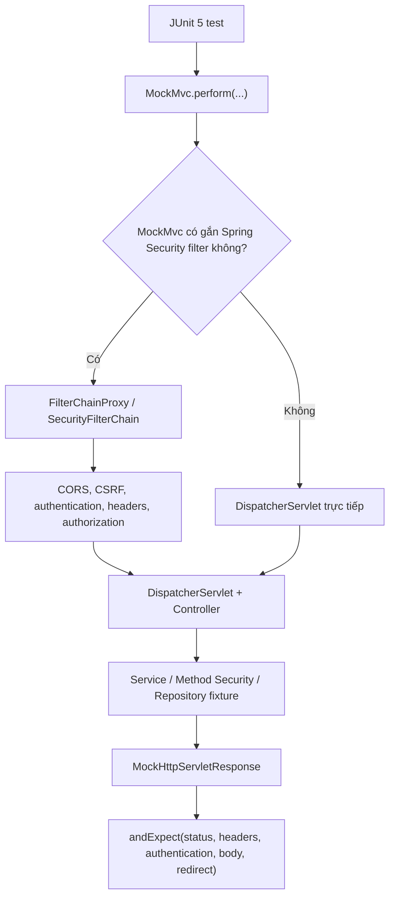
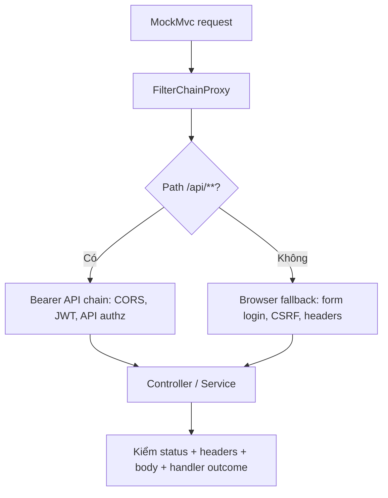

# Tích hợp spring-security-test với MockMvc

> **Chương:** Kiểm thử Servlet  
> **Module:** `SPRING_SECURITY_HTTP_PROTECTION` — bảo vệ HTTP và trình duyệt bằng Spring Security, từ CSRF, CORS, security headers, CSP, HSTS, HTTP firewall đến session; học viên cấu hình Servlet và Reactive, kiểm thử các kịch bản tấn công web và chẩn đoán xung đột bảo mật khi triển khai.  
> **Trọng tâm:** Viết **kiểm thử HTTP security trên Servlet** bằng Spring MVC `MockMvc` kết hợp `spring-security-test`, quan sát đúng security chain, authentication, authorization, CSRF, CORS và response headers. WebFlux được đối chiếu để tránh áp nhầm API giữa hai stack.

## 1. Kết quả học tập

Sau bài học, người học có thể:

1. Giải thích trách nhiệm riêng của `spring-security-test`, Spring MVC Test, `MockMvc` và Spring Security filter chain.
2. Khai báo dependency đúng test scope và kích hoạt MockMvc bằng `@SpringBootTest` + `@AutoConfigureMockMvc` hoặc `MockMvcBuilders.webAppContextSetup(...).apply(springSecurity())`.
3. Phân biệt `@WithMockUser`, `@WithAnonymousUser`, `@WithUserDetails` với request post-processors `user()`, `authentication()`, `jwt()`, `httpBasic()` và `csrf()`.
4. Phân biệt **mock principal/authorities** để kiểm quyền với **gửi credential thật qua authentication filter** để kiểm chữ ký JWT, password, issuer, audience hoặc session.
5. Tạo ma trận anonymous/authenticated/role/scope/CSRF và kiểm status 401, 403, redirect login 302 hoặc 200 đúng nguyên nhân.
6. Kiểm CORS preflight OPTIONS, Origin, Access-Control-Request-Headers và request thật trong cùng security chain.
7. Kiểm response headers `X-Content-Type-Options`, CSP, cache-control và HSTS với request mô phỏng HTTPS; hiểu giới hạn đối với proxy/TLS thật.
8. Kết hợp HTTP authorization với method security và object-level authorization để phát hiện truy cập tài nguyên của người dùng khác (IDOR/BOLA).
9. Dùng `@WebMvcTest`, `@Import` hoặc `MockMvcBuilders.standaloneSetup(...)` có chủ đích, tránh các test “xanh” chỉ vì security filters không chạy.
10. Thiết kế kiểm thử cho async, error dispatch, session và HTTP firewall, biết khi nào phải chuyển sang test Servlet container thật.
11. Chẩn đoán test thất bại mà không tắt CSRF/security hoặc thêm `permitAll()` quá rộng chỉ để status đúng.

## 2. `MockMvc` kiểm gì và không kiểm gì?

`MockMvc` tạo request/response Servlet **giả lập trong JVM**, chuyển request qua Spring MVC `DispatcherServlet` và những Servlet filters được tích hợp vào test setup. Nó có thể kiểm behavior của security chain mà không cần mở cổng HTTP.

`spring-security-test` cung cấp các phần mở rộng phục vụ kiểm thử: setup Spring Security cho MockMvc, annotations tạo security context, request post-processors tạo principal/CSRF/JWT và result matchers quan sát authentication.



Một test có `@WithMockUser` mà **không gắn security filters** vẫn có thể gọi controller/Method Security thành công, nhưng không kiểm được `CsrfFilter`, `CorsFilter`, `HeaderWriterFilter` hoặc authentication entry points của HTTP chain. Vì vậy phải xác định **filter coverage** trước khi tin kết quả.

### 2.1. Phân biệt phạm vi test

| Loại | Kiểm được | Chưa chứng minh |
|---|---|---|
| MockMvc với Spring Security filter chain | Request match chain, CORS/CSRF, auth/authz, status/headers, MVC handler | TLS thật, reverse proxy, HTTP parser raw bytes, browser enforcement |
| `with(jwt())` hoặc `@WithMockUser` | Role/scope/method security/IDOR sau khi principal được tạo | JWT signature, issuer/audience, password, login flow thật |
| `with(httpBasic(...))` / header Authorization thực | Authentication filter và provider/test decoder được cấu hình | Nhà cung cấp IdP production hoặc network gateway |
| `MockMvcBuilders.standaloneSetup(...)` không security | MVC binding, handler logic, simple validation | Security chain; những response 200 có thể sai về bảo mật |
| HTTP integration trên server thật | Servlet container, filter registration, URL normalization, cookies/redirect thực | Không luôn tự bao gồm CDN/browser policy nếu bỏ qua edge |
| Browser + gateway end-to-end | CORS/CSP/browser enforcement, HTTPS/HSTS/cookie/redirect cuối | Không nhất thiết cô lập được nguyên nhân một security filter cụ thể |

**Quy tắc:** Cần cả test **lọc HTTP** và test **quyền ở service/resource**; chỉ xác nhận endpoint có 401 khi anonymous không đủ chống IDOR.

## 3. Thiết lập dependency: test libraries phải ở test scope

Một ứng dụng Servlet Spring Boot thường cần Spring MVC, Spring Security, OAuth2 Resource Server (nếu dùng Bearer JWT), Spring Boot Test và Spring Security Test.

Ví dụ Gradle Kotlin DSL (các artifact/version được Spring Boot BOM hoặc dependency management của project quản lý):

```kotlin
dependencies {
    implementation("org.springframework.boot:spring-boot-starter-web")
    implementation("org.springframework.boot:spring-boot-starter-security")
    implementation("org.springframework.boot:spring-boot-starter-oauth2-resource-server")

    testImplementation("org.springframework.boot:spring-boot-starter-test")
    testImplementation("org.springframework.security:spring-security-test")
}

tasks.test {
    useJUnitPlatform()
}
```

Gradle Groovy tương ứng:

```groovy
dependencies {
    implementation 'org.springframework.boot:spring-boot-starter-web'
    implementation 'org.springframework.boot:spring-boot-starter-security'
    implementation 'org.springframework.boot:spring-boot-starter-oauth2-resource-server'

    testImplementation 'org.springframework.boot:spring-boot-starter-test'
    testImplementation 'org.springframework.security:spring-security-test'
}

test {
    useJUnitPlatform()
}
```

Maven dependency tối thiểu riêng cho Spring Security Test (trong project đã dùng Spring Boot dependency management):

```xml
<dependency>
    <groupId>org.springframework.security</groupId>
    <artifactId>spring-security-test</artifactId>
    <scope>test</scope>
</dependency>
```

**Không tự pin version lệch** giữa `spring-security-test` và Spring Security runtime. Sử dụng phiên bản được BOM/stack quản lý, đối chiếu API với Spring Security cụ thể đang chạy. Ví dụ code trong bài dùng lối cấu hình phổ biến của Spring Security 6+ và Spring Boot 3+; một số package, deprecation hoặc annotation có thể khác ở nhánh mới.

### 3.1. Kiểm stack: đây là Servlet, không phải Reactive

`spring-boot-starter-web` dùng Spring MVC và Servlet stack. Nếu project thật là WebFlux (`spring-boot-starter-webflux` với reactive application type), dùng `WebTestClient` và `springSecurity()` cho reactive test; không chuyển nguyên `SecurityFilterChain`/`HttpSecurity` của Servlet sang `SecurityWebFilterChain`/`ServerHttpSecurity`.

Trong bài này, tất cả `MockMvc` examples đều là **Servlet**. Chỉ nhắc WebFlux để so phạm vi cuối bài.

## 4. Ba cách tạo MockMvc và mức độ tích hợp security

### 4.1. Dùng Spring Boot tự cấu hình — cách thường tiện nhất

```java
@SpringBootTest
@AutoConfigureMockMvc
class SecurityHttpIntegrationTest {

    @Autowired
    MockMvc mvc;

    @Test
    void anonymousCannotReadPrivateApi() throws Exception {
        mvc.perform(get("/api/orders/42"))
            .andExpect(status().isUnauthorized());
    }
}
```

Nhập:

```java
import org.junit.jupiter.api.Test;
import org.springframework.beans.factory.annotation.Autowired;
import org.springframework.boot.test.context.SpringBootTest;
import org.springframework.boot.test.autoconfigure.web.servlet.AutoConfigureMockMvc;
import org.springframework.test.web.servlet.MockMvc;
import static org.springframework.test.web.servlet.request.MockMvcRequestBuilders.get;
import static org.springframework.test.web.servlet.result.MockMvcResultMatchers.status;
```

Ở các phiên bản Spring Boot hỗ trợ `@AutoConfigureMockMvc` theo API trên, auto-config thường đăng ký filters của application context vào MockMvc; `addFilters` mặc định là `true`. Cần xác minh Spring Security chain thật có trong context và không bị vô hiệu hóa bằng test overrides.

**Lỗi cực kỳ dễ bỏ sót:**

```java
@AutoConfigureMockMvc(addFilters = false)
```

Đoạn này loại việc đăng ký Servlet filters vào MockMvc setup của Boot. Nếu test trả 200 cho route private, điều đó có thể chỉ chứng minh bạn **không chạy Spring Security filter**, không phải authentication/authorization đúng. Chỉ dùng khi đang kiểm riêng controller và **không** tuyên bố test là HTTP security integration.

### 4.2. Dùng `webAppContextSetup(...).apply(springSecurity())`

Khi tự build MockMvc, thêm configurer của `spring-security-test`:

```java
@SpringBootTest
class ManualMockMvcSecurityTest {

    @Autowired
    WebApplicationContext context;

    MockMvc mvc;

    @BeforeEach
    void setup() {
        mvc = MockMvcBuilders
            .webAppContextSetup(context)
            .apply(springSecurity())
            .build();
    }
}
```

Imports:

```java
import org.junit.jupiter.api.BeforeEach;
import org.springframework.beans.factory.annotation.Autowired;
import org.springframework.boot.test.context.SpringBootTest;
import org.springframework.test.web.servlet.MockMvc;
import org.springframework.test.web.servlet.setup.MockMvcBuilders;
import org.springframework.web.context.WebApplicationContext;
import static org.springframework.security.test.web.servlet.setup.SecurityMockMvcConfigurers.springSecurity;
```

`springSecurity()` của MockMvc configurer gắn Spring Security `FilterChainProxy` (bean `springSecurityFilterChain`) và các thành phần test context thích hợp, giúp `@WithMockUser`/`user()` hoạt động nhất quán qua request.

Không tự thêm một lần filter chain nữa nếu setup đã gắn nó. Đăng ký trùng filter có thể làm CSRF/headers/authentication chạy hai lần hoặc gây kết quả khó giải thích.

### 4.3. Dùng `@WebMvcTest` cho test slice

```java
@WebMvcTest(OrderController.class)
@Import(ServletSecurityConfig.class)
class OrderControllerSliceTest {

    @Autowired
    MockMvc mvc;

    // Định nghĩa service mock và JwtDecoder test bean
    // khi security config của slice yêu cầu chúng.
}
```

`@WebMvcTest` chỉ load MVC slice, không phải toàn bộ beans production. Security filters/auto-configuration có thể được đưa vào slice, nhưng **controller dependencies, SecurityFilterChain, AuthenticationProvider, JwtDecoder, method security bean** phải được cung cấp đúng cho phạm vi cần kiểm.

Các phiên bản Boot khác nhau có cơ chế test bean mock khác nhau (chẳng hạn `@MockBean` trên nhánh cũ, `@MockitoBean` trên nhánh mới). Không sao chép tên annotation mà chưa đối chiếu Boot/Test framework của project. Cần dùng `@Import` hoặc test configuration rõ ràng để tránh slice dùng **default security chain** khác production.

**Khuyến nghị:** Dùng `@WebMvcTest` cho input validation, MVC mapping và chính sách filter phạm vi hẹp; dùng `@SpringBootTest` + `@AutoConfigureMockMvc` để chứng minh phối hợp HTTP security với method security/service. Nếu cần kiểm TLS/gateway, thêm integration test qua HTTP server thật.

## 5. Bài toán mẫu xuyên suốt: hai chain và ba nhóm endpoint

Ta dùng một ứng dụng Spring MVC giả định:

| URL | Client | Chính sách bảo mật |
|---|---|---|
| `GET /api/catalog/items` | Public API | Anonymous được phép; vẫn có security headers |
| `GET /api/orders/{id}` | Bearer API | JWT có `SCOPE_orders.read` và order thuộc principal |
| `POST /api/orders` | Bearer API | JWT có `SCOPE_orders.write` |
| `DELETE /api/orders/{id}` | Bearer API | JWT có `SCOPE_orders.delete` |
| `GET /account` | Browser | Session/form login |
| `POST /account/profile` | Browser | Session và CSRF token hợp lệ |
| `GET /admin/reports` | Browser | Role ADMIN |
| `GET /login`, `GET /assets/app.css` | Browser public | `permitAll()` trong browser chain, có headers |

API chain dùng OAuth2 Resource Server và Bearer header; browser chain dùng form login/session. CSRF có thể tắt riêng cho API **chỉ khi** API không tin browser auto-credentials; browser vẫn bật CSRF cho state-changing operations.



**Chú ý:** Test role/scope bằng mock principal giúp cô lập authorization; test Bearer signature cần một test khác với token thật/decoder thật.

## 6. Cấu hình Servlet Security cho test fixture

Ví dụ có hai chain rõ ràng, chú trọng CORS/CSRF/header policies khác nhau:

```java
package example.security;

import java.util.List;

import org.springframework.context.annotation.Bean;
import org.springframework.context.annotation.Configuration;
import org.springframework.core.annotation.Order;
import org.springframework.http.HttpMethod;
import org.springframework.security.config.Customizer;
import org.springframework.security.config.annotation.method.configuration.EnableMethodSecurity;
import org.springframework.security.config.annotation.web.builders.HttpSecurity;
import org.springframework.security.config.annotation.web.configuration.EnableWebSecurity;
import org.springframework.security.config.annotation.web.configurers.AbstractHttpConfigurer;
import org.springframework.security.config.http.SessionCreationPolicy;
import org.springframework.security.web.SecurityFilterChain;
import org.springframework.web.cors.CorsConfiguration;
import org.springframework.web.cors.CorsConfigurationSource;
import org.springframework.web.cors.UrlBasedCorsConfigurationSource;

@Configuration
@EnableWebSecurity
@EnableMethodSecurity
public class ServletSecurityConfig {

    @Bean
    @Order(1)
    SecurityFilterChain api(HttpSecurity http) throws Exception {
        return http
            .securityMatcher("/api/**")
            .cors(cors -> cors.configurationSource(apiCors()))
            .csrf(AbstractHttpConfigurer::disable)
            .sessionManagement(session -> session
                .sessionCreationPolicy(SessionCreationPolicy.STATELESS))
            .authorizeHttpRequests(auth -> auth
                .requestMatchers(HttpMethod.GET, "/api/catalog/**")
                    .permitAll()
                .requestMatchers(HttpMethod.GET, "/api/orders/**")
                    .hasAuthority("SCOPE_orders.read")
                .requestMatchers(HttpMethod.POST, "/api/orders")
                    .hasAuthority("SCOPE_orders.write")
                .requestMatchers(HttpMethod.DELETE, "/api/orders/**")
                    .hasAuthority("SCOPE_orders.delete")
                .anyRequest().denyAll())
            .oauth2ResourceServer(oauth2 -> oauth2
                .jwt(Customizer.withDefaults()))
            .build();
    }

    @Bean
    @Order(2)
    SecurityFilterChain browser(HttpSecurity http) throws Exception {
        return http
            // Không securityMatcher: fallback.
            .authorizeHttpRequests(auth -> auth
                .requestMatchers("/login", "/assets/**").permitAll()
                .requestMatchers("/admin/**").hasRole("ADMIN")
                .anyRequest().authenticated())
            .formLogin(Customizer.withDefaults())
            .csrf(Customizer.withDefaults())
            .headers(headers -> headers
                .contentSecurityPolicy(csp -> csp.policyDirectives(
                    "default-src 'self'; object-src 'none'; " +
                    "base-uri 'self'; frame-ancestors 'none'")))
            .build();
    }

    @Bean
    CorsConfigurationSource apiCors() {
        CorsConfiguration cors = new CorsConfiguration();
        cors.setAllowedOrigins(List.of(
            "https://client.example.com"));
        cors.setAllowedMethods(List.of(
            "GET", "POST", "PUT", "PATCH", "DELETE"));
        cors.setAllowedHeaders(List.of(
            "Authorization", "Content-Type"));
        cors.setMaxAge(1800L);

        UrlBasedCorsConfigurationSource source =
            new UrlBasedCorsConfigurationSource();
        source.registerCorsConfiguration("/api/**", cors);
        return source;
    }
}
```

### 6.1. Điều kiện tối thiểu để chạy mẫu

- Maven/Gradle dependencies phù hợp, JUnit Jupiter và Spring Security Test.
- Spring MVC controllers/test handlers cho các endpoint mong đợi 200/201/204.
- `JwtDecoder` hoặc issuer configuration để Resource Server chain xây dựng được; `jwt()` test helper **không tự tạo decoder bean** khi ứng dụng cần bean ấy để khởi động.
- User store/provider cho browser form login nếu test login bằng username/password thật.
- Service/database fixtures hoặc fake repository cô lập để test ownership.
- Đảm bảo bean/matcher/security config trong test **chính là cấu hình muốn kiểm**. Nếu ứng dụng đang có nhiều `SecurityFilterChain`, order ưu tiên quyết định chain nào nhận request.

### 6.2. Không sửa cấu hình production chỉ để test dễ qua

Nếu `POST /account/profile` thiếu CSRF và trả 403, đó có thể là behavior **đúng**. Hãy dùng `with(csrf())` để test authenticated browser request hợp lệ; đừng tắt CSRF toàn cục hoặc thêm `permitAll("/account/**")` cho test pass.

Tương tự, không đưa `JwtDecoder` kiểu “tin mọi token” vào production. Nếu dùng decoder test double, giới hạn riêng trong test profile/context và có integration test JWT decoder thật.

## 7. Ba loại danh tính test cần phân biệt

### 7.1. `@WithMockUser` — đặt user cho cả test method

```java
@Test
@WithMockUser(username = "alice", roles = {"USER"})
void accountPageLoadsForLoggedInUser() throws Exception {
    mvc.perform(get("/account"))
        .andExpect(status().isOk());
}
```

`@WithMockUser` tạo một `SecurityContext` với authentication mock (thường là `UsernamePasswordAuthenticationToken`) cho test. `roles = {"ADMIN"}` tạo authority `ROLE_ADMIN` theo convention; không tự tạo `SCOPE_orders.read`.

Nếu cần authority OAuth2 scope dạng string:

```java
@Test
@WithMockUser(
    username = "alice",
    authorities = {"SCOPE_orders.read"})
void serviceMethodMayObserveScope() {
    // Hữu ích cho authorization tests dùng authorities.
}
```

Nhưng một controller có `@AuthenticationPrincipal Jwt` yêu cầu JWT principal — `@WithMockUser` **không biến principal thành `Jwt`**. Với Resource Server JWT endpoint, ưu tiên `with(jwt())` khi test quyền.

### 7.2. `@WithAnonymousUser` — kiểm anonymous rõ ràng

```java
@Test
@WithAnonymousUser
void anonymousAccountIsRedirected() throws Exception {
    mvc.perform(get("/account"))
        .andExpect(status().is3xxRedirection());
}
```

Hữu ích nếu class hoặc một test base mặc định dùng `@WithMockUser`; annotation này làm test case rõ là anonymous.

### 7.3. `@WithUserDetails` — load user từ UserDetailsService

```java
@Test
@WithUserDetails(value = "alice")
void userFromConfiguredStoreCanAccessAccount()
        throws Exception {
    mvc.perform(get("/account"))
        .andExpect(status().isOk());
}
```

`@WithUserDetails` tìm user bằng `UserDetailsService` trong test context, giúp kiểm principal, roles/authorities được khai báo ở store. **Nó không gửi password tới form-login authentication filter** và không kiểm credential exchange thật.

Nếu project có nhiều `UserDetailsService` beans, cần chỉ rõ bean theo API annotation ở phiên bản đang dùng. Với user chỉ tồn tại sau `@BeforeEach`, phải hiểu thời điểm tạo security context của test listener; không mặc định listener luôn chạy sau setup data.

### 7.4. Security context test và request authorization là hai khái niệm

`@WithMockUser` làm test method có principal ở security context; nó không tự bảo đảm filter chain được MockMvc gắn. Khi security chain có nhiều authentication mechanisms, phương thức khởi tạo principal cũng ảnh hưởng loại `Authentication`/principal mà controller thấy.

Nếu muốn kiểm cookie/session form-login thật hoặc JWT token parsing, **không** dùng annotation mock như bằng chứng xác thực production.

## 8. Request post-processors: principal thuộc từng request

`spring-security-test` cung cấp các helpers (cần import tĩnh đúng package Servlet):

```java
import static org.springframework.security.test.web.servlet.request.SecurityMockMvcRequestPostProcessors.*;
```

### 8.1. `user()` — một authenticated request với UsernamePasswordAuthenticationToken

```java
mvc.perform(get("/account")
        .with(user("alice").roles("USER")))
    .andExpect(status().isOk());

mvc.perform(get("/admin/reports")
        .with(user("alice").roles("USER")))
    .andExpect(status().isForbidden());
```

`user("alice").roles("USER")` tạo `ROLE_USER`. Nếu rule dùng `hasAuthority("SCOPE_orders.read")`, không lấy role USER thay scope read; cấu hình authority cho đúng:

```java
.with(user("alice").authorities(
    new SimpleGrantedAuthority("SCOPE_orders.read")))
```

Đây vẫn là UsernamePasswordAuthenticationToken mock, không phải JWT. Endpoint/controller thật sự cần `Jwt` principal thì dùng `jwt()`.

### 8.2. `authentication()` — cung cấp Authentication tùy biến

```java
Authentication principal =
    UsernamePasswordAuthenticationToken.authenticated(
        "alice", "N/A",
        List.of(new SimpleGrantedAuthority("ROLE_USER")));

mvc.perform(get("/account")
        .with(authentication(principal)))
    .andExpect(status().isOk());
```

Hữu ích khi đang kiểm một custom `Authentication`/authority mapping. Cần Spring Security filter/context integration để mock request principal được dùng nhất quán.

### 8.3. `anonymous()` — reset principal cho request cụ thể

```java
mvc.perform(get("/account").with(anonymous()))
    .andExpect(status().is3xxRedirection());
```

Nếu các test chia sẻ security context setup, helper này giúp chỉ định request anonymous. Tuy nhiên nên tránh phụ thuộc trạng thái của test trước: mỗi test phải độc lập, không chia sẻ session/context không chủ ý.

### 8.4. `httpBasic()` — gửi Authorization header Basic thật

```java
mvc.perform(get("/basic/secure")
        .with(httpBasic("alice", "wrong-password")))
    .andExpect(status().isUnauthorized());
```

`httpBasic(...)` tạo header Basic; nếu security chain bật HTTP Basic và authentication provider tương ứng, request đi qua quá trình authentication thật của cấu hình test. Khác `with(user())`, nó **không trực tiếp tạo authenticated principal**.

Đoạn test trên chỉ chạy có ý nghĩa nếu route `/basic/secure` nằm trong chain bật `httpBasic` và credential sai thật bị provider từ chối. **Ví dụ hai-chain mục 6 không bật Basic**; đừng copy test Basic vào đó rồi coi 401 là bằng chứng password validation.

## 9. CSRF trong MockMvc: phải kiểm cả case hợp lệ và không hợp lệ

CSRF protection là một Servlet security filter, thường chặn unsafe methods dùng browser auto-credentials. `CsrfFilter` có thể trả 403 **trước authorization**, nên test chỉ assert 403 không đủ biết do CSRF hay thiếu role.

### 9.1. Browser POST thiếu token — phải bị từ chối

```java
@Test
void sessionPostWithoutCsrfIsForbidden() throws Exception {
    mvc.perform(post("/account/profile")
            .with(user("alice").roles("USER"))
            .contentType(MediaType.APPLICATION_JSON)
            .content("{\"displayName\":\"Alice\"}"))
        .andExpect(status().isForbidden());
}
```

Request này có user mock nhưng thiếu CSRF token. Với browser chain bật CSRF theo mặc định, 403 là kỳ vọng; controller chưa chắc được chạy.

### 9.2. Browser POST có token — được xét quyền tiếp

```java
@Test
void sessionPostWithCsrfReachesController() throws Exception {
    mvc.perform(post("/account/profile")
            .with(user("alice").roles("USER"))
            .with(csrf())
            .contentType(MediaType.APPLICATION_JSON)
            .content("{\"displayName\":\"Alice\"}"))
        .andExpect(status().isNoContent());
}
```

`with(csrf())` tạo token test phù hợp với request/repository setup. Nó giúp kiểm CSRF filter acceptance, nhưng **không kiểm vòng đời phát token thật cho browser**, cookie settings hay việc frontend lấy/gửi token chính xác.

Test 204 giả định có fixture controller trả 204 với JSON body hợp lệ. Nếu controller không tồn tại, request có thể trả 404 dù CSRF đã pass; phải tạo fixture thay vì nới security policy.

### 9.3. Token sai — chắc chắn phải được từ chối

```java
@Test
void invalidCsrfTokenIsForbidden() throws Exception {
    mvc.perform(post("/account/profile")
            .with(user("alice").roles("USER"))
            .with(csrf().useInvalidToken()))
        .andExpect(status().isForbidden());
}
```

Kết hợp case thiếu, hợp lệ và sai token để bắt lỗi cấu hình `csrf().disable()` vô ý trên browser chain.

### 9.4. Token trong header thay vì request parameter

```java
mvc.perform(post("/account/profile")
        .with(user("alice").roles("USER"))
        .with(csrf().asHeader()))
    .andExpect(status().isNoContent());
```

Hữu ích khi frontend SPA gửi CSRF token trong header; nhưng CORS allowlist của cross-origin SPA còn phải cho phép header CSRF trên preflight. `csrf().asHeader()` không kiểm browser CORS logic hoặc cách token được phát ra.

### 9.5. Vì sao test thiếu role phải cung cấp CSRF hợp lệ?

Ví dụ test `POST /admin/settings` với user role USER:

```java
mvc.perform(post("/admin/settings")
        .with(user("alice").roles("USER"))
        .with(csrf()))
    .andExpect(status().isForbidden());
```

Nếu không có `with(csrf())`, 403 có thể chỉ là CSRF failure, và test vẫn pass **ngay cả khi authorization cho USER nhầm**. Một test security tốt phải cô lập điều kiện đang kiểm.

### 9.6. API Bearer stateless không có nghĩa tự miễn CSRF

Trong cấu hình mẫu, API chain tắt CSRF vì threat model giả định chỉ dùng Authorization Bearer header và không chấp nhận credential browser tự gửi. Vì vậy:

```java
mvc.perform(post("/api/orders")
        .with(jwt().authorities(
            new SimpleGrantedAuthority("SCOPE_orders.write")))
        .contentType(MediaType.APPLICATION_JSON)
        .content("{\"item\":\"book\"}"))
    .andExpect(status().isCreated());
```

có thể pass mà không có `with(csrf())` nếu controller trả 201. **Đó là kiểm policy API cụ thể**, không phải bằng chứng mọi REST/JSON API được tắt CSRF. Nếu API nhận cookie hoặc Basic được browser tự gửi, phải đánh giá lại.

## 10. JWT và `jwt()`: kiểm đúng scope nhưng không kiểm chữ ký

Với Servlet OAuth2 Resource Server, helper `jwt()` tạo một `JwtAuthenticationToken` được đặt vào security context của request test. Điều này rất tiện để kiểm authority rules và controller nhận `Jwt` principal, nhưng nó **không giải mã hay xác minh chuỗi JWT nhận từ client**.

### 10.1. Kiểm scope read

```java
@Test
void jwtWithReadScopeCanReadOwnedOrder() throws Exception {
    mvc.perform(get("/api/orders/order-a")
            .with(jwt()
                .jwt(builder -> builder.subject("alice"))
                .authorities(new SimpleGrantedAuthority(
                    "SCOPE_orders.read"))))
        .andExpect(status().isOk());
}
```

Phải có fixture `order-a` thuộc Alice và controller/service ownership check đúng.

### 10.2. Kiểm JWT thiếu authority

```java
@Test
void jwtWithoutReadScopeIsForbidden() throws Exception {
    mvc.perform(get("/api/orders/order-a")
            .with(jwt()
                .jwt(builder -> builder.subject("alice"))
                .authorities(new SimpleGrantedAuthority(
                    "SCOPE_orders.write"))))
        .andExpect(status().isForbidden());
}
```

Ở đây test có authenticated JWT principal nhưng chỉ có write authority; rule GET yêu cầu `SCOPE_orders.read`. Kỳ vọng 403 trước khi service cho phép đọc.

### 10.3. JWT thiếu token: kiểm entry point thật của chain

```java
@Test
void anonymousApiGetsBearerChallenge() throws Exception {
    mvc.perform(get("/api/orders/order-a"))
        .andExpect(status().isUnauthorized())
        .andExpect(header().exists("WWW-Authenticate"));
}
```

Đây là test khác với `jwt()`: không có mock principal, nên request vào API chain rồi bị authorization/entry point xử lý. Nếu nhận 302 login, có thể browser fallback đã nhận request trước API chain vì `@Order`/matcher sai.

### 10.4. JWT “invalid signature” phải gửi token qua Authorization header

Không dùng:

```java
// SAI mục tiêu: jwt() KHÔNG verify chữ ký.
.with(jwt().jwt(builder -> builder.tokenValue("invalid")))
```

để tuyên bố chữ ký sai được từ chối. Helper tạo một authenticated JWT trong test context; tokenValue là metadata mock.

Để kiểm xác minh token, gửi:

```java
@Test
void malformedBearerHeaderIsRejected() throws Exception {
    mvc.perform(get("/api/orders/order-a")
            .header("Authorization", "Bearer not-a-valid-jwt"))
        .andExpect(status().isUnauthorized());
}
```

Test này cần `JwtDecoder` thật hoặc test double cố ý reject token, OAuth2 Resource Server filter được bật và không có `with(jwt())`. Để kiểm signature/issuer/audience/expiry, tích hợp decoder/key material và token fixtures thật theo threat model; một `JwtDecoder` mock luôn accept sẽ làm test 401 vô nghĩa.

### 10.5. Public endpoint vẫn có thể từ chối token hỏng

```java
mvc.perform(get("/api/catalog/items"))
    .andExpect(status().isOk());

mvc.perform(get("/api/catalog/items")
        .header("Authorization", "Bearer invalid"))
    .andExpect(status().isUnauthorized());
```

Trong Resource Server chain chuẩn, authentication filter có thể kiểm Bearer token đã gửi **trước** authorization `permitAll()`. Vì thế “public” không đồng nghĩa “bỏ qua credential verification khi client chủ động gửi token”.

## 11. Authorization matrix: không chỉ test anonymous

Một kiểm thử đầy đủ nên có cả request được phép và request phải bị từ chối theo **điều kiện cụ thể**.

| Request | Principal | Kỳ vọng theo mẫu | Lớp đang kiểm |
|---|---|---|---|
| `GET /api/catalog/items` | Anonymous | 200 nếu handler tồn tại | Public HTTP authorization + headers |
| `GET /api/orders/order-a` | Anonymous | 401 Bearer | API chain/entry point |
| `GET /api/orders/order-a` | JWT Alice, không scope read | 403 | HTTP scope authorization |
| `GET /api/orders/order-a` | JWT Alice, scope read | 200 | HTTP + ownership |
| `GET /api/orders/order-b` | JWT Alice, scope read | 404/403 theo contract | Service/domain ownership |
| `POST /api/orders` | JWT Alice, scope write | 201 nếu handler thành công | API permission, không browser CSRF |
| `DELETE /api/orders/order-a` | JWT Alice, không delete scope | 403 | HTTP method/path/scope |
| `GET /account` | Anonymous | 302 login | Browser form entry point |
| `GET /account` | User Alice | 200 | Browser authentication |
| `POST /account/profile` | Alice, thiếu CSRF | 403 | Browser CSRF |
| `POST /account/profile` | Alice, valid CSRF | 204 | CSRF pass + controller |
| `GET /admin/reports` | Alice USER | 403 | Browser role authorization |
| `GET /admin/reports` | Alice ADMIN | 200 nếu handler tồn tại | Browser role + handler |
| `GET /assets/app.css` | Anonymous | 200 + nosniff nếu fixture tồn tại | Public static qua chain |

Đây là **ma trận kỳ vọng theo cấu hình bài**, không phải mọi ứng dụng đều trả chính xác các status này. Entry point, exception handler, controller fixtures, CORS và filters tùy biến có thể thay kết quả. Quan trọng nhất là test chỉ rõ **lớp bảo mật cần quan sát**.

### 11.1. Một status 403 có thể là “đúng kết quả, sai nguyên nhân”

Nếu test POST admin không có CSRF token, 403 có thể đến từ CSRF chứ không phải role. Nếu GET admin dùng JWT mock trong browser chain form-login, kiểu authentication có thể không giống production. Hãy loại những nguyên nhân nhiễu trước khi kết luận rule đạt yêu cầu.

### 11.2. Không test chức năng bằng route không tồn tại rồi đòi 200

Một GET public với `permitAll` vẫn có thể trả 404 khi resource/controller chưa được khai báo. Điều đó không chứng minh security chặn; muốn assert 200, phải tạo handler hoặc static fixture.

### 11.3. Negative tests có giá trị bảo mật cao

Chỉ test JWT Alice có scope và gọi order của Alice sẽ không phát hiện thiếu ownership check. Cần test Alice gọi order của Bob, token sai scope, wrong HTTP method và prefix URL gần giống. Có thể thêm tenant cross-boundary nếu dữ liệu multi-tenant.

## 12. Browser session, form login và logout trong MockMvc

### 12.1. `@WithMockUser` không phải form login

`@WithMockUser` hoặc `with(user())` tạo principal test để bỏ qua bước nhập credential, rất tiện cho authorization/CSRF. Nhưng chúng **không** kiểm:

- PasswordEncoder hay AuthenticationProvider.
- Form login POST `/login` có nhận password đúng không.
- Session fixation protection hoặc session migration.
- Cookie Secure/HttpOnly/SameSite trên HTTP thật.
- Redirect sau login, saved request hoặc logout invalidation theo end-to-end flow.

Muốn kiểm các điều đó, cần request POST form thật, authentication provider phù hợp và đôi khi HTTP container/browser integration.

### 12.2. Đăng nhập form với POST và CSRF thật trong MockMvc

Ví dụ khi app dùng form-login mặc định, `UserDetailsService` có user `alice` với password mã hóa phù hợp:

```java
@Test
void realFormLoginCreatesAuthenticatedSession()
        throws Exception {
    MvcResult result = mvc.perform(post("/login")
            .param("username", "alice")
            .param("password", "correct-password")
            .with(csrf()))
        .andExpect(status().is3xxRedirection())
        .andReturn();

    MockHttpSession session = (MockHttpSession)
        result.getRequest().getSession(false);

    assertNotNull(session);
}
```

Imports:

```java
import org.junit.jupiter.api.Test;
import org.springframework.mock.web.MockHttpSession;
import org.springframework.test.web.servlet.MvcResult;
import static org.junit.jupiter.api.Assertions.assertNotNull;
```

Đây là kiểm thử **khi user store test thật có user/password ấy** và session-based security context persistence được bật. Nếu app dùng custom loginProcessingUrl, success handler hoặc security context repository khác, phải điều chỉnh endpoint/assertion; một 302 có thể còn đến từ failure handler, nên cần kiểm `Location`/authentication result theo contract.

### 12.3. Dùng session cho request tiếp theo

```java
mvc.perform(get("/account").session(session))
    .andExpect(status().isOk());
```

Ở đây `session` là `MockHttpSession` lấy từ bước login thành công. Khi test chuỗi login→request riêng tư, nên kiểm session không bị dùng giữa các test khác nhau; mỗi test tự tạo session hoặc có lifecycle rõ.

### 12.4. Logout cần test thay đổi trạng thái

Với form login/session, logout thường yêu cầu POST và CSRF khi CSRF bật:

```java
mvc.perform(post("/logout")
        .session(session)
        .with(csrf()))
    .andExpect(status().is3xxRedirection());
```

Tùy logout success handler và cách lưu SecurityContext, cần kiểm session được invalidated hoặc subsequent private request không còn authenticated. Một redirect đơn lẻ không chứng minh session đã được vô hiệu hóa nếu vẫn còn credential khác.

### 12.5. `@WithUserDetails` không kiểm password

Nhiều người dùng `@WithUserDetails("alice")` rồi khẳng định form login hoạt động. Thực tế annotation load principal vào test SecurityContext và không gửi `username/password` qua filter. Muốn kiểm login thật, dùng POST form, không dùng mock authentication.

## 13. CORS preflight và actual request: kiểm cả hai

Browser có thể preflight API có Authorization header:

```http
OPTIONS /api/orders HTTP/1.1
Origin: https://client.example.com
Access-Control-Request-Method: POST
Access-Control-Request-Headers: authorization,content-type
```

API CORS filter phải xử lý OPTIONS đủ sớm để không yêu cầu Bearer/CSRF trên preflight. Với cấu hình ở mục 6:

```java
@Test
void allowedPreflightCanSucceedWithoutBearer()
        throws Exception {
    mvc.perform(options("/api/orders")
            .header("Origin", "https://client.example.com")
            .header("Access-Control-Request-Method", "POST")
            .header("Access-Control-Request-Headers",
                "authorization,content-type"))
        .andExpect(status().isOk())
        .andExpect(header().string(
            "Access-Control-Allow-Origin",
            "https://client.example.com"));
}
```

Nếu preflight trả 401/302, kiểm chain selection và CORS filter/source. **Không** chữa bằng cách bỏ toàn bộ OPTIONS khỏi Spring Security chain vì có thể làm mất chính CORS filter.

### 13.1. Origin lạ phải bị từ chối

```java
@Test
void untrustedPreflightIsNotAllowed()
        throws Exception {
    mvc.perform(options("/api/orders")
            .header("Origin", "https://untrusted.example")
            .header("Access-Control-Request-Method", "POST")
            .header("Access-Control-Request-Headers",
                "authorization"))
        .andExpect(status().isForbidden());
}
```

Status 403 là hành vi thường gặp của Spring CORS với source mẫu; nếu thay CORS processor/gateway, status có thể khác. **Bất biến bảo mật** là origin lạ không được cấp `Access-Control-Allow-Origin` theo policy.

### 13.2. Preflight OK không đồng nghĩa POST được phép

```java
mvc.perform(post("/api/orders")
        .header("Origin", "https://client.example.com")
        .with(jwt().authorities(
            new SimpleGrantedAuthority("SCOPE_orders.read")))
        .contentType(MediaType.APPLICATION_JSON)
        .content("{\"item\":\"book\"}"))
    .andExpect(status().isForbidden());
```

Preflight trước đó có thể OK, nhưng POST thật phải có `SCOPE_orders.write`. CORS là browser origin policy, không phải authentication/authorization.

### 13.3. Cookie/credentials CORS khác Bearer API mẫu

Nếu một API cross-origin dùng session cookie, CORS cần allowlist origin và credential mode phù hợp (không dùng wildcard `*` với credentials). Unsafe request **vẫn** cần CSRF theo threat model. MockMvc chỉ kiểm backend response headers, không áp browser CORS engine; cần browser test để xác minh cookie SameSite, credentials mode và preflight/actual behavior thật.
## 14. Kiểm security headers: response 200 là chưa đủ

Spring Security Servlet thường dùng `HeaderWriterFilter` để thêm các security headers trước response commit. `X-Content-Type-Options` và cache-related headers thường có mặc định phù hợp, CSP là policy ứng dụng cần chủ động thiết kế, còn HSTS gắn với scheme HTTPS và cấu hình header writer.

### 14.1. Trang login công khai vẫn cần CSP/nosniff

```java
@Test
void publicLoginStillHasBrowserSecurityHeaders()
        throws Exception {
    mvc.perform(get("/login"))
        .andExpect(status().isOk())
        .andExpect(header().string(
            "X-Content-Type-Options", "nosniff"))
        .andExpect(header().string(
            "Content-Security-Policy",
            "default-src 'self'; object-src 'none'; " +
            "base-uri 'self'; frame-ancestors 'none'"));
}
```

Kỳ vọng giả định `GET /login` trả response 200 (trang login do Spring Security tạo hoặc fixture) và CSP từ cấu hình mục 6. `permitAll()` không tự bỏ security headers. Nếu static/login URL bị `web.ignoring()` hoặc không match chain, header writer của chain sẽ không chạy cho URL đó.

### 14.2. So sánh request secure và insecure

```java
@Test
void secureRequestCanReceiveHsts() throws Exception {
    mvc.perform(get("/login").secure(true))
        .andExpect(status().isOk())
        .andExpect(header().exists(
            "Strict-Transport-Security"));
}

@Test
void insecureMockRequestNormallyDoesNotHaveHsts()
        throws Exception {
    mvc.perform(get("/login").secure(false))
        .andExpect(status().isOk())
        .andExpect(header().doesNotExist(
            "Strict-Transport-Security"));
}
```

`.secure(true)` chỉ đổi cờ secure của `MockHttpServletRequest`, **không** tạo HTTPS thật, không xác nhận TLS termination, forwarded headers hoặc browser HSTS caching. Một edge proxy có thể tự thêm HSTS ngay cả khi MockMvc HTTP không thêm. Cần kiểm response cuối từ public HTTPS host.

### 14.3. Header trên CSRF 403 và private response

```java
@Test
void csrfDeniedResponseCanKeepConfiguredCsp()
        throws Exception {
    mvc.perform(post("/account/profile")
            .with(user("alice").roles("USER")))
        .andExpect(status().isForbidden())
        .andExpect(header().exists(
            "Content-Security-Policy"));
}

@Test
void privateAccountResponseHasCachePolicy()
        throws Exception {
    mvc.perform(get("/account")
            .with(user("alice").roles("USER")))
        .andExpect(status().isOk())
        .andExpect(header().exists("Cache-Control"));
}
```

Header tồn tại chưa chứng minh giá trị bảo vệ phù hợp. Private HTML thường cần cache policy thận trọng, trong khi CSS/JS có content hash có thể dùng cache dài hạn. Không tắt cache-control toàn app chỉ để static asset cache lâu; phân biệt policy theo resource.

Nếu response 400/403 do gateway/container/firewall tạo **trước security header writer**, headers của chain có thể không xuất hiện. CSP của HTML document quyết định các subresources, còn CSP trên JSON 403 không phải authorization và không thay CSRF.

## 15. Object authorization: test IDOR/BOLA dù HTTP scope đúng

JWT có `SCOPE_orders.read` cho phép gọi nhóm GET `/api/orders/**`, nhưng không tự cho user Alice đọc order của Bob. Cần kiểm ownership trong service và repository.

Controller minh họa:

```java
@RestController
class OrderController {

    private final OwnedOrderService service;

    OrderController(OwnedOrderService service) {
        this.service = service;
    }

    @GetMapping("/api/orders/{orderId}")
    OrderDto read(
            @PathVariable String orderId,
            Authentication authentication) {

        return service.readOwned(orderId,
            authentication.getName());
    }
}
```

Service giới hạn principal và query:

```java
@Service
class OwnedOrderService {

    private final OrderRepository repository;

    OwnedOrderService(OrderRepository repository) {
        this.repository = repository;
    }

    @PreAuthorize(
        "hasAuthority('SCOPE_orders.read') " +
        "and authentication.name == #subject")
    OrderDto readOwned(
            String orderId,
            @P("subject") String subject) {
        return repository
            .findByIdAndOwnerSubject(orderId, subject)
            .map(OrderDto::from)
            .orElseThrow(() ->
                new ResponseStatusException(
                    HttpStatus.NOT_FOUND));
    }
}
```

`OrderRepository`, `OrderRecord` và `OrderDto` là domain fixtures cần triển khai; method security phải được bật và lời gọi phải đi qua Spring-managed proxy. `this.readOwned(...)` nội bộ có thể không đi qua interceptor; query owner predicate vẫn là lớp bảo vệ dữ liệu quan trọng.

### 15.1. Positive và negative case bắt buộc

```java
@Test
void aliceCanReadHerOwnOrder() throws Exception {
    mvc.perform(get("/api/orders/order-a")
            .with(jwt().jwt(j -> j.subject("alice"))
                .authorities(new SimpleGrantedAuthority(
                    "SCOPE_orders.read"))))
        .andExpect(status().isOk())
        .andExpect(jsonPath("$.id").value("order-a"));
}

@Test
void aliceCannotReadBobsOrder() throws Exception {
    mvc.perform(get("/api/orders/order-b")
            .with(jwt().jwt(j -> j.subject("alice"))
                .authorities(new SimpleGrantedAuthority(
                    "SCOPE_orders.read"))))
        .andExpect(status().isNotFound());
}
```

Kỳ vọng 404 là contract của ví dụ khi service chỉ tìm order **trong phạm vi user**; API khác có thể dùng 403. Không bao giờ trả fields của Bob cho Alice. Phải có test data xác định order-a thuộc Alice và order-b thuộc Bob.

### 15.2. Header giả mạo không thay được principal đã xác thực

```java
@Test
void forgedUserHeaderDoesNotChangePrincipal()
        throws Exception {
    mvc.perform(get("/api/orders/order-b")
            .header("X-User-Id", "bob")
            .with(jwt().jwt(j -> j.subject("alice"))
                .authorities(new SimpleGrantedAuthority(
                    "SCOPE_orders.read"))))
        .andExpect(status().isNotFound());
}
```

Test chứng minh controller/service không tin header do client tự khai. Nhưng nó **không kiểm gateway có sanitize X-User-Id hay backend có bị truy cập trực tiếp không**; cần ingress test riêng cho trust boundary.

## 16. `@WebMvcTest`: slice test cần chủ động chọn security config

Slice test phù hợp cho mapping, input validation và HTTP authorization của controller, nhưng chỉ load phần MVC. Nó không bảo đảm import toàn bộ service/method security/database của ứng dụng.

Skeleton:

```java
@WebMvcTest(OrderController.class)
@Import({
    ServletSecurityConfig.class,
    OrderControllerSliceTest.SliceBeans.class
})
class OrderControllerSliceTest {

    @Autowired MockMvc mvc;
    @Autowired OwnedOrderService service;

    @Test
    void missingScopeIs403BeforeService() throws Exception {
        mvc.perform(get("/api/orders/order-a")
                .with(jwt().authorities(
                    new SimpleGrantedAuthority(
                        "SCOPE_orders.write"))))
            .andExpect(status().isForbidden());

        verifyNoInteractions(service);
    }

    @TestConfiguration
    static class SliceBeans {
        @Bean
        OwnedOrderService orderService() {
            return Mockito.mock(OwnedOrderService.class);
        }

        @Bean
        JwtDecoder jwtDecoder() {
            // Chỉ là test fixture, không dùng ở production.
            return token -> {
                throw new BadJwtException(
                    "JWT verification not exercised in this slice");
            };
        }
    }
}
```

Các imports gợi ý:

```java
import org.springframework.boot.test.autoconfigure.web.servlet.WebMvcTest;
import org.springframework.boot.test.context.TestConfiguration;
import org.springframework.context.annotation.Bean;
import org.springframework.context.annotation.Import;
import org.springframework.security.oauth2.jwt.BadJwtException;
import org.springframework.security.oauth2.jwt.JwtDecoder;
import org.mockito.Mockito;
import static org.mockito.Mockito.verifyNoInteractions;
```

**Giới hạn có chủ đích:** mock service làm `verifyNoInteractions` hữu ích để xác minh HTTP rule từ chối **trước controller**. Nhưng test này **không chứng minh owner query hoặc method security trong service thật**. Với Spring Boot/Spring Framework khác version, test bean mocking có thể dùng `@MockBean` hoặc `@MockitoBean`; ở đây dùng test bean factory để minh họa cách cung cấp dependencies.

Slice phải có đúng security config và `JwtDecoder` để context khởi động; nếu không import config production, Boot có thể áp default chain khác và làm assertion sai mục tiêu.

## 17. `standaloneSetup(...)`: chỉ kiểm controller nếu chưa gắn security

Một `MockMvc` standalone:

```java
MockMvc mvc = MockMvcBuilders
    .standaloneSetup(new SimpleController())
    .build();
```

không tự tạo `WebApplicationContext`, security beans hoặc `FilterChainProxy` như full context. Private route trả 200 trong setup này có thể chỉ chứng minh **controller trả 200 khi không qua Spring Security**.

Có thể chủ động gắn một `FilterChainProxy` đã xây đúng vào standalone builder:

```java
MockMvc mvc = MockMvcBuilders
    .standaloneSetup(controller)
    .apply(springSecurity(filterChainProxy))
    .build();
```

Tuy nhiên bảo đảm filter chain, authentication components, security context repository và Method Security đang tương thích với test setup không đơn giản. Khi mục đích là tích hợp Servlet security với MVC, nên ưu tiên `webAppContextSetup(context).apply(springSecurity())` hoặc `@AutoConfigureMockMvc`.

### 17.1. Không gắn filter trùng

Nếu Boot đã auto-register filter vào MockMvc, không add một `FilterChainProxy` nữa vào cùng builder chỉ vì “cho chắc”. Hai lần invocation có thể gây duplicate logs, CSRF xử lý lặp, header/session side effects và lỗi khó chẩn đoán.

## 18. Custom principal và `@WithSecurityContext`

Với tenant-aware principal hoặc authorities đặc thù, có thể tạo annotation test riêng qua `@WithSecurityContext`. Ví dụ trong test source:

```java
@Retention(RetentionPolicy.RUNTIME)
@Target({ElementType.TYPE, ElementType.METHOD})
@WithSecurityContext(factory = WithTenantUserFactory.class)
@interface WithTenantUser {
    String username() default "alice";
    String tenant() default "tenant-a";
}

record TenantPrincipal(String username, String tenant)
        implements java.security.Principal {
    @Override
    public String getName() {
        return username;
    }
}

public class WithTenantUserFactory
        implements WithSecurityContextFactory<WithTenantUser> {

    @Override
    public SecurityContext createSecurityContext(
            WithTenantUser user) {

        SecurityContext context =
            SecurityContextHolder.createEmptyContext();

        var authorities = List.of(
            new SimpleGrantedAuthority("ROLE_USER"));

        var principal = new TenantPrincipal(
            user.username(), user.tenant());

        context.setAuthentication(
            UsernamePasswordAuthenticationToken.authenticated(
                principal, "N/A", authorities));
        return context;
    }
}
```

Imports:

```java
import java.lang.annotation.Retention;
import java.lang.annotation.RetentionPolicy;
import java.lang.annotation.Target;
import java.lang.annotation.ElementType;
import java.util.List;
import org.springframework.security.authentication.UsernamePasswordAuthenticationToken;
import org.springframework.security.core.authority.SimpleGrantedAuthority;
import org.springframework.security.core.context.SecurityContext;
import org.springframework.security.core.context.SecurityContextHolder;
import org.springframework.security.test.context.support.WithSecurityContext;
import org.springframework.security.test.context.support.WithSecurityContextFactory;
```

Dùng:

```java
@Test
@WithTenantUser(username = "alice", tenant = "tenant-a")
void tenantMethodAuthorizationUsesTrustedPrincipal() {
    // Gọi Spring-managed service hoặc MockMvc đã tích hợp security.
}
```

Đây là **mock principal**, không xác minh JWT signature hoặc tenant membership production. Nếu controller cần `Jwt` principal, `with(jwt())` sát loại authentication hơn factory tạo `UsernamePasswordAuthenticationToken`.

**Lưu ý mã Java:** Tách `WithTenantUserFactory` thành một public top-level class trong file `WithTenantUserFactory.java`, hoặc điều chỉnh visibility/nesting phù hợp; đoạn trên minh họa các type liên quan, không nên đặt nhiều public top-level types trong cùng một file. Factory phải được Spring Security Test tạo được và có constructor phù hợp.
## 19. Session và SecurityContext persistence trong MockMvc

MockMvc có `MockHttpSession` để kiểm nhiều request sử dụng cùng session, hữu ích với browser form login. Đừng dùng `@WithMockUser` để tuyên bố đã kiểm password, cookie hay session fixation: nó tạo principal trong test context, **không** trải qua login filter thực.

### 19.1. Login rồi truy cập trang private

```java
MvcResult login = mvc.perform(post("/login")
        .param("username", "alice")
        .param("password", "correct-password")
        .with(csrf()))
    .andExpect(status().is3xxRedirection())
    .andReturn();

MockHttpSession authenticatedSession =
    (MockHttpSession) login.getRequest().getSession(false);
assertNotNull(authenticatedSession);

mvc.perform(get("/account")
        .session(authenticatedSession))
    .andExpect(status().isOk());
```

Test cần `UserDetailsService`, `PasswordEncoder`, user/password fixtures và form-login configuration đúng. **302 không mặc nhiên là đăng nhập thành công**: failure handler cũng có thể redirect. Kiểm `Location`, security context và quyền trong request tiếp theo.

Nếu ứng dụng sử dụng session fixation protection, session ID có thể được thay sau login; luôn lấy session từ request/response sau login thay vì suy session đầu vào vẫn hợp lệ.

### 19.2. Logout không chỉ là redirect

```java
mvc.perform(post("/logout")
        .session(authenticatedSession)
        .with(csrf()))
    .andExpect(status().is3xxRedirection());
```

Sau đó phải kiểm session invalidation hoặc request mới không còn authenticated. Nếu `MockHttpSession` bị invalidate, đừng tái sử dụng nó tùy tiện; mô phỏng một request mới với cookie/session theo behavior thực.

### 19.3. MockMvc có giới hạn với cookies và stateless API

MockMvc có thể kiểm `Set-Cookie` và session state ở mức mock, nhưng browser cookie Secure/HttpOnly/SameSite, TLS termination, session store phân tán và thời điểm timeout cần real HTTP/browser integration. Với API `SessionCreationPolicy.STATELESS`, Spring Security không sử dụng HttpSession để lấy/lưu SecurityContext theo policy ấy; controller hoặc component khác vẫn có thể tạo session. Nếu yêu cầu stateless nghiêm ngặt, kiểm cookie và session traces end-to-end.

## 20. Servlet async: `asyncDispatch(...)` và context

Spring MVC hỗ trợ `Callable`/`DeferredResult`/Servlet async. Một controller mẫu:

```java
@RestController
class AsyncReportController {
    @GetMapping("/reports/slow")
    Callable<ResponseEntity<String>> slow() {
        return () -> ResponseEntity.ok("ready");
    }
}
```

Kiểm:

```java
@Test
@WithMockUser(username = "alice", roles = "USER")
void authenticatedAsyncResponseCompletes()
        throws Exception {
    MvcResult started = mvc.perform(get("/reports/slow"))
        .andExpect(request().asyncStarted())
        .andReturn();

    mvc.perform(asyncDispatch(started))
        .andExpect(status().isOk())
        .andExpect(content().string("ready"))
        .andExpect(header().string(
            "X-Content-Type-Options", "nosniff"));
}
```

Imports liên quan:

```java
import java.util.concurrent.Callable;
import org.springframework.http.ResponseEntity;
import org.springframework.test.web.servlet.MvcResult;
import static org.springframework.test.web.servlet.request.MockMvcRequestBuilders.asyncDispatch;
import static org.springframework.test.web.servlet.result.MockMvcResultMatchers.request;
```

Spring Security có tích hợp truyền `SecurityContext` tới MVC-managed `Callable` như `WebAsyncManagerIntegrationFilter`. Nhưng không tự động bảo đảm context tới mọi `CompletableFuture`, thread pool hoặc `DeferredResult` producer của ứng dụng; khi cần dùng `DelegatingSecurityContextExecutor` và kiểm cleanup.

**Giới hạn:** `asyncDispatch(...)` của MockMvc không kiểm chính xác filter registration của Servlet container cho `ASYNC`, `ERROR`, `FORWARD`. Nếu async dispatch thay target thành `/admin/**`, phải kiểm authorization bằng real Servlet container test, không blanket permit mọi ASYNC request.

## 21. HTTP firewall, path encoding và `web.ignoring`

HTTP firewall nằm ở ranh giới giữa Servlet request parsing và các security filters trong `FilterChainProxy`. Có thể kiểm riêng quyết định của `StrictHttpFirewall`:

```java
@Test
void strictFirewallRejectsSemicolonPath() {
    StrictHttpFirewall firewall = new StrictHttpFirewall();
    MockHttpServletRequest request =
        new MockHttpServletRequest(
            "GET", "/api/orders;role=admin");

    request.setServletPath("/api/orders;role=admin");

    assertThrows(RequestRejectedException.class,
        () -> firewall.getFirewalledRequest(request));
}
```

Imports: `MockHttpServletRequest` của `org.springframework.mock.web`; `StrictHttpFirewall` và `RequestRejectedException` của `org.springframework.security.web.firewall`; `assertThrows` của JUnit.

Test này kiểm firewall với **mock path**, không mô phỏng hết raw percent-encoding, double decoding, gateway rewrite và Servlet container normalization. Cần HTTP server/staging tests để xác minh encoded slash, semicolon, double slash và traversal không bị các tầng hiểu khác nhau.

### 21.1. `permitAll()` khác bypass security chain

Nếu `GET /assets/app.css` dùng `permitAll("/assets/**")` trong browser chain, header writers vẫn có thể ghi nosniff/HSTS/CSP theo policy. Nếu dùng `web.ignoring("/assets/**")`, các security filters trong chain không chạy; header do CDN/proxy thêm vẫn có thể hiện diện nhưng không chứng minh Spring Security writer chạy.

Do đó assert **200** trên static asset không đủ. Cần kiểm filter coverage, headers và request path boundary (`/assets/**` không được tự match `/assets2/**`).

### 21.2. ERROR và FORWARD dispatch có thể đổi chain

Một API 404 có thể được Servlet container dispatch đến `/error`, làm browser fallback bắt request và trả login redirect 302. Một FORWARD từ URL public tới `/admin/**` phải không bypass target authorization. MockMvc có thể mô phỏng dispatcher type, nhưng chỉ test qua container thật mới xác minh Servlet security filter registration ở các pha đó.

## 22. Bảng chẩn đoán lỗi kiểm thử

| Hiện tượng | Khả năng chính | Phép thử phân biệt |
|---|---|---|
| API private anonymous trả 200 | MockMvc không gắn Spring Security filters | Kiểm `@AutoConfigureMockMvc(addFilters)` hoặc `springSecurity()` |
| `@WithMockUser` có nhưng controller thấy JWT null | Principal mock không phải `Jwt` | Dùng `with(jwt())` |
| Test chữ ký JWT pass với `jwt()` | Helper bypass decoder | Gửi Bearer header với decoder thật |
| Browser POST 403 | CSRF thiếu/sai | So `with(csrf())` và invalid token |
| POST role USER 403 dù role rule sai | CSRF chặn trước authorization | Cấp CSRF hợp lệ trước khi test role |
| API JWT POST bị CSRF 403 | Chain API có thể bị browser fallback bắt | Kiểm `@Order`/`securityMatcher` |
| API anonymous 302 login | Browser entry point xử lý nhầm API | Kiểm chain selection |
| CORS preflight OPTIONS 401 | CORS source/order/chain không đúng | OPTIONS với Origin và requested headers |
| Preflight 200 nhưng browser vẫn CORS error | Actual response/credentials mode/gateway khác | DevTools và gateway logs |
| Login POST 302 nhưng session không authenticated | Failure redirect hoặc session policy khác | Kiểm Location, session sau login |
| HSTS thiếu trong MockMvc | Request không secure hoặc policy writer khác | Test `secure(true)` và HTTPS thật |
| CSP không có trên HTML | Header writer không chạy hoặc CSP chưa bật | Kiểm chain và document response |
| `@WebMvcTest` không load được | Thiếu service/JwtDecoder beans | Test slice imports và beans |
| Standalone MockMvc trả 200 cho admin | Không có filter chain | Dùng full context với security |
| User A đọc được order B | Service không kiểm owner/tenant | Cross-user negative test |
| Async response cuối 302/401 | Context propagation hoặc redispatch matcher | MockMvc async + server integration |
| MockMvc pass nhưng gateway URL lỗi | URL normalization/forwarded headers khác | Real HTTP request qua ingress |

### 22.1. Log có kiểm soát

```properties
logging.level.org.springframework.security.web.FilterChainProxy=TRACE
logging.level.org.springframework.security.web.csrf=DEBUG
logging.level.org.springframework.security.web.access=DEBUG
logging.level.org.springframework.security.web.authentication=DEBUG
logging.level.org.springframework.test.web.servlet=DEBUG
```

Không log raw JWT, cookie, CSRF token, password hoặc dữ liệu user nhạy cảm; loggers/mức chi tiết tùy Spring Security version. TRACE chỉ nên bật ngắn hạn trong môi trường phù hợp.

### 22.2. Sáu bước khoanh vùng

1. MockMvc có gắn security filters không?
2. Request thực sự có path/method/Origin/credential/CSRF nào?
3. Chain nào được chọn theo `@Order`/matcher?
4. Filter nào dừng request: CORS, CSRF, authentication, authorization hay firewall?
5. Handler/service/test fixtures có tồn tại và thực thi đúng business owner check không?
6. Status/headers/side effects có chứng minh **chính policy định kiểm** không; có cần server/gateway/browser test bổ sung không?

## 23. Thiết kế bộ test ít giả dương

Mỗi test nên có **một policy trọng tâm** và giữ những điều kiện khác hợp lệ. Ví dụ muốn test thiếu role ở POST browser thì gửi valid CSRF; muốn test owner thì dùng JWT đủ scope; muốn test invalid JWT thì **không** dùng `with(jwt())`.

Nên đặt tên test theo request/principal/outcome như `aliceCannotReadBobsOrder` hoặc `untrustedOriginIsRejected`, không chỉ `testSecurity()`.

| Phạm vi | Positive test | Negative test |
|---|---|---|
| Authentication | Credential hợp lệ qua auth filter | Missing/bad JWT/password |
| HTTP authorization | Scope/role đúng | Thiếu scope/role, wrong method/path |
| Object authorization | User đọc resource mình sở hữu | User đọc resource khác/tenant khác |
| CSRF browser | Valid token | Missing/invalid token |
| CORS | Allowlisted Origin/method/header | Unknown Origin/method/header |
| Headers | Nosniff/CSP/HSTS theo policy | Header vắng do wrong chain/edge |
| Browser session | Login + request private | Logout + không còn quyền |
| Chain selection | API 401, browser 302 đúng | API bị browser redirect |
| Static/fallback | Public asset có headers | Private/near-prefix không public |
| Async/dispatch | Async thành công | Context mất, FORWARD/ERROR bypass |
| Proxy trust | Trusted identity và scheme | Spoofed headers/direct backend |

Dùng data fixtures và mock reset độc lập giữa tests. Nếu mock service, không tuyên bố test kiểm SQL owner predicate. Nếu status expected 200 mà chưa có controller/static file, 404 không phải lỗi Spring Security. Không lạm dụng `@DirtiesContext` khi chỉ cần reset dữ liệu/mocks.

**Bằng chứng quan trọng hơn mã status:** CSRF 403 phải không cập nhật dữ liệu, 403 scope phải không gọi use case, owner denial không trả fields của người khác, CORS origin lạ không nhận allow-origin, logout phải làm mất authentication ở request sau.

## 24. Khi nào phải rời MockMvc để dùng HTTP/browser integration?

MockMvc không tự kiểm đủ các vấn đề sau:

- Raw URL encoding, HTTP parser, reverse proxy rewrite và Servlet container routing.
- ERROR/FORWARD/ASYNC filter dispatcher registrations.
- TLS termination, forwarded headers đáng tin, host/scheme redirects.
- Cookie Secure/HttpOnly/SameSite, session store nhiều node, session fixation production.
- HSTS qua HTTPS public origin và CSP/CORS được browser enforce.
- CDN cache hit/miss, private data cache policy, edge-created error headers.
- JWT issuer/audience/expiry/signature với key/JWKS thực hoặc controlled signing fixtures.
- Network policy ngăn direct backend bypass gateway.

HTTP integration có thể dùng:

```java
@SpringBootTest(
    webEnvironment = SpringBootTest.WebEnvironment.RANDOM_PORT)
class ServletHttpIntegrationTest {
    // TestRestTemplate hoặc HTTP client tương ứng
    // gửi request qua embedded Servlet container thật.
}
```

Nếu cần kiểm gateway/CDN, gửi request vào staging public URL, không chỉ random-port backend.

```bash
# Không dùng -L; xem status/redirect đầu:
curl -i https://app.example.com/api/orders/42

# Preflight không Bearer:
curl -i -X OPTIONS https://app.example.com/api/orders \
  -H 'Origin: https://client.example.com' \
  -H 'Access-Control-Request-Method: POST' \
  -H 'Access-Control-Request-Headers: authorization,content-type'

# HTTPS CSP/HSTS response:
curl -sS -D - -o /dev/null https://app.example.com/login
```

URL chỉ là minh họa. Không đưa token/cookie/password thật vào log hoặc output công khai. Curl không thực thi browser CORS/CSP policies; cần thêm DevTools hoặc browser E2E tests.

## 25. Bài tập thực hành

### Bài A — Test có/không có filter

Tạo `@SpringBootTest + @AutoConfigureMockMvc` cho `GET /account` private. Trong test context riêng thử `addFilters=false`, giải thích vì sao controller trả 200 không chứng minh authorization.

### Bài B — So kiểu principal

Kiểm `@WithMockUser`, `with(user())`, `@WithUserDetails` trên browser endpoint và `with(jwt())` trên Resource Server endpoint. Ghi Authentication type, principal và authorities.

### Bài C — Bộ ba CSRF

Giữ user/payload giống nhau: POST thiếu CSRF, có valid CSRF, có invalid CSRF. Kiểm chỉ request valid được handler xử lý.

### Bài D — Thiếu role khác thiếu CSRF

Cho `POST /admin/settings` cần ADMIN và CSRF. USER + valid CSRF phải 403 role; ADMIN + thiếu CSRF phải 403 CSRF; ADMIN + valid CSRF có thể vào handler.

### Bài E — JWT mock và decoder thật

Test anonymous 401, scope thiếu 403 và scope đủ cho đi tiếp bằng `jwt()`. Sau đó gửi invalid JWT string ở Authorization header cho decoder thật/test decoder configured để kiểm signature rejection.

### Bài F — Preflight và POST thật

OPTIONS allowlisted Origin thành công, unknown Origin bị chặn. POST từ allowlisted Origin nhưng thiếu write scope vẫn bị 403.

### Bài G — CSP/HSTS/static

Kiểm `/login` public có CSP/nosniff, private account có cache header, `secure(true)` có HSTS. Đối chiếu bằng HTTPS staging public response.

### Bài H — IDOR

Alice và Bob có orders khác nhau. Alice có scope read nhưng không được đọc order của Bob. Thử cố ý bỏ owner predicate trong test branch để chứng minh negative test phát hiện lỗi.

### Bài I — Slice và full context

So một `@WebMvcTest` dùng mocked service với `@SpringBootTest` có service/repository fixture. Chỉ ra test nào chứng minh HTTP scope và test nào chứng minh ownership thật.

### Bài J — Form login/session/logout

POST login có valid CSRF, dùng session truy cập private resource, POST logout có CSRF, xác minh mất quyền. So với `@WithMockUser`.

### Bài K — Async và dispatcher registration

Test `Callable` bằng `asyncStarted()`/`asyncDispatch()`; dùng embedded Servlet container để xác minh ERROR/FORWARD/ASYNC filter registration.

### Bài L — Ma trận hồi quy

Mỗi chính sách phải có ít nhất một positive và một negative test. Bổ sung case API bị browser fallback redirect và identity header spoofing.

## 26. Câu hỏi tự kiểm

**1. Dependency `spring-security-test` có tự động bảo đảm mọi MockMvc chạy security filter chain?**  
Không; cần auto-config filter hoặc `.apply(springSecurity())` phù hợp.

**2. `@AutoConfigureMockMvc(addFilters=false)` phù hợp kiểm HTTP authorization?**  
Không. Nó bỏ các Servlet filters khỏi MockMvc setup.

**3. `@WithMockUser(roles="ADMIN")` sinh authority gì?**  
Thường là `ROLE_ADMIN`, không phải `SCOPE_admin`.

**4. `jwt()` có xác minh chữ ký JWT thật?**  
Không, nó dựng authentication mock.

**5. `permitAll()` có bảo đảm Bearer token hỏng không bị kiểm?**  
Không. Authentication filter có thể từ chối trước authorization.

**6. Vì sao POST role USER không có CSRF chưa chứng minh role rule?**  
Vì CSRF filter có thể trả 403 trước authorization.

**7. Preflight OPTIONS có bắt buộc có Bearer token?**  
Thông thường không; CORS filter nên xử lý trước auth.

**8. `secure(true)` có chứng minh HTTPS production đúng không?**  
Không, chỉ mô phỏng secure flag.

**9. Slice mock service có kiểm ownership query thật không?**  
Không. Cần service/repository integration fixtures.

**10. `@WithUserDetails` có gửi username/password qua login filter không?**  
Không, chỉ load principal vào test context.

**11. `webAppContextSetup(...).apply(springSecurity())` giải quyết gì?**  
Tích hợp security chain/test support vào MockMvc tự build từ WebApplicationContext.

**12. MockMvc encoded path có thay test gateway/container thật không?**  
Không, path normalization có thể khác qua các tầng.

**13. Có dùng Servlet `MockMvc` kiểm `SecurityWebFilterChain` WebFlux không?**  
Không. WebFlux dùng WebTestClient và reactive security test support.

## 27. Ghi nhớ kiến trúc

- **Spring Security Test cung cấp test helpers; MockMvc phải thực sự gắn security filter chain** để kiểm Servlet HTTP protection.
- **Mock principal khác kiểm credential thật.** `@WithMockUser`, `user()`, `jwt()` hữu ích cho authorization nhưng không thay password/JWT decoder integration.
- **Test CSRF bằng ba trường hợp thiếu, sai, hợp lệ;** luôn cấp valid CSRF khi muốn kiểm role trên unsafe browser method.
- **API JWT và browser form login có entry point khác nhau:** 401 Bearer challenge và 302 redirect; cùng 403 có thể do CSRF, CORS, scope hoặc ownership.
- **Preflight CORS không cấp quyền cho POST thật**, và CORS không thay CSRF.
- **CSP/nosniff/HSTS/cache cần test theo loại response**; MockMvc secure flag không thay kiểm HTTPS edge/browser.
- **JWT đúng scope vẫn có thể bị IDOR** nếu service không kiểm owner/tenant; negative cross-user tests là bắt buộc.
- **Slice, full context, standalone và real HTTP tests có phạm vi khác nhau.** Đừng gọi một test “security integration” nếu filter không chạy.
- **MockMvc không kiểm đầy đủ proxy, TLS, browser, Servlet dispatcher mapping hoặc raw HTTP URL normalization**; bổ sung test hạ tầng theo ranh giới có rủi ro.
- **Một bộ test mạnh có ma trận positive + negative rõ ràng**, tránh chỉ assert status mà không xác định policy đã chặn.
