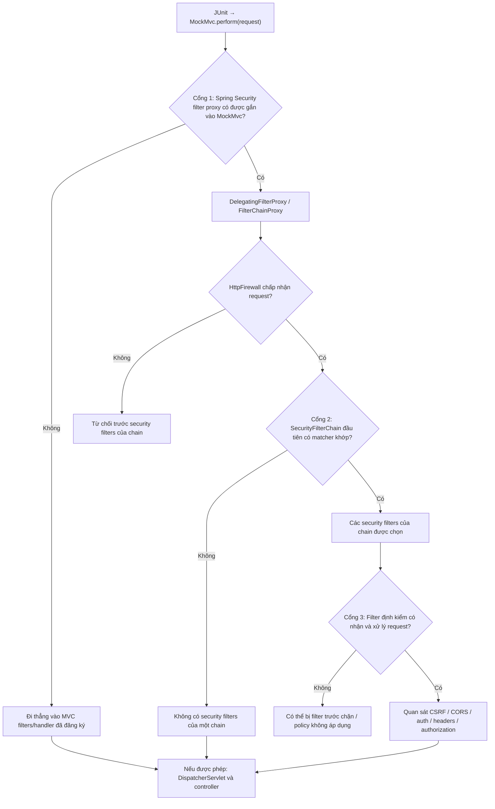
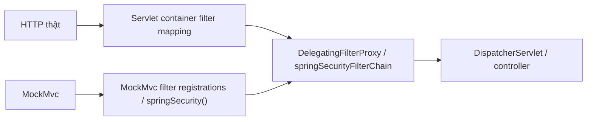

# Đảm bảo security filter chain thực sự tham gia bài kiểm thử

> **Chương:** Kiểm thử Servlet  
> **Module:** `SPRING_SECURITY_HTTP_PROTECTION` — bảo vệ HTTP và trình duyệt bằng Spring Security: CSRF, CORS, security headers, CSP, HSTS, HTTP firewall, session, cùng cấu hình trên Servlet và Reactive, kiểm thử kịch bản tấn công và chẩn đoán xung đột bảo mật.  
> **Trọng tâm của bài:** Một phép thử `MockMvc` trả 200 hoặc 403 **không tự chứng minh Spring Security đã lọc request**. Học cách chứng minh filter proxy được gắn, request đi vào đúng `SecurityFilterChain` và chính các lớp bảo vệ như CSRF, authentication, authorization, CORS, headers đã tạo hiệu ứng mong đợi.

## 1. Mục tiêu học tập

Sau bài học, người học có thể:

1. Giải thích vì sao `spring-security-test` trên classpath **không đủ** để bảo đảm `MockMvc` chạy Spring Security filter chain.
2. Phân biệt ba điều kiện: **filter được tích hợp vào MockMvc**, **request khớp một security chain**, **filter cần kiểm thật sự được thực thi**.
3. Thiết lập `@SpringBootTest` + `@AutoConfigureMockMvc` hoặc `MockMvcBuilders.webAppContextSetup(context).apply(springSecurity())` đúng cách.
4. Nhận diện `@AutoConfigureMockMvc(addFilters = false)`, `standaloneSetup(...)`, `@WebMvcTest` thiếu security config, cấu hình `web.ignoring()` và chain thiếu fallback là những nguồn test giả dương.
5. Thiết kế **security canary tests**: anonymous phải bị chặn, POST browser thiếu CSRF phải bị chặn, public resource đi qua chain vẫn có `X-Content-Type-Options`.
6. Phân biệt status 401, 302, 403 do đúng filter với 403 từ controller; dùng cặp positive/negative để xác định nguyên nhân chặn.
7. Kiểm chọn chain theo `@Order` và `securityMatcher` khi ứng dụng có API Bearer JWT và browser form-login/session.
8. Dùng `FilterChainProxy` để kiểm hiện diện cấu hình, đồng thời hiểu rằng **bean tồn tại không chứng minh MockMvc đã gọi nó**.
9. Viết kiểm thử CORS preflight, CSRF, JWT, role/scope và security headers, kiểm controller có/không chạy khi bị chặn.
10. Biết giới hạn của MockMvc đối với Servlet container filter registrations, HTTP firewall/path normalization, ERROR/FORWARD/ASYNC, HTTPS/HSTS và proxy.
11. Chẩn đoán và sửa test hỏng mà **không** vô hiệu hóa CSRF/authorization hoặc mở `permitAll()` quá mức để “cho xanh”.

## 2. Một test xanh có thể chứng minh điều sai

Xét controller:

```java
@RestController
class ProfileController {

    @GetMapping("/account")
    ResponseEntity<String> account() {
        return ResponseEntity.ok("private account");
    }
}
```

Nếu MockMvc được xây **không có Spring Security filters**:

```java
MockMvc mvc = MockMvcBuilders
    .standaloneSetup(new ProfileController())
    .build();

mvc.perform(get("/account"))
    .andExpect(status().isOk());
```

Test có thể pass vì controller trả 200. Nhưng trong production, `/account` cần authentication và anonymous phải bị redirect login hoặc trả 401.

Ở đây hai mệnh đề khác nhau:

- “Controller `GET /account` có thể trả 200 khi được gọi” — test standalone vừa chứng minh.
- “Anonymous không được xem `GET /account` trong ứng dụng thật” — test standalone **chưa kiểm**.

Nếu một bộ kiểm thử gọi private endpoint, thấy 200 và kết luận “security hoạt động”, đó là **false confidence**; chưa có bằng chứng `FilterChainProxy` từng được gọi.

### 2.1. Dấu hiệu một test HTTP security có giá trị

Bên cạnh positive test (authenticated 200), cần **negative test** (anonymous 302/401). Với browser unsafe method cần thêm CSRF negative test; với response HTML cần kiểm headers từ chain. Khi cả positive và negative đúng, bằng chứng mạnh hơn nhiều so với chỉ một response thành công.

Cũng phải kiểm handler fixture tồn tại: nếu endpoint không tồn tại, 404 có thể xuất hiện dù security chain hoàn toàn bị bỏ qua. Nếu private endpoint trả 403 do một `@ControllerAdvice` riêng, status 403 không khẳng định AuthorizationFilter đã chặn.

## 3. Ba cổng cần chứng minh — không được đánh đồng



**Cổng 1 — tích hợp filter:** `MockMvc` có sử dụng Spring Security `FilterChainProxy`/filter mapping tương ứng không? `spring-security-test` chỉ cung cấp helpers; không tự gắn filter cho mọi builder.

**Cổng 2 — chọn security chain:** khi proxy được gọi, `FilterChainProxy` chọn chain đầu tiên khớp `securityMatcher`. Nếu không có chain nào khớp, request có thể đi tới MVC mà không chịu security filters của chain. `anyRequest().denyAll()` trong một chain **không bảo vệ URL nằm ngoài chain đó**.

**Cổng 3 — filter behavior:** chain có thể chạy nhưng CORS preflight dừng request trước CSRF/auth; CSRF thiếu có thể trả 403 trước AuthorizationFilter; token Bearer sai có thể bị authentication từ chối trước `permitAll()`. Vì vậy muốn chứng minh role rule, phải tạo request mà CSRF/authentication đã hợp lệ.

### 3.1. Bảng điều kiện và bằng chứng

| Điều muốn chứng minh | Bằng chứng mạnh | Bằng chứng chưa đủ |
|---|---|---|
| MockMvc có gắn security proxy | Setup `springSecurity()`/Boot addFilters + negative request bị chặn bởi expected security mechanism | Chỉ có dependency `spring-security-test` |
| URL private vào đúng chain | Anonymous API 401 Bearer, browser anonymous 302 login, authenticated request đúng phạm vi | Có bean `SecurityFilterChain` trong context |
| CSRF filter hoạt động | Cùng browser POST: thiếu/sai token 403, hợp lệ vào handler | POST trả 403 bất kỳ |
| HTTP authorization hoạt động | Role/scope thiếu 403 khi token/CSRF đủ; role/scope đúng được phép | Chỉ test anonymous 401 |
| Security header writer tham gia | Trang public `permitAll` vẫn có nosniff/CSP theo chain | CDN trả header ngoài ứng dụng |
| CORS policy tham gia | OPTIONS preflight allowlist, unknown origin bị chặn | Browser báo “CORS error” không có backend evidence |
| Session authentication đúng | Login thật, session được duy trì, logout mất quyền | `@WithMockUser` được inject |
| Object ownership đúng | Alice có scope vẫn không đọc order Bob | JWT hợp lệ và có `orders.read` |

## 4. Đường đi Servlet thực tế và cách MockMvc tham gia

Trong Servlet application, `DelegatingFilterProxy` được Servlet container đăng ký và trỏ tới bean `springSecurityFilterChain`, thường là `FilterChainProxy`. Proxy lựa chọn một `SecurityFilterChain` rồi chạy filters bên trong trước khi request tới `DispatcherServlet`.

Trên MockMvc, không có network HTTP listener; nó mô phỏng request, nhưng **chỉ chạy những filters đã tích hợp trong builder/test context**.



So sánh:

- Production container dùng filter registration và `DispatcherType` mapping do server/Boot quản lý.
- MockMvc dùng test builder registrations, `@AutoConfigureMockMvc` và `springSecurity()`.
- Một mock request có thể kiểm filter logic, nhưng **không thể thay test registration trên embedded Servlet container thật**, nhất là ERROR, FORWARD, ASYNC dispatch.

### 4.1. Tên “security filter chain” có hai ngữ cảnh

- **FilterChainProxy** là một filter đại diện cho Spring Security trên Servlet boundary.
- **SecurityFilterChain** là tập security filters được chọn cho request cụ thể, có matcher riêng.

Việc tìm bean `SecurityFilterChain` hoặc `FilterChainProxy` trong application context chỉ chứng minh **định nghĩa tồn tại**. Cần chứng minh MockMvc đã thực sự gọi filter và URL đã chọn đúng chain.

## 5. Chuẩn bị một ứng dụng test có hai security chains

Để tránh kiểm mơ hồ, ta dùng fixture có hai vùng HTTP khác nhau:

| Đường dẫn | Loại client | Chính sách |
|---|---|---|
| `GET /api/public/catalog` | Public API | Anonymous được xem, vẫn qua API chain |
| `GET /api/orders/42` | Bearer API | JWT hợp lệ có `SCOPE_orders.read` |
| `POST /api/orders` | Bearer API | JWT hợp lệ có `SCOPE_orders.write` |
| `GET /account` | Browser | Phải login bằng session/form login |
| `POST /account/profile` | Browser | Authenticated + CSRF hợp lệ |
| `GET /admin/reports` | Browser | Role ADMIN |
| `GET /login` | Browser public | Anonymous được phép, có security headers |
| `GET /assets/app.css` | Static | Public qua browser chain, không ignoring |

Yêu cầu hai ranh giới:

1. API thật sự xác thực bằng Bearer header do client chủ động gửi, không dùng browser cookie authentication. Khi threat model thỏa, API có thể không cần CSRF.
2. Browser dùng session cookie, phải giữ CSRF cho unsafe requests, phù hợp frontend/login/logout.

Ví dụ test dùng Spring Security Servlet với DSL phổ biến Spring Security 6+/Spring Boot 3+; khi làm dự án phải đối chiếu version, dependencies và API deprecations đang dùng.

## 6. Dependencies: Spring Security Test và MVC Test phải cùng version stack

Ví dụ Gradle Kotlin DSL:

```kotlin
dependencies {
    implementation("org.springframework.boot:spring-boot-starter-web")
    implementation("org.springframework.boot:spring-boot-starter-security")
    implementation("org.springframework.boot:spring-boot-starter-oauth2-resource-server")

    testImplementation("org.springframework.boot:spring-boot-starter-test")
    testImplementation("org.springframework.security:spring-security-test")
}

tasks.test {
    useJUnitPlatform()
}
```

Gradle Groovy DSL:

```groovy
dependencies {
    implementation 'org.springframework.boot:spring-boot-starter-web'
    implementation 'org.springframework.boot:spring-boot-starter-security'
    implementation 'org.springframework.boot:spring-boot-starter-oauth2-resource-server'

    testImplementation 'org.springframework.boot:spring-boot-starter-test'
    testImplementation 'org.springframework.security:spring-security-test'
}

test {
    useJUnitPlatform()
}
```

Nếu dùng Maven (đã có Spring Boot dependency management):

```xml
<dependency>
    <groupId>org.springframework.security</groupId>
    <artifactId>spring-security-test</artifactId>
    <scope>test</scope>
</dependency>
```

Không pin `spring-security-test` khác version runtime của `spring-security-web/config`. Nếu app không cần OAuth2 Resource Server, không đưa JWT dependency vào chỉ để chạy ví dụ; thay bằng form/HTTP Basic chain phù hợp.

**Lưu ý:** Dependency có mặt trên test classpath **không tự đưa filters vào MockMvc**; đó là trách nhiệm thiết lập ở những mục tiếp theo.

## 7. Cấu hình SecurityFilterChain cho fixture

Hai chain rõ ràng giúp test đúng entry point và phát hiện chain selection sai:

```java
package example.security;

import java.util.List;

import org.springframework.context.annotation.Bean;
import org.springframework.context.annotation.Configuration;
import org.springframework.core.annotation.Order;
import org.springframework.http.HttpMethod;
import org.springframework.security.config.Customizer;
import org.springframework.security.config.annotation.web.builders.HttpSecurity;
import org.springframework.security.config.annotation.web.configuration.EnableWebSecurity;
import org.springframework.security.config.annotation.web.configurers.AbstractHttpConfigurer;
import org.springframework.security.config.http.SessionCreationPolicy;
import org.springframework.security.web.SecurityFilterChain;
import org.springframework.web.cors.CorsConfiguration;
import org.springframework.web.cors.CorsConfigurationSource;
import org.springframework.web.cors.UrlBasedCorsConfigurationSource;

@Configuration
@EnableWebSecurity
public class ServletChainCoverageConfig {

    @Bean
    @Order(1)
    SecurityFilterChain api(HttpSecurity http) throws Exception {
        return http
            .securityMatcher("/api/**")
            .cors(cors -> cors.configurationSource(apiCors()))
            // Chỉ khi API không chấp nhận credentials tự gắn
            // từ browser như session cookie/Basic.
            .csrf(AbstractHttpConfigurer::disable)
            .sessionManagement(session -> session
                .sessionCreationPolicy(SessionCreationPolicy.STATELESS))
            .authorizeHttpRequests(auth -> auth
                .requestMatchers(HttpMethod.GET, "/api/public/**")
                    .permitAll()
                .requestMatchers(HttpMethod.GET, "/api/orders/**")
                    .hasAuthority("SCOPE_orders.read")
                .requestMatchers(HttpMethod.POST, "/api/orders")
                    .hasAuthority("SCOPE_orders.write")
                .anyRequest().denyAll())
            .oauth2ResourceServer(oauth2 -> oauth2
                .jwt(Customizer.withDefaults()))
            .build();
    }

    @Bean
    @Order(2)
    SecurityFilterChain browser(HttpSecurity http) throws Exception {
        return http
            // Không có securityMatcher: fallback.
            .authorizeHttpRequests(auth -> auth
                .requestMatchers("/login", "/assets/**")
                    .permitAll()
                .requestMatchers("/admin/**").hasRole("ADMIN")
                .anyRequest().authenticated())
            .formLogin(Customizer.withDefaults())
            .csrf(Customizer.withDefaults())
            .headers(headers -> headers
                .contentSecurityPolicy(csp -> csp.policyDirectives(
                    "default-src 'self'; script-src 'self'; " +
                    "object-src 'none'; base-uri 'self'; " +
                    "frame-ancestors 'none'")))
            .build();
    }

    @Bean
    CorsConfigurationSource apiCors() {
        CorsConfiguration policy = new CorsConfiguration();
        policy.setAllowedOrigins(
            List.of("https://client.example.com"));
        policy.setAllowedMethods(
            List.of("GET", "POST", "PUT", "PATCH", "DELETE"));
        policy.setAllowedHeaders(
            List.of("Authorization", "Content-Type"));
        policy.setMaxAge(1800L);

        UrlBasedCorsConfigurationSource source =
            new UrlBasedCorsConfigurationSource();
        source.registerCorsConfiguration("/api/**", policy);
        return source;
    }
}
```

### 7.1. Những bean/fixtures phải có khi chạy

- `JwtDecoder` hoặc issuer configuration để Resource Server xây chain; mock `jwt()` **không tự tạo decoder bean lúc context startup**.
- User store/provider cho form login nếu test đăng nhập thật; với `with(user())` chỉ kiểm authorization thì có thể dùng principal mock.
- Controller/handler trả 200/201/204 cho các đường dẫn cần kiểm positive tests.
- Data fixture nếu test ownership/method security.
- `spring-security-test` cùng MockMvc test support.

### 7.2. Cấu hình trên cho biết điều gì?

`/api/**` vào chain `@Order(1)`, có CORS và Resource Server. Browser fallback `@Order(2)` nhận mọi URL còn lại. `permitAll()` cho public paths chỉ bỏ yêu cầu authorization, không bỏ Spring Security headers.

Một GET API thiếu JWT thường 401; một GET browser private anonymous thường 302 login. **Nếu API nhận 302**, rất có thể selected chain/entry point đang sai. **Nếu browser POST thiếu CSRF mà 200**, có thể CSRF bị tắt, chain không chạy hoặc endpoint chọn nhầm chain.

## 8. Cách 1: @SpringBootTest và @AutoConfigureMockMvc

Đây là setup thường thích hợp để kiểm phối hợp Spring MVC với security config của application context:

```java
@SpringBootTest
@AutoConfigureMockMvc
class SecurityFilterCoverageTest {

    @Autowired
    MockMvc mvc;

    @Test
    void anonymousPrivateApiMustBeDenied() throws Exception {
        mvc.perform(get("/api/orders/42"))
            .andExpect(status().isUnauthorized())
            .andExpect(header().exists("WWW-Authenticate"));
    }

    @Test
    void anonymousBrowserMustRedirectToLogin()
            throws Exception {
        mvc.perform(get("/account"))
            .andExpect(status().is3xxRedirection())
            .andExpect(redirectedUrlPattern("**/login"));
    }
}
```

Imports:

```java
import org.junit.jupiter.api.Test;
import org.springframework.beans.factory.annotation.Autowired;
import org.springframework.boot.test.context.SpringBootTest;
import org.springframework.boot.test.autoconfigure.web.servlet.AutoConfigureMockMvc;
import org.springframework.test.web.servlet.MockMvc;
import static org.springframework.test.web.servlet.request.MockMvcRequestBuilders.*;
import static org.springframework.test.web.servlet.result.MockMvcResultMatchers.*;
```

Với các phiên bản Spring Boot có `@AutoConfigureMockMvc` phù hợp, thuộc tính `addFilters` mặc định là `true`: Servlet filters trong context (trong đó có Spring Security) được thêm vào MockMvc. Tuy nhiên bạn vẫn cần biết security config thực tế được load, chain nào khớp và custom test config có thay security beans không.

### 8.1. Cạm bẫy lớn: `addFilters = false`

```java
@AutoConfigureMockMvc(addFilters = false)
```

Điều này **không gắn các Servlet filters từ application context** vào MockMvc theo cơ chế Boot auto-config. Nếu `/account` controller trả 200 không có method security, test anonymous có thể “thành công” trong khi HTTP authorization hoàn toàn chưa được thử.

Không chỉ nhìn annotation `@SpringBootTest` để kết luận filter có chạy: phải kiểm `addFilters`, test customizers và các filter registrations.

### 8.2. Một negative control có ý nghĩa

Trong một **test class riêng dùng riêng context** (không đặt trong bộ test bảo mật chính), thử cùng endpoint với `addFilters = false` để quan sát nó có thể đi tới controller.

```java
@SpringBootTest
@AutoConfigureMockMvc(addFilters = false)
class ControllerOnlyProbe {

    @Autowired MockMvc mvc;

    @Test
    void controllerCanBeReachedWithoutSecurityFilters()
            throws Exception {
        mvc.perform(get("/account"))
            .andExpect(status().isOk());
    }
}
```

Kỳ vọng 200 chỉ đúng với fixture `/account` không có method-level protection hoặc custom interceptor khác. Đây là **thí nghiệm phản chứng** cho người học; không nên duy trì `ControllerOnlyProbe` làm test chứng nhận production security.

**Đọc kết quả đúng cách:** Nếu cả hai test đều trả 200 với anonymous, kiểm vì sao security chain thiếu/không chạy/không match. Nếu cả hai đều 403 do controller có method-level security, bạn chưa chứng minh HTTP filters chạy; cần test CSRF/headers/chain-specific entry points.

## 9. Cách 2: tự build MockMvc và áp dụng springSecurity()

Khi xây MockMvc từ Spring `WebApplicationContext`, sử dụng `SecurityMockMvcConfigurers.springSecurity()`:

```java
@SpringBootTest
class ExplicitSpringSecurityMockMvcTest {

    @Autowired
    WebApplicationContext context;

    MockMvc mvc;

    @BeforeEach
    void setUp() {
        mvc = MockMvcBuilders
            .webAppContextSetup(context)
            .apply(springSecurity())
            .build();
    }

    @Test
    void securityChainIsInvoked() throws Exception {
        mvc.perform(get("/account"))
            .andExpect(status().is3xxRedirection());
    }
}
```

Imports:

```java
import org.junit.jupiter.api.BeforeEach;
import org.springframework.beans.factory.annotation.Autowired;
import org.springframework.boot.test.context.SpringBootTest;
import org.springframework.test.web.servlet.MockMvc;
import org.springframework.test.web.servlet.setup.MockMvcBuilders;
import org.springframework.web.context.WebApplicationContext;
import static org.springframework.security.test.web.servlet.setup.SecurityMockMvcConfigurers.springSecurity;
import static org.springframework.test.web.servlet.request.MockMvcRequestBuilders.get;
import static org.springframework.test.web.servlet.result.MockMvcResultMatchers.status;
```

`springSecurity()` tích hợp Spring Security filter chain bean và test-security-context support vào builder. Nó khác hoàn toàn việc chỉ có `spring-security-test` trên classpath.

### 9.1. Đừng gắn `FilterChainProxy` hai lần

Không tự thêm `.addFilters(springSecurityFilterChain)` một lần nữa nếu `springSecurity()` đã gắn chain. Tương tự, khi MockMvc được Boot auto-config với filters, không mặc định tự gọi apply springSecurity thêm lần nữa. Duplicate registration có thể làm CSRF/authentication/headers chạy lặp, khó chẩn đoán.

### 9.2. Dùng `@BeforeEach` hay field initializer?

Builder phụ thuộc `WebApplicationContext` được inject. Nên tạo MockMvc trong `@BeforeEach` hoặc một setup method sau dependency injection; tránh khởi tạo ở field initializer trước khi context tồn tại.

## 10. Cách 3: @WebMvcTest phải có security config đúng

`@WebMvcTest` chỉ load MVC slice. Nó có thể áp security auto-configuration, nhưng **không đương nhiên load mọi custom `SecurityFilterChain`, `JwtDecoder`, `AuthenticationProvider`, service/method security** của ứng dụng.

Một skeleton:

```java
@WebMvcTest(OrderController.class)
@Import({
    ServletChainCoverageConfig.class,
    OrderSecuritySliceTest.SliceFixtures.class
})
class OrderSecuritySliceTest {

    @Autowired
    MockMvc mvc;

    @Test
    void anonymousPrivateApiStillNeedsBearer()
            throws Exception {
        mvc.perform(get("/api/orders/42"))
            .andExpect(status().isUnauthorized());
    }

    @TestConfiguration
    static class SliceFixtures {

        @Bean
        JwtDecoder jwtDecoder() {
            // Decoder test-only để config có thể build;
            // không dùng để chứng nhận chữ ký JWT.
            return token -> {
                throw new BadJwtException(
                    "Decoder integration not covered");
            };
        }
    }
}
```

Các imports ví dụ:

```java
import org.springframework.boot.test.autoconfigure.web.servlet.WebMvcTest;
import org.springframework.boot.test.context.TestConfiguration;
import org.springframework.context.annotation.Bean;
import org.springframework.context.annotation.Import;
import org.springframework.security.oauth2.jwt.BadJwtException;
import org.springframework.security.oauth2.jwt.JwtDecoder;
```

**Phải cung cấp controller dependencies** của `OrderController`, ví dụ một mock service bean với annotation/API tương thích Boot version (`@MockBean` trên nhánh cũ, `@MockitoBean` trên nhánh mới), hoặc một test configuration. Nếu thiếu, slice không khởi động.

### 10.1. Cảnh báo default chain “qua mặt” test

Nếu không import security config cần kiểm, Spring Boot slice có thể dùng **một default security setup** khác production. Anonymous trả 401/302 không tự chứng minh API JWT chain `/api/**` hay CSRF config production đã chạy.

Luôn hỏi:

1. Security config/chain nào thực sự có trong context?
2. Có `JwtDecoder` và các custom matcher/filter cần thiết không?
3. `@AutoConfigureMockMvc(addFilters = false)` có tắt filters không?
4. Test đang kiểm HTTP filter rule hay test MVC input/service mocking?
5. Nếu full app có nhiều chains, slice có giữ đúng chain order và fallback không?

### 10.2. Không dùng slice mocked service để chứng minh IDOR

Một `@WebMvcTest` mock service trả order theo stub có thể kiểm HTTP role/scope, nhưng không kiểm service/repository đang lọc owner/tenant. Để chứng minh object-level authorization, dùng service test/full application context với test data hai users và hai records.

## 11. Standalone MockMvc: phân biệt controller test và security test

`standaloneSetup(...)` phù hợp test MVC controller nhỏ:

```java
MockMvc mvc = MockMvcBuilders
    .standaloneSetup(new AccountController())
    .build();
```

Nhưng nó **không tự tạo Spring Security filter chain, JwtDecoder, method security hoặc application context đầy đủ**.

Có thể tích hợp filter chain được cung cấp tường minh theo phiên bản:

```java
MockMvc mvc = MockMvcBuilders
    .standaloneSetup(controller)
    .apply(springSecurity(filterChainProxy))
    .build();
```

Tuy nhiên phải có `FilterChainProxy` xây đúng, authentication dependencies, Servlet context và setup tương thích. Đối với **integration test Spring Security + Spring MVC**, `webAppContextSetup(context).apply(springSecurity())` hoặc Boot auto-config thường ít sai hơn.

### 11.1. Khi nào chủ đích tắt filters là đúng?

Có thể tắt filters khi mục tiêu **chỉ kiểm controller mapping/validation/serialization**, và test class được đặt tên/mô tả rõ “controller-only”. Nhưng không báo “HTTP security verified” hoặc dùng những test này để thay negative security tests.

## 12. Kiểm bean FilterChainProxy mà không nhầm “đã chạy”

Một kiểm tra bổ trợ trong full Spring application context:

```java
@SpringBootTest
class FilterChainDefinitionTest {

    @Autowired
    ApplicationContext context;

    @Test
    void springSecurityProxyBeanAndChainsExist() {
        FilterChainProxy proxy = context.getBean(
            "springSecurityFilterChain",
            FilterChainProxy.class);

        assertNotNull(proxy);
        assertFalse(proxy.getFilterChains().isEmpty());
    }
}
```

Imports:

```java
import org.junit.jupiter.api.Test;
import org.springframework.beans.factory.annotation.Autowired;
import org.springframework.boot.test.context.SpringBootTest;
import org.springframework.context.ApplicationContext;
import org.springframework.security.web.FilterChainProxy;
import static org.junit.jupiter.api.Assertions.*;
```

Kết quả PASS chứng minh context chứa proxy và ít nhất một `SecurityFilterChain` **đã định nghĩa**. Nó không chứng minh:

- MockMvc builder đã đăng ký filter proxy này.
- Request `/api/orders/42` match chain API.
- CSRF/authentication/authorization/header writer đã xử lý request.
- Servlet container thực được map ERROR/FORWARD/ASYNC.

Do vậy phải ghép kiểm tra bean/config với các **behavioral canaries** ở những mục sau. Không viết test kiểu `assertNotNull(proxy)` rồi coi toàn bộ HTTP protection đã được xác minh.

### 12.1. Inspect chain definitions phục vụ chẩn đoán

`proxy.getFilterChains()` trả cấu hình chain để kiểm tra số lượng/chain type và có thể in `toString()` ở test log khi cần. Nhưng không nên phụ thuộc số lượng filter/classes cố định trên mọi Spring Security version: filter order, class names và defaults có thể thay đổi.

Nếu muốn xác minh **runtime chain selection**, dùng request có outcome khác biệt giữa API và browser (401 Bearer vs 302 login), kết hợp TRACE filter-chain logs hoặc test-only instrumentation có kiểm soát. Đừng suy từ thứ tự khai báo Java file; `@Order` và first-match quyết định.

## 13. Xây ba “canary tests” xác nhận chain hoạt động

Một canary test là phép thử nhỏ, có expected behavior rõ ràng và thất bại nhanh khi security bị bỏ qua.

### 13.1. Canary A — private API anonymous không thể thành công

```java
@Test
void anonymousApiCannotBypassResourceServer()
        throws Exception {
    mvc.perform(get("/api/orders/42"))
        .andExpect(status().isUnauthorized())
        .andExpect(header().exists("WWW-Authenticate"));
}
```

Với config mục 7, API anonymous phải 401 Bearer challenge. Nếu `/api/orders/42` trả 200, hãy kiểm filter registration, chain matcher và controller. Nếu 302, browser fallback có thể nhận request. Nếu 404, handler có thể chưa tồn tại hoặc no chain đã chạy; **chưa thể kết luận filter có/không chỉ từ 404**.

### 13.2. Canary B — browser POST thiếu CSRF bị từ chối

```java
@Test
void missingCsrfStopsAuthenticatedBrowserPost()
        throws Exception {
    mvc.perform(post("/account/profile")
            .with(user("alice").roles("USER"))
            .contentType(MediaType.APPLICATION_JSON)
            .content("{\"displayName\":\"Alice\"}"))
        .andExpect(status().isForbidden());
}
```

Test này phát hiện browser chain bị mất CSRF **nếu handler/payload hợp lệ và test context thực sự gắn security**. Để chặt hơn, thêm valid CSRF positive test:

```java
@Test
void validCsrfAllowsBrowserPostToReachHandler()
        throws Exception {
    mvc.perform(post("/account/profile")
            .with(user("alice").roles("USER"))
            .with(csrf())
            .contentType(MediaType.APPLICATION_JSON)
            .content("{\"displayName\":\"Alice\"}"))
        .andExpect(status().isNoContent());
}
```

Khi cùng user/URL/payload, chỉ thay token CSRF, cặp test giúp xác nhận request thiếu token thực sự bị CSRF chặn chứ không phải lỗi input/controller.

### 13.3. Canary C — public path vẫn được header writer bảo vệ

```java
@Test
void publicLoginRetainsSecurityHeaders() throws Exception {
    mvc.perform(get("/login"))
        .andExpect(status().isOk())
        .andExpect(header().string(
            "X-Content-Type-Options", "nosniff"))
        .andExpect(header().exists(
            "Content-Security-Policy"));
}
```

Cần trang `/login` thực sự được trả bởi framework/fixture và CSP như cấu hình mẫu. `permitAll()` ở authorization không loại filter/header writer.

**Giới hạn canary:** Header có thể đến từ filter khác hoặc custom controller, và một request đã qua chain không bảo đảm mọi filter trong chain đã chạy tới nơi. Vì vậy kết hợp nhiều phép thử đặc trưng và config/logs, không chỉ một header assertion.

### 13.4. Mẫu kiểm thử tốt là bộ ba chứ không phải một status

Một bộ tối thiểu:

1. API anonymous → 401 Bearer.
2. Browser unsafe POST thiếu token → 403, token hợp lệ vào handler.
3. Browser public document → 200 cùng security headers.

Các case này kiểm **các cơ chế khác nhau** và cho tín hiệu mạnh khi filters bị tắt, nhầm chain hoặc mất headers. Để có bảo đảm theo tài nguyên, còn cần role/scope/owner negative cases.
## 14. Đối chứng 403: CSRF và authorization không giống nhau

Với browser POST `/admin/settings` cần role ADMIN và CSRF, hai test đều trả 403 vẫn có thể kiểm **hai lỗi khác nhau**:

| Request | CSRF | Role | Tầng từ chối thường gặp |
|---|---|---|---|
| `POST /admin/settings` | Thiếu | ADMIN | `CsrfFilter` |
| `POST /admin/settings` | Hợp lệ | USER | HTTP authorization |
| `POST /admin/settings` | Hợp lệ | ADMIN | Controller được phép xử lý |
| `POST /admin/settings` | Sai | ADMIN | `CsrfFilter` |

Ví dụ:

```java
@Test
void userRoleCannotUpdateAdminSettingsEvenWithCsrf()
        throws Exception {
    mvc.perform(post("/admin/settings")
            .with(user("alice").roles("USER"))
            .with(csrf()))
        .andExpect(status().isForbidden());
}

@Test
void adminWithoutCsrfIsAlsoForbiddenButForAnotherReason()
        throws Exception {
    mvc.perform(post("/admin/settings")
            .with(user("root").roles("ADMIN")))
        .andExpect(status().isForbidden());
}

@Test
void adminWithCsrfCanReachAdminHandler() throws Exception {
    mvc.perform(post("/admin/settings")
            .with(user("root").roles("ADMIN"))
            .with(csrf()))
        .andExpect(status().isNoContent());
}
```

Ba test cần controller fixture `POST /admin/settings` thực sự trả 204 khi được phép; nếu thiếu fixture, 404 có thể che kết quả. Có thể thêm mock service để xác minh khi CSRF/authorization từ chối, **không có business side effect**.

### 14.1. Điểm dễ gây kết luận sai

Nếu chỉ có:

```java
mvc.perform(post("/admin/settings")
        .with(user("alice").roles("USER")))
    .andExpect(status().isForbidden());
```

thì 403 có thể xuất hiện **dù rule ADMIN đã bị xoá**, vì request vẫn thiếu CSRF token. Một test âm tính phải giữ mọi yếu tố khác hợp lệ để cô lập policy cần kiểm.

### 14.2. `permitAll()` không loại các security filters khác

Thêm `.requestMatchers("/admin/settings").permitAll()` trong HTTP authorization có thể không làm POST thiếu CSRF thành 200. Điều đó không chứng minh permitAll an toàn; chỉ nói CSRF vẫn chặn trước. Muốn test role rule, cần valid CSRF và authenticated user thiếu role.

### 14.3. Kiểm handler không nhận request bị chặn

Nếu `AdminController` gọi `AdminService.updateSettings()`, sau request CSRF 403 hoặc role 403, có thể assert:

```java
verifyNoInteractions(adminService);
```

**Chỉ có giá trị** khi `adminService` là mock bean thật được inject vào controller ở test context, interaction history được reset và controller sẽ gọi service trong positive case. Không thể assert một mock service không được dùng rồi coi đó là bằng chứng security chặn.

## 15. Principal mock không có nghĩa authentication filter đã xác minh credential

Các helpers của `spring-security-test` rất hữu ích để kiểm authorization **khi đã có principal**, nhưng không nên dùng chúng để chứng minh login/JWT decoder thật.

| Helper | Nó làm gì | Nó không kiểm |
|---|---|---|
| `@WithMockUser` | Đặt test SecurityContext theo principal/roles/authorities mock | PasswordEncoder, login POST, JWT signature |
| `with(user("alice"))` | Đặt username/password-style Authentication mock vào request | HTTP Basic hoặc form login credential exchange |
| `with(jwt())` | Đặt `JwtAuthenticationToken` mock với claims/authorities tùy chọn | Decode, signature, issuer, expiry, audience |
| `with(authentication(...))` | Đặt Authentication object tùy biến vào test request | Auth provider có thật sự tạo object ấy không |
| `with(httpBasic(...))` | Gửi HTTP Basic header để filter xử lý nếu chain bật Basic | Authentication khi chain **không** bật Basic |
| Bearer Authorization header thực | Kích hoạt Bearer filter và JwtDecoder khi cấu hình | Tính đúng của IdP production nếu decoder chỉ là test double |

### 15.1. Kiểm JWT scope bằng mock đúng mục tiêu

```java
@Test
void validMockJwtWithReadScopeCanReachHandler()
        throws Exception {
    mvc.perform(get("/api/orders/42")
            .with(jwt()
                .jwt(builder -> builder.subject("alice"))
                .authorities(new SimpleGrantedAuthority(
                    "SCOPE_orders.read"))))
        .andExpect(status().isOk());
}

@Test
void mockJwtWithoutReadScopeGets403() throws Exception {
    mvc.perform(get("/api/orders/42")
            .with(jwt()
                .jwt(builder -> builder.subject("alice"))
                .authorities(new SimpleGrantedAuthority(
                    "SCOPE_orders.write"))))
        .andExpect(status().isForbidden());
}
```

Đây là kiểm authorization chain đã nhận JwtAuthenticationToken, **không** chứng minh chuỗi JWT client gửi có chữ ký hợp lệ. Để assert status 200, fixture controller/service phải cho Alice quyền đọc order 42.

### 15.2. Kiểm malformed Bearer qua filter thật

```java
@Test
void invalidBearerHeaderIsUnauthorized() throws Exception {
    mvc.perform(get("/api/orders/42")
            .header("Authorization", "Bearer not-a-valid-jwt"))
        .andExpect(status().isUnauthorized());
}
```

Request này **không** dùng `with(jwt())`. `BearerTokenAuthenticationFilter` và `JwtDecoder` trong test context có cơ hội xử lý token. Nếu JwtDecoder là mock reject-all, test chứng minh filter đi qua decoder nhưng **không chứng minh production signature verification**; cần controlled signing keys/JWKS/decoder thật cho đó.

### 15.3. Public API kèm Bearer token sai

```java
@Test
void anonymousCanReadPublicCatalog() throws Exception {
    mvc.perform(get("/api/public/catalog"))
        .andExpect(status().isOk());
}

@Test
void invalidBearerCanBeRejectedEvenForPublicCatalog()
        throws Exception {
    mvc.perform(get("/api/public/catalog")
            .header("Authorization", "Bearer invalid"))
        .andExpect(status().isUnauthorized());
}
```

Lý do: authentication filter có thể xử lý credential **trước** authorization `permitAll()`. Một URL public không bắt buộc token; nó không yêu cầu framework chấp nhận token sai.

### 15.4. `@WithMockUser` và HTTP Basic

`@WithMockUser`/`with(user())` cung cấp principal mà không kiểm `UsernamePasswordAuthenticationFilter` hoặc `BasicAuthenticationFilter`. Nếu muốn test HTTP Basic password, phải bật `httpBasic` trong chain chuyên biệt hoặc cấu hình đúng hiện tại, rồi gửi `with(httpBasic("alice","secret"))`.

Ví dụ hai-chain của bài **không bật Basic**, nên không được gắn một `httpBasic()` helper vào API JWT rồi suy hệ thống đang kiểm password. Mỗi test phải khớp authentication mechanism thực sự được sử dụng.

## 16. Chọn chain sai: API Bearer 401 biến thành browser login 302

Ứng dụng mẫu:

```text
@Order(1)  /api/**  → JWT Resource Server; CORS API; stateless
@Order(2)  fallback → form login; session; CSRF
```

`FilterChainProxy` chọn **chain đầu tiên khớp**. Điều gì xảy ra nếu thứ tự bị đảo, hoặc API chain matcher chỉ khớp `POST` nhưng client gọi `OPTIONS`/`GET`?

- `GET /api/orders/42` anonymous có thể nhận 302 tới login thay vì 401 Bearer.
- `POST /api/orders` với JWT có thể bị `CsrfFilter` của browser chain trả 403.
- CORS preflight có thể bị form-login entry point chặn, gây lỗi từ browser.
- API có thể nhận session behavior không mong muốn.

### 16.1. Canary chọn đúng chain

```java
@Test
void anonymousApiUsesBearerEntryPoint() throws Exception {
    mvc.perform(get("/api/orders/42"))
        .andExpect(status().isUnauthorized())
        .andExpect(header().exists("WWW-Authenticate"));
}

@Test
void anonymousBrowserUsesFormLoginEntryPoint()
        throws Exception {
    mvc.perform(get("/account"))
        .andExpect(status().is3xxRedirection())
        .andExpect(redirectedUrlPattern("**/login"));
}
```

Hai test cùng chạy trong một app context giúp xác định hai vùng policy khác nhau; chỉ test `status().is4xxClientError()` là quá yếu, không phân biệt 401 Bearer và 403 do rule khác.

### 16.2. URL gần giống không được vào nhầm API chain

Kiểm các đường dẫn có ranh giới:

```text
/api/orders/42   → API chain
/api2/orders/42  → KHÔNG tự coi là /api/**
/api-public/foo  → KHÔNG tự coi là /api/**
/account         → browser fallback
```

Đừng viết custom matcher bằng `request.getRequestURI().startsWith("/api")` rồi cho rằng nó tương đương segment-aware `/api/**`. Path normalization, context path, servlet path và proxy rewrite phải được đánh giá theo real request/handler mapping.

### 16.3. Không có fallback chain là một lỗ hổng cấu hình có thể không được test thấy

Nếu chỉ khai `securityMatcher("/api/**")` và không có chain khác, `/account` có thể không được Spring Security bảo vệ, dù controller tồn tại. Một `anyRequest().denyAll()` trong API chain không áp cho `/account`.

Vì vậy tạo **negative test ngoài API scope**, không chỉ API tests. Nếu app có vùng public ngoài API, chọn rõ default/fallback policy thay vì để request rơi khỏi security.

### 16.4. `@Order` của `SecurityFilterChain` không phải order của Servlet filters

`@Order(1)` trên `SecurityFilterChain` quyết định thứ tự **chọn chain**. Thứ tự CORS, CSRF, authentication, authorization bên trong chain do Spring Security filter infrastructure quyết định. Một test chỉ nhìn `@Order` không xác minh mọi filter đã chạy.

## 17. CORS preflight: chứng minh một filter có thể kết thúc sớm

Preflight là một HTTP OPTIONS request riêng, thường không kèm Bearer token của request thật:

```http
OPTIONS /api/orders HTTP/1.1
Origin: https://client.example.com
Access-Control-Request-Method: POST
Access-Control-Request-Headers: authorization,content-type
```

### 17.1. Origin được phép, không có JWT

```java
@Test
void trustedPreflightDoesNotRequireBearer()
        throws Exception {
    mvc.perform(options("/api/orders")
            .header("Origin", "https://client.example.com")
            .header("Access-Control-Request-Method", "POST")
            .header("Access-Control-Request-Headers",
                "authorization,content-type"))
        .andExpect(status().isOk())
        .andExpect(header().string(
            "Access-Control-Allow-Origin",
            "https://client.example.com"));
}
```

Nếu preflight 401/302, kiểm CORS source, API chain matcher, filter order và whether another filter intercepts OPTIONS. Không chữa bằng cách loại OPTIONS khỏi toàn security chain, vì như vậy có thể bỏ qua CORS filter và security headers cần thiết.

### 17.2. Origin không tin cậy phải bị từ chối

```java
@Test
void unknownPreflightOriginIsRejected() throws Exception {
    mvc.perform(options("/api/orders")
            .header("Origin", "https://attacker.example")
            .header("Access-Control-Request-Method", "POST")
            .header("Access-Control-Request-Headers",
                "authorization"))
        .andExpect(status().isForbidden())
        .andExpect(header().doesNotExist(
            "Access-Control-Allow-Origin"));
}
```

Spring CORS phổ biến trả 403; nếu custom CORS processor/gateway, status có thể khác. Điều bất biến: origin không trong allowlist **không nhận quyền đọc response theo CORS policy**. Không cho wildcard credentials để “chữa” preflight thất bại.

### 17.3. Actual request phải đi qua authentication/authorization

```java
@Test
void acceptedOriginDoesNotGrantWriteScope()
        throws Exception {
    mvc.perform(post("/api/orders")
            .header("Origin", "https://client.example.com")
            .with(jwt().authorities(
                new SimpleGrantedAuthority(
                    "SCOPE_orders.read")))
            .contentType(MediaType.APPLICATION_JSON)
            .content("{\"sku\":\"book\"}"))
        .andExpect(status().isForbidden());
}
```

Preflight thành công không chứng minh Spring Security cho phép POST thật. CORS là chính sách browser origin, không thay authentication, authorization hoặc CSRF của session cookie.

### 17.4. Khi preflight do gateway xử lý

Nếu gateway trả preflight trước khi request tới backend, MockMvc **không nhìn thấy gateway path**. MockMvc có thể kiểm backend CORS nếu backend sở hữu policy, nhưng thực tế chỉ HTTP/browser E2E qua gateway mới xác minh preflight/actual response cuối. Tránh cấu hình CORS mâu thuẫn ở gateway và app.

## 18. Security headers: chứng minh public request vẫn qua chain

Các headers là một kênh quan sát bổ sung cho `HeaderWriterFilter` trong security chain.

### 18.1. `permitAll()` vẫn có nosniff/CSP

```java
@Test
void publicLoginGetsCspAndNosniff() throws Exception {
    mvc.perform(get("/login"))
        .andExpect(status().isOk())
        .andExpect(header().string(
            "X-Content-Type-Options", "nosniff"))
        .andExpect(header().string(
            "Content-Security-Policy",
            "default-src 'self'; script-src 'self'; " +
            "object-src 'none'; base-uri 'self'; " +
            "frame-ancestors 'none'"));
}
```

Đây là ví dụ tương ứng CSP ở mục 7 và login page fixture. Nếu sử dụng custom login page hoặc policy khác, sửa assertion theo contract thật; không nới policy chỉ để test pass.

### 18.2. HSTS và MockMvc request secure

```java
@Test
void hstsWriterCanRunForHttpsMockRequest()
        throws Exception {
    mvc.perform(get("/login").secure(true))
        .andExpect(status().isOk())
        .andExpect(header().exists(
            "Strict-Transport-Security"));
}

@Test
void hstsIsNormallyNotWrittenForInsecureMock()
        throws Exception {
    mvc.perform(get("/login").secure(false))
        .andExpect(status().isOk())
        .andExpect(header().doesNotExist(
            "Strict-Transport-Security"));
}
```

Spring Security HSTS writer mặc định chỉ viết trên secure request theo policy thích hợp. `secure(true)` chỉ mô phỏng `HttpServletRequest.isSecure()`, **không chứng minh TLS termination, trusted `X-Forwarded-Proto` hoặc HSTS enforcement của browser**.

### 18.3. Header trên lỗi CSRF/authorization

```java
@Test
void csrf403RetainsConfiguredBrowserCsp()
        throws Exception {
    mvc.perform(post("/account/profile")
            .with(user("alice").roles("USER")))
        .andExpect(status().isForbidden())
        .andExpect(header().exists("Content-Security-Policy"));
}
```

Nếu 403 do filter chain sau header writer tạo, CSP có thể xuất hiện. Nhưng response do firewall, Servlet container hoặc gateway tạo **trước Spring Security** có thể không có header writer, dù status trông giống nhau. Đừng dùng một header để suy chính xác filter nào từ chối.

### 18.4. Cache policy cho public static và private HTML

Private HTML/API user data nên có cache-control phù hợp để tránh shared caches lưu thông tin nhạy cảm. Static assets content-hash có thể dùng cache dài hạn với policy riêng. Một `GET /assets/app.css` `permitAll` qua browser chain không đồng nghĩa phải có caching giống private `/account`.

Không tắt security header writer toàn cục chỉ để bật cache dài hạn cho CSS. Thiết kế policy theo resource, rồi kiểm response cuối qua CDN.

## 19. `web.ignoring()` và “no matching chain” là hai vấn đề coverage

Một public URL có thể đi theo những cách:

1. **`permitAll()`**: request vào chain, các filters còn áp dụng, chỉ HTTP authorization cho phép.
2. **`web.ignoring()`** (Servlet): loại security filters của chain đối với matcher tương ứng. Tùy cách `FilterChainProxy` tổ chức ignored chain và firewall, một số xử lý tại proxy vẫn có thể tồn tại; **đừng coi ignored path có đầy đủ headers/CSRF/authentication của chain**.
3. **Không có chain nào khớp**: Spring Security HTTP filters của chain không bảo vệ request đó.

### 19.1. Test status 200 trên static asset không phân biệt đủ

```java
@Test
void publicAssetShouldStillReceiveNosniff()
        throws Exception {
    mvc.perform(get("/assets/app.css"))
        .andExpect(status().isOk())
        .andExpect(header().string(
            "X-Content-Type-Options", "nosniff"));
}
```

Cần file fixture `/assets/app.css` và resource handler tương ứng, hoặc controller test fixture công khai. Nếu asset được CDN phục vụ trực tiếp, test MockMvc backend không phản ánh CDN behavior; kiểm edge response riêng.

Nếu một static URL bị ignoring mà response vẫn có nosniff do **global Servlet filter khác**, đừng suy HeaderWriterFilter của Spring Security đã chạy. Dùng chain logs/introspection cùng negative controls để xác định source header.

### 19.2. Vì sao kiểm near-prefix?

`/assets/**` không được mở `/assets-secret/**` hoặc `/assets2/**` chỉ vì một custom matcher dùng `startsWith("/assets")`. Kiểm boundary test với những URL gần giống, đặc biệt khi proxy rewrite/context path làm thay đổi đường dẫn backend.

### 19.3. Còn API nào hoàn toàn không qua Spring Security?

Một ứng dụng chỉ có chain `/api/**` có thể bỏ ngoài `/admin/**`, `/actuator/**`, `/error`, static resources hoặc callback endpoints. Liệt kê các nhóm URL và test anonymous theo policy thực để phát hiện lỗ hổng do thiếu fallback. Không mặc định Actuator management chạy cùng port/application context; cần xem topology thực.

## 20. Kiểm controller không được gọi khi filter từ chối

**Status code là tín hiệu cần, nhưng side effects mới củng cố bằng chứng.**

Ví dụ controller tạo order gọi `OrderService.create(...)`. Với `POST /api/orders` anonymous, kỳ vọng HTTP security từ chối **trước khi service tạo order**:

```java
@Test
void anonymousCannotCreateOrderOrCallService()
        throws Exception {
    mvc.perform(post("/api/orders")
            .contentType(MediaType.APPLICATION_JSON)
            .content("{\"sku\":\"book\"}"))
        .andExpect(status().isUnauthorized());

    verifyNoInteractions(orderService);
}
```

Giả định:

- `orderService` là Mockito mock thực sự được inject vào controller.
- Test reset interaction history trước mỗi invocation, không dùng shared interactions từ test khác.
- Handler tạo order sẽ gọi service khi request hợp lệ.
- API chain đúng `/api/**`, được cấu hình Resource Server và CSRF exemption theo threat model.

Trong một test khác, gửi `with(jwt())` có write scope và body hợp lệ, rồi verify service được gọi. Cặp positive/negative chứng minh filter chặn trước business operation, thay vì một controller tự trả 401.

### 20.1. Kiểm side effect trên real repository

Nếu service mock thì test chỉ biết **controller không gọi service mock**, không chứng minh database mutation không xảy ra qua code path khác. Với operation quan trọng, bổ sung integration test transaction/repository/DB fixture để so trạng thái dữ liệu trước/sau denied request.

### 20.2. Test-only instrumentation khi cần chứng minh một filter cụ thể

Khi cần biết filter nào được gọi, có thể bổ sung **một filter ghi nhận trong security chain** ở test-only security config, nhưng phải tránh đăng ký Filter bean global rồi lại add vào Spring Security chain (sẽ chạy hai lần). Dùng cơ chế filter ordering, naming và scope có kiểm soát theo phiên bản đang dùng; chỉ đặt assertion trên tín hiệu có ý nghĩa, không cố gắn số lần filter invocation cố định qua ERROR/ASYNC dispatch.

Ưu tiên đầu tiên vẫn là behavioral tests và `FilterChainProxy` TRACE logs; instrumentation chỉ khi kết quả mơ hồ.

## 21. Session và form login: đừng lấy user mock làm chứng cứ password flow

Browser chain dùng form login/session. Các helper `@WithMockUser` hoặc `with(user())` có thể đặt principal đã authenticated cho request và kiểm authorization, nhưng **không kiểm được**:

- `UsernamePasswordAuthenticationFilter` xử lý login POST.
- PasswordEncoder/AuthenticationProvider.
- Session fixation protection, session persistence.
- Cookie Secure/HttpOnly/SameSite qua browser.
- Logout invalidation.

Nếu mục tiêu là **filter chain tham gia login**, gửi username/password thật qua request:

```java
@Test
void formLoginThenPrivateRequestUsesSession()
        throws Exception {
    MvcResult login = mvc.perform(post("/login")
            .param("username", "alice")
            .param("password", "correct-password")
            .with(csrf()))
        .andExpect(status().is3xxRedirection())
        .andReturn();

    MockHttpSession session =
        (MockHttpSession) login.getRequest().getSession(false);

    assertNotNull(session);

    mvc.perform(get("/account").session(session))
        .andExpect(status().isOk());
}
```

Cần UserDetailsService/test user phù hợp, password encoder và session-based login config. Login thất bại **cũng có thể redirect**, nên phải kiểm `Location`/authenticated session và private request tiếp theo, không chỉ 302.

Logout:

```java
mvc.perform(post("/logout")
        .session(session)
        .with(csrf()))
    .andExpect(status().is3xxRedirection());
```

Sau đó kiểm principal không còn authenticated ở một request mới, hoặc session invalidated theo policy. Nếu MockHttpSession bị invalidated, không tiếp tục reuse nó vô ý; dùng test flow phù hợp.

### 21.1. Bearer API stateless vẫn cần quan sát session

`SessionCreationPolicy.STATELESS` cho biết Spring Security API chain không dùng session để lưu/khôi phục SecurityContext theo policy đó. Nó **không cấm** mọi controller/Servlet component khác tạo HttpSession. Nếu API thực sự phải không tạo cookie, cần test response `Set-Cookie` và session behavior qua HTTP server thật.
## 22. Kiểm Servlet ERROR/FORWARD/ASYNC và HTTP firewall đúng cấp

MockMvc có thể mô phỏng `DispatcherType`, nhưng **không** tái hiện hoàn chỉnh Servlet filter registration của container. Đây là chỗ dễ thấy test “pass” trong MockMvc nhưng production lại thiếu bảo vệ.

### 22.1. Servlet ERROR dispatch có thể chọn chain khác

Ví dụ `GET /api/missing` vào API chain nhưng Servlet container ERROR dispatch tới `/error`. Khi proxy được map cho ERROR, path `/error` có thể đi vào browser fallback, khiến API 404 thành login redirect 302.

Nếu chỉ dùng `MockMvc.perform(get("/api/missing"))`, một số MVC error handling paths có thể trả 404 trực tiếp mà **không tạo Servlet ERROR dispatch** như real container. Để chứng minh filter registration ERROR và final response, dùng `@SpringBootTest(webEnvironment=RANDOM_PORT)` hoặc staging real Servlet HTTP server.

### 22.2. FORWARD có thể bypass target authorization

Nếu một public controller trả `forward:/admin/reports` và filter registration thiếu FORWARD, target handler có thể không được HTTP security chain kiểm lại. Nếu authorization dùng blanket `dispatcherTypeMatchers(FORWARD).permitAll()`, target có thể được phép dù vốn yêu cầu ADMIN.

Kiểm qua container với FORWARD filter mapping; phải assert anonymous **không nhận admin content**. Một mock request có `request.setDispatcherType(DispatcherType.FORWARD)` chỉ kiểm authorization behavior trong MockMvc, không chứng minh container sẽ gọi filter ở FORWARD phase.

### 22.3. Async MVC có thêm pha xử lý

Với `Callable` controller:

```java
@RestController
class SlowController {

    @GetMapping("/reports/slow")
    Callable<ResponseEntity<String>> report() {
        return () -> ResponseEntity.ok("ready");
    }
}
```

MockMvc test:

```java
@Test
@WithMockUser(username = "alice", roles = "USER")
void asyncReportCompletes() throws Exception {
    MvcResult start = mvc.perform(get("/reports/slow"))
        .andExpect(request().asyncStarted())
        .andReturn();

    mvc.perform(asyncDispatch(start))
        .andExpect(status().isOk())
        .andExpect(content().string("ready"))
        .andExpect(header().string(
            "X-Content-Type-Options", "nosniff"));
}
```

Imports:

```java
import java.util.concurrent.Callable;
import org.springframework.http.ResponseEntity;
import org.springframework.test.web.servlet.MvcResult;
import static org.springframework.test.web.servlet.request.MockMvcRequestBuilders.asyncDispatch;
import static org.springframework.test.web.servlet.result.MockMvcResultMatchers.request;
```

Spring Security có integration với MVC-managed `Callable` thông qua cơ chế như `WebAsyncManagerIntegrationFilter`, nhưng context không tự lan sang mọi custom executor, `CompletableFuture` hoặc `DeferredResult` producer. Khi dùng thread riêng, xem xét `DelegatingSecurityContextExecutor` và test context cleanup.

MockMvc `asyncDispatch(...)` không chứng minh filter registration cho `DispatcherType.ASYNC` trên Servlet container. Nếu ứng dụng dispatch async đến protected target khác, cần negative integration test ở HTTP server thật; không blanket permit toàn bộ ASYNC để tránh 401.

### 22.4. HTTP firewall và URL encoding: test ở nơi nhận raw URL

Có thể test đơn vị:

```java
@Test
void strictFirewallRejectsSemicolonServletPath() {
    StrictHttpFirewall firewall = new StrictHttpFirewall();

    MockHttpServletRequest request =
        new MockHttpServletRequest(
            "GET", "/api/orders;role=admin");
    request.setServletPath("/api/orders;role=admin");

    assertThrows(RequestRejectedException.class,
        () -> firewall.getFirewalledRequest(request));
}
```

Imports từ `org.springframework.security.web.firewall` và `org.springframework.mock.web.MockHttpServletRequest`, JUnit `assertThrows`.

Test này chỉ chứng minh firewall từ chối **mock path**. Raw percent encoding, HTTP parser, reverse proxy rewrite, Servlet container normalization có thể thay request **trước** Spring Security. Để kiểm path traversal, encoded slash và double-decoding behavior, thêm test qua real HTTP server/staging.

## 23. Kiểm chủ đích “mất filter” bằng mutation/failure tests

Một bộ test bảo mật tốt phải **thất bại khi lớp bảo vệ bị bỏ**. Có thể review giả thuyết mutation mà không cần đưa cấu hình yếu vào production.

| Thay đổi gây lỗi giả định | Test bắt buộc phải fail | Vì sao |
|---|---|---|
| MockMvc bỏ filters | Anonymous API 401, browser 302, CSRF negative/header canaries | Security effects biến mất |
| API `securityMatcher` đổi nhầm thành `/v2/api/**` | API anonymous JWT entry-point test | Request rơi vào fallback |
| Browser fallback đứng trước API chain | API 401 biến thành browser 302 | First-match wrong chain |
| Browser `csrf().disable()` | Browser POST thiếu token phải 403 | Thiếu CSRF filter protection |
| `/admin/**` đổi từ `hasRole("ADMIN")` thành `permitAll()` | USER + valid CSRF hoặc GET admin phải bị 403 | Role boundary bị mở |
| `/api/orders/**` bỏ read-scope rule | JWT thiếu read scope 403 test | API authorization bị nới |
| `/assets/**` được đưa vào `web.ignoring()` | Public asset security-header canary | HeaderWriterFilter không còn đi qua |
| Bỏ `headers().contentSecurityPolicy(...)` | CSP assertion trên `/login` | Browser document protection mất |
| CORS đổi allowOrigins thành mọi origin | Unknown Origin preflight negative | Origin allowlist mất |
| Service bỏ owner predicate | Alice đọc order Bob negative | IDOR/BOLA |
| Gateway tin `X-User-Id` từ client | Spoofed header integration negative | Trust boundary hỏng |
| Session logout không invalidates | Request sau logout vẫn có quyền | Session lifecycle sai |

Đây là **bảng kiểm thiết kế test**, không hướng dẫn bỏ bảo vệ trong môi trường thật. Nếu muốn thực nghiệm mutation, chỉ làm trong nhánh/bộ test cô lập rồi khôi phục ngay; không publish một production config yếu. Một mutation **không** khiến test nào fail là dấu hiệu coverage cần bổ sung.

### 23.1. Kiểm header-only cũng có giới hạn

Khi tắt Spring Security filters nhưng controller tự thêm `X-Content-Type-Options`, header canary vẫn pass. Bởi vậy phải có cả API anonymous 401, browser CSRF 403/valid positive và selected-chain tests. Khi cần, dùng TRACE hoặc test-only instrumentation để xác định chính proxy/filter nào đã chạy.

### 23.2. `@WithMockUser` có thể che lỗi authentication

Nếu mọi test đều dùng `@WithMockUser`, API sẽ không có case “không credential” hoặc “token hỏng”. Bộ test có thể pass dù authentication entry point hoặc decoder sai. Bắt buộc thêm request **không mock principal**, và request có credential thật khi kiểm authentication filter.

## 24. Bộ kiểm thử mẫu: minimal, nhưng chứng minh nhiều ranh giới

Bộ test sau dùng ứng dụng fixture và config mục 7; phải có controllers cho `GET /api/public/catalog`, `GET /api/orders/42`, `POST /account/profile`, `GET /account`, login page và dữ liệu test hợp lệ.

```java
@SpringBootTest
@AutoConfigureMockMvc
class SecurityChainContractTest {

    @Autowired
    MockMvc mvc;

    @Test
    void apiAnonymousGets401() throws Exception {
        mvc.perform(get("/api/orders/42"))
            .andExpect(status().isUnauthorized())
            .andExpect(header().exists("WWW-Authenticate"));
    }

    @Test
    void browserAnonymousRedirectsToLogin() throws Exception {
        mvc.perform(get("/account"))
            .andExpect(status().is3xxRedirection())
            .andExpect(redirectedUrlPattern("**/login"));
    }

    @Test
    void browserPostWithoutCsrfGets403() throws Exception {
        mvc.perform(post("/account/profile")
                .with(user("alice").roles("USER")))
            .andExpect(status().isForbidden());
    }

    @Test
    void browserPostWithCsrfCanReachHandler() throws Exception {
        mvc.perform(post("/account/profile")
                .with(user("alice").roles("USER"))
                .with(csrf()))
            .andExpect(status().isNoContent());
    }

    @Test
    void jwtWithoutReadScopeGets403() throws Exception {
        mvc.perform(get("/api/orders/42")
                .with(jwt()
                    .jwt(j -> j.subject("alice"))
                    .authorities(new SimpleGrantedAuthority(
                        "SCOPE_orders.write"))))
            .andExpect(status().isForbidden());
    }

    @Test
    void publicLoginHasNosniffAndCsp() throws Exception {
        mvc.perform(get("/login"))
            .andExpect(status().isOk())
            .andExpect(header().string(
                "X-Content-Type-Options", "nosniff"))
            .andExpect(header().exists(
                "Content-Security-Policy"));
    }

    @Test
    void corsPreflightAllowedWithoutJwt() throws Exception {
        mvc.perform(options("/api/orders")
                .header("Origin", "https://client.example.com")
                .header("Access-Control-Request-Method", "POST")
                .header("Access-Control-Request-Headers",
                    "authorization,content-type"))
            .andExpect(status().isOk())
            .andExpect(header().string(
                "Access-Control-Allow-Origin",
                "https://client.example.com"));
    }

    @Test
    void unknownCorsOriginIsRejected() throws Exception {
        mvc.perform(options("/api/orders")
                .header("Origin", "https://attacker.example")
                .header("Access-Control-Request-Method", "POST"))
            .andExpect(status().isForbidden());
    }
}
```

Imports tiêu biểu:

```java
import org.junit.jupiter.api.Test;
import org.springframework.beans.factory.annotation.Autowired;
import org.springframework.boot.test.context.SpringBootTest;
import org.springframework.boot.test.autoconfigure.web.servlet.AutoConfigureMockMvc;
import org.springframework.security.core.authority.SimpleGrantedAuthority;
import org.springframework.test.web.servlet.MockMvc;

import static org.springframework.security.test.web.servlet.request.SecurityMockMvcRequestPostProcessors.*;
import static org.springframework.test.web.servlet.request.MockMvcRequestBuilders.*;
import static org.springframework.test.web.servlet.result.MockMvcResultMatchers.*;
```

### 24.1. Điều kiện để các assertions phản ánh đúng security

- `@AutoConfigureMockMvc` đang thêm filters, không bị `addFilters=false`.
- Test application context load `ServletChainCoverageConfig` hoặc chính security config cần kiểm.
- `JwtDecoder` được cấu hình để Resource Server chain build được, kể cả khi hầu hết tests dùng `with(jwt())`.
- `/login` trả 200 và header policy như ví dụ.
- `POST /account/profile` trả 204 khi authenticated/CSRF pass.
- CORS source đúng method, origin và requested headers.
- Nếu có Method Security hoặc object-level authorization, test fixtures phải đáp ứng permissions của positive cases.
- Các examples có thể cần điều chỉnh theo Spring Boot/Security version và application customizations.

Một test failure 404/405/400 do controller/payload không thể được “sửa” bằng cách nới security rule. Dựng đúng fixture trước khi đánh giá security.

### 24.2. Mở rộng bộ test theo threat model

Thêm: malformed Bearer 401 qua decoder, JWT đủ scope 200, missing role ADMIN 403, login/logout session, public static asset with headers, IDOR/tenant, CSRF invalid token, wrong CORS method/header, near-prefix URL, HTTP firewall malformed path và final HTTPS HSTS.

## 25. Quy trình chẩn đoán khi “security test pass nhưng app vẫn hở”

### 25.1. Bảng triệu chứng

| Hiện tượng | Giả thuyết | Kiểm tra |
|---|---|---|
| Private anonymous trả 200 | Filters chưa gắn hoặc chain không match | `@AutoConfigureMockMvc` / `springSecurity()` / fallback |
| Bean `FilterChainProxy` tồn tại nhưng test không chặn | Builder bỏ filters | Behavioral canary + builder setup |
| API anonymous trả 302 login | Browser chain nhận API | `@Order`, `securityMatcher("/api/**")` |
| API JWT POST bị 403 CSRF | API vào browser chain hoặc threat model session khác | Chain selection và CSRF config |
| Browser POST thiếu CSRF vẫn 200 | CSRF disabled/chain không chạy | Test missing/invalid/valid token |
| Role USER admin 403 dù rule đã bỏ | CSRF chặn trước | GET hoặc POST có `with(csrf())` |
| `@WithMockUser` test pass nhưng JWT token hỏng được chấp nhận | Tests bypass decoder | Bearer header + real decoder |
| `@WebMvcTest` anonymous trả 401 nhưng production API trả 302 | Test slice dùng default chain | Import real security config, compare contexts |
| `/api2/**` cũng vào API chain | Custom matcher startsWith không đúng | Near-prefix tests |
| Public static trả 200 không nosniff | Ignoring/no chain/header writer vắng | `permitAll` vs `web.ignoring`, header assertion |
| CORS OPTIONS trả 401 | CORS filter/source chưa xử lý trước auth | OPTIONS Origin + requested headers |
| Browser báo CORS error dù backend 403 | Final response thiếu CORS allow-origin | Browser Network/edge logs |
| HSTS có trong MockMvc nhưng mất production | TLS proxy/header rewrite khác | HTTPS public response |
| Login POST 302 nhưng không authenticated | Failure redirect cũng là 302 | Session và redirect Location |
| MockMvc test 400 firewall nhưng gateway chấp nhận URL biến thể | Normalization khác ở edge/container | Real raw HTTP request |
| Service trả order của user khác | Thiếu object-level authorization | Two-user/two-resource negative tests |

### 25.2. Bật Spring Security diagnostics có kiểm soát

```properties
logging.level.org.springframework.security.web.FilterChainProxy=TRACE
logging.level.org.springframework.security.web.access=DEBUG
logging.level.org.springframework.security.web.csrf=DEBUG
logging.level.org.springframework.security.web.authentication=DEBUG
logging.level.org.springframework.test.web.servlet=DEBUG
```

Loggers/chữ ký message thay đổi theo Spring Security/Boot version; không bảo đảm log tự hiển thị đầy đủ matcher/filter invocation. Với một request test thất bại, quan sát:

1. Test builder có gắn Spring Security proxy?
2. Request method/path/dispatch/Origin/Authorization/CSRF có đúng?
3. Proxy chọn chain đầu tiên nào?
4. Filter nào kết thúc request, response owner là ai?
5. Controller có được gọi, DB/service có side effect không?
6. Status + headers + body có đúng contract client không?

Không log raw JWT, session cookie, password, CSRF token hoặc private payload. Nếu bật TRACE chỉ dùng trong môi trường phù hợp và hạ mức sau điều tra.

### 25.3. Đọc status bằng ngữ cảnh

- 401 thường liên quan API Bearer authentication/entry point, nhưng controller cũng có thể custom trả 401.
- 302 thường liên quan form login redirect, nhưng controller cũng có thể redirect khác.
- 403 có thể từ CSRF, CORS, authorization, method security hoặc business handler.
- 400 có thể từ HTTP parser/firewall hoặc validation.
- 404 có thể do handler không tồn tại, không phải mặc nhiên security từ chối.

**Không dùng status đơn lẻ để chứng minh chain involvement**; kiểm response headers đặc trưng, chain logs, control conditions và side effects.

## 26. Khi nào phải test Servlet container và browser thật?

MockMvc có request/response mô phỏng và không chạy toàn bộ network stack. Những phần sau cần kiểm ở cấp khác:

- Servlet filter mapping theo `DispatcherType.REQUEST/ERROR/FORWARD/ASYNC`, kể cả nested error dispatch.
- HTTP parser/raw URL encoding, semicolon, double slash, path canonicalization giữa gateway/container/security.
- TLS termination, `Forwarded`/`X-Forwarded-Proto` trust boundary, HTTPS redirects.
- HSTS ở HTTPS public origin và cache/browser semantics.
- Browser CSP enforcement, credentialed CORS, preflight + actual request và cookie SameSite.
- Session fixation, Secure/HttpOnly cookies, distributed session storage.
- Gateway identity header sanitation, network policy ngăn bypass backend.
- JWT signing keys/JWKS/issuer/audience/expiry và external IdP integration.
- Cache hit/miss, CDN rewriting headers, private response leakage.

### 26.1. Embedded Servlet server integration

```java
@SpringBootTest(
    webEnvironment = SpringBootTest.WebEnvironment.RANDOM_PORT)
class RealServletContainerTest {
    // Dùng TestRestTemplate/HTTP client phù hợp để gửi
    // HTTP request qua embedded Servlet container thật.
}
```

Test random port kiểm container/network boundary tốt hơn MockMvc; nếu có reverse proxy/CDN, vẫn cần request qua **public/staging ingress**. Không giả định chỉ vì embedded container trả đúng là proxy đã sanitize forwarded headers.

### 26.2. HTTP command minh họa

```bash
# API anonymous: kiểm 401 Bearer vs 302 form login.
curl -i https://app.example.com/api/orders/42

# Preflight: gửi Origin + requested method/headers, không JWT.
curl -i -X OPTIONS https://app.example.com/api/orders \
  -H 'Origin: https://client.example.com' \
  -H 'Access-Control-Request-Method: POST' \
  -H 'Access-Control-Request-Headers: authorization,content-type'

# HTML login qua HTTPS: kiểm HSTS/CSP trên response cuối.
curl -sS -D - -o /dev/null https://app.example.com/login
```

Các URLs chỉ minh họa. Không đưa credential thật vào log/output được chia sẻ. `curl` không thực thi browser CORS/CSP policies; dùng DevTools/browser E2E khi mục tiêu là hành vi trong browser.

## 27. Bài tập thực hành

### Bài A — Phản chứng bằng cách tắt filters trong test riêng

Xây hai test classes cùng controller `GET /account`: một dùng Boot MockMvc mặc định, một dùng `@AutoConfigureMockMvc(addFilters=false)`. So anonymous results và giải thích vì sao class thứ hai **không** chứng minh HTTP authorization.

### Bài B — Ba cổng: registration, selection, execution

Với `GET /api/orders/42`, ghi bằng chứng cho: MockMvc gắn proxy, request chọn API chain, authorization yêu cầu scope read. Dùng anonymous, JWT thiếu scope và JWT đủ scope; không lấy `FilterChainProxy` bean existence làm bằng chứng duy nhất.

### Bài C — Cặp CSRF filter canary

Với cùng user/payload ở `POST /account/profile`, tạo thiếu CSRF, valid CSRF và invalid CSRF tests. Kiểm service mutation chỉ xảy ra khi token hợp lệ. Cố ý dùng valid CSRF khi test role trên POST admin.

### Bài D — Sửa wrong chain, không tắt CSRF browser

Cố ý đảo thứ tự API/browser chains trong test branch, quan sát API 302/403; sửa `@Order`/matcher và xác minh API anonymous 401, browser POST thiếu CSRF **vẫn** 403.

### Bài E — Slice dùng default chain sai

Tạo `@WebMvcTest` không import production security config, xem response; sau đó import đúng config/JwtDecoder/test beans, so policy API JWT vs browser login. Giải thích vì sao một 401/302 bất kỳ không đủ chứng minh đúng chain.

### Bài F — Public static qua chain

Cho `/assets/app.css` public bằng `permitAll()` và kiểm nosniff. So kết quả nếu static path bị `web.ignoring()` trong test branch; chỉ ra vì sao status 200 có thể giữ nguyên còn security headers bị mất.

### Bài G — Verify no side effect

Một `POST /api/orders` anonymous bị 401; controller gọi mock `OrderService` khi request hợp lệ. Assert service không được gọi ở request denied và được gọi ở positive case JWT có write scope.

### Bài H — CORS preflight

Test allowlisted Origin/POST/Authorization headers → preflight OK, unknown Origin → bị chặn; POST thật với JWT thiếu scope write vẫn 403. Giải thích vị trí CORS trước auth.

### Bài I — JWT mock so với decoder

Viết test `with(jwt())` để kiểm `SCOPE_orders.read`, sau đó test HTTP header chứa malformed JWT để kích decoder. Không ghi “signature tested” nếu chỉ mock JwtAuthenticationToken.

### Bài J — HSTS/CSP và proxy

Test `/login` public nhận CSP/nosniff; dùng `secure(true)` để kiểm HSTS writer. Sau đó truy public HTTPS staging và so headers; nếu khác, xác định ai sở hữu header ở edge.

### Bài K — ERROR/FORWARD/ASYNC real registration

Tạo error dispatch sang `/error`, forward tới protected admin handler và Callable async. MockMvc test sơ bộ, sau đó real Servlet HTTP server xác minh filter registrations và không có bypass/redirect sai ở dispatch thứ hai.

### Bài L — Mutation checklist

Lập bảng những thay đổi sai (tắt filters, bỏ read scope, tắt CSRF, mất fallback, bỏ headers) và test nào phải fail. Đảm bảo mọi mutation thuộc lớp bảo vệ quan trọng có ít nhất một negative regression test.

## 28. Câu hỏi tự kiểm

**1. Có `spring-security-test` dependency thì mọi `MockMvc` đều tự chạy Spring Security filters?**  
Không. Cần tích hợp qua Boot auto-config hoặc `springSecurity()` trong builder phù hợp.

**2. `FilterChainProxy` bean tồn tại có đủ chứng minh `MockMvc.perform(...)` gọi nó không?**  
Không. Bean/config có thể tồn tại nhưng builder không đăng ký filter.

**3. `@AutoConfigureMockMvc(addFilters=false)` có phù hợp cho HTTP security integration test không?**  
Không. Nó bỏ Servlet filters khỏi MockMvc theo cơ chế Boot auto-configuration.

**4. Nếu `/api/orders/42` anonymous trả 302 thay vì 401, cần kiểm gì?**  
Chain matcher/order và entry point; request API có thể bị browser fallback xử lý.

**5. Browser POST thiếu CSRF trả 403 chứng minh role rule đã chạy không?**  
Không. CSRF có thể trả 403 trước AuthorizationFilter.

**6. `with(jwt())` có kiểm chữ ký JWT thật không?**  
Không. Nó tạo principal/authorities mock; cần gửi Bearer header và decoder thật để kiểm signature/issuer/audience.

**7. Một public `permitAll()` URL có còn nhận security headers không?**  
Có thể, nếu nó vẫn qua security chain chứa header writers; khác `web.ignoring()`.

**8. `@WebMvcTest` không import custom security config có tự giữ chính sách production không?**  
Không bảo đảm; slice có thể load default/partial config khác production.

**9. Preflight OPTIONS từ origin được phép có cần Bearer token không?**  
Thông thường không. CORS filter xử lý preflight sớm; actual request mới cần authentication/authorization.

**10. Response header `Content-Security-Policy` có chứng minh authorization đúng không?**  
Không. Nó chỉ cho thấy policy header được ghi bởi một thành phần nào đó; cần kiểm chain, authz và service separately.

**11. `MockMvc.asyncDispatch(...)` có chứng minh Servlet container đăng ký security filter cho ASYNC không?**  
Không. Cần real Servlet server integration.

**12. Vì sao phải kiểm `/account` ngoài `/api/**` khi API tests đều pass?**  
Vì một API-only security chain không bảo vệ URL nằm ngoài matcher nếu không có fallback chain.

**13. Khi nào kiểm ownership với service/repository fixture?**  
Khi có resource-level authorization/tenant isolation; JWT đúng scope chưa ngăn IDOR.

**14. Vì sao một MockMvc 200 không đủ làm security evidence?**  
Vì có thể test chạy controller trực tiếp, thiếu security filter, thiếu matching chain hoặc bỏ qua domain checks.

## 29. Ghi nhớ kiến trúc

- **Ba cổng cần bằng chứng độc lập:** Spring Security proxy được MockMvc gắn, request chọn được SecurityFilterChain, và filter/policy cần kiểm thật sự được thực thi.
- **Dependency không bằng filter integration.** Dùng `@SpringBootTest + @AutoConfigureMockMvc` với filters, hoặc `webAppContextSetup(context).apply(springSecurity())`; cảnh giác `addFilters=false` và `standaloneSetup`.
- **Bean `FilterChainProxy` tồn tại không chứng minh request đã đi qua nó.** Kết hợp setup/introspection với negative behavior canaries, chain logs và side-effect assertions.
- **Tạo nhiều canaries khác nhau:** API anonymous 401 Bearer, browser anonymous 302 login, browser POST thiếu CSRF 403 nhưng valid token vào handler, public page vẫn có CSP/nosniff.
- **Tách 403 theo nguyên nhân.** Khi kiểm role trên unsafe method, phải cấp CSRF hợp lệ; khi kiểm scope, dùng JWT principal đúng loại/authority; khi kiểm signature, gửi credential thật qua filter.
- **`permitAll()` khác ignoring hoặc no matching chain.** Public resource vẫn cần security headers; phải test đường dẫn ngoài API chain và near-prefix boundaries.
- **CORS preflight có thể kết thúc request trước authentication**; nó không cấp quyền nghiệp vụ cho actual POST và không thay CSRF của browser session.
- **MockMvc không kiểm đầy đủ TLS/proxy/browser/container dispatch.** Bổ sung real server/ingress tests cho HTTP parser, encoded path, ERROR/FORWARD/ASYNC, HSTS/CSP, cookies và trusted forwarding.
- **Test bảo mật mạnh phải thất bại khi bảo vệ bị bỏ.** Duy trì positive/negative regression matrix theo role, scope, CSRF, CORS, headers, session và object ownership; không chỉ assert một status “xanh”.


