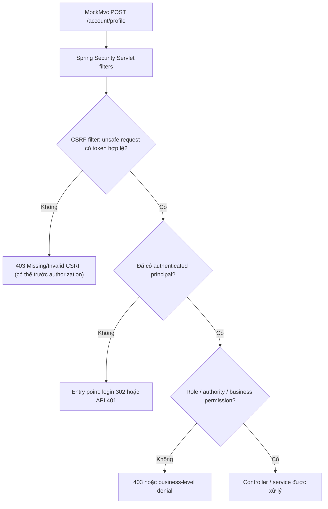

# Phân biệt giả lập danh tính với cung cấp CSRF token

> **Chương:** Kiểm thử Servlet  
> **Module:** `SPRING_SECURITY_HTTP_PROTECTION` — ứng dụng các lớp phòng vệ HTTP và trình duyệt trong Spring Security: CSRF, CORS, security headers, CSP, HSTS, HTTP firewall và bảo vệ session. Người học thực hành cấu hình Servlet/Reactive, kiểm thử tấn công web và chẩn đoán xung đột giữa các lớp bảo vệ.  
> **Trọng tâm:** Trong `MockMvc`, `@WithMockUser`, `user()` hoặc `jwt()` tạo **danh tính đã xác thực giả lập**; `csrf()` tạo và gửi **token chống CSRF cho request kiểm thử**. Hai loại hỗ trợ này giải quyết hai câu hỏi khác nhau. Có user không có nghĩa có CSRF token, và có CSRF token không có nghĩa người gửi đã đăng nhập.

## 1. Mục tiêu học tập

Sau bài này, người học có thể:

1. Giải thích authentication, authorization và CSRF protection là những kiểm tra độc lập, dù kết quả từ chối đều có thể là 403.
2. Hiểu vai trò của `@WithMockUser`, `@WithUserDetails`, `with(user())`, `with(authentication(...))`, `with(jwt())` và `with(csrf())` trong `spring-security-test`.
3. Dự đoán status từ cùng một browser POST khi thay đổi principal (anonymous/USER/ADMIN) và CSRF token (thiếu/hợp lệ/không hợp lệ).
4. Biết tại sao request đã authenticated nhưng thiếu CSRF thường 403, còn anonymous có CSRF hợp lệ vẫn cần authentication.
5. Viết MockMvc tests dùng `csrf()`, `csrf().asHeader()`, `csrf().useInvalidToken()` đúng ngữ cảnh.
6. Chứng minh `permitAll()` không tự tắt CSRF, và một GET public không thay một POST thay đổi trạng thái.
7. Phân biệt kiểm CSRF token bằng test helper với kiểm vòng đời phát/lưu/nhận token thật từ server, session, cookie hoặc SPA.
8. Cô lập lỗi CSRF với lỗi role/scope bằng cách giữ các điều kiện khác hợp lệ, kiểm controller/service không chạy khi request bị chặn.
9. Kiểm form login/logout dùng CSRF trong browser session, đồng thời biết giới hạn `@WithMockUser` đối với password/login flow.
10. Phân tích khi API Bearer-only có thể tắt CSRF, vì sao cookie authentication, CORS, SameSite hay `with(jwt())` không tự trả lời toàn bộ threat model.
11. Chẩn đoán lỗi 302/401/403/404 do chain matcher, filter setup, token repository, token handler hoặc controller.
12. Nhận biết khác biệt giữa Servlet `MockMvc` và Reactive `WebTestClient` để không trộn hai test APIs.

## 2. Câu hỏi của từng lớp phòng vệ

Một browser gửi:

```http
POST /account/profile HTTP/1.1
Host: app.example.com
Cookie: JSESSIONID=...
Content-Type: application/x-www-form-urlencoded

displayName=Alice
```

Có ít nhất ba câu hỏi bảo mật:

| Lớp | Câu hỏi | Dữ liệu quyết định |
|---|---|---|
| **Authentication** | Request này có principal hợp lệ là ai? | Session/cookie hoặc credential hợp lệ, được authentication filter/context xác minh |
| **CSRF protection** | Unsafe request dùng browser auto-credentials có token chống giả mạo hợp lệ không? | Token gửi qua tham số/header, so với token được lưu/phát theo `CsrfTokenRepository` và request handler |
| **Authorization** | Principal ấy có quyền đổi hồ sơ/đụng tài nguyên này không? | Role/authority/resource permission và business rules |

**CSRF token không xác thực danh tính.** Nó là một cơ chế phòng request giả mạo trong threat model có credential được browser tự gửi; nó không cấp quyền ADMIN. **Authentication không chứng minh request do chủ tài khoản chủ động thực hiện.** Một browser đã đăng nhập có thể bị trang khác kích hoạt POST cross-site, nếu ứng dụng không có phòng vệ CSRF phù hợp.

### 2.1. Vì sao chỉ có cookie phiên vẫn nguy hiểm?

Một trang độc hại có thể khiến browser người dùng gửi biểu mẫu đến một origin khác. Browser có thể tự gửi cookie tùy thuộc SameSite, cookie scope và các điều kiện trình duyệt. Attacker không nhất thiết đọc được HTTP response; chỉ cần thay đổi trạng thái là đủ.

CSRF token được ràng buộc với phiên/ngữ cảnh server và được yêu cầu trên unsafe request để chứng minh bên gửi có token hợp lệ mà attacker không dễ đoán/lấy từ origin khác.

CORS không tự thay CSRF: biểu mẫu POST đơn giản có thể được browser gửi mà không cần preflight. SameSite cookies giúp giảm một số kịch bản nhưng không thay đánh giá CSRF theo ứng dụng, subdomain và browser behavior.

### 2.2. Các lớp có thể từ chối ở những thời điểm khác nhau



Sơ đồ là mô hình khái niệm cho browser chain đã bật CSRF; filter order/handlers và error handling thực tế có thể thay đổi chi tiết status cuối. Đặc biệt, `CsrfFilter` có thể chặn trước `AuthorizationFilter`, nên nhận 403 **không** đủ chứng minh role rule hoạt động.

## 3. Hai trục độc lập trong Spring Security Test

Hãy nhớ cách ghép:

```text
           Authentication (ai?)
  anonymous          authenticated USER        authenticated ADMIN
       \                     |                         /
        \                    |                        /
         +-------------------+-----------------------+
                             |
                 CSRF token (có chứng cứ?)
                 thiếu / sai / hợp lệ
                             |
                Authorization + controller
```

Trong MockMvc:

- `@WithMockUser(username = "alice", roles = "USER")` hoặc `.with(user("alice").roles("USER"))` điều chỉnh **Authentication/SecurityContext**.
- `.with(csrf())` điều chỉnh **CSRF token gắn với request** theo test support.
- `.with(csrf().asHeader())` đưa token qua header thay vì request parameter.
- `.with(csrf().useInvalidToken())` mô phỏng token sai.
- Không gọi `csrf()` khi muốn kiểm request **thiếu token**; nếu helper đã thêm token, test không còn kiểm missing CSRF.

Một request có thể có cả principal và token:

```java
mvc.perform(post("/account/profile")
        .with(user("alice").roles("USER"))
        .with(csrf()))
    .andExpect(status().isNoContent());
```

Nhưng hai helpers không “gộp” thành một cơ chế; bỏ một helper sẽ kiểm một failure path khác.

## 4. Bảng công cụ: helper nào cấp thứ gì?

| Spring Security Test API | Nó cung cấp | Nó **không** cung cấp/không kiểm |
|---|---|---|
| `@WithMockUser` | Authentication mock trong SecurityContext của test | CSRF token; password verification; login form |
| `@WithAnonymousUser` | SecurityContext anonymous cho test | CSRF token |
| `@WithUserDetails` | Authentication từ UserDetailsService đã cấu hình | POST login/password check; CSRF token |
| `with(user("alice"))` | User-style Authentication mock cho một request | CSRF token, session login flow thật |
| `with(authentication(auth))` | Authentication object tùy chọn | CSRF token; AuthenticationProvider có sinh ra object đó không |
| `with(jwt())` | JwtAuthenticationToken mock và authorities/claims | CSRF token; JWT signature, issuer, expiry, audience |
| `with(httpBasic("alice","pw"))` | Authorization: Basic header để authentication filter xử lý nếu được bật | Không tự login; không thêm CSRF token |
| `with(csrf())` | CSRF token request phù hợp test repository/handler | Authentication, role, JWT, ownership |
| `with(csrf().asHeader())` | Token thử qua header | Authentication; browser có lấy/gửi token thật đúng không |
| `with(csrf().useInvalidToken())` | Token CSRF không hợp lệ | Authentication; không thay test thiếu token |
| `with(anonymous())` | Anonymous cho request hiện tại | CSRF token |

Nếu một test tên `authenticatedUserCanPost` dùng `@WithMockUser` nhưng không có `csrf()`, mà POST bị 403, **đó có thể là behavior đúng** của browser chain — không phải Spring Security “quên user”.

### 4.1. `roles` và `authorities` không tương đương

`@WithMockUser(roles = "ADMIN")` và `user("alice").roles("ADMIN")` theo convention tạo `ROLE_ADMIN`. Trong Resource Server, scope `orders.read` thường được map thành `SCOPE_orders.read`. Test role ADMIN không tự có scope read.

Khi muốn kiểm principal nhưng không lẫn authority mismatch, khai đúng authorities:

```java
.with(user("alice").authorities(
    new SimpleGrantedAuthority("SCOPE_orders.read")))
```

Đây vẫn chỉ là user-style Authentication mock; controller đòi `@AuthenticationPrincipal Jwt` cần mock JWT qua `jwt()`.

## 5. Thiết lập đúng MockMvc trước khi bàn về CSRF

Dù có `with(csrf())`, nếu MockMvc **không chạy Spring Security Servlet filters**, token đó không chứng minh `CsrfFilter` được gọi.

Một cấu hình Spring Boot test thường dùng:

```java
@SpringBootTest
@AutoConfigureMockMvc
class CsrfVsIdentityTest {

    @Autowired
    MockMvc mvc;

    @Test
    void testExample() throws Exception {
        mvc.perform(get("/account")
                .with(user("alice").roles("USER")))
            .andExpect(status().isOk());
    }
}
```

Dependencies Gradle Kotlin DSL:

```kotlin
dependencies {
    implementation("org.springframework.boot:spring-boot-starter-web")
    implementation("org.springframework.boot:spring-boot-starter-security")

    testImplementation("org.springframework.boot:spring-boot-starter-test")
    testImplementation("org.springframework.security:spring-security-test")
}
```

Maven riêng cho Spring Security Test khi dùng Spring Boot dependency management:

```xml
<dependency>
    <groupId>org.springframework.security</groupId>
    <artifactId>spring-security-test</artifactId>
    <scope>test</scope>
</dependency>
```

Không pin lệch version `spring-security-test` so với Spring Security runtime. Spring Boot starters/test annotations có thể thay package hoặc cách cấu hình ở các phiên bản mới; ví dụ theo stack Spring Security 6+/Spring Boot 3+ phổ biến.

### 5.1. Tự build MockMvc phải gọi `springSecurity()`

```java
@SpringBootTest
class ManualSecurityMockMvcTest {

    @Autowired
    WebApplicationContext context;

    MockMvc mvc;

    @BeforeEach
    void setUp() {
        mvc = MockMvcBuilders
            .webAppContextSetup(context)
            .apply(springSecurity())
            .build();
    }
}
```

Imports chính:

```java
import org.junit.jupiter.api.BeforeEach;
import org.springframework.beans.factory.annotation.Autowired;
import org.springframework.boot.test.context.SpringBootTest;
import org.springframework.test.web.servlet.MockMvc;
import org.springframework.test.web.servlet.setup.MockMvcBuilders;
import org.springframework.web.context.WebApplicationContext;
import static org.springframework.security.test.web.servlet.setup.SecurityMockMvcConfigurers.springSecurity;
```

### 5.2. Hai loại test giả dương

- `@AutoConfigureMockMvc(addFilters = false)`: Boot không thêm Servlet filters từ context vào MockMvc. Khi đó POST có hay không có `csrf()` đều có thể tới controller, vì `CsrfFilter` không chạy.
- `MockMvcBuilders.standaloneSetup(controller).build()`: chỉ kiểm MVC handler, không tự gắn Spring Security. Có `@WithMockUser` vẫn không chứng minh HTTP security chain.

Nếu muốn **controller-only unit test**, hai cách trên có thể dùng có chủ đích; không báo chúng là kiểm thử CSRF integration. Muốn chứng minh CSRF chặn request, giữ filters và tạo negative+positive test trên cùng fixture.

## 6. Ứng dụng Servlet mẫu để phân biệt danh tính và token

Ta tạo browser MVC application dùng form login/session, yêu cầu:

| Endpoint | Quyền HTTP | CSRF trên unsafe request |
|---|---|---|
| `GET /account` | Authenticated | Không yêu cầu cho GET |
| `POST /account/profile` | Authenticated | Yêu cầu |
| `POST /public/feedback` | `permitAll()` | **Vẫn yêu cầu** |
| `POST /admin/settings` | Role ADMIN | Yêu cầu |
| `GET /csrf` | Public; trả token thử nghiệm cho same-origin UI | GET không cần token để gọi, nhưng tạo/phát token |
| `GET /login` | Public | GET không cần token |
| `POST /login` | Login processing | Mặc định thường yêu cầu token nếu CSRF bật |
| `POST /logout` | Logout | Mặc định thường yêu cầu token nếu CSRF bật |

### 6.1. Security configuration dùng cho browser fixture

```java
package example.security;

import org.springframework.context.annotation.Bean;
import org.springframework.context.annotation.Configuration;
import org.springframework.http.HttpMethod;
import org.springframework.security.config.Customizer;
import org.springframework.security.config.annotation.web.builders.HttpSecurity;
import org.springframework.security.config.annotation.web.configuration.EnableWebSecurity;
import org.springframework.security.web.SecurityFilterChain;

@Configuration
@EnableWebSecurity
public class BrowserCsrfSecurityConfig {

    @Bean
    SecurityFilterChain browser(HttpSecurity http)
            throws Exception {
        return http
            .authorizeHttpRequests(auth -> auth
                .requestMatchers(HttpMethod.GET,
                    "/login", "/csrf", "/public/**").permitAll()
                .requestMatchers(HttpMethod.POST,
                    "/public/feedback").permitAll()
                .requestMatchers("/admin/**").hasRole("ADMIN")
                .anyRequest().authenticated())
            .formLogin(Customizer.withDefaults())
            .csrf(Customizer.withDefaults())
            .headers(headers -> headers
                .contentSecurityPolicy(csp ->
                    csp.policyDirectives(
                        "default-src 'self'; object-src 'none'; " +
                        "base-uri 'self'; frame-ancestors 'none'")))
            .build();
    }
}
```

Điểm cần chú ý:

- `csrf(Customizer.withDefaults())` bảo vệ unsafe methods theo CSRF matcher mặc định; không có rule `permitAll()` nào tự tắt kiểm token.
- `formLogin()` và `session` phục vụ authentication; CSRF token là lớp riêng.
- `/admin/**` cần role ADMIN sau khi CSRF pass.
- Không dùng `csrf().disable()` để chữa một test authenticated POST đang thiếu token.
- CSP/header writer tiếp tục chạy với public paths được `permitAll()` nếu request đi qua chain và response chưa commit.

### 6.2. Controller fixture có tác dụng phụ đo được

```java
package example.web;

import java.util.Map;
import jakarta.servlet.http.HttpServletRequest;
import org.springframework.http.ResponseEntity;
import org.springframework.security.web.csrf.CsrfToken;
import org.springframework.web.bind.annotation.*;

@RestController
class BrowserCsrfController {

    private final ProfileChangeRecorder recorder;

    BrowserCsrfController(ProfileChangeRecorder recorder) {
        this.recorder = recorder;
    }

    @GetMapping("/account")
    String account() {
        return "account";
    }

    @PostMapping("/account/profile")
    ResponseEntity<Void> changeProfile() {
        recorder.profileChanged();
        return ResponseEntity.noContent().build();
    }

    @PostMapping("/public/feedback")
    ResponseEntity<Void> feedback() {
        recorder.feedbackReceived();
        return ResponseEntity.noContent().build();
    }

    @PostMapping("/admin/settings")
    ResponseEntity<Void> adminSettings() {
        recorder.adminSettingsChanged();
        return ResponseEntity.noContent().build();
    }

    @GetMapping("/csrf")
    Map<String, String> csrf(
            @RequestAttribute("_csrf") CsrfToken token) {
        return Map.of(
            "parameterName", token.getParameterName(),
            "headerName", token.getHeaderName(),
            "token", token.getToken());
    }
}
```

`ProfileChangeRecorder` là interface/domain service fixture do bài kiểm thử cung cấp; ứng dụng thực nên có bean tương ứng. Handler `GET /csrf` ở đây chỉ phục vụ minh họa same-origin CSRF token issuance: **không** cache response chứa token và không mở credentialed CORS cho origin bất kỳ. Lời gọi `token.getToken()` còn giúp kích hoạt deferred token loading trong những cấu hình Spring Security sử dụng token lazy.

Dưới Spring Security 6, token trình bày cho client có thể được che bằng XOR masking qua request handler; không mặc định nó bằng raw value được lưu trong session/cookie. Chi tiết sẽ phân tích ở mục phát hành token thật.

### 6.3. Fixture này giúp chứng minh điều gì?

- POST hợp lệ trả **204** và gọi `recorder`.
- POST bị CSRF/authorization chặn trả **403** (theo cấu hình tiêu chuẩn), recorder **không** được gọi.
- GET `/account` anonymous thường nhận **302 login**, dù không thiếu CSRF.
- POST `/public/feedback` anonymous **có** CSRF được cho phép; không có token vẫn bị 403.

Để ví dụ Java chạy, cần Spring Boot/Security dependencies, test service bean, user store nếu muốn form login thật. Những tests chỉ dùng `with(user())` không cần nhập password thật, nhưng security context vẫn phải tạo đúng.

## 7. Kiểm `@WithMockUser`: có danh tính, chưa có CSRF

Ví dụ test:

```java
@Test
@WithMockUser(username = "alice", roles = "USER")
void authenticatedUserStillNeedsCsrfOnPost()
        throws Exception {
    mvc.perform(post("/account/profile"))
        .andExpect(status().isForbidden());
}
```

`@WithMockUser` chỉ làm Authentication authenticated trong test. Nó **không** tạo CSRF request parameter/header. Spring Security vẫn có thể từ chối ở `CsrfFilter`.

Cùng user, thêm token:

```java
@Test
@WithMockUser(username = "alice", roles = "USER")
void authenticatedUserWithCsrfCanPost()
        throws Exception {
    mvc.perform(post("/account/profile")
            .with(csrf()))
        .andExpect(status().isNoContent());
}
```

Hai test này không kiểm việc Alice đăng nhập bằng password thật. Chúng kiểm rằng **khi principal đã có**, CSRF vẫn là điều kiện độc lập của unsafe browser request.

### 7.1. `@WithMockUser` ở mức class

```java
@WithMockUser(username = "alice", roles = "USER")
class AccountCsrfTests {

    @Autowired MockMvc mvc;

    @Test
    void getDoesNotRequireCsrf() throws Exception {
        mvc.perform(get("/account"))
            .andExpect(status().isOk());
    }

    @Test
    void postStillRequiresCsrf() throws Exception {
        mvc.perform(post("/account/profile"))
            .andExpect(status().isForbidden());
    }
}
```

Class-level annotation áp test principal mặc định, **không** áp CSRF mặc định. Nó cũng có thể khiến một test tưởng là anonymous thực chất đã authenticated; với anonymous case hãy dùng test class riêng hoặc `@WithAnonymousUser`.

### 7.2. `@WithUserDetails` cũng không tự cung cấp token

`@WithUserDetails("alice")` nạp principal qua `UserDetailsService` trong test context. Nó có ích khi muốn roles từ store thật nhưng **không gửi password qua login filter** và **không tạo CSRF token tự động** cho POST.

Một test form-login/session security đúng còn phải kiểm riêng authentication filter, session fixation/cookie behavior và token issuance nếu các yếu tố này thuộc mục tiêu kiểm thử.

## 8. `user()` áp cho từng request; `csrf()` áp cho token của request ấy

Đối với MockMvc request post-processors:

```java
@Test
void useTwoIndependentPostProcessors()
        throws Exception {
    mvc.perform(post("/account/profile")
            .with(user("alice").roles("USER"))
            .with(csrf()))
        .andExpect(status().isNoContent());
}
```

Import:

```java
import static org.springframework.security.test.web.servlet.request.SecurityMockMvcRequestPostProcessors.*;
import static org.springframework.test.web.servlet.request.MockMvcRequestBuilders.*;
import static org.springframework.test.web.servlet.result.MockMvcResultMatchers.*;
```

Khi chỉ bỏ `with(csrf())`:

```java
mvc.perform(post("/account/profile")
        .with(user("alice").roles("USER")))
    .andExpect(status().isForbidden());
```

Khi chỉ bỏ principal (nhưng giữ CSRF):

```java
mvc.perform(post("/account/profile")
        .with(anonymous())
        .with(csrf()))
    .andExpect(status().is3xxRedirection());
```

Với browser form-login chain mẫu, anonymous nhưng có CSRF hợp lệ sẽ đi qua CSRF filter rồi bị authentication entry point chuyển đến trang login. Nếu ứng dụng dùng API entry point trả 401 hoặc custom handler, status sẽ khác; **bất biến** là token CSRF không tạo authenticated principal.

### 8.1. Tại sao thứ tự hai helpers thường không phải trọng tâm?

Dù viết `.with(user(...)).with(csrf())` hay sắp xếp lại helpers không xung đột, thứ quyết định bảo mật là **Authentication được đưa vào test security context** và **CSRF token được gắn đúng request**. Nhưng nếu có custom request post-processors tự ghi đè session/header/attributes, thứ tự có thể quan trọng; hãy giữ setup rõ ràng và test những trường hợp cụ thể.

### 8.2. Token không ràng buộc trực tiếp với role

Một user role USER có thể có CSRF hợp lệ nhưng không được cập nhật admin settings. Token hợp lệ chứng minh CSRF condition, không tự thêm `ROLE_ADMIN`. Thứ tự rule không được đổi để “sửa” test 403 do thiếu role.

## 9. Những dạng `csrf()` trong Spring Security Test

### 9.1. Token mặc định qua request parameter

```java
mvc.perform(post("/account/profile")
        .with(user("alice").roles("USER"))
        .with(csrf()))
    .andExpect(status().isNoContent());
```

Theo Spring Security Test, `csrf()` tạo token/test request data để request có thể thỏa CSRF validation của cấu hình được hỗ trợ. Đây **không** phải việc browser thật đã lấy token từ HTML/cookie và gửi lại đúng.

### 9.2. CSRF token qua HTTP header

```java
mvc.perform(post("/account/profile")
        .with(user("alice").roles("USER"))
        .with(csrf().asHeader()))
    .andExpect(status().isNoContent());
```

Hữu ích để test SPA gửi CSRF token qua header theo cấu hình token handler. Tên header thực tế theo `CsrfToken.getHeaderName()`/repository và phiên bản; không tự kết luận header trong production chỉ vì helper pass.

### 9.3. CSRF token không hợp lệ

```java
mvc.perform(post("/account/profile")
        .with(user("alice").roles("USER"))
        .with(csrf().useInvalidToken()))
    .andExpect(status().isForbidden());
```

Nó kiểm **token sai**, khác với case hoàn toàn không gửi token.

### 9.4. Header với token không hợp lệ

```java
mvc.perform(post("/account/profile")
        .with(user("alice").roles("USER"))
        .with(csrf().asHeader().useInvalidToken()))
    .andExpect(status().isForbidden());
```

Khi ứng dụng tự chọn `CsrfTokenRepository` hoặc custom `CsrfTokenRequestHandler`, phải kiểm cách helper và token repository tương tác theo version/cấu hình cụ thể. Không sửa production handler để làm test helper pass nếu client thật dùng flow khác.

### 9.5. Test thiếu token thì **không dùng `csrf()`**

```java
mvc.perform(post("/account/profile")
        .with(user("alice").roles("USER")))
    .andExpect(status().isForbidden());
```

Đừng thêm `csrf()` vào một helper chung cho **mọi** test rồi sau đó viết test `missingCsrfIsRejected`; test đó không còn thực sự thiếu token. Tách factory cho request hợp lệ và request bất hợp lệ.

## 10. Ma trận danh tính × CSRF token

Với `POST /account/profile` chỉ cần authenticated (không yêu cầu role ADMIN), browser form-login và CSRF như mục 6:

| Danh tính | CSRF thiếu | CSRF sai | CSRF hợp lệ |
|---|---|---|---|
| Anonymous | 403 ở CSRF trước authentication (thường gặp) | 403 CSRF | 302 login (hoặc entry point khác) |
| USER Alice đã authenticated | 403 CSRF | 403 CSRF | 204 handler |
| ADMIN đã authenticated | 403 CSRF | 403 CSRF | 204 handler |

Với `POST /admin/settings` thêm rule ADMIN:

| Danh tính | CSRF thiếu | CSRF sai | CSRF hợp lệ |
|---|---|---|---|
| Anonymous | 403 CSRF | 403 CSRF | 302 login |
| USER Alice | 403 CSRF | 403 CSRF | 403 authorization |
| ADMIN | 403 CSRF | 403 CSRF | 204 handler |

**Lưu ý:** Mã status minh họa cho ứng dụng Servlet form-login với handlers/test fixtures tương ứng; custom `AccessDeniedHandler`, entry point và error handling có thể thay status/body. Điều quan trọng là **nguyên nhân** thay đổi có chủ đích giữa các ô.

### 10.1. Vì sao ma trận mạnh hơn một test đơn lẻ?

Nếu bạn chỉ kiểm `POST /admin/settings` từ USER thiếu CSRF trả 403, test sẽ pass cả khi rule `hasRole("ADMIN")` bị xoá: CSRF vẫn từ chối trước. Ô **USER + CSRF hợp lệ → 403 authorization** mới kiểm quyền ADMIN, còn ô **ADMIN + CSRF thiếu → 403 CSRF** kiểm riêng token.

### 10.2. Một positive case là đối chứng bắt buộc

Phải có ít nhất một ô **ADMIN + token hợp lệ → handler chạy**, nếu không ba test 403 có thể pass do endpoint/controller không tồn tại, configuration luôn deny hoặc database lỗi. Nên assert status **và** tác dụng phụ để biết request thực sự tới use case.

## 11. Tách 403 CSRF và 403 authorization bằng code

Giả định `/admin/settings` trong fixture mục 6 trả 204 khi ADMIN có token hợp lệ:

```java
@Test
void userWithValidCsrfStillCannotUpdateAdmin()
        throws Exception {
    mvc.perform(post("/admin/settings")
            .with(user("alice").roles("USER"))
            .with(csrf()))
        .andExpect(status().isForbidden());
}

@Test
void adminWithoutCsrfStillCannotUpdate()
        throws Exception {
    mvc.perform(post("/admin/settings")
            .with(user("root").roles("ADMIN")))
        .andExpect(status().isForbidden());
}

@Test
void adminWithCsrfCanUpdate()
        throws Exception {
    mvc.perform(post("/admin/settings")
            .with(user("root").roles("ADMIN"))
            .with(csrf()))
        .andExpect(status().isNoContent());
}
```

Test đầu giữ CSRF **hợp lệ**, nên một HTTP 403 sẽ liên quan authorization/handler policy, không phải missing CSRF theo cấu hình mẫu. Test thứ hai giữ role **ADMIN**, nên 403 gợi ý CSRF. Test thứ ba là positive control.

### 11.1. Có thể dùng Mock service để kiểm side effects

Nếu controller gọi một `ProfileChangeRecorder` mock bean được inject thật:

```java
mvc.perform(post("/admin/settings")
        .with(user("alice").roles("USER"))
        .with(csrf()))
    .andExpect(status().isForbidden());

verify(recorder, never()).adminSettingsChanged();
```

Ở request ADMIN + token hợp lệ, có thể verify `adminSettingsChanged()` được gọi đúng một lần. Trước mỗi test phải reset history của mock. Cần cấu hình Mockito/test bean tương ứng với Spring Boot version; một mock không được controller sử dụng thì `never()` luôn pass nhưng không chứng minh security chặn.

### 11.2. CSRF 403 có thể đến trước controller và `@ControllerAdvice`

CSRF là Servlet security filter. Nó có thể tạo response trước khi `DispatcherServlet` gọi controller, nên `@ControllerAdvice` của MVC không phải catch-all cho CSRF failure. Nếu ứng dụng muốn JSON 403 thống nhất, cần config `AccessDeniedHandler`/entry point hoặc cơ chế filter-level tương ứng, chứ không dựa hoàn toàn vào MVC advice.

## 12. `permitAll()` không có nghĩa miễn CSRF

Trong cấu hình mẫu:

```java
.authorizeHttpRequests(auth -> auth
    .requestMatchers(HttpMethod.POST, "/public/feedback")
        .permitAll()
    .anyRequest().authenticated())
.csrf(Customizer.withDefaults())
```

Một anonymous browser POST tới `/public/feedback`:

```java
@Test
void anonymousPublicPostWithoutCsrfIsForbidden()
        throws Exception {
    mvc.perform(post("/public/feedback"))
        .andExpect(status().isForbidden());
}

@Test
void anonymousPublicPostWithCsrfIsPermitted()
        throws Exception {
    mvc.perform(post("/public/feedback")
            .with(csrf()))
        .andExpect(status().isNoContent());
}
```

Đây là phép thử trực tiếp rằng **CSRF không phụ thuộc authenticated principal**: endpoint public theo authorization vẫn có thể cần CSRF nếu unsafe action có rủi ro browser forgery.

Ngược lại, `GET /public/info` hoặc `GET /account` không mặc định cần CSRF token vì GET được xem là safe method. Nếu một GET làm thay đổi trạng thái, đó là vấn đề thiết kế HTTP method; không sửa bằng cách tự ép `csrf()` vào GET tests rồi coi an toàn.
## 13. Safe method, unsafe method và CSRF request matcher

Spring Security Servlet CSRF protection có một request matcher xác định những request cần token. Theo mặc định phổ biến, `GET`, `HEAD`, `TRACE` và `OPTIONS` được xem là safe methods; các method khác, bao gồm `POST`, `PUT`, `PATCH`, `DELETE`, được kiểm CSRF khi chain bật CSRF.

| HTTP method | Với CSRF matcher mặc định | Điều phải nhớ |
|---|---|---|
| GET | Không cần CSRF token | Không thiết kế GET thay đổi trạng thái |
| HEAD | Không cần CSRF token | Không dùng HEAD kích hoạt operation nhạy cảm |
| OPTIONS | Không cần CSRF token | CORS preflight còn có origin/method/header policy riêng |
| TRACE | Không cần CSRF token | Server/proxy nên đánh giá có cần hỗ trợ TRACE; không dùng cho business mutation |
| POST | Cần CSRF token trên browser session chain | `permitAll()` không tự miễn |
| PUT/PATCH | Cần token trên browser session chain | Đừng bỏ sót SPA update actions |
| DELETE | Cần token trên browser session chain | Đừng nghĩ DELETE là “REST nên miễn CSRF” |

Test:

```java
@Test
@WithMockUser
void safeGetWorksWithoutCsrfToken() throws Exception {
    mvc.perform(get("/account"))
        .andExpect(status().isOk());
}

@Test
@WithMockUser
void unsafePostIsDeniedWithoutCsrfToken()
        throws Exception {
    mvc.perform(post("/account/profile"))
        .andExpect(status().isForbidden());
}
```

Một `GET /delete-account` làm thay đổi dữ liệu **là lỗi thiết kế method semantics**, không nên coi là an toàn vì CSRF matcher mặc định bỏ qua GET. Khi cần endpoint state-changing, dùng method thích hợp và giữ CSRF nếu browser auto-credentials được dùng.

### 13.1. Custom `requireCsrfProtectionMatcher` có thể mở lỗ hổng

Một số ứng dụng dùng custom matcher:

```java
http.csrf(csrf -> csrf
    .requireCsrfProtectionMatcher(request ->
        "POST".equals(request.getMethod())));
```

Đây là **ví dụ thiếu bảo vệ** nếu ứng dụng cũng dùng PUT/PATCH/DELETE để đổi trạng thái: matcher này chỉ kiểm POST. Không copy vào production. Nếu cần policy chuyên biệt, nên bắt đầu từ matcher mặc định và thiết kế exception cụ thể có threat model, sau đó test **mọi unsafe methods**.

### 13.2. Chỉ `permitAll` chưa đủ để cho endpoint webhooks/API machine-to-machine đi qua

Một webhook nhận POST có thể không sử dụng cookie/session authentication, nhưng nếu nằm trong browser chain bật CSRF, nó vẫn bị yêu cầu token. Cần thiết kế riêng chain hoặc exception theo endpoint/credential model và kiểm xác thực webhook (signature/timestamp/replay protection) tương ứng. Không blanket `csrf().disable()` cho toàn browser chỉ vì có một webhook.

## 14. Form login và logout: token riêng với username/password

Form login mặc định của Spring Security Servlet dùng một POST để xử lý username/password. Khi CSRF bật, POST login thường cần token; **có đúng password chưa chắc login request được chấp nhận nếu thiếu CSRF**.

### 14.1. Test POST login không gửi CSRF

```java
@Test
void formLoginWithoutCsrfIsRejected() throws Exception {
    mvc.perform(post("/login")
            .param("username", "alice")
            .param("password", "correct-password"))
        .andExpect(status().isForbidden());
}
```

Đoạn này cần form-login config và test user store đúng. Request thiếu CSRF có thể bị chặn **trước khi UsernamePasswordAuthenticationFilter xác minh password**. Một status 403 không có nghĩa password đã sai.

### 14.2. Test login có token nhưng password sai

```java
@Test
void formLoginWithCsrfAndWrongPasswordFails()
        throws Exception {
    mvc.perform(post("/login")
            .param("username", "alice")
            .param("password", "wrong-password")
            .with(csrf()))
        .andExpect(status().is3xxRedirection())
        .andExpect(redirectedUrlPattern("**/login?error"));
}
```

Ở đây CSRF được cung cấp để **authentication provider có cơ hội kiểm password**. Mẫu `/login?error` là convention form-login default; custom failure handler có thể trả JSON/401 hoặc URL khác. Nếu không có CSRF, test password sai có thể 403 và **chưa kiểm được password verification**.

### 14.3. Login đúng có token: kiểm session, không chỉ redirect

```java
@Test
void formLoginWithCsrfCanAuthenticate()
        throws Exception {
    MvcResult login = mvc.perform(post("/login")
            .param("username", "alice")
            .param("password", "correct-password")
            .with(csrf()))
        .andExpect(status().is3xxRedirection())
        .andReturn();

    MockHttpSession session =
        (MockHttpSession) login.getRequest().getSession(false);

    assertNotNull(session);

    mvc.perform(get("/account").session(session))
        .andExpect(status().isOk());
}
```

Cần user/password fixtures, PasswordEncoder/AuthenticationProvider, session-based security context persistence. Login thất bại **cũng có thể redirect**, nên phải kiểm `Location` theo contract và subsequent private request. Nếu session fixation protection thay đổi session ID, lấy session **sau login** thay vì reuse phiên cũ tùy tiện.

### 14.4. Logout cũng thường cần CSRF

```java
mvc.perform(post("/logout")
        .session(session)
        .with(csrf()))
    .andExpect(status().is3xxRedirection());
```

Với CSRF bật, logout thường qua POST; phải kiểm tiếp session invalidated hoặc request mới không còn authenticated. Nếu `MockHttpSession` đã bị invalidated, không tái dùng nó để giả lập request sau logout.

Không dùng `@WithMockUser` như bằng chứng form login/logout/session fixation hoạt động thật: annotation tạo principal test trực tiếp, không đi qua password filter.

## 15. Phát hành và dùng token thật: `csrf()` chưa phải end-to-end flow

`with(csrf())` là công cụ kiểm **CSRF filter authorization/validation**. Nó không chứng minh:

- GET login/form đã tạo token và hiển thị đúng cho browser.
- Token được lưu vào `HttpSessionCsrfTokenRepository` hoặc cookie repository đúng cách.
- Browser có giữ session/cookie cần thiết giữa GET và POST không.
- HTML form/JavaScript đọc đúng token từ server và gửi đúng header/parameter.
- Spring Security request handler (bao gồm XOR masking/lazy loading) diễn giải đúng token thực.
- Token có được làm mới sau authentication/logout theo chính sách hay không.

Để kiểm vòng đời token thật, gửi **GET nhận token rồi POST dùng lại token và cùng session** mà không dùng `with(csrf())` trên POST.

### 15.1. Endpoint phát token trong controller mẫu

Ở mục 6 có:

```java
@GetMapping("/csrf")
Map<String, String> csrf(
        @RequestAttribute("_csrf") CsrfToken token) {
    return Map.of(
        "parameterName", token.getParameterName(),
        "headerName", token.getHeaderName(),
        "token", token.getToken());
}
```

Đoạn này trả token theo `CsrfToken` đã được security filter/request handler đặt trên request, không tự sinh UUID tùy tiện. `token.getToken()` có thể kích deferred token loading. Dùng endpoint minh họa trong ứng dụng có same-origin frontend; cần `Cache-Control: no-store`, kiểm CORS credentials và không cho attacker-origin đọc response chứa token.

Ở ứng dụng MVC HTML, thay vì JSON endpoint, server có thể render token vào form hidden field hoặc meta tags. Trong SPA, source có thể là cookie/endpoint và header tương ứng; cần thiết kế riêng.

### 15.2. Test GET → lấy token → POST mà không dùng `csrf()`

```java
@Test
void serverIssuedCsrfTokenWorksWithSameSession()
        throws Exception {
    MockHttpSession session = new MockHttpSession();

    MvcResult issued = mvc.perform(get("/csrf")
            .session(session))
        .andExpect(status().isOk())
        .andExpect(header().exists("Cache-Control"))
        .andReturn();

    String json = issued.getResponse().getContentAsString();
    String parameterName =
        JsonPath.read(json, "$.parameterName");
    String token = JsonPath.read(json, "$.token");

    mvc.perform(post("/account/profile")
            .session(session)
            .with(user("alice").roles("USER"))
            .param(parameterName, token))
        .andExpect(status().isNoContent());
}
```

Imports tiêu biểu:

```java
import com.jayway.jsonpath.JsonPath;
import org.junit.jupiter.api.Test;
import org.springframework.mock.web.MockHttpSession;
import org.springframework.test.web.servlet.MvcResult;
import static org.springframework.security.test.web.servlet.request.SecurityMockMvcRequestPostProcessors.user;
import static org.springframework.test.web.servlet.request.MockMvcRequestBuilders.*;
import static org.springframework.test.web.servlet.result.MockMvcResultMatchers.*;
```

**Giải thích chi tiết:**

1. `GET /csrf` vào browser security chain, tạo/đưa token cho client; response được xử lý trước khi POST.
2. Test giữ một `MockHttpSession` chung để `HttpSessionCsrfTokenRepository` có thể kiểm server-side token qua request sau.
3. Test lấy `parameterName` và giá trị trình bày của token do server trả, **không** tự phỏng đoán raw token.
4. POST gửi token như một browser form cùng session và một principal mock; riêng bước authentication vẫn **được giả lập** bởi `user()`.
5. Nếu muốn kiểm cả login thực, dùng POST `/login` với token được cấp từ server, kiểm session và token sau authentication trước khi POST tiếp.

Nếu ứng dụng dùng `CookieCsrfTokenRepository`, session strategy khác, custom handler hoặc response encoding khác, cần điều chỉnh test để tái tạo đúng cookie/header flow. Một CSRF token được masked cho presentation có thể khác raw token trong repository; test phải gửi **giá trị client thật được phát**, không đọc trực tiếp repository rồi tự cho là tương đương.

### 15.3. Kiểm token từ session khác bị từ chối

Tạo session A, GET `/csrf` lấy token A, rồi POST với session B không có server-side token tương ứng và principal đã authenticated. Với session repository thông thường, token A không được nhận trong session B, kỳ vọng 403. Đây là negative control quan trọng để xác minh token không chỉ là “một chuỗi bất kỳ”.

Với cookie repository, phải thiết kế case **cookie và header không tương ứng**, không chỉ đổi MockHttpSession, vì nơi lưu expected token đã khác.

## 16. Token repository, request handler và Spring Security 6 lazy/XOR

CSRF không chỉ là “so token string trong controller”. Servlet `CsrfFilter` phối hợp:

- `CsrfTokenRepository`: tạo, lưu và nạp expected token (ví dụ `HttpSessionCsrfTokenRepository` hoặc `CookieCsrfTokenRepository`).
- `CsrfTokenRequestHandler`: expose token vào request và trích giá trị token client gửi qua header/parameter theo cơ chế phù hợp.
- `requireCsrfProtectionMatcher`: quyết định method/path cần CSRF.
- Access denied handling: từ chối nếu thiếu/sai token hoặc các lỗi bảo mật liên quan.

### 16.1. Session repository

Mặc định phổ biến của Servlet CSRF là `HttpSessionCsrfTokenRepository`. Với browser form login, session repository giữ expected token bên server, còn form/header chứa giá trị đại diện client gửi lại.

Giả sử token của user Alice tồn tại ở session A; attacker gửi request bằng browser Alice nhưng không biết token hợp lệ. Một POST có cookie session mà không có token sẽ bị chặn; đã authenticated không miễn.

### 16.2. Cookie repository và SPA

Với frontend JavaScript cần đọc CSRF cookie, một lựa chọn:

```java
@Bean
SecurityFilterChain browser(HttpSecurity http)
        throws Exception {
    CookieCsrfTokenRepository repo =
        CookieCsrfTokenRepository.withHttpOnlyFalse();

    return http
        .authorizeHttpRequests(auth -> auth
            .requestMatchers("/login", "/csrf").permitAll()
            .anyRequest().authenticated())
        .csrf(csrf -> csrf
            .csrfTokenRepository(repo))
        .formLogin(Customizer.withDefaults())
        .build();
}
```

**Đây chỉ minh họa cách chọn repository, chưa phải toàn bộ cấu hình production SPA.** `withHttpOnlyFalse()` cho phép JavaScript đọc CSRF cookie, tăng khả năng lộ token nếu XSS; phải bảo vệ origin bằng CSP, tránh XSS và kiểm cookie flags/HTTPS/SameSite. Nếu frontend không cần đọc cookie, giữ HttpOnly theo thiết kế phù hợp.

### 16.3. XOR masking và raw token từ cookie

Trong Spring Security 6, `XorCsrfTokenRequestAttributeHandler` là cơ chế thường dùng để bảo vệ token khi đưa vào HTML bằng masking chống BREACH. Giá trị token client nhìn thấy trong form có thể là **masked token**, khác expected raw token ở repository.

SPA đọc raw token từ CSRF cookie rồi gửi qua header có thể cần một `CsrfTokenRequestHandler` **được cấu hình cho hai đường**: xử lý raw header token phù hợp, đồng thời tiếp tục hỗ trợ masked form token/lazy loading. Không mặc định rằng đổi sang `CookieCsrfTokenRepository.withHttpOnlyFalse()` là đủ cho mọi SPA trên mọi phiên bản.

Khi test:

- `with(csrf())` có thể cho CSRF filter pass dù frontend cookie/header production không hoạt động.
- Bổ sung HTTP/browser test nhận cookie thật, đọc raw token theo client policy và gửi đúng header.
- Kiểm session/cookie rotation sau login/logout.
- Không tắt XOR/BREACH protection toàn cục chỉ để vượt lỗi test; xác định request handler và wire protocol chính xác.

### 16.4. Deferred/lazy CSRF tokens

Spring Security hiện đại có thể **không tạo/lưu token cho mọi GET** cho đến khi token thực sự được truy cập. Vì vậy test `GET /public` rồi assert ngay có CSRF cookie có thể sai khi controller không gọi `csrfToken.getToken()` hay frontend chưa yêu cầu token.

Dùng endpoint/form có truy cập token để kích phát hành; kiểm giá trị theo handler thực. Sau authentication/logout, strategy có thể xoá token cũ, khiến SPA cần yêu cầu token mới trước unsafe request tiếp theo.

### 16.5. Tránh tự tạo một “CSRF token” tùy ý

Đừng làm:

```java
// KHÔNG phải cách chứng minh CsrfFilter chấp nhận token.
mvc.perform(post("/account/profile")
        .header("X-CSRF-TOKEN", "12345"))
    .andExpect(status().isNoContent());
```

Nếu server không có expected token khớp trong repository, header string không có giá trị. CSRF test helper hoặc vòng đời token issuance thật phải tạo cặp **expected/submitted** tương thích; một chuỗi tùy ý không tự hợp lệ.

## 17. Logout/login có thể xoá token trước đó

Ngoài chuyện login POST cần CSRF, token lifecycle còn liên quan chiến lược Spring Security:

- `CsrfAuthenticationStrategy` có thể làm mất hiệu lực token trước khi authentication hoàn tất.
- `CsrfLogoutHandler` có thể xoá token khi logout.
- Lazy token loading khiến cookie/token mới không nhất thiết được phát ngay trong redirect response.
- Ứng dụng SPA có thể cần gọi endpoint CSRF token hoặc trigger token issuance **sau login/logout** để có token mới cho request tiếp theo.

### 17.1. Một test helper có thể che lỗi refresh token

`with(csrf())` trên mọi POST tự cung cấp token hợp lệ theo test abstraction. Nó có thể khiến bài kiểm thử bỏ sót việc frontend vẫn đang gửi token cũ sau login trong thực tế.

Cần thêm integration flow:

1. GET form/token.
2. POST login với CSRF token hiện hành và password hợp lệ.
3. Theo redirect/giữ session thực sau login.
4. Lấy token mới theo cơ chế UI/API.
5. POST protected operation với token mới.
6. Logout với token hợp lệ và kiểm không còn quyền.
7. Kiểm token cũ không được tái dùng trái policy.

Khi test, phân biệt **nguyên nhân 403**: token invalid vì bị refresh không đồng nghĩa principal đã mất authentication. Đọc CSRF logs/test response và state/side effects.

## 18. CORS, SameSite và CSRF trong SPA cross-origin

Giả sử SPA ở `https://client.example.com` gọi backend ở `https://api.example.com` bằng cookies. Browser có các lớp độc lập:

- CORS: server có cho phép origin client đọc response và gửi headers/methods tương ứng theo browser policy?
- Cookie domain/path/SameSite/Secure: browser có gửi cookie tự động trong ngữ cảnh cross-site/same-site đó?
- CSRF: unsafe operation có token hợp lệ trong header/parameter không?
- Authentication: session cookie được server chấp nhận, principal là ai?
- Authorization: principal có được thực hiện operation không?

### 18.1. Preflight không phải authenticated POST

```http
OPTIONS /account/profile HTTP/1.1
Origin: https://client.example.com
Access-Control-Request-Method: POST
Access-Control-Request-Headers: content-type,x-csrf-token
```

Preflight thường không có session cookie/CSRF token của unsafe request thật. CORS filter xử lý sớm để trả allow-origin/method/header khi policy cho phép. `CsrfFilter` mặc định không đòi token trên OPTIONS.

### 18.2. Kiểm preflight và POST thành hai tests

```java
@Test
void corsPreflightNeedsPolicyButNotCsrfToken()
        throws Exception {
    mvc.perform(options("/account/profile")
            .header("Origin", "https://client.example.com")
            .header("Access-Control-Request-Method", "POST")
            .header("Access-Control-Request-Headers",
                "content-type,x-csrf-token"))
        // Status/headers phụ thuộc CORS config của ứng dụng.
        .andExpect(header().exists(
            "Access-Control-Allow-Origin"));
}
```

Test này **chỉ hợp lệ khi browser chain có CORS configuration** cho origin/method/header đã dùng; fixture mục 6 chưa bật CORS, nên phải bổ sung CORS source đúng trước khi sử dụng. Một POST actual còn phải có session authentication và CSRF token, không thể dùng preflight 200 làm bằng chứng POST được phép.

### 18.3. CORS không thay CSRF và không thay login

Một attacker có thể gửi simple cross-site form POST mà không cần JS đọc response hoặc preflight, tùy browser/cookie policy. Vì vậy không dùng `allowedOrigins` allowlist làm lý do tắt CSRF cho browser cookie auth.

Ngược lại, một Bearer token do JS tự gắn theo Authorization header thường không được browser tự gửi như cookie; threat model CSRF của một API **thuần Bearer** có thể khác, như mục sau. Tuy nhiên XSS, đánh cắp token và CORS vẫn cần được kiểm soát.

### 18.4. Không mặc định `SameSite=Lax` giải quyết mọi CSRF

SameSite phụ thuộc same-site definition (schemeful site), HTTP method, top-level navigation, subdomains, browser exceptions và chính sách cookie. Nên phối hợp đúng cookie flags, CSRF token, Origin/Referer checks khi phù hợp và HTTPS. Một MockMvc test không mô phỏng browser cookie-enforcement; cần browser/edge integration.

## 19. API Bearer-only khác browser cookie: đừng đặt CSRF theo tên “REST”

Đối với API dùng OAuth2 Resource Server, client thường gửi:

```http
POST /api/orders HTTP/1.1
Authorization: Bearer <jwt>
Content-Type: application/json

{"sku":"book"}
```

Bearer token được client chủ động thêm vào header, không phải cookie session browser tự đính kèm. Khi API **chỉ chấp nhận credential kiểu này**, không dùng cookie/Basic/browser auto-credentials và đã đánh giá threat model, có thể thiết kế chain stateless miễn CSRF cho API.

### 19.1. Hai chain tách theo loại credential

```java
@Configuration
@EnableWebSecurity
public class ApiAndBrowserCsrfConfig {

    @Bean
    @Order(1)
    SecurityFilterChain api(HttpSecurity http)
            throws Exception {
        return http
            .securityMatcher("/api/**")
            // Chỉ cho API thật sự thuần Bearer header.
            .csrf(AbstractHttpConfigurer::disable)
            .sessionManagement(session -> session
                .sessionCreationPolicy(SessionCreationPolicy.STATELESS))
            .authorizeHttpRequests(auth -> auth
                .requestMatchers(HttpMethod.POST, "/api/orders")
                    .hasAuthority("SCOPE_orders.write")
                .anyRequest().authenticated())
            .oauth2ResourceServer(oauth2 -> oauth2
                .jwt(Customizer.withDefaults()))
            .build();
    }

    @Bean
    @Order(2)
    SecurityFilterChain browser(HttpSecurity http)
            throws Exception {
        return http
            .authorizeHttpRequests(auth -> auth
                .requestMatchers("/login", "/csrf").permitAll()
                .anyRequest().authenticated())
            .csrf(Customizer.withDefaults())
            .formLogin(Customizer.withDefaults())
            .build();
    }
}
```

Imports chính:

```java
import org.springframework.context.annotation.Bean;
import org.springframework.context.annotation.Configuration;
import org.springframework.core.annotation.Order;
import org.springframework.http.HttpMethod;
import org.springframework.security.config.Customizer;
import org.springframework.security.config.annotation.web.builders.HttpSecurity;
import org.springframework.security.config.annotation.web.configuration.EnableWebSecurity;
import org.springframework.security.config.annotation.web.configurers.AbstractHttpConfigurer;
import org.springframework.security.config.http.SessionCreationPolicy;
import org.springframework.security.web.SecurityFilterChain;
```

**Điều kiện chạy:** Cần Spring Security OAuth2 Resource Server/JWT và `JwtDecoder` phù hợp. App phải không dựa vào browser cookie authentication trên API chain. Spring Security `STATELESS` quản lý SecurityContext/session behavior của chính chain, nhưng không tự cấm component khác tạo session.

### 19.2. Test Bearer API POST không CSRF

```java
@Test
void bearerOnlyApiCanPostWithoutCsrfToken()
        throws Exception {
    mvc.perform(post("/api/orders")
            .with(jwt()
                .jwt(j -> j.subject("alice"))
                .authorities(new SimpleGrantedAuthority(
                    "SCOPE_orders.write")))
            .contentType(MediaType.APPLICATION_JSON)
            .content("{\"sku\":\"book\"}"))
        .andExpect(status().isCreated());
}
```

Fixture cần handler trả 201. Test chứng minh **CSRF policy trong API chain được miễn theo thiết kế** khi có mock JWT principal; nó **không** chứng minh JWT signature, issuer hay audience, vì `with(jwt())` không đi qua decoder.

### 19.3. Hai negative tests không được bỏ

```java
@Test
void apiWithoutBearerIsUnauthorized() throws Exception {
    mvc.perform(post("/api/orders")
            .contentType(MediaType.APPLICATION_JSON)
            .content("{\"sku\":\"book\"}"))
        .andExpect(status().isUnauthorized());
}

@Test
void apiWithoutWriteScopeIsForbidden()
        throws Exception {
    mvc.perform(post("/api/orders")
            .with(jwt().authorities(
                new SimpleGrantedAuthority(
                    "SCOPE_orders.read")))
            .contentType(MediaType.APPLICATION_JSON)
            .content("{\"sku\":\"book\"}"))
        .andExpect(status().isForbidden());
}
```

Nếu API anonymous POST bất ngờ trả 403 CSRF, có thể request vào browser fallback thay vì API chain, API chain chưa tắt CSRF theo threat model hoặc một CSRF filter custom đang áp dụng. **Không** chữa bằng cách permitAll mọi POST.

### 19.4. Trộn Bearer và cookie làm thay đổi kết luận

Nếu một URL API vừa nhận Bearer header vừa chấp nhận session cookie/HTTP Basic mà browser tự gửi, request vẫn có thể bị CSRF. Không tắt CSRF chỉ vì endpoint tên `/api/**` hoặc trả JSON. Hãy kiểm **credential nguồn nào thực sự tạo authenticated principal** trên từng chain và mọi paths có side effects.

Với SPA dùng browser session + JSON, thông thường vẫn cần CSRF token. Tên `REST`, `AJAX`, `fetch` hay `Axios` không quyết định threat model.

## 20. `jwt()`, `@WithMockUser` và `httpBasic()`: giới hạn authentication tests

### 20.1. `jwt()` là JWT Authentication mock

```java
mvc.perform(get("/api/orders/42")
        .with(jwt()
            .jwt(j -> j.subject("alice"))
            .authorities(new SimpleGrantedAuthority(
                "SCOPE_orders.read"))))
    .andExpect(status().isOk());
```

Test này đưa `JwtAuthenticationToken` có principal/authorities, hữu ích để kiểm controller/method authorization. Nó không parse signature/claims từ một raw Bearer token nhận qua HTTP.

Đừng test “invalid signature” như sau:

```java
// SAI mục tiêu: tokenValue của jwt() không gọi JwtDecoder.
.with(jwt().jwt(j -> j.tokenValue("bad-signature")))
```

Muốn kiểm token sai, gửi header thật:

```java
mvc.perform(get("/api/orders/42")
        .header("Authorization", "Bearer invalid-jwt"))
    .andExpect(status().isUnauthorized());
```

Phải có Resource Server chain và decoder reject token không hợp lệ. Muốn kiểm production signature/issuer/audience, dùng `JwtDecoder` thật với controlled keys/JWKS, không phải mock decoder luôn chấp nhận chuỗi.

### 20.2. `@WithMockUser` có thể không đúng kiểu principal của Resource Server

Một controller nhận `@AuthenticationPrincipal Jwt jwt` cần JWT principal; `@WithMockUser` thường tạo principal kiểu user/string, không phải `Jwt`. Vì vậy với JWT endpoints dùng `jwt()` cho tests theo scope/principal type thay vì chỉ đặt username.

### 20.3. `httpBasic()` chỉ đặt Basic header

```java
mvc.perform(get("/basic/resource")
        .with(httpBasic("alice", "wrong-password")))
    .andExpect(status().isUnauthorized());
```

Test trên chỉ kiểm Basic authentication **nếu security chain có bật HTTP Basic và AuthenticationProvider thực sự xử lý credential đó**. Browser form-login fixture mục 6 và Bearer chain mục 19 không tự bật Basic. Nếu Basic không được bật, status có thể không phản ánh password validity.

### 20.4. Identity mock phải nhất quán với CSRF test mục tiêu

- Khi kiểm “USER thiếu CSRF”, dùng `with(user())` và **không** dùng `csrf()`.
- Khi kiểm “USER có CSRF nhưng thiếu ADMIN”, dùng `with(user(...).roles("USER"))` **kèm** `csrf()`.
- Khi kiểm “anonymous có token”, dùng `with(anonymous()).with(csrf())`.
- Khi kiểm “Bearer API không CSRF”, dùng đúng API chain và `jwt()`; không dùng browser form chain giả làm JWT API.
- Khi kiểm “JWT invalid”, gửi Authorization header thật, **không** dùng `jwt()`.

## 21. Security headers, CSP và HSTS không thay CSRF

Ứng dụng browser session nên có các headers bổ trợ:

- `Content-Security-Policy` giới hạn script/style/frames trong HTML document, hỗ trợ giảm một số nguy cơ XSS.
- `X-Content-Type-Options: nosniff` giúp ngăn browser suy đoán MIME type sai.
- `Strict-Transport-Security` hướng browser giữ HTTPS cho host trên các HTTPS responses hợp lệ.
- `Cache-Control`/cookie attributes cần được cân nhắc cho private content/session.

Đây là **các lớp độc lập**, không làm POST thiếu CSRF token được chấp nhận hoặc trở nên an toàn.

### 21.1. Test CSP trên CSRF denial

```java
@Test
@WithMockUser
void csrf403MayStillHaveConfiguredCsp()
        throws Exception {
    mvc.perform(post("/account/profile"))
        .andExpect(status().isForbidden())
        .andExpect(header().exists(
            "Content-Security-Policy"));
}
```

Nếu request vào browser chain có header writer, 403 do CSRF có thể vẫn có CSP. Nhưng response bị gateway/firewall từ chối trước header writer có thể thiếu headers; phải xác định response owner. CSP header có mặt **không** chứng minh CSRF success/authorization success.

### 21.2. HSTS test trong MockMvc chưa phải HTTPS end-to-end

```java
mvc.perform(get("/login").secure(true))
    .andExpect(header().exists(
        "Strict-Transport-Security"));
```

`secure(true)` chỉ đặt thuộc tính `HttpServletRequest.isSecure()` trong mock, không tạo HTTPS thật hoặc kiểm TLS termination, trusted forwarded headers và browser HSTS policy. Nếu HTTPS kết thúc ở reverse proxy, response cuối do proxy có thể khác.

### 21.3. CSRF response không nên lộ token/secret

Khi trả lỗi 403, tránh xuất raw CSRF token, session cookie, JWT, password, stack trace hoặc chi tiết repository vào body/log. Có thể trả JSON error code và correlation ID, nhưng status/body/headers phải phản ánh đúng lớp từ chối.

## 22. Test fixture sai có thể làm ta đọc nhầm nguyên nhân 403

Một bộ test tốt **không chỉ assert status** mà còn xác định lớp cần kiểm.

| Tình huống | Vì sao test có thể lừa người viết |
|---|---|
| Browser POST thiếu CSRF và thiếu role | 403 do CSRF che authorization sai |
| `@WithMockUser` nhưng MockMvc không gắn filters | Controller có thể trả 200 ngay cả khi CSRF không chạy |
| `csrf()` được thêm vào mọi request trong test setup | “Missing CSRF test” không còn thiếu token |
| POST hợp lệ nhưng controller chưa tồn tại | 404 không chứng minh CSRF từ chối |
| `@WithMockUser` trên controller JWT-only | Principal type không giống production JWT |
| `with(jwt())` để kiểm chữ ký sai | Bỏ qua JwtDecoder |
| `@WebMvcTest` không import đúng security chain | Test có thể chạy default chain khác production |
| `@AutoConfigureMockMvc(addFilters = false)` | Spring Security Servlet filters không chạy |
| `standaloneSetup(controller)` không security | Chỉ test controller |
| Service recorder mock không được inject vào controller | `verifyNoInteractions` luôn pass giả |
| Token cookie raw gửi qua header nhưng handler mong XOR | Backend 403 dù repository có token |
| GET không tạo token vì lazy loading | Test mong cookie phải luôn có bị fail giả |
| Token cũ sau login/logout | 403 do token lifecycle, không phải mất authentication |
| POST public permitAll nhưng thiếu CSRF | 403 đúng do CSRF, không phải permitAll sai |
| CORS preflight OK, actual POST 403 | CORS permission không cấp CSRF/authentication/role |

### 22.1. Ưu tiên đối chứng cùng request

Với `/account/profile`, chỉ thay **CSRF** giữa hai tests (giữ user, method, payload, session); với `/admin/settings`, giữ CSRF hợp lệ rồi thay role. Với JWT API, giữ đúng method/path, thay scope read/write; đừng đồng thời thay HTTP method và token type rồi kết luận một filter cụ thể.

### 22.2. Kiểm filter chain có chạy thật

`@AutoConfigureMockMvc` mặc định ở các version phù hợp thêm filters vào MockMvc, nhưng không nhầm với `@AutoConfigureMockMvc(addFilters = false)`. Nếu tự build, dùng:

```java
MockMvc mvc = MockMvcBuilders
    .webAppContextSetup(context)
    .apply(springSecurity())
    .build();
```

Một canary: browser POST đã authenticated thiếu CSRF phải 403, có CSRF thì vào handler. Nếu cả hai đều 204, rất có thể CSRF filter không áp dụng; kiểm chain registration/matcher/disabled config và handler fixtures. Nếu cả hai đều 403, kiểm authorization/handler/CSRF repository/CSRF request handler.

### 22.3. MVC test slice khác full integration

`@WebMvcTest` có thể kiểm controller mapping và Spring Security filters nếu import đúng config/test beans. Nhưng một slice mock service không chứng minh ownership query hoặc method security của service thật. Dùng `@SpringBootTest + @AutoConfigureMockMvc` khi muốn kiểm tích hợp HTTP filters với service; real HTTP test khi cần TLS/container/proxy.

## 23. Chẩn đoán 302, 401, 403 và các CSRF exceptions

### 23.1. Một status có nhiều nguyên nhân

| HTTP response | Nguồn có thể | Phép thử phân biệt |
|---|---|---|
| 302 `Location: /login` | Browser form-login entry point | Thêm user mock, giữ token policy |
| 401 Bearer | API authentication entry point | Kiểm JWT chain, header challenge, token |
| 403 CSRF | Missing/invalid token trong `CsrfFilter` | Cùng principal, thêm `csrf()` và thử token sai |
| 403 authorization | Role/authority thiếu | Giữ CSRF hợp lệ, thay role/scope |
| 403 CORS | Unknown origin/preflight bị từ chối | OPTIONS Origin + requested method/headers |
| 403 business | Service/method authorization | Kiểm ownership/tenant/side effects |
| 404 | Controller/resource không tồn tại hoặc cố ý ẩn ngoài quyền | Kiểm handler mapping/service result |
| 400 | Validation/HTTP firewall/parser | Kiểm payload/path, không mặc định do CSRF |

Với cấu hình mặc định phổ biến, `MissingCsrfTokenException` và `InvalidCsrfTokenException` là các tình huống dẫn tới access denied handling. Nhưng nếu app có custom response handler, status/body có thể thay đổi; nên kiểm **behavior** chứ không chỉ tên exception.

### 23.2. Logging khi nghi CSRF

```properties
logging.level.org.springframework.security.web.csrf=DEBUG
logging.level.org.springframework.security.web.FilterChainProxy=TRACE
logging.level.org.springframework.security.web.access=DEBUG
logging.level.org.springframework.security.web.authentication=DEBUG
```

Đừng bật TRACE lâu dài trên production. Không log giá trị CSRF token, raw Authorization header, cookie/session ID, password hoặc request body nhạy cảm; log request ID, method/path, principal dạng ID an toàn, token present/absent (không nội dung), selected chain, source response và status.

### 23.3. Quy trình chẩn đoán bảy bước

1. **MockMvc có security filters không?** Đối chiếu `@AutoConfigureMockMvc`/`springSecurity()` và selected SecurityFilterChain.
2. **Request có phải unsafe method?** GET/HEAD/TRACE/OPTIONS thường không bị matcher CSRF mặc định yêu cầu token; POST/PUT/PATCH/DELETE thường có.
3. **Bạn đang giả lập user hay gửi credential thật?** `@WithMockUser`/`user()` khác login POST/JWT Bearer decode.
4. **Token được gửi như thế nào?** Missing, parameter, header, masked hay raw cookie; expected token ở session/cookie repo nào?
5. **CSRF pass rồi chưa?** Dùng cùng request/principal, thêm valid CSRF và kiểm handler/side effect.
6. **Authorization còn chặn không?** Giữ token hợp lệ, thay USER/ADMIN/scope/resource owner.
7. **Lỗi có đến từ tầng khác không?** CORS, firewall, gateway, error dispatch, content validation; nếu cần hãy kiểm HTTP/browser response thật.

### 23.4. Không sửa lỗi bằng cách tắt CSRF

Nếu `@WithMockUser` POST 403, giải pháp test thông thường là cấp `with(csrf())` cho request **đang được kỳ vọng thành công**, không phải đổi production config thành `csrf().disable()`. Nếu cần miễn cho một endpoint thực sự không có CSRF threat (webhook/Bearer-only), thiết kế ngoại lệ/chain riêng có kiểm chứng, giữ bảo vệ cho browser session endpoints.

## 24. Reactive WebFlux: tương tự hai điều kiện, khác test API

Trên WebFlux, HTTP security là `SecurityWebFilterChain` cấu hình bởi `ServerHttpSecurity` và danh tính trong Reactor Context. `MockMvc`, `HttpSecurity`, Servlet `CsrfFilter` và Servlet request post-processors **không** phải test API tương ứng.

Reactive tests dùng `WebTestClient` và `SecurityMockServerConfigurers`, ví dụ:

```java
@SpringBootTest
class ReactiveCsrfContrastTest {

    @Autowired ApplicationContext context;

    WebTestClient client;

    @BeforeEach
    void setup() {
        client = WebTestClient
            .bindToApplicationContext(context)
            .apply(springSecurity())
            .configureClient()
            .build();
    }

    @Test
    void authenticatedReactivePostWithoutCsrfIsDenied() {
        client.mutateWith(mockUser("alice"))
            .post().uri("/account/profile")
            .exchange()
            .expectStatus().isForbidden();
    }

    @Test
    void authenticatedReactivePostWithCsrfIsAllowed() {
        client.mutateWith(mockUser("alice"))
            .mutateWith(csrf())
            .post().uri("/account/profile")
            .exchange()
            .expectStatus().isNoContent();
    }
}
```

Imports được dùng theo `org.springframework.security.test.web.reactive.server.SecurityMockServerConfigurers.*` cùng `WebTestClient`, Spring Test context và JUnit. **Đây là ví dụ riêng cho WebFlux fixture** có `/account/profile` handler, `CsrfWebFilter` và session policy phù hợp, không chạy trong Servlet app của các mục trước.

Nội dung cần nhớ vẫn giống: `mockUser()` tạo authentication, `csrf()` cấp CSRF token cho exchange test, hai helpers không thay nhau. Nhưng reactive implementation có `CsrfWebFilter`, `ServerCsrfTokenRepository`, `ServerWebExchange`/Reactor Context; không lấy `HttpSessionCsrfTokenRepository` từ Servlet đặt vào `ServerHttpSecurity`.
## 25. Ma trận hồi quy: phải kiểm cả identity và CSRF

Một bộ test không nên dừng ở “có user, POST 200”. Hãy chọn các ranh giới thực sự cần giữ:

| Tình huống | Principal/credential | CSRF token | Kỳ vọng theo ví dụ | Mục đích kiểm |
|---|---|---|---|---|
| GET private account | Anonymous | Không | 302 login | Authentication |
| GET private account | USER | Không | 200 | Safe GET không cần token |
| GET private account | USER | Có | 200 | Thêm token không cấp quyền mới |
| POST private profile | Anonymous | Không | 403 CSRF | Missing token |
| POST private profile | Anonymous | Hợp lệ | 302 login | Token không thay authentication |
| POST private profile | USER | Không | 403 CSRF | Authenticated không miễn token |
| POST private profile | USER | Sai | 403 CSRF | Token invalid |
| POST private profile | USER | Hợp lệ | 204 | Cả hai điều kiện đã thỏa |
| POST private profile | ADMIN | Hợp lệ | 204 | Role cao hơn không tự cần token khác |
| POST public feedback | Anonymous | Không | 403 CSRF | `permitAll` không miễn CSRF |
| POST public feedback | Anonymous | Hợp lệ | 204 | Anonymous vẫn có thể có token hợp lệ |
| POST admin settings | USER | Hợp lệ | 403 authorization | Thiếu role dù CSRF đúng |
| POST admin settings | ADMIN | Không | 403 CSRF | Có role vẫn cần token |
| POST admin settings | ADMIN | Hợp lệ | 204 | Positive control |
| POST login | Username/password đúng | Không | 403 CSRF | Auth credentials không miễn CSRF |
| POST login | Username/password sai | Hợp lệ | Login failure | Password được kiểm sau CSRF |
| POST login | Username/password đúng | Hợp lệ | Login success | Form login thật |
| POST logout | Authenticated session | Không | 403 CSRF khi bật | Logout protection |
| POST logout | Authenticated session | Hợp lệ | Logout success | Session invalidation |
| POST API Bearer-only | JWT write scope | Không | 201 | CSRF exemption theo threat model |
| POST API Bearer-only | Không JWT | Không | 401 | Authentication độc lập CSRF |
| POST API Bearer-only | JWT thiếu write scope | Không | 403 authorization | Scope policy |
| Cross-origin OPTIONS | Preflight no credentials | Không | CORS contract | Preflight không cần CSRF |
| POST browser từ allowed origin | Session USER | Không | 403 CSRF | CORS không thay token |
| POST browser từ allowed origin | Session USER | Hợp lệ | Theo authorization | CORS + CSRF + auth |
| Token session A ở session B | Authenticated | Không khớp | 403 CSRF | Token repository binding |
| POST dùng token cũ sau login/logout | Authenticated/changed | Cũ | Theo rotation policy, thường bị chặn | Token lifecycle |
| User có CSRF và scope nhưng order ngoài quyền | Authenticated | Hợp lệ nếu browser policy yêu cầu | 403/404 nghiệp vụ | CSRF không thay ownership |

**Đây là contract của các cấu hình minh họa**, không phải status cố định của mọi ứng dụng. Với custom entry point, `AccessDeniedHandler`, login/logout handler hoặc domain error mapping, status/body có thể khác; cần giữ các bất biến: không cấp quyền ngoài phạm vi và không thực hiện side effects trước khi đủ mọi điều kiện.

### 25.1. Bộ test tối thiểu nên thất bại nếu bỏ một lớp bảo vệ

Thiết kế một **positive + negative pair** cho mỗi lớp:

- CSRF: USER POST thiếu token 403, USER + token hợp lệ 204.
- Authentication: anonymous + token hợp lệ vẫn phải login, USER + token hợp lệ mới vào handler.
- Authorization: USER + valid CSRF tới ADMIN 403, ADMIN + valid CSRF 204.
- Token validity: invalid CSRF 403, valid CSRF 204.
- Token issuance: GET token từ server, POST cùng session pass; khác session fail.
- CORS: preflight origin hợp lệ được xử lý, origin lạ không được allow.
- API Bearer: JWT không scope write 403, JWT đúng scope được xét; CSRF miễn theo API threat model.
- Resource-level authorization: authenticated có role nhưng không được xem resource của user khác.

Nếu tắt CSRF trong test branch mà cả hai CSRF tests vẫn pass, bộ test đang có **giả dương**: có thể POST vẫn trả 403 do authorization, hoặc handler chưa tồn tại.

## 26. Một lớp test tích hợp tập trung đúng ba lớp bảo vệ

Dưới đây là ví dụ rút gọn dùng `BrowserCsrfSecurityConfig`, `BrowserCsrfController` và `ProfileChangeRecorder` fixture đã có. Nó cho thấy **hai request cùng authenticated identity nhưng khác CSRF**, cũng như **hai request cùng token hợp lệ nhưng khác role**:

```java
@SpringBootTest
@AutoConfigureMockMvc
class IdentityAndCsrfContractTest {

    @Autowired
    MockMvc mvc;

    @Test
    void authenticatedPostWithoutCsrfIsDenied() throws Exception {
        mvc.perform(post("/account/profile")
                .with(user("alice").roles("USER")))
            .andExpect(status().isForbidden());
    }

    @Test
    void authenticatedPostWithCsrfIsAllowed() throws Exception {
        mvc.perform(post("/account/profile")
                .with(user("alice").roles("USER"))
                .with(csrf()))
            .andExpect(status().isNoContent());
    }

    @Test
    void invalidCsrfIsDeniedEvenWhenAuthenticated()
            throws Exception {
        mvc.perform(post("/account/profile")
                .with(user("alice").roles("USER"))
                .with(csrf().useInvalidToken()))
            .andExpect(status().isForbidden());
    }

    @Test
    void anonymousWithCsrfMustStillAuthenticate()
            throws Exception {
        mvc.perform(post("/account/profile")
                .with(anonymous())
                .with(csrf()))
            .andExpect(status().is3xxRedirection());
    }

    @Test
    void publicPostWithoutCsrfIsStillDenied()
            throws Exception {
        mvc.perform(post("/public/feedback"))
            .andExpect(status().isForbidden());
    }

    @Test
    void publicPostWithCsrfWorksForAnonymous()
            throws Exception {
        mvc.perform(post("/public/feedback")
                .with(csrf()))
            .andExpect(status().isNoContent());
    }

    @Test
    void userWithValidCsrfCannotWriteAdminSettings()
            throws Exception {
        mvc.perform(post("/admin/settings")
                .with(user("alice").roles("USER"))
                .with(csrf()))
            .andExpect(status().isForbidden());
    }

    @Test
    void adminWithCsrfCanWriteAdminSettings()
            throws Exception {
        mvc.perform(post("/admin/settings")
                .with(user("root").roles("ADMIN"))
                .with(csrf()))
            .andExpect(status().isNoContent());
    }

    @Test
    void safeGetAuthenticatedDoesNotNeedCsrf()
            throws Exception {
        mvc.perform(get("/account")
                .with(user("alice").roles("USER")))
            .andExpect(status().isOk());
    }

    @Test
    void anonymousGetCannotAccessPrivateAccount()
            throws Exception {
        mvc.perform(get("/account"))
            .andExpect(status().is3xxRedirection());
    }
}
```

Imports:

```java
import org.junit.jupiter.api.Test;
import org.springframework.beans.factory.annotation.Autowired;
import org.springframework.boot.test.context.SpringBootTest;
import org.springframework.boot.test.autoconfigure.web.servlet.AutoConfigureMockMvc;
import org.springframework.test.web.servlet.MockMvc;
import static org.springframework.security.test.web.servlet.request.SecurityMockMvcRequestPostProcessors.*;
import static org.springframework.test.web.servlet.request.MockMvcRequestBuilders.*;
import static org.springframework.test.web.servlet.result.MockMvcResultMatchers.*;
```

**Điều kiện:** Test application context phải có `ProfileChangeRecorder` bean (mock hoặc test implementation), handler/controller của mục 6, security configuration browser, và chính xác các entry points như ví dụ. Tests không tự tạo data/domain beans nếu chưa cấu hình. Một status 204 chỉ đúng khi controller đã được định nghĩa tương ứng.

### 26.1. Vì sao không bỏ negative tests?

Nếu chỉ chạy case `authenticatedPostWithCsrfIsAllowed` và nó pass, một hệ thống đã tắt CSRF toàn browser cũng có thể pass. Các test **missing** và **invalid** token phải fail khi CSRF bị tắt; đó mới là dấu hiệu regression coverage.

Nếu chỉ chạy `userWithValidCsrfCannotWriteAdminSettings` và nó pass, một handler luôn trả 403 cũng có thể pass. Phải có **ADMIN + valid token → 204** làm positive control.

### 26.2. Test controller không bị gọi khi CSRF từ chối

Nếu recorder là Mockito mock bean được inject vào controller, có thể bổ sung:

```java
mvc.perform(post("/account/profile")
        .with(user("alice").roles("USER")))
    .andExpect(status().isForbidden());

verify(recorder, never()).profileChanged();
```

Sau POST có CSRF hợp lệ, verify `profileChanged()` được gọi đúng một lần theo fixture. Trước test cần reset mock history phù hợp. Một mock không được inject thật làm `never()` pass vô nghĩa.

### 26.3. Thử mutation có kiểm soát

Trong nhánh test cô lập, thử tắt CSRF của browser chain để xem negative tests `missingCsrfIsDenied`/`invalidCsrfIsDenied` **thất bại**. Khôi phục config sau thực nghiệm; không đưa cấu hình yếu vào production. Tương tự, thử permitAll ADMIN để xem USER+valid CSRF negative test có phát hiện. Bộ test mạnh phải thất bại khi một lớp phòng vệ bị bỏ.

## 27. Bài tập thực hành

### Bài A — Ba biến thể trên cùng browser POST

Với authenticated Alice và `POST /account/profile`, viết ba tests: thiếu token, token sai và token hợp lệ. Giữ nguyên request body/role; assert 403/403/204 và việc recorder chỉ được gọi ở case hợp lệ.

### Bài B — Token không phải danh tính

Gửi `POST /account/profile` với `with(anonymous()).with(csrf())`; chứng minh vẫn bị yêu cầu login. Sau đó thay anonymous bằng `with(user("alice").roles("USER"))` mà giữ nguyên token để nhận 204.

### Bài C — Role không thay token

Gửi `POST /admin/settings` với USER + valid CSRF, ADMIN + missing CSRF và ADMIN + valid CSRF. Mỗi case phải giải thích được **lớp nào** chặn/cho qua.

### Bài D — POST public vẫn có CSRF

Tạo `POST /public/feedback` là `permitAll()`. Viết anonymous POST không token 403 và anonymous POST có token 204. Giải thích vì sao CSRF không phụ thuộc authenticated principal.

### Bài E — Test server-issued CSRF token

Tạo endpoint GET `/csrf`, lấy token/parameterName, giữ `MockHttpSession`, POST cùng session với token server-issued mà không dùng `with(csrf())`. Tạo session thứ hai, gửi lại token và xác minh bị từ chối theo repository policy.

### Bài F — Form login và token rotation

Test login POST thiếu CSRF bị từ chối; login đúng password có CSRF được xác thực; lấy token mới sau authentication nếu strategy xoá token cũ; POST profile bằng token mới. Thêm logout rồi xác minh mất quyền và token lifecycle theo cấu hình.

### Bài G — SPA cookie và XOR handler

Thiết lập `CookieCsrfTokenRepository` có thiết kế request handler phù hợp. So header token raw đọc từ cookie với masked token trong HTML/form, kiểm SPA gửi đúng header và không dựa hoàn toàn vào `csrf().asHeader()` test helper. Thêm browser integration cho cookie/CORS.

### Bài H — CORS không thay CSRF

Cho SPA same-site hoặc cross-site phù hợp trust model. Test preflight OPTIONS từ allowed Origin và unknown Origin. Sau đó gửi POST actual có session nhưng không CSRF, chứng minh vẫn bị từ chối ngay cả khi CORS preflight đã được chấp nhận.

### Bài I — Bearer API chỉ dùng header

Thiết kế `/api/**` JWT Resource Server riêng, không dùng cookie authentication; test POST có JWT write scope nhưng không CSRF được xét, thiếu JWT 401, thiếu scope 403. Giải thích vì sao một API dùng session cookie không được tự áp kết luận này.

### Bài J — Authentication mock vs credential thật

Test `with(jwt())` để kiểm scope; rồi gửi raw JWT sai chữ ký qua Authorization header tới decoder thật/test key. Test `@WithMockUser` và login POST password sai để thấy hai loại bằng chứng khác nhau.

### Bài K — Test hỏng khi filter bị gỡ

Trong test-only configuration bật `@AutoConfigureMockMvc(addFilters = false)` để quan sát các CSRF tests mất ý nghĩa; khôi phục filter setup đúng và giải thích canary nào chứng minh security chain chạy.

### Bài L — Ba dạng 403

Cố tình tạo 403 do CSRF thiếu, do role thiếu (có CSRF hợp lệ), do service/tenant permission (đã có authentication/CSRF). Với mỗi case, kiểm logs/side effects và nêu vì sao chỉ assert `status().isForbidden()` là chưa đủ.

### Bài M — WebFlux contrast

Viết test WebTestClient cho reactive browser POST: `mockUser()` không CSRF → forbidden, `mockUser() + csrf()` → handler. Nêu package/type khác nhau giữa Servlet `MockMvc` và Reactive `WebTestClient`.

## 28. Câu hỏi tự kiểm

**1. `@WithMockUser` có tự cấp CSRF token cho POST không?**  
Không. Nó tạo authenticated principal/SecurityContext test; token phải được cung cấp riêng hoặc lấy từ server theo flow thật.

**2. `with(csrf())` có tự đăng nhập user không?**  
Không. Nó chỉ giúp cung cấp token CSRF phù hợp request test, không xác thực danh tính.

**3. Vì sao authenticated USER POST không CSRF có thể 403?**  
Vì `CsrfFilter` chặn unsafe request trước khi controller/authorization xử lý xong.

**4. Anonymous nhưng có token hợp lệ có được POST protected profile không?**  
Không. CSRF pass không thay authentication; form-login chain có thể redirect login.

**5. `permitAll()` cho POST feedback có tắt CSRF không?**  
Không. `permitAll()` là rule authorization, CSRF là filter độc lập.

**6. Tại sao USER POST admin thiếu CSRF → 403 không chứng minh role ADMIN rule đúng?**  
CSRF có thể chặn trước authorization; cần USER + valid CSRF để kiểm role.

**7. Khác nhau giữa `csrf().asHeader()` và `csrf()` mặc định?**  
Helper gửi CSRF token bằng header hoặc parameter trong request test; cả hai không tự xác thực user.

**8. `useInvalidToken()` có giống test thiếu token hoàn toàn không?**  
Không. Một case cung cấp token sai, case kia không gửi token; nên kiểm cả hai.

**9. GET thông thường có cần CSRF token không?**  
Thông thường không theo default matcher. Không dùng GET để thực hiện mutation.

**10. POST login có password đúng nhưng thiếu CSRF có chắc đăng nhập được không?**  
Không. CSRF có thể từ chối trước password authentication.

**11. Vì sao test `with(csrf())` pass chưa chứng minh SPA gửi token đúng?**  
Vì helper không mô phỏng toàn bộ cookie issuance, browser header handling, lazy/XOR masking và token refresh.

**12. `CookieCsrfTokenRepository.withHttpOnlyFalse()` có luôn đủ cho SPA trên Spring Security 6 không?**  
Không. Còn phải xem request handler raw header/XOR, deferred loading, cookie/CORS/security policy.

**13. Có nên tắt CSRF cho mọi JSON REST API không?**  
Không. Chỉ xét theo credential model/threat model; API dùng browser auto-credentials vẫn có rủi ro CSRF.

**14. `with(jwt())` có kiểm signature/expiry/audience thật không?**  
Không. Nó dựng JWT authentication mock; cần Bearer header + decoder thật cho credential verification.

**15. Một 403 trong MockMvc có đủ chứng minh `CsrfFilter` đã chạy không?**  
Không. Authorization, CORS, controller hoặc service cũng có thể trả 403.

**16. Khi nào phải dùng HTTP/browser integration ngoài MockMvc?**  
Khi kiểm cookie flags, SameSite, trusted proxy/CORS, TLS/HSTS, token issuance/refresh qua browser và gateway behavior.

**17. Tại sao test token ở session A gửi cùng session B phải bị từ chối với session repository?**  
Vì expected token được lưu/ràng buộc trong session A; token A không phải expected token của session B.

**18. Reactive có dùng Servlet `CsrfFilter` và `MockMvc` không?**  
Không. WebFlux dùng `CsrfWebFilter`/`ServerCsrfTokenRepository` và `WebTestClient`.

## 29. Ghi nhớ kiến trúc

- **Giả lập danh tính và cấp token CSRF là hai hành động độc lập:** `@WithMockUser`/`user()`/`jwt()` tác động authentication test; `csrf()`/`csrf().asHeader()` tác động token chống CSRF.
- **Authenticated không đồng nghĩa CSRF-valid.** Browser POST có user nhưng thiếu/sai token vẫn có thể bị chặn; anonymous có CSRF hợp lệ vẫn phải xác thực nếu endpoint private.
- **CSRF không cấp role hoặc scope.** USER + valid CSRF vẫn không được vào ADMIN endpoint; test role phải giữ token hợp lệ.
- **`permitAll()` không vô hiệu hóa CSRF**, và một GET không cần CSRF không phải bằng chứng POST đã được bảo vệ.
- **Test cả thiếu, sai, hợp lệ** và cặp positive/negative trên cùng endpoint, tránh 403 giả dương do một filter khác.
- **`with(csrf())` không kiểm issuance/cookie/session thực.** Khi cần, viết GET nhận token từ server rồi POST cùng session, test token khác session và refresh sau login/logout.
- **Cookie repository, lazy token và XOR masking cần wire protocol đúng**, đặc biệt với SPA raw cookie/header; không nới production protection chỉ vì test helper pass nhưng browser fail.
- **API thuần Bearer header có threat model CSRF khác browser session cookie**, nhưng tắt CSRF chỉ khi thật sự không chấp nhận auto-credentials; CORS không thay authentication hay CSRF.
- **MockMvc phải thực sự gắn Spring Security filter chain**, và JWT/user mock không kiểm login/password hoặc JWT signature.
- **Servlet và WebFlux dùng API test/filter khác nhau**; cùng một nguyên tắc hai điều kiện nhưng không copy classes/matchers giữa hai stack.
- **Kiểm security bằng hành vi và side effects**, không chỉ status 403: request bị chặn không được đổi dữ liệu, request hợp lệ được xử lý theo đúng role/resource.

