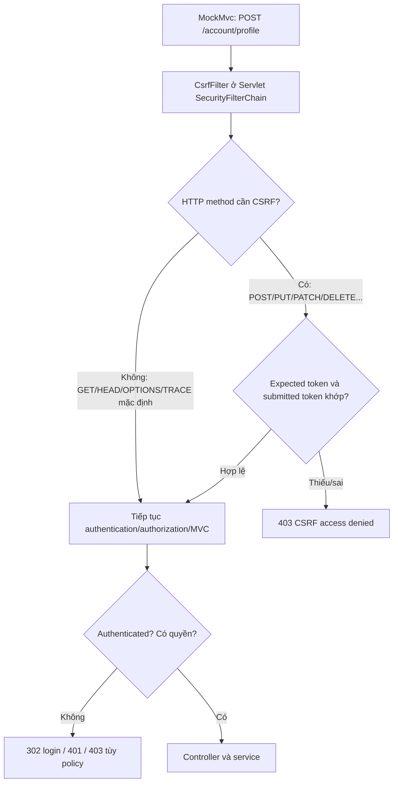
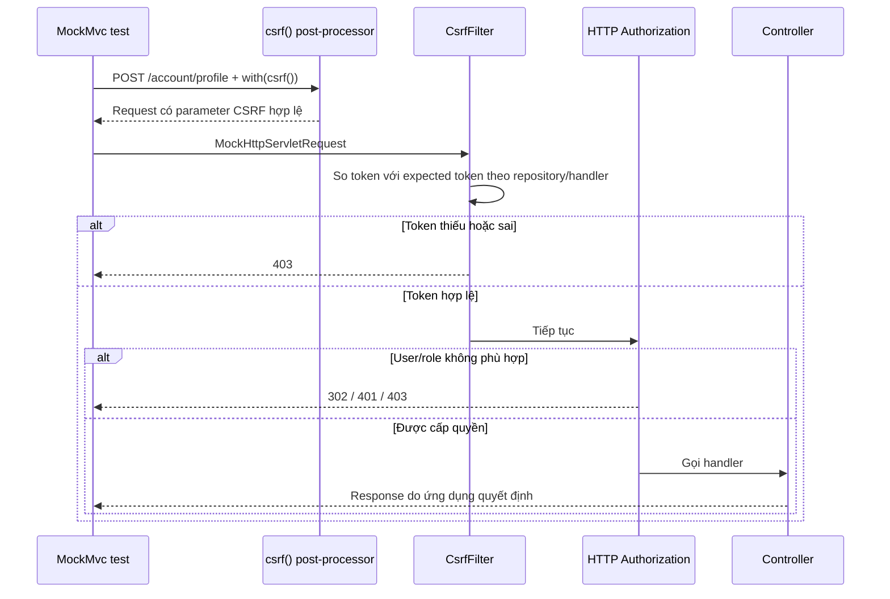

# csrf() để gửi token hợp lệ trong tham số

> **Chương:** Kiểm thử Servlet  
> **Module:** `SPRING_SECURITY_HTTP_PROTECTION` — bảo vệ HTTP và trình duyệt trong Spring Security: CSRF, CORS, security headers, CSP, HSTS, HTTP firewall và session; áp dụng Servlet và Reactive, kiểm thử kịch bản tấn công và chẩn đoán xung đột khi triển khai.  
> **Trọng tâm:** Trong `spring-security-test` dành cho Servlet, `MockMvc.perform(post(...).with(csrf()))` gửi **CSRF token hợp lệ qua request parameter theo mặc định**. Đây là một request post-processor, **không phải thao tác đăng nhập**, không tự cấp role và không chứng minh browser thực đã nhận, lưu và gửi token đúng.

## 1. Kết quả cần đạt

Sau bài này, người học có thể:

1. Giải thích đúng chức năng của `SecurityMockMvcRequestPostProcessors.csrf()` trong Spring Security Test.
2. Mô tả request parameter CSRF (thường `_csrf`) và lý do token được `CsrfFilter`/`CsrfTokenRepository` kiểm tra khi HTTP method không an toàn.
3. Viết MockMvc test `POST` có `.with(csrf())`, không token và token sai; phân biệt tác dụng đối với HTTP 403 và controller.
4. Biết rằng `csrf()` mặc định gửi qua **parameter**, còn `csrf().asHeader()` gửi qua **header**; hiểu sự khác biệt với `.param("_csrf", "chuoi-bat-ky")`.
5. Phân biệt authenticated principal do `@WithMockUser`/`user()` cung cấp với CSRF token do `csrf()` cung cấp.
6. Tách lỗi CSRF ra khỏi authentication và authorization bằng một ma trận request anonymous/USER/ADMIN × token missing/invalid/valid.
7. Hiểu `permitAll()` không tự miễn `CsrfFilter`; GET thường không yêu cầu CSRF nhưng POST/PUT/PATCH/DELETE trên browser chain thường cần.
8. Tạo fixture `SecurityFilterChain`, controller và Spring Boot/MockMvc setup để bảo đảm security filters thực sự chạy trong bài kiểm thử.
9. Dùng `csrf()` đúng trong các trường hợp form-urlencoded, JSON POST, multipart upload, login/logout, và chọn cách gửi token phù hợp frontend thật.
10. Kiểm token được phát bởi server qua GET → POST cùng session mà không chỉ dựa vào test helper; nhận biết token masking, lazy issuance, cookie repository và SPA.
11. Chẩn đoán vì sao cùng một POST có `csrf()` vẫn trả 302, 403, 400, 404 hoặc 500.
12. Phân biệt API chỉ dùng Bearer header với browser cookie session, và phân biệt Servlet `MockMvc` với Reactive `WebTestClient`.

## 2. Một dòng code cần hiểu thật chính xác

Ví dụ cốt lõi:

```java
mvc.perform(post("/account/profile")
        .with(user("alice").roles("USER"))
        .with(csrf()))
    .andExpect(status().isNoContent());
```

Trong request trên:

- `post("/account/profile")` tạo `MockHttpServletRequest` với HTTP method POST.
- `user("alice").roles("USER")` tạo authenticated principal giả lập cho request kiểm thử; nó **không** tạo token CSRF.
- `csrf()` tạo/gắn một CSRF token được xem là hợp lệ cho test, **mặc định đặt token trong request parameter** chứ không phải trong header.
- `andExpect(status().isNoContent())` chỉ đúng nếu request đã đi qua các security filters và có handler fixture trả 204. Nếu controller trả status khác, assertion phải theo contract ứng dụng.

Thử bỏ phần user nhưng giữ token:

```java
mvc.perform(post("/account/profile")
        .with(csrf()))
    .andExpect(status().is3xxRedirection());
```

Với browser form-login chain, token có thể hợp lệ nhưng anonymous vẫn cần đăng nhập: Spring Security thường redirect tới `/login`. Với API entry point, có thể là 401 thay vì 302. **Có token không đồng nghĩa có danh tính.**

Thử giữ user và bỏ token:

```java
mvc.perform(post("/account/profile")
        .with(user("alice").roles("USER")))
    .andExpect(status().isForbidden());
```

Khi browser chain bật CSRF, `CsrfFilter` có thể chặn POST thiếu token, dù user đã authenticated. **Có danh tính không đồng nghĩa CSRF hợp lệ.**

### 2.1. Những tuyên bố đúng và sai về `csrf()`

| Tuyên bố | Đúng/sai | Vì sao |
|---|---|---|
| `with(csrf())` giúp POST có token CSRF hợp lệ trong MockMvc | Đúng | Test support thêm token/expected token thích hợp cho request |
| Mặc định `csrf()` gửi token qua request parameter | Đúng | Header là biến thể `asHeader()` |
| `csrf()` tự đăng nhập user | Sai | Không tạo Authentication |
| `csrf()` tự cấp `ROLE_ADMIN` hoặc JWT scope | Sai | Không thay authorization |
| `csrf()` đảm bảo controller thực thi | Sai | Auth, role, validation, routing và business rules còn có thể chặn |
| `csrf()` chứng minh frontend đã lấy token từ server | Sai | Helper tạo token test, không mô phỏng toàn vòng đời browser |
| `csrf()` làm CSRF filter chạy nếu MockMvc không gắn security chain | Sai | Helper chỉ sửa request, không tự đăng ký filters |
| `csrf()` và `csrf().asHeader()` luôn tương đương với frontend thật | Sai | Frontend cần gửi theo request handler, token repository và contract thực tế |

## 3. Vì sao CSRF filter đòi token ở unsafe request?

Một ứng dụng browser dùng session cookie thường có rủi ro CSRF khi trình duyệt **tự gửi credential**. Trang bên ngoài có thể kích hoạt biểu mẫu POST tới ứng dụng mà không biết người dùng đã đăng nhập hay chưa. Browser không cần cho attacker đọc response để hành động thay đổi trạng thái có thể xảy ra.

CSRF token là bằng chứng riêng mà server yêu cầu trên unsafe request. Với một mô hình thông thường, server phát/lưu expected token và client gửi lại token theo parameter hoặc header; khi thiếu hoặc không trùng, request bị từ chối.



Sơ đồ minh họa hành vi phổ biến, không cố định thứ tự mọi custom filter hay handler. `CsrfFilter` có thể chặn trước `AuthorizationFilter`; vì vậy một POST 403 chưa chứng minh rule role đã được kiểm.

### 3.1. “Safe HTTP methods” không có nghĩa mọi GET vô hại

Mặc định phổ biến của Spring Security CSRF bỏ qua `GET`, `HEAD`, `OPTIONS` và `TRACE`; các method khác bị kiểm khi chain bật CSRF. Ứng dụng không được đặt operation thay đổi trạng thái vào GET chỉ vì GET không yêu cầu token.

### 3.2. CSRF không thay authentication hay ownership

Một user hợp lệ có CSRF token vẫn cần quyền sửa hồ sơ hoặc tài nguyên cụ thể. Nếu controller chỉ dùng ID do client khai để sửa đơn hàng của người khác, `csrf()` không giải quyết IDOR/BOLA. Cần authorization tại URL/method/service và owner/tenant checks riêng.

## 4. `csrf()` của Servlet Spring Security Test là gì?

Helper nằm trong các **request post-processors** của Spring Security Test:

```java
import static org.springframework.security.test.web.servlet.request.SecurityMockMvcRequestPostProcessors.csrf;
```

Cách dùng:

```java
mvc.perform(post("/account/profile").with(csrf()));
```

`.with(csrf())` thực thi khi MockMvc chuẩn bị `MockHttpServletRequest`. Nó thêm CSRF token phù hợp để request được xem là hợp lệ theo test support khi security CSRF validation chạy. Ở trường hợp mặc định, **submitted token nằm trong parameter** mang tên theo `CsrfToken.getParameterName()` — thường là `_csrf`.

Điều đó khác hai hành vi:

- `http.csrf(...)` trong cấu hình Spring Security: bật và điều chỉnh *CSRF filter policy* của ứng dụng.
- `csrf()` trong MockMvc test: tạo *request dữ liệu test* có CSRF token để vượt qua policy khi điều kiện khác hợp lệ.

Một bên là **bảo vệ**, một bên là **dữ liệu được gửi để chứng minh request hợp lệ**.

### 4.1. Luồng trước và sau khi thêm helper



Chi tiết bên trong test helper, repository và request handler có thể thay theo Spring Security version/customization; đừng dựa vào giá trị token cố định hoặc trực tiếp gọi private internals của framework.

## 5. Tạo project test với dependency đúng phạm vi

Một Servlet Spring Boot application minh họa sử dụng Spring MVC/Security và Spring Security Test.

Gradle Kotlin DSL:

```kotlin
dependencies {
    implementation("org.springframework.boot:spring-boot-starter-web")
    implementation("org.springframework.boot:spring-boot-starter-security")

    testImplementation("org.springframework.boot:spring-boot-starter-test")
    testImplementation("org.springframework.security:spring-security-test")
}

tasks.test {
    useJUnitPlatform()
}
```

Gradle Groovy DSL:

```groovy
dependencies {
    implementation 'org.springframework.boot:spring-boot-starter-web'
    implementation 'org.springframework.boot:spring-boot-starter-security'

    testImplementation 'org.springframework.boot:spring-boot-starter-test'
    testImplementation 'org.springframework.security:spring-security-test'
}

test {
    useJUnitPlatform()
}
```

Maven (khi dùng Spring Boot dependency management) cần test dependency:

```xml
<dependency>
    <groupId>org.springframework.security</groupId>
    <artifactId>spring-security-test</artifactId>
    <scope>test</scope>
</dependency>
```

Để chạy test Spring Security 6+/Boot 3+ cần JUnit Jupiter, Spring MVC Test, Spring Security Test và dependencies của ứng dụng tương thích. Không pin một version `spring-security-test` lệch khỏi Spring Security runtime; API/deprecations có thể khác ở các phiên bản mới.

**Lưu ý:** Thêm dependency không đồng nghĩa MockMvc đã được gắn `FilterChainProxy`. Phải thiết lập đúng như mục sau.

## 6. Bảo đảm Spring Security filter chain thực sự chạy trong MockMvc

Cách thông dụng với Spring Boot:

```java
@SpringBootTest
@AutoConfigureMockMvc
class BrowserCsrfMockMvcTest {

    @Autowired
    MockMvc mvc;

    @Test
    void placeholder() throws Exception {
        // Các tests sẽ được triển khai ở các mục tiếp theo.
    }
}
```

Ở những phiên bản Boot phù hợp, `@AutoConfigureMockMvc` tự thêm các Servlet filters từ application context vào MockMvc; `addFilters` thường mặc định là `true`. Khi app có Spring Security config, `springSecurityFilterChain` được tích hợp vào request path.

Khi tự xây MockMvc:

```java
@SpringBootTest
class ManualBrowserCsrfMockMvcTest {

    @Autowired
    WebApplicationContext context;

    MockMvc mvc;

    @BeforeEach
    void setup() {
        mvc = MockMvcBuilders
            .webAppContextSetup(context)
            .apply(springSecurity())
            .build();
    }
}
```

Imports tiêu biểu:

```java
import org.junit.jupiter.api.BeforeEach;
import org.springframework.beans.factory.annotation.Autowired;
import org.springframework.boot.test.context.SpringBootTest;
import org.springframework.boot.test.autoconfigure.web.servlet.AutoConfigureMockMvc;
import org.springframework.test.web.servlet.MockMvc;
import org.springframework.test.web.servlet.setup.MockMvcBuilders;
import org.springframework.web.context.WebApplicationContext;
import static org.springframework.security.test.web.servlet.setup.SecurityMockMvcConfigurers.springSecurity;
```

### 6.1. Hai cấu hình gây test “xanh” giả

```java
// Cố ý loại filters trong Boot MockMvc test:
@AutoConfigureMockMvc(addFilters = false)
```

và:

```java
// Controller-only: không tự có Spring Security chain:
MockMvc mvc = MockMvcBuilders
    .standaloneSetup(controller)
    .build();
```

Nếu `csrf()` có hay không mà POST đều trả 204, hãy nghi ngờ CSRF filter không chạy, chain không khớp hoặc CSRF bị tắt — **không** kết luận helper đã làm CSRF an toàn.

### 6.2. `@WebMvcTest` không mặc định có đầy đủ policy production

`@WebMvcTest` tạo MVC slice. Tùy Boot version, nó có thể áp security auto-configuration nhưng thiếu custom security beans, token repository hoặc controller/service dependencies. Nếu muốn kiểm integration thật, import đúng `SecurityFilterChain` hoặc dùng `@SpringBootTest`; đừng dựa vào default security chain tình cờ được nạp trong slice.

### 6.3. Một canary cần có

Với đúng một POST có handler trả 204 khi được phép, viết **hai test chỉ khác nhau ở CSRF**:

```java
mvc.perform(post("/account/profile")
        .with(user("alice").roles("USER")))
    .andExpect(status().isForbidden());

mvc.perform(post("/account/profile")
        .with(user("alice").roles("USER"))
        .with(csrf()))
    .andExpect(status().isNoContent());
```

Nếu hai tests có kết quả khác như dự kiến, đây là bằng chứng hành vi mạnh hơn việc chỉ inject `@WithMockUser` hoặc chỉ assert một status 403.

## 7. SecurityFilterChain Servlet mẫu: form login, session và CSRF

Sử dụng browser security chain, để POST thay đổi trạng thái phải có token:

```java
package example.security;

import org.springframework.context.annotation.Bean;
import org.springframework.context.annotation.Configuration;
import org.springframework.http.HttpMethod;
import org.springframework.security.config.Customizer;
import org.springframework.security.config.annotation.web.builders.HttpSecurity;
import org.springframework.security.config.annotation.web.configuration.EnableWebSecurity;
import org.springframework.security.web.SecurityFilterChain;

@Configuration
@EnableWebSecurity
public class BrowserCsrfSecurityConfig {

    @Bean
    SecurityFilterChain browser(HttpSecurity http)
            throws Exception {
        return http
            .authorizeHttpRequests(auth -> auth
                .requestMatchers(HttpMethod.GET,
                    "/login", "/csrf", "/public/**")
                    .permitAll()
                .requestMatchers(HttpMethod.POST,
                    "/public/feedback").permitAll()
                .requestMatchers("/admin/**")
                    .hasRole("ADMIN")
                .anyRequest().authenticated())
            .formLogin(Customizer.withDefaults())
            .csrf(Customizer.withDefaults())
            .headers(headers -> headers
                .contentSecurityPolicy(csp -> csp.policyDirectives(
                    "default-src 'self'; object-src 'none'; " +
                    "base-uri 'self'; frame-ancestors 'none'")))
            .build();
    }
}
```

Chính sách:

- `GET /account` cần authenticated principal nhưng **không** CSRF theo default matcher.
- `POST /account/profile` cần authenticated principal **và** CSRF token.
- `POST /public/feedback` được `permitAll()` tại authorization nhưng **vẫn cần CSRF token**.
- `POST /admin/settings` cần role ADMIN và CSRF hợp lệ.
- `POST /login` và `POST /logout` thông thường vẫn chịu CSRF protection khi bật.

**Không** tắt CSRF toàn browser chain chỉ để những test `@WithMockUser`/`post()` thiếu token được trả 200.

### 7.1. Token nằm ở đâu khi browser gửi form?

Ở cấu hình mặc định thông dụng, `CsrfToken.getParameterName()` là `_csrf`. HTML form có thể render field hidden tương ứng:

```html
<form method="post" action="/account/profile">
  <input type="text" name="displayName" value="Alice" />
  <input type="hidden" name="_csrf" value="TOKEN_DO_SERVER_PHAT" />
  <button type="submit">Lưu</button>
</form>
```

Giá trị `TOKEN_DO_SERVER_PHAT` là placeholder giải thích, **không dùng literal này** để gửi request thật. Với Spring Security 6, request handler có thể cung cấp **masked token** cho HTML; không giả định hidden field phải chứa raw token trong server repository.

### 7.2. Cấu hình trên chưa đủ để test login/password thật

Để test form login thực, cần `UserDetailsService`/`AuthenticationProvider`/`PasswordEncoder` và test user. Test với `with(user())` chỉ cần principal mock, không gửi password; bài này tập trung vào tham số CSRF nên phân biệt hai mục tiêu.

## 8. Controller fixture: có endpoint trả 204 mới test được “thành công”

Tạo controller phụ thuộc service test để chứng minh request được phép mới gây tác dụng phụ:

```java
package example.web;

import org.springframework.http.ResponseEntity;
import org.springframework.web.bind.annotation.*;

@RestController
class AccountController {

    private final ChangeRecorder recorder;

    AccountController(ChangeRecorder recorder) {
        this.recorder = recorder;
    }

    @GetMapping("/account")
    String account() {
        return "account";
    }

    @PostMapping("/account/profile")
    ResponseEntity<Void> updateProfile(
            @RequestParam String displayName) {
        recorder.recordProfileChange(displayName);
        return ResponseEntity.noContent().build();
    }

    @PostMapping("/public/feedback")
    ResponseEntity<Void> feedback(
            @RequestParam String message) {
        recorder.recordFeedback(message);
        return ResponseEntity.noContent().build();
    }

    @PostMapping("/admin/settings")
    ResponseEntity<Void> adminSettings(
            @RequestParam String theme) {
        recorder.recordAdminTheme(theme);
        return ResponseEntity.noContent().build();
    }
}
```

`ChangeRecorder` là interface/domain test fixture cần tạo bean riêng, không tự sinh trong ví dụ. Các tests muốn 204 phải cung cấp `displayName`, `message` hoặc `theme` hợp lệ. Nếu thiếu parameter bắt buộc, MVC có thể trả **400** dù CSRF đã hợp lệ; đó không phải bằng chứng `csrf()` sai.

### 8.1. Lớp fixture tối giản

```java
public interface ChangeRecorder {
    void recordProfileChange(String displayName);
    void recordFeedback(String message);
    void recordAdminTheme(String theme);
}
```

Trong test context có thể cung cấp một bean mock hoặc implementation ghi lại tác dụng phụ theo test. Với Spring Boot version cũ dùng `@MockBean`; nhánh mới có thể dùng `@MockitoBean`. Không giả định annotation mock bean có cùng package/API ở mọi version.

### 8.2. Quan sát side effects mạnh hơn chỉ status

Khi thiếu CSRF, không chỉ kiểm `403`; nên xác minh `recordProfileChange(...)` không được gọi. Khi có token hợp lệ và authenticated user, kiểm recorder được gọi đúng một lần, hoặc với repository thật thì kiểm dữ liệu được cập nhật.

Một mock không thực sự được inject vào controller có thể khiến `verifyNoInteractions` pass vô nghĩa; phải đảm bảo fixture wiring đúng.

## 9. Bài test đầu tiên: token hợp lệ trong request parameter

Đây là bài test đúng chủ đề:

```java
@SpringBootTest
@AutoConfigureMockMvc
class ParameterCsrfTest {

    @Autowired
    MockMvc mvc;

    @Test
    void validCsrfParameterAllowsAuthenticatedPost()
            throws Exception {
        mvc.perform(post("/account/profile")
                .with(user("alice").roles("USER"))
                .param("displayName", "Alice")
                .with(csrf()))
            .andExpect(status().isNoContent());
    }
}
```

Imports chính:

```java
import org.junit.jupiter.api.Test;
import org.springframework.beans.factory.annotation.Autowired;
import org.springframework.boot.test.context.SpringBootTest;
import org.springframework.boot.test.autoconfigure.web.servlet.AutoConfigureMockMvc;
import org.springframework.test.web.servlet.MockMvc;

import static org.springframework.security.test.web.servlet.request.SecurityMockMvcRequestPostProcessors.*;
import static org.springframework.test.web.servlet.request.MockMvcRequestBuilders.*;
import static org.springframework.test.web.servlet.result.MockMvcResultMatchers.*;
```

Giải thích thứ tự:

1. `post("/account/profile")` chọn unsafe method POST.
2. `with(user("alice").roles("USER"))` cho request một authenticated principal giả lập.
3. `param("displayName", "Alice")` cung cấp input nghiệp vụ đúng `@RequestParam` của controller.
4. `with(csrf())` bổ sung CSRF token hợp lệ vào request parameter test.
5. `CsrfFilter` cho request đi tiếp, authorization authenticated pass, controller chạy và trả 204.

**Lưu ý:** `param("displayName", ...)` là **tham số nghiệp vụ**, còn parameter CSRF được helper tự thêm. Đừng nhầm hai parameter này hoặc hardcode một token không thuộc repository.

### 9.1. Assert parameter CSRF hiện diện khi cần minh họa

Với token parameter name mặc định `_csrf`, có thể kiểm request sau khi dùng helper:

```java
mvc.perform(post("/account/profile")
        .with(user("alice").roles("USER"))
        .param("displayName", "Alice")
        .with(csrf()))
    .andExpect(status().isNoContent())
    .andExpect(result -> assertNotNull(
        result.getRequest().getParameter("_csrf")));
```

Thêm import `org.junit.jupiter.api.Assertions.assertNotNull`. Test này minh họa **request parameter** chứ không khẳng định giá trị token cố định. Nếu ứng dụng dùng custom `CsrfTokenRepository` đổi parameter name, hãy dựa vào `CsrfToken.getParameterName()` của cấu hình thực thay vì hardcode `_csrf`.

### 9.2. Vì sao không nên assert token string cụ thể?

Token thường ngẫu nhiên, có thể được masked/XOR hoặc tái tạo theo vòng đời session. Assert một string cụ thể làm test giòn, sai mục tiêu và có thể vô tình log sensitive token. Nên assert hành vi: thiếu/sai token bị chặn; token hợp lệ được chấp nhận; controller chỉ thực thi khi cả authentication và CSRF đủ.

### 9.3. Gửi bằng parameter không giống gửi trong JSON body

Trong MockMvc, `.with(csrf())` gắn parameter vào request object; controller nhận JSON qua `@RequestBody` vẫn có thể cho security CSRF filter xem parameter test, **dù một browser/SPA thực tế không gửi parameter như vậy**. Với JSON SPA, token thường được gửi qua header và cần kiểm riêng cách client lấy/gửi token thật.

## 10. Ba phép thử quan trọng nhất: missing, invalid, valid

Cùng controller, cùng user, cùng business input — chỉ thay CSRF:

```java
@Test
void missingCsrfIsForbidden() throws Exception {
    mvc.perform(post("/account/profile")
            .with(user("alice").roles("USER"))
            .param("displayName", "Alice"))
        .andExpect(status().isForbidden());
}

@Test
void invalidCsrfIsForbidden() throws Exception {
    mvc.perform(post("/account/profile")
            .with(user("alice").roles("USER"))
            .param("displayName", "Alice")
            .with(csrf().useInvalidToken()))
        .andExpect(status().isForbidden());
}

@Test
void validCsrfParameterIsAccepted() throws Exception {
    mvc.perform(post("/account/profile")
            .with(user("alice").roles("USER"))
            .param("displayName", "Alice")
            .with(csrf()))
        .andExpect(status().isNoContent());
}
```

Ba trường hợp chứng minh khác nhau:

- **Missing:** request không nộp token, `CsrfFilter` phải từ chối.
- **Invalid:** request nộp token sai, `CsrfFilter` phải từ chối.
- **Valid:** request nộp token hợp lệ; bảo vệ CSRF cho đi tiếp, nhưng authorization/controller còn có thể chặn vì nguyên nhân khác.

Không chỉ test valid. Nếu CSRF bị tắt, valid case vẫn có thể 204; chính **missing/invalid negative tests** mới phát hiện lớp phòng vệ bị vô hiệu hóa.

### 10.1. 403 không luôn do CSRF

Nếu request có user thiếu role, `@Valid` body sai hoặc controller tự trả 403, một test `status().isForbidden()` có thể pass vì nguyên nhân khác. Để chứng minh **đúng CSRF filter**, giữ principal, role, business parameter và handler fixtures hợp lệ; kiểm valid counterpart 204 và no side effect khi thiếu/sai token.

### 10.2. Test token sai không được làm rò giá trị token

Không log raw CSRF token trong test diagnostics. Có thể log method/path và boolean `csrfPresent`, nhưng không lưu secret trong CI artifact hay debug log dài hạn. Token ví dụ trong tài liệu chỉ là placeholder.
## 11. `csrf()` gửi parameter; `csrf().asHeader()` gửi header

Hãy phân biệt **vị trí nộp token**, không chỉ tính hợp lệ của token:

| Helper / thao tác | Token ở đâu? | Mục đích |
|---|---|---|
| `with(csrf())` | Request parameter (thường `_csrf`) | Mô phỏng form có hidden field |
| `with(csrf().asHeader())` | HTTP header theo `CsrfToken.getHeaderName()` | Mô phỏng SPA/AJAX dùng CSRF header |
| `with(csrf().useInvalidToken())` | Parameter nhưng token sai | Test CSRF từ chối token không hợp lệ |
| `with(csrf().asHeader().useInvalidToken())` | Header nhưng token sai | Test header token invalid |
| Không có `with(csrf())` | Không tự thêm CSRF token | Test request thiếu token |
| `.param("_csrf", "abc")` | Parameter literal | **Không tự bảo đảm** expected token khớp |
| GET lấy token, POST giữ session và `.param(...)` | Parameter do server thực phát | Test issuance và session/token binding |

Ví dụ parameter và header cạnh nhau:

```java
// Request parameter (mặc định của Spring Security Test):
mvc.perform(post("/account/profile")
        .param("displayName", "Alice")
        .with(user("alice").roles("USER"))
        .with(csrf()))
    .andExpect(status().isNoContent());

// HTTP header (dành cho client gửi CSRF token trong header):
mvc.perform(post("/account/profile")
        .param("displayName", "Alice")
        .with(user("alice").roles("USER"))
        .with(csrf().asHeader()))
    .andExpect(status().isNoContent());
```

Cả hai chỉ pass nếu `CsrfFilter` và handler chấp nhận cách gửi token tương ứng, request đã authenticated và controller fixture tồn tại.

### 11.1. Header CSRF không tự làm CORS đúng

Nếu SPA ở `https://client.example.com` gọi backend cross-origin, header CSRF như `X-CSRF-TOKEN` có thể kích hoạt CORS preflight. Gateway/backend phải cho phép origin, method và requested header phù hợp; **CORS allow** không tự cho request quyền thay đổi trạng thái, còn **CSRF pass** không tự cấp quyền đọc cross-origin.

### 11.2. Header token invalid để kiểm đúng failure path

```java
mvc.perform(post("/account/profile")
        .param("displayName", "Alice")
        .with(user("alice").roles("USER"))
        .with(csrf().asHeader().useInvalidToken()))
    .andExpect(status().isForbidden());
```

Nếu frontend thật dùng CSRF header, nên có cả positive và negative tests theo header. Parameter-only tests có thể bỏ sót lỗi custom `CsrfTokenRequestHandler` dành riêng cho SPA.

## 12. `.param("_csrf", "abc")` khác `with(csrf())`

Một literal tự chọn không tự trở thành CSRF token hợp lệ:

```java
// Ví dụ sai nếu server chưa phát/lưu expected token trùng "abc".
mvc.perform(post("/account/profile")
        .param("displayName", "Alice")
        .param("_csrf", "abc")
        .with(user("alice").roles("USER")))
    .andExpect(status().isForbidden());
```

Server phải có **expected token** phù hợp trong repository/handler; việc xuất hiện tên parameter `_csrf` không đủ. Dùng `csrf()` khi muốn helper chuẩn bị token hợp lệ trong một test filter/authorization, và dùng **server-issued token** khi muốn kiểm frontend/form issuance thật.

### 12.1. Tham số nghiệp vụ không phải tham số bảo mật

```java
post("/account/profile")
    .param("displayName", "Alice") // Dữ liệu cho @RequestParam.
    .with(csrf());                 // CSRF token, mặc định là parameter khác.
```

Nếu controller cần `displayName` nhưng test chỉ có `csrf()`, CSRF có thể pass rồi MVC trả 400 vì thiếu required parameter. Không “chữa” 400 bằng cách tắt CSRF; thêm input nghiệp vụ hợp lệ.

### 12.2. Không gán giá trị token cố định trong test snapshot

Token thường ngẫu nhiên, có thể masked hoặc được rotate theo session/login/logout. Đừng hardcode một token literal cho mọi test hoặc log raw token vào CI. Kiểm allowed/denied behavior là bằng chứng ổn định hơn.

## 13. HTML form: cách parameter tương ứng hidden input

Browser gửi:

```http
POST /account/profile HTTP/1.1
Cookie: JSESSIONID=...
Content-Type: application/x-www-form-urlencoded

displayName=Alice&_csrf=<server-issued-token>
```

MockMvc biểu diễn form parameters:

```java
@Test
void formUrlEncodedPostWithValidCsrfParameter()
        throws Exception {
    mvc.perform(post("/account/profile")
            .contentType(MediaType.APPLICATION_FORM_URLENCODED)
            .param("displayName", "Alice")
            .with(user("alice").roles("USER"))
            .with(csrf()))
        .andExpect(status().isNoContent());
}
```

Trong MockMvc, `.param(...)` thao tác trực tiếp với `MockHttpServletRequest`. Nó **không** chứng minh raw bytes của HTTP form được Servlet container parse giống production. Nếu lo encoding/content-length/parser, bổ sung integration test qua HTTP server thật.

### 13.1. HTML form thật phải render token từ server

```html
<form method="post" action="/account/profile">
  <input type="text" name="displayName" value="Alice">
  <input type="hidden" name="_csrf" value="TOKEN_TU_SERVER">
  <button type="submit">Lưu</button>
</form>
```

`TOKEN_TU_SERVER` chỉ minh họa, không phải giá trị dùng để submit. Với Spring Security 6, form token có thể được XOR-masked theo request handler; sử dụng giá trị được render thực tế, không suy raw token từ repository.

### 13.2. Vì sao `csrf()` pass chưa xác nhận template đúng?

Helper gắn parameter dù template HTML bị thiếu hidden field. Vì vậy cần hai lớp kiểm thử: test POST helper để kiểm CSRF filter và test GET form (hoặc E2E) để xác nhận server đã phát đúng token, form có field đúng, browser gửi lại cùng session.

## 14. JSON POST: parameter test pass không chứng minh SPA đúng giao thức

Một controller nhận JSON:

```java
@PostMapping("/account/json-profile")
ResponseEntity<Void> updateJson(
        @RequestBody ProfileUpdate body) {
    recorder.recordProfileChange(body.displayName());
    return ResponseEntity.noContent().build();
}

record ProfileUpdate(String displayName) {}
```

MockMvc có thể thêm CSRF parameter độc lập với JSON body:

```java
@Test
void jsonPostCanPassWithTestCsrfParameter()
        throws Exception {
    mvc.perform(post("/account/json-profile")
            .contentType(MediaType.APPLICATION_JSON)
            .content("{\"displayName\":\"Alice\"}")
            .with(user("alice").roles("USER"))
            .with(csrf()))
        .andExpect(status().isNoContent());
}
```

Với cấu hình tương ứng, `CsrfFilter` đọc parameter mà post-processor gắn vào mock request, dù JSON không chứa property CSRF. Đây là test filter behavior hợp lệ, nhưng **không chứng minh SPA thực gửi parameter ngoài body**.

### 14.1. Nếu frontend dùng header, test header

```java
mvc.perform(post("/account/json-profile")
        .contentType(MediaType.APPLICATION_JSON)
        .content("{\"displayName\":\"Alice\"}")
        .with(user("alice").roles("USER"))
        .with(csrf().asHeader()))
    .andExpect(status().isNoContent());
```

Để kiểm giao thức end-to-end, cần biết token lấy từ endpoint/cookie nào, header name và request handler xử lý raw/masked token như thế nào. `csrf().asHeader()` vẫn là helper test, chưa mô phỏng tất cả browser cookies và CORS.

### 14.2. JSON property `_csrf` không tự là Servlet parameter

```json
{"displayName":"Alice","_csrf":"TOKEN"}
```

Chỉ đặt property JSON `_csrf` không khiến Servlet CSRF filter mặc định parse JSON body để lấy token. Dùng parameter/header theo contract hoặc một custom handler được thiết kế, kiểm tra và test rõ; không đòi filter tiêu thụ body streaming tùy tiện.

## 15. Multipart: token parameter và thứ tự xử lý file upload

MockMvc multipart POST:

```java
@Test
void multipartAvatarRequiresCsrf() throws Exception {
    MockMultipartFile file = new MockMultipartFile(
        "file", "avatar.png", "image/png",
        new byte[] {1, 2, 3});

    mvc.perform(multipart("/account/avatar")
            .file(file)
            .with(user("alice").roles("USER"))
            .with(csrf()))
        .andExpect(status().isNoContent());
}
```

Imports: `org.springframework.mock.web.MockMultipartFile` và `MockMvcRequestBuilders.multipart`. Cần controller nhận `MultipartFile`, dịch vụ lưu file test và trả 204. Bytes minh họa không phải ảnh thật; kiểm MIME/size/storage policy riêng.

Negative:

```java
mvc.perform(multipart("/account/avatar")
        .file(file)
        .with(user("alice").roles("USER")))
    .andExpect(status().isForbidden());
```

Trong production, token nằm trong multipart body có thể yêu cầu parse multipart **trước** `CsrfFilter`; như vậy bytes/temp file có thể được xử lý trước CSRF từ chối, ảnh hưởng tài nguyên. Cân nhắc đưa token vào header hoặc parameter/query theo threat model và multipart architecture, giới hạn upload size ở edge/server. MockMvc multipart mock không chứng minh Servlet container parser/filter-order thực.

## 16. `permitAll()` không miễn CSRF cho POST

Ở cấu hình mẫu, `POST /public/feedback` public về authorization:

```java
.requestMatchers(HttpMethod.POST, "/public/feedback")
    .permitAll()
```

Nhưng CSRF filter vẫn chạy:

```java
@Test
void publicPostWithoutCsrfIsDenied() throws Exception {
    mvc.perform(post("/public/feedback")
            .param("message", "Hello"))
        .andExpect(status().isForbidden());
}

@Test
void publicPostWithCsrfParameterIsAccepted() throws Exception {
    mvc.perform(post("/public/feedback")
            .param("message", "Hello")
            .with(csrf()))
        .andExpect(status().isNoContent());
}
```

Một anonymous request **vẫn có thể sở hữu token CSRF hợp lệ** khi server phát token cho public form. Token không phải bằng chứng đã login.

### 16.1. Webhook/machine-to-machine cần thiết kế riêng

Nếu webhook POST chỉ xác thực bằng signature của bên gửi và **không dựa vào browser cookie/auto-credentials**, CSRF threat model khác browser form. Nên tạo policy/chain phù hợp, test signature/timestamp/replay protection và giới hạn CSRF exception đúng URL; không tắt toàn bộ CSRF cho browser chỉ để webhook không bị 403.

## 17. Phân biệt 403 CSRF và 403 thiếu role

Với `POST /admin/settings` yêu cầu ADMIN và CSRF:

| Principal | CSRF | Kỳ vọng theo fixture | Lớp cần quan sát |
|---|---|---|---|
| USER | Thiếu | 403 | CSRF |
| USER | Hợp lệ | 403 | Authorization role |
| ADMIN | Thiếu | 403 | CSRF |
| ADMIN | Sai | 403 | CSRF |
| ADMIN | Hợp lệ | 204 | Controller |
| Anonymous | Hợp lệ | 302 login | Authentication |

Viết ba test có cùng path/business parameters:

```java
@Test
void userCannotWriteAdminEvenWithCsrf() throws Exception {
    mvc.perform(post("/admin/settings")
            .param("theme", "dark")
            .with(user("alice").roles("USER"))
            .with(csrf()))
        .andExpect(status().isForbidden());
}

@Test
void adminWithoutCsrfIsForbidden() throws Exception {
    mvc.perform(post("/admin/settings")
            .param("theme", "dark")
            .with(user("root").roles("ADMIN")))
        .andExpect(status().isForbidden());
}

@Test
void adminWithCsrfCanWrite() throws Exception {
    mvc.perform(post("/admin/settings")
            .param("theme", "dark")
            .with(user("root").roles("ADMIN"))
            .with(csrf()))
        .andExpect(status().isNoContent());
}
```

Nếu chỉ có test USER + missing CSRF trả 403, test có thể pass **ngay cả khi ai đó bỏ rule ADMIN**, vì CSRF đã chặn trước. Để test role, cần valid CSRF; để test CSRF, cần principal đủ quyền.

### 17.1. Dùng service spy/mock để kiểm không có side effect

Nếu `ChangeRecorder` là Mockito mock được inject đúng vào controller:

```java
mvc.perform(post("/admin/settings")
        .param("theme", "dark")
        .with(user("alice").roles("USER"))
        .with(csrf()))
    .andExpect(status().isForbidden());

verify(recorder, never()).recordAdminTheme(anyString());
```

Test phải reset mock history và có positive case gọi recorder khi ADMIN+token hợp lệ. Một mock không được inject sẽ khiến `never()` luôn pass nhưng không chứng minh gì.

## 18. Authenticated user và CSRF token không thay nhau

`@WithMockUser` hay `with(user())` chỉ tạo SecurityContext/Auth mock, `csrf()` tạo submitted CSRF token. Dùng cặp:

```java
@Test
@WithMockUser(username = "alice", roles = "USER")
void mockUserWithoutCsrfStillForbidden() throws Exception {
    mvc.perform(post("/account/profile")
            .param("displayName", "Alice"))
        .andExpect(status().isForbidden());
}

@Test
@WithMockUser(username = "alice", roles = "USER")
void mockUserWithCsrfAccepted() throws Exception {
    mvc.perform(post("/account/profile")
            .param("displayName", "Alice")
            .with(csrf()))
        .andExpect(status().isNoContent());
}
```

Với anonymous + token:

```java
mvc.perform(post("/account/profile")
        .param("displayName", "Alice")
        .with(anonymous())
        .with(csrf()))
    .andExpect(status().is3xxRedirection());
```

Với browser form-login chain, token pass nhưng anonymous phải login; API Bearer chain có thể trả 401. `@WithUserDetails` cũng chỉ load principal từ store, không gửi form password hoặc tự thêm token.

### 18.1. Test request post-processors theo từng trục

Giữ user, chỉ đổi token để test CSRF. Giữ token hợp lệ, chỉ đổi role để test authorization. Nếu đồng thời thay method, path, principal và CSRF, một status 403 không chứng minh điều kiện nào gây từ chối.
## 19. Login/logout: `csrf()` cho phép kiểm password filter sau CSRF

Form-login mặc định của Spring Security Servlet xử lý username/password bằng một POST. Khi CSRF bật, yêu cầu này cũng thuộc unsafe methods.

### 19.1. Có password nhưng thiếu CSRF

```java
@Test
void loginWithoutCsrfIsRejected() throws Exception {
    mvc.perform(post("/login")
            .param("username", "alice")
            .param("password", "correct-password"))
        .andExpect(status().isForbidden());
}
```

Một 403 ở đây **không chứng minh password sai**: `CsrfFilter` có thể đã kết thúc request trước khi `UsernamePasswordAuthenticationFilter` xác thực.

### 19.2. Có token hợp lệ nhưng password sai

```java
@Test
void loginWrongPasswordWithCsrfStillFails()
        throws Exception {
    mvc.perform(post("/login")
            .param("username", "alice")
            .param("password", "wrong-password")
            .with(csrf()))
        .andExpect(status().is3xxRedirection())
        .andExpect(redirectedUrlPattern("**/login?error"));
}
```

Ví dụ giả định form login mặc định với `/login?error` là failure URL; custom authentication failure handler có thể dùng status/URL khác. Với CSRF hợp lệ, authentication filter mới có cơ hội xử lý username/password. Test cần UserDetailsService/PasswordEncoder và test user thật.

### 19.3. Password đúng + CSRF parameter hợp lệ

```java
@Test
void loginWithCsrfThenAccessPrivatePage()
        throws Exception {
    MvcResult login = mvc.perform(post("/login")
            .param("username", "alice")
            .param("password", "correct-password")
            .with(csrf()))
        .andExpect(status().is3xxRedirection())
        .andReturn();

    MockHttpSession session =
        (MockHttpSession) login.getRequest().getSession(false);

    assertNotNull(session);

    mvc.perform(get("/account")
            .session(session))
        .andExpect(status().isOk());
}
```

**Không kết luận login thành công chỉ từ 302**: failure redirect cũng có thể 302. Kiểm redirect target, session và request private tiếp theo. Sau session fixation protection, session ID có thể đổi; dùng session sau login. Test dùng `with(csrf())` vẫn chưa kiểm frontend thực lấy token từ form/login page.

### 19.4. Logout cũng cần CSRF khi policy bật

```java
mvc.perform(post("/logout")
        .session(session)
        .with(csrf()))
    .andExpect(status().is3xxRedirection());
```

Cần kiểm session invalidated và request tiếp theo không còn quyền, không chỉ redirect. Token CSRF có thể bị xóa sau login/logout và cần được cấp mới tùy strategy.

## 20. Kiểm token thật do server phát: GET → POST parameter

`with(csrf())` phù hợp test bảo vệ/filter. Nhưng khi muốn kiểm **client nhận token và gửi lại**, hãy dùng token phát từ server thay vì helper trên POST.

### 20.1. Endpoint test-only/same-origin minh họa phát token

Bổ sung vào controller:

```java
@GetMapping("/csrf")
Map<String, String> csrfToken(
        @RequestAttribute("_csrf") CsrfToken token) {
    return Map.of(
        "parameterName", token.getParameterName(),
        "headerName", token.getHeaderName(),
        "token", token.getToken());
}
```

Imports: `java.util.Map`, `org.springframework.security.web.csrf.CsrfToken` và `org.springframework.web.bind.annotation.RequestAttribute`.

Đây là minh họa phát token cho frontend có kiểm soát. Response chứa token phải tránh cache bởi intermediary, có cache-control phù hợp, không cung cấp bừa cho cross-origin origins hoặc đưa vào log. `token.getToken()` còn có tác dụng kích hoạt deferred token generation khi version/config dùng lazy tokens.

### 20.2. Cùng session, POST bằng parameter được phát

```java
@Test
void serverIssuedCsrfParameterWorksWithoutTestHelper()
        throws Exception {
    MockHttpSession session = new MockHttpSession();

    MvcResult issued = mvc.perform(get("/csrf")
            .session(session))
        .andExpect(status().isOk())
        .andReturn();

    String response = issued.getResponse()
        .getContentAsString();

    String parameterName =
        JsonPath.read(response, "$.parameterName");
    String submittedToken =
        JsonPath.read(response, "$.token");

    mvc.perform(post("/account/profile")
            .session(session)
            .with(user("alice").roles("USER"))
            .param("displayName", "Alice")
            .param(parameterName, submittedToken))
        .andExpect(status().isNoContent());
}
```

Imports gợi ý:

```java
import com.jayway.jsonpath.JsonPath;
import org.springframework.mock.web.MockHttpSession;
import org.springframework.test.web.servlet.MvcResult;
import static org.springframework.security.test.web.servlet.request.SecurityMockMvcRequestPostProcessors.user;
```

Giải thích:

1. GET `/csrf` phát token cho request, và session giữ expected token theo `HttpSessionCsrfTokenRepository` thường dùng.
2. Test đọc **tên parameter** cùng **giá trị client thấy** chứ không tự ghi `_csrf` hoặc token literal.
3. POST giữ cùng `MockHttpSession` và gửi submitted token qua `.param(parameterName, submittedToken)`.
4. `with(user())` vẫn giả lập authentication — đây là **token issuance/session flow test**, chưa phải password/login end-to-end.
5. Nếu dùng repository cookie/custom handler, cách giữ cookie/token và trích request cần điều chỉnh theo contract thật.

Với Spring Security 6, giá trị `CsrfToken.getToken()` được expose trong request có thể là **XOR-masked token**, khác raw expected token. Dùng giá trị thật mà endpoint phát, không tự đọc raw token trong repository rồi giả định nó tương đương.

### 20.3. Token của session A không được chấp nhận trong session B

Với session-based repository, tạo hai `MockHttpSession` khác nhau: GET lấy token A trong session A; gửi token đó ở POST session B đã authenticated. Nếu expected token của session B không trùng, `CsrfFilter` phải từ chối.

**Quan trọng:** Với `CookieCsrfTokenRepository`, việc đổi mỗi MockHttpSession chưa đủ vì expected token nằm trong cookie; cần thiết kế negative test cookie/header/parameter không khớp thay vì giả định session binding.

### 20.4. Vì sao không dùng `with(csrf())` trong bài test issuance?

Nếu POST vẫn gọi `.with(csrf())`, helper có thể tạo token hợp lệ độc lập với GET trước, nên một endpoint GET hỏng hoặc form thiếu token vẫn không làm test fail. Để chứng minh issuance, POST phải nộp **giá trị đã lấy từ response trước**.

## 21. `CsrfTokenRepository`, lazy token và XOR masking

Trong Servlet Spring Security, CSRF protection phối hợp:

- `CsrfTokenRepository` tạo/lưu/nạp expected token: thường `HttpSessionCsrfTokenRepository` hoặc `CookieCsrfTokenRepository`.
- `CsrfTokenRequestHandler` đưa token vào request và giải mã/trích submitted token theo hình thức parameter/header.
- `CsrfFilter` quyết định HTTP methods cần kiểm token và từ chối missing/invalid.
- Authentication, HTTP authorization và business service vẫn có trách nhiệm riêng.

### 21.1. Parameter name không luôn phải là `_csrf`

Trong cấu hình mặc định phổ biến, `CsrfToken.getParameterName()` là `_csrf`. Repository/custom handler có thể đổi tên/thay cách trích. Test `.with(csrf())` được thiết kế cho các cấu hình tương thích của Spring Security Test, nhưng test issuance thật nên lấy `parameterName` từ server để tránh hardcode.

### 21.2. Lazy token: GET bất kỳ không luôn tạo cookie/token

Spring Security hiện đại có thể trì hoãn việc tạo token cho đến khi ứng dụng thực sự đọc nó. Vì vậy một `GET /public` không render form hay đọc token có thể không sinh CSRF cookie/session entry. Để kiểm issuance, dùng endpoint/form thực sự truy cập `csrfToken.getToken()`.

### 21.3. XOR masking/BREACH protection

`XorCsrfTokenRequestAttributeHandler` giúp che raw token khi expose vào form HTML để giảm nguy cơ side-channel như BREACH. Token trong hidden input có thể thay mỗi response dù expected token repository chưa đổi. Một test so nguyên string raw repository token với rendered form token có thể sai về mô hình.

Lựa chọn đúng là test server-issued token theo đúng request handler: GET form/endpoint, đọc submitted value, POST trong cùng session/context.

### 21.4. Cookie repository trong SPA có đặc điểm khác

`CookieCsrfTokenRepository.withHttpOnlyFalse()` có thể phù hợp khi frontend cần đọc CSRF cookie qua JavaScript, nhưng việc cho JS đọc cookie làm tăng tác động của XSS. Cần CSP, HTTPS/SameSite, origin isolation, tránh dữ liệu nhạy cảm trong log và kiểm request handler phân biệt raw cookie token với masked form token.

Không mặc định chỉ đổi repository là đủ cho mọi SPA Spring Security 6; cần custom handler phù hợp khi frontend gửi raw token qua header, và test flow cookie/header thật. Test helper `csrf().asHeader()` có thể pass trong mock mà browser client vẫn gặp 403 nếu handler/encoding không khớp.

### 21.5. Authentication/logout có thể reset token

Spring Security có các strategy/handler như `CsrfAuthenticationStrategy` và `CsrfLogoutHandler` giúp làm mất hiệu lực token cũ trong những sự kiện tương ứng. Frontend có thể cần GET token mới sau login/logout, đặc biệt khi token lazy. Đừng dùng một token cũ qua nhiều phiên rồi coi 403 là “mất authentication”.

## 22. API Bearer-only: trường hợp không yêu cầu CSRF parameter

Một API stateless chỉ xác thực bằng Bearer header do client chủ động gắn có threat model khác browser session cookie. Nếu **không chấp nhận credential tự gửi từ browser** (cookie/Basic/session), CSRF có thể được tắt riêng trong API chain sau khi đánh giá.

```java
@Configuration
@EnableWebSecurity
public class ApiAndBrowserSecurity {

    @Bean
    @Order(1)
    SecurityFilterChain api(HttpSecurity http) throws Exception {
        return http
            .securityMatcher("/api/**")
            // Chỉ cho API thuần Bearer, không dùng cookie auth.
            .csrf(AbstractHttpConfigurer::disable)
            .sessionManagement(session -> session
                .sessionCreationPolicy(SessionCreationPolicy.STATELESS))
            .authorizeHttpRequests(auth -> auth
                .requestMatchers(HttpMethod.POST, "/api/orders")
                    .hasAuthority("SCOPE_orders.write")
                .anyRequest().authenticated())
            .oauth2ResourceServer(oauth2 -> oauth2
                .jwt(Customizer.withDefaults()))
            .build();
    }

    @Bean
    @Order(2)
    SecurityFilterChain browser(HttpSecurity http) throws Exception {
        return http
            .authorizeHttpRequests(auth -> auth
                .requestMatchers("/login").permitAll()
                .anyRequest().authenticated())
            .csrf(Customizer.withDefaults())
            .formLogin(Customizer.withDefaults())
            .build();
    }
}
```

Cần OAuth2 Resource Server/JWT, `JwtDecoder` và business controller fixture. Thứ tự `@Order` giữ API chain trước browser fallback.

### 22.1. API Bearer được xét mà không có `csrf()`

```java
@Test
void bearerApiPostCanProceedWithoutCsrfToken()
        throws Exception {
    mvc.perform(post("/api/orders")
            .with(jwt()
                .jwt(j -> j.subject("alice"))
                .authorities(new SimpleGrantedAuthority(
                    "SCOPE_orders.write")))
            .contentType(MediaType.APPLICATION_JSON)
            .content("{\"sku\":\"book\"}"))
        .andExpect(status().isCreated());
}
```

Test dùng `with(jwt())` tạo mock JWT authentication; **không** xác minh signature, issuer hay audience. POST có thể không cần CSRF trong chain API đã thiết kế, nhưng vẫn phải có JWT/authority và business authorization đúng.

### 22.2. Hai negative controls bắt buộc

```java
mvc.perform(post("/api/orders")
        .contentType(MediaType.APPLICATION_JSON)
        .content("{\"sku\":\"book\"}"))
    .andExpect(status().isUnauthorized());

mvc.perform(post("/api/orders")
        .with(jwt().authorities(
            new SimpleGrantedAuthority("SCOPE_orders.read")))
        .contentType(MediaType.APPLICATION_JSON)
        .content("{\"sku\":\"book\"}"))
    .andExpect(status().isForbidden());
```

Nếu API POST thiếu JWT trả 403 CSRF, kiểm chain matcher/order hoặc liệu URL API đang dùng browser auto-credentials. **Không tắt CSRF toàn browser** chỉ để API tests pass.

### 22.3. API JSON không tự được miễn CSRF

Một `/api/**` dùng `JSESSIONID` hoặc HTTP Basic do browser tự gửi vẫn có nguy cơ CSRF; tên REST/JSON không quyết định. Nếu vừa hỗ trợ cookie vừa Bearer trên cùng URL, phải đánh giá mọi đường authentication và browser behavior.

## 23. CORS, SameSite, CSP/HSTS: các lớp không thay `csrf()`

Browser cross-origin có nhiều quyết định độc lập:

| Cơ chế | Giải quyết điều gì? | Không thay |
|---|---|---|
| CORS | JS của Origin nào được đọc response/call API theo browser rules | CSRF, authentication và owner authorization |
| SameSite cookie | Giới hạn khi browser tự gửi cookie theo site context | Toàn bộ CSRF token policy trên mọi browser/topology |
| CSRF | Unsafe request có submitted token phù hợp expected token | Login, role/scope, business ownership |
| CSP | HTML document được tải nguồn script/style/frame nào | CSRF và HTTP authorization |
| HSTS | Browser sử dụng HTTPS cho host | CSRF và session authentication |
| HTTP firewall | URL/method request bất thường bị từ chối trước chain | CSRF token validation và resource ownership |

### 23.1. Preflight không phải POST có token

```http
OPTIONS /account/profile HTTP/1.1
Origin: https://client.example.com
Access-Control-Request-Method: POST
Access-Control-Request-Headers: content-type,x-csrf-token
```

Preflight thường không chứa session cookie hoặc CSRF token của request POST thật; Spring Security CSRF matcher mặc định không yêu cầu token cho OPTIONS. Một API/browser chain có CORS policy phù hợp phải xử lý preflight sớm, trong khi POST sau đó vẫn phải được xác thực và nộp CSRF nếu dùng cookie authentication.

**Fixture mục 7 chưa cấu hình CORS**, nên test preflight phải bổ sung `CorsConfigurationSource`/`http.cors(...)` với origin/method/header allowlist trước khi kỳ vọng allow-origin headers.

### 23.2. Một HTML GET có thể cần CSP dù không cần CSRF

`GET /login` thường không cần CSRF token để được gọi, nhưng response HTML nên có CSP phù hợp và `X-Content-Type-Options`. Một POST bị 403 CSRF vẫn có thể có security headers do `HeaderWriterFilter` ghi trước commit. CSP header không chứng minh CSRF success.

### 23.3. MockMvc `secure(true)` không kiểm HTTPS thật

```java
mvc.perform(get("/login").secure(true))
    .andExpect(header().exists(
        "Strict-Transport-Security"));
```

Chỉ mô phỏng `request.isSecure()`, không kiểm TLS termination, forwarded headers, HSTS được browser ghi nhận hoặc response do CDN/gateway tạo. Cần HTTP/browser integration khi mục tiêu là edge security.
## 24. Lớp MockMvc test mẫu: kiểm request parameter token theo nhiều ranh giới

Lớp sau dùng `BrowserCsrfSecurityConfig`, `AccountController` và một `ChangeRecorder` test bean đã có. Những test kỳ vọng 204 cần controller fixture của mục 8 và parameters tương ứng. Toàn bộ tests chạy với Spring Security Servlet filters của application context, **không** dùng `addFilters=false`.

```java
@SpringBootTest
@AutoConfigureMockMvc
class CsrfRequestParameterContractTest {

    @Autowired
    MockMvc mvc;

    @Test
    void validParameterTokenAllowsAuthenticatedPost()
            throws Exception {
        mvc.perform(post("/account/profile")
                .param("displayName", "Alice")
                .with(user("alice").roles("USER"))
                .with(csrf()))
            .andExpect(status().isNoContent());
    }

    @Test
    void tokenIsSubmittedAsRequestParameterByDefault()
            throws Exception {
        mvc.perform(post("/account/profile")
                .param("displayName", "Alice")
                .with(user("alice").roles("USER"))
                .with(csrf()))
            .andExpect(status().isNoContent())
            .andExpect(result -> assertNotNull(
                result.getRequest().getParameter("_csrf")));
    }

    @Test
    void authenticatedWithoutTokenGets403() throws Exception {
        mvc.perform(post("/account/profile")
                .param("displayName", "Alice")
                .with(user("alice").roles("USER")))
            .andExpect(status().isForbidden());
    }

    @Test
    void invalidParameterTokenGets403() throws Exception {
        mvc.perform(post("/account/profile")
                .param("displayName", "Alice")
                .with(user("alice").roles("USER"))
                .with(csrf().useInvalidToken()))
            .andExpect(status().isForbidden());
    }

    @Test
    void headerAlternativeCanAlsoBeAccepted()
            throws Exception {
        mvc.perform(post("/account/profile")
                .param("displayName", "Alice")
                .with(user("alice").roles("USER"))
                .with(csrf().asHeader()))
            .andExpect(status().isNoContent());
    }

    @Test
    void validTokenDoesNotAuthenticateAnonymous()
            throws Exception {
        mvc.perform(post("/account/profile")
                .param("displayName", "Alice")
                .with(anonymous())
                .with(csrf()))
            .andExpect(status().is3xxRedirection());
    }

    @Test
    void publicPostStillRequiresToken() throws Exception {
        mvc.perform(post("/public/feedback")
                .param("message", "Hello"))
            .andExpect(status().isForbidden());

        mvc.perform(post("/public/feedback")
                .param("message", "Hello")
                .with(csrf()))
            .andExpect(status().isNoContent());
    }

    @Test
    void userCannotCallAdminEvenWithValidToken()
            throws Exception {
        mvc.perform(post("/admin/settings")
                .param("theme", "dark")
                .with(user("alice").roles("USER"))
                .with(csrf()))
            .andExpect(status().isForbidden());
    }

    @Test
    void adminStillNeedsToken() throws Exception {
        mvc.perform(post("/admin/settings")
                .param("theme", "dark")
                .with(user("root").roles("ADMIN")))
            .andExpect(status().isForbidden());
    }

    @Test
    void adminWithTokenCanCallHandler() throws Exception {
        mvc.perform(post("/admin/settings")
                .param("theme", "dark")
                .with(user("root").roles("ADMIN"))
                .with(csrf()))
            .andExpect(status().isNoContent());
    }

    @Test
    void safeGetDoesNotNeedToken() throws Exception {
        mvc.perform(get("/account")
                .with(user("alice").roles("USER")))
            .andExpect(status().isOk());
    }
}
```

Imports:

```java
import org.junit.jupiter.api.Test;
import org.springframework.beans.factory.annotation.Autowired;
import org.springframework.boot.test.context.SpringBootTest;
import org.springframework.boot.test.autoconfigure.web.servlet.AutoConfigureMockMvc;
import org.springframework.test.web.servlet.MockMvc;
import static org.junit.jupiter.api.Assertions.assertNotNull;
import static org.springframework.security.test.web.servlet.request.SecurityMockMvcRequestPostProcessors.*;
import static org.springframework.test.web.servlet.request.MockMvcRequestBuilders.*;
import static org.springframework.test.web.servlet.result.MockMvcResultMatchers.*;
```

### 24.1. Điều kiện để lớp test thật sự có ý nghĩa

1. `BrowserCsrfSecurityConfig` hoặc chính browser policy đang kiểm phải được load, với CSRF bật.
2. MockMvc phải tích hợp Spring Security filter chain.
3. `AccountController` và `ChangeRecorder` bean phải tồn tại; positive controller path trả 204.
4. Default CSRF parameter name phải là `_csrf` để assertion cụ thể ở test thứ hai đúng; nếu custom repository/handler, điều chỉnh kiểm tra theo token metadata thực.
5. Không dùng một custom `AccessDeniedHandler` có contract khác rồi khẳng định các status minh họa là bất biến cho mọi app.
6. Nếu kiểm side effects, cần reset Mockito mock hoặc dữ liệu fixture giữa tests.
7. Test CSRF helper **không chứng minh frontend production** đã phát/nhận/gửi hidden input đúng.

### 24.2. Vì sao bộ test này mạnh hơn một request `with(csrf())`?

Nếu ai đó tắt CSRF browser, positive tests vẫn có thể pass nhưng tests **missing/invalid** phải fail. Nếu ai đó bỏ rule ADMIN, USER+valid-CSRF negative test sẽ fail. Nếu ai đó bỏ authentication, anonymous+valid-CSRF test sẽ thay đổi. Đây là **ma trận phản chứng** giúp phát hiện bảo vệ bị nới lỏng.

## 25. Chẩn đoán status khi đã thêm `csrf()`

| Triệu chứng | Khả năng | Cách xác định |
|---|---|---|
| `POST with(csrf())` vẫn 403 | Thiếu role, custom CSRF handler/repository khác, chain sai, method security hoặc business 403 | Giữ role ADMIN, so valid/invalid, kiểm selected chain/logs |
| `POST with(csrf())` trả 302 | CSRF qua nhưng anonymous cần login | Thêm `with(user())`, kiểm `Location` |
| `POST with(csrf())` trả 401 | API authentication entry point; request chưa authenticated | Kiểm API/browser chains và credential |
| `POST with(csrf())` trả 400 | Thiếu `@RequestParam`, JSON invalid hoặc validation | Thêm input business hợp lệ, kiểm MVC binding |
| `POST with(csrf())` trả 404 | Không có controller/resource | Tạo đúng fixture, không nới security |
| `POST with(csrf())` trả 405 | Method không được mapping | Kiểm `@PostMapping` và path |
| `POST with(csrf())` trả 500 | Service/database/fixture lỗi | Kiểm stack/error mapping, không đổ cho CSRF |
| Missing token vẫn trả 204 | CSRF disabled, MockMvc thiếu filters, hoặc path được miễn | Kiểm `addFilters`, matcher, `csrf().ignoringRequestMatchers` |
| Token sai vẫn trả 204 | CSRF filter không áp dụng hoặc handler tùy biến có lỗi | Negative test, TRACE và filter setup |
| Parameter pass nhưng header fail | Custom `CsrfTokenRequestHandler` hoặc header name/format sai | Kiểm GET token metadata và request handler |
| Helper pass nhưng HTML form fail | Template không render hidden token hoặc session/token stale | GET form → POST same session |
| Helper pass nhưng SPA fail | Cookie raw token vs XOR handler, missing CORS header, SameSite | Cookie/header E2E tests |
| GET không phát cookie CSRF | Deferred token không được truy cập | Kiểm `CsrfToken.getToken()` tại form/endpoint |
| Login có CSRF nhưng redirect tới error | Password sai hoặc auth provider/redirect handler | Kiểm login failure/success path |
| Logout có CSRF nhưng user vẫn authenticated | Session/cookie/token source khác | Kiểm session invalidation và request sau logout |
| Browser POST dùng Cookie nhưng test API không CSRF pass | Test nhầm Bearer chain hoặc threat model không sát | Kiểm credential types của URL thật |

### 25.1. Quan sát đúng chain trước tiên

Một `POST /account/profile` phải vào browser chain có `CsrfFilter`. Nếu `@Order` hoặc `securityMatcher` khiến nó vào chain API stateless (CSRF disabled), test thiếu token có thể 200. Một `POST /api/orders` vào browser fallback có thể bị 403 CSRF dù API có Bearer JWT.

**Đừng thay `with(csrf())` bằng việc tắt CSRF** để sửa lỗi chọn chain. Xác minh URL sau gateway rewrite, filter registration và first matching chain.

### 25.2. Bật diagnostics ngắn hạn, không log secrets

```properties
logging.level.org.springframework.security.web.FilterChainProxy=TRACE
logging.level.org.springframework.security.web.csrf=DEBUG
logging.level.org.springframework.security.web.access=DEBUG
logging.level.org.springframework.security.web.authentication=DEBUG
```

Logger và message phụ thuộc Spring Security version. Chỉ log request ID, method/path, dispatcher type, selected chain, boolean token present/valid outcome và status; **không log token string, session cookie, password hoặc JWT**. Giảm log sau khi điều tra.

### 25.3. Quy trình sáu bước

1. MockMvc đã gắn Spring Security filters chưa?
2. Request có unsafe method và vào đúng browser chain không?
3. CSRF token missing, invalid, parameter hay header? Expected token ở repository nào?
4. Cùng principal và payload, valid `csrf()` có đưa request tới controller không?
5. Nếu vẫn bị chặn, authentication/role/service/validation nào là nguyên nhân?
6. Nếu helper pass nhưng browser fail, kiểm issuance/cookie/hidden input/header, CORS, proxy và SameSite qua real HTTP/E2E.

## 26. Phạm vi MockMvc và lúc cần thử HTTP thật

`MockMvc` rất phù hợp kiểm Servlet `CsrfFilter` behavior, security chain và controller mapping nhưng không tự mô phỏng mọi yếu tố production.

### 26.1. Những gì MockMvc kiểm tốt

- Request parameter có CSRF token hợp lệ khi dùng `with(csrf())`.
- Missing/invalid token bị từ chối theo chain policy.
- Role/authentication vẫn áp dụng khi token hợp lệ.
- Request post-processors cho form, JSON, multipart với fixture.
- GET issuance → POST với session mock ở mức servlet security context.
- Header/security result assertions của những filters đã gắn vào MockMvc.

### 26.2. Những gì cần real HTTP/browser integration

- HTML template thực render hidden CSRF field, browser follow redirects và submit form.
- Cookie Secure/HttpOnly/SameSite, domain/path, reverse proxy TLS termination.
- Cookie-based SPA raw token/header/XOR request handler và CORS preflight.
- Multipart filter order, raw request body parsing, upload resource limits.
- CSRF token refresh sau login/logout qua session cookie thật.
- Servlet filter registration theo ERROR/FORWARD/ASYNC dispatch.
- CDN cache/no-store đối với responses chứa CSRF token.
- Backend/gateway URL rewriting và request normalization.
- Browser CSP enforcement và HSTS trên HTTPS public origin.

Một integration test server thật có thể dùng:

```java
@SpringBootTest(
    webEnvironment = SpringBootTest.WebEnvironment.RANDOM_PORT)
class CsrfRealServletHttpTest {
    // Dùng TestRestTemplate hoặc HTTP client phù hợp:
    // GET form/token, giữ cookies, POST form-urlencoded.
}
```

Nếu ứng dụng có gateway/proxy/CDN, cần thử qua **ingress staging** chứ không chỉ backend random port.

### 26.3. Ví dụ request staging (không dùng token thật)

```bash
# Xem form/login headers, không tự follow redirect:
curl -i https://app.example.com/login

# Request thiếu CSRF, không có session:
curl -i -X POST https://app.example.com/account/profile \
  -H 'Content-Type: application/x-www-form-urlencoded' \
  --data 'displayName=Alice'
```

Các lệnh này chỉ minh họa request shape; để thực sự test CSRF vs auth, cần session cookie/identity hợp lệ và token được server phát. Không gửi token/cookie/password production vào logs công khai. `curl` không thực thi CORS/CSP hoặc SameSite như browser.

## 27. Bài tập thực hành

### Bài A — Parameter CSRF hợp lệ

Viết test `POST /account/profile` có `.with(user("alice"))`, `.param("displayName", "Alice")` và `.with(csrf())`. Assert 204 và request có parameter CSRF theo cấu hình mặc định.

### Bài B — Đổi đúng một biến

Giữ nguyên path, method, principal, business input. Chạy ba tests missing, invalid, valid token, kỳ vọng 403/403/204 và không có side effect ở hai test đầu.

### Bài C — Parameter so với header

So `csrf()` và `csrf().asHeader()` trên cùng controller. Tạo invalid token cho cả hai, xác định frontend hiện dùng mode nào và viết negative tests tương ứng.

### Bài D — Hardcode token sai

Thử `.param("_csrf","abc")` mà chưa lấy expected token, giải thích vì sao 403. Sau đó dùng GET `/csrf` lấy giá trị được server phát và POST bằng `.param(parameterName, token)` với cùng session.

### Bài E — `permitAll()` không thay CSRF

Cho `POST /public/feedback` là `permitAll()`. Test anonymous thiếu token bị 403, anonymous có `csrf()` + message hợp lệ được 204.

### Bài F — Role khác CSRF

Tạo ba tests USER+valid-CSRF, ADMIN+missing-CSRF, ADMIN+valid-CSRF cho `POST /admin/settings`. Chỉ rõ filter/policy tạo 403 và kiểm recorder không chạy khi bị chặn.

### Bài G — HTML form thật

Render HTML form có hidden input từ `CsrfToken`. Viết test GET form rồi POST với session, không dùng helper ở POST, để chắc chắn form thực sự phát token.

### Bài H — JSON SPA

Viết test JSON POST với `csrf()` và `csrf().asHeader()`. Thêm browser/HTTP integration nhận cookie/token thật, gửi CSRF header và kiểm CORS preflight nếu cross-origin.

### Bài I — Multipart upload

Tạo `MockMultipartFile` và test upload với token hợp lệ/thiếu token. So behavior với real Servlet server khi multipart parsing/filter order khác, không tải file nhạy cảm.

### Bài J — Login/logout

POST login thiếu CSRF 403; có CSRF và password sai đi vào failure handler; có CSRF và password đúng tạo session. Logout POST có token, kiểm quyền bị thu hồi.

### Bài K — API Bearer-only

Thiết kế API JWT chain không cookie authentication và browser fallback CSRF. Test API POST có JWT write scope nhưng không `csrf()` được xét; browser POST thiếu CSRF vẫn 403. Viết luận giải threat model thay vì suy từ tên REST.

### Bài L — Anti-regression

Trong một test-only branch, thử loại Spring Security filters hoặc tắt CSRF browser và xem missing/invalid CSRF negative tests thất bại. Khôi phục config đúng; không đưa cấu hình yếu vào production.

## 28. Câu hỏi tự kiểm

**1. `csrf()` mặc định gửi token ở đâu trong MockMvc Servlet?**  
Trong request parameter, thường mang tên `_csrf` theo token metadata mặc định.

**2. Muốn gửi CSRF token qua header thì dùng gì?**  
`csrf().asHeader()`.

**3. `with(csrf())` có tự tạo authenticated principal không?**  
Không. Cần authentication riêng như `@WithMockUser`, `user()` hoặc credential thật.

**4. `@WithMockUser` có tự gửi CSRF token cho POST không?**  
Không. Nó tạo principal mock chứ không tự gắn CSRF parameter/header.

**5. Vì sao POST có `csrf()` vẫn trả 403?**  
Có thể thiếu role/scope, custom CSRF handler/repository không tương thích, method security hoặc business denial; cần cô lập nguyên nhân.

**6. Vì sao `.param("_csrf", "abc")` thường không hợp lệ?**  
Vì chuỗi đó không mặc nhiên khớp expected token server lưu.

**7. Tại sao cần ba tests missing/invalid/valid?**  
Để phát hiện CSRF filter bị tắt và phân biệt request thiếu với token sai.

**8. `permitAll()` có vô hiệu hóa CSRF cho POST không?**  
Không. Authorization và CSRF là hai lớp độc lập.

**9. Một GET có cần CSRF mặc định không?**  
Thông thường không. GET phải tuân safe method semantics, không thực hiện mutation.

**10. `csrf()` trên JSON POST có chứng minh SPA thực gửi token đúng không?**  
Không. Helper có thể thêm request parameter trong mock dù SPA gửi token bằng header/cookie.

**11. POST login password đúng nhưng thiếu CSRF chắc chắn đăng nhập được?**  
Không. CSRF có thể chặn trước login filter.

**12. Vì sao phải lấy token từ GET rồi POST không dùng `csrf()` khi test issuance?**  
Để xác minh token được server phát và client nộp lại đúng trong cùng context, không để helper che lỗi GET.

**13. Spring Security 6 có thể gửi masked token trong form không?**  
Có. XOR token request handler có thể tạo representation khác raw repository value.

**14. `CookieCsrfTokenRepository.withHttpOnlyFalse()` có luôn đủ cho SPA không?**  
Không. Cần xem raw header token/XOR handler, lazy loading, XSS, CORS và cookie policy.

**15. Khi nào API có thể không yêu cầu CSRF?**  
Khi credential model/threat model cho thấy API thật sự chỉ dùng Bearer header do client chủ động gửi và không nhận browser auto-credentials.

**16. Vì sao public anonymous POST vẫn có thể cần token?**  
Vì `permitAll()` chỉ nói về authorization, không bỏ `CsrfFilter`.

**17. MockMvc `secure(true)` có kiểm TLS/HSTS production không?**  
Không. Nó chỉ mô phỏng request secure flag; cần HTTPS edge/browser test.

**18. Vì sao MockMvc thiếu security filters làm CSRF test mất giá trị?**  
Vì `with(csrf())` chỉ sửa request; nếu `CsrfFilter` không chạy, không có CSRF validation để kiểm.

## 29. Ghi nhớ kiến trúc

- **Trong Servlet MockMvc, `with(csrf())` mặc định gửi token hợp lệ qua request parameter.** Tên thông dụng là `_csrf` nhưng phải tôn trọng `CsrfToken.getParameterName()`.
- **`csrf()` khác `csrf().asHeader()`.** Parameter phù hợp form hidden field; header phù hợp nhiều SPA/AJAX clients, tùy request handler.
- **Token hợp lệ không đồng nghĩa user đã đăng nhập hoặc có quyền.** Ghép `user()`/`@WithMockUser` riêng với `csrf()`, và kiểm authorization/resource ownership độc lập.
- **Kiểm missing, invalid và valid token trên cùng request.** Negative tests phải thất bại khi CSRF filter bị vô hiệu hóa; positive case chứng minh handler có thể chạy.
- **`permitAll()` không miễn CSRF**, GET an toàn không đồng nghĩa unsafe POST được bỏ token.
- **Không hardcode `_csrf=abc` và coi token hợp lệ.** Helper tạo token test; muốn test issuance thật thì GET token từ server rồi POST cùng session/cookie với giá trị đã phát.
- **JSON/multipart cần đối chiếu giao thức client thật.** Một MockMvc parameter test xanh không chứng minh browser/SPA/cookie/header hoặc upload filter order đúng.
- **Spring Security 6 lazy/XOR/cookie token lifecycle cần được hiểu khi làm SPA.** Không tắt security chỉ để test helper pass nhưng browser fail.
- **API thuần Bearer-only có thể có CSRF policy khác browser session**, nhưng phải đánh giá mọi đường credential thực tế trước khi miễn.
- **MockMvc phải thực sự chạy Spring Security filter chain.** Security Test helpers không tự đăng ký filters; HTTP/server/browser integration bổ sung những phần mock không kiểm được.


