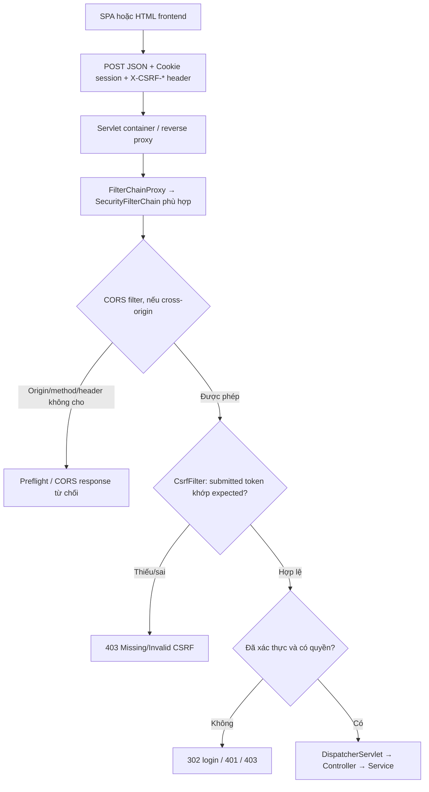
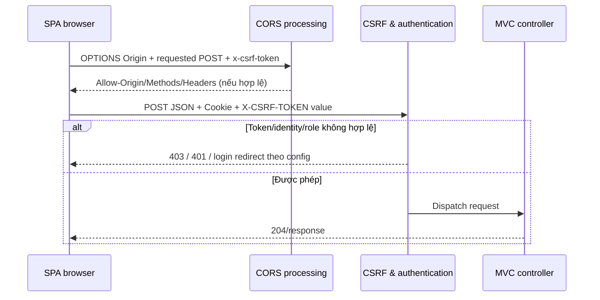

# csrf().asHeader() cho yêu cầu dùng header

> **Chương:** Kiểm thử Servlet  
> **Module:** `SPRING_SECURITY_HTTP_PROTECTION` — áp dụng các lớp phòng vệ HTTP và trình duyệt bằng Spring Security, từ CSRF, CORS, security headers, CSP, HSTS đến HTTP firewall và bảo vệ session. Học viên cấu hình trên Servlet lẫn Reactive, kiểm thử các kịch bản tấn công web và chẩn đoán xung đột bảo mật khi triển khai.  
> **Trọng tâm:** Với `spring-security-test` dành cho Servlet, `MockMvc.perform(post(...).with(csrf().asHeader()))` gửi **CSRF token hợp lệ qua HTTP request header**, thay vì request parameter như `csrf()` mặc định. Đây là cách kiểm thử đặc biệt hữu ích với AJAX/JSON/SPA nhưng không thay thế việc kiểm luồng phát token và cookie trong trình duyệt thực.

## 1. Mục tiêu học tập

Sau bài này, người học có thể:

1. Giải thích chính xác tác dụng của `SecurityMockMvcRequestPostProcessors.csrf().asHeader()`.
2. Phân biệt **header nộp CSRF token**, **Authorization header chứa Bearer token** và **cookie/session xác thực**.
3. Biết vì sao `csrf()` mặc định gửi token bằng request parameter, còn `csrf().asHeader()` gửi qua tên header được cấu hình trong `CsrfToken`.
4. Viết ba test trên cùng endpoint: thiếu header, header chứa token sai, header chứa token hợp lệ.
5. Xác định Spring Security filter chain phải thực sự chạy trong MockMvc và test nào có thể “xanh” giả khi thiếu filters.
6. Thiết kế `SecurityFilterChain` cho browser session với CSRF bật, handler JSON dùng `@RequestBody` và test fixture có side effects đo được.
7. Hiểu tên header mặc định thường là `X-CSRF-TOKEN` với session repository, có thể là `X-XSRF-TOKEN` với cookie repository; không gắn cứng tên khi ứng dụng có custom repository.
8. Giải thích vai trò của `CsrfTokenRepository`, `CsrfTokenRequestHandler`, token deferred/lazy và XOR masking ở Spring Security hiện đại.
9. Kiểm luồng GET phát token rồi POST thật với đúng session/cookie và submitted header mà **không** dùng `with(csrf().asHeader())` ở bước POST.
10. Phân biệt CORS preflight OPTIONS với actual POST có session và CSRF header; kiểm allowlist Origin, requested method và requested headers.
11. Viết kiểm thử role/authority cùng CSRF để không ngộ nhận 403 do CSRF là 403 do thiếu quyền.
12. Phân tích login/logout, token rotation và lý do SPA có thể cần lấy token mới sau authentication.
13. Đánh giá khi API chỉ dùng Bearer header có thể có CSRF policy khác browser cookie authentication, không suy từ việc API dùng JSON.
14. Phân biệt MockMvc Servlet `CsrfFilter` và WebFlux `CsrfWebFilter`/`WebTestClient`.
15. Chẩn đoán lỗi 302/401/403/404 của request có `csrf().asHeader()` mà không vô hiệu hóa bảo vệ để “cho test qua”.

## 2. Một dòng code quan trọng nhất

Ví dụ:

```java
mvc.perform(post("/account/profile")
        .with(user("alice").roles("USER"))
        .contentType(MediaType.APPLICATION_JSON)
        .content("{\"displayName\":\"Alice\"}")
        .with(csrf().asHeader()))
    .andExpect(status().isNoContent());
```

Phân tích từng phần:

- `post("/account/profile")` mô phỏng HTTP POST — một unsafe method thường phải kiểm CSRF trên browser session chain.
- `with(user("alice").roles("USER"))` tạo authenticated principal **giả lập** cho request; nó không tạo CSRF token.
- `contentType(APPLICATION_JSON)` và `content(...)` gửi dữ liệu nghiệp vụ JSON tới controller; JSON body không chứa CSRF token.
- `with(csrf().asHeader())` tạo CSRF token hợp lệ trong test support rồi thêm token vào **HTTP request header** theo `CsrfToken.getHeaderName()`, không phải `_csrf` request parameter.
- `isNoContent()` kỳ vọng controller xử lý thành công và trả 204; điều này cần controller/test fixtures thực sự trả 204, không phải behavior tự sinh bởi test helper.

Nếu bỏ `.with(csrf().asHeader())` nhưng giữ mọi điều kiện khác, browser CSRF filter phải từ chối POST thiếu token. Nếu giữ header hợp lệ nhưng bỏ authenticated principal, API/browser entry point vẫn có thể yêu cầu đăng nhập.

### 2.1. Những khẳng định cần tránh

| Nhận định | Đúng? | Lý do |
|---|---|---|
| `csrf().asHeader()` gửi token CSRF trong HTTP header test | Đúng | Header name lấy theo `CsrfToken`/test repository |
| `csrf()` và `csrf().asHeader()` nộp token qua cùng vị trí | Sai | Một bên parameter, một bên header |
| Có CSRF header là request đã authenticated | Sai | CSRF không cấp danh tính |
| CSRF header là `Authorization: Bearer ...` | Sai | Hai credential/protection mechanism khác nhau |
| Helper kiểm được JWT signature hoặc password | Sai | Không đi qua credential authentication tương ứng |
| Helper chứng minh SPA thật đã đọc cookie CSRF | Sai | Chưa kiểm token issuance/cookie/browser handling |
| Header hợp lệ tự cho user vào `/admin/**` | Sai | HTTP authorization vẫn kiểm role/authority |
| CORS preflight có CSRF header value như POST thật | Sai ở flow thông thường | Preflight chỉ khai **tên header** dự kiến trong `Access-Control-Request-Headers` |
| Test xanh chứng minh CSRF filter chạy trong mọi setup | Sai | MockMvc phải gắn đúng Spring Security filters |

## 3. Nơi CSRF header tham gia request lifecycle

Một ứng dụng browser dùng cookie session có thể tự gửi session credential khi frontend gọi backend. Spring Security nhận request, đọc CSRF token client nộp qua header hoặc parameter, đối chiếu expected token theo repository/handler rồi mới cho unsafe request đi tiếp.



Sơ đồ dùng để tách điều kiện, không khẳng định thứ tự mọi custom filters/handlers. Khi CORS preflight OPTIONS được xử lý và trả lời sớm, request đó có thể **không đi đến authorization/controller**; với actual POST, tất cả điều kiện vẫn phải được đáp ứng.

### 3.1. Header CSRF không phải một token xác thực thứ hai

Một CSRF token giúp chống browser request forgery trong mô hình có credential do browser tự gửi. Nó không nói user là ai, không mang role hay scope và không thay business authorization/owner checks.

Một SPA có thể cần đồng thời:

```http
POST /account/profile HTTP/1.1
Cookie: JSESSIONID=...
X-CSRF-TOKEN: <server-issued-csrf-value>
Content-Type: application/json

{"displayName":"Alice"}
```

**Cookie session** dùng để xác định principal; **X-CSRF-TOKEN** dùng để đáp ứng CSRF check; **body JSON** là dữ liệu cần cập nhật. Không lấy header `X-CSRF-TOKEN` làm user ID, không thay nó bằng Bearer JWT nếu backend đang dùng session authentication.

### 3.2. GET thường không đòi submitted token

Theo matcher mặc định thông dụng, `GET`, `HEAD`, `OPTIONS` và `TRACE` được coi là safe methods, còn `POST`, `PUT`, `PATCH`, `DELETE` thường cần CSRF nếu browser chain bật filter. Đừng đặt mutation trong GET chỉ để khỏi gửi CSRF.

## 4. API test của Servlet Spring Security: `csrf().asHeader()`

Helper có package:

```java
import static org.springframework.security.test.web.servlet.request.SecurityMockMvcRequestPostProcessors.csrf;
```

Đặt nó vào MockMvc request builder:

```java
mockMvc.perform(post("/account/profile")
        .with(csrf().asHeader()));
```

Nó cung cấp token hợp lệ trong test request **theo cách Spring Security Test hỗ trợ** và đưa submitted value vào header. Không cần tự viết:

```java
.header("X-CSRF-TOKEN", "constant-test-token")
```

vì chuỗi tự đặt không tự trùng expected token ở `CsrfTokenRepository`.

### 4.1. Parameter, header và invalid header

```java
// CSRF token hợp lệ, gửi dưới dạng request parameter:
.with(csrf())

// CSRF token hợp lệ, gửi dưới dạng HTTP header:
.with(csrf().asHeader())

// CSRF token sai, gửi dưới dạng request parameter:
.with(csrf().useInvalidToken())

// CSRF token sai, gửi dưới dạng HTTP header:
.with(csrf().asHeader().useInvalidToken())
```

Điểm khác nhau là **submitted token nằm đâu** và **nó hợp lệ hay không**, chứ không phải helper nào “có quyền cao hơn”.

### 4.2. Header name do token metadata quyết định

Phổ biến:

- `HttpSessionCsrfTokenRepository`: parameter `_csrf` và header `X-CSRF-TOKEN`.
- `CookieCsrfTokenRepository`: cookie `XSRF-TOKEN` và request header `X-XSRF-TOKEN` theo convention.

Nhưng repository hoặc custom `CsrfTokenRequestHandler` có thể đổi tên/cách giải token. Trong code và test theo production flow, đọc `CsrfToken.getHeaderName()`; không hardcode `X-CSRF-TOKEN` nếu ứng dụng dùng repository khác. Sự khác nhau giữa cookie name và header name cũng quan trọng: cookie server phát có thể được JS đọc, nhưng header là giá trị JS phải **gửi lại**.

## 5. Thiết lập dependency và tránh lệch version

Một ứng dụng Servlet Spring Boot + Spring Security Test thường cần:

```kotlin
dependencies {
    implementation("org.springframework.boot:spring-boot-starter-web")
    implementation("org.springframework.boot:spring-boot-starter-security")

    testImplementation("org.springframework.boot:spring-boot-starter-test")
    testImplementation("org.springframework.security:spring-security-test")
}

tasks.test {
    useJUnitPlatform()
}
```

Gradle Groovy DSL:

```groovy
dependencies {
    implementation 'org.springframework.boot:spring-boot-starter-web'
    implementation 'org.springframework.boot:spring-boot-starter-security'

    testImplementation 'org.springframework.boot:spring-boot-starter-test'
    testImplementation 'org.springframework.security:spring-security-test'
}

test {
    useJUnitPlatform()
}
```

Maven (khi dùng Spring Boot dependency management):

```xml
<dependency>
    <groupId>org.springframework.security</groupId>
    <artifactId>spring-security-test</artifactId>
    <scope>test</scope>
</dependency>
```

Dùng version của `spring-security-test` tương thích với Spring Security runtime (Spring Boot BOM/dependency management). Các ví dụ Servlet `HttpSecurity`/`MockMvc` phản ánh style phổ biến của Spring Security 6+/Spring Boot 3+; kiểm API của phiên bản project khi nâng cấp.

### 5.1. Đừng nhầm với Reactive

Servlet `MockMvc` và `CsrfFilter` khác WebFlux `WebTestClient`/`CsrfWebFilter`. Cả hai có test helpers mang tên `csrf()` nhưng packages và request/response models khác nhau; không copy trực tiếp Servlet `SecurityMockMvcRequestPostProcessors` sang reactive WebTestClient.

## 6. Tích hợp security filters thật vào MockMvc

Cách thông dụng với Spring Boot:

```java
@SpringBootTest
@AutoConfigureMockMvc
class HeaderCsrfHttpTest {

    @Autowired
    MockMvc mvc;
}
```

Spring Boot `@AutoConfigureMockMvc` theo API này thường gắn Servlet filters của application context vào MockMvc (`addFilters` mặc định `true`). Nếu security config được load, `springSecurityFilterChain` sẽ tham gia request.

Nếu build thủ công:

```java
@SpringBootTest
class ManuallyWiredHeaderCsrfTest {

    @Autowired
    WebApplicationContext context;

    MockMvc mvc;

    @BeforeEach
    void setUp() {
        mvc = MockMvcBuilders
            .webAppContextSetup(context)
            .apply(springSecurity())
            .build();
    }
}
```

Imports:

```java
import org.junit.jupiter.api.BeforeEach;
import org.springframework.beans.factory.annotation.Autowired;
import org.springframework.boot.test.context.SpringBootTest;
import org.springframework.boot.test.autoconfigure.web.servlet.AutoConfigureMockMvc;
import org.springframework.test.web.servlet.MockMvc;
import org.springframework.test.web.servlet.setup.MockMvcBuilders;
import org.springframework.web.context.WebApplicationContext;
import static org.springframework.security.test.web.servlet.setup.SecurityMockMvcConfigurers.springSecurity;
```

### 6.1. Hai bẫy lớn

```java
// Controller-only: Boot sẽ không tự đăng ký Servlet filters vào MockMvc.
@AutoConfigureMockMvc(addFilters = false)
```

```java
// Standalone builder không tự lấy Spring Security chain trong context.
MockMvc mvc = MockMvcBuilders
    .standaloneSetup(controller)
    .build();
```

Trong cả hai trường hợp, `.with(csrf().asHeader())` chỉ sửa request test; nếu `CsrfFilter` không chạy, test không chứng minh gì về CSRF validation. Một POST thiếu token vẫn có thể 200/204 vì filter chưa được gọi.

### 6.2. Slice `@WebMvcTest` phải kiểm security policy thật

`@WebMvcTest` có thể load một phần Spring Security auto-configuration, nhưng không bảo đảm toàn bộ custom `SecurityFilterChain`, `CsrfTokenRepository`, `UserDetailsService` hoặc services của ứng dụng đã hiện diện. Nếu mục tiêu kiểm behavior production, import cấu hình thật/cung cấp test beans phù hợp hoặc dùng full `@SpringBootTest`, không dựa vào default chain tình cờ.

### 6.3. Một positive test thôi chưa đủ

Nếu chỉ test `POST with(csrf().asHeader())` trả 204, app đã tắt CSRF hoàn toàn cũng có thể pass. Cần thêm **missing header** và **invalid header** tests để bảo đảm bộ test thất bại khi `CsrfFilter` bị gỡ hoặc vô hiệu hóa.

## 7. SecurityFilterChain browser có session và CSRF header

Ví dụ một browser chain cho SPA cùng origin hoặc cross-origin được cấu hình CORS riêng:

```java
package example.security;

import org.springframework.context.annotation.Bean;
import org.springframework.context.annotation.Configuration;
import org.springframework.http.HttpMethod;
import org.springframework.security.config.Customizer;
import org.springframework.security.config.annotation.web.builders.HttpSecurity;
import org.springframework.security.config.annotation.web.configuration.EnableWebSecurity;
import org.springframework.security.web.SecurityFilterChain;

@Configuration
@EnableWebSecurity
public class BrowserHeaderCsrfSecurityConfig {

    @Bean
    SecurityFilterChain browser(HttpSecurity http) throws Exception {
        return http
            .authorizeHttpRequests(auth -> auth
                .requestMatchers(HttpMethod.GET,
                    "/login", "/csrf", "/public/**")
                    .permitAll()
                .requestMatchers(HttpMethod.POST,
                    "/public/feedback").permitAll()
                .requestMatchers("/admin/**").hasRole("ADMIN")
                .anyRequest().authenticated())
            .csrf(Customizer.withDefaults())
            .formLogin(Customizer.withDefaults())
            .headers(headers -> headers
                .contentSecurityPolicy(csp -> csp.policyDirectives(
                    "default-src 'self'; object-src 'none'; " +
                    "base-uri 'self'; frame-ancestors 'none'")))
            .build();
    }
}
```

Ở đây:

- `csrf(Customizer.withDefaults())` bật CSRF cho unsafe requests theo default matcher.
- `POST /account/profile` cần cả authenticated principal và token hợp lệ.
- `POST /public/feedback` được `permitAll()` về authorization nhưng **vẫn** cần token.
- `POST /admin/settings` còn cần role ADMIN.
- `GET /csrf` là public endpoint phục vụ minh họa phát token cho cùng origin; cần controller và cache policy riêng.
- Browser form login mặc định dùng session; token header không thay việc user đăng nhập.
- CSP giúp phòng vệ HTML document, **không thay** CSRF hoặc authorization.

**CORS chưa được cấu hình trong ví dụ này.** Muốn hỗ trợ SPA cross-origin, phải thêm CORS source/DSL rõ ràng với allowlist; không mặc định request có Origin sẽ được phép chỉ vì CSRF header hợp lệ.

### 7.1. Khi nào dùng session repository?

Với cấu hình phổ biến, `HttpSessionCsrfTokenRepository` là một lựa chọn mặc định của Servlet CSRF. Nó lưu expected token theo session, còn client submit token qua parameter/header. MockMvc request có `csrf().asHeader()` giúp mô phỏng header hợp lệ nhưng không tự kiểm browser có giữ session/cookie thật.

### 7.2. `permitAll()` không tắt CSRF

Mặc dù URL có `permitAll()`, `CsrfFilter` vẫn xét request trước authorization nếu filter áp dụng. Một anonymous POST public có header CSRF hợp lệ có thể vào handler; anonymous POST không token vẫn có thể 403.

### 7.3. Một cấu hình Browser SPA cần nghĩ thêm

Đối với cross-origin SPA, cần kiểm cookie `Secure`, `SameSite`, CORS credentials, header allowlist, CSRF token issuance, header naming/handler, HTTPS và CSP. Bật CSRF mặc định ở browser chain là điểm bắt đầu, chưa đủ để hoàn tất giao thức SPA.

## 8. Controller fixture dùng JSON và có side effect quan sát được

Tạo một fixture nhận JSON:

```java
package example.web;

import java.util.Map;

import org.springframework.http.ResponseEntity;
import org.springframework.security.web.csrf.CsrfToken;
import org.springframework.web.bind.annotation.*;

@RestController
class BrowserApiController {

    private final ChangeRecorder recorder;

    BrowserApiController(ChangeRecorder recorder) {
        this.recorder = recorder;
    }

    @GetMapping("/account")
    String account() {
        return "account";
    }

    @PostMapping("/account/profile")
    ResponseEntity<Void> updateProfile(
            @RequestBody ProfileUpdate update) {
        recorder.profileChanged(update.displayName());
        return ResponseEntity.noContent().build();
    }

    @PostMapping("/admin/settings")
    ResponseEntity<Void> adminSettings(
            @RequestBody AdminUpdate update) {
        recorder.adminSettingsChanged(update.theme());
        return ResponseEntity.noContent().build();
    }

    @PostMapping("/public/feedback")
    ResponseEntity<Void> feedback(
            @RequestBody FeedbackInput input) {
        recorder.feedbackReceived(input.message());
        return ResponseEntity.noContent().build();
    }

    @GetMapping("/csrf")
    Map<String, String> csrf(
            @RequestAttribute("_csrf") CsrfToken csrfToken) {
        return Map.of(
            "parameterName", csrfToken.getParameterName(),
            "headerName", csrfToken.getHeaderName(),
            "token", csrfToken.getToken());
    }
}

record ProfileUpdate(String displayName) {}
record AdminUpdate(String theme) {}
record FeedbackInput(String message) {}
```

Domain fixture:

```java
public interface ChangeRecorder {
    void profileChanged(String displayName);
    void adminSettingsChanged(String theme);
    void feedbackReceived(String message);
}
```

Để chạy, ứng dụng phải cung cấp một bean `ChangeRecorder` (test double hoặc implementation), và controller phải được scan/import phù hợp. `POST /account/profile` trả 204 khi JSON hợp lệ và request được phép. Nếu thiếu `@RequestBody` hoặc payload sai JSON, MVC có thể trả 400 dù CSRF đã hợp lệ.

Endpoint `GET /csrf` minh họa việc phát token cho client same-origin, không tự là một API nên công khai cho mọi origin. Response chứa token cần tránh cache, chỉ được browser đọc qua origin/cookie policy an toàn; `getToken()` cũng có thể buộc lazy/deferred token được tạo.

### 8.1. Định danh các lớp được kiểm

Test có `with(user(...))` và `with(csrf().asHeader())` chứng minh behavior sau khi một principal **giả lập** đã tồn tại. Nó chưa chứng minh PasswordEncoder/user store/session fixation hoạt động, nhưng đủ cho nhiều CSRF authorization tests.

### 8.2. Tác dụng phụ phải không xuất hiện khi bị từ chối

Với `ChangeRecorder` mock bean được inject đúng, test CSRF thiếu/sai có thể xác minh service **không** được gọi. Với positive test có header hợp lệ, verify service nhận đúng dữ liệu, giúp phân biệt lỗi security filter với controller không tồn tại/luôn deny.

## 9. Bài test cơ sở: JSON POST gửi CSRF token qua header

```java
@SpringBootTest
@AutoConfigureMockMvc
class HeaderTokenSmokeTest {

    @Autowired
    MockMvc mvc;

    @Test
    void validHeaderCsrfAllowsAuthenticatedJsonPost()
            throws Exception {
        mvc.perform(post("/account/profile")
                .with(user("alice").roles("USER"))
                .contentType(MediaType.APPLICATION_JSON)
                .content("{\"displayName\":\"Alice\"}")
                .with(csrf().asHeader()))
            .andExpect(status().isNoContent());
    }
}
```

Imports thường dùng:

```java
import org.junit.jupiter.api.Test;
import org.springframework.beans.factory.annotation.Autowired;
import org.springframework.boot.test.context.SpringBootTest;
import org.springframework.boot.test.autoconfigure.web.servlet.AutoConfigureMockMvc;
import org.springframework.http.MediaType;
import org.springframework.test.web.servlet.MockMvc;

import static org.springframework.security.test.web.servlet.request.SecurityMockMvcRequestPostProcessors.*;
import static org.springframework.test.web.servlet.request.MockMvcRequestBuilders.*;
import static org.springframework.test.web.servlet.result.MockMvcResultMatchers.*;
```

Bài test này có năm điều kiện: HTTP method POST; JSON hợp lệ; authenticated principal mock; header CSRF hợp lệ; handler trả 204. Nó không kiểm browser CORS hoặc token được phát ra trước đó.

### 9.1. Kiểm header được helper đặt trên mock request

Với `HttpSessionCsrfTokenRepository` thông dụng, CSRF header name thường là `X-CSRF-TOKEN`. Khi muốn xác nhận nơi token được đặt:

```java
mvc.perform(post("/account/profile")
        .with(user("alice").roles("USER"))
        .contentType(MediaType.APPLICATION_JSON)
        .content("{\"displayName\":\"Alice\"}")
        .with(csrf().asHeader()))
    .andExpect(status().isNoContent())
    .andExpect(result -> assertNotNull(
        result.getRequest().getHeader("X-CSRF-TOKEN")));
```

Import `org.junit.jupiter.api.Assertions.assertNotNull`. Nếu dùng cookie repository/custom header naming, nên đọc `CsrfToken.getHeaderName()` thay vì hardcode string. Kiểm header có mặt chỉ là **một quan sát**; positive/negative behavior mới chứng minh CSRF filter thực sự áp policy.

### 9.2. Header không phải form parameter

```java
mvc.perform(post("/account/profile")
        .with(user("alice").roles("USER"))
        .contentType(MediaType.APPLICATION_JSON)
        .content("{\"displayName\":\"Alice\"}")
        .with(csrf().asHeader()))
    .andExpect(result -> assertNull(
        result.getRequest().getParameter("_csrf")));
```

Đây là minh họa cho request **chỉ dùng asHeader** với config chuẩn không thêm token parameter từ nơi khác. Nếu test setup/custom post-processors đã thêm `_csrf`, assertion null có thể không còn đúng. Không phụ thuộc việc parameter luôn vắng trong mọi app; điều cần chứng minh là submitted token **đi qua header**.

### 9.3. Không assert một giá trị token cố định

CSRF tokens thường được tạo ngẫu nhiên, có thể masked và thay theo authentication lifecycle. Không đưa giá trị token vào snapshot, không log secrets trong CI và không gán cứng `X-CSRF-TOKEN: abc` rồi coi đó là valid token.

## 10. Ba phép thử tối thiểu: thiếu, sai và hợp lệ

Giữ nguyên method, URL, JSON payload, principal và session policy; chỉ đổi CSRF header:

```java
@Test
void missingHeaderCsrfIsForbidden() throws Exception {
    mvc.perform(post("/account/profile")
            .with(user("alice").roles("USER"))
            .contentType(MediaType.APPLICATION_JSON)
            .content("{\"displayName\":\"Alice\"}"))
        .andExpect(status().isForbidden());
}

@Test
void invalidHeaderCsrfIsForbidden() throws Exception {
    mvc.perform(post("/account/profile")
            .with(user("alice").roles("USER"))
            .contentType(MediaType.APPLICATION_JSON)
            .content("{\"displayName\":\"Alice\"}")
            .with(csrf().asHeader().useInvalidToken()))
        .andExpect(status().isForbidden());
}

@Test
void validHeaderCsrfCanReachController() throws Exception {
    mvc.perform(post("/account/profile")
            .with(user("alice").roles("USER"))
            .contentType(MediaType.APPLICATION_JSON)
            .content("{\"displayName\":\"Alice\"}")
            .with(csrf().asHeader()))
        .andExpect(status().isNoContent());
}
```

Nếu chỉ test positive, CSRF bị tắt toàn app vẫn có thể cho 204; phải có **missing/invalid negative controls**. Nếu cả ba đều trả 403, có thể thiếu authority, dùng sai chain, custom token handler hoặc controller fixture không đúng; không tự đổ lỗi cho `asHeader()`.

### 10.1. Một 403 có nhiều nguồn

`CsrfFilter` thiếu/sai token, `CorsFilter` từ chối Origin, `AuthorizationFilter` thiếu role, method security hoặc domain service đều có thể trả 403. Muốn chứng minh **CSRF**, giữ các điều kiện khác hợp lệ và kiểm cặp positive+negative trên cùng fixture.

### 10.2. Khi request bị chặn, không được có side effect

Nếu controller gọi `recorder.profileChanged(...)`, với mock bean được inject thật:

```java
mvc.perform(post("/account/profile")
        .with(user("alice").roles("USER"))
        .contentType(MediaType.APPLICATION_JSON)
        .content("{\"displayName\":\"Alice\"}"))
    .andExpect(status().isForbidden());

verify(recorder, never()).profileChanged(anyString());
```

Cần reset Mockito history giữa các test; một mock không được inject vào controller có thể làm `never()` luôn pass mà không chứng minh gì.
## 11. So sánh `csrf()` với `csrf().asHeader()` theo đúng wire protocol

Trong Servlet MockMvc, hai helper đều có thể tạo một token hợp lệ để qua CSRF validation. Nhưng submitted token nằm ở hai vị trí khác nhau:

| Tiêu chí | `with(csrf())` | `with(csrf().asHeader())` |
|---|---|---|
| Nơi gửi | Request parameter | HTTP request header |
| Tên mặc định thường gặp | `_csrf` | `X-CSRF-TOKEN` |
| Client gần với test | HTML form hidden input | AJAX/JSON/SPA |
| `CsrfTokenRepository` | Vẫn phải có expected token thích hợp | Vẫn phải có expected token thích hợp |
| Tự đăng nhập user | Không | Không |
| Tự xử lý CORS | Không | Không |
| Kiểm SPA token issuance/rotation | Không | Không |
| Cách tạo token sai | `csrf().useInvalidToken()` | `csrf().asHeader().useInvalidToken()` |
| Rủi ro test giả dương | Form HTML thật thiếu hidden field | SPA thực không lấy cookie hoặc dùng sai tên/header value |

### 11.1. Vì sao JSON body không làm header token trở nên thừa?

Một JSON POST thường trông như:

```http
POST /account/profile HTTP/1.1
Cookie: JSESSIONID=...
Content-Type: application/json
X-CSRF-TOKEN: <server-issued-token>

{"displayName":"Alice"}
```

JSON chứa dữ liệu nghiệp vụ, còn CSRF header nằm ở HTTP metadata. Servlet CSRF filter không cần parse `@RequestBody` để trích token, tránh xung đột với input stream của controller.

Test `with(csrf())` cũng có thể pass với body JSON vì MockMvc thêm một request parameter **ngoài JSON body**, nhưng thực tế SPA thường không gửi parameter đó. Nếu sản phẩm yêu cầu CSRF header, test phải có các case `asHeader()` và luồng lấy token thật.

### 11.2. Header value không phải random string nào cũng hợp lệ

```java
// Sai nếu chưa có expected token tương ứng trong repository:
mvc.perform(post("/account/profile")
        .with(user("alice").roles("USER"))
        .contentType(MediaType.APPLICATION_JSON)
        .content("{\"displayName\":\"Alice\"}")
        .header("X-CSRF-TOKEN", "abc"))
    .andExpect(status().isForbidden());
```

Chỉ có tên header không đủ; giá trị phải khớp expected token theo CSRF repository và request handler của session/cookie tương ứng. Nếu test luôn gắn header literal bằng một fixture bypass validation, nó không chứng minh `CsrfFilter` production đang hoạt động đúng.

## 12. CORS preflight không gửi *giá trị* CSRF token của POST

Giả sử SPA được triển khai ở `https://client.example.com`, backend browser session ở `https://app.example.com`. Một POST JSON có custom CSRF header thường kích hoạt preflight:

```http
OPTIONS /account/profile HTTP/1.1
Origin: https://client.example.com
Access-Control-Request-Method: POST
Access-Control-Request-Headers: content-type,x-csrf-token
```

Preflight cho server biết **client muốn gửi header tên gì**, không gửi giá trị CSRF header của actual POST. Browser preflight cũng thường không gửi credentials như request thật. CORS filter phải có khả năng xử lý OPTIONS trước khi authentication chặn nó; CSRF matcher mặc định không yêu cầu token trên OPTIONS.



**Không** dùng `with(csrf().asHeader())` trên OPTIONS rồi coi đã kiểm preflight. Bản chất preflight là kiểm Origin/method/header name, không yêu cầu client cung cấp valid CSRF token cho một thao tác không thay đổi trạng thái.

### 12.1. Vì sao OPTIONS 401 không nên chữa bằng cách bỏ chain?

Nếu OPTIONS bị browser form-login entry point redirect 302 hoặc JWT API trả 401, khả năng CORS chưa xử lý đủ sớm hoặc request đang vào sai chain. Bỏ toàn bộ OPTIONS khỏi security chain có thể khiến CORS filter nằm trong chain không bao giờ chạy. Hãy cấu hình CORS và matcher/chain đúng, rồi test preflight.

### 12.2. CORS cho phép không có nghĩa CSRF cho phép

CORS chỉ liên quan browser origin access policy. Một Origin được allowlist có thể POST nhưng **vẫn** cần authentication, CSRF và role. Ngược lại, CSRF token hợp lệ không cấp CORS permission. Hai policy phải được test riêng, kèm actual POST.

## 13. Cấu hình CORS cho SPA gửi header CSRF

Cấu hình ở mục 7 chưa bật CORS. Khi client và backend khác origin, bổ sung một `CorsConfigurationSource` vào security chain theo allowlist cụ thể.

Ví dụ:

```java
@Bean
CorsConfigurationSource browserCors() {
    CorsConfiguration cors = new CorsConfiguration();
    cors.setAllowedOrigins(
        List.of("https://client.example.com"));
    cors.setAllowedMethods(
        List.of("GET", "POST", "PUT", "PATCH", "DELETE"));
    cors.setAllowedHeaders(
        List.of("Content-Type", "X-CSRF-TOKEN", "X-XSRF-TOKEN"));
    cors.setAllowCredentials(true);
    cors.setMaxAge(1800L);

    UrlBasedCorsConfigurationSource source =
        new UrlBasedCorsConfigurationSource();
    source.registerCorsConfiguration("/**", cors);
    return source;
}
```

Thêm vào browser security chain:

```java
return http
    .cors(cors -> cors.configurationSource(browserCors()))
    .authorizeHttpRequests(auth -> auth
        .requestMatchers("/login", "/csrf").permitAll()
        .anyRequest().authenticated())
    .csrf(Customizer.withDefaults())
    .formLogin(Customizer.withDefaults())
    .build();
```

Imports:

```java
import java.util.List;
import org.springframework.web.cors.CorsConfiguration;
import org.springframework.web.cors.CorsConfigurationSource;
import org.springframework.web.cors.UrlBasedCorsConfigurationSource;
```

Những điểm phải làm rõ:

- `allowedOrigins` là danh sách origin tin cậy cụ thể, không mặc định mọi origin.
- `allowCredentials(true)` phục vụ browser gửi cookie qua cross-origin fetch khi cookie policy cho phép; không kết hợp với wildcard `*` trong `Access-Control-Allow-Origin`.
- `allowedHeaders` cần gồm header CSRF mà frontend thực gửi, cũng như Content-Type cho JSON POST.
- `OPTIONS` preflight cần trả CORS headers tương ứng; backend có thể trả allow-origin/method/header trước khi user đăng nhập.
- Site policy, cookie `SameSite`/`Secure`, HTTPS và frontend `credentials: "include"` vẫn phải đồng bộ; CORS config **không tự khiến browser gửi cookie**.
- Nếu gateway xử lý CORS trước backend, phải xác định tầng sở hữu CORS cuối cùng để tránh response headers mâu thuẫn.

Đây là ví dụ cho browser chain trong app minh họa. Nếu hệ thống có nhiều chains (API JWT, browser), cần bảo đảm CORS source phù hợp với chain thực sự nhận endpoint.

## 14. Kiểm CORS preflight đúng cách với MockMvc

### 14.1. Origin được phép, không cần principal hoặc CSRF header value

```java
@Test
void allowedPreflightForCsrfHeaderDoesNotNeedLogin()
        throws Exception {
    mvc.perform(options("/account/profile")
            .header("Origin", "https://client.example.com")
            .header("Access-Control-Request-Method", "POST")
            .header("Access-Control-Request-Headers",
                "content-type,x-csrf-token"))
        .andExpect(status().isOk())
        .andExpect(header().string(
            "Access-Control-Allow-Origin",
            "https://client.example.com"))
        .andExpect(header().string(
            "Access-Control-Allow-Credentials", "true"));
}
```

Test cần cấu hình browser CORS của mục 13. Đây là phép kiểm preflight do `CorsFilter`/CORS processing trả lời, không phải request đến `@PostMapping` hay kiểm CSRF token value.

### 14.2. Origin lạ phải bị từ chối

```java
@Test
void unknownOriginCannotPreflightCsrfHeader()
        throws Exception {
    mvc.perform(options("/account/profile")
            .header("Origin", "https://attacker.example")
            .header("Access-Control-Request-Method", "POST")
            .header("Access-Control-Request-Headers",
                "content-type,x-csrf-token"))
        .andExpect(status().isForbidden())
        .andExpect(header().doesNotExist(
            "Access-Control-Allow-Origin"));
}
```

Status 403 là kết quả phổ biến với Spring CORS implementation; custom CORS processor/gateway có thể trả status khác. Điều bất biến là origin không đáng tin **không nhận allow-origin cho dữ liệu có credentials**.

### 14.3. Requested header/method không nằm trong allowlist

```java
@Test
void unapprovedPreflightHeaderIsRejected()
        throws Exception {
    mvc.perform(options("/account/profile")
            .header("Origin", "https://client.example.com")
            .header("Access-Control-Request-Method", "POST")
            .header("Access-Control-Request-Headers",
                "x-unknown-secret-header"))
        .andExpect(status().isForbidden());
}
```

Nếu CORS processor thay đổi, có thể test **không** trả allow-headers tương ứng thay vì cố định status. Dù sao vẫn không nên mở `allowedHeaders("*")` chỉ để test qua mà chưa đánh giá threat model của origin/credentials.

### 14.4. Một preflight 200 không chứng minh POST được phép

Thực hiện thêm actual POST có valid/invalid CSRF header và authenticated user:

```java
@Test
void actualCorsJsonPostStillRequiresCsrf()
        throws Exception {
    mvc.perform(post("/account/profile")
            .header("Origin", "https://client.example.com")
            .with(user("alice").roles("USER"))
            .contentType(MediaType.APPLICATION_JSON)
            .content("{\"displayName\":\"Alice\"}"))
        .andExpect(status().isForbidden());

    mvc.perform(post("/account/profile")
            .header("Origin", "https://client.example.com")
            .with(user("alice").roles("USER"))
            .contentType(MediaType.APPLICATION_JSON)
            .content("{\"displayName\":\"Alice\"}")
            .with(csrf().asHeader()))
        .andExpect(status().isNoContent())
        .andExpect(header().string(
            "Access-Control-Allow-Origin",
            "https://client.example.com"));
}
```

`with(user())` trong test giả lập authentication; nó không gửi browser cookie thật. Muốn kiểm credentialed CORS và cookie SameSite/Domain/Secure, phải dùng browser hoặc HTTP integration test với cookie jar, giữ session đúng flow.

## 15. Repository quyết định expected token và header name

`CsrfTokenRepository` là nơi Spring Security tạo/lưu/nạp expected CSRF token. Hai ví dụ đáng phân biệt:

| Repository | Nơi lưu expected token | Conventional request header | Khi nào hay dùng |
|---|---|---|---|
| `HttpSessionCsrfTokenRepository` | HTTP session | `X-CSRF-TOKEN` | Form login/session backend, server-rendered HTML hoặc client lấy token qua endpoint |
| `CookieCsrfTokenRepository` | CSRF cookie | `X-XSRF-TOKEN` | SPA JavaScript đọc cookie token rồi gửi header |
| Custom repository | Theo implementation | Theo `CsrfToken.getHeaderName()` | Đặc thù topology, test phải theo wire contract |

**CSRF cookie không phải session authentication cookie.** Cookie `XSRF-TOKEN` có thể giúp JS đọc token chống giả mạo; cookie `JSESSIONID` dùng để xác định session/user. Không đổi hai cookie với nhau.

### 15.1. Header chứa token do server phát, không phải token ngẫu nhiên tự tạo

Nếu dùng session repository, client phải lấy token được expose trên response/form trong ngữ cảnh session ấy. Nếu dùng cookie repository, client phải gửi đúng cookie cùng header value được server trích/giải mã.

Một request có header token phù hợp nhưng không có authenticated session vẫn có thể được CSRF filter cho qua rồi authentication entry point từ chối. Ngược lại, authenticated session có thể bị CSRF 403 nếu header sai.

### 15.2. Không hardcode header name khi repository đổi

Khi chuyển từ session repository sang cookie repository, frontend từ `X-CSRF-TOKEN` có thể phải chuyển sang `X-XSRF-TOKEN`. Những tests chỉ dùng `with(csrf().asHeader())` có thể vẫn pass theo metadata helper và **không phát hiện frontend vẫn gửi tên header cũ**. Bổ sung test dùng header name/value thực mà client sử dụng.

### 15.3. Custom request handler có thể thay cách diễn giải submitted header

Một `CsrfTokenRequestHandler` quyết định cách expose token vào request và trích submitted value. Với XOR masking, token được trình bày cho form có thể khác raw expected token. Vì thế **header có mặt và token trông giống nhau** chưa đủ: request handler phải nhận đúng representation.

## 16. Spring Security hiện đại: lazy token và XOR masking

### 16.1. Deferred token

Spring Security có thể trì hoãn sinh CSRF token cho đến khi ứng dụng thực sự truy cập nó. Một `GET /public/info` không đọc `CsrfToken.getToken()` có thể không tạo CSRF cookie/session attribute. Vì vậy test “mọi GET đều phải có XSRF-TOKEN cookie” có thể sai.

Nếu UI cần token trước POST, hãy render form/đọc `CsrfToken` hoặc thiết kế `GET /csrf` để kích hoạt token issuance an toàn.

### 16.2. XOR masking chống BREACH

Spring Security 6 thường dùng `XorCsrfTokenRequestAttributeHandler` khi expose token cho HTML form/request attribute, tạo một **masked token** dùng làm submitted value. Raw token ở repository có thể khác giá trị gửi trong form và thay đổi theo request.

Sự khác nhau này quan trọng với SPA:

- Form HTML lấy **masked token** do server expose và nộp lại; XOR handler có thể unmask.
- SPA lấy raw token từ cookie `XSRF-TOKEN` rồi gửi qua `X-XSRF-TOKEN`; mặc định XOR handler có thể mong token masked, dẫn tới 403.
- Test helper `with(csrf().asHeader())` không tự chứng minh frontend raw cookie/header flow sẽ pass khi request handler tùy biến.
- Không tắt CSRF hoặc masking toàn cục chỉ để tránh mismatch; thiết kế handler cho đúng hai representation.

### 16.3. Không dùng token từ session/cookie khác

Token trong session A không mặc nhiên hợp lệ khi client gửi cùng session B (với session repository); token trong CSRF cookie A không tự hợp lệ nếu request thực gửi cookie B hoặc cookie đã rotate. Test phải giữ expected/submitted token cùng nguồn, rồi có negative cross-session/cookie test để bảo đảm tính ràng buộc.

## 17. Thiết kế request handler cho SPA đọc raw CSRF cookie

Một pattern Servlet SPA cần cân bằng:

1. Khi render form HTML, tiếp tục hỗ trợ XOR-masked request attribute token.
2. Khi SPA gửi header raw token đọc từ CSRF cookie, giải bằng plain request handler.
3. Kích hoạt token issuance cho request thích hợp, vì SPA cần một cookie có token để đọc.
4. Sau authentication/logout có thể phải phát token mới.

Một example implementation (chỉ thêm vào ứng dụng **nếu** bạn đã quyết định dùng cookie repo và raw-header SPA protocol):

```java
import java.util.function.Supplier;
import jakarta.servlet.http.HttpServletRequest;
import jakarta.servlet.http.HttpServletResponse;
import org.springframework.security.web.csrf.CsrfToken;
import org.springframework.security.web.csrf.CsrfTokenRequestAttributeHandler;
import org.springframework.security.web.csrf.CsrfTokenRequestHandler;
import org.springframework.security.web.csrf.XorCsrfTokenRequestAttributeHandler;
import org.springframework.util.StringUtils;

public final class SpaCsrfTokenRequestHandler
        implements CsrfTokenRequestHandler {

    private final CsrfTokenRequestHandler plain =
        new CsrfTokenRequestAttributeHandler();

    private final CsrfTokenRequestHandler xor =
        new XorCsrfTokenRequestAttributeHandler();

    @Override
    public void handle(
            HttpServletRequest request,
            HttpServletResponse response,
            Supplier<CsrfToken> csrfToken) {

        // Giữ masked representation cho server-rendered form.
        xor.handle(request, response, csrfToken);

        // Buộc lazy token được load/phát cho SPA.
        csrfToken.get().getToken();
    }

    @Override
    public String resolveCsrfTokenValue(
            HttpServletRequest request,
            CsrfToken csrfToken) {

        String headerValue =
            request.getHeader(csrfToken.getHeaderName());

        // Header: SPA gửi raw cookie token.
        // Parameter: HTML form gửi XOR-masked token.
        CsrfTokenRequestHandler delegate =
            StringUtils.hasText(headerValue) ? plain : xor;

        return delegate.resolveCsrfTokenValue(
            request, csrfToken);
    }
}
```

Cấu hình CSRF cho chain **chỉ minh họa mảnh liên quan**:

```java
CookieCsrfTokenRepository repository =
    CookieCsrfTokenRepository.withHttpOnlyFalse();

http.csrf(csrf -> csrf
    .csrfTokenRepository(repository)
    .csrfTokenRequestHandler(
        new SpaCsrfTokenRequestHandler()));
```

Cần import `org.springframework.security.web.csrf.CookieCsrfTokenRepository`. Đặt đoạn trên trong security config tương ứng và giữ authorization/CORS/form login/headers như yêu cầu ứng dụng; đây **không phải toàn bộ production SecurityFilterChain**.

### 17.1. Vì sao handler chọn theo có header hay không?

Trong protocol minh họa, SPA gửi raw cookie token trong header `X-XSRF-TOKEN`, còn HTML form gửi masked token trong parameter `_csrf`. Handler chọn plain cho header và XOR cho parameter. Nếu hệ thống dùng custom header format hoặc masked header token, quy tắc phải được điều chỉnh và test theo contract thật.

### 17.2. Thận trọng với `withHttpOnlyFalse()`

`CookieCsrfTokenRepository.withHttpOnlyFalse()` cho JavaScript đọc cookie CSRF, nhưng làm token có thể bị JS trên origin đọc. XSS lúc này có thể lấy token, nên CSP, output escaping, strict origin policy và chống XSS vẫn là ưu tiên. Tránh dùng cookie không Secure khi HTTPS là bắt buộc; `SameSite`, Domain/Path, proxy scheme và CORS credentials cần cấu hình phù hợp.

### 17.3. Test helper chỉ kiểm một phần của handler

`with(csrf().asHeader())` tạo token/hành vi test, không giả lập đầy đủ response `Set-Cookie`, cookie jar, frontend reading, login/logout token rotation và CORS. Cần test GET cookie → POST raw header thực, sẽ làm ở mục sau.

## 18. GET phát CSRF token qua endpoint rồi POST header không dùng helper

Bổ sung `GET /csrf` fixture từ mục 8: nó trả metadata header name và token được request handler expose. Với session repository, có thể viết integration test **không dùng `with(csrf().asHeader())` ở POST**.

```java
@Test
void serverIssuedTokenCanBeSubmittedInHeader()
        throws Exception {

    MockHttpSession session = new MockHttpSession();

    MvcResult issued = mvc.perform(get("/csrf")
            .session(session))
        .andExpect(status().isOk())
        .andReturn();

    String json = issued.getResponse()
        .getContentAsString();

    String headerName =
        JsonPath.read(json, "$.headerName");

    String token =
        JsonPath.read(json, "$.token");

    mvc.perform(post("/account/profile")
            .session(session)
            .with(user("alice").roles("USER"))
            .contentType(MediaType.APPLICATION_JSON)
            .content("{\"displayName\":\"Alice\"}")
            .header(headerName, token))
        .andExpect(status().isNoContent());
}
```

Imports gợi ý:

```java
import com.jayway.jsonpath.JsonPath;
import org.springframework.mock.web.MockHttpSession;
import org.springframework.test.web.servlet.MvcResult;
import static org.springframework.security.test.web.servlet.request.SecurityMockMvcRequestPostProcessors.user;
```

Phép thử này khác helper test:

- GET thật qua Spring Security tạo/expose CSRF token cho session.
- Test lấy **đúng header name và token được server trả về cho client**, không hardcode giá trị.
- POST giữ cùng session, tự gắn header giống client, **không** nhờ `csrf()` tạo expected token mới.
- `user()` vẫn mock authentication nên nó **chưa** kiểm password login hoặc browser cookies.
- Nếu production dùng cookie repository hoặc SPA raw token, cần test cookie flow riêng, không chỉ session.

### 18.1. Khi `GET /csrf` trả masked token

Mặc định XOR handler có thể expose masked token; nếu gửi **chính masked token ấy** trong header, XOR handler hỗ trợ giải representation tương ứng. Không lấy raw token từ session internal rồi suy header sẽ luôn được chấp nhận.

Nếu custom handler chọn plain khi có header (như mục 17), GET endpoint có thể trả masked token trong JSON nhưng header đang kỳ vọng raw; phải điều chỉnh contract: dùng raw cookie token cho header, hoặc xây endpoint phát raw token có bảo vệ và làm rõ representation. Test phải theo đúng production flow.

### 18.2. Đảm bảo token endpoint không bị cache lộ

Response chứa token phải có `Cache-Control` phù hợp (thường no-store), không được CDN/shared cache phát lại giữa sessions, và không cấp credentialed CORS cho origin không tin cậy. `GET /csrf` có thể `permitAll()` để frontend khởi tạo session, nhưng vẫn cần HTTPS/header policy và tránh log token.

## 19. SPA dùng cookie: GET cookie rồi POST `X-XSRF-TOKEN` raw

Với `CookieCsrfTokenRepository` và `SpaCsrfTokenRequestHandler` của mục 17, frontend thường:

1. GET endpoint/HTML làm CSRF cookie được sinh.
2. Browser nhận cookie `XSRF-TOKEN` và cookie session (nếu đã login).
3. JavaScript lấy raw token cookie (khi HttpOnly=false theo thiết kế).
4. Gửi actual unsafe request kèm cookie và header `X-XSRF-TOKEN: <raw-cookie-token>`.
5. Backend lấy expected token từ CSRF cookie, plain handler trích submitted raw header và CSRF filter so khớp.

Test MockMvc minh họa, yêu cầu cookie fixture/config thật:

```java
@Test
void spaRawCookieTokenCanBeSubmittedInHeader()
        throws Exception {

    MvcResult issued = mvc.perform(get("/csrf"))
        .andExpect(status().isOk())
        .andReturn();

    Cookie xsrf = Arrays.stream(
            issued.getResponse().getCookies())
        .filter(cookie -> "XSRF-TOKEN".equals(
            cookie.getName()))
        .findFirst()
        .orElseThrow();

    mvc.perform(post("/account/profile")
            .cookie(xsrf)
            .with(user("alice").roles("USER"))
            .header("X-XSRF-TOKEN", xsrf.getValue())
            .contentType(MediaType.APPLICATION_JSON)
            .content("{\"displayName\":\"Alice\"}"))
        .andExpect(status().isNoContent());
}
```

Imports:

```java
import jakarta.servlet.http.Cookie;
import java.util.Arrays;
```

**Giới hạn thiết kế:** Test này giả lập principal bằng `user()`, không kiểm login thật/cookie session hay browser cross-site cookie behavior. Nó có ích để xác minh server cookie repository + raw-header handler và không phụ thuộc `with(csrf().asHeader())`.

### 19.1. Negative controls khi cookie/header không khớp

Test cùng CSRF cookie `xsrf` nhưng gửi `X-XSRF-TOKEN` sai:

```java
mvc.perform(post("/account/profile")
        .cookie(xsrf)
        .with(user("alice").roles("USER"))
        .header("X-XSRF-TOKEN", "wrong-token")
        .contentType(MediaType.APPLICATION_JSON)
        .content("{\"displayName\":\"Alice\"}"))
    .andExpect(status().isForbidden());
```

Hoặc gửi raw token header nhưng **không gửi CSRF cookie**: repository không có expected token tương ứng, nên theo cookie policy phải từ chối. Cần kiểm ứng dụng có custom repository/fallback nào không trước khi cố định status.

### 19.2. Khi frontend gửi sai tên header

Nếu repository mong `X-XSRF-TOKEN` nhưng frontend vẫn gửi `X-CSRF-TOKEN`, token header có thể không được request handler tìm thấy. Test `csrf().asHeader()` có thể vẫn pass vì helper dùng đúng tên theo metadata; do đó phải có ít nhất một integration test gửi **đúng header name do frontend thực dùng**.

### 19.3. Khi cookie không được phát vì lazy token

Một GET không truy cập `CsrfToken.getToken()` có thể không sinh `XSRF-TOKEN` cookie. Controller `GET /csrf` ví dụ có `getToken()` để kích hoạt lazy issuance; `SpaCsrfTokenRequestHandler` cũng có thể ép token load tùy configuration. Nếu Cookie chưa có, đừng sửa test bằng cách tự tiêm CSRF cookie giả rồi coi production issuance đã hoạt động.

## 20. Khi header token bị mất hoặc thay đổi ở proxy

Không phải mọi request đến Spring MVC có header giống request frontend ban đầu:

- Gateway có thể allow/deny/strip những custom headers.
- Reverse proxy WAF có thể xử lý OPTIONS, normalize header names hoặc chặn request lạ.
- Servlet container có thể áp size/header limits hoặc chuyển request qua error dispatch.
- CDN/proxy có thể tạo response 403 trước Spring Security filters.
- CORS policy ở edge có thể không cho browser gửi `X-CSRF-TOKEN` dù backend MockMvc test pass.

Do đó production chẩn đoán cần cả **request tới backend** và **request browser Network/edge**; MockMvc chỉ chứng minh Spring application xử lý một request giả lập có header ấy.

### 20.1. Header name không phụ thuộc chữ hoa/thường của HTTP

Tên HTTP header không phân biệt hoa/thường theo HTTP semantics; `x-csrf-token` và `X-CSRF-TOKEN` là cùng tên header ở mức giao thức. Vấn đề thường là **sai tên** (`X-CSRF-TOKEN` vs `X-XSRF-TOKEN`), không phải chỉ khác chữ hoa.

### 20.2. Không gửi CSRF token trong URL query tùy tiện

Header thường tránh một số nguy cơ token nằm trong URL/referrer/access logs. Một token nhạy cảm gắn query string có thể bị log hoặc chia sẻ không mong muốn. Form parameter do ứng dụng quản lý cũng cần chống rò qua logs; chọn header khi contract SPA yêu cầu và bảo vệ token như dữ liệu bí mật của session.
## 21. Form login, logout và token rotation trên browser session

Nếu ứng dụng dùng Spring Security form login, authentication thường diễn ra qua POST `/login` với username/password, còn CSRF vẫn kiểm unsafe login request.

### 21.1. Password đúng nhưng thiếu CSRF header có thể bị từ chối

```java
@Test
void loginWithoutCsrfIsRejected() throws Exception {
    mvc.perform(post("/login")
            .param("username", "alice")
            .param("password", "correct-password"))
        .andExpect(status().isForbidden());
}
```

Test này không chứng minh password sai: CSRF filter có thể chặn **trước** authentication provider.

### 21.2. Header CSRF hợp lệ cho login filter cơ hội chạy

```java
@Test
void formLoginWithCsrfHeaderCanAuthenticate()
        throws Exception {
    MvcResult login = mvc.perform(post("/login")
            .param("username", "alice")
            .param("password", "correct-password")
            .with(csrf().asHeader()))
        .andExpect(status().is3xxRedirection())
        .andReturn();

    MockHttpSession session =
        (MockHttpSession) login.getRequest().getSession(false);
    assertNotNull(session);

    mvc.perform(get("/account").session(session))
        .andExpect(status().isOk());
}
```

Đây là test với user store/password encoder/AuthenticationProvider được cấu hình và session persistence thật trong test context. `302` **chưa đủ chứng minh login success**, vì failure handler cũng có thể redirect; kiểm `Location` và private request sau login.

Form HTML truyền CSRF bằng hidden parameter trong thực tế là bình thường; `asHeader()` ở đây chỉ minh họa rằng CSRF filter có thể nhận token qua header, không khẳng định mọi browser form frontend đều gửi header.

### 21.3. Logout có CSRF header

```java
mvc.perform(post("/logout")
        .session(session)
        .with(csrf().asHeader()))
    .andExpect(status().is3xxRedirection());
```

Bổ sung kiểm session bị vô hiệu hóa/mất authentication trong request tiếp theo, không chỉ một redirect. Nếu session đã bị invalidate, không cố tái sử dụng `MockHttpSession` cũ một cách vô điều kiện.

### 21.4. Sau login/logout, SPA có thể cần token mới

Spring Security có thể dùng `CsrfAuthenticationStrategy` và `CsrfLogoutHandler` để xóa expected token sau authentication/logout. Nếu SPA tiếp tục gửi raw CSRF cookie value cũ, POST tiếp theo có thể bị 403 dù session authentication hợp lệ.

Với token lazy/deferred, cookie mới không nhất thiết được gửi ngay trong redirect response. UI có thể cần gọi `GET /csrf` hoặc render một page/form có đọc token để nhận giá trị mới. Test một chuỗi thực: GET token → login → lấy token mới → POST protected → logout → xác nhận mất quyền.

Một bộ test luôn thêm `with(csrf().asHeader())` trên từng POST có thể vô tình che **lỗi frontend không refresh token**; bổ sung real token flow như mục 18–19.

## 22. Authorization và CSRF header là hai trục độc lập

CSRF token hợp lệ chứng minh request đã vượt điều kiện chống request forgery. Nó **không** cấp quyền người dùng, không sửa JWT authority, không thay ownership/tenant policy.

Với browser fixture:

| Principal | CSRF header | POST `/account/profile` | POST `/admin/settings` |
|---|---|---|---|
| Anonymous | Thiếu | 403 CSRF | 403 CSRF |
| Anonymous | Hợp lệ | 302 login | 302 login |
| USER Alice | Thiếu | 403 CSRF | 403 CSRF |
| USER Alice | Sai | 403 CSRF | 403 CSRF |
| USER Alice | Hợp lệ | 204 | 403 role |
| ADMIN | Thiếu | 403 CSRF | 403 CSRF |
| ADMIN | Hợp lệ | 204 | 204 |

Đây là kết quả mong đợi theo browser form-login/test fixture minh họa; một API/custom entry point có thể trả 401 thay 302, domain handler có thể dùng status khác. Điều bất biến là **CSRF valid khác authenticated/authorized**.

### 22.1. Kiểm role bằng cách cấp CSRF hợp lệ trước

```java
@Test
void userWithValidHeaderCannotWriteAdminSettings()
        throws Exception {
    mvc.perform(post("/admin/settings")
            .with(user("alice").roles("USER"))
            .contentType(MediaType.APPLICATION_JSON)
            .content("{\"theme\":\"dark\"}")
            .with(csrf().asHeader()))
        .andExpect(status().isForbidden());
}

@Test
void adminWithoutHeaderIsForbiddenByCsrf()
        throws Exception {
    mvc.perform(post("/admin/settings")
            .with(user("root").roles("ADMIN"))
            .contentType(MediaType.APPLICATION_JSON)
            .content("{\"theme\":\"dark\"}"))
        .andExpect(status().isForbidden());
}

@Test
void adminWithHeaderCanWriteAdminSettings()
        throws Exception {
    mvc.perform(post("/admin/settings")
            .with(user("root").roles("ADMIN"))
            .contentType(MediaType.APPLICATION_JSON)
            .content("{\"theme\":\"dark\"}")
            .with(csrf().asHeader()))
        .andExpect(status().isNoContent());
}
```

Nếu chỉ test USER thiếu CSRF trả 403, test có thể pass **ngay cả khi role ADMIN đã bị xóa** vì CSRF chặn trước. Cặp USER+valid token và ADMIN+valid token mới phân biệt rule authorization.

### 22.2. Anonymous có token vẫn chưa được đăng nhập

```java
@Test
void anonymousWithCsrfHeaderStillNeedsLogin()
        throws Exception {
    mvc.perform(post("/account/profile")
            .with(anonymous())
            .contentType(MediaType.APPLICATION_JSON)
            .content("{\"displayName\":\"Alice\"}")
            .with(csrf().asHeader()))
        .andExpect(status().is3xxRedirection());
}
```

Nếu endpoint là JWT API, entry point có thể 401. Token CSRF không thay `JSESSIONID`/principal; không nhầm với Authentication header.

### 22.3. Có header CSRF vẫn phải kiểm quyền trên từng tài nguyên

User Alice có CSRF hợp lệ và role USER vẫn không được sửa order của Bob. HTTP role/scope chỉ bảo vệ nhóm URL; service cần kiểm owner/tenant. Thêm test cross-user với valid header để bảo đảm 403/404 do object-level authorization, không phải CSRF.

## 23. Public `permitAll()` vẫn có thể cần CSRF header

Trong browser chain, `POST /public/feedback` được permit:

```java
.requestMatchers(HttpMethod.POST, "/public/feedback")
    .permitAll()
```

Nhưng `CsrfFilter` vẫn chạy:

```java
@Test
void anonymousPublicPostWithoutTokenIsForbidden()
        throws Exception {
    mvc.perform(post("/public/feedback")
            .contentType(MediaType.APPLICATION_JSON)
            .content("{\"message\":\"Hello\"}"))
        .andExpect(status().isForbidden());
}

@Test
void anonymousPublicPostWithHeaderIsAccepted()
        throws Exception {
    mvc.perform(post("/public/feedback")
            .contentType(MediaType.APPLICATION_JSON)
            .content("{\"message\":\"Hello\"}")
            .with(csrf().asHeader()))
        .andExpect(status().isNoContent());
}
```

Đây là ví dụ tốt để bác bỏ suy luận sai **“CSRF chỉ dành cho người đã đăng nhập”**: anonymous public form vẫn có thể được server cấp token hợp lệ, và filter áp dụng với unsafe request bất kể principal có authenticated không.

Nếu public webhook/machine-to-machine endpoint không sử dụng cookie/browser auto-credentials, nên thiết kế policy/chain riêng dựa trên threat model và xác thực webhook signature/timestamp/replay, không blanket `csrf().disable()` cho toàn bộ browser session.

## 24. Browser cookie khác API thuần Bearer header

Không phải mọi POST đều cần CSRF. Điều quan trọng là **credential nào được browser tự gửi**, không phải endpoint có tên REST/JSON.

### 24.1. API chỉ dùng Bearer có thể có policy CSRF khác

Một API chỉ chấp nhận Authorization Bearer token do client chủ động đưa vào header, không dựa vào cookie/Basic/session tự gửi, có thể tắt CSRF trong riêng API chain sau đánh giá threat model.

```java
@Configuration
@EnableWebSecurity
public class ApiAndBrowserSecurityConfig {

    @Bean
    @Order(1)
    SecurityFilterChain api(HttpSecurity http)
            throws Exception {
        return http
            .securityMatcher("/api/**")
            // Chỉ phù hợp API không nhận browser auto-credentials.
            .csrf(AbstractHttpConfigurer::disable)
            .sessionManagement(session -> session
                .sessionCreationPolicy(SessionCreationPolicy.STATELESS))
            .authorizeHttpRequests(auth -> auth
                .requestMatchers(HttpMethod.POST, "/api/orders")
                    .hasAuthority("SCOPE_orders.write")
                .anyRequest().authenticated())
            .oauth2ResourceServer(oauth2 -> oauth2
                .jwt(Customizer.withDefaults()))
            .build();
    }

    @Bean
    @Order(2)
    SecurityFilterChain browser(HttpSecurity http)
            throws Exception {
        return http
            .authorizeHttpRequests(auth -> auth
                .requestMatchers("/login", "/csrf").permitAll()
                .anyRequest().authenticated())
            .csrf(Customizer.withDefaults())
            .formLogin(Customizer.withDefaults())
            .build();
    }
}
```

Cần OAuth2 Resource Server/JWT dependencies và một `JwtDecoder` để chain API khởi động; phải bảo đảm API không xác thực bằng browser cookie. `@Order` chọn API trước browser fallback.

### 24.2. JWT helper không phải CSRF helper

```java
mvc.perform(post("/api/orders")
        .with(jwt().authorities(
            new SimpleGrantedAuthority(
                "SCOPE_orders.write")))
        .contentType(MediaType.APPLICATION_JSON)
        .content("{\"sku\":\"book\"}"))
    .andExpect(status().isCreated());
```

Nếu API chain đã miễn CSRF một cách hợp lý, không cần `csrf().asHeader()` cho POST trên API đó. Nhưng nó vẫn cần JWT/authority đúng và business authorization.

`with(jwt())` tạo một mock `JwtAuthenticationToken`, **không xác minh chữ ký/issuer/audience**. Muốn kiểm credential thật, gửi `Authorization: Bearer ...` vào Resource Server chain cùng decoder thật/controlled keys.

### 24.3. Hai negative controls quan trọng

```java
// Không principal/token Bearer -> 401 (theo API chain).
mvc.perform(post("/api/orders")
        .contentType(MediaType.APPLICATION_JSON)
        .content("{\"sku\":\"book\"}"))
    .andExpect(status().isUnauthorized());

// Có JWT nhưng thiếu write scope -> 403.
mvc.perform(post("/api/orders")
        .with(jwt().authorities(
            new SimpleGrantedAuthority(
                "SCOPE_orders.read")))
        .contentType(MediaType.APPLICATION_JSON)
        .content("{\"sku\":\"book\"}"))
    .andExpect(status().isForbidden());
```

Nếu POST API thiếu JWT lại nhận browser login redirect/403 CSRF, kiểm `securityMatcher("/api/**")`, thứ tự chains và credential model; đừng vô hiệu hóa CSRF toàn bộ chỉ để test pass.

### 24.4. “Authorization header” không có nghĩa “CSRF header”

- `Authorization: Bearer ...` cung cấp credential để authentication filter xác minh.
- `X-CSRF-TOKEN: ...` cung cấp token chống request forgery, không tạo principal.
- `Access-Control-Request-Headers: authorization,x-csrf-token` trên preflight chỉ khai các tên header mà POST dự kiến dùng.

Không gộp ba loại này trong test assertions hoặc bảo browser “gửi CSRF token vào Authorization”.

## 25. PUT, PATCH, DELETE và multipart cũng có thể dùng CSRF header

CSRF matcher mặc định thường kiểm mọi unsafe method, không chỉ POST.

### 25.1. PATCH JSON bằng header

```java
mvc.perform(patch("/account/profile")
        .with(user("alice").roles("USER"))
        .contentType(MediaType.APPLICATION_JSON)
        .content("{\"displayName\":\"New name\"}")
        .with(csrf().asHeader()))
    .andExpect(status().isNoContent());
```

Cần `@PatchMapping` fixture, không áp vào controller chỉ có `@PostMapping` rồi kết luận 405 là lỗi CSRF.

### 25.2. DELETE dùng header

```java
mvc.perform(delete("/account/sessions/old")
        .with(user("alice").roles("USER"))
        .with(csrf().asHeader()))
    .andExpect(status().isNoContent());
```

Cần delete handler cùng authorization theo owner; token không cho phép xóa session của user khác.

### 25.3. Multipart file upload dùng header giúp tách token khỏi file body

```java
MockMultipartFile upload = new MockMultipartFile(
    "file", "avatar.png", "image/png",
    new byte[] {1, 2, 3});

mvc.perform(multipart("/account/avatar")
        .file(upload)
        .with(user("alice").roles("USER"))
        .with(csrf().asHeader()))
    .andExpect(status().isNoContent());
```

Header token có thể tránh việc cần parse multipart body chỉ để lấy hidden CSRF parameter. Nhưng MockMvc multipart mock **không** mô phỏng đầy đủ Servlet container multipart parser, temp-file allocation, upload size limits và filter ordering; thêm real HTTP upload test nếu đó là rủi ro quan trọng.

## 26. Security headers, CSP, HSTS và session không thay CSRF

Browser HTTP protection còn có:

- `Content-Security-Policy` để hạn chế scripts/styles/frames cho HTML document, giúp giảm một số rủi ro XSS.
- `X-Content-Type-Options: nosniff` ngăn MIME sniffing không mong muốn.
- `Strict-Transport-Security` để browser duy trì HTTPS trên host theo policy.
- `Cache-Control` phù hợp cho private HTML/token responses.
- Cookie `Secure`/`HttpOnly`/`SameSite` theo trust model.
- HTTP firewall kiểm URL/method bất thường trước khi filters trong security chain chạy.

Các lớp này **bổ trợ**, không thay CSRF validation hoặc role/business ownership.

### 26.1. Response 403 CSRF có thể vẫn có CSP

```java
mvc.perform(post("/account/profile")
        .with(user("alice").roles("USER"))
        .contentType(MediaType.APPLICATION_JSON)
        .content("{\"displayName\":\"Alice\"}"))
    .andExpect(status().isForbidden())
    .andExpect(header().exists("Content-Security-Policy"));
```

Kỳ vọng CSP dựa trên cấu hình header writer của browser chain. Response do gateway/firewall/container tạo **trước** header writer có thể không có CSP. CSP trong JSON 403 không tự bảo vệ nội dung document nếu HTML response không có policy.

### 26.2. HSTS trong MockMvc không chứng minh TLS production

```java
mvc.perform(get("/login").secure(true))
    .andExpect(header().exists(
        "Strict-Transport-Security"));
```

`secure(true)` chỉ mô phỏng `HttpServletRequest.isSecure()`; cần kiểm HTTPS response qua ingress/gateway và browser enforcement để biết HSTS thực.

### 26.3. CSRF token trong cache là rủi ro

Một endpoint phát token cần tránh shared caching hoặc đưa token sang client khác. Không dùng `Cache-Control: public` cho response chứa token/session-specific data; kiểm cache policy cuối cùng qua CDN/proxy, không chỉ MockMvc internal headers.

## 27. Bộ kiểm thử mẫu cho request dùng CSRF header

Lớp sau minh họa đầy đủ request JSON, user role, thiếu/sai/hợp lệ, CORS và public POST. Nó yêu cầu các fixture ở mục 7–8 và CORS source mục 13 nếu thực hiện preflight tests.

```java
@SpringBootTest
@AutoConfigureMockMvc
class CsrfHeaderContractTest {

    @Autowired
    MockMvc mvc;

    @Test
    void validHeaderAndUserCanUpdateProfile()
            throws Exception {
        mvc.perform(post("/account/profile")
                .with(user("alice").roles("USER"))
                .contentType(MediaType.APPLICATION_JSON)
                .content("{\"displayName\":\"Alice\"}")
                .with(csrf().asHeader()))
            .andExpect(status().isNoContent());
    }

    @Test
    void missingHeaderIsForbidden() throws Exception {
        mvc.perform(post("/account/profile")
                .with(user("alice").roles("USER"))
                .contentType(MediaType.APPLICATION_JSON)
                .content("{\"displayName\":\"Alice\"}"))
            .andExpect(status().isForbidden());
    }

    @Test
    void invalidHeaderIsForbidden() throws Exception {
        mvc.perform(post("/account/profile")
                .with(user("alice").roles("USER"))
                .contentType(MediaType.APPLICATION_JSON)
                .content("{\"displayName\":\"Alice\"}")
                .with(csrf().asHeader().useInvalidToken()))
            .andExpect(status().isForbidden());
    }

    @Test
    void anonymousWithValidHeaderMustLogIn()
            throws Exception {
        mvc.perform(post("/account/profile")
                .with(anonymous())
                .contentType(MediaType.APPLICATION_JSON)
                .content("{\"displayName\":\"Alice\"}")
                .with(csrf().asHeader()))
            .andExpect(status().is3xxRedirection());
    }

    @Test
    void userWithHeaderCannotUpdateAdminSettings()
            throws Exception {
        mvc.perform(post("/admin/settings")
                .with(user("alice").roles("USER"))
                .contentType(MediaType.APPLICATION_JSON)
                .content("{\"theme\":\"dark\"}")
                .with(csrf().asHeader()))
            .andExpect(status().isForbidden());
    }

    @Test
    void adminWithHeaderCanUpdateSettings()
            throws Exception {
        mvc.perform(post("/admin/settings")
                .with(user("root").roles("ADMIN"))
                .contentType(MediaType.APPLICATION_JSON)
                .content("{\"theme\":\"dark\"}")
                .with(csrf().asHeader()))
            .andExpect(status().isNoContent());
    }

    @Test
    void anonymousPublicPostStillNeedsHeader()
            throws Exception {
        mvc.perform(post("/public/feedback")
                .contentType(MediaType.APPLICATION_JSON)
                .content("{\"message\":\"Hello\"}"))
            .andExpect(status().isForbidden());

        mvc.perform(post("/public/feedback")
                .contentType(MediaType.APPLICATION_JSON)
                .content("{\"message\":\"Hello\"}")
                .with(csrf().asHeader()))
            .andExpect(status().isNoContent());
    }

    @Test
    void allowedPreflightMentionsCsrfHeaderName()
            throws Exception {
        mvc.perform(options("/account/profile")
                .header("Origin",
                    "https://client.example.com")
                .header("Access-Control-Request-Method", "POST")
                .header("Access-Control-Request-Headers",
                    "content-type,x-csrf-token"))
            .andExpect(status().isOk())
            .andExpect(header().string(
                "Access-Control-Allow-Origin",
                "https://client.example.com"));
    }

    @Test
    void rejectedPreflightDoesNotAllowUnknownOrigin()
            throws Exception {
        mvc.perform(options("/account/profile")
                .header("Origin",
                    "https://attacker.example")
                .header("Access-Control-Request-Method", "POST")
                .header("Access-Control-Request-Headers",
                    "content-type,x-csrf-token"))
            .andExpect(status().isForbidden())
            .andExpect(header().doesNotExist(
                "Access-Control-Allow-Origin"));
    }
}
```

Imports:

```java
import org.junit.jupiter.api.Test;
import org.springframework.beans.factory.annotation.Autowired;
import org.springframework.boot.test.context.SpringBootTest;
import org.springframework.boot.test.autoconfigure.web.servlet.AutoConfigureMockMvc;
import org.springframework.http.MediaType;
import org.springframework.test.web.servlet.MockMvc;

import static org.springframework.security.test.web.servlet.request.SecurityMockMvcRequestPostProcessors.*;
import static org.springframework.test.web.servlet.request.MockMvcRequestBuilders.*;
import static org.springframework.test.web.servlet.result.MockMvcResultMatchers.*;
```

### 27.1. Các điều kiện phải đúng để test có ý nghĩa

- Spring Boot context có `BrowserHeaderCsrfSecurityConfig`/browser policy cần kiểm và MockMvc gắn security filters thật.
- Controller `BrowserApiController`, `ChangeRecorder` test bean và handler trả 204 khi thành công được cung cấp.
- Nếu test CORS, security config phải đã thêm `CorsConfigurationSource` và exact allowlist origin/method/header.
- Mọi payload JSON phải được controller/validator chấp nhận.
- Đừng dùng `@AutoConfigureMockMvc(addFilters=false)` trong test security integration.
- Với app có nhiều chains, phải bảo đảm request vào browser chain CSRF-enabled, không vào Bearer-only API chain.
- Không coi `with(user())` là kiểm form login password hoặc session cookie browser.

### 27.2. Cách biết bộ test có khả năng bắt regression

Nếu cố ý tắt CSRF ở một **test-only branch**, positive request với token vẫn có thể pass, nhưng missing/invalid tests phải fail. Nếu bỏ role ADMIN, USER+valid CSRF negative test phải fail. Nếu bỏ authentication, anonymous+valid CSRF test thay đổi outcome. Khôi phục cấu hình ngay sau thực nghiệm; không đưa cấu hình yếu vào production.
## 28. Chẩn đoán lỗi khi dùng `csrf().asHeader()`

Một request có CSRF header hợp lệ vẫn có thể bị từ chối ở các tầng khác. Đừng “sửa” bằng cách tắt CSRF hoặc mở `permitAll()` khi chưa xác định nguyên nhân.

| Triệu chứng | Nguyên nhân có thể | Phép thử phân biệt |
|---|---|---|
| Header hợp lệ nhưng 403 | Thiếu role, custom handler, wrong chain, Method Security, business denial | Giữ user đủ quyền, thử valid/invalid và xem selected chain |
| Header hợp lệ nhưng 302 login | Không có authenticated browser principal/session | Thêm `with(user())` hoặc kiểm real login session |
| Header hợp lệ nhưng 401 Bearer | Request vào Resource Server chain, không có JWT | Kiểm `securityMatcher`, API entry point và Authorization header |
| Header hợp lệ nhưng 400 | JSON invalid, thiếu `@RequestBody`/field hoặc validation | Kiểm MVC input binding |
| Header hợp lệ nhưng 404/405 | Sai route/method, controller không tồn tại | Kiểm handler mapping thay vì nới security |
| Header hợp lệ nhưng 500 | Service/database/mock fixture lỗi | Kiểm stack trace bảo mật, không kết luận CSRF |
| Thiếu CSRF header vẫn 204 | CSRF disabled, filter không chạy, matcher được miễn hoặc route vào chain khác | Test canary + filter setup |
| Header sai vẫn 204 | CSRF validation không áp dụng | Kiểm `CsrfFilter`/chain/config |
| `csrf()` parameter pass nhưng `asHeader()` fail | Request handler/repository custom nhận parameter nhưng không nhận header | Kiểm `CsrfToken.getHeaderName()`, handler |
| `asHeader()` pass nhưng SPA thật 403 | Frontend chưa lấy token, raw-cookie/XOR mismatch, stale token, session/cookie bị mất | Test GET token/cookie → POST raw header |
| Backend MockMvc 204 nhưng browser báo CORS | CORS preflight/actual response hoặc cookie credentials mode không đúng | DevTools, OPTIONS/POST qua gateway |
| Preflight OPTIONS trả 401/302 | CORS không xử lý sớm hoặc wrong chain | OPTIONS với Origin/method/headers, không CSRF helper |
| Không có `XSRF-TOKEN` cookie sau GET | Lazy issuance, JS chưa kích token, cookie path/flags khác | GET token endpoint và kiểm `getToken()` |
| POST sau login 403 CSRF | Token cũ bị reset/rotate | Lấy token mới rồi POST |
| Header name có chữ hoa khác | Thường **không** phải nguyên nhân HTTP header matching | Kiểm `X-CSRF-TOKEN` vs `X-XSRF-TOKEN` là hai tên khác nhau |
| POST public permitAll 403 | CSRF filter vẫn kiểm unsafe method | Thêm valid CSRF, giữ anonymous |
| Session token ở browser A dùng với browser B | Expected token không cùng session/cookie | Negative cross-session/cookie test |
| CSP/HSTS thiếu trên response | Header writer/gateway/HTTPS scheme khác | Kiểm selected chain, `secure(true)` và edge HTTPS |
| MockMvc passes, server thật multipart fail | Multipart parsing/filter order/resource limits | Real HTTP upload integration |

### 28.1. Quy trình xác định nguyên nhân trong bảy bước

1. **Filter registration:** MockMvc có Spring Security filters chưa? `@AutoConfigureMockMvc(addFilters=true)` hoặc `.apply(springSecurity())`?
2. **Chain selection:** Browser CSRF-enabled hay API Bearer stateless nhận request? `@Order`/`securityMatcher`/fallback đúng không?
3. **Request shape:** POST/PUT/PATCH/DELETE, `Content-Type`, Origin, cookies, `Authorization`, header CSRF có/không?
4. **Token contract:** Header name đúng repository không; value là raw, XOR-masked hay stale; expected token ở session/cookie nào?
5. **Đối chứng:** Giữ cùng user/path/payload; thay missing, invalid, valid CSRF header — expected statuses có khác không?
6. **Authorization/handler:** Có authenticated principal, đúng role/scope/owner, JSON hợp lệ, controller/service thực thi và side effects đúng không?
7. **Edge/browser:** Nếu helper pass nhưng UI fail, so request thực trong DevTools, preflight/actual CORS, cookie rules, reverse proxy và TLS.

### 28.2. Logs có kiểm soát, không làm lộ token

```properties
logging.level.org.springframework.security.web.FilterChainProxy=TRACE
logging.level.org.springframework.security.web.csrf=DEBUG
logging.level.org.springframework.security.web.access=DEBUG
logging.level.org.springframework.security.web.authentication=DEBUG
```

Tên loggers và mức chi tiết tùy phiên bản Spring Security. Chỉ bật tạm ở môi trường điều tra; tuyệt đối không log raw CSRF token, cookie `JSESSIONID`, `XSRF-TOKEN` value, password, Authorization Bearer token hoặc private JSON. Thay vào đó dùng correlation ID, path/method, Origin, token-present boolean, selected chain, response owner và status.

### 28.3. Không kết luận từ status 403 đơn lẻ

CSRF 403, CORS 403, HTTP authorization 403, method security 403 và business 403 có thể giống nhau ở status. Hãy có **positive case** khi cấp đủ điều kiện để handler trả 204, và **negative case** chỉ thiếu đúng một yếu tố. Kiểm side effects để loại trường hợp controller tự trả 403 không liên quan security.

## 29. Những giới hạn MockMvc và đối chiếu Reactive WebFlux

### 29.1. MockMvc kiểm tốt điều gì?

- Spring Security Servlet `CsrfFilter` nhận hay từ chối submitted token qua header khi filters thực sự được gắn.
- Header name/metadata và request post-processor behavior.
- CSRF vs authenticated principal/role/authority qua test fixtures.
- MVC JSON mapping, request parameters/headers và response status.
- CORS policy ở backend khi security CORS filter/source đang chạy.
- GET token endpoint → POST header với session mock, hoặc cookie repository test có cookie object.
- Header writers và entry points ở tầng ứng dụng.

### 29.2. Điều cần HTTP server, gateway và browser thực

- Browser fetch `credentials: "include"`, cookie Domain/Path/Secure/SameSite/HttpOnly.
- CORS preflight + actual response do gateway/CDN/proxy xử lý, including credentialed CORS.
- TLS termination, trusted `X-Forwarded-Proto` và HSTS ở public HTTPS host.
- Browser CSP enforcement và XSS/tokens bị lộ trong DOM/JS.
- Raw URL encoding, HTTP parser, path normalization, HTTP firewall và upstream rewrites.
- Multipart file parser/filter order, payload sizes/temp file creation.
- Servlet dispatcher registration cho ERROR/FORWARD/ASYNC.
- Session fixation, distributed session store, token rotation khi login/logout.
- Cookie XSRF-TOKEN được phát/cập nhật/trả cho đúng client origin.
- Cấu hình WAF/proxy strip custom headers hoặc yêu cầu headers không được allowed.

Ví dụ real HTTP integration skeleton:

```java
@SpringBootTest(
    webEnvironment = SpringBootTest.WebEnvironment.RANDOM_PORT)
class RealServletHeaderCsrfTest {
    // HTTP client giữ cookie jar:
    // GET /csrf -> đọc token/cookie -> POST JSON
    // kèm actual CSRF header và session credential.
}
```

Chỉ embedded backend test chưa kiểm đầy đủ gateway. Với production có CDN/reverse proxy, cần staging test qua **public ingress** để thấy response cuối và browser cookie behavior.

### 29.3. Lệnh kiểm staging minh họa

```bash
# Preflight: chỉ khai tên header, không gửi CSRF value.
curl -i -X OPTIONS https://app.example.com/account/profile \
  -H 'Origin: https://client.example.com' \
  -H 'Access-Control-Request-Method: POST' \
  -H 'Access-Control-Request-Headers: content-type,x-csrf-token'

# Kiểm public HTTPS response có CSP/HSTS:
curl -sS -D - -o /dev/null https://app.example.com/login
```

Muốn kiểm actual authenticated POST, cần cookie/session và CSRF token **hợp lệ do server phát**; không dùng dữ liệu production thật trong logs/tài liệu. `curl` không thực thi CORS/CSP như browser, nên dùng browser DevTools/E2E khi kiểm browser enforcement.

### 29.4. Reactive cùng ý tưởng, khác API

Trong Spring WebFlux, cấu hình là `SecurityWebFilterChain`/`ServerHttpSecurity`, CSRF filter là `CsrfWebFilter` và test bằng `WebTestClient`, không dùng Servlet `MockMvc` hay `SecurityMockMvcRequestPostProcessors`.

Ví dụ ở một **ứng dụng WebFlux fixture riêng**:

```java
@SpringBootTest
class ReactiveCsrfContrastTest {

    @Autowired
    ApplicationContext context;

    WebTestClient client;

    @BeforeEach
    void setUp() {
        client = WebTestClient
            .bindToApplicationContext(context)
            .apply(springSecurity())
            .configureClient()
            .build();
    }

    @Test
    void reactivePostMissingCsrfIsForbidden() {
        client.mutateWith(mockUser("alice"))
            .post().uri("/account/profile")
            .exchange()
            .expectStatus().isForbidden();
    }

    @Test
    void reactivePostWithCsrfCanProceed() {
        client.mutateWith(mockUser("alice"))
            .mutateWith(csrf())
            .post().uri("/account/profile")
            .exchange()
            .expectStatus().isNoContent();
    }
}
```

Imports của các reactive test configurers thuộc `org.springframework.security.test.web.reactive.server.SecurityMockServerConfigurers.*`. Ví dụ đòi reactive controller và policy/handler trả 204. **Không** coi đoạn này là hướng dùng `MockMvc csrf().asHeader()` trong WebFlux: reactive token handlers và repository types có API khác.

## 30. Bài tập thực hành

### Bài A — Header CSRF hợp lệ trên JSON POST

Tạo `POST /account/profile` với user Alice, JSON body hợp lệ và `with(csrf().asHeader())`. Kiểm status 204, và inspect request header theo `CsrfToken.getHeaderName()` của cấu hình test.

### Bài B — Bộ ba thiếu, sai và hợp lệ

Giữ method/path/user/body giống nhau; tạo ba tests missing header, invalid header và valid header. Kỳ vọng 403/403/204 và không có mutation khi bị từ chối.

### Bài C — Parameter vs header

Test `with(csrf())` và `with(csrf().asHeader())` trên cùng controller. Kiểm header present/parameter absent ở mode asHeader trong cấu hình chuẩn; giải thích vì sao helper parameter có thể pass nhưng SPA real vẫn fail.

### Bài D — Header name khi đổi repository

Bắt đầu với session repository và `X-CSRF-TOKEN`, chuyển test-only config sang CookieCsrfTokenRepository và `X-XSRF-TOKEN`. Viết negative test gửi tên header cũ và positive test gửi tên đúng, không hardcode token string.

### Bài E — GET token → POST header cùng session

Dùng `GET /csrf`, lấy `headerName` và `token`, giữ `MockHttpSession`, POST JSON bằng `header(headerName, token)` **không** dùng `csrf().asHeader()`. Kiểm khác session bị từ chối theo session repository.

### Bài F — Raw CSRF cookie của SPA

Dùng `CookieCsrfTokenRepository` và handler hỗ trợ raw-header. GET token/cookie, lấy `XSRF-TOKEN` cookie và gửi `X-XSRF-TOKEN` cùng giá trị. Test wrong header token và missing cookie; giải thích XOR-masked form token khác raw cookie token.

### Bài G — CORS preflight với CSRF header

Thêm exact Origin allowlist và allowedHeaders phù hợp. Test OPTIONS chỉ có `Access-Control-Request-Headers: x-csrf-token,content-type` được cho phép; unknown origin/header bị chặn. Sau đó test POST actual có/không có token CSRF.

### Bài H — Role ADMIN không được cấp bởi CSRF header

USER + valid CSRF tới admin route phải 403; ADMIN + missing CSRF phải 403; ADMIN + valid CSRF phải 204. Kèm side-effect assertions để biết controller chỉ chạy ở trường hợp hợp lệ.

### Bài I — Public POST và `permitAll()`

Với anonymous `POST /public/feedback`, missing header phải 403, valid header phải vào handler. Không sửa `permitAll()` để bỏ CsrfFilter.

### Bài J — Login/logout và token refresh

Gửi login POST có CSRF header để password filter xử lý. Sau login, nhận token mới theo cookie/endpoint policy rồi POST protected operation. Logout với valid CSRF header và xác minh session mất quyền.

### Bài K — Header qua gateway

Gửi preflight và actual POST qua staging ingress. So Browser Network headers, CORS response, cookie attributes và backend logs có correlation ID. Kiểm custom header có bị proxy strip hoặc đổi không.

### Bài L — API Bearer-only khác cookie session

Thiết kế API JWT-only chain và browser session fallback. API POST có JWT write scope không cần CSRF khi threat model phù hợp; browser POST cùng JSON body nhưng dùng session cookie vẫn cần CSRF header.

### Bài M — PATCH/DELETE/multipart

Viết tests với `PATCH`, `DELETE` và multipart file upload gửi `with(csrf().asHeader())`. Thêm negative missing-header cases và real upload test nếu cần kiểm parser/filter order.

### Bài N — Regression by mutation

Trong branch test riêng, thử bỏ `CsrfFilter`/tắt CSRF browser và quan sát negative tests phải thất bại; thử bỏ role ADMIN và xem USER+valid header test phải fail. Không đưa config yếu vào production.

## 31. Câu hỏi tự kiểm

**1. `csrf().asHeader()` khác `csrf()` mặc định ở đâu?**  
`csrf().asHeader()` gửi token trong HTTP request header; `csrf()` mặc định đưa token vào request parameter.

**2. Với `HttpSessionCsrfTokenRepository`, header CSRF thường tên gì?**  
`X-CSRF-TOKEN`, nhưng luôn kiểm token metadata/cấu hình cụ thể.

**3. Với `CookieCsrfTokenRepository`, header SPA thông dụng tên gì?**  
`X-XSRF-TOKEN`, còn cookie chứa expected token thường là `XSRF-TOKEN`.

**4. `csrf().asHeader()` có tạo authenticated principal không?**  
Không. Phải có session/user mock/credential tương ứng.

**5. Có CSRF header hợp lệ thì có quyền ADMIN không?**  
Không. Authorization kiểm role/scope độc lập.

**6. Vì sao JSON POST cần header CSRF trong nhiều SPA?**  
Vì JSON body không tự biến `_csrf` property thành Servlet request parameter; header là một contract phổ biến để gửi token không cần parse JSON trong security filter.

**7. Có nên luôn dùng `header("X-CSRF-TOKEN", "abc")` thay helper?**  
Không. Token tự đặt không khớp expected token server nếu không được phát/lưu đúng.

**8. Tại sao OPTIONS preflight không gửi giá trị token CSRF của POST?**  
Vì preflight chỉ khai method và **tên** requested headers, không phải actual unsafe business operation.

**9. CORS allow-origin có thay CSRF không?**  
Không. Preflight success không bảo đảm actual POST hợp lệ về authentication/CSRF/authorization.

**10. Tại sao `with(csrf().asHeader())` pass chưa chứng minh SPA cookie flow?**  
Vì helper không mô phỏng browser cookie issuance, raw/XOR representation, SameSite, CORS credentials và token rotation.

**11. Trong Spring Security 6, raw cookie token và masked form token có thể khác nhau không?**  
Có. XOR masking có thể biến đổi representation exposed cho form.

**12. Cách test server-issued header token đúng nhất là gì?**  
GET token từ server rồi POST với header name/value nhận được và đúng session/cookie, không dùng helper tạo token mới ở POST.

**13. Tại sao sau login/logout SPA có thể gặp 403 CSRF?**  
Token cũ có thể bị reset và client chưa lấy token mới.

**14. `permitAll()` có miễn `CsrfFilter` trên POST không?**  
Không. Authorization rule không tự thay CSRF matcher.

**15. Khi nào một API có thể không cần CSRF?**  
Khi thật sự chỉ nhận credentials như Bearer header do client chủ động gửi, không dùng auto-sent browser credentials, và threat model cho phép.

**16. Vì sao chỉ test 204 với valid header chưa đủ?**  
Vì app tắt CSRF vẫn có thể trả 204. Cần missing/invalid negative cases.

**17. `@AutoConfigureMockMvc(addFilters=false)` có phù hợp để kiểm CSRF không?**  
Không. Nó bỏ Servlet filters khỏi MockMvc auto-configuration.

**18. HTTP header name `x-csrf-token` khác `X-CSRF-TOKEN` về semantics không?**  
Không; header names không phân biệt chữ hoa/thường. Nhưng `X-CSRF-TOKEN` và `X-XSRF-TOKEN` là hai tên khác nhau.

**19. Vì sao CSRF 403 và authorization 403 phải tách bằng cặp test?**  
Vì một status 403 có thể đến từ CSRF trước khi role được kiểm; cần role đầy đủ khi test CSRF, token hợp lệ khi test role.

**20. Khi nào cần real browser/HTTP test ngoài MockMvc?**  
Khi kiểm CORS preflight/credentials, cookie SameSite/HttpOnly/Secure, token issuance/rotation, reverse proxy, TLS/HSTS, raw multipart/URL handling hoặc browser CSP.

## 32. Ghi nhớ kiến trúc

- **`with(csrf().asHeader())` là cách Servlet MockMvc gửi CSRF token hợp lệ qua request header.** Nó khác `csrf()` mặc định gửi bằng request parameter.
- **Header name phải theo repository/request handler**: thường `X-CSRF-TOKEN` với session repository, `X-XSRF-TOKEN` với cookie repository; không dùng token/header hardcoded mà bỏ qua contract thật.
- **Token không cấp danh tính hoặc quyền.** `@WithMockUser`/`user()`/session authentication và authorization/ownership vẫn là các bước độc lập.
- **Phải kiểm missing, invalid và valid token trên cùng request.** Positive test một mình không phát hiện CSRF bị tắt; test side effects tăng độ tin cậy.
- **Preflight OPTIONS chỉ khai tên header cần gửi.** CORS allowlist không thay CSRF check trên actual POST; cookie credentials mode phải phù hợp.
- **Test helper không chứng minh frontend đã phát/nhận/gửi token thật.** Khi cần, GET token từ server rồi POST header cùng session, hoặc GET CSRF cookie rồi POST raw header/cookie đúng contract.
- **Spring Security 6 có lazy token và XOR masking.** SPA dùng raw cookie token có thể cần request handler hỗ trợ header raw nhưng vẫn giữ masked form token; tránh “chữa lỗi” bằng cách tắt CSRF.
- **Sau login/logout token có thể bị làm mới.** Browser/SPA phải có luồng lấy token mới trước unsafe request tiếp theo theo cấu hình.
- **API thuần Bearer header có threat model khác browser session cookie**, nhưng không suy miễn CSRF chỉ vì API dùng JSON.
- **MockMvc phải được gắn Spring Security filter chain thực sự**, và cần bổ sung browser/HTTP/ingress integration cho CORS, cookies, TLS/HSTS, CSP và proxy behavior.


