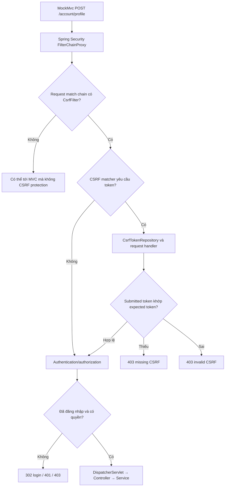

# csrf().useInvalidToken() cho ca dữ liệu token sai

> **Chương:** Kiểm thử Servlet  
> **Module:** `SPRING_SECURITY_HTTP_PROTECTION` — áp dụng các lớp phòng vệ HTTP và trình duyệt bằng Spring Security, từ CSRF, CORS, security headers, CSP, HSTS đến HTTP firewall và bảo vệ session. Người học cấu hình Servlet/Reactive, kiểm thử kịch bản tấn công web và chẩn đoán xung đột bảo mật khi triển khai.  
> **Trọng tâm:** Với Spring Security Test dành cho Servlet, `MockMvc.perform(post(...).with(csrf().useInvalidToken()))` mô phỏng **request có nộp CSRF token nhưng token không hợp lệ**. Khác với bỏ hẳn `csrf()` (request thiếu token), biến thể này nhằm chứng minh Spring Security không chỉ kiểm sự hiện diện của token mà còn **xác thực giá trị token**.

## 1. Mục tiêu học tập

Sau bài này, người học có thể:

1. Giải thích ý nghĩa của `SecurityMockMvcRequestPostProcessors.csrf().useInvalidToken()` trong `spring-security-test`.
2. Phân biệt **CSRF token thiếu**, **CSRF token sai** và **CSRF token hợp lệ**, với test cho cả ba trường hợp.
3. Sử dụng `csrf().useInvalidToken()` gửi token sai bằng **request parameter** và `csrf().asHeader().useInvalidToken()` gửi token sai qua **HTTP header**.
4. Biết vì sao token giả bất kỳ qua `.param("_csrf","abc")`/`.header("X-CSRF-TOKEN","abc")` không thay thế hoàn toàn helper khi cần test deterministic.
5. Kiểm một browser POST đã authenticated nhưng token sai phải bị CSRF filter chặn; verify controller/service không gây tác dụng phụ.
6. Có positive control `with(csrf())` hoặc `with(csrf().asHeader())` để chứng minh handler **được phép chạy** khi cùng user, payload và role hợp lệ.
7. Phân biệt 403 do `CsrfFilter` với 403 do thiếu role, CORS, method security hoặc business authorization.
8. Giải thích `permitAll()` không tự miễn CSRF; anonymous public POST vẫn có thể cần token.
9. Kiểm form login/logout với token sai, đặc biệt vì lỗi CSRF có thể che phép thử xác thực mật khẩu.
10. Nêu trách nhiệm của `CsrfTokenRepository`, `CsrfTokenRequestHandler`, masked/XOR và deferred tokens.
11. Viết integration test lấy token từ server/session A rồi gửi sai token hoặc gửi token vào session B mà **không chỉ dùng helper**.
12. Giải thích rủi ro CSRF của cookie/session và điều kiện để một API Bearer-only có CSRF policy khác.
13. Biết vì sao browser preflight OPTIONS không tương đương actual POST chứa CSRF header.
14. Chẩn đoán lỗi khi negative test có token sai lại trả 200/302/401/404 thay vì 403.
15. Nêu giới hạn MockMvc so với Servlet container, reverse proxy, browser cookies, CORS, CSP/HSTS và WebFlux.

## 2. Dòng code trung tâm: gửi một token sai thay vì thiếu token

Ví dụ:

```java
mvc.perform(post("/account/profile")
        .with(user("alice").roles("USER"))
        .param("displayName", "Alice")
        .with(csrf().useInvalidToken()))
    .andExpect(status().isForbidden());
```

Ý nghĩa từng thành phần:

- `post("/account/profile")` tạo một unsafe request thuộc CSRF protection của browser chain.
- `with(user("alice").roles("USER"))` giả lập principal đã xác thực; nó **không** tự tạo CSRF token.
- `param("displayName", "Alice")` cung cấp dữ liệu nghiệp vụ hợp lệ để tránh nhầm với lỗi binding.
- `with(csrf().useInvalidToken())` thêm **CSRF token sai** vào request test. Theo cách dùng mặc định, submitted token ở **request parameter** (thường `_csrf`).
- `status().isForbidden()` kỳ vọng 403 do CSRF filter theo cấu hình Servlet thông thường; muốn khẳng định nguồn từ chối, phải có valid counterpart và kiểm side effect.

So với request hoàn toàn thiếu token:

```java
mvc.perform(post("/account/profile")
        .with(user("alice").roles("USER"))
        .param("displayName", "Alice"))
    .andExpect(status().isForbidden());
```

Cùng status 403, nhưng **nguyên nhân test muốn mô phỏng khác nhau**: một request không nộp token; request kia nộp token không khớp expected token. Server phải từ chối cả hai.

Đối chứng token hợp lệ:

```java
mvc.perform(post("/account/profile")
        .with(user("alice").roles("USER"))
        .param("displayName", "Alice")
        .with(csrf()))
    .andExpect(status().isNoContent());
```

Test thứ ba chứng minh handler có thể được xử lý khi CSRF hợp lệ, và giúp tách trường hợp “controller luôn 403” khỏi việc CSRF validation thực sự từ chối token sai.

### 2.1. Bảng tóm tắt

| MockMvc setup | Token đã nộp? | Hợp lệ? | Kết quả dự kiến trong browser chain |
|---|---|---|---|
| Không gọi `csrf()` | Không | Không áp dụng | Thường 403 (missing token) |
| `with(csrf().useInvalidToken())` | Có | Không | Thường 403 (invalid token) |
| `with(csrf().asHeader().useInvalidToken())` | Có, qua header | Không | Thường 403 |
| `with(csrf())` | Có, qua parameter | Có | CSRF pass; quyền/handler quyết định |
| `with(csrf().asHeader())` | Có, qua header | Có | CSRF pass; quyền/handler quyết định |
| `.param("_csrf","abc")` tùy tiện | Có | Không chắc | Chỉ được chấp nhận nếu khớp expected token và handler |

**Đừng kết luận:** “Có 403 nên `CsrfFilter` chắc chắn hoạt động”. Trường hợp user thiếu role, API nhầm chain, CORS hay controller riêng cũng có thể trả 403.

## 3. Bối cảnh tấn công: token sai phải bị từ chối vì sao?

Một ứng dụng web dùng session cookie có thể bị trang ngoài kích hoạt yêu cầu thay đổi trạng thái. Browser tự gửi cookies phù hợp với SameSite/site rules, trong khi attacker thường không thể đọc một CSRF token hợp lệ gắn với phiên từ origin của ứng dụng.

Trong threat model đó, token cần có ba đặc tính:

1. **Không chỉ tồn tại về hình thức**: client phải nộp token đúng repository/handler.
2. **Không dễ đoán hay lấy từ origin không tin cậy**: token phát/sử dụng theo session/cookie/site context và được bảo vệ khỏi leak.
3. **Bị từ chối khi sai hoặc stale**: một submitted token bất kỳ, token đã rotate hoặc token từ ngữ cảnh khác không được thay expected token.

Một implementation sai như “`_csrf` parameter có mặt là cho qua” sẽ có lỗ hổng; negative test `csrf().useInvalidToken()` được thiết kế để giúp phát hiện dạng nới lỏng này trong phạm vi CSRF filter behavior của application test.

### 3.1. CSRF không phải authentication

CSRF token **không cấp danh tính**, không chứng minh người dùng có quyền sửa dữ liệu. Một token sai phải bị từ chối ngay cả khi principal `alice` đã authenticated; một token hợp lệ không giúp anonymous trở thành authenticated.

### 3.2. CORS và SameSite cũng không thay phép thử token sai

CORS giới hạn khả năng JavaScript cross-origin đọc response và sử dụng một số cross-origin request patterns, không thay token validation. SameSite cookies giảm một số kịch bản nhưng không loại bỏ mọi trường hợp request forgery, nhất là khi ứng dụng có nhiều subdomains, browser/site behavior và credential paths.

## 4. Luồng xử lý Servlet: ba điểm từ chối phải phân biệt



`FilterChainProxy` chọn security chain khớp request; `CsrfFilter` xét request matcher và token. Khi token sai, nó thường ném `InvalidCsrfTokenException` đi qua access-denied handling; khi thiếu, có thể là `MissingCsrfTokenException`. Detail code/status tùy Spring Security version và custom handlers.

**Quan trọng:** Một `403` cũng có thể do `AuthorizationFilter`/method security; muốn test role rule, phải cấp valid CSRF trước. Muốn test invalid CSRF, dùng principal có đủ role và input hợp lệ để không có failure khác che kết quả.

### 4.1. Safe vs unsafe HTTP methods

Theo CSRF matcher mặc định phổ biến trong Servlet, `GET`, `HEAD`, `OPTIONS` và `TRACE` được xem là safe methods; `POST`, `PUT`, `PATCH`, `DELETE` thường cần CSRF token khi chain bật CSRF.

Nếu gắn `with(csrf().useInvalidToken())` vào GET, filter **có thể không kiểm token** vì GET không thuộc diện bắt buộc; test vẫn 200. Đó không phải bằng chứng CSRF filter không phát hiện token sai, mà là method không được yêu cầu token theo matcher.

**Không dùng GET để thay đổi trạng thái** chỉ vì CSRF mặc định bỏ qua GET.

## 5. Các biến thể Spring Security Test cần thuộc

Test API Servlet:

```java
import static org.springframework.security.test.web.servlet.request.SecurityMockMvcRequestPostProcessors.csrf;
```

Các dạng:

```java
// Request không nộp token qua helper.
mvc.perform(post("/account/profile"));

// Token đúng qua request parameter:
mvc.perform(post("/account/profile")
        .with(csrf()));

// Token sai qua request parameter:
mvc.perform(post("/account/profile")
        .with(csrf().useInvalidToken()));

// Token đúng qua HTTP header:
mvc.perform(post("/account/profile")
        .with(csrf().asHeader()));

// Token sai qua HTTP header:
mvc.perform(post("/account/profile")
        .with(csrf().asHeader().useInvalidToken()));
```

`csrf()` trả về một `RequestPostProcessor` dành cho MockMvc. Cả `asHeader()` và `useInvalidToken()` là các tùy chọn xây dựng request test; chúng **không sửa cấu hình bảo vệ production**.

### 5.1. Parameter và header là hai đường đưa submitted token

Với cấu hình thông dụng:

- `HttpSessionCsrfTokenRepository`: parameter `_csrf`; HTTP header `X-CSRF-TOKEN`.
- `CookieCsrfTokenRepository`: cookie `XSRF-TOKEN`; HTTP header `X-XSRF-TOKEN`.

Tên và cách resolve có thể được custom; đừng hardcode khi app dùng repository/request handler khác. `useInvalidToken()` có thể kết hợp với `asHeader()` để test đường mà frontend thực sự dùng.

### 5.2. Invalid không đồng nghĩa token hoàn toàn vắng mặt

`.with(csrf().useInvalidToken())` chủ đích nộp **một giá trị không hợp lệ** theo test abstraction. Không coi nó là cách duy nhất để kiểm `MissingCsrfTokenException`; muốn test missing thì **không thêm token**.

Để kiểm HTTP response mapper phân biệt “token missing” và “token invalid” trong custom app, có thể cần kiểm chính exception qua filter-level tests/logs/mapped error codes. Một status 403 cho cả hai không chứng minh mapper phân biệt thành công.

### 5.3. Helper không gửi credential thật

`csrf().useInvalidToken()` không kiểm password, session login hoặc JWT signature. Dùng `@WithMockUser`/`with(user())` để đặt authenticated principal trong security context test, hoặc gửi login/Bearer thật trong một integration test khác.

## 6. Thiết lập dependencies cho Servlet MockMvc

Ví dụ Gradle Kotlin DSL:

```kotlin
dependencies {
    implementation("org.springframework.boot:spring-boot-starter-web")
    implementation("org.springframework.boot:spring-boot-starter-security")

    testImplementation("org.springframework.boot:spring-boot-starter-test")
    testImplementation("org.springframework.security:spring-security-test")
}

tasks.test {
    useJUnitPlatform()
}
```

Gradle Groovy DSL:

```groovy
dependencies {
    implementation 'org.springframework.boot:spring-boot-starter-web'
    implementation 'org.springframework.boot:spring-boot-starter-security'

    testImplementation 'org.springframework.boot:spring-boot-starter-test'
    testImplementation 'org.springframework.security:spring-security-test'
}

test {
    useJUnitPlatform()
}
```

Maven trong project đã có Spring Boot dependency management:

```xml
<dependency>
    <groupId>org.springframework.security</groupId>
    <artifactId>spring-security-test</artifactId>
    <scope>test</scope>
</dependency>
```

Dùng `spring-security-test` cùng version family với runtime `spring-security-web/config`. API trong các ví dụ phù hợp Spring Security 6+/Spring Boot 3+ quen thuộc; khi nâng version, kiểm package/deprecations và test support tương ứng. Cần JUnit Jupiter và Spring MVC Test trên classpath.

**Dependency chỉ cung cấp helpers, không tự gắn Servlet security filters vào mọi MockMvc builder.**

## 7. Gắn security filter chain vào MockMvc trước khi kiểm token sai

Spring Boot integration test điển hình:

```java
@SpringBootTest
@AutoConfigureMockMvc
class CsrfInvalidTokenTest {

    @Autowired
    MockMvc mvc;
}
```

Trong các version Boot hỗ trợ annotation này, `@AutoConfigureMockMvc` thường thêm Servlet filters từ application context (`addFilters=true` mặc định). Nhưng vẫn phải bảo đảm security config thực tế được load và URL khớp đúng chain có CSRF bật.

Khi tự build:

```java
@SpringBootTest
class ExplicitFilterMockMvcTest {

    @Autowired
    WebApplicationContext context;

    MockMvc mvc;

    @BeforeEach
    void setup() {
        mvc = MockMvcBuilders
            .webAppContextSetup(context)
            .apply(springSecurity())
            .build();
    }
}
```

Các imports:

```java
import org.junit.jupiter.api.BeforeEach;
import org.springframework.beans.factory.annotation.Autowired;
import org.springframework.boot.test.context.SpringBootTest;
import org.springframework.boot.test.autoconfigure.web.servlet.AutoConfigureMockMvc;
import org.springframework.test.web.servlet.MockMvc;
import org.springframework.test.web.servlet.setup.MockMvcBuilders;
import org.springframework.web.context.WebApplicationContext;
import static org.springframework.security.test.web.servlet.setup.SecurityMockMvcConfigurers.springSecurity;
```

### 7.1. Những kiểu test đánh lừa người học

```java
// Cố tình không thêm filters vào Boot MockMvc:
@AutoConfigureMockMvc(addFilters = false)
```

```java
// Chỉ dựng controller, không tự lấy FilterChainProxy:
MockMvc mvc = MockMvcBuilders
    .standaloneSetup(controller)
    .build();
```

Nếu security filters không chạy, submitted token sai có thể hoàn toàn không được xét: controller trả 204/200 theo logic riêng. **Đừng chữa test bằng cách bỏ `useInvalidToken()` rồi kết luận app an toàn.**

### 7.2. Test canary khi filter thực sự chạy

Tạo một private POST với principal đủ quyền, payload hợp lệ:

- `without csrf` → 403.
- `with csrf().useInvalidToken()` → 403.
- `with csrf()` → 204.

Cùng URL/handler/identity, ba phép thử này giúp quan sát CSRF validation. Muốn chứng minh chính filter được gọi, kiểm filter setup/chain selection, logs và business side effects bên cạnh statuses.

### 7.3. `@WebMvcTest` cần security config đúng

Một MVC slice có thể load security defaults khác production nếu không import custom `SecurityFilterChain`/`CsrfTokenRepository`. Nếu test invalid CSRF 403 nhưng production tắt CSRF cho endpoint, slice có thể cho kết luận sai. Import chính policy đang kiểm hoặc dùng `@SpringBootTest`. MockMvc standalone chỉ thích hợp khi mục tiêu là unit test controller, trừ khi chủ động tích hợp filters đúng.

## 8. Cấu hình Servlet SecurityFilterChain cho fixture

Ta dùng một browser chain có form login, session và CSRF bật:

```java
package example.security;

import org.springframework.context.annotation.Bean;
import org.springframework.context.annotation.Configuration;
import org.springframework.http.HttpMethod;
import org.springframework.security.config.Customizer;
import org.springframework.security.config.annotation.web.builders.HttpSecurity;
import org.springframework.security.config.annotation.web.configuration.EnableWebSecurity;
import org.springframework.security.web.SecurityFilterChain;

@Configuration
@EnableWebSecurity
public class BrowserCsrfSecurityConfig {

    @Bean
    SecurityFilterChain browser(HttpSecurity http) throws Exception {
        return http
            .authorizeHttpRequests(auth -> auth
                .requestMatchers(HttpMethod.GET,
                    "/login", "/csrf", "/public/**")
                    .permitAll()
                .requestMatchers(HttpMethod.POST,
                    "/public/feedback").permitAll()
                .requestMatchers("/admin/**").hasRole("ADMIN")
                .anyRequest().authenticated())
            .csrf(Customizer.withDefaults())
            .formLogin(Customizer.withDefaults())
            .headers(headers -> headers
                .contentSecurityPolicy(csp -> csp.policyDirectives(
                    "default-src 'self'; object-src 'none'; " +
                    "base-uri 'self'; frame-ancestors 'none'")))
            .build();
    }
}
```

Fixture được thiết kế để có các case:

| URL | Rule authorization | Với POST, CSRF? |
|---|---|---|
| `GET /account` | Authenticated | Không đòi token theo default matcher |
| `POST /account/profile` | Authenticated | Có |
| `POST /public/feedback` | `permitAll` | Có |
| `POST /admin/settings` | `ROLE_ADMIN` | Có |
| `POST /login` | Form login processing | Có |
| `POST /logout` | Logout | Có |
| `GET /csrf` | Public endpoint phát token | Không đòi submitted token |

### 8.1. Chú ý `permitAll()` và CSRF khác lớp

`requestMatchers(...).permitAll()` chỉ áp dụng HTTP authorization. `CsrfFilter` vẫn có thể từ chối POST anonymous tới public URL nếu thiếu/sai token. Nếu frontend công khai có form POST, cần phát token cho anonymous form theo policy phù hợp.

### 8.2. Security headers không thay token validity

`Content-Security-Policy`, `X-Content-Type-Options`, `Strict-Transport-Security`, session cookie flags và HTTP firewall bổ trợ phòng vệ browser/HTTP. Một CSP tốt không biến invalid CSRF token thành valid; HSTS cũng không thay CSRF validation.

## 9. Controller fixture có tác dụng phụ để đo kiểm

Định nghĩa domain service interface, để test kiểm bị từ chối trước khi mutation xảy ra:

```java
package example.web;

public interface ChangeRecorder {
    void profileUpdated(String displayName);
    void adminSettingsUpdated(String theme);
    void feedbackSaved(String message);
}
```

Controller:

```java
package example.web;

import java.util.Map;
import org.springframework.http.ResponseEntity;
import org.springframework.security.web.csrf.CsrfToken;
import org.springframework.web.bind.annotation.*;

@RestController
class BrowserController {

    private final ChangeRecorder recorder;

    BrowserController(ChangeRecorder recorder) {
        this.recorder = recorder;
    }

    @GetMapping("/account")
    ResponseEntity<String> account() {
        return ResponseEntity.ok("account");
    }

    @PostMapping("/account/profile")
    ResponseEntity<Void> update(
            @RequestParam String displayName) {
        recorder.profileUpdated(displayName);
        return ResponseEntity.noContent().build();
    }

    @PostMapping("/public/feedback")
    ResponseEntity<Void> feedback(
            @RequestParam String message) {
        recorder.feedbackSaved(message);
        return ResponseEntity.noContent().build();
    }

    @PostMapping("/admin/settings")
    ResponseEntity<Void> admin(
            @RequestParam String theme) {
        recorder.adminSettingsUpdated(theme);
        return ResponseEntity.noContent().build();
    }

    @GetMapping("/csrf")
    Map<String, String> csrf(
            @RequestAttribute("_csrf") CsrfToken csrfToken) {
        return Map.of(
            "parameterName", csrfToken.getParameterName(),
            "headerName", csrfToken.getHeaderName(),
            "token", csrfToken.getToken());
    }
}
```

App/test phải cung cấp một bean `ChangeRecorder`; có thể dùng test implementation hoặc Mockito mock trong test context phù hợp với Spring Boot version (`@MockBean` ở version cũ, `@MockitoBean` ở version mới). Các positive examples kỳ vọng 204 **chỉ khi controller và recorder hiện diện**.

### 9.1. Vì sao cần payload hợp lệ?

`update(@RequestParam String displayName)` thiếu parameter thì MVC có thể trả 400 khi CSRF đã pass. Nếu test invalid CSRF có payload thiếu, cả invalid và valid requests có thể cho statuses khác vì validation; phải giữ `.param("displayName","Alice")` trong mọi case của cặp đối chứng.

### 9.2. Khi bị CSRF filter chặn, controller không được chạy

Một 403 đúng phải **không gọi** `recorder.profileUpdated(...)`. Nếu Mockito mock đã được inject vào controller, có thể verify không có interactions sau negative case và có interaction sau valid positive case. Reset mock history giữa tests.

## 10. Ba test đầu tiên: missing, invalid, valid

```java
@SpringBootTest
@AutoConfigureMockMvc
class InvalidCsrfTripletTest {

    @Autowired
    MockMvc mvc;

    @Test
    void missingTokenIsForbidden() throws Exception {
        mvc.perform(post("/account/profile")
                .with(user("alice").roles("USER"))
                .param("displayName", "Alice"))
            .andExpect(status().isForbidden());
    }

    @Test
    void invalidTokenIsForbidden() throws Exception {
        mvc.perform(post("/account/profile")
                .with(user("alice").roles("USER"))
                .param("displayName", "Alice")
                .with(csrf().useInvalidToken()))
            .andExpect(status().isForbidden());
    }

    @Test
    void validTokenCanReachController() throws Exception {
        mvc.perform(post("/account/profile")
                .with(user("alice").roles("USER"))
                .param("displayName", "Alice")
                .with(csrf()))
            .andExpect(status().isNoContent());
    }
}
```

Imports:

```java
import org.junit.jupiter.api.Test;
import org.springframework.beans.factory.annotation.Autowired;
import org.springframework.boot.test.context.SpringBootTest;
import org.springframework.boot.test.autoconfigure.web.servlet.AutoConfigureMockMvc;
import org.springframework.test.web.servlet.MockMvc;

import static org.springframework.security.test.web.servlet.request.SecurityMockMvcRequestPostProcessors.*;
import static org.springframework.test.web.servlet.request.MockMvcRequestBuilders.*;
import static org.springframework.test.web.servlet.result.MockMvcResultMatchers.*;
```

### 10.1. Vì sao negative invalid test cần positive control?

Nếu endpoint luôn trả 403 vì role mismatch hoặc controller tự chặn, cả invalid và valid có thể 403, khiến test invalid “pass” nhưng không chứng minh CSRF. Positive `with(csrf())` phải vào controller/204 với cùng user/path/input, nhờ đó token validity mới là biến khác biệt rõ ràng.

### 10.2. Kịch bản quan trọng: token sai không gây mutation

Nếu controller gọi recorder, một test có thể thêm:

```java
mvc.perform(post("/account/profile")
        .with(user("alice").roles("USER"))
        .param("displayName", "Alice")
        .with(csrf().useInvalidToken()))
    .andExpect(status().isForbidden());

verify(recorder, never()).profileUpdated(anyString());
```

Chỉ có ý nghĩa nếu `recorder` là mock bean **được inject thật**, không có interaction từ các tests khác và positive case chắc chắn gọi recorder. Đừng để một mock không liên quan luôn “never called” tạo cảm giác an toàn giả.
## 11. Token sai trong request parameter và token sai qua HTTP header

`csrf().useInvalidToken()` mặc định gửi submitted token sai dưới dạng **request parameter**. Khi frontend dùng AJAX/JSON gửi CSRF token bằng header, hãy kiểm biến thể `csrf().asHeader().useInvalidToken()`.

### 11.1. Parameter không hợp lệ

```java
@Test
void invalidParameterTokenMustBeRejected()
        throws Exception {
    mvc.perform(post("/account/profile")
            .with(user("alice").roles("USER"))
            .param("displayName", "Alice")
            .with(csrf().useInvalidToken()))
        .andExpect(status().isForbidden());
}
```

Một default `CsrfTokenRepository` thường dùng parameter `_csrf`, nhưng tên có thể được custom. Test helper lấy metadata phù hợp với test integration; trong test phát token thật cần đọc `CsrfToken.getParameterName()` từ server.

### 11.2. Header không hợp lệ

```java
@Test
void invalidHeaderTokenMustBeRejected()
        throws Exception {
    mvc.perform(post("/account/profile")
            .with(user("alice").roles("USER"))
            .param("displayName", "Alice")
            .with(csrf().asHeader().useInvalidToken()))
        .andExpect(status().isForbidden());
}
```

Ở cấu hình session repository thông dụng, header name thường là `X-CSRF-TOKEN`; với cookie repository thường là `X-XSRF-TOKEN`. Đừng nhầm hai tên. Tên HTTP header không phân biệt chữ hoa, nhưng `X-CSRF-TOKEN` và `X-XSRF-TOKEN` là **hai header khác nhau**.

### 11.3. Positive header đối chứng

```java
@Test
void validHeaderTokenAllowsRequestToProceed()
        throws Exception {
    mvc.perform(post("/account/profile")
            .with(user("alice").roles("USER"))
            .param("displayName", "Alice")
            .with(csrf().asHeader()))
        .andExpect(status().isNoContent());
}
```

Test header invalid mà không có header valid counterpart có thể bị nhiễu bởi một `CsrfTokenRequestHandler` custom không hỗ trợ header nào cả. Hai test cùng dùng `asHeader()` nhưng chỉ khác invalid/valid sẽ tăng độ tin cậy.

### 11.4. Ma trận vị trí token

| Submitted value | Vị trí | Test API | Kết quả theo fixture |
|---|---|---|---|
| Không có | Không có | Bỏ CSRF helper | 403 |
| Sai | Parameter | `csrf().useInvalidToken()` | 403 |
| Đúng | Parameter | `csrf()` | 204 |
| Sai | Header | `csrf().asHeader().useInvalidToken()` | 403 |
| Đúng | Header | `csrf().asHeader()` | 204 |

Đây là chính sách browser chain mẫu có principal và payload hợp lệ; API dùng một chain CSRF-disabled có thể không áp dụng ma trận này. Đừng tái sử dụng một test fixture thuộc chain API rồi suy toàn bộ browser CSRF đang hoạt động.

## 12. Vì sao tự gắn `_csrf=abc` hoặc `X-CSRF-TOKEN: abc` chưa đủ?

Ví dụ:

```java
// Token literal không có expected value tương ứng:
mvc.perform(post("/account/profile")
        .with(user("alice").roles("USER"))
        .param("displayName", "Alice")
        .param("_csrf", "abc"))
    .andExpect(status().isForbidden());
```

Nếu không có expected token hợp lệ khớp trong repository, một literal không tùy ý biến thành token đúng. Tương tự:

```java
mvc.perform(post("/account/profile")
        .with(user("alice").roles("USER"))
        .param("displayName", "Alice")
        .header("X-CSRF-TOKEN", "abc"))
    .andExpect(status().isForbidden());
```

**Khác nhau về mục tiêu:**

- `csrf().useInvalidToken()`: dùng API kiểm thử của Spring Security để chủ đích tạo submitted token sai, tránh phụ thuộc vào một string cố định.
- `.param(...)`/`.header(...)` tự đặt: kiểm wire protocol của client hoặc một token thực đã được server phát. Muốn chắc chắn “sai”, phải biết expected token/session/cookie đang dùng.
- GET token thực → sửa một byte/đổi token → POST: kiểm token issuance/rotation và request handler tích hợp trong luồng client.

### 12.1. Không viết logic kiểm CSRF giả trong controller

Không tự làm:

```java
// Sai về mô hình phòng vệ nếu chỉ kiểm sự hiện diện:
if (request.getParameter("_csrf") != null) {
    recorder.profileUpdated("Alice");
}
```

Spring Security CSRF filter kiểm submitted value với expected value qua repository/handler, không phải một controller business tự xem “parameter có mặt”. Test invalid cần thất bại khi code cố ý nới policy chỉ kiểm sự hiện diện; negative control còn phải xác minh controller không được gọi.

### 12.2. Khi test header mà gửi cả parameter valid và header invalid

Một request thực có thể gửi cả CSRF parameter lẫn header. Tùy `CsrfTokenRequestHandler`, header có thể được ưu tiên khi có mặt. Để kiểm **invalid header**, không vô tình gắn thêm `with(csrf())` (valid parameter) trong cùng request vì có thể che nguyên nhân hoặc làm kết quả phụ thuộc precedence.

Tốt nhất kiểm riêng:

- Invalid parameter, **không** có CSRF header.
- Invalid header, **không** có CSRF parameter.
- Valid parameter hoặc valid header để đối chứng.

Nếu ứng dụng cố ý nhận đồng thời cả hai, phải định nghĩa precedence/security policy và viết test riêng cho conflict cases.

## 13. Không đưa invalid token lên một GET rồi kết luận CSRF sai

Ví dụ này không phải negative test hiệu quả theo default matcher:

```java
mvc.perform(get("/account")
        .with(user("alice").roles("USER"))
        .with(csrf().useInvalidToken()))
    .andExpect(status().isOk());
```

Một GET an toàn thường **không cần CSRF validation**. Nó có thể vẫn trả 200 khi gửi token sai, bởi Spring Security mặc định không coi GET là unsafe. Tương tự HEAD/OPTIONS/TRACE theo matcher mặc định.

Nếu ứng dụng có custom matcher yêu cầu token cho những method khác, outcome phải theo matcher đó. Không nên biến một GET làm thay đổi trạng thái thành “an toàn” chỉ vì không bị CsrfFilter chặn.

### 13.1. Kiểm đủ POST/PUT/PATCH/DELETE

Một bộ hồi quy nên bao phủ các method thực sự thay đổi dữ liệu:

```java
@Test
void patchWithInvalidTokenIsForbidden()
        throws Exception {
    mvc.perform(patch("/account/profile")
            .with(user("alice").roles("USER"))
            .contentType(MediaType.APPLICATION_JSON)
            .content("{\"displayName\":\"New\"}")
            .with(csrf().useInvalidToken()))
        .andExpect(status().isForbidden());
}

@Test
void deleteWithInvalidTokenIsForbidden()
        throws Exception {
    mvc.perform(delete("/account/sessions/old")
            .with(user("alice").roles("USER"))
            .with(csrf().asHeader().useInvalidToken()))
        .andExpect(status().isForbidden());
}
```

Cần endpoints/handlers phù hợp cho positive counterparts; ở đây invalid token thường bị chặn trước MVC mapping, nên dù route không tồn tại vẫn có thể nhận 403. **Nếu không có positive case với valid token vào đúng handler**, không thể khẳng định bộ test đã kiểm bảo vệ cho thao tác thực.

### 13.2. Custom CSRF matcher chỉ kiểm POST là nguy hiểm khi có PUT/PATCH/DELETE

Ví dụ anti-pattern:

```java
// KHÔNG copy nguyên vào production nếu PUT/PATCH/DELETE
// cũng có mutation: matcher này chỉ kiểm POST.
http.csrf(csrf -> csrf.requireCsrfProtectionMatcher(
    request -> "POST".equals(request.getMethod())));
```

Nếu ứng dụng có DELETE/PUT/PATCH nhưng matcher chỉ kiểm POST, các request ấy có thể đổi dữ liệu mà không cần token. Test invalid token trên từng unsafe method có thể phát hiện vùng bị bỏ sót; nên thiết kế policy theo method semantics và các ngoại lệ có threat model.

## 14. `permitAll()` không loại yêu cầu CSRF token hợp lệ

Ở browser config mẫu:

```java
.requestMatchers(HttpMethod.POST, "/public/feedback")
    .permitAll()
```

Dù anonymous được phép về authorization, unsafe POST vẫn phải có token:

```java
@Test
void publicPostWithInvalidCsrfIsForbidden()
        throws Exception {
    mvc.perform(post("/public/feedback")
            .param("message", "Hello")
            .with(csrf().useInvalidToken()))
        .andExpect(status().isForbidden());
}

@Test
void publicPostWithValidCsrfIsAllowed()
        throws Exception {
    mvc.perform(post("/public/feedback")
            .param("message", "Hello")
            .with(csrf()))
        .andExpect(status().isNoContent());
}
```

Cặp test này mạnh vì **không có Authentication được inject**. Token sai vẫn bị từ chối, token đúng được cho qua authorization `permitAll()`. Nó chứng minh CSRF condition độc lập với việc user đã login hay chưa.

### 14.1. Có cần phát token cho anonymous public form?

Có, nếu public form POST thuộc CSRF protection. Server có thể render token vào hidden field của form hoặc cấp qua endpoint/response phù hợp. Nếu không có cơ chế anonymous lấy token hợp lệ, form public sẽ không thể submit; đó là vấn đề thiết kế client-server, không phải lý do tự động tắt CSRF.

### 14.2. Webhook không dùng browser credential là một threat model riêng

Một webhook machine-to-machine chỉ xác thực bằng HMAC signature, timestamp, anti-replay và không nhận browser auto-credentials có thể không cần browser CSRF token. Thiết kế CSRF exception/chain giới hạn đúng webhook matcher, không bỏ CSRF toàn browser chỉ vì webhook POST 403.

## 15. CSRF 403 khác Authorization 403 dù cùng status

Với `POST /admin/settings`, controller đòi ADMIN; CSRF filter kiểm token trước authorization:

| Principal | CSRF token | Expected status | Tầng từ chối |
|---|---|---|---|
| Anonymous | Thiếu | 403 theo browser fixture | CSRF |
| Anonymous | Hợp lệ | 302 login | Authentication |
| USER | Sai | 403 | CSRF |
| USER | Hợp lệ | 403 | Role |
| ADMIN | Sai | 403 | CSRF |
| ADMIN | Hợp lệ | 204 | Handler |

Hai test đều 403 nhưng mục tiêu khác:

```java
@Test
void adminWithInvalidTokenIsDeniedByCsrf()
        throws Exception {
    mvc.perform(post("/admin/settings")
            .param("theme", "dark")
            .with(user("root").roles("ADMIN"))
            .with(csrf().useInvalidToken()))
        .andExpect(status().isForbidden());
}

@Test
void userWithValidTokenIsDeniedByRole()
        throws Exception {
    mvc.perform(post("/admin/settings")
            .param("theme", "dark")
            .with(user("alice").roles("USER"))
            .with(csrf()))
        .andExpect(status().isForbidden());
}
```

Positive control:

```java
@Test
void adminWithValidTokenCanReachHandler()
        throws Exception {
    mvc.perform(post("/admin/settings")
            .param("theme", "dark")
            .with(user("root").roles("ADMIN"))
            .with(csrf()))
        .andExpect(status().isNoContent());
}
```

**Một lỗi phổ biến:** Nếu chỉ test USER + invalid CSRF nhận 403, test vẫn có thể pass khi rule `hasRole("ADMIN")` bị xóa, vì CSRF chặn từ trước. Để chứng minh role rule, **phải cấp valid CSRF**.

### 15.1. Đừng nhầm `roles` và `authorities`

`user("alice").roles("USER")` tạo `ROLE_USER` theo convention. Đối với OAuth2 Resource Server, authority scope thường là `SCOPE_orders.read`; roles và scopes không tự tương đương. Khi test CSRF trên browser role, chọn principal đúng loại và đủ role, để kết quả negative không bị authority mismatch che lấp.

## 16. Anonymous có invalid CSRF và anonymous có valid CSRF khác nhau

Test anonymous + invalid token:

```java
@Test
void anonymousInvalidTokenIsStillRejected()
        throws Exception {
    mvc.perform(post("/account/profile")
            .param("displayName", "Alice")
            .with(anonymous())
            .with(csrf().useInvalidToken()))
        .andExpect(status().isForbidden());
}
```

Với browser chain mẫu, CSRF filter có thể trả 403 **trước authentication entry point**. Nếu test anonymous có token hợp lệ:

```java
@Test
void anonymousValidTokenMustStillLogIn()
        throws Exception {
    mvc.perform(post("/account/profile")
            .param("displayName", "Alice")
            .with(anonymous())
            .with(csrf()))
        .andExpect(status().is3xxRedirection());
}
```

Đó là hai failure paths độc lập. CSRF-valid không làm anonymous authenticated; token invalid có thể bị chặn trước khi login redirect.

Một số custom handlers hoặc API entry points có thể trả 401/403 khác, nên phải kiểm chính security configuration/expected response owner chứ không chép nguyên status từ một project không tương thích.

## 17. JSON/AJAX: invalid header token thực tế hơn invalid parameter

Một SPA thường gửi JSON body và CSRF token qua header:

```http
POST /account/json-profile HTTP/1.1
Cookie: JSESSIONID=...
Content-Type: application/json
X-CSRF-TOKEN: <server-issued-token>

{"displayName":"Alice"}
```

Tạo JSON controller fixture:

```java
record ProfileUpdate(String displayName) {}

@PostMapping("/account/json-profile")
ResponseEntity<Void> updateJson(
        @RequestBody ProfileUpdate input) {
    recorder.profileUpdated(input.displayName());
    return ResponseEntity.noContent().build();
}
```

Invalid-header test:

```java
@Test
void ajaxJsonPostWithWrongCsrfHeaderIsForbidden()
        throws Exception {
    mvc.perform(post("/account/json-profile")
            .with(user("alice").roles("USER"))
            .contentType(MediaType.APPLICATION_JSON)
            .content("{\"displayName\":\"Alice\"}")
            .with(csrf().asHeader().useInvalidToken()))
        .andExpect(status().isForbidden());
}
```

Valid-header counterpart:

```java
@Test
void ajaxJsonPostWithValidCsrfHeaderReachesHandler()
        throws Exception {
    mvc.perform(post("/account/json-profile")
            .with(user("alice").roles("USER"))
            .contentType(MediaType.APPLICATION_JSON)
            .content("{\"displayName\":\"Alice\"}")
            .with(csrf().asHeader()))
        .andExpect(status().isNoContent());
}
```

`csrf().useInvalidToken()` qua parameter cũng có thể bị filter từ chối dù body là JSON, vì helper thêm request parameter độc lập với body. Nhưng nếu frontend **chỉ gửi header**, test theo header để phản ánh đúng đường đi thực tế. Đừng viết JSON `{"_csrf":"token"}` rồi mặc định `CsrfFilter` sẽ parse JSON field; custom handler sẽ cần thiết kế riêng.

### 17.1. Header name không phải luôn `X-CSRF-TOKEN`

Session repository thường dùng `X-CSRF-TOKEN`; cookie repository thường dùng `X-XSRF-TOKEN`. Một test helper `asHeader()` lấy metadata phù hợp, nhưng frontend cứng mã sai header name vẫn có thể bị 403 production. Thêm test wire contract với header name/value client thật nếu app dùng SPA.

## 18. Multipart, file upload và token sai

Một form upload cũng là unsafe request:

```java
@Test
void multipartUploadWithInvalidCsrfMustBeRejected()
        throws Exception {
    MockMultipartFile image = new MockMultipartFile(
        "file", "avatar.png", "image/png",
        new byte[] {1, 2, 3});

    mvc.perform(multipart("/account/avatar")
            .file(image)
            .with(user("alice").roles("USER"))
            .with(csrf().useInvalidToken()))
        .andExpect(status().isForbidden());
}
```

Nếu frontend gửi token trong header:

```java
mvc.perform(multipart("/account/avatar")
        .file(image)
        .with(user("alice").roles("USER"))
        .with(csrf().asHeader().useInvalidToken()))
    .andExpect(status().isForbidden());
```

Cần `@PostMapping("/account/avatar")`/`MultipartFile` handler và positive test với valid token. Invalid token có thể bị chặn trước MVC parsing/handler; MockMvc multipart đã dựng mock request nên không chứng minh resource allocation trong Servlet container thật.

**Rủi ro production:** Khi CSRF token nằm trong multipart body, parser có thể cần chạy trước CSRF filter để lấy parameter; file bytes/temp storage có thể được xử lý trước khi request bị CSRF từ chối. Header CSRF cho upload có thể đơn giản hơn, nhưng còn phụ thuộc browser/gateway/header policy. Bổ sung real HTTP upload test để kiểm filter order, parser limits và no-side-effect.

## 19. Form login: token sai chặn trước mật khẩu được kiểm

POST `/login` thường chịu CSRF khi form login browser chain bật CSRF. Một test:

```java
@Test
void loginWithCorrectPasswordButInvalidCsrfIsRejected()
        throws Exception {
    mvc.perform(post("/login")
            .param("username", "alice")
            .param("password", "correct-password")
            .with(csrf().useInvalidToken()))
        .andExpect(status().isForbidden());
}
```

Một 403 không chứng minh password sai; `CsrfFilter` có thể đã kết thúc request trước `UsernamePasswordAuthenticationFilter`. Muốn test password verification, phải cấp **valid CSRF**:

```java
@Test
void wrongPasswordWithValidCsrfReachesAuthFilter()
        throws Exception {
    mvc.perform(post("/login")
            .param("username", "alice")
            .param("password", "wrong-password")
            .with(csrf()))
        .andExpect(status().is3xxRedirection())
        .andExpect(redirectedUrlPattern("**/login?error"));
}
```

URL failure là form login default convention; app custom handler có thể trả status/URL khác. Cần test user store và PasswordEncoder phù hợp.

### 19.1. Token sai trên login không tạo authenticated session

Sau invalid login CSRF 403, đừng chỉ assert 403; xác minh không có authenticated session/security context được lưu, và private `GET /account` ở request sau vẫn cần login. Việc có một `MockHttpSession` object trong test không tự chứng minh principal đã authenticated.

### 19.2. Login đúng + valid CSRF cần đối chứng

```java
MvcResult login = mvc.perform(post("/login")
        .param("username", "alice")
        .param("password", "correct-password")
        .with(csrf()))
    .andExpect(status().is3xxRedirection())
    .andReturn();

MockHttpSession session =
    (MockHttpSession) login.getRequest().getSession(false);

assertNotNull(session);

mvc.perform(get("/account").session(session))
    .andExpect(status().isOk());
```

Login failure cũng có thể 302; dùng `Location`/session và private request tiếp theo để phân biệt success. Khi session fixation protection đổi session ID, lấy session sau login.

## 20. Logout: invalid token không được tùy tiện kết thúc phiên

Trong browser CSRF-enabled chain, logout qua POST thường cần token hợp lệ:

```java
@Test
void logoutWithInvalidCsrfIsRejected()
        throws Exception {
    mvc.perform(post("/logout")
            .with(user("alice").roles("USER"))
            .with(csrf().useInvalidToken()))
        .andExpect(status().isForbidden());
}
```

Test trên chứng minh CSRF validation có thể từ chối logout request, nhưng vì `with(user())` giả lập principal, nó **không** tự kiểm session login/logout thực. Muốn kiểm session invalidation, phải login thật, giữ session, POST logout có invalid token rồi xác minh session/rights vẫn theo policy; tiếp tục với valid CSRF để logout và kiểm request mới không còn authenticated.

```java
mvc.perform(post("/logout")
        .session(authenticatedSession)
        .with(csrf()))
    .andExpect(status().is3xxRedirection());
```

Test session phải tự tạo `authenticatedSession` từ real form login fixture, không coi đây là biến đã có. Nếu logout invalidated session, không tái sử dụng session object cũ cho request tiếp theo vô điều kiện.

### 20.1. Token lifecycle sau login/logout

Spring Security có thể dùng `CsrfAuthenticationStrategy` và `CsrfLogoutHandler` để xóa expected token khi authentication/logout. Với deferred/lazy loading, SPA có thể cần GET token mới sau login/logout. Một token cũ dùng lại và bị 403 là kịch bản **stale token**, khác với thiếu token.

Khi làm negative test về stale token, lấy token thật trước/ sau lifecycle events, không chỉ dùng `csrf().useInvalidToken()` rồi tuyên bố đã chứng minh rotation.
## 21. CSRF token repository và request handler: vì sao token “sai”?

Đối với Servlet Spring Security, CSRF protection thường gồm:

- `CsrfTokenRepository`: tạo, lưu và nạp expected token, ví dụ `HttpSessionCsrfTokenRepository` hoặc `CookieCsrfTokenRepository`.
- `CsrfTokenRequestHandler`: expose token vào request và resolve submitted token từ parameter/header, có thể xử lý XOR masking.
- `CsrfFilter`: dựa vào request matcher để quyết định method/path cần CSRF, đối chiếu submitted với expected token.
- Access-denied handling: quyết định HTTP status/body khi token thiếu/sai.

Token sai có thể đến từ nhiều tình huống:

| Tình huống | Expected token | Submitted token | Kết quả đúng về ý tưởng |
|---|---|---|---|
| Browser không gửi CSRF | Có/được tạo | Không có | Deny |
| Client gửi chuỗi ngẫu nhiên | Token phiên/cookie hiện hành | Không trùng | Deny |
| Client dùng token từ phiên khác | Token phiên B | Token phiên A | Deny |
| SPA gửi token cũ sau rotation | Token mới | Token cũ | Deny |
| Client gửi raw cookie token nhưng handler chỉ xử lý masked token | Raw expected cookie token | Raw header nhưng giải mã sai representation | Có thể deny đến khi contract được sửa |
| Client gửi sai tên header | Token đúng ở repository | Request handler không tìm thấy | Deny |
| Token/handler phù hợp | Token tương ứng | Submitted value được resolve đúng | CSRF pass; auth/role vẫn kiểm |

### 21.1. `HttpSessionCsrfTokenRepository`

Với browser form-login/session, repository thường lưu expected token trong HttpSession. Test GET phát token từ session A rồi POST trong session A với token đúng phải qua CSRF. Gửi token A nhưng dùng session B thường bị từ chối, vì expected token B không trùng.

**Đừng khẳng định test `csrf().useInvalidToken()` chứng minh session-bound isolation.** Nó chỉ mô phỏng submitted token sai ở test abstraction; để kiểm isolation thật cần hai sessions và token được phát bởi server.

### 21.2. `CookieCsrfTokenRepository`

Một SPA có thể được phát cookie `XSRF-TOKEN`, rồi JavaScript đọc cookie và gửi header `X-XSRF-TOKEN` nếu cookie không HttpOnly theo thiết kế. Expected token nằm trong cookie, không đơn giản ràng với `MockHttpSession`.

Vì thế test token “session A sang B” chỉ có ý nghĩa với session repository. Với cookie repo, phải tạo các trường hợp cookie/header không khớp và thử bỏ CSRF cookie trong request.

### 21.3. Không coi token có mặt là valid

Một test hiệu quả phải xác minh request nộp invalid value bị denied. Nếu custom CSRF protection chỉ kiểm parameter/header **tồn tại** rồi cho phép, đó là lỗi thiết kế; nhưng khi đang dùng Spring Security built-in `CsrfFilter`, đừng tự viết “CSRF check” trong controller thay framework.

## 22. Deferred token và XOR masking: token raw, masked và stale

Trong Spring Security hiện đại, CSRF token có thể **deferred/lazy**: GET không truy cập token thì chưa cần sinh/lưu token. `XorCsrfTokenRequestAttributeHandler` còn có thể expose **masked token** để giảm rủi ro BREACH trong HTML/form.

### 22.1. Vì sao token form có thể khác token trong repository?

Raw expected token ở session/cookie có thể được che (XOR masking) trước khi render HTML. Browser submit masked value; request handler unmask rồi mới so expected value. Vì vậy “raw token và submitted string khác nhau” không nhất thiết nghĩa token invalid. **Invalid** chỉ khi handler resolve submitted value mà không khớp expected token.

Đừng viết negative test “raw ≠ masked thì 403” nếu handler được thiết kế để nhận masked token; positive test phải nộp giá trị browser thực được phát.

### 22.2. Lazy token issuance

Một `GET /public/info` không dùng token có thể không tạo cookie/session token. Một `GET /csrf` gọi `csrfToken.getToken()` sẽ kích hoạt issuance theo deferred strategy. Test “mọi GET phải có XSRF cookie” không đúng trong mọi configuration.

### 22.3. SPA dùng raw cookie token qua header

Khi frontend đọc raw CSRF cookie rồi gửi `X-XSRF-TOKEN`, nhưng request handler default mong XOR-masked representation, POST có thể 403 dù cookie/header text giống nhau. Cần cấu hình request handler hỗ trợ raw header và masked form parameter nếu đó là contract của app.

Không tắt CSRF hoặc XOR protection toàn cục để chữa một integration test 403; phải xác định frontend/client gửi representation nào và Spring Security resolve nó ra sao.

### 22.4. Token sai sau login/logout có thể là behavior đúng

Authentication/logout có thể clear expected token. Client sử dụng token từ trước khi login để POST sau login sẽ bị từ chối; giải pháp client là lấy token mới theo policy. Negative test `csrf().useInvalidToken()` có thể mô phỏng một giá trị sai, nhưng **không chứng minh** token rotation đang được triển khai đúng.

## 23. Test end-to-end trong MockMvc: server-issued token đúng rồi cố ý làm sai

Có thể dùng endpoint GET phát token của controller mẫu, sau đó POST mà **không** dùng `with(csrf())` để chắc chắn giá trị submitted đến từ server.

### 23.1. GET token rồi POST đúng với cùng session

```java
@Test
void serverIssuedTokenWorksInSameSession()
        throws Exception {
    MockHttpSession session = new MockHttpSession();

    MvcResult issued = mvc.perform(get("/csrf")
            .session(session))
        .andExpect(status().isOk())
        .andReturn();

    String json = issued.getResponse()
        .getContentAsString();

    String parameterName =
        JsonPath.read(json, "$.parameterName");
    String submittedToken =
        JsonPath.read(json, "$.token");

    mvc.perform(post("/account/profile")
            .session(session)
            .with(user("alice").roles("USER"))
            .param("displayName", "Alice")
            .param(parameterName, submittedToken))
        .andExpect(status().isNoContent());
}
```

Imports:

```java
import com.jayway.jsonpath.JsonPath;
import org.springframework.mock.web.MockHttpSession;
import org.springframework.test.web.servlet.MvcResult;
import static org.springframework.security.test.web.servlet.request.SecurityMockMvcRequestPostProcessors.user;
```

Đây là một test **token issuance → submission**. `with(user())` vẫn mock authentication; test không kiểm password login thật.

### 23.2. Cố ý nộp giá trị khác server-issued token

Cùng session, test một invalid value:

```java
@Test
void modifiedServerIssuedTokenIsRejected()
        throws Exception {
    MockHttpSession session = new MockHttpSession();

    MvcResult issued = mvc.perform(get("/csrf")
            .session(session))
        .andExpect(status().isOk())
        .andReturn();

    String json = issued.getResponse()
        .getContentAsString();

    String parameterName =
        JsonPath.read(json, "$.parameterName");
    String validToken =
        JsonPath.read(json, "$.token");

    // Thêm ký tự khiến submitted value chắc chắn
    // khác chuỗi được server phát; không log token.
    String wrongValue = validToken + "x";

    mvc.perform(post("/account/profile")
            .session(session)
            .with(user("alice").roles("USER"))
            .param("displayName", "Alice")
            .param(parameterName, wrongValue))
        .andExpect(status().isForbidden());
}
```

Nếu handler dùng XOR masking, thêm ký tự có thể làm masked value không decode được hoặc decode khác expected; cả hai đều phải bị từ chối. Tránh log secret trong assertion failure/CI artifacts.

**Đây khác `csrf().useInvalidToken()`**: token sai được tạo từ một token thật đã được phát. Nhờ vậy test kiểm luôn đường token issuance, session persistence và request handler.

### 23.3. Token từ session A gửi trong session B

Với `HttpSessionCsrfTokenRepository`:

```java
@Test
void tokenFromAnotherSessionIsRejected() throws Exception {
    MockHttpSession firstSession = new MockHttpSession();
    MockHttpSession secondSession = new MockHttpSession();

    MvcResult first = mvc.perform(get("/csrf")
            .session(firstSession))
        .andExpect(status().isOk())
        .andReturn();

    String json = first.getResponse().getContentAsString();
    String parameterName =
        JsonPath.read(json, "$.parameterName");
    String tokenFromFirst =
        JsonPath.read(json, "$.token");

    mvc.perform(post("/account/profile")
            .session(secondSession)
            .with(user("alice").roles("USER"))
            .param("displayName", "Alice")
            .param(parameterName, tokenFromFirst))
        .andExpect(status().isForbidden());
}
```

Kỳ vọng chỉ phù hợp khi expected token gắn với session; cookie/custom repo cần kịch bản khác. Đừng dùng cùng một global mutable token/session cho mọi test rồi vô tình cho token khác session vẫn khớp.

### 23.4. Kiểm issued token qua HTTP header

Nếu client dùng header, lấy `headerName` và `token` từ GET rồi POST:

```java
String headerName =
    JsonPath.read(json, "$.headerName");

mvc.perform(post("/account/profile")
        .session(session)
        .with(user("alice").roles("USER"))
        .param("displayName", "Alice")
        .header(headerName, submittedToken))
    .andExpect(status().isNoContent());
```

Đây là đoạn tiếp nối logic khi `json`, `session` và `submittedToken` đã có trong test GET cùng session. Với một handler custom nhận raw header nhưng GET trả masked token, flow có thể khác; phải test representation **đúng với frontend**.

## 24. Test CSRF cookie raw header: mismatch phải bị chặn

Với `CookieCsrfTokenRepository` và request handler SPA hỗ trợ raw-header token, một luồng thực có thể là:

1. GET endpoint/form sinh cookie `XSRF-TOKEN`.
2. Browser lưu CSRF cookie và session cookie theo policy.
3. JavaScript đọc raw cookie token khi HttpOnly=false.
4. Actual POST gửi lại CSRF cookie và header `X-XSRF-TOKEN`.
5. Backend so submitted raw header với expected token từ cookie.

### 24.1. Positive cookie/header counterpart

```java
@Test
void cookieTokenWithMatchingHeaderCanPass()
        throws Exception {
    MvcResult issued = mvc.perform(get("/csrf"))
        .andExpect(status().isOk())
        .andReturn();

    Cookie csrfCookie = Arrays.stream(
            issued.getResponse().getCookies())
        .filter(c -> "XSRF-TOKEN".equals(c.getName()))
        .findFirst()
        .orElseThrow();

    mvc.perform(post("/account/profile")
            .cookie(csrfCookie)
            .with(user("alice").roles("USER"))
            .param("displayName", "Alice")
            .header("X-XSRF-TOKEN", csrfCookie.getValue()))
        .andExpect(status().isNoContent());
}
```

Imports `jakarta.servlet.http.Cookie` và `java.util.Arrays`. Test này yêu cầu **CookieCsrfTokenRepository + handler hỗ trợ raw header**; nó không thể áp nguyên vẹn vào session default fixture ở mục 8.

### 24.2. Negative cookie/header mismatch

```java
mvc.perform(post("/account/profile")
        .cookie(csrfCookie)
        .with(user("alice").roles("USER"))
        .param("displayName", "Alice")
        .header("X-XSRF-TOKEN", "wrong-token"))
    .andExpect(status().isForbidden());
```

Nếu CSRF cookie không gửi kèm, expected token không có cùng nguồn và request cũng phải bị từ chối theo cookie repository policy. Đừng viết header value literal rồi coi valid nếu không có CSRF cookie/session state tương ứng.

### 24.3. Vì sao test helper đôi khi che lỗi SPA?

`with(csrf().asHeader())` có thể tự tạo token đúng theo test abstraction, dù frontend thực đang gửi tên header cũ, cookie bị thiếu hoặc raw/XOR handler sai. Một test cookie/header thực + negative mismatch giúp bắt những lỗi mà helper không mô phỏng.

### 24.4. Token cookie đọc được bởi JavaScript tăng rủi ro XSS

`CookieCsrfTokenRepository.withHttpOnlyFalse()` có thể được dùng khi SPA cần JS đọc CSRF cookie. Nhưng điều đó tăng tác hại của XSS; cần CSP, output escaping, HTTPS, cookie flags, content security policy và origin isolation. CSRF token không thay phòng vệ XSS, cũng không thay session/authentication.

## 25. CORS preflight và CSRF invalid token là hai phép thử khác nhau

Một SPA cross-origin gửi JSON kèm custom CSRF header thường có preflight:

```http
OPTIONS /account/profile HTTP/1.1
Origin: https://client.example.com
Access-Control-Request-Method: POST
Access-Control-Request-Headers: content-type,x-csrf-token
```

Preflight chỉ khai **tên headers** muốn gửi trong actual POST; nó thường không mang CSRF token value. Spring Security CSRF default matcher không yêu cầu token trên OPTIONS.

Vì thế:

- OPTIONS preflight sai Origin/headers có thể bị CORS từ chối.
- OPTIONS preflight hợp lệ có thể trả 200 mà **không JWT/session/CSRF**.
- Actual POST từ allowlisted Origin vẫn phải có authentication, CSRF token hợp lệ và role phù hợp.
- `csrf().useInvalidToken()` trên OPTIONS không phải phép thử thích hợp để chứng minh backend từ chối POST chứa CSRF token sai.

### 25.1. Kiểm valid preflight

Khi application đã bật CORS source cho browser chain:

```java
@Test
void preflightForCsrfHeaderCanBeAccepted()
        throws Exception {
    mvc.perform(options("/account/profile")
            .header("Origin", "https://client.example.com")
            .header("Access-Control-Request-Method", "POST")
            .header("Access-Control-Request-Headers",
                "content-type,x-csrf-token"))
        .andExpect(status().isOk())
        .andExpect(header().string(
            "Access-Control-Allow-Origin",
            "https://client.example.com"));
}
```

**Điều kiện:** Cấu hình browser chain ở mục 8 chưa gọi `cors()`; muốn chạy test trên cần bổ sung `CorsConfigurationSource` allowlist origin, method, header và (nếu cookie auth cross-origin) credentials policy. Không giả định preflight sẽ pass trong một app chưa bật CORS.

### 25.2. Actual POST có Origin hợp lệ nhưng invalid CSRF

```java
@Test
void allowedOriginDoesNotMakeInvalidCsrfValid()
        throws Exception {
    mvc.perform(post("/account/profile")
            .header("Origin", "https://client.example.com")
            .with(user("alice").roles("USER"))
            .param("displayName", "Alice")
            .with(csrf().asHeader().useInvalidToken()))
        .andExpect(status().isForbidden());
}
```

Dù CORS policy cho Origin qua, CSRF filter vẫn phải từ chối giá trị token sai trên POST.

### 25.3. CORS headers và session cookies không tự cấp token

Một browser có cookie session không nhất thiết có CSRF token hợp lệ. CORS allow-credentials và SameSite rules không thay token matching. Không bật wildcard origin cho credentialed requests để “sửa” test; cần xét cả actual request, cookie path/domain/Secure/SameSite và request handler.

## 26. API Bearer-only khác browser session nhưng không được nhầm phạm vi

Một API chỉ dùng `Authorization: Bearer ...` do client chủ động thêm, không chấp nhận auto-sent browser session/cookie/Basic, có thể có threat model CSRF khác. Sau đánh giá, API chain có thể được thiết kế không cần CSRF, trong khi browser chain vẫn giữ nó.

Ví dụ:

```java
@Configuration
@EnableWebSecurity
public class ApiAndBrowserSecurity {

    @Bean
    @Order(1)
    SecurityFilterChain api(HttpSecurity http) throws Exception {
        return http
            .securityMatcher("/api/**")
            // Chỉ áp dụng cho API thuần Bearer,
            // không dùng browser auto-credentials.
            .csrf(AbstractHttpConfigurer::disable)
            .sessionManagement(session -> session
                .sessionCreationPolicy(SessionCreationPolicy.STATELESS))
            .authorizeHttpRequests(auth -> auth
                .requestMatchers(HttpMethod.POST, "/api/orders")
                    .hasAuthority("SCOPE_orders.write")
                .anyRequest().authenticated())
            .oauth2ResourceServer(oauth2 -> oauth2
                .jwt(Customizer.withDefaults()))
            .build();
    }

    @Bean
    @Order(2)
    SecurityFilterChain browser(HttpSecurity http) throws Exception {
        return http
            .authorizeHttpRequests(auth -> auth
                .requestMatchers("/login", "/csrf").permitAll()
                .anyRequest().authenticated())
            .csrf(Customizer.withDefaults())
            .formLogin(Customizer.withDefaults())
            .build();
    }
}
```

Phải có OAuth2 Resource Server/JWT dependencies và `JwtDecoder` phù hợp; HTTP Basic/session cookies không được lén trở thành authenticated paths trên API chain nếu đã quyết định exemption.

### 26.1. Đừng viết “invalid CSRF API POST phải 403” khi API cố ý miễn CSRF

```java
mvc.perform(post("/api/orders")
        .with(jwt().authorities(
            new SimpleGrantedAuthority(
                "SCOPE_orders.write")))
        .contentType(MediaType.APPLICATION_JSON)
        .content("{\"sku\":\"book\"}"))
    .andExpect(status().isCreated());
```

Không thêm `csrf()` vì API chain được thiết kế miễn CSRF, nhưng vẫn phải có JWT write scope và business authorization. `jwt()` chỉ tạo mock JWT authentication, không xác minh JWT signature.

Nếu cố ý thêm `csrf().useInvalidToken()` vào API này mà request vẫn được xét, điều đó **có thể đúng theo policy**, không tự là lỗ hổng. Bảo vệ đúng phải được kiểm theo mỗi chain và credential model.

### 26.2. Hai negative controls cho API

```java
// Không JWT -> 401 theo Resource Server entry point.
mvc.perform(post("/api/orders")
        .contentType(MediaType.APPLICATION_JSON)
        .content("{\"sku\":\"book\"}"))
    .andExpect(status().isUnauthorized());

// JWT chỉ có read scope -> 403 authorization.
mvc.perform(post("/api/orders")
        .with(jwt().authorities(
            new SimpleGrantedAuthority(
                "SCOPE_orders.read")))
        .contentType(MediaType.APPLICATION_JSON)
        .content("{\"sku\":\"book\"}"))
    .andExpect(status().isForbidden());
```

Nếu POST API với Bearer token bị 403 CSRF, cần kiểm URL có vào nhầm browser fallback không hoặc API có hỗ trợ cookie authentication. Không tắt CSRF toàn bộ browser để chữa một routing issue.

### 26.3. REST/JSON không tự chứng minh miễn CSRF

Một JSON endpoint vẫn có CSRF risk nếu browser tự gửi `JSESSIONID` hoặc Basic authentication credential. Hãy xét **credential source** và khả năng cross-site triggering thực tế, không suy từ path `/api/**` hay Content-Type.
## 27. Security headers, HSTS, firewall và session: không thay CSRF

HTTP protection gồm nhiều lớp. Khi kiểm negative CSRF, vẫn cần nhận diện lớp khác có thể tạo response trước hoặc sau `CsrfFilter`.

| Lớp | Nhiệm vụ chính | Không chứng minh điều gì? |
|---|---|---|
| CORS | Điều chỉnh browser cross-origin access | Không thay CSRF token check |
| CSP | Giới hạn nguồn script/style/frame trong HTML document | Không cấp quyền POST |
| HSTS | Buộc browser dùng HTTPS cho host theo policy | Không xác minh CSRF token |
| Nosniff | Giảm MIME sniffing | Không xác định user |
| Cookie Secure/HttpOnly/SameSite | Kiểm browser cookie behavior | Không tự bao phủ mọi CSRF threat |
| HTTP firewall | Từ chối request path/method bất thường | Không thay token repository comparison |
| CSRF | Kiểm submitted vs expected token trên unsafe request | Không thay authentication/role/ownership |
| Authentication | Xác minh principal | Không nói CSRF token hợp lệ |
| Authorization/ownership | Kiểm quyền theo URL/method/resource | Không tự xác minh token |

### 27.1. 403 CSRF có thể vẫn có CSP

Khi header writers của Spring Security chạy trong browser chain:

```java
@Test
void invalidCsrfResponseCanRetainBrowserCsp()
        throws Exception {
    mvc.perform(post("/account/profile")
            .with(user("alice").roles("USER"))
            .param("displayName", "Alice")
            .with(csrf().useInvalidToken()))
        .andExpect(status().isForbidden())
        .andExpect(header().exists(
            "Content-Security-Policy"));
}
```

CSP assertion cần config headers mục 8. Response do HTTP firewall, Servlet container hoặc gateway tạo **trước HeaderWriterFilter** có thể không có CSP. Nếu CSP xuất hiện ở 403, điều đó không chứng minh CSRF đã đúng nếu 403 đến từ controller khác; vẫn cần positive counterpart.

### 27.2. HSTS trong MockMvc chỉ mô phỏng secure request

```java
mvc.perform(get("/login").secure(true))
    .andExpect(header().exists(
        "Strict-Transport-Security"));
```

`secure(true)` chỉ đặt mock `HttpServletRequest.isSecure()`, không tạo TLS thật, không kiểm proxy forwarded scheme hoặc browser HSTS cache. Điều này độc lập với invalid-CSRF tests.

### 27.3. Firewall errors có thể chưa tới CsrfFilter

Một encoded URL/path bất thường có thể bị HTTP parser, WAF hoặc `StrictHttpFirewall` từ chối trước khi CSRF filter xét token. Status 400/403 khác có thể là firewall, không phải invalid CSRF. Khi điều tra, kiểm chính URL/method/dispatcher/selected chain, đừng suy chỉ từ HTTP status.

## 28. Bộ test hoàn chỉnh dành riêng cho invalid CSRF

Lớp sau minh họa một bộ smoke/regression tests về **token thiếu, token sai, token hợp lệ**, header và role. Nó sử dụng `BrowserCsrfSecurityConfig` và `BrowserController` từ mục 8–9; muốn chạy phải cung cấp `ChangeRecorder` bean/handler và đúng Spring Security filters.

```java
@SpringBootTest
@AutoConfigureMockMvc
class InvalidCsrfContractTest {

    @Autowired
    MockMvc mvc;

    @Test
    void missingTokenDenied() throws Exception {
        mvc.perform(post("/account/profile")
                .with(user("alice").roles("USER"))
                .param("displayName", "Alice"))
            .andExpect(status().isForbidden());
    }

    @Test
    void invalidParameterTokenDenied() throws Exception {
        mvc.perform(post("/account/profile")
                .with(user("alice").roles("USER"))
                .param("displayName", "Alice")
                .with(csrf().useInvalidToken()))
            .andExpect(status().isForbidden());
    }

    @Test
    void validParameterTokenReachesHandler() throws Exception {
        mvc.perform(post("/account/profile")
                .with(user("alice").roles("USER"))
                .param("displayName", "Alice")
                .with(csrf()))
            .andExpect(status().isNoContent());
    }

    @Test
    void invalidHeaderTokenDenied() throws Exception {
        mvc.perform(post("/account/profile")
                .with(user("alice").roles("USER"))
                .param("displayName", "Alice")
                .with(csrf().asHeader().useInvalidToken()))
            .andExpect(status().isForbidden());
    }

    @Test
    void validHeaderTokenReachesHandler() throws Exception {
        mvc.perform(post("/account/profile")
                .with(user("alice").roles("USER"))
                .param("displayName", "Alice")
                .with(csrf().asHeader()))
            .andExpect(status().isNoContent());
    }

    @Test
    void anonymousInvalidTokenDenied() throws Exception {
        mvc.perform(post("/account/profile")
                .param("displayName", "Alice")
                .with(anonymous())
                .with(csrf().useInvalidToken()))
            .andExpect(status().isForbidden());
    }

    @Test
    void anonymousValidTokenStillRequiresLogin()
            throws Exception {
        mvc.perform(post("/account/profile")
                .param("displayName", "Alice")
                .with(anonymous())
                .with(csrf()))
            .andExpect(status().is3xxRedirection());
    }

    @Test
    void publicPostInvalidTokenDenied() throws Exception {
        mvc.perform(post("/public/feedback")
                .param("message", "Hello")
                .with(csrf().useInvalidToken()))
            .andExpect(status().isForbidden());
    }

    @Test
    void publicPostValidTokenCanBeSubmitted()
            throws Exception {
        mvc.perform(post("/public/feedback")
                .param("message", "Hello")
                .with(csrf()))
            .andExpect(status().isNoContent());
    }

    @Test
    void adminInvalidTokenDeniedEvenWithRole()
            throws Exception {
        mvc.perform(post("/admin/settings")
                .param("theme", "dark")
                .with(user("root").roles("ADMIN"))
                .with(csrf().useInvalidToken()))
            .andExpect(status().isForbidden());
    }

    @Test
    void userValidTokenStillLacksAdminRole()
            throws Exception {
        mvc.perform(post("/admin/settings")
                .param("theme", "dark")
                .with(user("alice").roles("USER"))
                .with(csrf()))
            .andExpect(status().isForbidden());
    }

    @Test
    void adminValidTokenReachesAdminHandler()
            throws Exception {
        mvc.perform(post("/admin/settings")
                .param("theme", "dark")
                .with(user("root").roles("ADMIN"))
                .with(csrf()))
            .andExpect(status().isNoContent());
    }

    @Test
    void safeGetDoesNotRequireCsrf() throws Exception {
        mvc.perform(get("/account")
                .with(user("alice").roles("USER")))
            .andExpect(status().isOk());
    }
}
```

Imports gợi ý:

```java
import org.junit.jupiter.api.Test;
import org.springframework.beans.factory.annotation.Autowired;
import org.springframework.boot.test.context.SpringBootTest;
import org.springframework.boot.test.autoconfigure.web.servlet.AutoConfigureMockMvc;
import org.springframework.test.web.servlet.MockMvc;

import static org.springframework.security.test.web.servlet.request.SecurityMockMvcRequestPostProcessors.*;
import static org.springframework.test.web.servlet.request.MockMvcRequestBuilders.*;
import static org.springframework.test.web.servlet.result.MockMvcResultMatchers.*;
```

### 28.1. Checklist trước khi tuyên bố test có giá trị

1. MockMvc đã được gắn Spring Security Servlet filters chưa?
2. Browser `SecurityFilterChain` có `CsrfFilter` và request match chain ấy?
3. `ChangeRecorder` bean/handler fixture tồn tại và positive tests trả 204?
4. `displayName`/`message`/`theme` có đủ để handler không 400?
5. `with(user())` có đúng authenticated principal và role cho mục tiêu test CSRF không?
6. Negative test chỉ khác valid test ở token validity, không khác path/role/body?
7. Có cả invalid parameter và invalid header nếu frontend sử dụng cả hai protocol?
8. CORS/HTTP firewall có thể chặn request trước CSRF không?
9. Tests dùng profile/test config phù hợp với production policy; `@WebMvcTest` có import đúng custom config không?
10. Có kiểm no business side effect khi token sai không?

### 28.2. Khi mutation làm negative test không đổi

Nếu cố ý disable CSRF trong **một nhánh test cô lập**, invalid/missing tests phải **thất bại** vì handler sẽ được gọi và trả 204 (giả định controller/role/payload hợp lệ). Nếu tests vẫn 403, có thể một lớp khác đang từ chối và che CSRF regression; phải sửa fixture cho positive counterpart pass trước khi tin negative result.

Không để cấu hình CSRF-disabled tồn tại trong production chỉ để thử coverage.

## 29. Chẩn đoán vì sao invalid token test cho kết quả bất ngờ

| Hiện tượng | Nguyên nhân có thể | Phép kiểm phân biệt |
|---|---|---|
| `useInvalidToken()` trả 204 | CSRF disabled, matcher miễn, MockMvc thiếu filters, request vào API chain khác | Kiểm setup/chain + missing/valid controls |
| Invalid token trả 302 login | CSRF không áp dụng hoặc entry point xử lý trước theo custom filters | Kiểm selected chain, form login, token repository |
| Invalid token trả 401 Bearer | API Resource Server nhận request, authentication từ chối | Kiểm JWT chain/matcher/credential |
| Invalid token trả 403 nhưng valid cũng 403 | Role/authority thiếu, handler custom, token helper mismatch | Valid with ADMIN/handler positive |
| Invalid token trả 400 | Parser/firewall/validation từ chối trước/sau CSRF | Inspect request/body/path/error handler |
| Invalid token trả 404 | Handler không tồn tại sau khi CSRF không chặn | Tạo đúng controller fixture |
| GET invalid token trả 200 | GET safe method, CSRF matcher không yêu cầu token | Thử POST/PUT/PATCH/DELETE |
| Public `permitAll` invalid token trả 403 | CSRF vẫn áp dụng | Test anonymous valid token 204 |
| Admin USER invalid token 403 dù rule admin sai | CSRF che role rule | USER + valid CSRF test |
| Header invalid 403 nhưng header valid cũng 403 | Header name/request handler/XOR/custom repository không phù hợp | GET token metadata + raw/masked check |
| SPA token cũ sau login 403 | Token rotation/clear | GET fresh token rồi POST |
| Token từ session khác vẫn pass | Test dùng global token/cookie repo hoặc helper tái tạo expected token | Kiểm session binding/repository |
| Browser CORS error không có POST | Preflight không allow header/credentials | OPTIONS browser logs/edge headers |
| MockMvc pass nhưng gateway strip header | Proxy/WAF rewrite | HTTP staging ingress request |
| Invalid CSRF 403 nhưng recorder vẫn bị gọi | Security xảy ra sau side effect hoặc fixture wiring sai | Verify no interactions/DB state |
| `@WithMockUser` test pass, real login fail | Mock principal bypass login/password flow | Test POST login with valid CSRF |
| JWT API invalid CSRF không bị chặn | API chain chủ đích CSRF-disabled | Kiểm threat model, JWT/role negative tests |
| MockMvc GET token cookie rỗng | Deferred/lazy token chưa được load | Gọi token.getToken() ở endpoint hợp lệ |
| Token sai ở multipart test fail vì 404 | Multipart filter/route fixture khác | Positive upload counterpart và HTTP test |

### 29.1. Logs theo lớp cần kiểm, không log token raw

```properties
logging.level.org.springframework.security.web.FilterChainProxy=TRACE
logging.level.org.springframework.security.web.csrf=DEBUG
logging.level.org.springframework.security.web.access=DEBUG
logging.level.org.springframework.security.web.authentication=DEBUG
```

Mức log và nội dung thay đổi theo Spring Security version. Trong môi trường debug có kiểm soát, chỉ log request ID, HTTP method/path, selected chain, principal đã được rút gọn, boolean CSRF-present và status. Không log token value, JSESSIONID, XSRF-TOKEN cookie, password hoặc Bearer JWT vào CI artifact.

### 29.2. Bảy bước điều tra

1. **Kiểm Setup** — MockMvc có filter chain thực sự hay chỉ standalone/controller-only?
2. **Kiểm chain** — request match browser CSRF-enabled hay API Resource Server CSRF-disabled?
3. **Kiểm method** — GET/OPTIONS có thực sự phải dùng token theo matcher không?
4. **Kiểm submitted value** — parameter/header name, missing/invalid/valid, raw/XOR-masked representation?
5. **Kiểm expected value** — session/cookie repo nào, token đã lazy-issued/rotated chưa?
6. **Kiểm principal/role/handler** — đã authenticated, đủ authority và payload/route tồn tại để positive case pass không?
7. **Kiểm môi trường** — CORS preflight, gateway header strip, HTTP parser, browser cookies và response owner khác MockMvc không?

Nếu thấy 403, **đừng** tự chuyển CSRF policy thành disabled để “fix”. Xác định đúng lớp từ chối, sửa test fixture hoặc client/server contract tương ứng.

## 30. Kiểm thực tế vượt ngoài phạm vi MockMvc

MockMvc là công cụ mạnh để test Servlet security filters nhưng nó **không khởi động HTTP listener** hay chạy browser thật. Cần test ở cấp Servlet container, ingress/gateway, browser cho:

- Raw URL encoding, HTTP parser, percent decoding, semicolon/double slash/path normalization.
- HTTP firewall và WAF/proxy response phát sinh trước Spring Security.
- Servlet filter registration cho ERROR/FORWARD/ASYNC dispatch.
- TLS termination/forwarded headers, HSTS public HTTPS origin.
- Cookie Domain/Path/Secure/HttpOnly/SameSite, credentialed CORS và session persistence.
- Browser CSP enforcement, JS XSS hazards và CSRF cookie exposure.
- HTML form real hidden CSRF field và token rotation qua login/logout.
- SPA cookie raw header/XOR request handler, cross-origin preflight và actual POST.
- Multipart upload file-size/parser/temp storage/filter order.
- Distributed session cache, session fixation, logout invalidation.
- JWT signature/issuer/audience/expiry với decoder thật ở Bearer API.

### 30.1. Real HTTP integration test skeleton

```java
@SpringBootTest(
    webEnvironment = SpringBootTest.WebEnvironment.RANDOM_PORT)
class RealServletCsrfTest {
    // Dùng TestRestTemplate hoặc HTTP client:
    // GET form/CSRF endpoint -> giữ cookie/session;
    // POST với token đúng -> cho phép;
    // POST với token bị sửa hoặc token phiên khác -> từ chối.
}
```

Một test embedded Servlet server không tự kiểm reverse proxy/CDN; với public traffic phải thêm staging ingress tests.

### 30.2. Ví dụ HTTP commands minh họa

```bash
# Xem response login/form public, không tự follow redirect.
curl -i https://app.example.com/login

# POST không CSRF; chưa có session nên có thể bị chặn
# bởi CSRF/authentication tùy config:
curl -i -X POST https://app.example.com/account/profile \
  -H 'Content-Type: application/x-www-form-urlencoded' \
  --data 'displayName=Alice'

# CORS preflight chỉ khai tên header, không CSRF value:
curl -i -X OPTIONS https://app.example.com/account/profile \
  -H 'Origin: https://client.example.com' \
  -H 'Access-Control-Request-Method: POST' \
  -H 'Access-Control-Request-Headers: content-type,x-csrf-token'
```

URLs chỉ ví dụ, không dùng user/token production thật trong câu lệnh/log chia sẻ. `curl` không áp browser CORS/CSP/SameSite enforcement nên phải dùng DevTools/E2E khi kiểm hành vi browser.

### 30.3. Reactive WebFlux dùng test API khác

WebFlux có `CsrfWebFilter`, `SecurityWebFilterChain`, `ServerCsrfTokenRepository` và tests qua `WebTestClient`/`SecurityMockServerConfigurers`. Không dùng `MockMvc` hoặc `SecurityMockMvcRequestPostProcessors.csrf().useInvalidToken()` của Servlet để tuyên bố đã kiểm WebFlux.

Một test WebFlux cần setup reactive security config và dùng helpers reactive tương ứng; invalid-CSRF case có thể phải gửi một giá trị header/parameter không khớp theo `ServerCsrfTokenRepository` thay vì sao chép nguyên Servlet post-processor chain.
## 31. Bài tập thực hành

### Bài A — Bộ ba token thiếu, sai và hợp lệ

Tạo `POST /account/profile` với user Alice đã authenticated, payload `displayName=Alice`. Viết ba tests chỉ khác token:

- Không gọi `csrf()`.
- `with(csrf().useInvalidToken())`.
- `with(csrf())`.

Kỳ vọng 403, 403 và 204 theo browser fixture. Giải thích vì sao test invalid có ý nghĩa riêng, không thay được test missing.

### Bài B — Parameter sai và header sai

Viết cặp:

```java
with(csrf().useInvalidToken())
with(csrf().asHeader().useInvalidToken())
```

Với cùng user/method/path, test nhận 403. Thêm positive `csrf()` và `csrf().asHeader()`. Khi frontend SPA chỉ dùng header, nêu test nào đại diện đúng wire protocol.

### Bài C — Không nhầm CSRF với identity mock

Dùng `@WithMockUser` hoặc `with(user())` cho private POST. Chứng minh authenticated principal vẫn bị 403 khi CSRF sai. Sau đó giữ valid token nhưng đổi sang anonymous và quan sát login redirect/401 theo entry point.

### Bài D — Tách CSRF 403 khỏi role 403

Với `POST /admin/settings`:

1. ADMIN + invalid CSRF → 403 do CSRF.
2. USER + valid CSRF → 403 do thiếu role.
3. ADMIN + valid CSRF → 204.

Kiểm `ChangeRecorder.adminSettingsUpdated` không bị gọi trong hai case đầu. Phân tích vì sao test USER + invalid CSRF không chứng minh ADMIN rule.

### Bài E — Public form `permitAll()`

Cho `POST /public/feedback` là `permitAll()`. Gửi anonymous + invalid CSRF, kỳ vọng 403; anonymous + valid CSRF, kỳ vọng 204. Giải thích tại sao authorization public không loại security filter.

### Bài F — GET không thể dùng làm invalid-CSRF canary

Gửi `GET /account` đã authenticated kèm `csrf().useInvalidToken()`. Quan sát GET vẫn 200 theo default matcher. Sau đó chuyển cùng hành vi mutation sang POST/PUT và kiểm token sai bị chặn.

### Bài G — Token thật bị sửa

GET `/csrf` nhận token/parameter name, giữ cùng MockHttpSession, POST bằng token đúng không dùng helper → 204; sau đó sửa token bằng cách append một ký tự rồi POST → 403. Tại sao đây là test issuance + validation chứ không chỉ helper behavior?

### Bài H — Token từ session khác

Với `HttpSessionCsrfTokenRepository`, tạo session A/B. GET phát token A; POST sử dụng session B và token A. Xác minh từ chối. Đối chiếu tại sao case này cần thay đổi khi dùng `CookieCsrfTokenRepository`.

### Bài I — SPA cookie raw header

Thiết kế `CookieCsrfTokenRepository` + request handler hỗ trợ raw-header, lấy `XSRF-TOKEN` cookie rồi POST kèm `X-XSRF-TOKEN`. Case cookie/header trùng → pass; header sai hoặc bỏ cookie → bị từ chối. Kiểm vì sao `csrf().asHeader().useInvalidToken()` không tự xác minh cookie issuance.

### Bài J — Token cũ sau login

GET token trước login; POST login với token hợp lệ, kiểm session. Lấy token mới sau login theo policy. So POST với token cũ và token mới; phân biệt 403 do token rotation với 403 do mất authentication. Không dùng helper tạo valid token mới ở mỗi request nếu đang kiểm rotation thật.

### Bài K — Token sai trên logout

Đăng nhập thật và giữ session. POST logout với invalid CSRF, bảo đảm không logout ngoài ý muốn; POST logout có token hợp lệ, kiểm session bị vô hiệu hóa và private request sau đó không còn quyền.

### Bài L — CORS preflight và actual POST

Với cross-origin SPA, kiểm OPTIONS Origin/Access-Control-Request-Headers hợp lệ mà không gửi CSRF value. Sau đó actual POST có Origin được allowlist nhưng token CSRF sai qua header phải 403. Không bỏ security chain cho OPTIONS một cách tùy tiện.

### Bài M — Multipart/PATCH/DELETE

Tạo positive và invalid CSRF negative tests cho PATCH JSON, DELETE resource và multipart upload. Ghi rõ handler fixtures/expected statuses, sau đó bổ sung HTTP server test cho multipart parser/filter order.

### Bài N — JWT-only API không cần invalid CSRF test theo browser policy

Thiết kế hai chains: API stateless Bearer-only, browser session CSRF-enabled. Kiểm API POST cần JWT write scope, browser POST invalid CSRF bị chặn. Nêu khi nào API đã miễn CSRF đúng threat model, khi nào cookie/Basic làm threat model thay đổi.

### Bài O — Mutation/regression test

Trong **test-only branch**, thử tắt CSRF browser và chạy lại invalid/missing/valid tests. Hai negative tests phải chuyển sang FAIL khi handler được gọi. Thử đổi rule ADMIN thành `permitAll()`, bảo đảm USER + valid CSRF test bắt được regression. Khôi phục bảo vệ ngay sau thực nghiệm.

### Bài P — Chẩn đoán 403 giả dương

Tạo một fixture lỗi: controller luôn trả 403 hoặc role USER không đủ, khiến invalid test pass mà valid test cũng 403. Sửa fixture để valid counterpart trả 204. Giải thích tại sao thiếu positive control làm test CSRF thiếu tin cậy.

## 32. Câu hỏi tự kiểm

**1. `csrf().useInvalidToken()` dùng để làm gì?**  
Mô phỏng request nộp CSRF token không hợp lệ, để kiểm Spring Security từ chối token sai trên unsafe request.

**2. Khác biệt với không gọi `csrf()`?**  
Không gọi helper tạo case thiếu submitted token; `useInvalidToken()` là case token được nộp nhưng sai theo test abstraction.

**3. Mặc định token sai được nộp qua đâu?**  
Qua request parameter (thường tên `_csrf`) của MockMvc request.

**4. Cách gửi token sai qua HTTP header?**  
`csrf().asHeader().useInvalidToken()`.

**5. Vì sao cần positive counterpart `with(csrf())`?**  
Để chắc rằng cùng principal/path/payload có thể tới handler khi token hợp lệ, tránh 403 giả do một tầng khác.

**6. Nếu một GET mang token sai vẫn trả 200, có phải bug CSRF?**  
Không nhất thiết; GET thường không thuộc default CSRF matcher. Hãy kiểm unsafe method thực sự cần bảo vệ.

**7. `@WithMockUser` có tự cấp CSRF token không?**  
Không. Authentication mock và submitted CSRF token là hai thứ độc lập.

**8. Anonymous có valid token có tự thành authenticated không?**  
Không. Entry point vẫn có thể redirect login/401 nếu URL private.

**9. Vì sao `permitAll()` vẫn có thể trả 403 khi token sai?**  
Vì `permitAll()` chỉ điều chỉnh authorization, `CsrfFilter` vẫn áp dụng theo method/chain.

**10. USER + invalid CSRF trên ADMIN route trả 403 có chứng minh role rule?**  
Không. CSRF có thể chặn trước authorization; phải test USER + valid CSRF để kiểm role.

**11. `.param("_csrf","abc")` có tương đương `useInvalidToken()` không?**  
Không hoàn toàn. Chuỗi literal chỉ sai nếu không khớp expected token và handler; helper chuyên dụng hơn cho deterministic negative test.

**12. Làm sao kiểm giá trị token thật do server phát bị sửa sẽ bị từ chối?**  
GET token từ server, giữ đúng session/cookie, sửa submitted value rồi POST không dùng `csrf()` helper; kiểm 403 và không có side effect.

**13. Token phiên A có hợp lệ với phiên B không?**  
Với session repository thông thường là không; với cookie/custom repository phải kiểm binding theo nơi lưu expected token của chính thiết kế.

**14. XOR-masked token khác raw repository token có luôn là invalid không?**  
Không. Request handler có thể unmask representation hợp lệ trước khi so với expected token.

**15. Vì sao SPA gửi raw cookie token qua header vẫn 403?**  
Có thể frontend sai header name, thiếu cookie, token stale hoặc handler đang mong XOR-masked representation; phải xác minh contract và repository.

**16. CORS preflight có cần nộp CSRF token value không?**  
Thông thường không. OPTIONS khai tên headers/method; actual unsafe POST mới nộp token.

**17. Nếu `csrf().useInvalidToken()` trên Bearer-only API trả 201, đó có luôn là lỗ hổng không?**  
Không. API chain có thể chủ đích miễn CSRF khi chỉ dùng client-controlled Bearer header và không nhận browser auto-credentials.

**18. Login đúng password nhưng invalid CSRF trả 403 có chứng minh password sai không?**  
Không. CSRF có thể từ chối trước password authentication.

**19. Vì sao logout invalid CSRF cần test session thực?**  
Vì mock principal không kiểm token/session invalidation; một negative logout phải bảo đảm phiên đang authenticated không bị kết thúc ngoài ý muốn.

**20. Có `spring-security-test` dependency thì MockMvc tự chạy filter chain?**  
Không. Cần Boot filter auto-config hoặc `webAppContextSetup(...).apply(springSecurity())` phù hợp.

**21. Tại sao invalid token 403 chưa chắc có `CsrfFilter`?**  
403 có thể do CORS/authorization/method security/controller; kiểm chain, valid counterpart và side effects.

**22. Tại sao không log raw CSRF token trong tests?**  
Để tránh lộ token qua CI artifacts/logs. Dùng boolean present, request ID và status thay vì secret value.

**23. HSTS, CSP, SameSite có thay invalid-token test không?**  
Không. Chúng là các lớp browser/HTTP khác, bổ trợ nhưng không thay submitted-token matching.

**24. WebFlux dùng Servlet `csrf().useInvalidToken()` của MockMvc không?**  
Không. Reactive dùng `WebTestClient`/`CsrfWebFilter`/`ServerCsrfTokenRepository` và test APIs tương ứng.

## 33. Ghi nhớ kiến trúc

- **`with(csrf().useInvalidToken())` mô phỏng token CSRF sai** trên request Servlet MockMvc, theo mặc định nộp token bằng request parameter.
- **Muốn nộp header sai dùng `csrf().asHeader().useInvalidToken()`.** Chọn đúng đường gửi token mà frontend thực dùng.
- **Missing, invalid và valid là ba ca khác nhau.** Giữ request/principal/payload giống nhau, chỉ thay CSRF; cần positive control pass để loại 403 giả.
- **Có user không miễn CSRF, có CSRF không cấp quyền.** Test role ADMIN phải dùng valid CSRF; test invalid CSRF phải dùng user/role đủ quyền.
- **`permitAll()` không xóa `CsrfFilter`.** Public POST có token sai vẫn bị từ chối nếu browser chain bật CSRF.
- **Token sai phải bị chặn trước business mutation.** Kiểm no side effects ở controller/service/repository, không chỉ HTTP status.
- **Unsafe methods cần bao phủ POST/PUT/PATCH/DELETE theo route thật.** GET thường không kiểm submitted token theo CSRF matcher mặc định; không đặt mutation vào GET.
- **`CsrfTokenRepository` và `CsrfTokenRequestHandler` quyết định expected/submitted token protocol**. Session, cookie, lazy issuance, XOR masking và rotation có thể khiến token từ ngữ cảnh cũ không còn hợp lệ.
- **`useInvalidToken()` không chứng minh toàn bộ frontend token lifecycle.** Thêm test GET token do server phát rồi POST token đúng/sai/khác session, hoặc cookie raw header mismatch với SPA.
- **CORS preflight không phải actual POST CSRF check.** Origin được phép không biến token sai thành hợp lệ; SameSite/CSP/HSTS không thay bảo vệ này.
- **API thuần Bearer header có thể miễn CSRF theo threat model**, nhưng các endpoint dùng browser session/cookie vẫn cần đánh giá riêng; không suy từ tên REST/JSON.
- **MockMvc phải thật sự chạy Spring Security filter chain** và cần real HTTP/ingress/browser tests cho cookies, proxy, multipart, TLS, CSP/HSTS và Servlet dispatch.


