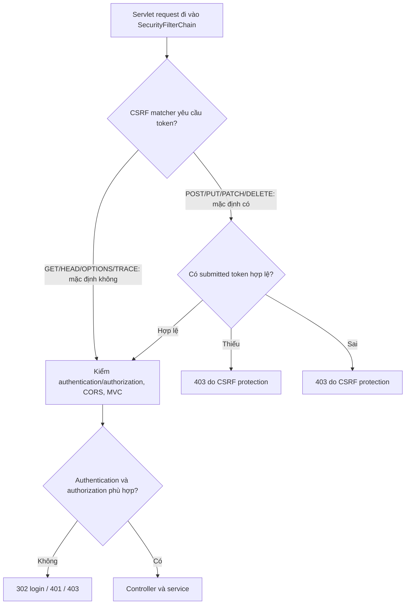

# Kiểm tra yêu cầu thiếu token và phương thức an toàn

> **Chương:** Kiểm thử Servlet  
> **Module:** `SPRING_SECURITY_HTTP_PROTECTION` — áp dụng các lớp phòng vệ HTTP và trình duyệt trong Spring Security, từ CSRF, CORS, security headers, CSP, HSTS đến HTTP firewall và bảo vệ session. Người học cấu hình cho Servlet và Reactive, kiểm thử kịch bản tấn công web và chẩn đoán xung đột bảo mật.  
> **Trọng tâm:** Trong Spring Security Servlet, yêu cầu HTTP có **phương thức không an toàn** như POST/PUT/PATCH/DELETE thường bị kiểm CSRF; nếu thiếu submitted token, `CsrfFilter` thường từ chối. Ngược lại, default CSRF request matcher xem GET/HEAD/OPTIONS/TRACE là **safe methods** và không đòi submitted token. Điều này **không** miễn authentication, authorization, CORS, HTTP firewall hay nghĩa vụ không thay đổi trạng thái của safe methods.

## 1. Mục tiêu học tập

Sau bài này, người học có thể:

1. Giải thích thế nào là **yêu cầu thiếu CSRF token** và phân biệt với token sai/hợp lệ trong Spring Security Test.
2. Hiểu `CsrfFilter.DEFAULT_CSRF_MATCHER` và danh sách safe methods mặc định: `GET`, `HEAD`, `OPTIONS` và `TRACE`.
3. Biết tại sao `POST`, `PUT`, `PATCH` và `DELETE` thông thường cần token trên browser session chain có CSRF bật.
4. Viết `MockMvc` tests xác minh một POST thiếu token được từ chối và POST tương đương có `with(csrf())` đi tiếp.
5. Kiểm GET/HEAD/OPTIONS không cần token khi ứng dụng cho phép; không đồng nhất việc “không cần CSRF” với “cho phép anonymous”.
6. Phân biệt lý do `TRACE` mặc định không bị CSRF matcher yêu cầu token nhưng có thể bị `StrictHttpFirewall`, Servlet container hoặc proxy từ chối.
7. Không đặt thao tác thay đổi trạng thái vào GET hoặc safe methods để tránh CSRF.
8. Giải thích vì sao `permitAll()` chỉ tác động authorization và không tự miễn CSRF cho public POST.
9. Thiết lập MockMvc đúng để security filters thực sự tham gia, tránh test giả dương khi `addFilters=false`.
10. Cô lập 403 do CSRF thiếu token với 403 do thiếu quyền, CORS hoặc business rules bằng các positive/negative controls.
11. Kiểm CORS preflight OPTIONS không có CSRF token nhưng actual POST vẫn cần CSRF, authentication và authorization.
12. Nắm vai trò của `CsrfTokenRepository`, CSRF token lazy/deferred, session/cookie và việc trình bày token cho browser.
13. Nhận ra login/logout qua POST, form HTML, AJAX/JSON và multipart đều có thể cần token.
14. Tổ chức test ma trận method × token × principal, kiểm side effects không xuất hiện khi request bị chặn.
15. Biết các giới hạn MockMvc và trường hợp cần Servlet HTTP server, gateway hoặc browser test.

## 2. Hai câu hỏi khác nhau: request có cần token không, rồi token có hợp lệ không?

Hãy tách CSRF security thành hai phép quyết định:

- **Câu hỏi A:** Request này có thuộc `requireCsrfProtectionMatcher` hay không? Mặc định unsafe HTTP method thuộc diện cần CSRF, safe method không thuộc diện ấy.
- **Câu hỏi B:** Nếu cần CSRF, submitted token trong request có phù hợp với expected token được `CsrfTokenRepository`/`CsrfTokenRequestHandler` xử lý không?

Một request GET thiếu token không bị CSRF từ chối vì câu hỏi A trả **không**; một request POST thiếu token thường 403 vì câu hỏi A trả **có**, còn câu hỏi B thất bại.



Sơ đồ minh họa CSRF-enabled browser chain phổ biến. Một filter ở phía trước (CORS, firewall hoặc custom filter) có thể tạo response sớm; khi response đã commit, không nhất thiết mọi filter hoặc MVC handler đều chạy.

### 2.1. “Không có token” phải được mô tả chính xác

Đối với test MockMvc, một request **thiếu submitted CSRF token** là request không đưa CSRF value qua parameter/header:

```java
mvc.perform(post("/account/profile")
        .with(user("alice").roles("USER"))
        .param("displayName", "Alice"))
    .andExpect(status().isForbidden());
```

Không gọi `.with(csrf())`, `.with(csrf().asHeader())` hoặc tự thêm `_csrf`/`X-CSRF-TOKEN`. Lưu ý trong ứng dụng thật, token ở repository có thể đã được server tạo/lưu nhưng **client không nộp**; đó vẫn là request thiếu *submitted* token.

### 2.2. Thiếu token khác token sai

```java
// Không nộp token.
post("/account/profile")
    .param("displayName", "Alice");

// Có nộp token nhưng cố ý sai.
post("/account/profile")
    .param("displayName", "Alice")
    .with(csrf().useInvalidToken());

// Có nộp token hợp lệ.
post("/account/profile")
    .param("displayName", "Alice")
    .with(csrf());
```

Hai case đầu đều có thể 403, nhưng test mục tiêu khác nhau. Không dùng `csrf().useInvalidToken()` nếu tên test là `missingCsrfTokenIsRejected`; helper ấy **đã thêm token**.

## 3. Safe HTTP methods trong CSRF matcher mặc định

Spring Security Servlet phổ biến sử dụng request matcher tương đương:

```java
// Mô hình giải thích nguyên tắc, không phải mã nguồn framework.
boolean requiresCsrf(String method) {
    return !Set.of("GET", "HEAD", "TRACE", "OPTIONS")
        .contains(method);
}
```

Danh sách này phản ánh cách `CsrfFilter.DEFAULT_CSRF_MATCHER` phân biệt method cần kiểm CSRF. Không copy đoạn giải thích làm production custom matcher nếu ứng dụng cần hỗ trợ các method đặc biệt hoặc custom policy.

| Phương thức | CSRF matcher mặc định yêu cầu token? | Trách nhiệm vẫn còn |
|---|---|---|
| GET | **Không** | Authentication, authorization, CORS/headers, **không được gây mutation** |
| HEAD | **Không** | Quyền truy cập như GET tương ứng; không tạo body có nội dung |
| OPTIONS | **Không** | CORS preflight / Allow header / quyền truy cập theo config |
| TRACE | **Không** ở tầng CSRF matcher | Thường nên bị HTTP firewall/container/proxy từ chối; không coi là public endpoint |
| POST | **Có** | CSRF + authentication/authorization + validation |
| PUT | **Có** | CSRF nếu browser session credential; ownership/resource permission |
| PATCH | **Có** | CSRF nếu browser session credential; payload validation |
| DELETE | **Có** | CSRF nếu browser session credential; không xóa tài nguyên ngoài quyền |
| Method extension | Thường **có** nếu không nằm trong safe allowlist | Firewall/parser có thể từ chối method trước CSRF |

**Safe** trong ngữ cảnh này nói về **semantics HTTP** — client không kỳ vọng request làm thay đổi trạng thái ứng dụng. Nó không có nghĩa “không cần xác thực” hoặc “không cần bảo vệ headers”. Cần bảo đảm business side effects không nằm trong GET, HEAD, OPTIONS hay TRACE.

### 3.1. Vì sao POST thiếu token thường 403 dù user đã đăng nhập?

Authentication và CSRF là hai phép kiểm độc lập. Session cookie có thể được browser tự đính kèm, nên chỉ biết user là Alice không chứng minh browser request được Alice chủ động gửi. Token bổ sung một bằng chứng chống request forgery theo threat model.

### 3.2. Vì sao GET authenticated có thể 200 dù không token?

Theo default matcher GET không cần submitted token. Nếu user có quyền đọc endpoint, request tiếp tục đến handler và có thể trả 200. **Nếu anonymous**, GET private có thể 302 login hoặc 401 vì authentication chứ không phải CSRF.

### 3.3. Safe methods vẫn có thể được server dùng để phát token

Một GET render HTML form hoặc `GET /csrf` có thể yêu cầu framework phát token để browser dùng cho POST tiếp theo. Điều này khác với việc GET **nộp** submitted token để vượt kiểm tra. “GET không cần CSRF” không có nghĩa request không bao giờ tạo/lưu CSRF token.

## 4. Kiểm trực tiếp `CsrfFilter.DEFAULT_CSRF_MATCHER`

Có thể test logic matcher **không cần khởi động controller**:

```java
import org.junit.jupiter.api.Test;
import org.springframework.mock.web.MockHttpServletRequest;
import org.springframework.security.web.csrf.CsrfFilter;

import java.util.List;
import static org.junit.jupiter.api.Assertions.*;

class DefaultCsrfMatcherTest {

    @Test
    void safeMethodsDoNotRequireCsrf() {
        for (String method :
                List.of("GET", "HEAD", "OPTIONS", "TRACE")) {
            MockHttpServletRequest request =
                new MockHttpServletRequest();
            request.setMethod(method);

            assertFalse(
                CsrfFilter.DEFAULT_CSRF_MATCHER.matches(request),
                method + " should not require CSRF");
        }
    }

    @Test
    void unsafeMethodsRequireCsrf() {
        for (String method :
                List.of("POST", "PUT", "PATCH", "DELETE")) {
            MockHttpServletRequest request =
                new MockHttpServletRequest();
            request.setMethod(method);

            assertTrue(
                CsrfFilter.DEFAULT_CSRF_MATCHER.matches(request),
                method + " should require CSRF");
        }
    }
}
```

**Phạm vi của test này:** nó chứng minh behavior của default CSRF request matcher trực tiếp trên request object. Nó **không** chứng minh application đang dùng matcher mặc định hoặc `CsrfFilter` thực sự chạy trong Servlet `FilterChainProxy`.

Nếu production có `requireCsrfProtectionMatcher` tùy biến, cần kiểm chính matcher được gắn vào production config, không chỉ constant mặc định.

### 4.1. TRACE là bẫy thường gặp khi giải thích “safe”

`TRACE` nằm trong danh sách mà default **CSRF matcher không yêu cầu token**, nhưng `StrictHttpFirewall` mặc định trong Spring Security thường **không cho TRACE**, do danh sách HTTP methods được phép ở firewall chặt hơn. Web server/proxy cũng có thể disable TRACE.

Vì thế:

- Kiểm `CsrfFilter.DEFAULT_CSRF_MATCHER.matches(mockRequestTRACE) == false` là cách minh họa đúng CSRF classification.
- **Đừng** đòi `MockMvc.perform(request(TRACE,...))` phải trả 200 trong ứng dụng thực; nó có thể bị firewall/container chặn trước CSRF.
- Không nới `StrictHttpFirewall` chỉ để chứng minh TRACE là safe theo CSRF matcher.
- “TRACE không cần CSRF” **không có nghĩa** “nên bật TRACE cho public traffic”.

## 5. Thiết lập project cho Servlet security testing

Với Spring Boot MVC/Servlet, cần Spring MVC, Spring Security và Spring Security Test.

Gradle Kotlin DSL:

```kotlin
dependencies {
    implementation("org.springframework.boot:spring-boot-starter-web")
    implementation("org.springframework.boot:spring-boot-starter-security")

    testImplementation("org.springframework.boot:spring-boot-starter-test")
    testImplementation("org.springframework.security:spring-security-test")
}

tasks.test {
    useJUnitPlatform()
}
```

Maven trong ứng dụng đã dùng Spring Boot dependency management:

```xml
<dependency>
    <groupId>org.springframework.security</groupId>
    <artifactId>spring-security-test</artifactId>
    <scope>test</scope>
</dependency>
```

Dùng phiên bản `spring-security-test` tương thích với Spring Security runtime. Các examples theo style Spring Security 6+/Spring Boot 3+ quen thuộc; package/configuration có thể thay đổi giữa version nên kiểm API của dự án khi nâng cấp.

**Có dependency không nghĩa MockMvc tự chạy filter chain.** Hãy cấu hình Spring Security Test integration đúng như phần tiếp theo.

## 6. MockMvc phải chạy Servlet SecurityFilterChain thật

Một test full Spring Boot application:

```java
@SpringBootTest
@AutoConfigureMockMvc
class CsrfMethodContractTest {

    @Autowired
    MockMvc mvc;
}
```

Trong cấu hình Spring Boot phù hợp, `@AutoConfigureMockMvc` thường thêm Servlet filters từ context với `addFilters=true` mặc định. Khi app có Spring Security config, `FilterChainProxy` xử lý request nếu được đăng ký.

Nếu tự xây MockMvc từ `WebApplicationContext`:

```java
@SpringBootTest
class ManualSecurityMockMvcTest {

    @Autowired
    WebApplicationContext context;

    MockMvc mvc;

    @BeforeEach
    void init() {
        mvc = MockMvcBuilders
            .webAppContextSetup(context)
            .apply(springSecurity())
            .build();
    }
}
```

Imports chính:

```java
import org.junit.jupiter.api.BeforeEach;
import org.springframework.beans.factory.annotation.Autowired;
import org.springframework.boot.test.context.SpringBootTest;
import org.springframework.boot.test.autoconfigure.web.servlet.AutoConfigureMockMvc;
import org.springframework.test.web.servlet.MockMvc;
import org.springframework.test.web.servlet.setup.MockMvcBuilders;
import org.springframework.web.context.WebApplicationContext;
import static org.springframework.security.test.web.servlet.setup.SecurityMockMvcConfigurers.springSecurity;
```

### 6.1. Khi nào tests “xanh” nhưng không có CSRF protection?

```java
// Chỉ để test Controller không thông qua Servlet filters:
@AutoConfigureMockMvc(addFilters = false)
```

Hoặc:

```java
// Standalone không tự load Spring Security chain.
MockMvc mvc = MockMvcBuilders
    .standaloneSetup(controller)
    .build();
```

Nếu POST thiếu token vẫn 204 khi lẽ ra phải 403, kiểm `addFilters`, `springSecurity()`, `@Order/securityMatcher`, `web.ignoring()` hoặc cấu hình `csrf().disable()` trước khi kết luận Spring Security không bảo vệ.

### 6.2. `@WithMockUser` cũng không đủ nếu filter không được gắn

`@WithMockUser` giả lập Authentication trong security context của test, không tự gắn `CsrfFilter`. Việc MockMvc có bean `FilterChainProxy` trong Spring context cũng chưa chứng minh builder của test dùng bean đó. Test missing-token negative và valid-token positive là hai hành vi cần được đo.

## 7. Cấu hình browser SecurityFilterChain minh họa

Ta dùng một browser chain có form login/session, giữ CSRF mặc định và phân quyền URL rõ ràng:

```java
package example.security;

import org.springframework.context.annotation.Bean;
import org.springframework.context.annotation.Configuration;
import org.springframework.http.HttpMethod;
import org.springframework.security.config.Customizer;
import org.springframework.security.config.annotation.web.builders.HttpSecurity;
import org.springframework.security.config.annotation.web.configuration.EnableWebSecurity;
import org.springframework.security.web.SecurityFilterChain;

@Configuration
@EnableWebSecurity
public class BrowserCsrfSecurityConfig {

    @Bean
    SecurityFilterChain browser(HttpSecurity http)
            throws Exception {
        return http
            .authorizeHttpRequests(auth -> auth
                .requestMatchers(HttpMethod.GET,
                    "/login", "/csrf", "/public/**").permitAll()
                .requestMatchers(HttpMethod.OPTIONS,
                    "/public/methods").permitAll()
                .requestMatchers(HttpMethod.POST,
                    "/public/feedback").permitAll()
                .requestMatchers("/admin/**").hasRole("ADMIN")
                .anyRequest().authenticated())
            .csrf(Customizer.withDefaults())
            .formLogin(Customizer.withDefaults())
            .headers(headers -> headers
                .contentSecurityPolicy(csp -> csp
                    .policyDirectives(
                        "default-src 'self'; object-src 'none'; " +
                        "base-uri 'self'; frame-ancestors 'none'")))
            .build();
    }
}
```

Theo policy này:

| Request | HTTP authorization | Default CSRF |
|---|---|---|
| GET `/account` | Authenticated | Không yêu cầu token |
| HEAD `/account` | Authenticated | Không yêu cầu token |
| OPTIONS `/public/methods` | Public | Không yêu cầu token |
| GET `/public/methods` | Public | Không yêu cầu token |
| POST `/account/profile` | Authenticated | Yêu cầu token |
| PUT/PATCH `/account/profile` | Authenticated | Yêu cầu token |
| DELETE `/account/profile` | Authenticated | Yêu cầu token |
| POST `/public/feedback` | Public theo authorization | **Vẫn** yêu cầu token |
| POST `/admin/settings` | ROLE_ADMIN | Yêu cầu token |
| POST `/login` | Form-login processing | Thường yêu cầu token |
| POST `/logout` | Logout | Thường yêu cầu token |

### 7.1. Vì sao `permitAll()` không đồng nghĩa `ignoring()`?

`permitAll()` là kết quả authorization trong một security chain vẫn chạy; `CsrfFilter` có thể yêu cầu token trên POST trước khi authorization. Ngược lại, `web.ignoring()` bỏ security chain cho matching requests, thường kéo theo mất các security filters/header writers trên đường ấy. Đừng dùng `ignoring()` để chữa thiếu CSRF cho public POST.

### 7.2. GET/HEAD private vẫn phải authenticated

Default CSRF matcher không đòi token cho GET/HEAD, nhưng rule `anyRequest().authenticated()` vẫn áp. Anonymous GET private được chuyển đến login, không biến thành public vì method safe.

### 7.3. CORS chưa được bật trong cấu hình này

Ví dụ trên dành cho same-origin hoặc tests không yêu cầu CORS. Nếu chạy cross-origin preflight, phải bổ sung cấu hình `http.cors(...)`/`CorsConfigurationSource` có allowlist. Không tự kỳ vọng OPTION request có Origin sẽ được CORS approve chỉ vì nó không cần CSRF.

## 8. Controller và service fixture với side effects đo được

Test thiếu CSRF phải chứng minh **không có thay đổi dữ liệu**, không chỉ trả 403. Tạo interface recorder:

```java
package example.web;

public interface MutationRecorder {
    void profileCreated(String displayName);
    void profileReplaced(String displayName);
    void profilePatched(String displayName);
    void profileDeleted();
    void feedbackSaved(String message);
    void adminThemeChanged(String theme);
}
```

Controller minh họa:

```java
package example.web;

import java.util.Map;
import org.springframework.http.ResponseEntity;
import org.springframework.security.web.csrf.CsrfToken;
import org.springframework.web.bind.annotation.*;

@RestController
class CsrfMethodController {

    private final MutationRecorder recorder;

    CsrfMethodController(MutationRecorder recorder) {
        this.recorder = recorder;
    }

    @GetMapping("/account")
    ResponseEntity<String> account() {
        return ResponseEntity.ok("account");
    }

    @GetMapping("/public/methods")
    ResponseEntity<String> publicMethodsGet() {
        return ResponseEntity.ok("safe");
    }

    @RequestMapping(path = "/public/methods",
                    method = RequestMethod.OPTIONS)
    ResponseEntity<Void> publicMethodsOptions() {
        return ResponseEntity.noContent().build();
    }

    @PostMapping("/account/profile")
    ResponseEntity<Void> create(
            @RequestParam String displayName) {
        recorder.profileCreated(displayName);
        return ResponseEntity.noContent().build();
    }

    @PutMapping("/account/profile")
    ResponseEntity<Void> replace(
            @RequestParam String displayName) {
        recorder.profileReplaced(displayName);
        return ResponseEntity.noContent().build();
    }

    @PatchMapping("/account/profile")
    ResponseEntity<Void> patch(
            @RequestParam String displayName) {
        recorder.profilePatched(displayName);
        return ResponseEntity.noContent().build();
    }

    @DeleteMapping("/account/profile")
    ResponseEntity<Void> deleteProfile() {
        recorder.profileDeleted();
        return ResponseEntity.noContent().build();
    }

    @PostMapping("/public/feedback")
    ResponseEntity<Void> feedback(
            @RequestParam String message) {
        recorder.feedbackSaved(message);
        return ResponseEntity.noContent().build();
    }

    @PostMapping("/admin/settings")
    ResponseEntity<Void> settings(
            @RequestParam String theme) {
        recorder.adminThemeChanged(theme);
        return ResponseEntity.noContent().build();
    }

    @GetMapping("/csrf")
    Map<String, String> csrf(
            @RequestAttribute("_csrf") CsrfToken token) {
        return Map.of(
            "parameterName", token.getParameterName(),
            "headerName", token.getHeaderName(),
            "token", token.getToken());
    }
}
```

`MutationRecorder` phải có bean implementation hoặc test mock được inject thật vào controller. Để chạy tests, cung cấp các route và payload đúng fixture; không kỳ vọng 204 nếu controller không tồn tại hoặc thiếu required parameters.

### 8.1. Vì sao endpoint GET và OPTIONS không gọi recorder?

Chúng là các read-only/safe handlers. Với default CSRF matcher, không có token check cho safe method; nếu người phát triển lén gọi `recorder.profileDeleted()` trong GET, Spring Security **không** tự thêm CSRF validation để cứu lỗi API semantics.

### 8.2. Vì sao mock recorder cần positive controls?

Nếu test POST thiếu CSRF 403 và `verifyNoInteractions(recorder)` pass, nhưng recorder là mock không được controller inject, test vẫn pass vô nghĩa. Bổ sung test valid CSRF POST thực sự gọi `recorder.profileCreated("Alice")` để xác nhận wiring/side-effect coverage.

### 8.3. Endpoint `GET /csrf` không có nghĩa GET cần submitted token

Endpoint này phát token cho same-origin client/form. Gọi `token.getToken()` kích hoạt deferred/lazy loading nếu đang áp dụng. Response chứa token cần cache policy phù hợp, không trả bừa qua credentialed CORS cho attacker-origin hoặc log token. Nó chỉ là fixture để test client issuance flow, không được dùng như authorization secret.
## 9. POST thiếu submitted CSRF token: negative test căn bản

Cùng URL, user đã authenticated và input nghiệp vụ hợp lệ:

```java
@Test
void missingTokenDeniesAuthenticatedPost() throws Exception {
    mvc.perform(post("/account/profile")
            .with(user("alice").roles("USER"))
            .param("displayName", "Alice"))
        .andExpect(status().isForbidden());
}
```

Không có `with(csrf())`, không `.param("_csrf",...)` và không CSRF header. Đây là test missing **submitted** token, không có nghĩa repository chưa từng sinh expected token.

Để loại khả năng 403 do controller/authorization:

```java
@Test
void validTokenLetsSameRequestReachHandler() throws Exception {
    mvc.perform(post("/account/profile")
            .with(user("alice").roles("USER"))
            .param("displayName", "Alice")
            .with(csrf()))
        .andExpect(status().isNoContent());
}
```

### 9.1. So với token sai

```java
@Test
void invalidTokenDeniesSamePost() throws Exception {
    mvc.perform(post("/account/profile")
            .with(user("alice").roles("USER"))
            .param("displayName", "Alice")
            .with(csrf().useInvalidToken()))
        .andExpect(status().isForbidden());
}
```

Ba ca khác nhau: missing → 403; invalid → 403; valid → 204. Khi test thiếu token, **không** gọi `csrf().useInvalidToken()`: helper ấy đã thêm một token sai chứ không mô phỏng thiếu token.

### 9.2. `@WithMockUser` không tự có token

```java
@Test
@WithMockUser(username = "alice", roles = "USER")
void mockPrincipalStillNeedsCsrfToken() throws Exception {
    mvc.perform(post("/account/profile")
            .param("displayName", "Alice"))
        .andExpect(status().isForbidden());
}
```

Authenticated principal trong test và CSRF token là hai điều kiện độc lập. `@WithMockUser` không gửi form login/password, không cấp `_csrf` parameter hay `X-CSRF-TOKEN` header.

## 10. GET an toàn: không cần CSRF nhưng vẫn cần Authentication

```java
@Test
void authenticatedGetWithoutTokenWorks() throws Exception {
    mvc.perform(get("/account")
            .with(user("alice").roles("USER")))
        .andExpect(status().isOk())
        .andExpect(content().string("account"));
}
```

Không có submitted token là **đúng**, vì GET không bị CSRF matcher mặc định yêu cầu token. Nhưng anonymous GET private vẫn phải đăng nhập:

```java
@Test
void anonymousGetStillNeedsLogin() throws Exception {
    mvc.perform(get("/account"))
        .andExpect(status().is3xxRedirection())
        .andExpect(redirectedUrlPattern("**/login"));
}
```

Trong browser form-login chain, entry point thường redirect; với API Bearer chain, GET private anonymous có thể 401. **Safe về CSRF không đồng nghĩa public về authorization.**

### 10.1. Public GET

```java
@Test
void publicGetWorksWithoutCsrfOrUser() throws Exception {
    mvc.perform(get("/public/methods"))
        .andExpect(status().isOk())
        .andExpect(content().string("safe"));
}
```

Ở đây authorization `permitAll()` cho public URL, còn CSRF matcher miễn GET. Hai chính sách khác nhau, không dùng một status 200 để chứng minh cả hai khi chưa kiểm cấu hình.

### 10.2. GET có token sai có thể vẫn 200

```java
@Test
void safeGetIgnoresInvalidSubmittedCsrf() throws Exception {
    mvc.perform(get("/account")
            .with(user("alice").roles("USER"))
            .with(csrf().useInvalidToken()))
        .andExpect(status().isOk());
}
```

Test này **không** chứng minh CSRF filter bỏ lọt attack: GET không phải method được yêu cầu token theo default matcher. Đừng dùng GET với invalid token làm canary để kiểm CSRF protection của POST.

## 11. HEAD: không yêu cầu token, nhưng authorization vẫn áp dụng

HEAD có semantics liên hệ với GET và không có response body trong HTTP thực. Spring MVC thường có thể phục vụ HEAD dựa trên GET mapping.

```java
@Test
void authenticatedHeadDoesNotNeedCsrf() throws Exception {
    mvc.perform(head("/account")
            .with(user("alice").roles("USER")))
        .andExpect(status().isOk());
}

@Test
void anonymousHeadPrivateStillRequiresLogin() throws Exception {
    mvc.perform(head("/account"))
        .andExpect(status().is3xxRedirection());
}
```

Không tự suy rằng `MockMvc` mô phỏng hoàn toàn network HEAD body handling, bởi không có Servlet HTTP listener thật. Quan trọng hơn: `@GetMapping` xử lý HEAD có thể vẫn gọi service; nếu GET handler làm thay đổi trạng thái, đó là vi phạm safe method semantics có nguy cơ bị kích hoạt qua HEAD.

## 12. OPTIONS: phân biệt method discovery với CORS preflight

Có hai loại request OPTIONS thường gặp:

- OPTIONS thông thường yêu cầu thông tin method/metadata.
- CORS preflight: OPTIONS kèm `Origin`, `Access-Control-Request-Method`, và thường `Access-Control-Request-Headers`.

Default CSRF matcher không đòi token cho cả hai. Nhưng CORS processor, authorization và MVC handler vẫn có thể từ chối.

### 12.1. OPTIONS không có Origin trong fixture

```java
@Test
void ordinaryOptionsWithoutTokenCanPass() throws Exception {
    mvc.perform(options("/public/methods"))
        .andExpect(status().isNoContent());
}
```

Test dựa vào `@RequestMapping(method=OPTIONS)` và authorization `permitAll()` của fixture. Nó không kiểm CORS cross-origin.

### 12.2. OPTIONS preflight không gửi CSRF token value

```http
OPTIONS /account/profile HTTP/1.1
Origin: https://client.example.com
Access-Control-Request-Method: POST
Access-Control-Request-Headers: content-type,x-csrf-token
```

Header `Access-Control-Request-Headers` chỉ **khai tên** header dự kiến gửi trong POST thật; nó không chứa token CSRF cần validate. CORS phải xử lý preflight sớm, không yêu cầu cookie/login/CSRF trên preflight thông thường.

### 12.3. OPTIONS vẫn có thể 403 do CORS

Nếu Origin không có trong allowlist, preflight có thể bị từ chối dù `CsrfFilter` không yêu cầu token. Đây là **CORS denial**, không phải missing CSRF. Không blanket ignore OPTIONS khỏi security chain nếu chính `CorsFilter` đang nằm trong chain: có thể mất CORS processing.

## 13. TRACE: safe với CSRF matcher, thường bị chặn bởi firewall

`TRACE` nằm trong default CSRF safe allowlist, nhưng `StrictHttpFirewall` thường không cho method TRACE theo default allowed-methods policy; Servlet container hoặc proxy cũng có thể disable.

```java
@Test
void traceExcludedFromCsrfMatcherEvenIfFirewallRejectsIt() {
    MockHttpServletRequest req =
        new MockHttpServletRequest();
    req.setMethod("TRACE");
    assertFalse(CsrfFilter.DEFAULT_CSRF_MATCHER.matches(req));
}
```

Test matcher trực tiếp khác hoàn toàn với kiểm HTTP TRACE end-to-end. **Không** đặt kỳ vọng TRACE trả 200 trong MockMvc full chain; có thể gặp `RequestRejectedException` hoặc response do error handler map, trước khi CSRF filter chạy. Không nới firewall để cho phép TRACE chỉ vì tên nó xuất hiện trong nhóm safe methods.

## 14. PUT và PATCH không có token phải bị chặn

Một browser application thay đổi dữ liệu qua REST methods cũng cần CSRF nếu dùng credential tự gửi (cookie/session).

### 14.1. PUT — cặp missing và valid

```java
@Test
void putMissingCsrfIsForbidden() throws Exception {
    mvc.perform(put("/account/profile")
            .with(user("alice").roles("USER"))
            .param("displayName", "Alice"))
        .andExpect(status().isForbidden());
}

@Test
void putWithCsrfCanReplaceProfile() throws Exception {
    mvc.perform(put("/account/profile")
            .with(user("alice").roles("USER"))
            .param("displayName", "Alice")
            .with(csrf()))
        .andExpect(status().isNoContent());
}
```

### 14.2. PATCH — cặp missing và valid

```java
@Test
void patchMissingCsrfIsForbidden() throws Exception {
    mvc.perform(patch("/account/profile")
            .with(user("alice").roles("USER"))
            .param("displayName", "Alice"))
        .andExpect(status().isForbidden());
}

@Test
void patchWithCsrfCanModifyProfile() throws Exception {
    mvc.perform(patch("/account/profile")
            .with(user("alice").roles("USER"))
            .param("displayName", "Alice")
            .with(csrf()))
        .andExpect(status().isNoContent());
}
```

Nếu test suite chỉ có POST, một custom `requireCsrfProtectionMatcher` sai có thể bỏ lọt PUT/PATCH. Dùng cặp negative/positive cho **mọi unsafe method ứng dụng đang nhận**, không chỉ những method HTML form trực tiếp hỗ trợ.

## 15. DELETE thiếu token: không chữa bằng GET /delete

```java
@Test
void deleteMissingCsrfIsForbidden() throws Exception {
    mvc.perform(delete("/account/profile")
            .with(user("alice").roles("USER")))
        .andExpect(status().isForbidden());
}

@Test
void deleteWithCsrfCanReachHandler() throws Exception {
    mvc.perform(delete("/account/profile")
            .with(user("alice").roles("USER"))
            .with(csrf()))
        .andExpect(status().isNoContent());
}
```

CSRF token hợp lệ không chứng minh owner permission, nên DELETE resource của user khác vẫn phải bị authorization/service từ chối. Đừng đổi thành GET để tránh token: link preview/crawler/attacker page có thể vô tình kích hoạt mutation.

## 16. Ma trận phương thức × token theo browser fixture

Giả sử security config và controller mục 7–8 được load, request có principal đủ quyền đối với private URL, payload hợp lệ, và default CSRF matcher:

| Request | Thiếu token | Token sai | Token hợp lệ |
|---|---|---|---|
| GET /account (USER) | 200 | 200 | 200 |
| HEAD /account (USER) | 200 | 200 | 200 |
| OPTIONS /public/methods (anonymous) | 204 | 204 | 204 |
| POST /account/profile (USER) | 403 | 403 | 204 |
| PUT /account/profile (USER) | 403 | 403 | 204 |
| PATCH /account/profile (USER) | 403 | 403 | 204 |
| DELETE /account/profile (USER) | 403 | 403 | 204 |
| POST /public/feedback (anonymous) | 403 | 403 | 204 |
| POST /admin/settings (ADMIN) | 403 | 403 | 204 |
| POST /admin/settings (USER) | 403 do CSRF | 403 do CSRF | 403 do role |

Không đặt TRACE vào ma trận HTTP status, vì firewall/container thường chặn trước CSRF. Test `CsrfFilter.DEFAULT_CSRF_MATCHER` riêng đã minh họa nó được phân loại ra sao.

### 16.1. Status phụ thuộc entry point/error handler

Một app có custom `AccessDeniedHandler`, `AuthenticationEntryPoint`, CORS filter hoặc controller response khác có thể không dùng đúng 200/204/302/403 trên. Mục tiêu là *bất biến bảo mật*: unsafe mutation thiếu token bị chặn; safe request không bị CSRF đòi submitted token một cách không cần thiết; authentication và role vẫn áp.

## 17. Thiếu CSRF khác thiếu authentication

Browser form-login fixture tạo ma trận:

| Principal | CSRF thiếu trên POST private | CSRF hợp lệ trên POST private |
|---|---|---|
| Anonymous | Thường 403 CSRF trước login | Thường 302 login |
| USER authenticated | 403 CSRF | 204 handler |
| ADMIN authenticated | 403 CSRF | 204 handler |

```java
@Test
void anonymousMissingCsrfCanFailBeforeLogin() throws Exception {
    mvc.perform(post("/account/profile")
            .param("displayName", "Alice")
            .with(anonymous()))
        .andExpect(status().isForbidden());
}

@Test
void anonymousValidCsrfStillNeedsAuthentication()
        throws Exception {
    mvc.perform(post("/account/profile")
            .param("displayName", "Alice")
            .with(anonymous())
            .with(csrf()))
        .andExpect(status().is3xxRedirection());
}
```

Nếu mục tiêu test **authentication entry point**, gửi CSRF hợp lệ để không bị CSRF 403 che. Nếu mục tiêu test **missing token**, dùng authenticated user có đủ quyền và payload hợp lệ. Đừng thay đồng thời method, principal và payload rồi kết luận 403 do một filter cụ thể.
## 18. `permitAll()` không miễn CSRF cho public POST

Public feedback endpoint trong fixture được `permitAll()` về HTTP authorization:

```java
.requestMatchers(HttpMethod.POST, "/public/feedback")
    .permitAll()
```

Nhưng POST vẫn là unsafe method, nên CSRF filter mặc định yêu cầu submitted token.

```java
@Test
void anonymousPublicPostWithoutCsrfIsRejected()
        throws Exception {
    mvc.perform(post("/public/feedback")
            .param("message", "Hello"))
        .andExpect(status().isForbidden());
}

@Test
void anonymousPublicPostWithCsrfCanSucceed()
        throws Exception {
    mvc.perform(post("/public/feedback")
            .param("message", "Hello")
            .with(csrf()))
        .andExpect(status().isNoContent());
}
```

Hai tests này đặc biệt hữu ích: cả hai đều **anonymous**, chỉ khác CSRF token. Public form có thể được server cấp token ngay cả trước khi user login. Token CSRF không cấp identity, còn `permitAll()` không gỡ `CsrfFilter`.

### 18.1. Public GET form và public POST form là hai chuyện khác nhau

Một `GET /public/feedback-form` thường không cần **nộp** token nhưng phải **render/phát** token nếu form POST tiếp theo cần CSRF. Nếu frontend quên hidden field, valid POST sẽ 403 trong browser dù MockMvc `with(csrf())` test pass.

### 18.2. Không dùng `web.ignoring()` để bỏ qua CSRF

`web.ignoring()` có thể bỏ security chain, kéo theo mất authentication, headers và CSRF của đường dẫn. Nếu endpoint thực sự không dùng browser auto-credentials (webhook signed), thiết kế exception hoặc chain riêng có scope hẹp; không bỏ HTTP protection toàn diện chỉ để một public POST pass.

## 19. Phân biệt 403 do CSRF với 403 do role ADMIN

Ở `POST /admin/settings`, thiếu token và thiếu role đều có thể 403:

| Identity | Token | Mong đợi | Tầng cần kiểm |
|---|---|---|---|
| ADMIN | Thiếu | 403 | CSRF |
| ADMIN | Hợp lệ | 204 | Controller |
| USER | Hợp lệ | 403 | Role authorization |
| USER | Thiếu | 403 | CSRF, không chứng minh role |
| Anonymous | Hợp lệ | 302 login | Authentication |

```java
@Test
void adminWithoutTokenIsDenied() throws Exception {
    mvc.perform(post("/admin/settings")
            .with(user("root").roles("ADMIN"))
            .param("theme", "dark"))
        .andExpect(status().isForbidden());
}

@Test
void userWithValidTokenStillCannotUpdateAdmin()
        throws Exception {
    mvc.perform(post("/admin/settings")
            .with(user("alice").roles("USER"))
            .param("theme", "dark")
            .with(csrf()))
        .andExpect(status().isForbidden());
}

@Test
void adminWithValidTokenCanUpdateAdmin()
        throws Exception {
    mvc.perform(post("/admin/settings")
            .with(user("root").roles("ADMIN"))
            .param("theme", "dark")
            .with(csrf()))
        .andExpect(status().isNoContent());
}
```

Nếu chỉ có test USER + missing token 403, rule `hasRole("ADMIN")` có thể bị xóa mà test vẫn pass vì CSRF từ chối trước. Muốn test role, cấp valid CSRF. Muốn test missing CSRF, cấp user đủ quyền.

### 19.1. HTTP status không chứng minh owner/tenant permission

Ngay cả khi user có role và CSRF hợp lệ, resource owner check vẫn cần service/repository. Một user Alice có thể phải bị 403/404 khi sửa order của Bob. Kiểm CSRF/HTTP authorization đúng không thay IDOR/BOLA tests.

## 20. Form login POST thiếu token: password chưa chắc được kiểm

Một login form thường xử lý POST `/login`. Khi CSRF bật trong browser chain, **login POST cũng phải có token** theo default matcher.

```java
@Test
void loginWithoutCsrfIsDeniedBeforePasswordCheck()
        throws Exception {
    mvc.perform(post("/login")
            .param("username", "alice")
            .param("password", "correct-password"))
        .andExpect(status().isForbidden());
}
```

Chỉ nhìn 403 ở đây không thể kết luận password sai: CSRF có thể chặn trước authentication filter.

### 20.1. Kiểm password sai cần cung cấp token hợp lệ

```java
@Test
void wrongPasswordWithCsrfReachesLoginFailure()
        throws Exception {
    mvc.perform(post("/login")
            .param("username", "alice")
            .param("password", "wrong-password")
            .with(csrf()))
        .andExpect(status().is3xxRedirection())
        .andExpect(redirectedUrlPattern("**/login?error"));
}
```

Cần test `UserDetailsService`/`PasswordEncoder` và default form-login failure URL, hoặc điều chỉnh theo custom handler. Cấp CSRF hợp lệ mới có cơ sở nói password được kiểm.

### 20.2. Login thành công cần kiểm session sau login

```java
@Test
void loginWithCsrfCreatesAuthenticatedSession()
        throws Exception {
    MvcResult result = mvc.perform(post("/login")
            .param("username", "alice")
            .param("password", "correct-password")
            .with(csrf()))
        .andExpect(status().is3xxRedirection())
        .andReturn();

    MockHttpSession session =
        (MockHttpSession) result.getRequest().getSession(false);
    assertNotNull(session);

    mvc.perform(get("/account").session(session))
        .andExpect(status().isOk());
}
```

Một redirect 302 có thể là login success **hoặc failure**. Kiểm Location, session và truy cập private resource tiếp theo. `@WithMockUser` không chứng minh password/login filter/session fixation hoạt động.

## 21. Logout POST thiếu CSRF: không nhầm với GET logout

Spring Security Servlet form-login config có thể yêu cầu POST `/logout` kèm CSRF khi CSRF bật. Một test:

```java
@Test
void logoutPostWithoutCsrfIsDenied() throws Exception {
    mvc.perform(post("/logout")
            .with(user("alice").roles("USER")))
        .andExpect(status().isForbidden());
}
```

Đoạn này kiểm filter behavior với principal mock, **không** chứng minh session login thực bị giữ hoặc hủy. Để kiểm logout protection end-to-end, phải login thật, giữ session, thử POST logout thiếu token (không logout), sau đó gửi logout với token hợp lệ và xác minh session invalidated.

### 21.1. Không kích hoạt logout nhạy cảm qua GET

Nếu ứng dụng cho phép GET logout không cần token, một trang ngoài có thể kích browser thoát phiên mà user không chủ động. Theo default Spring Security behavior khi CSRF bật, logout thường sử dụng POST; không nới cấu hình GET logout chỉ để tránh CSRF trên form/link.

### 21.2. Token có thể đổi sau login/logout

Spring Security có thể dùng `CsrfAuthenticationStrategy`/`CsrfLogoutHandler` để xóa expected token sau các sự kiện authentication/logout. Với lazy tokens, client có thể cần GET token mới. Test một POST sau login thiếu token và nhận 403 không tự chứng minh user đã mất authentication.

## 22. HTML form: GET phát token, POST phải nộp token

Một form server-rendered nên có hidden CSRF field do Spring Security cấp:

```html
<form action="/account/profile" method="post">
  <input name="displayName" value="Alice" />
  <input type="hidden" name="_csrf"
         value="TOKEN_DUOC_SERVER_PHAT" />
  <button type="submit">Lưu</button>
</form>
```

`TOKEN_DUOC_SERVER_PHAT` chỉ là placeholder; **không** copy literal này vào test để coi valid token.

### 22.1. `csrf()` trong MockMvc có thể che lỗi template thiếu input

```java
mvc.perform(post("/account/profile")
        .with(user("alice").roles("USER"))
        .param("displayName", "Alice")
        .with(csrf()))
    .andExpect(status().isNoContent());
```

Test trên chứng minh CSRF filter cho request test hợp lệ; nó **không** chứng minh template GET form có hidden `_csrf` hoặc browser đã nộp nó. Test UI cần GET render form và parse token/cookie đúng, rồi POST same session mà không dùng `with(csrf())`.

### 22.2. Token repository và request handler quyết định tên/giá trị

Default parameter name thường là `_csrf`, nhưng tên được lấy từ `CsrfToken.getParameterName()`. Với Spring Security 6, form token có thể được XOR-masked và khác raw expected token trong session/cookie. Khi test HTML flow thật, dùng giá trị server **expose cho client**, không tự đọc raw token rồi giả định giống form.

## 23. JSON/AJAX: thiếu CSRF header cũng là thiếu submitted token

Một SPA gửi JSON body có thể chọn CSRF header:

```http
POST /account/json-profile HTTP/1.1
Cookie: JSESSIONID=...
Content-Type: application/json
X-CSRF-TOKEN: <server-issued-token>

{"displayName":"Alice"}
```

Nếu browser dùng session cookie và CSRF-enabled chain, request không có CSRF header/parameter vẫn phải bị từ chối. MockMvc test:

```java
@Test
void jsonPostWithoutCsrfHeaderIsDenied()
        throws Exception {
    mvc.perform(post("/account/json-profile")
            .with(user("alice").roles("USER"))
            .contentType(MediaType.APPLICATION_JSON)
            .content("{\"displayName\":\"Alice\"}"))
        .andExpect(status().isForbidden());
}
```

Cần `@PostMapping("/account/json-profile")` và valid JSON handler fixture cho positive case.

### 23.1. Positive header counterpart

```java
@Test
void jsonPostWithCsrfHeaderCanProceed()
        throws Exception {
    mvc.perform(post("/account/json-profile")
            .with(user("alice").roles("USER"))
            .contentType(MediaType.APPLICATION_JSON)
            .content("{\"displayName\":\"Alice\"}")
            .with(csrf().asHeader()))
        .andExpect(status().isNoContent());
}
```

`with(csrf())` mặc định gửi qua parameter dù body là JSON; test đó có thể pass nhưng **không** chứng minh frontend thực gửi parameter. Nếu client JSON luôn dùng header, test theo `csrf().asHeader()` và token issuance/header name thực.

### 23.2. JSON property tên `_csrf` không tự là Servlet request parameter

```json
{"displayName":"Alice","_csrf":"some-value"}
```

Một property JSON trong body không tự được `CsrfFilter` mặc định đọc như `_csrf` request parameter. Nếu app có custom `CsrfTokenRequestHandler`, phải kiểm protocol rõ; không tự cho rằng JSON parser của controller cung cấp token cho security filter trước khi controller chạy.

## 24. Multipart file upload: thiếu token và filter order

Upload qua multipart POST cũng là unsafe request:

```java
@Test
void multipartUploadWithoutCsrfIsDenied()
        throws Exception {
    MockMultipartFile image = new MockMultipartFile(
        "file", "avatar.png", "image/png",
        new byte[] {1, 2, 3});

    mvc.perform(multipart("/account/avatar")
            .file(image)
            .with(user("alice").roles("USER")))
        .andExpect(status().isForbidden());
}
```

Positive counterpart với endpoint/upload fixture phù hợp:

```java
mvc.perform(multipart("/account/avatar")
        .file(image)
        .with(user("alice").roles("USER"))
        .with(csrf().asHeader()))
    .andExpect(status().isNoContent());
```

Multipart handler có thể nằm ngoài controller mẫu mục 8, nên phải tạo `@PostMapping("/account/avatar")` nhận `MultipartFile` và trả 204 khi thành công; không mặc định positive case sẽ pass nếu chưa dựng handler.

### 24.1. Vì sao cần real Servlet test cho upload?

Khi CSRF token nằm trong multipart body, parser có thể phải chạy trước `CsrfFilter` để trích parameter, khiến bytes/temp file được xử lý **trước khi request bị từ chối**. Header CSRF có thể đơn giản hơn cho upload, nhưng còn phụ thuộc frontend/gateway/CORS. MockMvc multipart mock không mô phỏng hoàn toàn parser, temp file, limits hoặc Servlet filter ordering.

## 25. CSRF token lazy/deferred: expected token khác submitted token

Spring Security có thể tạo/lưu CSRF token một cách **deferred**: chỉ khi ứng dụng thực sự truy cập `CsrfToken.getToken()` mới cần materialize expected token trong repository.

Điều này dẫn đến một khác biệt:

- Server có thể chưa tạo token cho GET thường, nhưng GET vẫn 200 vì CSRF matcher không đòi submitted token.
- GET render form/`GET /csrf` có thể làm token được phát cho client để dùng trong POST.
- POST đến mà client **không gửi submitted token** vẫn phải bị từ chối, dù expected token chưa có sẵn và được tạo lazily.
- Session/cookie strategy có thể làm thay đổi exception subtype, token creation và response cookie behavior; không dùng chỉ một tên exception làm bằng chứng.

### 25.1. `MissingCsrfTokenException` và `InvalidCsrfTokenException`

Spring Security có các loại exception cho tình huống token thiếu/sai. Cách phân loại cụ thể trong implementation có thể phụ thuộc **trạng thái token ở repository/deferred token** ngoài submitted value. Vì vậy không tuyên bố rằng mọi `POST` thiếu header phải luôn ném đúng một exception subtype trong mọi phiên bản/config. Đối với học phần này, hợp đồng cốt lõi là **unsafe request không có token hợp lệ bị từ chối**, và request không gây side effects.

### 25.2. Token có thể được trình bày dạng XOR-masked

`XorCsrfTokenRequestAttributeHandler` trong Spring Security 6 có thể expose masked CSRF token để giảm rủi ro compression side channel như BREACH. Raw expected token trong repository có thể khác chuỗi HTML form gửi; request handler có trách nhiệm giải mã submitted representation. Không so raw string trực tiếp rồi gọi token “sai” nếu handler chấp nhận masked value hợp lệ.

+### 25.3. Session repository so với cookie repository

Với `HttpSessionCsrfTokenRepository`, expected token được lưu theo `HttpSession`; browser nộp token qua form parameter hoặc header, session cookie giúp server xác định expected token. Nếu POST chỉ mang session cookie nhưng **không nộp submitted token**, request vẫn phải bị từ chối.

Với `CookieCsrfTokenRepository`, expected token được lưu trong cookie CSRF riêng (convention thường là `XSRF-TOKEN`); frontend có thể nộp giá trị qua header `X-XSRF-TOKEN`. Cookie CSRF **không phải** cookie đăng nhập `JSESSIONID`. Nếu cookie có expected token nhưng header/parameter không có, unsafe request vẫn phải bị từ chối.

Với SPA gửi raw CSRF cookie token trên Spring Security 6, cần xác minh `CsrfTokenRequestHandler` giải raw header token tương thích với XOR-masked form value. `with(csrf())` và `with(csrf().asHeader())` kiểm filter behavior nhưng **không** chứng minh browser phát, lưu và gửi cookie/token đúng. Bổ sung GET token/cookie → POST có/không có submitted header để kiểm wire contract thật.

## 26. Lấy token thực từ server rồi POST, không dùng test helper

Một bộ test nâng cao kiểm **token issuance + submission**, thay vì chỉ test behavior khi helper tự cung cấp token.

### 26.1. GET `/csrf` lấy giá trị và parameter name thực

Controller mẫu có:

```java
@GetMapping("/csrf")
Map<String, String> csrf(
        @RequestAttribute("_csrf") CsrfToken token) {
    return Map.of(
        "parameterName", token.getParameterName(),
        "headerName", token.getHeaderName(),
        "token", token.getToken());
}
```

Endpoint minh họa phục vụ frontend cùng origin. Response chứa token cần cache policy an toàn, đặc biệt không bị CDN/shared cache phân phát giữa sessions, và không cho attacker-origin đọc qua credentialed CORS.

### 26.2. GET → POST trong cùng session

```java
@Test
void issuedTokenCanBeSubmittedWithSameSession()
        throws Exception {
    MockHttpSession session = new MockHttpSession();

    MvcResult issued = mvc.perform(get("/csrf")
            .session(session))
        .andExpect(status().isOk())
        .andReturn();

    String json = issued.getResponse()
        .getContentAsString();

    String parameterName =
        JsonPath.read(json, "$.parameterName");
    String token =
        JsonPath.read(json, "$.token");

    mvc.perform(post("/account/profile")
            .session(session)
            .with(user("alice").roles("USER"))
            .param("displayName", "Alice")
            .param(parameterName, token))
        .andExpect(status().isNoContent());
}
```

Imports tiêu biểu:

```java
import com.jayway.jsonpath.JsonPath;
import org.springframework.mock.web.MockHttpSession;
import org.springframework.test.web.servlet.MvcResult;
import static org.springframework.security.test.web.servlet.request.SecurityMockMvcRequestPostProcessors.user;
```

Đoạn trên giả định `HttpSessionCsrfTokenRepository` và flow có thể giữ expected token trong `MockHttpSession`. Nếu app dùng cookie repo, phải giữ cookie tương ứng; nếu custom request handler dùng raw-header thay vì masked parameter, test phải điều chỉnh submitted representation đúng contract.

### 26.3. POST cùng session nhưng không nộp token

Sau GET token, request sau vẫn phải bị từ chối nếu client không gửi token:

```java
mvc.perform(post("/account/profile")
        .session(session)
        .with(user("alice").roles("USER"))
        .param("displayName", "Alice"))
    .andExpect(status().isForbidden());
```

Đây là test rất quan trọng: server đã tạo expected token nhưng **client quên nộp**. Chỉ có cookie/session không thay yêu cầu submitted token trên unsafe request.

### 26.4. POST token của session A trong session B

Với session repository, lấy token của session A, sau đó submit sang session B. Nó phải bị từ chối theo token repository binding. Với cookie repository, phải tạo wrong/missing cookie case, không chỉ đổi MockHttpSession.

### 26.5. `csrf()` không chứng minh form/SPA lấy token đúng

Helper tạo submitted token hợp lệ cho mock request, ngay cả khi template GET form thiếu hidden field hoặc SPA không refresh cookie. GET server-issued token → POST thật với same session/cookie là tầng test riêng, không nên nhầm với unit/integration test CSRF filter behavior.
## 27. CORS preflight OPTIONS không cần CSRF nhưng cần CORS policy đúng

Khi frontend ở `https://client.example.com` gửi JSON POST có `X-CSRF-TOKEN` đến `https://app.example.com`, browser có thể gửi preflight trước:

```http
OPTIONS /account/profile HTTP/1.1
Origin: https://client.example.com
Access-Control-Request-Method: POST
Access-Control-Request-Headers: content-type,x-csrf-token
```

Preflight chỉ khai **method/header names dự kiến**, không chứa token CSRF thực của POST. Default CSRF matcher không yêu cầu token trên OPTIONS. Nhưng CORS filter/source phải cho phép Origin/method/headers đã khai.

### 27.1. Cấu hình CORS mẫu với allowlist hẹp

Bổ sung vào security config:

```java
@Bean
CorsConfigurationSource browserCors() {
    CorsConfiguration config = new CorsConfiguration();
    config.setAllowedOrigins(
        List.of("https://client.example.com"));
    config.setAllowedMethods(
        List.of("GET", "HEAD", "POST", "PUT",
                "PATCH", "DELETE", "OPTIONS"));
    config.setAllowedHeaders(
        List.of("Content-Type", "X-CSRF-TOKEN"));
    config.setAllowCredentials(true);

    UrlBasedCorsConfigurationSource source =
        new UrlBasedCorsConfigurationSource();
    source.registerCorsConfiguration("/**", config);
    return source;
}
```

Thêm vào chain:

```java
http.cors(cors -> cors.configurationSource(browserCors()));
```

Imports gợi ý:

```java
import java.util.List;
import org.springframework.web.cors.CorsConfiguration;
import org.springframework.web.cors.CorsConfigurationSource;
import org.springframework.web.cors.UrlBasedCorsConfigurationSource;
```

CORS có credentials không được dùng `Access-Control-Allow-Origin: *`; phải có allowlist phù hợp. Cookie `SameSite`, `Secure`, Domain/Path và client `fetch(..., { credentials: "include" })` vẫn phải đồng bộ. CORS policy **không tạo CSRF token** hay đăng nhập user.

### 27.2. Positive preflight không có token

```java
@Test
void allowedCorsPreflightNeedsNoCsrfToken()
        throws Exception {
    mvc.perform(options("/account/profile")
            .header("Origin", "https://client.example.com")
            .header("Access-Control-Request-Method", "POST")
            .header("Access-Control-Request-Headers",
                "content-type,x-csrf-token"))
        .andExpect(status().isOk())
        .andExpect(header().string(
            "Access-Control-Allow-Origin",
            "https://client.example.com"));
}
```

Điều kiện: browser chain đã bật CORS source; không chạy test này trên config chưa có CORS mà kỳ vọng 200 chỉ vì OPTIONS là safe. Controller POST không được gọi bởi preflight.

### 27.3. Negative preflight Origin không tin cậy

```java
@Test
void untrustedOriginMustNotBeAllowed()
        throws Exception {
    mvc.perform(options("/account/profile")
            .header("Origin", "https://attacker.example")
            .header("Access-Control-Request-Method", "POST")
            .header("Access-Control-Request-Headers",
                "content-type,x-csrf-token"))
        .andExpect(status().isForbidden())
        .andExpect(header().doesNotExist(
            "Access-Control-Allow-Origin"));
}
```

Spring CORS processor thường trả 403 cho preflight invalid; gateway/custom policy có thể trả status khác. Bất biến cần kiểm là untrusted Origin **không** nhận credentialed CORS allow-origin.

### 27.4. Preflight 200 không làm POST thiếu CSRF hợp lệ

```java
@Test
void actualCorsPostStillNeedsCsrf()
        throws Exception {
    mvc.perform(post("/account/profile")
            .header("Origin", "https://client.example.com")
            .with(user("alice").roles("USER"))
            .param("displayName", "Alice"))
        .andExpect(status().isForbidden());

    mvc.perform(post("/account/profile")
            .header("Origin", "https://client.example.com")
            .with(user("alice").roles("USER"))
            .param("displayName", "Alice")
            .with(csrf().asHeader()))
        .andExpect(status().isNoContent());
}
```

`with(user())` chỉ mock authenticated principal, không mô phỏng browser session cookies. Muốn kiểm credentialed CORS end-to-end phải dùng browser/HTTP client có cookie jar và giữ session.

## 28. Tùy biến CSRF matcher: bảo vệ an toàn theo threat model

Mặc định Spring Security yêu cầu CSRF với mọi method không nằm trong allowlist safe. Có thể thay qua `requireCsrfProtectionMatcher` hoặc loại một số paths bằng `ignoringRequestMatchers`. Nhưng một matcher sai có thể tạo vùng không bảo vệ.

### 28.1. Anti-pattern: chỉ xét POST

```java
// MINH HỌA CẤU HÌNH THIẾU: không copy vào production
// nếu PUT/PATCH/DELETE cũng thay đổi trạng thái.
http.csrf(csrf -> csrf.requireCsrfProtectionMatcher(
    request -> "POST".equals(request.getMethod())));
```

Với matcher trên, `PUT/PATCH/DELETE` có thể không cần token trong khi controller vẫn thay đổi dữ liệu. Test matrix của mục 16 sẽ phát hiện vì negative tests của các method ấy bất ngờ thành 204.

### 28.2. Một ngoại lệ endpoint không phải mặc định public

Với webhook HMAC từ hệ thống ngoài không sử dụng browser auto-credentials, có thể thiết kế một chain/CSRF exception giới hạn chính xác đường dẫn và phương thức, **sau khi** kiểm signature/timestamp/replay:

```java
// Chỉ dùng nếu /webhooks/external được bảo vệ bằng
// cơ chế xác thực machine-to-machine phù hợp.
http.csrf(csrf -> csrf
    .ignoringRequestMatchers("/webhooks/external"));
```

Đây là fragment, chưa phải full production policy. Không biến ngoại lệ thành `"/**"` hoặc `"/api/**"` chỉ vì endpoint trả JSON. Test phải có case webhook không signature bị từ chối bởi xác thực khác, cùng browser POST vẫn cần CSRF.

### 28.3. Viết test trên matcher *đang dùng*, không chỉ default constant

Nếu ứng dụng custom CSRF matcher, unit test `CsrfFilter.DEFAULT_CSRF_MATCHER` vẫn pass nhưng không chứng minh production matcher đúng. Cần HTTP integration tests trên các URLs/methods thực, bao gồm method ngoài expected allowlist, near-prefix URL và matching security chain.

### 28.4. Không yêu cầu token trên GET để bù cho GET gây side effect

Nếu `GET /transfer?amount=...` làm chuyển tiền, đó là lỗi HTTP API design. Không giải quyết căn bản bằng việc ép token vào GET; hãy đổi thành unsafe method thích hợp, kiểm CSRF/authorization/ownership, rồi test GET không có side effect.

## 29. Bearer-only API có thể có CSRF policy riêng, không suy từ tên REST

CSRF threat model phụ thuộc browser credential có được tự gửi hay không. Một API chỉ nhận `Authorization: Bearer ...` do client chủ động gắn vào header và không chấp nhận browser session/Basic auto-credentials có thể không cần CSRF theo đánh giá.

### 29.1. Tách hai SecurityFilterChain theo credential

```java
@Configuration
@EnableWebSecurity
class ApiAndBrowserSecurity {

    @Bean
    @Order(1)
    SecurityFilterChain api(HttpSecurity http)
            throws Exception {
        return http
            .securityMatcher("/api/**")
            // Chỉ khi API thật sự không dùng auto-sent browser credentials.
            .csrf(AbstractHttpConfigurer::disable)
            .sessionManagement(session -> session
                .sessionCreationPolicy(
                    SessionCreationPolicy.STATELESS))
            .authorizeHttpRequests(auth -> auth
                .requestMatchers(HttpMethod.POST, "/api/orders")
                    .hasAuthority("SCOPE_orders.write")
                .anyRequest().authenticated())
            .oauth2ResourceServer(oauth2 -> oauth2
                .jwt(Customizer.withDefaults()))
            .build();
    }

    @Bean
    @Order(2)
    SecurityFilterChain browser(HttpSecurity http)
            throws Exception {
        return http
            .authorizeHttpRequests(auth -> auth
                .requestMatchers("/login", "/csrf").permitAll()
                .anyRequest().authenticated())
            .csrf(Customizer.withDefaults())
            .formLogin(Customizer.withDefaults())
            .build();
    }
}
```

Cần Spring Security OAuth2 Resource Server/JWT dependencies và `JwtDecoder`, không lấy code trên làm runnable fixture trừ khi có controller/api beans phù hợp.

### 29.2. API Bearer POST không token CSRF vẫn có thể hợp lệ

```java
mvc.perform(post("/api/orders")
        .with(jwt()
            .authorities(new SimpleGrantedAuthority(
                "SCOPE_orders.write")))
        .contentType(MediaType.APPLICATION_JSON)
        .content("{\"sku\":\"book\"}"))
    .andExpect(status().isCreated());
```

Trong API chain đã được thiết kế miễn CSRF, POST không có `with(csrf())` là **đúng policy**, không tự là lỗ hổng. Nhưng vẫn cần JWT authentication/authorization và business ownership.

`with(jwt())` tạo JWT principal mock, không kiểm chữ ký/expiry/issuer/audience; dùng raw Bearer header và decoder thật để kiểm credential.

### 29.3. Negative API controls khác CSRF

```java
mvc.perform(post("/api/orders")
        .contentType(MediaType.APPLICATION_JSON)
        .content("{\"sku\":\"book\"}"))
    .andExpect(status().isUnauthorized());

mvc.perform(post("/api/orders")
        .with(jwt().authorities(
            new SimpleGrantedAuthority(
                "SCOPE_orders.read")))
        .contentType(MediaType.APPLICATION_JSON)
        .content("{\"sku\":\"book\"}"))
    .andExpect(status().isForbidden());
```

Nếu API POST thiếu token CSRF trả 403 mà bạn kỳ vọng 401 Bearer, kiểm chain selection. Request có thể rơi vào browser fallback. Đừng tắt CSRF browser để “chữa” API matcher sai.

### 29.4. JSON/REST không đồng nghĩa miễn CSRF

Nếu JSON endpoint nhận session cookie, HTTP Basic hoặc credential browser tự gửi, nó vẫn có thể có CSRF risk. Không dùng tên `/api/**` để mặc định tắt CSRF khi chưa kiểm thực tế mọi đường authentication.

## 30. Headers, CSP, HSTS, firewall: an toàn hơn nhưng không thay CSRF

Các lớp HTTP protection có phạm vi khác:

| Lớp | Giá trị | Không thay |
|---|---|---|
| CSRF | Chặn unsafe request thiếu/sai token | Authentication/authorization |
| CORS | Kiểm cross-origin browser access | CSRF, owner check |
| CSP | Giới hạn script/style/frame cho HTML documents | Token requirement |
| X-Content-Type-Options | Giảm MIME sniffing | Role/CSRF |
| HSTS | Hướng browser luôn dùng HTTPS cho host theo policy | Token/session matching |
| HTTP firewall | Từ chối request path/method bất thường | CSRF business protection |
| Cookie flags | Giới hạn browser cookie behavior | Đánh giá CSRF cho mọi topology |

### 30.1. Response CSRF 403 có thể vẫn mang security headers

```java
@Test
void csrfDenialMayStillHaveConfiguredCsp()
        throws Exception {
    mvc.perform(post("/account/profile")
            .with(user("alice").roles("USER"))
            .param("displayName", "Alice"))
        .andExpect(status().isForbidden())
        .andExpect(header().exists(
            "Content-Security-Policy"));
}
```

Fixture browser chain đã config CSP. Nhưng response do firewall/gateway tạo trước header writer có thể không có CSP; không kết luận mọi 403 luôn có security headers.

### 30.2. HSTS với `secure(true)` chưa kiểm HTTPS production

```java
mvc.perform(get("/login").secure(true))
    .andExpect(header().exists(
        "Strict-Transport-Security"));
```

`secure(true)` mô phỏng secure request attribute trong MockMvc; không kiểm TLS termination, reverse proxy forwarded scheme, browser HSTS cache hay header cuối do CDN/gateway ghi. Khi app sau reverse proxy, kiểm qua public HTTPS ingress.

### 30.3. HTTP firewall có thể chặn request trước CSRF

HTTP method TRACE, encoded URL bất thường, semicolon/double slash và request path normalization có thể bị firewall/container từ chối trước `CsrfFilter`. Khi test thiếu token, dùng URL bình thường và method đúng để tránh lẫn HTTP firewall rejection.

## 31. Lớp regression test gộp các hợp đồng cơ bản

Dưới đây là một lớp tập trung vào missing token, safe methods và phân quyền. Nó giả định browser config ở mục 7, controller/recorder fixture mục 8 và security filter integration đã đúng.

```java
@SpringBootTest
@AutoConfigureMockMvc
class CsrfMissingAndSafeMethodsTest {

    @Autowired
    MockMvc mvc;

    @Test
    void privateGetWithUserDoesNotNeedCsrf()
            throws Exception {
        mvc.perform(get("/account")
                .with(user("alice").roles("USER")))
            .andExpect(status().isOk());
    }

    @Test
    void anonymousPrivateGetStillRedirects()
            throws Exception {
        mvc.perform(get("/account"))
            .andExpect(status().is3xxRedirection());
    }

    @Test
    void privateHeadWithUserDoesNotNeedCsrf()
            throws Exception {
        mvc.perform(head("/account")
                .with(user("alice").roles("USER")))
            .andExpect(status().isOk());
    }

    @Test
    void ordinaryOptionsDoesNotNeedCsrf()
            throws Exception {
        mvc.perform(options("/public/methods"))
            .andExpect(status().isNoContent());
    }

    @Test
    void postMissingTokenIsForbidden() throws Exception {
        mvc.perform(post("/account/profile")
                .param("displayName", "Alice")
                .with(user("alice").roles("USER")))
            .andExpect(status().isForbidden());
    }

    @Test
    void postValidTokenReachesHandler() throws Exception {
        mvc.perform(post("/account/profile")
                .param("displayName", "Alice")
                .with(user("alice").roles("USER"))
                .with(csrf()))
            .andExpect(status().isNoContent());
    }

    @Test
    void putMissingTokenIsForbidden() throws Exception {
        mvc.perform(put("/account/profile")
                .param("displayName", "Alice")
                .with(user("alice").roles("USER")))
            .andExpect(status().isForbidden());
    }

    @Test
    void patchMissingTokenIsForbidden() throws Exception {
        mvc.perform(patch("/account/profile")
                .param("displayName", "Alice")
                .with(user("alice").roles("USER")))
            .andExpect(status().isForbidden());
    }

    @Test
    void deleteMissingTokenIsForbidden() throws Exception {
        mvc.perform(delete("/account/profile")
                .with(user("alice").roles("USER")))
            .andExpect(status().isForbidden());
    }

    @Test
    void anonymousPublicPostStillNeedsCsrf()
            throws Exception {
        mvc.perform(post("/public/feedback")
                .param("message", "Hi"))
            .andExpect(status().isForbidden());

        mvc.perform(post("/public/feedback")
                .param("message", "Hi")
                .with(csrf()))
            .andExpect(status().isNoContent());
    }

    @Test
    void userWithValidCsrfCannotWriteAdmin()
            throws Exception {
        mvc.perform(post("/admin/settings")
                .param("theme", "dark")
                .with(user("alice").roles("USER"))
                .with(csrf()))
            .andExpect(status().isForbidden());
    }

    @Test
    void adminMissingCsrfCannotWriteAdmin()
            throws Exception {
        mvc.perform(post("/admin/settings")
                .param("theme", "dark")
                .with(user("root").roles("ADMIN")))
            .andExpect(status().isForbidden());
    }

    @Test
    void adminWithCsrfCanWriteAdmin()
            throws Exception {
        mvc.perform(post("/admin/settings")
                .param("theme", "dark")
                .with(user("root").roles("ADMIN"))
                .with(csrf()))
            .andExpect(status().isNoContent());
    }
}
```

Imports:

```java
import org.junit.jupiter.api.Test;
import org.springframework.beans.factory.annotation.Autowired;
import org.springframework.boot.test.context.SpringBootTest;
import org.springframework.boot.test.autoconfigure.web.servlet.AutoConfigureMockMvc;
import org.springframework.test.web.servlet.MockMvc;
import static org.springframework.security.test.web.servlet.request.SecurityMockMvcRequestPostProcessors.*;
import static org.springframework.test.web.servlet.request.MockMvcRequestBuilders.*;
import static org.springframework.test.web.servlet.result.MockMvcResultMatchers.*;
```

### 31.1. Điều kiện để test suite chạy đúng

- Browser SecurityFilterChain và đúng controller/recorder beans được load; MockMvc có security filters.
- GET/HEAD `/account` trả 200, OPTIONS public trả 204.
- POST/PUT/PATCH/DELETE controllers trả 204 với input hợp lệ khi authenticated và CSRF pass.
- `/admin/settings` yêu cầu ADMIN, không được một chain khác permit toàn bộ.
- Không dùng `@AutoConfigureMockMvc(addFilters=false)` hoặc standalone builder không security.
- Với CORS preflight, thêm các tests của mục 27 **chỉ khi** CORS policy đã bật.
- Tất cả database/mock fixtures độc lập, không tồn tại interaction từ test trước.

### 31.2. Bổ sung test side effects

Nếu `MutationRecorder` là Mockito mock bean được inject thật:

```java
mvc.perform(post("/account/profile")
        .param("displayName", "Alice")
        .with(user("alice").roles("USER")))
    .andExpect(status().isForbidden());

verify(recorder, never()).profileCreated(anyString());
```

Ở positive case có `with(csrf())`, nên verify `profileCreated("Alice")` được gọi đúng một lần. Reset mock history giữa tests. Nếu mock không được controller inject, negative `never()` pass không có giá trị.

### 31.3. Regression mutation

Trong nhánh test cô lập, thử disable CSRF ở browser chain: missing-token negative tests phải fail khi controller trả 204. Thử đổi `hasRole("ADMIN")` thành `permitAll()`: USER + valid CSRF test phải fail. Một mutation **không khiến test nào fail** là tín hiệu thiếu coverage, không phải bằng chứng bảo vệ không cần thiết. Khôi phục policy sau thực nghiệm, không đưa cấu hình yếu vào production.

## 32. Chẩn đoán khi “thiếu token nhưng không nhận 403”

| Triệu chứng | Giả thuyết | Phép kiểm |
|---|---|---|
| POST thiếu token trả 204 | CSRF disabled, filter vắng, matcher miễn hoặc chain khác | Filter setup + selected chain + canary |
| POST thiếu token trả 302 login | Anonymous entry point xử lý, CSRF chưa áp hoặc filter order custom | Giữ authenticated principal rồi test lại |
| POST thiếu token trả 401 Bearer | Request vào API Resource Server chain | `securityMatcher`, JWT auth, CSRF policy |
| POST thiếu token trả 403 nhưng valid token cũng 403 | Role/CSRF handler custom, service denial | USER/ADMIN controls và handler positive |
| GET không token trả 302 | Authentication thiếu, không phải CSRF | `with(user())` trên GET |
| HEAD không token trả 401 | API authentication policy | Bổ sung credential, không thêm `csrf()` |
| OPTIONS không token trả 403 | CORS Origin/method/header bị cấm hoặc authorization | Phân biệt ordinary OPTIONS/preflight |
| TRACE không token bị `RequestRejectedException` | `StrictHttpFirewall` chặn method | Matcher unit test; không nới firewall |
| PUT/PATCH thiếu token trả 204 | Custom CSRF matcher chỉ xét POST | Test đủ unsafe method |
| Public POST `permitAll` không token trả 403 | CSRF protection vẫn chạy | Public POST + valid token counterpart |
| CORS preflight 200 nhưng actual POST 403 | POST thiếu CSRF/auth/role | Separate actual request tests |
| Server GET token nhưng POST không gửi vẫn 403 | Đúng behavior khi submitted token missing | GET issuance rồi POST valid counterpart |
| Browser form luôn 403 dù MockMvc `csrf()` pass | Template không render token hoặc session/token stale | GET form → POST same session |
| SPA token qua header 403 | Sai header name, raw/XOR handler/cookie missing | GET cookie → POST header wire contract |
| Login password đúng nhưng POST thiếu CSRF 403 | CSRF chặn trước login filter | POST login + valid CSRF |
| Status 400/404 khi đã thêm CSRF | MVC parser/controller route/validation | Handler/payload, không nới security |
| Header CSP/HSTS mất trong edge response | Header writer/proxy/TLS scheme khác | Browser/HTTPS ingress test |

### 32.1. Không chỉ dựa vào HTTP status

CSRF, authorization, CORS, firewall và business handler có thể đều trả 403. Để chứng minh cụ thể CSRF, test **cặp** missing/valid với cùng method/path/principal/payload; xác định selected chain, token repository, logs có kiểm soát và service side effects.

### 32.2. Debug logger có kiểm soát

```properties
logging.level.org.springframework.security.web.FilterChainProxy=TRACE
logging.level.org.springframework.security.web.csrf=DEBUG
logging.level.org.springframework.security.web.access=DEBUG
logging.level.org.springframework.security.web.authentication=DEBUG
```

Không bật TRACE dài hạn trong production. Không log raw CSRF token, `JSESSIONID`, `XSRF-TOKEN`, Bearer header, password hoặc dữ liệu nhạy cảm. Dùng correlation ID, method/path, selected chain, token-present boolean, status và response owner.

### 32.3. Quy trình bảy bước

1. **Filter registration:** `@AutoConfigureMockMvc` có thêm Spring Security filters không? Có vô tình dùng `addFilters=false`?
2. **Chain selection:** Request vào browser CSRF-enabled chain hay API JWT stateless?
3. **Method/matcher:** Đây có thực sự là unsafe request theo chính matcher đang áp dụng không?
4. **Submitted token:** Request thiếu header/parameter hay nộp token sai? Có helper chung tự gắn CSRF ngoài ý muốn không?
5. **Expected token:** Repository session/cookie, lazy-issued token, XOR representation và rotation có phù hợp?
6. **Authentication/authorization/handler:** User đủ quyền, controller tồn tại, payload hợp lệ, service không gây side effect khi bị chặn?
7. **Network/browser:** Nếu MockMvc pass nhưng UI fail, kiểm Origin/preflight, cookie flags, proxies, raw request và response HTTPS cuối.

## 33. Giới hạn của MockMvc và các bước kiểm ngoài Servlet mock

MockMvc mô phỏng Servlet request/response và gọi Spring MVC/Security filters theo setup, nhưng không chạy một HTTP listener/container/proxy/browser thực.

### 33.1. Những việc MockMvc kiểm tốt

- CSRF filter từ chối unsafe request thiếu/sai token và chấp nhận token hợp lệ.
- CSRF matcher default safe method classification ở unit level.
- Authentication/authorization áp dụng riêng trên safe và unsafe URLs.
- CORS backend behavior nếu cấu hình Spring CORS thực sự load.
- Session/CSRF token issuance flow ở mức MockHttpSession/Mock cookies.
- HTTP headers do Spring Security viết trên response của test chain.
- Controller service side effects với test beans.

### 33.2. Những việc cần HTTP server/ingress/browser

- Servlet filter registration theo `DispatcherType.REQUEST/ERROR/FORWARD/ASYNC`.
- HTTP parser, encoded path, repeated slash, firewall/WAF normalization.
- TLS termination, HSTS, reverse proxy forwarded headers.
- Browser SameSite/Secure/HttpOnly cookie rules, cross-origin credentials.
- CSP enforcement, XSS risks và token bị lộ qua HTML/JS.
- Login/logout session fixation, distributed session storage.
- Actual multipart parsing, resource limits và temp file creation.
- CDN/gateway header rewriting, cache của CSRF token response.
- Thực tế browser preflight/actual POST CORS và token refresh.

### 33.3. Real Servlet integration skeleton

```java
@SpringBootTest(
    webEnvironment = SpringBootTest.WebEnvironment.RANDOM_PORT)
class CsrfRealHttpIntegrationTest {
    // HTTP client lưu cookie/session:
    // GET form/CSRF endpoint -> lấy token.
    // GET private với cookie: auth rule.
    // POST thiếu token với session hợp lệ -> từ chối.
    // POST có token hợp lệ cùng session -> xử lý.
}
```

Test embedded Servlet server không kiểm được ingress/CDN nếu hệ thống còn gateway phía trước. Với những behavior thuộc edge, dùng staging ingress và browser automation phù hợp.

### 33.4. Đối chiếu với WebFlux

WebFlux dùng `SecurityWebFilterChain`, `ServerHttpSecurity`, `CsrfWebFilter`, `ServerCsrfTokenRepository` và `WebTestClient`. Nguyên tắc safe/unsafe và missing-token vẫn có, nhưng **không** dùng `MockMvc`/Servlet `CsrfFilter.DEFAULT_CSRF_MATCHER` để thay thế reactive integration tests. Với Reactive, phải dùng test helpers/packages tương ứng để kiểm `mockUser()` và CSRF token trên reactive exchanges.
## 34. Bài tập thực hành

### Bài A — POST thiếu token

Tạo `POST /account/profile` với user đã authenticated và payload hợp lệ, **không** dùng `csrf()`. Kiểm 403 và recorder không được gọi. Gửi request thứ hai chỉ khác `with(csrf())`, kiểm 204 và recorder được gọi đúng một lần.

### Bài B — Phân biệt thiếu token với token sai

Viết ba tests `missingCsrf`, `invalidCsrf` và `validCsrf` trên cùng route/payload/identity. Chứng minh cả missing và invalid đều bị từ chối, còn valid được xử lý. Giải thích vì sao `csrf().useInvalidToken()` không phải missing-token test.

### Bài C — Unit test default CSRF matcher

Dùng `CsrfFilter.DEFAULT_CSRF_MATCHER.matches(...)` và `MockHttpServletRequest` cho GET, HEAD, OPTIONS, TRACE, POST, PUT, PATCH, DELETE. Assert safe=false, unsafe=true. Đừng dùng status thực của TRACE để suy về matcher.

### Bài D — GET private không token

Gửi `GET /account` anonymous rồi authenticated, đều không CSRF token. Quan sát form-login redirect với anonymous và 200 với user đã đăng nhập. Giải thích CSRF khác authentication.

### Bài E — HEAD private không token

Test HEAD trên GET mapping đã authenticated, không CSRF. Thêm anonymous HEAD và xác minh vẫn cần authentication. Kiểm service spy để bảo đảm GET/HEAD không tạo mutation.

### Bài F — OPTIONS thường và CORS preflight

Tạo explicit OPTIONS handler public không cần token. Sau đó bật CORS allowlist, test OPTIONS có Origin/method/headers hợp lệ được xử lý, unknown Origin bị từ chối. Actual POST thiếu CSRF dù preflight 200 phải vẫn bị từ chối.

### Bài G — TRACE và StrictHttpFirewall

Chứng minh matcher mặc định bỏ qua TRACE bằng unit test, nhưng full HTTP/Spring Security có thể chặn TRACE ở firewall. Không bật TRACE chỉ để ép nhận 200. Viết một đoạn giải thích phân biệt hai lớp.

### Bài H — PUT, PATCH, DELETE

Với các endpoint thay đổi profile, viết negative test thiếu CSRF cho từng method và positive counterpart có `with(csrf())`. Nếu có custom matcher chỉ bảo vệ POST, test nào sẽ phát hiện regression?

### Bài I — Public feedback `permitAll()`

Cho public POST `/public/feedback` là `permitAll()`. Test anonymous POST không token 403, anonymous POST có token 204. Vì sao public authorization không vô hiệu hóa CsrfFilter?

### Bài J — Vai trò ADMIN

Tạo ba tests: ADMIN + missing CSRF → 403; USER + valid CSRF → 403 role; ADMIN + valid CSRF → 204. Với mỗi case, xác định lớp từ chối và side effects.

### Bài K — Form login/logout

Gửi POST `/login` thiếu token với username/password đúng và quan sát 403. Gửi login có token hợp lệ nhưng password sai để kiểm authentication failure; login đúng có token để tạo session. Logout thiếu token không được chấm dứt phiên trái chính sách; valid CSRF logout phải làm mất quyền.

### Bài L — HTML form thật

GET trang form, đọc hidden token được server render và session cookie, rồi POST với giá trị ấy mà không dùng `with(csrf())`. Bỏ hidden field trong test branch để chứng minh form thực lỗi, dù MockMvc helper test vẫn pass.

### Bài M — Session expected token khác submitted token

Gọi `GET /csrf` để tạo token vào session A. POST cùng session A nhưng bỏ submitted token phải 403; gửi token thật phải 204. Gửi token A sang session B phải bị từ chối với session repository.

### Bài N — SPA JSON và header

Viết JSON POST thiếu CSRF header → 403 và có `csrf().asHeader()` → 204. Test thêm header sai. Kiểm frontend thực gửi đúng header name theo repository và không giả định property JSON `_csrf` được filter đọc.

### Bài O — Multipart upload

Dùng `MockMultipartFile` test upload thiếu token bị chặn; valid CSRF + handler hợp lệ được xử lý. Thử real HTTP server để kiểm multipart parser/filter order và không ghi file nếu request bị từ chối.

### Bài P — API Bearer-only

Thiết kế API JWT-only chain stateless và browser chain CSRF-enabled. POST JWT write scope không token CSRF có thể được xử lý trong API, còn browser POST session thiếu token phải 403. Giải thích điều kiện threat model, tránh suy từ tên REST.

### Bài Q — Xác định nguồn 403

Tạo các 403 khác nhau do CSRF, role, CORS và business authorization. Với từng tình huống, dùng positive counterpart và kiểm service call để xác định nguyên nhân; không dựa vào status một mình.

### Bài R — Mutation thử nghiệm

Trong một nhánh **test-only**, tắt CSRF browser và quan sát missing-token tests phải thất bại khi controller được gọi. Thử nới `hasRole("ADMIN")` để kiểm negative role test phát hiện. Khôi phục bảo vệ sau bài tập, không đưa cấu hình sai vào production.

### Bài S — Kiểm proxy/browser

Chạy preflight và actual POST qua staging ingress. Dùng DevTools xem cookie/session, Origin, CSRF header, response headers, redirect và HTTPS scheme; đối chiếu với MockMvc. Không log hoặc chia sẻ raw token/user credentials thực.

## 35. Câu hỏi tự kiểm

**1. Yêu cầu thiếu CSRF token được hiểu là gì?**  
Client không gửi submitted token qua parameter/header cho request cần CSRF, dù server có thể đã có expected token.

**2. Default CSRF matcher xem phương thức nào là safe?**  
GET, HEAD, OPTIONS và TRACE.

**3. Phương thức nào thường yêu cầu CSRF?**  
POST, PUT, PATCH, DELETE và những method không nằm trong safe allowlist mặc định, khi request vào CSRF-enabled chain.

**4. GET không token trả 200 có phải CSRF bị tắt không?**  
Không. GET thông thường không bị default CSRF matcher đòi token.

**5. GET private anonymous trả 302 login dù không cần CSRF có hợp lý không?**  
Có. Authentication/authorization độc lập với CSRF.

**6. HEAD có được miễn authorization vì không có body?**  
Không. HEAD vẫn có thể truy cập metadata của tài nguyên và phải chịu policy truy cập.

**7. OPTIONS preflight có phải gửi token CSRF value không?**  
Thông thường không. Preflight chỉ khai Origin, requested method và requested header names.

**8. OPTIONS bị CORS 403 có chứng minh CSRF đang chặn không?**  
Không. CSRF matcher mặc định không yêu cầu token trên OPTIONS; CORS processor có thể từ chối origin/method/header.

**9. Vì sao TRACE thuộc safe allowlist nhưng full HTTP request có thể bị từ chối?**  
Vì StrictHttpFirewall/container/proxy có thể cấm TRACE trước CSRF filter.

**10. POST `@WithMockUser` không `csrf()` bị 403 có bất thường không?**  
Không. Mock authenticated principal không tự nộp CSRF token.

**11. Vì sao phải có cặp test POST missing 403 và valid 204?**  
Để loại nguyên nhân 403 khác và xác minh handler được gọi khi token hợp lệ.

**12. `csrf().useInvalidToken()` có phải cách tạo missing token không?**  
Không. Nó nộp token **sai**; missing case phải không nộp token.

**13. POST public `permitAll()` có thể vẫn 403 khi không token không?**  
Có. Authorization public không loại CSRF filter.

**14. Nếu custom CSRF matcher chỉ xét POST, rủi ro là gì?**  
PUT/PATCH/DELETE có thể đổi dữ liệu mà không cần token trong browser session app.

**15. Có nên chuyển DELETE thành GET để tránh CSRF?**  
Không. Đó là vi phạm safe method semantics và tạo nguy cơ cross-site triggering.

**16. USER thiếu CSRF đến ADMIN route trả 403 có chứng minh role ADMIN đang bảo vệ không?**  
Không. CSRF có thể từ chối trước. Cần USER + valid CSRF để test role.

**17. Login có đúng password nhưng thiếu CSRF trả 403 có chứng minh password sai không?**  
Không. Login filter có thể chưa được gọi.

**18. Có expected token trong session thì POST không gửi submitted token có được xử lý không?**  
Không, nếu request thuộc diện cần CSRF; token phải được client nộp hợp lệ.

**19. Một GET form có thể phát token dù GET không cần nộp token không?**  
Có. Token issuance cho POST tiếp theo khác submitted-token validation trên GET.

**20. Vì sao `with(csrf())` test pass chưa chứng minh template HTML đúng?**  
Helper tự gắn token vào mock POST dù form có thể thiếu hidden field.

**21. `XorCsrfTokenRequestAttributeHandler` có thể khiến token trong form khác raw repository token không?**  
Có. Handler giải masked representation khi request được submit đúng cách.

**22. Khi nào JSON API có thể miễn CSRF?**  
Khi threat model/credential model cho thấy API thật sự chỉ dùng Bearer header do client chủ động gửi và không chấp nhận browser auto-credentials.

**23. `@AutoConfigureMockMvc(addFilters=false)` có phù hợp với CSRF integration test không?**  
Không. Nó bỏ Servlet filters khỏi MockMvc auto-registration.

**24. Nếu test POST thiếu token vẫn 204, kiểm gì trước tiên?**  
Filter registration, selected chain, CSRF disabled/ignoring matcher, method/path và test fixture.

**25. Có CSP/HSTS nghĩa là CSRF đã được kiểm đúng không?**  
Không. Đây là các lớp bảo vệ khác nhau.

**26. `MockMvc` có kiểm cookie SameSite và TLS termination giống browser thật không?**  
Không đầy đủ. Cần HTTP/browser/ingress integration cho các hành vi đó.

**27. Tại sao phải kiểm service không gây side effect khi thiếu token?**  
Để chứng minh request bị chặn trước mutation, tránh tin một status 403 do handler trả sau khi đã thay đổi dữ liệu.

**28. WebFlux có dùng `MockMvc` hoặc Servlet `CsrfFilter` không?**  
Không. Dùng WebTestClient, CsrfWebFilter và reactive security components tương ứng.

## 36. Ghi nhớ kiến trúc

- **Kiểm tra CSRF trước hết là câu hỏi phương thức nào cần token**: GET/HEAD/OPTIONS/TRACE được default CSRF matcher coi là safe; POST/PUT/PATCH/DELETE thường cần token.
- **Safe ở CSRF matcher không có nghĩa request public.** Authentication, authorization, CORS, headers và HTTP firewall vẫn có thể chặn.
- **TRACE là ngoại lệ cần giải thích đúng**: được matcher xem safe nhưng thường bị StrictHttpFirewall/container/proxy từ chối. Không bật TRACE để làm test “xanh”.
- **POST thiếu submitted token phải bị từ chối khi thuộc CSRF-enabled browser chain**. Kiểm cùng request với `csrf()` hợp lệ để có positive control.
- **Missing khác invalid.** Không gửi token và gửi `csrf().useInvalidToken()` là hai ca test khác nhau, dù đều có thể 403.
- **`@WithMockUser`/`user()` không tự cấp CSRF token.** Khi test CSRF cần principal đủ quyền; khi test authentication/role nên cấp CSRF hợp lệ để không bị filter che kết quả.
- **`permitAll()` không tắt CSRF**; public POST vẫn cần token nếu matcher áp dụng. GET public không nộp token nhưng có thể phát token cho form POST.
- **Không làm mutation trong GET/HEAD/OPTIONS/TRACE.** CSRF exemption dựa trên HTTP safe method semantics, không tự cứu API thiết kế sai.
- **CORS preflight OPTIONS không cần CSRF value**, nhưng actual POST từ allowlisted origin vẫn cần authentication, CSRF và quyền nghiệp vụ.
- **Session/cookie expected token không thay submitted token.** GET token rồi POST thiếu token vẫn phải bị chặn; test token issuance end-to-end cần giữ đúng session/cookie.
- **API Bearer-only có thể được miễn CSRF theo threat model riêng**, không suy từ tên REST/JSON; browser session endpoints vẫn cần bảo vệ phù hợp.
- **MockMvc phải thực sự tích hợp Servlet SecurityFilterChain**; negative/positive pairs và no-side-effect assertions quan trọng hơn một status 403 đơn lẻ.
- **Bổ sung real HTTP/browser tests khi cần** kiểm TLS, SameSite, CORS credentials, proxy, multipart parser và Servlet dispatcher registration.
