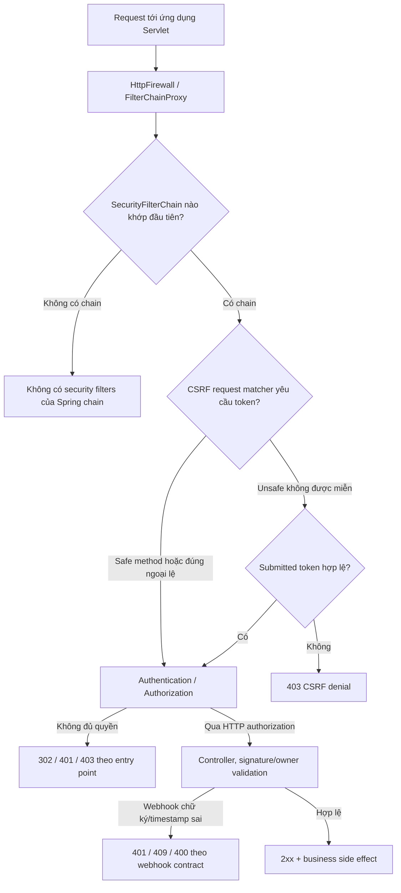

# Kiểm tra matcher miễn trừ cùng các endpoint vẫn phải bảo vệ

> **Chương:** Kiểm thử Servlet  
> **Module:** `SPRING_SECURITY_HTTP_PROTECTION` — áp dụng các lớp phòng vệ HTTP và trình duyệt trong Spring Security từ CSRF, CORS, security headers, CSP, HSTS đến HTTP firewall và bảo vệ session; cấu hình Servlet/Reactive, thử tình huống tấn công web và chẩn đoán xung đột khi triển khai.  
> **Trọng tâm:** Với `Spring Security Servlet`, một matcher miễn CSRF phải **khớp đúng phạm vi đã chủ đích** và không làm các endpoint khác mất bảo vệ. `csrf(csrf -> csrf.ignoringRequestMatchers(...))` chỉ bỏ yêu cầu CSRF cho những request khớp, **không** tự bỏ xác thực bằng chữ ký, HTTP authorization, security headers, firewall, rate limiting hay bảo vệ dữ liệu. Bài dùng `MockMvc` và các phép thử đối chứng để chứng minh cả *ngoại lệ hợp lệ* lẫn *phần còn lại vẫn được bảo vệ*.

## 1. Kết quả học tập

Sau bài này, người học có thể:

1. Giải thích vì sao CSRF matcher ngoại lệ là một **thay đổi phạm vi bảo vệ**, không phải chỉ là “sửa lỗi 403”.
2. Phân biệt `csrf().ignoringRequestMatchers(...)`, `csrf().requireCsrfProtectionMatcher(...)`, `http.securityMatcher(...)`, `authorizeHttpRequests().requestMatchers(...)` và `web.ignoring()`.
3. Thiết kế ngoại lệ **đúng HTTP method và đúng URL** như `POST /webhooks/partner`, không miễn cả `/webhooks/**` vô ý.
4. Kiểm một request khớp ngoại lệ **không cần CSRF token** nhưng vẫn phải đáp ứng một cơ chế tin cậy phù hợp, ví dụ chữ ký HMAC, timestamp và chống phát lại.
5. Kiểm endpoint private, public `permitAll()`, quản trị, login/logout vẫn cần CSRF trên unsafe request theo browser chain.
6. Viết các negative tests cho near-prefix, suffix, slash, phương thức khác, URL rewrite và case matcher quá rộng.
7. Phân biệt 403 do CSRF với 401 do chữ ký webhook hoặc 403 do phân quyền và các lỗi MVC khác.
8. Bảo đảm `MockMvc` có `springSecurityFilterChain` thực; dùng missing/invalid/valid token và business side effects làm bằng chứng.
9. Hiểu `CsrfFilter.DEFAULT_CSRF_MATCHER` mặc định bỏ qua GET/HEAD/OPTIONS/TRACE, và vì sao TRACE vẫn có thể bị firewall từ chối.
10. Biết cách kiểm nhiều `SecurityFilterChain` có `@Order`/first-match và không suy rằng authorization matcher chọn security chain.
11. Chẩn đoán URL sau reverse proxy/context path/servlet mapping và khác biệt giữa matcher URI với `servletPath`.
12. Đánh giá API chỉ dùng Bearer header, webhook machine-to-machine và browser session cookie theo các threat model khác nhau.
13. Thêm kiểm thử CORS preflight, security headers, StrictHttpFirewall, session và cookie để biết ngoại lệ CSRF không làm mất các lớp khác.
14. Hiểu giới hạn MockMvc đối với signature/cookie/TLS/gateway và chuẩn bị browser/HTTP integration tests.
15. Tạo một regression matrix để mọi thay đổi matcher, filter order hoặc security chain làm test phản chứng thất bại nếu vô tình nới bảo vệ.

## 2. Bài toán: không biến một webhook thành cửa hậu

Một ứng dụng browser dùng `JSESSIONID` cho nhân viên và có các endpoint:

| Đường dẫn | Ai sử dụng? | Cơ chế tin cậy | CSRF mong muốn |
|---|---|---|---|
| `POST /webhooks/partner` | Máy chủ đối tác, không dùng browser cookie | HMAC chữ ký, timestamp, event ID chống replay | **Miễn CSRF đúng endpoint + method** |
| `POST /account/profile` | Người dùng đã đăng nhập bằng session | Session + role/owner | **Bắt buộc token** |
| `POST /public/feedback` | Biểu mẫu browser anonymous | CSRF token trên public form + validation/rate limit | **Bắt buộc token**, dù `permitAll()` |
| `POST /admin/settings` | Quản trị viên | Session + ROLE_ADMIN + CSRF | **Bắt buộc token** |
| `POST /login` | Browser form login | Password/provider + CSRF | **Bắt buộc token** |
| `POST /logout` | Browser session | Session + CSRF | **Bắt buộc token** |
| `GET /public/docs` | Browser anonymous | Public authorization, security headers | Không cần *submitted* CSRF |
| `POST /webhooks/partner/debug` | Đường dẫn gần giống nhưng không được cấp ngoại lệ | Policy riêng; nếu đi browser chain thì CSRF áp dụng | **Không được miễn theo prefix** |

Tại sao webhook có thể miễn CSRF? Vì một HTTP client máy-máy không dùng credential do trình duyệt tự gửi và có cơ chế xác thực riêng mạnh hơn việc yêu cầu token CSRF của browser. **Ngoại lệ này không có nghĩa webhook được phép thực thi không cần kiểm chữ ký.**

Một cấu hình thiếu an toàn:

```java
// QUÁ RỘNG nếu chỉ POST /webhooks/partner cần miễn:
http.csrf(csrf -> csrf
    .ignoringRequestMatchers("/webhooks/**"));
```

Nó có thể miễn mọi HTTP method và endpoint dưới prefix phù hợp, kể cả một admin/debug endpoint mới được thêm sau này. Test cho riêng webhook trả 202 **không phát hiện** sự nới phạm vi đó; phải thử các đường dẫn lân cận và endpoints browser khác.

### 2.1. Threat model là điều kiện bắt buộc trước khi tạo ngoại lệ

CSRF protection đặc biệt quan trọng khi browser tự gắn credentials (cookie session, một số hình thức Basic auth). Với webhook chỉ nhận chữ ký/secret bên ngoài, người gửi không có browser session; CSRF token của browser thường không phù hợp. Nhưng nếu cùng URL còn chấp nhận cookie authentication, cơ chế tin cậy hỗn hợp có thể tái tạo rủi ro CSRF: **không miễn chỉ dựa trên tên đường dẫn**.

### 2.2. Mục tiêu của bài là hai mệnh đề có thể kiểm chứng

1. **Mệnh đề tích cực:** đúng `POST /webhooks/partner` không bị CSRF filter từ chối khi không gửi CSRF token, nhưng chữ ký hợp lệ mới được chấp nhận.
2. **Mệnh đề phản chứng:** ngoài matcher ngoại lệ, các unsafe request browser vẫn bị CSRF từ chối khi thiếu/sai token, và quy tắc authentication/authorization vẫn có hiệu lực khi token hợp lệ.

Hai nhóm kiểm thử phải cùng tồn tại. Chỉ kiểm nhóm đầu có thể để lọt một cấu hình `csrf().disable()` áp cho toàn bộ chain.

## 3. Năm matcher/DSL rất dễ bị nhầm lẫn

| API | Phạm vi quyết định | Điều xảy ra khi request khớp |
|---|---|---|
| `http.securityMatcher("/api/**")` | **Security chain selection** | Chain này có cơ hội được chọn; `FilterChainProxy` dùng **chain khớp đầu tiên** |
| `http.authorizeHttpRequests(auth -> auth.requestMatchers(...).permitAll())` | **Authorization trong chain được chọn** | Cho phép qua HTTP authorization rule; các security filters khác vẫn chạy |
| `http.csrf(csrf -> csrf.ignoringRequestMatchers(...))` | **CSRF exception trong chain** | Request khớp không phải nộp CSRF token; authentication/authorization/headers vẫn theo chain |
| `http.csrf(csrf -> csrf.requireCsrfProtectionMatcher(...))` | **Quy tắc request nào cần CSRF** | Có thể thay default matcher; sai một method/path có thể bỏ lọt hoặc chặn nhầm |
| `web.ignoring().requestMatchers(...)` | **Bỏ Spring Security chain cho URL** | Không chạy các security filters/header writers trong chain; ảnh hưởng rộng hơn CSRF |

Lưu ý `web.ignoring()` còn có thể tương tác với lựa chọn chain/firewall theo cách khác `permitAll()`. Không dùng nó như cách thông thường để bỏ CSRF cho webhook.

### 3.1. `securityMatcher` không phải `requestMatchers` trong authorization

`securityMatcher` quyết định **cả chain có áp dụng không**. `requestMatchers` trong `authorizeHttpRequests` chỉ quyết định **rule authorization trong chain đã chọn**. Nếu một API chain có thứ tự ưu tiên cao bắt `/webhooks/partner` và CSRF đã disabled ở chain ấy, các CSRF exceptions khai báo ở browser chain sau **không có tác dụng** với webhook request.

### 3.2. `permitAll()` không phải “skip filter”

`permitAll()` giữ HTTP security chain và headers; một POST public vẫn có thể nhận 403 do `CsrfFilter` trước khi authorization. Ngược lại, `csrf().ignoringRequestMatchers(...)` không tự trả 200 và không tạo authenticated principal; nó chỉ không bắt CSRF ở request đã được miễn.

### 3.3. Miễn CSRF không miễn các phương thức HTTP sai

Nếu matcher chỉ khớp `POST /webhooks/partner`, một `PUT` cùng URL vẫn ở trong phạm vi CSRF theo default unsafe-method matcher, ngay cả khi controller trả 405 nếu đến MVC. Cần kiểm **đúng boundary method** và tránh dùng URL pattern quá rộng trong ngoại lệ.

## 4. Luồng xử lý Servlet có ngoại lệ CSRF



Một request qua firewall và selected chain vẫn có thể được CORS hoặc custom filter xử lý sớm, nên sơ đồ là cách nhìn logic, không phải lệnh gọi cố định mọi filter ở từng phiên bản.

**Điểm cần ghi nhớ:** bỏ CSRF ở một webhook không tự cho webhook đi qua signature verification. Nhưng nếu signature check chỉ tồn tại ở controller/service, request có thể đi đến đó sau khi CSRF được miễn; vì vậy phải kiểm chữ ký **trước tác dụng phụ**, có phản chứng không chữ ký và sai chữ ký.

## 5. Safe/unsafe method matcher và ngoại lệ được kết hợp thế nào?

Theo default `CsrfFilter.DEFAULT_CSRF_MATCHER`, `GET`/`HEAD`/`OPTIONS`/`TRACE` không bị yêu cầu submitted token, còn `POST`/`PUT`/`PATCH`/`DELETE` thường cần token trên CSRF-enabled browser chain.

Khi thêm `ignoringRequestMatchers(webhookExemption)`, policy hợp lý là:

```text
requiresCsrf(request)
    = defaultUnsafeMethod(request) AND NOT webhookExemption(request)
```

Đây là mô hình giải thích, không phải source code nội bộ được cam kết ở mọi Spring Security version.

| HTTP method / URL | Default unsafe? | Đúng ngoại lệ webhook? | CSRF cần? |
|---|---:|---:|---:|
| POST /webhooks/partner | Có | Có | **Không** |
| PUT /webhooks/partner | Có | Không | **Có** |
| PATCH /webhooks/partner | Có | Không | **Có** |
| DELETE /webhooks/partner | Có | Không | **Có** |
| POST /webhooks/partner/debug | Có | Không | **Có** |
| POST /webhooks/partner-extra | Có | Không | **Có** |
| POST /account/profile | Có | Không | **Có** |
| POST /public/feedback | Có | Không | **Có** |
| GET /account/profile | Không | Không | **Không**, nhưng vẫn cần quyền |
| OPTIONS /account/profile | Không | Không | **Không**, CORS có thể từ chối |
| TRACE /webhooks/partner | Không ở default CSRF matcher | Không | Không do CSRF, nhưng thường bị HTTP firewall từ chối |

**Lưu ý TRACE:** Spring Security `StrictHttpFirewall` thường không cho TRACE dù `CsrfFilter` coi nó là safe method. Không nới firewall để chứng minh matcher CSRF bằng HTTP test.

## 6. Thiết kế ngoại lệ với path và method chính xác

Một cách minh họa rõ ràng là dùng `RequestMatcher` kiểm đồng thời HTTP method và `servletPath`:

```java
import jakarta.servlet.http.HttpServletRequest;
import org.springframework.security.web.util.matcher.RequestMatcher;

final class WebhookRequestMatchers {

    static final RequestMatcher PARTNER_POST =
        request -> "POST".equals(request.getMethod())
            && "/webhooks/partner".equals(
                request.getServletPath());

    private WebhookRequestMatchers() {}
}
```

Khi `DispatcherServlet` được map thông thường tới `/`, `getServletPath()` thường phản ánh application path như `/webhooks/partner` sau khi bỏ context path. Nếu app dùng servlet mapping đặc biệt, path-prefix hoặc forward/proxy rewrite, semantics có thể khác. **Đừng áp matcher bằng `getRequestURI()` và so string thô khi chưa xét contextPath/servletPath/pathInfo.**

### 6.1. Tại sao dùng đối chiếu exact thay cho `startsWith()`?

Sai:

```java
// Anti-pattern: /webhooks/partner-extra cũng được miễn.
RequestMatcher tooBroad = request ->
    "POST".equals(request.getMethod())
    && request.getServletPath()
        .startsWith("/webhooks/partner");
```

Khi đó `POST /webhooks/partner-extra`, `POST /webhooks/partner/debug` và các đường lân cận có thể bị miễn ngoài ý muốn. Một giá trị bí mật cấu hình ở frontend/client không sửa được lỗi matcher rộng.

### 6.2. Tại sao phải khóa HTTP method?

Một ngoại lệ theo path trần có thể miễn cả PUT/PATCH/DELETE. Nếu sau này developer thêm `@DeleteMapping("/webhooks/partner")` phục vụ admin, path-only exemption làm DELETE khỏi CSRF. Matcher kiểm chính `POST` giúp fail closed với method mới.

### 6.3. Nếu dùng matcher theo framework MVC

Spring Security có các implementation như `MvcRequestMatcher` hoặc PathPattern-based matchers tùy version. Với MVC servlet mapping, cần cấu hình đúng `HandlerMappingIntrospector` hoặc servlet path nếu matcher yêu cầu. Mục tiêu bài này không phải chọn một class matcher bất biến theo mọi version; mục tiêu là test **HTTP method + request path + chain selection** và xác minh các near-prefix không được miễn.

## 7. Servlet SecurityFilterChain mẫu: miễn CSRF đúng webhook

Ví dụ browser chain dùng form login/session, với webhook được miễn CSRF **chỉ ở đúng POST URL**:

```java
package example.security;

import org.springframework.context.annotation.Bean;
import org.springframework.context.annotation.Configuration;
import org.springframework.http.HttpMethod;
import org.springframework.security.config.Customizer;
import org.springframework.security.config.annotation.web.builders.HttpSecurity;
import org.springframework.security.config.annotation.web.configuration.EnableWebSecurity;
import org.springframework.security.web.SecurityFilterChain;
import org.springframework.security.web.util.matcher.RequestMatcher;

@Configuration
@EnableWebSecurity
public class BrowserSecurityConfig {

    private static final RequestMatcher WEBHOOK_POST =
        request -> "POST".equals(request.getMethod())
            && "/webhooks/partner".equals(
                request.getServletPath());

    @Bean
    SecurityFilterChain browser(HttpSecurity http)
            throws Exception {
        return http
            .authorizeHttpRequests(auth -> auth
                .requestMatchers(HttpMethod.POST,
                    "/webhooks/partner").permitAll()
                .requestMatchers(HttpMethod.GET,
                    "/public/**", "/login", "/csrf")
                    .permitAll()
                .requestMatchers(HttpMethod.POST,
                    "/public/feedback").permitAll()
                .requestMatchers("/admin/**")
                    .hasRole("ADMIN")
                .anyRequest().authenticated())
            .csrf(csrf -> csrf
                .ignoringRequestMatchers(WEBHOOK_POST))
            .formLogin(Customizer.withDefaults())
            .headers(headers -> headers
                .contentSecurityPolicy(csp -> csp.policyDirectives(
                    "default-src 'self'; object-src 'none'; " +
                    "base-uri 'self'; frame-ancestors 'none'")))
            .build();
    }
}
```

Ở đây webhook POST được `permitAll()` ở **HTTP authorization** vì đối tác chưa đăng nhập bằng browser session. Tuy nhiên **controller/service phải xác thực chữ ký HMAC trước khi xử lý**, ví dụ tại `PartnerWebhookVerifier` dưới đây. Đừng coi `permitAll()` là chữ ký xác thực.

### 7.1. Ba tầng độc lập ở webhook

- **CSRF exception**: cho máy ngoài gửi POST không có CSRF token của browser.
- **HTTP authorization rule**: cho request tới endpoint webhook (anonymous theo session model).
- **Webhook authenticity policy**: chữ ký, timestamp, event id, chống replay, payload limits và business validation quyết định có chấp nhận sự kiện hay không.

Nếu bỏ tầng thứ ba, một attacker không cần session cũng có thể gửi POST webhook và gây side effects. Điều đó là lỗi bảo vệ nghiêm trọng hơn việc test CSRF exemption có trả 2xx hay không.

### 7.2. Các endpoint khác vẫn nằm trong chain

Vì chỉ dùng `csrf().ignoringRequestMatchers(WEBHOOK_POST)`, `HeaderWriterFilter`, `AuthorizationFilter` và các security filters khác theo chain vẫn có thể xử lý request webhook. `StrictHttpFirewall` áp trước/ở proxy chain. Đây là lý do không nên dùng `web.ignoring()` để miễn CSRF.

### 7.3. Cấu hình trên là một fixture same-origin chưa bật CORS

Nếu webhook là máy-máy, CORS browser policy thường không cần cho nó. Nếu frontend SPA khác Origin dùng các endpoint browser, phải cấu hình `CorsConfigurationSource` ở browser chain phù hợp; đừng mở wildcard CORS chỉ để webhook gửi được — HTTP server-to-server clients không chịu browser CORS enforcement.

## 8. Controller fixture cho browser endpoints

Để chứng minh các browser endpoints khác vẫn cần CSRF, tạo một service chỉ ghi nhận mutation khi controller thực sự chạy:

```java
package example.web;

public interface ChangeRecorder {
    void profileUpdated(String displayName);
    void feedbackRecorded(String message);
    void adminThemeUpdated(String theme);
    void webhookDelivered(String eventId);
}
```

Và controller:

```java
package example.web;

import org.springframework.http.ResponseEntity;
import org.springframework.web.bind.annotation.*;

@RestController
class BrowserController {

    private final ChangeRecorder recorder;

    BrowserController(ChangeRecorder recorder) {
        this.recorder = recorder;
    }

    @GetMapping("/account")
    ResponseEntity<String> account() {
        return ResponseEntity.ok("account");
    }

    @PostMapping("/account/profile")
    ResponseEntity<Void> profile(
            @RequestParam String displayName) {
        recorder.profileUpdated(displayName);
        return ResponseEntity.noContent().build();
    }

    @PostMapping("/public/feedback")
    ResponseEntity<Void> feedback(
            @RequestParam String message) {
        recorder.feedbackRecorded(message);
        return ResponseEntity.noContent().build();
    }

    @PostMapping("/admin/settings")
    ResponseEntity<Void> adminSettings(
            @RequestParam String theme) {
        recorder.adminThemeUpdated(theme);
        return ResponseEntity.noContent().build();
    }
}
```

Để chạy snippets, application/test context phải cung cấp bean `ChangeRecorder` và controller phải được scan/import. Trong tests có thể dùng Mockito mock bean được inject vào controller và reset history đúng cách. Các positive cases kỳ vọng 204 **chỉ khi** fixture này tồn tại và parameter nghiệp vụ hợp lệ.

### 8.1. Vì sao cần fixture luôn có positive path?

Nếu `POST /account/profile` thiếu token trả 403, nhưng `with(csrf())` cũng 403 vì service/controller hoặc role lỗi, bạn chưa chứng minh được CSRF policy. Test phải có negative **và** positive counterpart cùng URL, user và payload để tách CSRF khỏi các failure khác.

### 8.2. Đừng để verification thiếu wiring tạo giả dương

Một `verifyNoInteractions(recorder)` trên mock không được inject vào controller vẫn pass dù request được xử lý bởi implementation khác. Cần test `with(csrf())` gọi `recorder.profileUpdated(...)` đúng một lần để xác minh bean wiring trước khi tin no-side-effect assertion ở negative case.
## 9. Controller webhook: miễn CSRF nhưng vẫn xác minh người gửi

Một webhook không phải HTML form. Khi không dùng CSRF token, phải có cơ chế tin cậy phù hợp **trước** khi cập nhật database/hàng đợi. Thiết kế một controller nhận nguyên văn bytes của body cùng metadata chữ ký:

```java
package example.web;

import org.springframework.http.MediaType;
import org.springframework.http.ResponseEntity;
import org.springframework.web.bind.annotation.*;

@RestController
class PartnerWebhookController {

    private final PartnerWebhookVerifier verifier;
    private final ChangeRecorder recorder;

    PartnerWebhookController(
            PartnerWebhookVerifier verifier,
            ChangeRecorder recorder) {
        this.verifier = verifier;
        this.recorder = recorder;
    }

    @PostMapping(
        path = "/webhooks/partner",
        consumes = MediaType.APPLICATION_JSON_VALUE)
    ResponseEntity<Void> partner(
            @RequestHeader(name = "X-Webhook-Id",
                required = false) String eventId,
            @RequestHeader(name = "X-Webhook-Timestamp",
                required = false) String timestamp,
            @RequestHeader(name = "X-Webhook-Signature",
                required = false) String signature,
            @RequestBody byte[] rawBody) {

        // Phải từ chối thiếu/sai chữ ký, timestamp/replay
        // TRƯỚC khi gọi nghiệp vụ hoặc lưu dữ liệu.
        verifier.verify(eventId, timestamp, signature, rawBody);

        recorder.webhookDelivered(eventId);
        return ResponseEntity.accepted().build();
    }
}
```

Contract của verifier:

```java
package example.web;

public interface PartnerWebhookVerifier {
    void verify(
        String eventId,
        String timestamp,
        String signature,
        byte[] rawBody);
}
```

Ví dụ quy ước HTTP status trong fixture:

- Header/chữ ký thiếu hoặc sai: `401 Unauthorized` (do verifier chủ động trả, không phải CSRF).
- Timestamp nằm ngoài giới hạn chấp nhận: `401`.
- Event ID phát lại: `409 Conflict` nếu ứng dụng chọn contract này.
- Payload hợp lệ, chữ ký đúng và event ID chưa xử lý: `202 Accepted`.
- Content-Type sai, body không giải mã được hoặc header/request validation lỗi: có thể `400/415` theo MVC/controller/gateway.

Status trên là **contract minh họa**. Một webhook provider có thể yêu cầu trả `200` kể cả event trùng để tránh retry; khi đó test phải theo contract sản phẩm mà **vẫn bảo đảm không xử lý lại**.

### 9.1. Vì sao `@RequestBody byte[]` thay vì deserialize JSON trước?

Nhiều webhook provider ký **raw request bytes**. Nếu parse JSON rồi serialize lại, thứ tự thuộc tính/whitespace/encoding có thể khác khiến chữ ký không khớp. Verifier cần dùng đúng canonical signing input được provider định nghĩa (ví dụ timestamp + event ID + raw bytes), sau đó mới parse, validate schema và xử lý nghiệp vụ.

### 9.2. Chữ ký phải bao gồm dữ liệu chống replay

Một HMAC thuần chỉ ký body mà không timestamp/event ID có thể bị replay. Nên xác thực timestamp trong cửa sổ ngắn, bind event ID/timestamp với body trong nội dung được ký, và lưu idempotency key có tính atomic/TTL đủ dài theo retry policy của đối tác.

### 9.3. Đừng lấy JWT mock principal để thay chữ ký webhook

`with(user())` hay `with(jwt())` trong Spring Security Test tạo một authentication test identity. Nếu HTTP authorization của webhook là `permitAll()` và trust model thật là chữ ký HTTP, inject principal mock **không** kiểm HMAC/timestamp/replay. Test endpoint webhook phải gửi headers/payload theo protocol thực và kiểm verifier, không “giả lập đã tin cậy” chỉ vì CSRF được miễn.

## 10. Một verifier HMAC-SHA256 có kiểm timestamp và replay

Đây là ví dụ giáo dục dùng quy ước **do bài học tự định nghĩa**: chữ ký hex với prefix `v1=` của HMAC-SHA256 trên chuỗi bytes `eventId + "." + timestamp + "." + rawBody`. Provider thực có thể dùng canonicalization, versioning, key ID hoặc cách encode khác; **phải theo đúng tài liệu chính thức của provider**.

```java
package example.web;

import java.nio.charset.StandardCharsets;
import java.security.GeneralSecurityException;
import java.security.MessageDigest;
import java.time.Clock;
import java.time.Duration;
import java.time.Instant;
import java.time.DateTimeException;
import java.util.HexFormat;
import javax.crypto.Mac;
import javax.crypto.spec.SecretKeySpec;

import org.springframework.http.HttpStatus;
import org.springframework.web.server.ResponseStatusException;

public final class HmacPartnerWebhookVerifier
        implements PartnerWebhookVerifier {

    private final byte[] secret;
    private final Clock clock;
    private final ReplayGuard replayGuard;

    public HmacPartnerWebhookVerifier(
            byte[] secret, Clock clock, ReplayGuard replayGuard) {
        if (secret == null || secret.length < 32) {
            throw new IllegalArgumentException(
                "Webhook HMAC secret must have sufficient entropy");
        }
        this.secret = secret.clone();
        this.clock = clock;
        this.replayGuard = replayGuard;
    }

    @Override
    public void verify(
            String eventId,
            String timestamp,
            String signature,
            byte[] rawBody) {

        if (eventId == null || eventId.isBlank()
                || eventId.length() > 128
                || timestamp == null
                || signature == null
                || rawBody == null) {
            deny();
        }

        final Instant sent;
        try {
            sent = Instant.ofEpochSecond(
                Long.parseLong(timestamp));
        }
        catch (NumberFormatException | DateTimeException ex) {
            throw unauthorized();
        }

        if (Duration.between(sent, clock.instant())
                .abs().compareTo(Duration.ofMinutes(5)) > 0) {
            deny();
        }

        byte[] submitted;
        try {
            if (!signature.startsWith("v1=")) {
                deny();
            }
            submitted = HexFormat.of()
                .parseHex(signature.substring(3));
        }
        catch (IllegalArgumentException ex) {
            throw unauthorized();
        }

        byte[] expected = hmac(eventId, timestamp, rawBody);
        if (!MessageDigest.isEqual(expected, submitted)) {
            deny();
        }

        // Atomic claim across instances, with TTL in storage:
        if (!replayGuard.claimOnce(
                eventId, sent.plus(Duration.ofMinutes(10)))) {
            throw new ResponseStatusException(
                HttpStatus.CONFLICT, "Duplicate webhook event");
        }
    }

    private byte[] hmac(
            String eventId,
            String timestamp,
            byte[] rawBody) {
        try {
            Mac mac = Mac.getInstance("HmacSHA256");
            mac.init(new SecretKeySpec(secret, "HmacSHA256"));
            mac.update(eventId.getBytes(StandardCharsets.UTF_8));
            mac.update((byte) '.');
            mac.update(timestamp.getBytes(StandardCharsets.UTF_8));
            mac.update((byte) '.');
            mac.update(rawBody);
            return mac.doFinal();
        }
        catch (GeneralSecurityException ex) {
            throw new IllegalStateException(
                "HMAC-SHA256 unavailable", ex);
        }
    }

    private static void deny() {
        throw unauthorized();
    }

    private static ResponseStatusException unauthorized() {
        return new ResponseStatusException(
            HttpStatus.UNAUTHORIZED, "Invalid webhook signature");
    }
}
```

Replay guard là abstraction cho một hệ thống lưu event ID đã xử lý:

```java
package example.web;

import java.time.Instant;

public interface ReplayGuard {
    // Phải trả true một lần duy nhất cho mỗi eventId trong
    // phạm vi đối tác/tenant tương ứng, và có TTL bền vững.
    boolean claimOnce(String eventId, Instant expiresAt);
}
```

**Giới hạn quan trọng của đoạn minh họa:** Cần bổ sung key rotation, per-partner identity, secret ở secret manager, body size limit, timestamp/clock drift policy, atomic durable replay store và chiến lược retry/idempotency. Việc claim event ID và ghi side effect cần phối hợp transactional/outbox để không mất sự kiện nếu xử lý lỗi. Không dùng một `HashSet` global trong RAM làm replay guard production trên nhiều instances.

### 10.1. Vì sao không so chữ ký bằng `String.equals()`?

So sánh chữ ký với `MessageDigest.isEqual(expected, submitted)` giúp tránh việc branch so sánh string từng ký tự theo content. Nhưng constant-time compare **chỉ là một phần**: cách parse, message canonicalization, timing của lỗi và bảo vệ secret cũng cần xét. Không log chữ ký và raw body có nội dung nhạy cảm chỉ để debug.

### 10.2. Nếu muốn không leak lý do thất bại cho attacker

Đoạn code dùng thông báo `Invalid webhook signature` cho cả thiếu/sai timestamp/chữ ký. Ở production có thể dùng generic 401/403 và log sự kiện điều tra bằng correlation ID **không chứa secret**; đừng trả chi tiết chữ ký mong đợi hoặc token nào thiếu cho client không tin cậy.

### 10.3. Replay guard không nên tạo lỗ hổng DoS

Event ID phải được giới hạn độ dài, namespace theo đối tác/tenant, TTL theo retry policy. Nếu lưu vô hạn mọi event hoặc claim trước khi kiểm chữ ký, attacker có thể làm cạn storage hoặc cố tình khóa event ID hợp lệ. Ví dụ trên xác minh chữ ký/timestamp trước khi gọi replay guard để giảm rủi ro ấy.

## 11. Chuẩn bị Spring Security Test và MockMvc đúng đường xử lý

Gradle Kotlin DSL:

```kotlin
dependencies {
    implementation("org.springframework.boot:spring-boot-starter-web")
    implementation("org.springframework.boot:spring-boot-starter-security")

    testImplementation("org.springframework.boot:spring-boot-starter-test")
    testImplementation("org.springframework.security:spring-security-test")
}

tasks.test {
    useJUnitPlatform()
}
```

Spring Boot full-context MockMvc:

```java
@SpringBootTest
@AutoConfigureMockMvc
class CsrfExceptionMatcherTest {

    @Autowired
    MockMvc mvc;
}
```

Các phiên bản Spring Boot thường tích hợp servlet filters từ application context khi dùng `@AutoConfigureMockMvc` (mặc định `addFilters=true`). Với builder tự tạo:

```java
@SpringBootTest
class ManualMockMvcSecurityTest {

    @Autowired
    WebApplicationContext context;

    MockMvc mvc;

    @BeforeEach
    void setup() {
        mvc = MockMvcBuilders
            .webAppContextSetup(context)
            .apply(springSecurity())
            .build();
    }
}
```

Imports thường dùng:

```java
import org.junit.jupiter.api.BeforeEach;
import org.springframework.beans.factory.annotation.Autowired;
import org.springframework.boot.test.context.SpringBootTest;
import org.springframework.boot.test.autoconfigure.web.servlet.AutoConfigureMockMvc;
import org.springframework.test.web.servlet.MockMvc;
import org.springframework.test.web.servlet.setup.MockMvcBuilders;
import org.springframework.web.context.WebApplicationContext;
import static org.springframework.security.test.web.servlet.setup.SecurityMockMvcConfigurers.springSecurity;
```

### 11.1. Hai kiểu test làm “mọi URL đều được miễn CSRF” giả

```java
// Không dùng cho CSRF integration tests:
@AutoConfigureMockMvc(addFilters = false)
```

```java
// Không tự có Spring Security filters:
MockMvc mvc = MockMvcBuilders
    .standaloneSetup(controller)
    .build();
```

Nếu filter chain không chạy, mọi POST có thể tới controller bất kể `csrf()`; từ đó bạn **không thể** kết luận matcher ngoại lệ đã đúng hay toàn bộ endpoints được bảo vệ.

### 11.2. Canary xác nhận CSRF filters vẫn tồn tại

Trước khi test ngoại lệ webhook, kiểm:

```java
mvc.perform(post("/account/profile")
        .with(user("alice").roles("USER"))
        .param("displayName", "Alice"))
    .andExpect(status().isForbidden());

mvc.perform(post("/account/profile")
        .with(user("alice").roles("USER"))
        .param("displayName", "Alice")
        .with(csrf()))
    .andExpect(status().isNoContent());
```

Chỉ khi cặp test này qua, bạn mới có cơ sở nói **ngoài ngoại lệ, browser POST vẫn được CsrfFilter bảo vệ**. Nếu thiếu-token test trả 204, có thể `csrf().disable()`, selected chain khác, matcher quá rộng hoặc builder thiếu filters.

### 11.3. Một 403 không đủ chứng minh CSRF

POST 403 có thể do `CorsFilter`, `AuthorizationFilter`, `@PreAuthorize` hoặc service. Giữ principal/payload có quyền rồi đổi **mỗi CSRF token** để tạo missing/invalid/valid controls. Khi cần, verify không có business side effects ở negative test.

## 12. Tạo chữ ký hợp lệ trong test mà không dùng secret production

Các test dưới đây dùng cố định một **test-only key 32 bytes**, fixed clock và raw JSON body. Key này chỉ dùng cho test fixtures, không dùng ở production hoặc copy vào app config.

Ví dụ helper riêng trong test:

```java
static final String EVENT_ID = "event-42";
static final String TIME = "1790000000";
static final byte[] TEST_KEY =
    "0123456789abcdef0123456789abcdef"
        .getBytes(StandardCharsets.UTF_8);

static final String BODY = "{\"kind\":\"invoice.paid\"}";

static String hmacHeader(
        String eventId, String timestamp, byte[] rawBody)
        throws Exception {
    Mac mac = Mac.getInstance("HmacSHA256");
    mac.init(new SecretKeySpec(TEST_KEY, "HmacSHA256"));
    mac.update(eventId.getBytes(StandardCharsets.UTF_8));
    mac.update((byte) '.');
    mac.update(timestamp.getBytes(StandardCharsets.UTF_8));
    mac.update((byte) '.');
    mac.update(rawBody);
    return "v1=" + HexFormat.of().formatHex(mac.doFinal());
}
```

Đặt test `Clock.fixed(Instant.ofEpochSecond(1790000000L), ZoneOffset.UTC)` để timestamp hợp lệ trong toàn bộ runtime test, tránh thất bại do thời gian thực. Các test trường hợp “timestamp quá cũ” nên dùng `time - 10 phút` thay vì một literal khác gắn với ngày hiện tại.

Imports:

```java
import java.nio.charset.StandardCharsets;
import java.time.Clock;
import java.time.Instant;
import java.time.ZoneOffset;
import java.util.HexFormat;
import javax.crypto.Mac;
import javax.crypto.spec.SecretKeySpec;
```

### 12.1. Kết nối test fixture vào Spring context

Ví dụ `@TestConfiguration` gắn verifier thực và một replay guard **chỉ cho test**:

```java
@TestConfiguration
class WebhookSecurityTestBeans {

    @Bean
    Clock webhookClock() {
        return Clock.fixed(
            Instant.ofEpochSecond(1790000000L),
            ZoneOffset.UTC);
    }

    @Bean
    ReplayGuard replayGuard() {
        Set<String> seen = ConcurrentHashMap.newKeySet();
        return (eventId, expiresAt) -> seen.add(eventId);
    }

    @Bean
    ChangeRecorder changeRecorder() {
        return Mockito.mock(ChangeRecorder.class);
    }

    @Bean
    PartnerWebhookVerifier verifier(
            Clock webhookClock, ReplayGuard replayGuard) {
        return new HmacPartnerWebhookVerifier(
            "0123456789abcdef0123456789abcdef"
                .getBytes(StandardCharsets.UTF_8),
            webhookClock, replayGuard);
    }
}
```

Imports thêm:

```java
import java.util.Set;
import java.util.concurrent.ConcurrentHashMap;
import org.springframework.boot.test.context.TestConfiguration;
import org.springframework.context.annotation.Bean;
import org.mockito.Mockito;
```

Test class có thể dùng `@Import(WebhookSecurityTestBeans.class)`. Bean `ChangeRecorder` trong ví dụ là Mockito mock **chỉ dành cho test**; nếu application đã có bean cùng loại thì điều chỉnh cấu hình test để tránh trùng hoặc nhập nhằng. Reset Mockito interaction history giữa tests nếu dùng verify side effects. **In-memory replay guard ở đây chỉ là fixture**: nó không có TTL, không persistent, không đủ cho distributed production và phải được reset giữa tests để event ID không trùng ngẫu nhiên.

### 12.2. Reset state giữa tests để tránh 409 giả

Nếu mỗi test gửi cùng `event-42` vào replay guard dùng chung Spring test context, test thành công thứ hai có thể gặp 409 vì event ID đã claim. Dùng event ID unique cho mỗi test, reset test store, hoặc tạo per-test context/isolated verifier.

Một test fail do replay guard state từ test trước không phản ánh matcher CSRF sai. Fixture deterministic cần tách state và thứ tự test.

## 13. Kiểm webhook khớp ngoại lệ nhưng thiếu chữ ký vẫn bị từ chối

Trường hợp **đúng** `POST /webhooks/partner`, không CSRF token, không chữ ký:

```java
@Test
void webhookWithoutCsrfAndWithoutSignatureIsUnauthorized()
        throws Exception {
    mvc.perform(post("/webhooks/partner")
            .contentType(MediaType.APPLICATION_JSON)
            .content(BODY))
        .andExpect(status().isUnauthorized());
}
```

Vì request được miễn CSRF, nó đi đến controller/verifier. Verifier từ chối vì thiếu X-Webhook-* headers, tạo 401 theo fixture. **Nếu security filter trả 403 CSRF**, matcher không khớp hoặc request vào chain khác. **Nếu trả 202**, webhook authentication bị bỏ qua hoặc fixture verifier không hoạt động.

### 13.1. Chữ ký sai cũng phải 401, không gây side effect

```java
@Test
void wrongSignatureIsDeniedEvenThoughCsrfIsExempt()
        throws Exception {
    mvc.perform(post("/webhooks/partner")
            .contentType(MediaType.APPLICATION_JSON)
            .content(BODY)
            .header("X-Webhook-Id", "bad-sig-event")
            .header("X-Webhook-Timestamp", TIME)
            .header("X-Webhook-Signature",
                "v1=" + "00".repeat(32)))
        .andExpect(status().isUnauthorized());
}
```

Nếu `ChangeRecorder` là mock bean thật trong controller, thêm `verify(recorder, never()).webhookDelivered(anyString())` sau request. Khi token sai, controller có thể được gọi nhưng verifier phải chặn **trước** business mutation; điều đó khác CSRF denial chặn trước controller.

### 13.2. Chữ ký đúng nhưng timestamp quá cũ vẫn bị từ chối

```java
@Test
void staleWebhookTimestampIsRejected() throws Exception {
    String stale = Long.toString(
        Long.parseLong(TIME) - 600);
    String eventId = "stale-event";
    byte[] bytes = BODY.getBytes(StandardCharsets.UTF_8);

    mvc.perform(post("/webhooks/partner")
            .contentType(MediaType.APPLICATION_JSON)
            .content(bytes)
            .header("X-Webhook-Id", eventId)
            .header("X-Webhook-Timestamp", stale)
            .header("X-Webhook-Signature",
                hmacHeader(eventId, stale, bytes)))
        .andExpect(status().isUnauthorized());
}
```

Test quan trọng: chữ ký có thể **đúng về mật mã** nhưng message đã quá hạn nên không được xử lý. CSRF exemption không tự cung cấp freshness/replay protection.

## 14. Kiểm webhook hợp lệ không gửi CSRF vẫn được xử lý

Một positive test đúng trọng tâm:

```java
@Test
void signedWebhookWithoutCsrfIsAccepted()
        throws Exception {
    String eventId = "valid-event-001";
    byte[] bytes = BODY.getBytes(StandardCharsets.UTF_8);
    String signature = hmacHeader(eventId, TIME, bytes);

    mvc.perform(post("/webhooks/partner")
            .contentType(MediaType.APPLICATION_JSON)
            .content(bytes)
            .header("X-Webhook-Id", eventId)
            .header("X-Webhook-Timestamp", TIME)
            .header("X-Webhook-Signature", signature))
        .andExpect(status().isAccepted());
}
```

Không có `.with(csrf())` hay CSRF header/parameter. Nếu verifier chấp nhận signature/timestamp và event ID chưa dùng, controller trả 202. Test này chứng minh **ngoại lệ có tác dụng** trong request path, nhưng **chưa** chứng minh ngoại lệ chỉ áp dụng đúng một URL — phải test phần còn lại trong các mục sau.

### 14.1. Tại sao không gắn `with(csrf())` vào positive webhook test?

Nếu bạn thêm `with(csrf())`, một cấu hình sai **không miễn webhook** vẫn có thể pass vì token hợp lệ. Mục tiêu kiểm *ngoại lệ* là chứng minh webhook hợp lệ có thể gửi **không có browser CSRF token**.

### 14.2. Không inject principal giả lập vào webhook signature test

Một webhook thực có thể không có session/JWT principal. Nếu test thêm `with(user("root").roles("ADMIN"))`, request có thể pass do HTTP authorization rule dành riêng cho admin dù signature flow bị hỏng. Giữ test ở trạng thái anonymous đúng threat model, kiểm headers signature và side effect.

### 14.3. Replay test: hợp lệ lần đầu, lần sau không xử lý lại

```java
@Test
void replayedWebhookEventIsNotProcessedTwice()
        throws Exception {
    String id = "replay-test-unique";
    byte[] bytes = BODY.getBytes(StandardCharsets.UTF_8);
    String sig = hmacHeader(id, TIME, bytes);

    ResultActions first = mvc.perform(post("/webhooks/partner")
        .contentType(MediaType.APPLICATION_JSON)
        .content(bytes)
        .header("X-Webhook-Id", id)
        .header("X-Webhook-Timestamp", TIME)
        .header("X-Webhook-Signature", sig));

    first.andExpect(status().isAccepted());

    mvc.perform(post("/webhooks/partner")
            .contentType(MediaType.APPLICATION_JSON)
            .content(bytes)
            .header("X-Webhook-Id", id)
            .header("X-Webhook-Timestamp", TIME)
            .header("X-Webhook-Signature", sig))
        .andExpect(status().isConflict());
}
```

Đây là fixture có `ReplayGuard` trả false cho event ID đã thấy; provider thực có thể yêu cầu duplicate trả 200/202 idempotently, nhưng **không** được tạo mutation lần hai. Kiểm recorder/service count để xác minh no duplicate side effect.

## 15. Test near-prefix: chỉ đúng URL webhook được miễn CSRF

Một matcher quá rộng rất dễ vô tình miễn:

- `/webhooks/partner/debug`
- `/webhooks/partner-extra`
- `/webhooks/partner/`
- `/webhooks/other`

Với browser fixture, các URL đó không thuộc exception, nên **POST thiếu CSRF token** phải bị từ chối trước khi MVC trả 404/405, ngay cả khi controller chưa định nghĩa route:

```java
@ParameterizedTest
@ValueSource(strings = {
    "/webhooks/partner/debug",
    "/webhooks/partner-extra",
    "/webhooks/partner/",
    "/webhooks/other"
})
void nearbyPathsAreNotCsrfExempt(String url)
        throws Exception {
    mvc.perform(post(url)
            .with(user("alice").roles("USER"))
            .contentType(MediaType.APPLICATION_JSON)
            .content(BODY))
        .andExpect(status().isForbidden());
}
```

Imports:

```java
import org.junit.jupiter.params.ParameterizedTest;
import org.junit.jupiter.params.provider.ValueSource;
```

### 15.1. Vì sao 403 trên URL chưa có controller vẫn có giá trị giới hạn?

CsrfFilter có thể kiểm request trước DispatcherServlet/handler mapping, nên một URL không có controller vẫn 403 khi thiếu token. Để tránh hiểu nhầm “đã kiểm bảo vệ route nghiệp vụ”, hãy bổ sung một **controller thật** ở một endpoint cần CSRF, và positive test có `with(csrf())` trả 204. Near-prefix tests chủ yếu chứng minh matcher không mở rộng.

### 15.2. Đối chứng token hợp lệ trên near-prefix chưa mapping

```java
mvc.perform(post("/webhooks/partner-extra")
        .with(user("alice").roles("USER"))
        .with(csrf()))
    .andExpect(status().isNotFound());
```

Nếu controller thật không mapping đường dẫn đó, khi CSRF pass, MVC thường trả 404. Test này có giá trị chẩn đoán: thiếu token 403 không có nghĩa route tồn tại. Nếu app có catch-all SPA/error controller, status có thể khác, nên sửa expectation theo routing contract thực.

### 15.3. Path normalization và firewall là bài test riêng

Encoded slash, double slash, `..` segment, semicolon, `%2F` hoặc URL do gateway rewrite có thể bị HTTP parser/`StrictHttpFirewall` từ chối **trước** CsrfFilter. Không ép mọi đường dẫn bất thường trả 403 CSRF; kiểm rằng chúng không vượt qua firewall hoặc trở thành một URL được miễn CSRF sau normalize ngoài ý muốn.

## 16. Test giới hạn phương thức: POST miễn, PUT/PATCH/DELETE không miễn

Matcher đã khóa `"POST".equals(request.getMethod())`. Vì vậy unsafe methods khác với cùng path vẫn phải có CSRF nếu chain áp dụng:

```java
@Test
void putToWebhookUrlIsNotCsrfExempt() throws Exception {
    mvc.perform(put("/webhooks/partner")
            .with(user("alice").roles("USER")))
        .andExpect(status().isForbidden());
}

@Test
void patchToWebhookUrlIsNotCsrfExempt() throws Exception {
    mvc.perform(patch("/webhooks/partner")
            .with(user("alice").roles("USER")))
        .andExpect(status().isForbidden());
}

@Test
void deleteToWebhookUrlIsNotCsrfExempt() throws Exception {
    mvc.perform(delete("/webhooks/partner")
            .with(user("alice").roles("USER")))
        .andExpect(status().isForbidden());
}
```

Tuy nhiên `GET/HEAD/OPTIONS` trên webhook URL **mặc định không cần CSRF** vì *method safe*, không phải vì webhook exception. Đừng viết “GET webhook không token 403 CSRF” làm test khóa scope; GET có thể 302 login hoặc 404 theo authorization/MVC, và OPTIONS có thể bị CORS policy xử lý.

### 16.1. Không dùng `csrf().useInvalidToken()` trên GET để kiểm ngoại lệ

Safe GET không yêu cầu submitted token theo default matcher, nên dù nộp token sai vẫn có thể đến handler. Kiểm method boundary bằng **unsafe methods khác POST**, không bằng GET hoặc OPTIONS.

### 16.2. HEAD/TRACE có quy tắc riêng

HEAD có thể được Spring MVC xử lý giống GET tương ứng và cần authorization nếu private; TRACE thường bị `StrictHttpFirewall` chặn trước CSRF. Không nới firewall chỉ để thử “TRACE không khớp ngoại lệ”.

## 17. Public `permitAll()` vẫn phải CSRF, dù webhook exempt

Public browser POST ví dụ `/public/feedback` có `permitAll()` nhưng không nằm trong CSRF exception:

```java
@Test
void publicFeedbackWithoutCsrfStillForbidden()
        throws Exception {
    mvc.perform(post("/public/feedback")
            .param("message", "Hello"))
        .andExpect(status().isForbidden());
}

@Test
void publicFeedbackWithValidCsrfIsAllowed()
        throws Exception {
    mvc.perform(post("/public/feedback")
            .param("message", "Hello")
            .with(csrf()))
        .andExpect(status().isNoContent());
}
```

Đây là một regression canary mạnh: nếu vô tình sửa `ignoringRequestMatchers("/**")` hoặc `csrf().disable()`, public POST không token có thể chạy và negative test sẽ fail.

### 17.1. Không cần authenticated user để có CSRF token

Một browser public feedback form có thể được cấp token ngay khi anonymous GET trang form. `csrf()` trong MockMvc tạo token hợp lệ cho test mà không cần principal. Token chống request forgery **không** tự cấp identity.

### 17.2. Nếu không có CSRF token trên browser form thật

Đừng vội ngoại lệ `/public/feedback`. Kiểm GET form có hidden input, token/cookie được server phát, JavaScript/client có submit parameter/header đúng, session/token lifecycle và Origin/cookie policy. Test helper pass không chứng minh UI thực đã nộp token.
## 18. Private browser POST phải giữ nguyên CSRF

Với `POST /account/profile` trong browser chain, kiểm *thiếu, sai, hợp lệ* theo cùng principal và payload:

```java
@Test
void profileMissingCsrfIsRejected() throws Exception {
    mvc.perform(post("/account/profile")
            .with(user("alice").roles("USER"))
            .param("displayName", "Alice"))
        .andExpect(status().isForbidden());
}

@Test
void profileInvalidCsrfIsRejected() throws Exception {
    mvc.perform(post("/account/profile")
            .with(user("alice").roles("USER"))
            .param("displayName", "Alice")
            .with(csrf().useInvalidToken()))
        .andExpect(status().isForbidden());
}

@Test
void profileValidCsrfCanProceed() throws Exception {
    mvc.perform(post("/account/profile")
            .with(user("alice").roles("USER"))
            .param("displayName", "Alice")
            .with(csrf()))
        .andExpect(status().isNoContent());
}
```

Nếu thiếu-token test trả 204, hãy nghi ngờ matcher CSRF quá rộng, selected chain sai hoặc MockMvc không gắn filters. Nếu valid-token test cũng trả 403, cần kiểm role, controller/service, custom CSRF request handler hoặc MVC input binding.

### 18.1. Kiểm token qua header nếu frontend là SPA

```java
mvc.perform(post("/account/profile")
        .with(user("alice").roles("USER"))
        .param("displayName", "Alice")
        .with(csrf().asHeader()))
    .andExpect(status().isNoContent());
```

Negative `csrf().asHeader().useInvalidToken()` phải bị từ chối. Header token thường là `X-CSRF-TOKEN` hoặc `X-XSRF-TOKEN` tùy repository; không đồng nhất với `Authorization: Bearer`.

### 18.2. Side effects là bằng chứng mạnh

Nếu `ChangeRecorder` được inject thật, sau missing-token 403 có thể dùng `verify(recorder, never()).profileUpdated(anyString())`; sau valid-token positive case verify `profileUpdated("Alice")` một lần. Reset mock history giữa tests. Một mock không được inject vào controller làm negative verification vô nghĩa.

## 19. Admin vẫn đòi CSRF và ROLE_ADMIN

Một ngoại lệ cho webhook không được ảnh hưởng `POST /admin/settings`:

```java
@Test
void adminWithoutCsrfIsForbidden() throws Exception {
    mvc.perform(post("/admin/settings")
            .with(user("root").roles("ADMIN"))
            .param("theme", "dark"))
        .andExpect(status().isForbidden());
}

@Test
void userWithValidCsrfStillCannotCallAdmin()
        throws Exception {
    mvc.perform(post("/admin/settings")
            .with(user("alice").roles("USER"))
            .param("theme", "dark")
            .with(csrf()))
        .andExpect(status().isForbidden());
}

@Test
void adminWithValidCsrfCanCallAdmin() throws Exception {
    mvc.perform(post("/admin/settings")
            .with(user("root").roles("ADMIN"))
            .param("theme", "dark")
            .with(csrf()))
        .andExpect(status().isNoContent());
}
```

**Lưu ý:** USER + missing CSRF trả 403 không chứng minh rule ROLE_ADMIN còn nguyên; CSRF có thể từ chối trước authorization. Để kiểm role, phải cấp CSRF hợp lệ. Để kiểm CSRF, dùng principal đủ quyền. Quyền theo tài nguyên/tenant (IDOR/BOLA) vẫn cần test riêng với CSRF hợp lệ.

## 20. Login/logout vẫn nằm ngoài CSRF exception

Webhook matcher chỉ khớp `POST /webhooks/partner`; browser form-login và logout không được miễn:

```java
@Test
void loginPostWithoutCsrfIsStillForbidden()
        throws Exception {
    mvc.perform(post("/login")
            .param("username", "alice")
            .param("password", "correct-password"))
        .andExpect(status().isForbidden());
}

@Test
void logoutPostWithoutCsrfIsStillForbidden()
        throws Exception {
    mvc.perform(post("/logout")
            .with(user("alice").roles("USER")))
        .andExpect(status().isForbidden());
}
```

Để kiểm password thật, phải gửi login POST **có token hợp lệ**, dùng test user store/PasswordEncoder và kiểm redirect/session. 403 do thiếu CSRF trên login **không chứng minh password sai**. Logout thật cần kiểm session không bị hủy khi POST thiếu token, và session mất quyền khi POST có token hợp lệ.

### 20.1. Không sửa bằng cách miễn login hoặc logout

Sau login/logout, expected CSRF token có thể bị xóa/rotate, nhất là khi dùng `CsrfAuthenticationStrategy` hoặc `CsrfLogoutHandler`. Frontend có thể cần token mới. Không thêm `/login/**`, `/logout/**` vào ngoại lệ chỉ để tránh lỗi token stale.

### 20.2. Safe GET cũng không có nghĩa public

`GET /account` không đòi submitted CSRF token theo default matcher, nhưng anonymous vẫn phải login. `GET/HEAD/OPTIONS/TRACE` được CSRF matcher coi safe; TRACE vẫn có thể bị `StrictHttpFirewall` hoặc Servlet container chặn. CSRF exemption không phải authorization exemption.

## 21. Multiple chains: ngoại lệ chỉ có tác dụng trong chain được chọn

Spring Security `FilterChainProxy` chọn **security chain khớp đầu tiên**. `http.securityMatcher(...)` chọn phạm vi chain; `authorizeHttpRequests().requestMatchers(...)` chỉ chọn authorization rule **trong chain đó**. Nếu webhook đi vào API chain ưu tiên cao thay vì browser chain, CSRF matcher browser sẽ không bao giờ được xét.

### 21.1. Phương án hai chains tách Bearer API và browser

Đây là **phương án cấu hình thay thế** ví dụ một chain ở mục 7; không thêm chồng hai phương án mà không kiểm bean order.

```java
@Configuration
@EnableWebSecurity
class MultiChainSecurity {

    private static final RequestMatcher WEBHOOK_POST =
        req -> "POST".equals(req.getMethod())
            && "/webhooks/partner".equals(
                req.getServletPath());

    @Bean
    @Order(1)
    SecurityFilterChain bearerApi(HttpSecurity http)
            throws Exception {
        return http
            .securityMatcher("/api/**")
            // Chỉ khi API không sử dụng auto-sent browser credentials.
            .csrf(AbstractHttpConfigurer::disable)
            .sessionManagement(s -> s.sessionCreationPolicy(
                SessionCreationPolicy.STATELESS))
            .authorizeHttpRequests(a -> a
                .requestMatchers(HttpMethod.POST, "/api/orders")
                    .hasAuthority("SCOPE_orders.write")
                .anyRequest().authenticated())
            .oauth2ResourceServer(o -> o
                .jwt(Customizer.withDefaults()))
            .build();
    }

    @Bean
    @Order(2)
    SecurityFilterChain browser(HttpSecurity http)
            throws Exception {
        return http
            .authorizeHttpRequests(a -> a
                .requestMatchers(HttpMethod.POST,
                    "/webhooks/partner").permitAll()
                .requestMatchers("/admin/**").hasRole("ADMIN")
                .anyRequest().authenticated())
            .csrf(csrf -> csrf
                .ignoringRequestMatchers(WEBHOOK_POST))
            .formLogin(Customizer.withDefaults())
            .build();
    }
}
```

Ví dụ cần JWT resource-server dependencies, `JwtDecoder` và API controller. Nó minh họa chain matching, không đầy đủ mọi rule/header/public endpoint của browser fixture; nên dùng chính browser policy mục 7 cho các tests feedback/public form.

### 21.2. Kiểm ba ranh giới khác nhau

```java
// Bearer-only API: không cần CSRF nếu threat model cho phép.
mvc.perform(post("/api/orders")
        .with(jwt().authorities(
            new SimpleGrantedAuthority(
                "SCOPE_orders.write")))
        .contentType(MediaType.APPLICATION_JSON)
        .content("{\"sku\":\"book\"}"))
    .andExpect(status().isCreated());

// Browser private: vẫn cần CSRF.
mvc.perform(post("/account/profile")
        .with(user("alice").roles("USER"))
        .param("displayName", "Alice"))
    .andExpect(status().isForbidden());

// Webhook: CSRF exempt, nhưng cần HMAC hợp lệ.
mvc.perform(post("/webhooks/partner")
        .contentType(MediaType.APPLICATION_JSON)
        .content(BODY))
    .andExpect(status().isUnauthorized());
```

API positive test cần handler trả 201; `with(jwt())` chỉ mock authentication, không kiểm chữ ký JWT/expiry. Nếu API POST thiếu Bearer bị redirect tới login thay vì nhận 401, hoặc browser POST thiếu CSRF lại được 204, kiểm `@Order` và `securityMatcher`.

### 21.3. Chain quá rộng có thể che chain phía sau

Một chain `@Order(1)` có `securityMatcher("/**")` có thể làm fallback khác không bao giờ được dùng. Đừng tin một test `permitAll()`/401 đơn lẻ; chạy tập URLs đại diện cho từng chain và kiểm selected filters trong debug logs.

## 22. CSRF exception không phải `web.ignoring()`

| Trường hợp | Spring Security filters chạy? | CSRF filter đòi token? | Các lớp khác |
|---|---|---|---|
| Chain có `csrf().ignoringRequestMatchers(WEBHOOK_POST)` | Có theo chain | Không trên request khớp | HTTP auth, headers, firewall tiếp tục áp dụng |
| Chain có `permitAll()`, không ngoại lệ | Có | Có nếu unsafe | Public POST vẫn có thể 403 CSRF |
| `web.ignoring()` hoặc không matching chain | Không chạy security filters của chain | Không có CsrfFilter của chain | Mất HTTP authorization/header writers của chain |

Đừng dùng `web.ignoring()` để chữa webhook 403. Nó có thể bỏ nhiều lớp bảo vệ hơn dự kiến. **Caveat:** Gateway/Servlet container vẫn có thể sinh vài headers hoặc lỗi riêng dù Spring Security chain không chạy; kiểm đúng response owner.

### 22.1. Không matching chain cũng là một bug

Nếu chỉ có API chain `securityMatcher("/api/**")` mà thiếu browser fallback, `/account/profile` có thể hoàn toàn không nhận HTTP security filters. Một cặp missing/valid CSRF canary ở browser path sẽ phát hiện lỗ hổng này khi handler được xử lý mà không cần token.

## 23. Context path, servletPath và rewrite qua gateway

Với `RequestMatcher` ở mục 6, `request.getServletPath()` được so chính xác với `/webhooks/partner`. Nhưng public URL có thể là `/service/webhooks/partner` khi application `contextPath="/service"`, hoặc gateway rewrite `/incoming/partner` thành `/webhooks/partner`.

| Thành phần | Giá trị minh họa |
|---|---|
| Public URL | `https://app.example.com/service/webhooks/partner` |
| Servlet contextPath | `/service` |
| Servlet path | `/webhooks/partner` |
| Request URI | `/service/webhooks/partner` |

Không so raw `requestURI` với `servletPath` nếu chưa hiểu context path và servlet mapping của hệ thống.

```java
@Test
void exactServletPathCanMatchWithContextPath()
        throws Exception {
    String id = "context-path-event";
    byte[] body = BODY.getBytes(StandardCharsets.UTF_8);

    mvc.perform(post("/service/webhooks/partner")
            .contextPath("/service")
            .servletPath("/webhooks/partner")
            .contentType(MediaType.APPLICATION_JSON)
            .content(body)
            .header("X-Webhook-Id", id)
            .header("X-Webhook-Timestamp", TIME)
            .header("X-Webhook-Signature",
                hmacHeader(id, TIME, body)))
        .andExpect(status().isAccepted());
}
```

Ví dụ này yêu cầu MockMvc/app fixture có servlet mapping/URL phù hợp; không copy vào app root-context không hỗ trợ `/service` rồi coi test fail là matcher sai. Với rewrite/forward/case sensitivity, bổ sung HTTP integration test qua public ingress, không chỉ MockMvc.

### 23.1. Encoded paths và `StrictHttpFirewall`

Các biến thể `%2F`, `..`, double slash và semicolon có thể bị firewall/HTTP parser từ chối **trước** CSRF matcher. Khi kiểm chúng, assert không có side effect/không được 2xx; status có thể là 400/403 hoặc exception tùy exception handling. Không vô hiệu hóa firewall để cho URL “đẹp” trong test.

## 24. Security headers và HTTPS vẫn cần trên webhook exempt

Vì webhook vẫn nằm trong security chain, configured headers vẫn thường được viết vào response do controller tạo, kể cả 401 từ verifier:

```java
@Test
void webhookErrorKeepsConfiguredSecurityHeaders()
        throws Exception {
    mvc.perform(post("/webhooks/partner")
            .contentType(MediaType.APPLICATION_JSON)
            .content(BODY))
        .andExpect(status().isUnauthorized())
        .andExpect(header().exists(
            "X-Content-Type-Options"))
        .andExpect(header().exists(
            "Content-Security-Policy"));
}
```

Fixture mục 7 có cấu hình CSP. Header hiện diện trên JSON 401 không tự chứng minh browser HTML được CSP bảo vệ, nhưng là regression check cho chain/header-writing path.

### 24.1. HSTS cần request HTTPS theo góc nhìn ứng dụng

```java
mvc.perform(get("/account")
        .with(user("alice").roles("USER"))
        .secure(true))
    .andExpect(header().exists(
        "Strict-Transport-Security"));
```

`secure(true)` mô phỏng secure request flag, không kiểm TLS thật, reverse proxy forwarded scheme hay browser HSTS cache. Cần kiểm public HTTPS ingress và trusted proxy headers. Firewall/gateway có thể tạo response trước HeaderWriterFilter và có header set khác.

### 24.2. Cookie/session không được xem là webhook authentication

Nếu webhook không sử dụng session, một browser cookie không nên thay chữ ký. Tránh authentication fallback chấp nhận `JSESSIONID` cho webhook trong khi CSRF đã exempt, vì có thể tạo đường tấn công với auto-sent cookie. Test webhook có session cookie nhưng **không chữ ký** vẫn bị verifier từ chối.

## 25. CORS của SPA và webhook là hai chuyện khác nhau

Webhook server-to-server không chịu browser CORS enforcement. Bật `Access-Control-Allow-Origin: *` không giúp đối tác gửi webhook; nó có thể mở rộng bề mặt browser access không cần thiết. Nhưng SPA cross-origin dùng cookie + CSRF header cần CORS source hẹp và được xử lý preflight:

```http
OPTIONS /account/profile HTTP/1.1
Origin: https://client.example.com
Access-Control-Request-Method: POST
Access-Control-Request-Headers: content-type,x-csrf-token
```

Preflight khai **tên header**, không nộp CSRF token value; actual POST vẫn phải có token hợp lệ theo browser CSRF policy.

### 25.1. CORS allowlist mẫu

```java
@Bean
CorsConfigurationSource browserCors() {
    CorsConfiguration cors = new CorsConfiguration();
    cors.setAllowedOrigins(
        List.of("https://client.example.com"));
    cors.setAllowedMethods(
        List.of("GET", "POST", "PUT", "PATCH", "DELETE"));
    cors.setAllowedHeaders(
        List.of("Content-Type", "X-CSRF-TOKEN"));
    cors.setAllowCredentials(true);

    UrlBasedCorsConfigurationSource source =
        new UrlBasedCorsConfigurationSource();
    source.registerCorsConfiguration("/account/**", cors);
    return source;
}
```

Đặt `.cors(c -> c.configurationSource(browserCors()))` trong browser chain và cung cấp imports `java.util.List` cùng các type của `org.springframework.web.cors`. Không dùng `Access-Control-Allow-Origin: *` với credentialed CORS; cookie SameSite/Secure và frontend `credentials: "include"` vẫn phải được thiết kế.

### 25.2. Test preflight và actual POST độc lập

```java
@Test
void preflightCanPassWithoutCsrfToken()
        throws Exception {
    mvc.perform(options("/account/profile")
            .header("Origin", "https://client.example.com")
            .header("Access-Control-Request-Method", "POST")
            .header("Access-Control-Request-Headers",
                "content-type,x-csrf-token"))
        .andExpect(status().isOk());
}

@Test
void actualPostFromAllowedOriginStillNeedsCsrf()
        throws Exception {
    mvc.perform(post("/account/profile")
            .header("Origin", "https://client.example.com")
            .with(user("alice").roles("USER"))
            .param("displayName", "Alice"))
        .andExpect(status().isForbidden());
}
```

Chỉ chạy preflight success test khi CORS source đã được load và cho phép headers tương ứng. CORS không tự xác thực chữ ký webhook và không phải lớp chống gửi CSRF request thay token.
## 26. Bộ regression tests: bao phủ đúng ngoại lệ và vùng không được miễn

Một bộ test mạnh phải có ít nhất bốn nhóm:

1. **Exempt-positive:** đúng POST webhook ký hợp lệ, không CSRF token → 202.
2. **Exempt-negative-auth:** đúng POST webhook thiếu/sai HMAC hoặc replay → 401/409, không side effect.
3. **Not-exempt-negative:** POST near-prefix và PUT/PATCH/DELETE cùng path thiếu CSRF → 403 theo browser chain.
4. **Still-protected:** POST browser private/public/admin/login/logout thiếu CSRF → 403; positive cases hợp lệ vẫn xử lý.

Dưới đây là khung kiểm thử hợp đồng sử dụng fixtures đã tạo ở các mục trước. Bean `PartnerWebhookVerifier`, `ReplayGuard`, `ChangeRecorder` phải được cung cấp bởi app/test config; test key và fixed clock chỉ dùng test.

```java
@SpringBootTest
@AutoConfigureMockMvc
@Import(WebhookSecurityTestBeans.class)
class ExactCsrfExemptionContractTest {

    @Autowired
    MockMvc mvc;

    static final String BODY =
        "{\"kind\":\"invoice.paid\"}";
    static final String TIME = "1790000000";

    @Test
    void webhookMissingSignatureIsNotAccepted()
            throws Exception {
        mvc.perform(post("/webhooks/partner")
                .contentType(MediaType.APPLICATION_JSON)
                .content(BODY))
            .andExpect(status().isUnauthorized());
    }

    @Test
    void privateBrowserPostWithoutCsrfIsDenied()
            throws Exception {
        mvc.perform(post("/account/profile")
                .with(user("alice").roles("USER"))
                .param("displayName", "Alice"))
            .andExpect(status().isForbidden());
    }

    @Test
    void privateBrowserPostWithCsrfCanRun()
            throws Exception {
        mvc.perform(post("/account/profile")
                .with(user("alice").roles("USER"))
                .param("displayName", "Alice")
                .with(csrf()))
            .andExpect(status().isNoContent());
    }

    @Test
    void publicBrowserPostStillNeedsCsrf()
            throws Exception {
        mvc.perform(post("/public/feedback")
                .param("message", "Hi"))
            .andExpect(status().isForbidden());
    }

    @Test
    void adminBrowserPostStillNeedsCsrf()
            throws Exception {
        mvc.perform(post("/admin/settings")
                .with(user("root").roles("ADMIN"))
                .param("theme", "dark"))
            .andExpect(status().isForbidden());
    }

    @Test
    void userWithCsrfDoesNotGetAdminRole()
            throws Exception {
        mvc.perform(post("/admin/settings")
                .with(user("alice").roles("USER"))
                .param("theme", "dark")
                .with(csrf()))
            .andExpect(status().isForbidden());
    }

    @Test
    void nearPrefixCannotSkipCsrf() throws Exception {
        mvc.perform(post("/webhooks/partner-extra")
                .with(user("alice").roles("USER"))
                .contentType(MediaType.APPLICATION_JSON)
                .content(BODY))
            .andExpect(status().isForbidden());
    }

    @Test
    void patchToWebhookUrlCannotSkipCsrf()
            throws Exception {
        mvc.perform(patch("/webhooks/partner")
                .with(user("alice").roles("USER")))
            .andExpect(status().isForbidden());
    }
}
```

Imports:

```java
import org.junit.jupiter.api.Test;
import org.springframework.beans.factory.annotation.Autowired;
import org.springframework.boot.test.context.SpringBootTest;
import org.springframework.boot.test.autoconfigure.web.servlet.AutoConfigureMockMvc;
import org.springframework.context.annotation.Import;
import org.springframework.http.MediaType;
import org.springframework.test.web.servlet.MockMvc;

import static org.springframework.security.test.web.servlet.request.SecurityMockMvcRequestPostProcessors.*;
import static org.springframework.test.web.servlet.request.MockMvcRequestBuilders.*;
import static org.springframework.test.web.servlet.result.MockMvcResultMatchers.*;
```

### 26.1. Điều kiện chạy thực tế

- Fixture browser chain mục 7 phải được load và chính xác URL/method trong test.
- `ChangeRecorder` có bean; positive controller calls phải trả 204 theo ví dụ.
- Webhook verifier/test clock/replay guard được import, và endpoint webhook thực sự được mapping.
- Để test webhook signature đúng bằng HMAC, dùng helper `hmacHeader` mục 12 và unique event ID mỗi test; lớp trên chỉ minh họa khung regression tối thiểu.
- MockMvc phải có security filters; `@AutoConfigureMockMvc(addFilters=false)` không phù hợp.
- Không chạy hai bộ security config ví dụ cùng lúc nếu chúng tạo nhiều overlapping chains không chủ đích.

### 26.2. Lý do có positive test ngoài ngoại lệ

Nếu tất cả endpoints trả 403 do thiếu controller hoặc một custom filter luôn deny, negative tests có thể pass sai. Positive browser POST với CSRF hợp lệ phải tới controller/204; positive webhook có chữ ký đúng nhưng không CSRF phải tới verifier/202. Các cặp đối chứng giúp khẳng định **đúng phạm vi** thay vì một app luôn từ chối.

## 27. Bảng matcher regression theo method và near-prefix

Dùng một parameterized test để thử nhiều biến thể mà không lặp code:

```java
static Stream<Arguments> notExemptRequests() {
    return Stream.of(
        Arguments.of(HttpMethod.POST,
            "/webhooks/partner-extra"),
        Arguments.of(HttpMethod.POST,
            "/webhooks/partner/debug"),
        Arguments.of(HttpMethod.POST,
            "/webhooks/partner/"),
        Arguments.of(HttpMethod.POST,
            "/webhooks/other"),
        Arguments.of(HttpMethod.PUT,
            "/webhooks/partner"),
        Arguments.of(HttpMethod.PATCH,
            "/webhooks/partner"),
        Arguments.of(HttpMethod.DELETE,
            "/webhooks/partner"),
        Arguments.of(HttpMethod.POST,
            "/account/profile"),
        Arguments.of(HttpMethod.POST,
            "/public/feedback"),
        Arguments.of(HttpMethod.POST,
            "/admin/settings")
    );
}

@ParameterizedTest
@MethodSource("notExemptRequests")
void otherUnsafeRequestsStillRequireCsrf(
        HttpMethod method, String path) throws Exception {
    mvc.perform(request(method, path)
            .with(user("root").roles("ADMIN")))
        .andExpect(status().isForbidden());
}
```

Imports:

```java
import java.util.stream.Stream;
import org.junit.jupiter.params.ParameterizedTest;
import org.junit.jupiter.params.provider.Arguments;
import org.junit.jupiter.params.provider.MethodSource;
import org.springframework.http.HttpMethod;
```

Tất cả các case ở đây là **unsafe methods**; nếu bạn đưa GET/HEAD/OPTIONS vào bảng mà kỳ vọng 403 CSRF thì sai về default matcher. Test trên chủ đích kiểm CsrfFilter từ chối *trước MVC*, nên có thể trả 403 ngay cả khi URL không mapping; thêm positive tests với URL thật để chứng minh routes nghiệp vụ tồn tại.

### 27.1. Nếu matcher dùng regex hay MVC patterns

Thử cả path có ký tự escape, case difference, matrix params, trailing slash và servlet mapping khác. Nhưng những request có encoded path bất thường có thể bị firewall từ chối trước CsrfFilter; test nên assert **không có 2xx/side effect** thay vì ép cố định 403 từ CSRF.

### 27.2. Tương đương của “deny by default” trong test

Matcher ngoại lệ chỉ khớp **một phương thức + một đường dẫn**. Mỗi endpoint mới được thêm vào browser chain sẽ mặc định vẫn cần CSRF nếu dùng unsafe method. Việc thêm một `/webhooks/partner/admin` mới mà không cập nhật matcher không tự nới bảo vệ cho route ấy.

## 28. Mutation testing: cấu hình sai nào bị bộ test bắt được?

Một phương pháp hiệu quả là thay đổi cố ý trong **nhánh test cô lập**, chạy regression matrix và khôi phục ngay sau đó:

| Mutation cấu hình | Test nào phải thất bại? | Nguy cơ nó phát hiện |
|---|---|---|
| `csrf(AbstractHttpConfigurer::disable)` trên browser chain | Missing-token tests `/account/profile`, `/public/feedback` | Toàn bộ browser CSRF mất |
| `ignoringRequestMatchers("/**")` | Private/public/admin missing-token tests | Ngoại lệ rộng toàn app |
| `ignoringRequestMatchers("/webhooks/**")` | Near-prefix `/webhooks/partner/debug`, `/webhooks/other` | Ngoại lệ rộng theo prefix |
| Exemption matcher bỏ kiểm method | PUT/PATCH/DELETE same-path tests | Method khác bị miễn |
| Loại `csrf.ignoringRequestMatchers(WEBHOOK_POST)` | Signed webhook without-CSRF positive test | Webhook không được miễn như thiết kế |
| `web.ignoring()` cho webhook | Security-header checks, signature/controller flow có thể thay đổi | Bỏ toàn bộ security chain |
| Cho `/admin/**` `permitAll()` | USER + valid-CSRF test | Mất role authorization |
| Bỏ hoặc stub luôn cho phép verifier | Unsigned/invalid-HMAC tests và side effects | Webhook nhận payload không tin cậy |
| Bỏ replay guard | Duplicate-event test | Xử lý event nhiều lần |
| Cấu hình chain ưu tiên cao bắt `/**` | Đại diện các URLs trên từng chain | Shadowed chain hoặc thiếu CSRF |

**Quan trọng:** Nếu test thiếu token vẫn trả 403 ngay cả khi tắt CSRF, có thể một lớp khác đang từ chối (role, CORS hoặc controller). Sửa test fixture/positive counterpart trước khi coi test bắt được regression.

## 29. Chẩn đoán theo triệu chứng khi kiểm matcher miễn trừ

| Triệu chứng | Nguyên nhân thường gặp | Cách tách nguyên nhân |
|---|---|---|
| Webhook không CSRF trả 403 | Exemption matcher không khớp, chọn sai chain, authorization, CORS | Kiểm servletPath/method/selected chain và signature-bearing positive |
| Webhook không chữ ký trả 202 | Verifier bỏ qua, mock stub luôn accept, controller xử lý trước verify | Kiểm HMAC implementation, signature negative, recorder count |
| Webhook chữ ký đúng trả 401 | Header/timestamp/clock mismatch, body canonicalization, key sai | Dùng fixed clock, raw body, test signer và verifier riêng |
| Webhook duplicate trả 202 lần hai | Replay guard không atomic/không lưu state/cho phép retry không idempotent | Kiểm event ID state và side effects |
| Webhook signed no-CSRF chỉ pass khi gắn `with(csrf())` | Chưa có ngoại lệ hoặc request vào wrong chain | Bỏ helper và kiểm matcher exact |
| Browser private POST không CSRF trả 204 | CSRF disabled, exception quá rộng, filter không chạy | Canary missing/valid, FilterChainProxy |
| Near-prefix POST không CSRF trả 202 | Matcher `startsWith` hoặc wildcard quá rộng | Exact method/path test |
| Near-prefix POST trả 403 dù không có route | CSRF filter chặn trước MVC | Gắn valid CSRF để xác định route 404 |
| PUT cùng webhook path không CSRF trả 405 | Exemption có thể quá rộng khiến tới MVC | Kiểm `requireCsrfProtectionMatcher` và method-specific exception |
| Admin USER + valid CSRF trả 204 | Rule `ROLE_ADMIN` bị mất hoặc sai chain | HTTP authorization/method security test |
| Login POST không CSRF trả redirect thay 403 | Chain khác, matcher exemption quá rộng, policy/custom filter | Login CSRF canary + selected chain |
| OPTIONS CORS 401/302 | CorsFilter chưa xử lý sớm hoặc wrong CORS source | Preflight với Origin/request headers |
| App log 403 nhưng browser báo CORS | Không trả allow-origin cho response, preflight thất bại | So actual/preflight browser Network |
| Test webhook chỉ fail khi qua gateway | Path rewrite, header strip, body mutation, TLS/clock | Staging ingress test giữ raw body và correlation ID |
| HSTS header thiếu ở HTTPS | Reverse proxy forwarded scheme/header writer | Kiểm public HTTPS edge response, không chỉ `secure(true)` |
| `web.ignoring()` đã thêm và CSP không còn | HeaderWriterFilter bị bỏ qua | Dùng CSRF exception thay vì ignore |
| Test signature pass nhưng cập nhật DB hai lần | Race/idempotency guard không transactional | Replay/transaction/outbox integration |
| POST lỗi 404/415 thay 401 | MVC mapping/Content-Type/body binding trước verifier | Đặt controller fixture và payload đúng protocol |

### 29.1. Bảy bước điều tra

1. **Request thực:** HTTP method, canonicalized path, contextPath/servletPath, Origin, headers và body có đúng?
2. **Filter registration:** MockMvc có security filters, `FilterChainProxy` và `HeaderWriterFilter` không?
3. **First matching chain:** Request vào browser, webhook hay JWT API chain? `@Order` nào đang thắng?
4. **CSRF exemption:** Matcher có giới hạn cả method/path, exclude không vượt sang near-prefix?
5. **Authentication/authorization:** Webhook verifier, role, token/session, JWT và owner checks nào còn áp dụng?
6. **Positive/negative controls:** Signed webhook no-CSRF → 202, unsigned → 401; browser missing CSRF → 403, valid → 204?
7. **Edge/network:** Gateway rewrite/strip, CORS preflight, cookies, TLS/forwarded headers hoặc WAF tạo response trước app?

### 29.2. Logging có kiểm soát

```properties
logging.level.org.springframework.security.web.FilterChainProxy=TRACE
logging.level.org.springframework.security.web.csrf=DEBUG
logging.level.org.springframework.security.web.access=DEBUG
logging.level.org.springframework.security.web.authentication=DEBUG
```

Tên logger và thông điệp phụ thuộc Spring Security version. Bật tạm trong test/staging với dữ liệu giả; không log raw CSRF token, webhook signature, secret, request body nhạy cảm, `JSESSIONID`, JWT hoặc password. Ghi correlation ID, method/path, selected chain, boolean signature-valid/CSRF-present và status.

## 30. Hàng rào bổ sung không nên biến mất vì CSRF exemption

Ngoài CSRF/HTTP authorization, một webhook có thể cần:

- **Mật mã:** HMAC với key đủ entropy, key ID/rotation, constant-time comparison, ký đúng raw bytes và timestamp/event ID.
- **Replay/idempotency:** atomic event ID claim với TTL, namespace per partner, transaction/outbox và retry semantics.
- **Input validation:** schema, JSON depth, max body size, accepted Content-Type, character encoding và reject unknown event types.
- **Rate limiting/bulkhead:** giới hạn theo partner identity, IP nếu phù hợp, queues/backpressure; IP allowlist chỉ là lớp bổ sung.
- **Transport:** TLS, certificate validation (mTLS nếu cần), reverse proxy trusted headers, HSTS khi browser-facing domain.
- **Observability:** correlation ID, audit sự kiện, tránh log token/secret/body nhạy cảm, metrics rejection.
- **HTTP firewall:** không chấp nhận URL normalization bất thường hoặc phương thức không dự kiến.
- **Domain authorization:** webhook chỉ được tạo/cập nhật đúng tenant/resource của đối tác; chữ ký đúng không cấp toàn quyền trong hệ thống.

Các cơ chế này **khác CSRF token**. Đừng cố dùng `csrf().disable()` hoặc `permitAll()` thay toàn bộ chính sách ở trên. Hãy test từng điều kiện tại ranh giới mà nó thuộc về.

### 30.1. Cookie-based fallback là nguy cơ lớn

Nếu webhook controller chấp nhận session cookie hoặc một authentication option browser tự đính kèm **để thay HMAC**, CSRF-exempt route có thể bị cross-site POST lạm dụng. Với webhook thuần máy-máy, nên đòi xác thực đối tác độc lập trên **mọi** request, kể cả khi browser cookie tồn tại.

### 30.2. CORS deny không thay chữ ký

CORS có thể chặn JavaScript ở một origin đọc response, nhưng **không** thay server-side authentication. Nhiều requests có thể được gửi mà không cần đọc response; server-to-server clients cũng không bị browser CORS enforcement. Luôn verify HMAC/replay trước side effects.
## 31. Kiểm thử qua Servlet HTTP server và gateway

`MockMvc` mô phỏng Servlet request/response và gọi Spring Security filters được đăng ký trong test, nhưng không khởi tạo HTTP listener, không chạy reverse proxy hay browser. Vì vậy một matcher đúng trong MockMvc có thể khác production khi public URL được rewrite, header chữ ký bị gateway strip hoặc body bị biến đổi.

### 31.1. Skeleton HTTP integration test

```java
@SpringBootTest(
    webEnvironment = SpringBootTest.WebEnvironment.RANDOM_PORT)
class RealWebhookHttpIntegrationTest {
    // HTTP client:
    // 1) POST /webhooks/partner raw JSON + HMAC headers,
    //    không CSRF token -> 202, chỉ một side effect.
    // 2) Thiếu/sai HMAC -> 401, không mutation.
    // 3) Duplicate event -> response theo idempotency contract.
    // 4) POST /account/profile với session nhưng thiếu
    //    CSRF token -> 403.
    // 5) POST browser với token thực cùng session -> 204.
}
```

Với session browser, HTTP client cần cookie jar, thực hiện login/token issuance trước khi test POST thiếu token. Với HMAC, signer và verifier phải cùng dùng raw request bytes; tránh serializer trung gian bất ngờ chuẩn hóa payload.

### 31.2. Đi qua public ingress là một phép thử khác

Nếu production có load balancer/CDN/WAF/API gateway, test qua **staging ingress** để kiểm:

- Request path sau rewrite vẫn là matcher đã chủ đích.
- Không có alias `/external/partner/anything` vô tình được miễn.
- HTTP method không bị chuyển hoặc override trước Spring Security.
- HMAC headers và raw body bytes còn nguyên, không bị gateway strip/modify.
- TLS và forwarded scheme đúng trusted proxy config.
- Body-size limits, timeouts, rate limits và response caching phù hợp.
- CSRF cookie/session vẫn đến đúng backend cho browser forms.
- HTTP firewall và error responses ở edge có chính sách phù hợp.

### 31.3. Ví dụ curl để quan sát request shape

```bash
# Một webhook thiếu chữ ký có thể trả 401 theo fixture:
curl -i -X POST https://app.example.com/webhooks/partner \
  -H 'Content-Type: application/json' \
  --data-binary '{"kind":"invoice.paid"}'

# Một browser POST thiếu token không được đổi dữ liệu:
curl -i -X POST https://app.example.com/account/profile \
  -H 'Content-Type: application/x-www-form-urlencoded' \
  --data 'displayName=Alice'
```

Các lệnh không gửi session cookie thật nên status ở public ingress còn tùy authentication/CSRF policy; chúng chỉ minh họa request shapes, **không** tự chứng minh matcher hoặc HMAC đầy đủ. Không đưa secrets, CSRF token, cookies, JWT, body nhạy cảm vào lịch sử shell/CI logs công khai.

### 31.4. Servlet vs Reactive

WebFlux dùng `SecurityWebFilterChain`, `ServerHttpSecurity`, `CsrfWebFilter`, `ServerCsrfTokenRepository` và `WebTestClient`. Ý tưởng ngoại lệ CSRF phải hẹp và giữ authentication/authorization giống nhau, nhưng không dùng Servlet `HttpSecurity`/`RequestMatcher`/`MockMvc` như API reactive. Khi kiểm một module có cả hai stacks, cần viết regression suite riêng theo đúng runtime stack.

## 32. Checklist thiết kế và review matcher trước khi merge

Dùng checklist này trước code review/triển khai. Một ngoại lệ CSRF chỉ nên được chấp nhận khi có **bằng chứng** cho các mục tương ứng:

| Kiểm tra | Bằng chứng cần có |
|---|---|
| Trust model được mô tả | Webhook machine-to-machine không dùng browser auto-credentials |
| Scope hẹp | `POST` và exact `/webhooks/partner`, không wildcard prefix |
| Chain selection rõ | Request vào chain intended theo `@Order`/`securityMatcher` |
| Webhook HMAC có hiệu lực | Positive valid signature và negative missing/invalid signature |
| Chống replay | Timestamp window, event ID idempotency với store atomic |
| Browser POST vẫn có CSRF | Missing/invalid 403, valid 204 cho private |
| Public POST không bị miễn nhầm | Anonymous `permitAll` missing token 403, valid token được xử lý |
| Admin đủ hai điều kiện | ADMIN+missing token 403, USER+valid token 403, ADMIN+valid 204 |
| Login/logout không mở | POST thiếu CSRF vẫn bị chặn |
| Method-boundary được khóa | PUT/PATCH/DELETE cùng webhook URL không được CSRF exempt |
| Near-prefix được test | `/webhooks/partner-extra`, `/webhooks/partner/debug`, trailing slash |
| Security headers còn | CSP/nosniff/HSTS theo response type và HTTPS condition |
| Firewall/proxy đúng | Encoded/malformed path không bypass matcher |
| CORS đúng owner | Browser preflight và actual request tách biệt, webhook không dùng CORS thay HMAC |
| Side effects có kiểm | No mutation khi CSRF/signature/role fail |
| Test environment đúng | MockMvc có filters, config tương thích production, không dùng `addFilters=false` |
| HTTP ingress coverage | Gateway rewrite/strip, TLS, cookie, body bytes và rate limits được kiểm khi phù hợp |

### 32.1. Quy tắc review khi có thêm endpoint mới

Mỗi khi thêm một route under `/webhooks/partner/**` hoặc một phương thức mới, review matcher bằng regression tests trước khi merge. Không mặc định “webhook prefix thì mọi route đều miễn CSRF”; scope mới cần trust model, signature policy và test riêng.

### 32.2. Quy tắc review khi refactor security config

Nếu chuyển từ một browser chain sang nhiều chains, kiểm first-match order, default fallback và chính xác nơi `csrf().ignoringRequestMatchers(...)` được khai. Một matcher được viết đúng nhưng nằm trong **chain không bao giờ được chọn** không bảo vệ/miễn trừ như mong đợi.

## 33. Bài tập thực hành

### Bài A — Chỉ miễn một POST đúng đường dẫn

Tạo `RequestMatcher` kiểm `POST` và `servletPath="/webhooks/partner"`, thêm vào `csrf().ignoringRequestMatchers(...)`. Viết positive POST webhook không CSRF đi đến verifier; viết negative PUT/PATCH/DELETE cùng URL thiếu token → 403.

### Bài B — Bắt lỗi prefix quá rộng

Thay exact matcher bằng `startsWith("/webhooks/partner")` ở một nhánh **test-only**. Chạy `POST /webhooks/partner-extra` và `POST /webhooks/partner/debug` thiếu token. Hai tests nào sẽ phát hiện vùng bị miễn ngoài ý muốn? Khôi phục exact matcher.

### Bài C — Bắt lỗi wildcard `/webhooks/**`

Thử `ignoringRequestMatchers("/webhooks/**")` trong nhánh test. Tạo thêm một private `POST /webhooks/admin/resend`; xác minh request thiếu token không được đi tới controller. Giải thích vì sao wildcard có thể gây nợ bảo mật khi hệ thống tăng endpoints.

### Bài D — `permitAll()` không tự miễn CSRF

Cho `POST /public/feedback` là `permitAll()`. Test anonymous thiếu CSRF → 403 và anonymous valid CSRF → 204. Chuyển sang `web.ignoring()` trong test-only branch và quan sát khác biệt về filter/header behavior; không đưa thay đổi này vào production.

### Bài E — Webhook thiếu chữ ký vẫn bị chặn

Dùng verifier HMAC test fixture. POST webhook không CSRF, không X-Webhook-Signature → 401; sai HMAC → 401; valid signature → 202. Không mock verifier thành “luôn accept” cho cả ba tests.

### Bài F — Timestamp và sự kiện trùng

Dùng fixed Clock. Một chữ ký đúng với timestamp quá cũ phải bị từ chối. Cùng event ID gửi hai lần: chỉ xử lý business mutation một lần, response duplicate theo contract. Giải thích vì sao signature đúng không đủ chống replay.

### Bài G — Raw-body HMAC

Ký hai JSON payload cùng object nhưng khác whitespace/trình tự properties; cho thấy HMAC trên raw bytes khác nhau. Test verifier ký/so đúng bytes trên wire, không deserialize/serialize trước khi verify.

### Bài H — Bảo vệ private POST

Dùng cặp `POST /account/profile` user Alice thiếu/valid CSRF, kỳ vọng 403/204 và ghi nhận recorder. Nếu chuyển `csrf().disable()` toàn chain, negative test phải fail.

### Bài I — Kiểm role độc lập CSRF

Test ADMIN+missing CSRF → 403; USER+valid CSRF → 403; ADMIN+valid CSRF → 204. Ghi rõ điều kiện nào đang được kiểm trong từng test.

### Bài J — Login và logout

Gửi POST login/logout thiếu CSRF → bị từ chối. Với login hợp lệ, kiểm authentication; với logout, dùng session thật để xác minh request thiếu CSRF không kết thúc phiên, valid token mới logout.

### Bài K — Multiple security chains

Tạo Bearer-only API `/api/**` và browser fallback. Viết ba tests: API JWT write scope, browser POST thiếu CSRF, webhook signed no-CSRF. Đổi `@Order`/`securityMatcher` trong test branch để chứng minh suite bắt được shadowed chain.

### Bài L — Context path và servlet mapping

Giả lập `contextPath="/service"` và `servletPath="/webhooks/partner"`. Kiểm external URI có prefix vẫn match đúng nội bộ. Bổ sung near-prefix `/service/webhooks/partner-extra` không được miễn.

### Bài M — Encoded path và firewall

Kiểm URL có `%2F`, semicolon, double slash hoặc `..` không được xử lý thành event hợp lệ ngoài scope. Nếu firewall từ chối trước CSRF, không gán sai kết quả là “CSRF matcher deny”.

### Bài N — Security headers không biến mất

POST webhook thiếu chữ ký và kiểm 401 vẫn có configured CSP/nosniff trong browser chain. Dùng MockMvc `secure(true)` kiểm HSTS, rồi kiểm public HTTPS ingress để phát hiện proxy scheme/header issue.

### Bài O — CORS không thay signature

Tạo SPA CORS preflight tới browser endpoint cho phép Origin/header. Actual POST thiếu CSRF vẫn 403. Webhook máy-máy không có Origin vẫn cần HMAC; có Origin được CORS allow cũng không tự làm chữ ký hợp lệ.

### Bài P — Regression bằng mutation

Tắt CSRF browser hoặc dùng CSRF ignore `/**` trong test-only branch; negative private/public/admin tests phải fail. Sau đó bỏ verifier, replay guard và role ADMIN lần lượt, ghi lại test nào phát hiện từng regression.

### Bài Q — Dữ liệu đa tenant

Thêm partner/tenant ID vào signature contract; mỗi partner có HMAC secret và replay namespace riêng. Test chữ ký của partner A không được tạo mutation cho tenant B dù CSRF-exempt endpoint được gọi.

### Bài R — Audit side effects

Với verifier missing/sai HMAC, CSRF thiếu trên browser, role sai trên admin, kiểm recorder/repository không được thay đổi. Chứng minh một status 403/401 có thể đánh lừa nếu controller vẫn làm mutation trước khi trả error.

### Bài S — Bài tập triển khai staging

Gửi webhook ký đúng qua public ingress; so raw body, signature headers, path rewrite, HSTS, WAF và response status với MockMvc. Không dùng secret thật trong log, và kiểm rate limiting/body limits.

## 34. Câu hỏi tự kiểm

**1. `csrf().ignoringRequestMatchers(...)` có bỏ toàn bộ Spring Security chain không?**  
Không. Nó bỏ yêu cầu CSRF cho những request khớp, còn authentication, authorization, headers và filters khác phụ thuộc chain vẫn hoạt động.

**2. `permitAll()` có đủ để webhook không cần CSRF không?**  
Không. Authorization cho phép nhưng CsrfFilter vẫn có thể yêu cầu token cho POST, trừ khi được miễn đúng matcher hoặc chain policy khác.

**3. Vì sao ngoại lệ nên ràng cả method và path?**  
Để không miễn PUT/PATCH/DELETE hay near-prefix URL ngoài ý muốn, đặc biệt khi thêm endpoint mới.

**4. `http.securityMatcher(...)` khác `authorizeHttpRequests().requestMatchers(...)` ở đâu?**  
Một bên chọn scope của chain, bên kia chọn authorization rule trong chain đã được chọn.

**5. Nếu webhook ký hợp lệ không CSRF vẫn trả 403, kiểm gì đầu tiên?**  
Selected security chain, exact servletPath/method, matcher exemption, CORS/firewall và authorization.

**6. Tại sao signed webhook positive test không nên gọi `with(csrf())`?**  
Vì helper có thể che lỗi ngoại lệ CSRF: một webhook không được miễn vẫn pass nếu test tự nộp token hợp lệ.

**7. Webhook không chữ ký nhưng POST được CSRF exempt phải trả gì?**  
Theo fixture, verifier từ chối 401; không được ghi mutation. Status có thể khác theo contract nhưng không được nhận sự kiện trái policy.

**8. Chữ ký HMAC hợp lệ có chống replay hoàn toàn không?**  
Không. Cần timestamp window, event ID idempotency/replay guard và atomic storage.

**9. Vì sao nên ký raw request body bytes?**  
Vì serialize lại JSON có thể thay whitespace/encoding/property order khiến signing input không giống provider đã ký.

**10. HMAC signature nên so theo cách nào?**  
Có thể dùng `MessageDigest.isEqual` cho byte arrays và bảo vệ secret/key rotation, thay vì so string từng ký tự không kiểm soát.

**11. Một `POST /webhooks/partner-extra` thiếu CSRF phải bị miễn không?**  
Không, nếu ngoại lệ chỉ exact `POST /webhooks/partner`.

**12. Tại sao near-prefix URL chưa có controller vẫn có thể trả 403?**  
Vì CsrfFilter có thể chặn request trước DispatcherServlet/handler mapping; valid-CSRF counterpart mới có thể tới 404.

**13. PUT cùng URL webhook cần CSRF theo matcher exact POST không?**  
Có, nếu request vào browser chain CSRF-enabled theo default unsafe method matcher.

**14. GET webhook có thể không cần CSRF mà không liên quan ngoại lệ không?**  
Có. GET thường là safe method theo default matcher; vẫn chịu authentication/authorization hoặc firewall.

**15. TRACE được CSRF matcher coi safe có nghĩa nên mở TRACE không?**  
Không. StrictHttpFirewall/container/proxy thường từ chối TRACE và không nên nới bảo vệ chỉ để có 200.

**16. `web.ignoring()` có giống ngoại lệ CSRF không?**  
Không. Nó bỏ nhiều security filters của chain, có thể mất headers/authorization; không dùng như cách thông thường để miễn webhook.

**17. Public `permitAll()` POST thiếu CSRF có thể 403 không?**  
Có. Public authorization không thay CSRF protection cho unsafe browser request.

**18. USER + valid CSRF đến admin endpoint 403 chứng minh gì?**  
Kiểm authorization/role độc lập với CSRF; nếu USER thiếu CSRF, 403 có thể đến từ CsrfFilter trước role.

**19. Có HSTS/CSP trên webhook 401 nghĩa là chữ ký đã được kiểm đúng?**  
Không. Security headers và signature verification khác mục đích; cần negative/positive HMAC tests.

**20. Vì sao webhook server-to-server không cần CORS để hoạt động?**  
CORS là browser policy; HTTP clients máy-máy không phụ thuộc browser CORS enforcement.

**21. Browser CORS preflight 200 có thay CSRF trên POST thật không?**  
Không. OPTIONS khai header names, actual POST vẫn cần token, authentication và quyền nếu sử dụng session.

**22. Nếu API thuần Bearer được miễn CSRF, điều đó có áp cho browser chain không?**  
Không. Cần threat model cho từng credential/chain, bảo đảm API không chấp nhận auto-sent browser authentication.

**23. Tại sao `requestURI` và `servletPath` có thể khác?**  
Vì contextPath/servlet mapping/gateway rewrites; matcher phải dùng canonical path semantics của runtime và được kiểm qua ingress.

**24. MockMvc có tự kiểm WAF/gateway rewrite không?**  
Không. Cần HTTP/staging ingress tests cho path normalization, header strip, TLS và body alteration.

**25. Khi đổi `csrf().disable()` mà negative test vẫn 403, vì sao đáng ngờ?**  
Có thể CORS/role/controller luôn deny, nên test 403 không thực sự chứng minh CSRF. Cần positive counterpart 2xx và side-effect checks.

**26. `@AutoConfigureMockMvc(addFilters=false)` có phù hợp kiểm ngoại lệ CSRF không?**  
Không. Nó bỏ filters làm test không chứng minh được CSRF matcher/chain behavior.

**27. Event ID nên được lưu chống replay như thế nào?**  
Có namespace theo partner, atomic claim, TTL phù hợp retry policy, và được phối hợp với xử lý nghiệp vụ/idempotent transactions.

**28. Ngoại lệ CSRF có bảo đảm domain authorization theo tenant không?**  
Không. Chữ ký hợp lệ và CSRF-exempt request vẫn phải được ràng đúng partner, tenant và tài nguyên.

## 35. Ghi nhớ kiến trúc

- **Một ngoại lệ CSRF phải được chứng minh theo hai hướng**: đúng `POST /webhooks/partner` được miễn, còn mọi unsafe browser endpoint khác vẫn đòi token.
- **`csrf().ignoringRequestMatchers(...)` khác `permitAll()`, `web.ignoring()` và `securityMatcher()`.** Nhầm phạm vi có thể mở cả chain hoặc làm matcher không bao giờ được dùng.
- **Khóa method + exact path** là cách giới hạn dễ review cho webhook. Test near-prefix, trailing slash và PUT/PATCH/DELETE để phát hiện nới matcher ngoài ý muốn.
- **Webhook CSRF exempt không có nghĩa anonymous data được tin cậy.** HMAC signature trên raw bytes, timestamp, event ID chống replay, payload limits và tenant authorization vẫn phải chạy trước mutation.
- **Đừng cấp CSRF helper cho positive webhook test.** Chữ ký hợp lệ nhưng không có CSRF token phải vẫn xử lý được — đó mới là phép thử ngoại lệ.
- **Browser private/public/admin/login/logout vẫn phải bảo vệ.** Dùng cặp missing/valid CSRF để xác minh; với admin, thêm USER+valid token để test role độc lập.
- **Nhiều security chains chọn first match.** Cần biết request vào chain nào, tránh `@Order`/`securityMatcher` che khuất ngoại lệ hoặc bỏ vùng browser khỏi filter chain.
- **CORS, security headers, HSTS, firewall và session là các lớp độc lập.** Một webhook exempt vẫn nên đi qua security chain và có headers phù hợp; webhook máy-máy không cần mở rộng CORS để hoạt động.
- **MockMvc phải có filters và positive/negative controls.** Một status 403/202 riêng lẻ không đủ chứng minh matcher đúng hay chữ ký đã được xác minh.
- **Luôn bổ sung HTTP/ingress tests cho deployment thật** khi có context path, gateway rewrite, WAF, TLS, body transformation hoặc nhiều instances.


