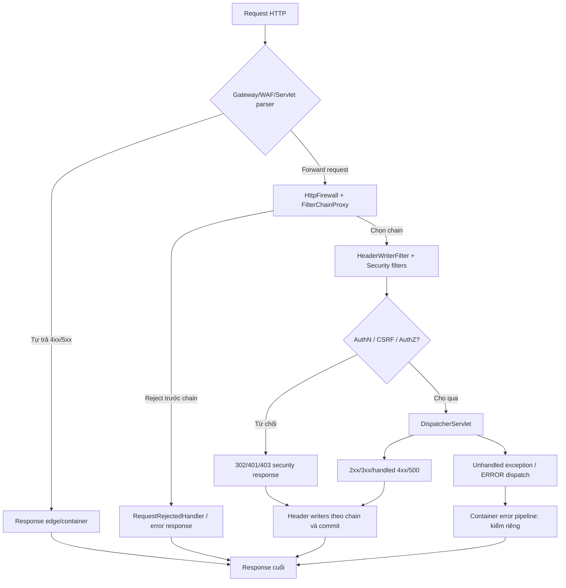

# Kiểm tra header trên phản hồi thành công và phản hồi lỗi

> **Chương:** Kiểm thử Servlet  
> **Module:** `SPRING_SECURITY_HTTP_PROTECTION` — áp dụng các lớp phòng vệ HTTP và trình duyệt bằng Spring Security, bao gồm CSRF, CORS, security headers, CSP, HSTS, HTTP firewall và bảo vệ session. Người học cấu hình Servlet lẫn Reactive, kiểm thử tình huống tấn công web và chẩn đoán xung đột bảo mật khi triển khai.  
> **Trọng tâm:** Trong Spring Security Servlet, kiểm tra security response headers không chỉ trên `200 OK` mà cả `204 No Content`, `302 Redirect`, `400 Bad Request`, `401 Unauthorized`, `403 Forbidden`, `404 Not Found` và `500 Internal Server Error`. Tuy nhiên, header policy phụ thuộc **response owner**: phản hồi đi qua `SecurityFilterChain` có thể được `HeaderWriterFilter` bảo vệ; phản hồi do firewall, Servlet container hoặc gateway tạo trước chain có thể khác.

## 1. Kết quả học tập

Sau bài học, người học có thể:

1. Giải thích vì sao phải kiểm security headers trên **phản hồi thành công, redirect và phản hồi lỗi**.
2. Nêu headers thường được Spring Security Servlet ghi theo mặc định so với headers cần opt-in như `Content-Security-Policy`.
3. Phân biệt `X-Content-Type-Options`, `X-Frame-Options`, `Cache-Control`, `Strict-Transport-Security`, `Content-Security-Policy`, `Referrer-Policy` và `Permissions-Policy`.
4. Hiểu `HeaderWriterFilter`/`HeaderWriter` ghi headers ở trong chain và không bảo đảm áp dụng cho mọi response do edge/container sở hữu.
5. Sử dụng `MockMvc` kiểm header trên 200, 204, 302, 400, 401, 403, 404 và 500 theo fixture có kiểm soát.
6. Kiểm HSTS chỉ xuất hiện trên request được coi là HTTPS theo policy, không coi `secure(true)` là TLS thật.
7. Viết assertions cho header tồn tại, không tồn tại, có giá trị chính xác hay chứa các directives mang ý nghĩa bảo mật.
8. Tách lỗi CSRF 403, authorization 403, authentication 401/302 và lỗi MVC 400/404/500.
9. Biết cách kiểm request chưa vào handler vì security filter, lỗi đã được MVC xử lý và lỗi chưa xử lý của Servlet `ERROR` dispatch.
10. Phân biệt CSP `frame-ancestors` với `X-Frame-Options` và phân biệt CORS response headers với bảo vệ chống CSRF.
11. Viết test cho `SecurityFilterChain` đa dạng, kể cả static resources, error pages, API và browser.
12. Chẩn đoán trường hợp firewall, WAF, reverse proxy hay Servlet container trả response trước header writer.
13. Phân tích Cache-Control cho dữ liệu riêng tư, CSRF token/session và static assets.
14. Kiểm security header behavior sau login/logout, redirects, HTTP response commit, error mapping và CORS.
15. Xác định khi nào cần HTTP/container/ingress/browser integration vượt phạm vi MockMvc.

## 2. Vì sao phải kiểm headers cả khi request thất bại?

Giả sử cùng một ứng dụng có các request:

| Request | Status theo ứng dụng | Response owner dự kiến |
|---|---:|---|
| GET trang công khai | 200 | MVC trong security chain |
| POST cập nhật profile có CSRF | 204 | MVC trong security chain |
| Chưa đăng nhập truy cập trang private | 302 tới login | Authentication entry point |
| API chưa được xác thực | 401 | Authentication entry point |
| POST thiếu CSRF token | 403 | CSRF denial |
| USER truy cập admin với CSRF hợp lệ | 403 | Authorization denial |
| JSON/form sai tham số | 400 | MVC binding/validation |
| Resource không có handler | 404 | MVC hoặc container error handling |
| Controller trả trạng thái 500 có kiểm soát | 500 | MVC response |
| WAF chặn request | 403 | Gateway trước app |
| HTTP parser/container từ chối | 400 hoặc exception | Container trước security chain |

Nếu browser nhận một HTML error page không có CSP trong khi trang bình thường có, bề mặt script/frame injection của error page có thể bị bỏ sót. Response 403 có dữ liệu cá nhân cũng phải tránh shared caching. Ngược lại, một status 200 có headers đúng không chứng minh tất cả failure paths đều an toàn.

### 2.1. Không phải mọi header đều cần có trên mọi response

| Header | Công dụng | Lưu ý khi test |
|---|---|---|
| `Content-Security-Policy` | Browser hạn chế scripts/styles/frames | Cần opt-in và đánh giá directive, không chỉ tồn tại |
| `X-Content-Type-Options: nosniff` | Hạn chế MIME sniffing | Assert `nosniff`, đồng thời Content-Type vẫn phải đúng |
| `X-Frame-Options` | Giảm framing/clickjacking | So `DENY`/`SAMEORIGIN` theo policy |
| `Strict-Transport-Security` | Browser ghi nhớ HTTPS cho host | Thường chỉ trên HTTPS; test giá trị và scope |
| `Cache-Control` | Ngăn cache dữ liệu nhạy cảm | Với private/user-specific response, thường cần `no-store` |
| `Referrer-Policy` | Giới hạn thông tin URL gửi bằng Referer | Không giả định mặc định đã bật |
| `Permissions-Policy` | Giới hạn browser features | Chỉ assert khi chủ động cấu hình |
| `Access-Control-Allow-Origin` | Browser CORS policy | Không phải header mặc định của mọi request |
| `Set-Cookie` | Quản lý cookie/session | Không cần có trên mọi response; cần flags đúng |

Không lấy việc có `X-XSS-Protection` làm tiêu chí chống XSS hiện đại: behavior khác giữa các phiên bản/browser, trong khi output escaping và CSP đúng có ý nghĩa thiết thực hơn.

### 2.2. Header hiện diện không có nghĩa policy hữu ích

Một CSP như `default-src *` hoặc có nhiều ngoại lệ `unsafe-inline` có thể mở rộng đáng kể bề mặt tấn công. Một header `Cache-Control: public` trên response chứa tài khoản là nguy cơ dù header có mặt. Một HSTS `max-age=0` không tương đương yêu cầu HTTPS trong thời gian dài.

**Kiểm cả tên, giá trị và bối cảnh**, không chỉ đếm headers.

## 3. HeaderWriterFilter và ownership của response



Sơ đồ nêu các **điểm quyết định**, không cam kết thứ tự filter cụ thể cho mọi version/custom chain.

### 3.1. HeaderWriterFilter làm việc gì?

`HeaderWriterFilter` gọi các `HeaderWriter` phù hợp để bổ sung headers vào response của request đi qua chain. Header có thể được ghi trong quá trình response commit hoặc khi filter hoàn thành tùy implementation. Vì vậy nhiều responses 2xx, 3xx và 4xx của ứng dụng có cùng policy, nhưng không thể mặc định mọi HTTP response đều đi qua header writer.

### 3.2. Không nhầm error response từ Security với exception trong MVC

`ExceptionTranslationFilter` chuyển một số authentication/authorization exceptions thành entry point hoặc access-denied response; CSRF filter cũng có thể từ chối trước controller. `@RestControllerAdvice` chủ yếu xử lý exception phát sinh trong MVC, không tự xử lý mọi `RequestRejectedException`/firewall/gateway 403.

### 3.3. Response commit là ranh giới quan trọng

Nếu Servlet response đã commit headers/body, một downstream handler không thể sửa headers như chưa commit. Filter wrappers và error dispatch có thể thay đường ghi response; vì thế response cuối ở edge/container cần được kiểm bằng HTTP test, không chỉ dựa trên danh sách `HeaderWriter` đã cấu hình.

## 4. Default security response headers: cần biết trước khi assert

Ở các bản Spring Security Servlet hiện đại với header defaults được bật, những headers thường gặp gồm:

| Header | Giá trị/điều kiện thông dụng | Ý nghĩa |
|---|---|---|
| `Cache-Control` | Chứa `no-cache, no-store, max-age=0, must-revalidate` | Tránh cache dữ liệu nhạy cảm theo default |
| `Pragma` | `no-cache` | Hỗ trợ caching behavior legacy |
| `Expires` | `0` | Hạn chế caching theo cách cũ |
| `X-Content-Type-Options` | `nosniff` | Không đoán MIME không mong muốn |
| `X-Frame-Options` | `DENY` | Hạn chế framing |
| `Strict-Transport-Security` | Trên secure requests | Browser HSTS |
| `X-XSS-Protection` | Có thể là `0` hoặc được cấu hình khác | Không coi là phòng vệ XSS chính |

Không mặc định Spring Security tự sinh `Content-Security-Policy`, `Referrer-Policy` hay `Permissions-Policy` cho mọi app. Chúng cần được cấu hình phù hợp và kiểm theo version.

### 4.1. Cache-Control: kiểm directive thay vì thứ tự chuỗi

Đối với HTML/API chứa thông tin tài khoản, token hoặc user-specific data, thường cần `no-store`. Thứ tự directives trong một header có thể thay đổi hoặc được gateway bổ sung; test nên kiểm `no-store` có mặt, trừ khi hợp đồng API yêu cầu chính xác chuỗi.

### 4.2. HSTS không chỉ là một header có tồn tại hay không

`Strict-Transport-Security: max-age=...; includeSubDomains` ảnh hưởng các lần truy cập sau. `includeSubDomains`/`preload` cần cân nhắc tất cả host/subdomain và TLS; đừng chỉ copy từ một test khác. `secure(true)` trong MockMvc mô phỏng `isSecure()`, không kiểm HTTPS thật.

### 4.3. Không tự suy CSP an toàn cho mọi frontend

Một app SPA, server-rendered template và trang login có nhu cầu script/font/CDN/frames khác nhau. Ví dụ CSP trong bài là một cấu hình đơn giản minh họa; production cần điều chỉnh nonce/hash/trusted types/connect-src/frame-ancestors theo threat model, không nới `unsafe-inline` chỉ để UI chạy.

## 5. Dependencies và MockMvc filter integration

Gradle Kotlin DSL:

```kotlin
dependencies {
    implementation("org.springframework.boot:spring-boot-starter-web")
    implementation("org.springframework.boot:spring-boot-starter-security")

    testImplementation("org.springframework.boot:spring-boot-starter-test")
    testImplementation("org.springframework.security:spring-security-test")
}

tasks.test {
    useJUnitPlatform()
}
```

Hoặc Maven (khi đã có Spring Boot dependency management):

```xml
<dependency>
    <groupId>org.springframework.security</groupId>
    <artifactId>spring-security-test</artifactId>
    <scope>test</scope>
</dependency>
```

Các ví dụ dùng Java 17+/Spring Boot 3+/Spring Security Servlet 6+ theo style thông dụng. Khi nâng version, kiểm phiên bản `spring-security-test` tương thích và đối chiếu defaults/DSL chính thức.

### 5.1. Boot MockMvc trong Spring context

```java
@SpringBootTest
@AutoConfigureMockMvc
class SecurityHeadersContractTest {

    @Autowired
    MockMvc mvc;
}
```

Trong cấu hình Boot hỗ trợ, `@AutoConfigureMockMvc` thường đưa filters vào MockMvc (mặc định `addFilters=true`). Nhưng URL có thể đi chain khác nếu app có nhiều `SecurityFilterChain`.

### 5.2. Tự dựng MockMvc phải gắn Spring Security

```java
@SpringBootTest
class ExplicitSpringSecurityMockMvcTest {

    @Autowired
    WebApplicationContext context;

    MockMvc mvc;

    @BeforeEach
    void init() {
        mvc = MockMvcBuilders
            .webAppContextSetup(context)
            .apply(springSecurity())
            .build();
    }
}
```

Imports:

```java
import org.junit.jupiter.api.BeforeEach;
import org.springframework.beans.factory.annotation.Autowired;
import org.springframework.boot.test.context.SpringBootTest;
import org.springframework.boot.test.autoconfigure.web.servlet.AutoConfigureMockMvc;
import org.springframework.test.web.servlet.MockMvc;
import org.springframework.test.web.servlet.setup.MockMvcBuilders;
import org.springframework.web.context.WebApplicationContext;
import static org.springframework.security.test.web.servlet.setup.SecurityMockMvcConfigurers.springSecurity;
```

### 5.3. Đừng kiểm security headers với filters bị tắt

```java
// Không phù hợp để xác minh HeaderWriterFilter:
@AutoConfigureMockMvc(addFilters = false)
```

```java
// Standalone controller không tự có security chain:
MockMvc mvc = MockMvcBuilders
    .standaloneSetup(controller)
    .build();
```

Header do controller tự set có thể khiến assertion pass dù Spring Security filters không chạy. Kiểm cả CSRF/authorization canary và selected chain để chứng minh test đang đi đúng filter path.
## 6. Cấu hình Servlet SecurityFilterChain có CSP và Referrer-Policy

Bài sử dụng một browser `SecurityFilterChain` có form-login và CSRF mặc định; cấu hình explicit CSP/referrer để tests có giá trị thực, không mặc định rằng framework sinh CSP cho mọi ứng dụng.

```java
package example.security;

import org.springframework.context.annotation.Bean;
import org.springframework.context.annotation.Configuration;
import org.springframework.http.HttpMethod;
import org.springframework.http.HttpStatus;
import org.springframework.security.config.Customizer;
import org.springframework.security.config.annotation.web.builders.HttpSecurity;
import org.springframework.security.config.annotation.web.configuration.EnableWebSecurity;
import org.springframework.security.web.SecurityFilterChain;
import org.springframework.security.web.authentication.HttpStatusEntryPoint;
import org.springframework.security.web.header.writers.ReferrerPolicyHeaderWriter;
import org.springframework.security.web.util.matcher.AntPathRequestMatcher;

@Configuration
@EnableWebSecurity
public class SecurityHeadersConfig {

    @Bean
    SecurityFilterChain browser(HttpSecurity http)
            throws Exception {
        return http
            .authorizeHttpRequests(auth -> auth
                .requestMatchers(HttpMethod.GET,
                    "/demo/ok",
                    "/demo/redirect",
                    "/demo/bad-request",
                    "/demo/server-error",
                    "/demo/needs-id",
                    "/login").permitAll()
                .requestMatchers("/admin/**").hasRole("ADMIN")
                .anyRequest().authenticated())
            .exceptionHandling(ex -> ex
                .defaultAuthenticationEntryPointFor(
                    new HttpStatusEntryPoint(
                        HttpStatus.UNAUTHORIZED),
                    new AntPathRequestMatcher("/api/**")))
            .csrf(Customizer.withDefaults())
            .formLogin(Customizer.withDefaults())
            .headers(headers -> headers
                .contentSecurityPolicy(csp -> csp
                    .policyDirectives(
                        "default-src 'self'; " +
                        "object-src 'none'; " +
                        "base-uri 'self'; " +
                        "frame-ancestors 'none'"))
                .referrerPolicy(referrer -> referrer
                    .policy(
                        ReferrerPolicyHeaderWriter.ReferrerPolicy
                            .STRICT_ORIGIN_WHEN_CROSS_ORIGIN)))
            .build();
    }
}
```

Giải thích thiết kế:

- CSP được cấu hình bằng `contentSecurityPolicy(...)`; không có dòng này thì test đòi CSP có thể thất bại đúng vì framework không bật CSP mặc định.
- `Referrer-Policy` cũng được bật explicit bằng `referrerPolicy(...)`; không áp một assertion bắt buộc vào app chưa cấu hình.
- Default writers khác thường còn hiệu lực, miễn không dùng `defaultsDisabled()` hoặc disabled writers.
- `HttpStatusEntryPoint(UNAUTHORIZED)` minh họa cách trả 401 cho request chưa xác thực dưới `/api/**`, còn form-login entry point có thể redirect 302 cho browser URLs.
- Ví dụ chỉ dùng **một chain** để giảm số fixture; nó **không** phải blueprint API JWT-only, vì credential model của các endpoints vẫn theo policy tổng thể.
- `POST /demo/update` và `POST /admin/settings` mặc định cần CSRF token.
- Browser và API thật có thể cần **nhiều chains**, tách login/cookie và stateless Bearer; sẽ phân tích kiểm thử multiple chains ở phần sau.

### 6.1. Vì sao không tự khai đủ mọi header ở controller?

Security response headers là chính sách xuyên nhiều endpoints/status; đặt ở security chain giúp giảm việc quên viết headers trên lỗi 401/403 hoặc 302. Controller vẫn có thể thêm response-specific headers như `Location`, `Content-Type` hoặc cache policy đặc thù; cần kiểm tránh header values mâu thuẫn.

### 6.2. Caution về CSP

CSP ở ví dụ dành cho HTML/JSON đơn giản. App có scripts, styles, frames, websockets, fonts hoặc CDN cần thêm directives phù hợp. Đừng chữa UI bị CSP chặn bằng cách mở `unsafe-inline`/`*` tùy tiện. Có thể dùng CSP nonces/hashes, report-only giai đoạn rollout và kiểm browser DevTools riêng.

### 6.3. Caution về HeaderWriterFilter và exception mapping

Header writer có thể bảo vệ response 403 do security filters và 500 do controller trả trực tiếp. Nhưng nếu một exception được ném xuyên qua Servlet filter chain hoặc ERROR dispatch do container tạo, response cuối có thể khác; phải kiểm HTTP integration thay vì suy từ config.

## 7. Controller fixture tạo 200/204/302/400/500

Một controller đơn giản giúp test headers mà không lẫn database/service behavior:

```java
package example.web;

import java.net.URI;
import java.util.Map;
import org.springframework.http.HttpStatus;
import org.springframework.http.ResponseEntity;
import org.springframework.web.bind.annotation.*;

@RestController
class HeaderDemoController {

    @GetMapping("/demo/ok")
    ResponseEntity<Map<String, String>> ok() {
        return ResponseEntity.ok(
            Map.of("message", "ok"));
    }

    @GetMapping("/demo/redirect")
    ResponseEntity<Void> redirect() {
        return ResponseEntity.status(HttpStatus.FOUND)
            .location(URI.create("/demo/ok"))
            .build();
    }

    @GetMapping("/demo/bad-request")
    ResponseEntity<Map<String, String>> badRequest() {
        return ResponseEntity.badRequest()
            .body(Map.of("error", "bad_input"));
    }

    @GetMapping("/demo/server-error")
    ResponseEntity<Map<String, String>> serverError() {
        // 500 explicit từ controller; không phải ERROR dispatch.
        return ResponseEntity
            .status(HttpStatus.INTERNAL_SERVER_ERROR)
            .body(Map.of("error", "internal_error"));
    }

    @GetMapping("/demo/needs-id")
    ResponseEntity<Map<String, Long>> needsId(
            @RequestParam("id") long id) {
        return ResponseEntity.ok(
            Map.of("id", id));
    }

    @GetMapping("/account")
    ResponseEntity<String> account() {
        return ResponseEntity.ok("account");
    }

    @GetMapping("/api/private")
    ResponseEntity<String> apiPrivate() {
        return ResponseEntity.ok("private");
    }

    @PostMapping("/demo/update")
    ResponseEntity<Void> update(
            @RequestParam("name") String name) {
        return ResponseEntity.noContent().build();
    }

    @PostMapping("/admin/settings")
    ResponseEntity<Void> adminUpdate(
            @RequestParam("theme") String theme) {
        return ResponseEntity.noContent().build();
    }
}
```

Controller `/demo/server-error` trả 500 có chủ ý qua `ResponseEntity`, nghĩa là Spring MVC có response thông thường. Một unhandled exception hoặc container error page có đường xử lý **khác**, không được bao trùm bởi test này.

### 7.1. Đảm bảo test không bị auth che 404/400

Trong config mục 6, `GET /demo/needs-id` là public nên thiếu parameter có thể tới MVC và trả 400. Với `GET /demo/not-mapped` chưa có handler nhưng mặc định yêu cầu authenticated, test cần `with(user(...))` mới tới MVC 404 thay vì nhận redirect login.

### 7.2. Đừng quên CSRF trên POST hợp lệ

`POST /demo/update` là endpoint private, khi user có role cần thiết nhưng không CSRF sẽ nhận 403. Chỉ thêm `with(csrf())` ở positive 204 test; ngược lại phải có negative 403 để chứng minh filter đang chạy.

### 7.3. Response 302 redirect cũng cần chính sách

Redirect controller trả `Location: /demo/ok`; browser form-login redirect tạo `Location: /login` hoặc URL khác theo config. Security headers cần được kiểm trên cả hai nếu response đi qua same chain; CORS, cache và cookies cần được xem xét theo request context.

## 8. Ma trận response owner và kỳ vọng test

| Request | Auth / CSRF | Status theo fixture | Tầng tạo response |
|---|---|---:|---|
| `GET /demo/ok` | Anonymous public | 200 | MVC |
| `POST /demo/update` | USER + valid CSRF | 204 | MVC |
| `GET /demo/redirect` | Anonymous public | 302 | MVC redirect |
| `GET /account` | Anonymous | 302 login | Form-login entry point |
| `GET /api/private` | Anonymous | 401 | API-specific entry point |
| `POST /demo/update` | USER, thiếu CSRF | 403 | CsrfFilter |
| `POST /admin/settings` | USER + valid CSRF | 403 | Authorization |
| `GET /demo/bad-request` | Anonymous public | 400 | MVC explicit 400 |
| `GET /demo/needs-id` | Anonymous thiếu parameter | 400 | MVC argument resolver |
| `GET /demo/not-mapped` | USER | 404 | MVC no handler |
| `GET /demo/server-error` | Anonymous public | 500 | MVC explicit 500 |
| `GET /demo/crash` | Có thể ném exception | 500 ở Servlet container hoặc exception propagate trong MockMvc | Error dispatch/exception handling cần test riêng |
| Malformed path/TRACE | Bất kỳ | 400/403/exception | Firewall/parser có thể chặn trước chain |
| Gateway WAF rule | Bất kỳ | 403/502 tùy edge | Gateway/proxy |

### 8.1. Không xem bảng là hợp đồng HTTP mặc định mọi Spring app

Form login, API entry point, MVC advice, status của không-matching route và error dispatch có thể được custom. Những assertions trong bài dựa trên fixture đúng cấu hình; phải điều chỉnh theo ứng dụng thực, không chép status từ một stack khác.

### 8.2. Header theo status có khác biệt hợp lý

`Location` chỉ có trên redirect; `WWW-Authenticate` tùy Basic/Bearer entry point, không bắt buộc trong ví dụ `HttpStatusEntryPoint(401)`. `Access-Control-Allow-Origin` thuộc CORS, không phải header mặc định trên mọi response. `Content-Type` có thể vắng mặt trên 204 hoặc redirect, không nên assert JSON content type lên mọi status.

## 9. Kiểm header mặc định trên 200 OK

Ví dụ sử dụng `@SpringBootTest` + `@AutoConfigureMockMvc` và config mục 6:

```java
@Test
void okResponseContainsCoreSecurityHeaders()
        throws Exception {
    mvc.perform(get("/demo/ok"))
        .andExpect(status().isOk())
        .andExpect(header().string(
            "X-Content-Type-Options", "nosniff"))
        .andExpect(header().string(
            "X-Frame-Options", "DENY"))
        .andExpect(header().string(
            "Cache-Control", containsString("no-store")))
        .andExpect(header().string(
            "Content-Security-Policy",
            containsString("object-src 'none'")))
        .andExpect(header().string(
            "Referrer-Policy",
            "strict-origin-when-cross-origin"));
}
```

Import:

```java
import static org.hamcrest.Matchers.containsString;
import static org.springframework.test.web.servlet.request.MockMvcRequestBuilders.*;
import static org.springframework.test.web.servlet.result.MockMvcResultMatchers.*;
```

Test này đo header writer với response thành công, **không** khẳng định HEAD/304/error pages đều có cùng Content-Type/Cache-Control. Giá trị policy có thể khác khi app chủ ý cho iframe hoặc dùng CSP riêng cho HTML vs static resource.

### 9.1. Test chính directive CSP quan trọng

```java
mvc.perform(get("/demo/ok"))
    .andExpect(status().isOk())
    .andExpect(header().string(
        "Content-Security-Policy",
        containsString("frame-ancestors 'none'")))
    .andExpect(header().string(
        "Content-Security-Policy",
        containsString("base-uri 'self'")));
```

Chỉ `header().exists("Content-Security-Policy")` sẽ pass cả khi policy bị thay thành `default-src *`, nên test directives có nghĩa theo threat model.

### 9.2. Tránh hardcode giá trị default theo version không xác minh

Có thể test `X-Content-Type-Options: nosniff`/`X-Frame-Options: DENY` theo fixture hiện tại; với app đã custom frame options hoặc disabled defaults, assertions phải theo policy mới. `X-XSS-Protection` không nên là tiêu chí chính chống XSS trong ứng dụng hiện đại.

## 10. POST 204 No Content vẫn có security headers

Một successful mutation không trả body vẫn có thể chứa security headers:

```java
@Test
void noContentPostHasSecurityHeaders()
        throws Exception {
    mvc.perform(post("/demo/update")
            .with(user("alice").roles("USER"))
            .with(csrf())
            .param("name", "Alice"))
        .andExpect(status().isNoContent())
        .andExpect(header().string(
            "X-Content-Type-Options", "nosniff"))
        .andExpect(header().string(
            "X-Frame-Options", "DENY"))
        .andExpect(header().string(
            "Cache-Control", containsString("no-store")))
        .andExpect(header().string(
            "Content-Security-Policy",
            containsString("object-src 'none'")));
}
```

Thành công 204 không đồng nghĩa response body phải là JSON; nhiều controllers không ghi `Content-Type`. Không dùng `content().contentType(MediaType.APPLICATION_JSON)` một cách máy móc cho `204 No Content`.

### 10.1. Token CSRF là yêu cầu của request, không phải response header bắt buộc

`with(csrf())` thêm submitted token vào request test. Spring Security **không** mặc định phải thêm `X-CSRF-TOKEN` vào mọi response. Nếu frontend cần phát token qua cookie/endpoint, đó là protocol riêng; không assert response `X-CSRF-TOKEN` trên mọi 204 khi không hề cấu hình.

### 10.2. Negative control: thiếu CSRF không được 204

```java
mvc.perform(post("/demo/update")
        .with(user("alice").roles("USER"))
        .param("name", "Alice"))
    .andExpect(status().isForbidden());
```

Không chỉ kiểm headers success; canary này bảo đảm CSRF filter đang thực sự áp dụng. Request bị chặn có thể vẫn mang security headers, sẽ test riêng ở phần 403.

## 11. Helper chung để kiểm header invariant theo chain

Khi nhiều statuses cần cùng core policy, tạo helper để tránh bỏ một header ở test mới:

```java
static void assertBrowserSecurityHeaders(
        MvcResult result) {
    MockHttpServletResponse response =
        result.getResponse();

    assertEquals("nosniff",
        response.getHeader("X-Content-Type-Options"));
    assertEquals("DENY",
        response.getHeader("X-Frame-Options"));

    String cache =
        response.getHeader("Cache-Control");
    assertNotNull(cache);
    assertTrue(cache.contains("no-store"));

    String csp =
        response.getHeader("Content-Security-Policy");
    assertNotNull(csp);
    assertTrue(csp.contains("object-src 'none'"));
    assertTrue(csp.contains("frame-ancestors 'none'"));

    assertEquals("strict-origin-when-cross-origin",
        response.getHeader("Referrer-Policy"));
}
```

Imports:

```java
import org.springframework.test.web.servlet.MvcResult;
import org.springframework.mock.web.MockHttpServletResponse;
import static org.junit.jupiter.api.Assertions.*;
```

Dùng với MockMvc:

```java
mvc.perform(get("/demo/ok"))
    .andExpect(status().isOk())
    .andExpect(
        SecurityHeadersContractTest
            ::assertBrowserSecurityHeaders);
```

Đây là cú pháp `ResultMatcher` thông qua method reference nhận `MvcResult`. Trong project thực, có thể đưa helper vào test support class hoặc sử dụng riêng `andExpectAll(...)` tùy Spring Test version.

### 11.1. Không tạo helper “mọi response luôn có tất cả headers”

Helper này dành cho **browser response thuộc chain/config đã định nghĩa**. Không áp vô điều kiện cho gateway 403, HTTP 304, static asset cache response, CORS preflight hoặc một chain có CSP khác. Khi policy khác nhau, tạo helpers theo named policies, không làm một “god assertion” mơ hồ.

### 11.2. Assert policy trước khi assert status có thể làm báo lỗi khó hiểu

Trong test nên assert status trước, headers sau. Nếu controller trả 302 thay vì 200 vì chưa login, nguyên nhân chính dễ nhìn hơn khi lỗi status xuất hiện đầu tiên.
## 12. Redirect 302: headers của login và redirect controller

Có ít nhất hai nguồn redirect phổ biến:

1. `GET /demo/redirect` trả `302 Location: /demo/ok` từ MVC.
2. `GET /account` anonymous dẫn đến `302 Location: /login` do Spring Security form-login entry point.

Cả hai được xử lý trong browser chain mẫu và nên có security header policy phù hợp.

### 12.1. Redirect do controller trả về

```java
@Test
void mvcRedirectKeepsSecurityHeaders()
        throws Exception {
    mvc.perform(get("/demo/redirect"))
        .andExpect(status().isFound())
        .andExpect(header().string(
            "Location", "/demo/ok"))
        .andExpect(
            SecurityHeadersContractTest
                ::assertBrowserSecurityHeaders);
}
```

`Location` là response-specific header, không phải security header writer. Redirect có thể có hoặc không có body/Content-Type; không assert `application/json` cho 302.

### 12.2. Redirect do authentication entry point

```java
@Test
void anonymousBrowserRedirectHasCoreHeaders()
        throws Exception {
    mvc.perform(get("/account"))
        .andExpect(status().is3xxRedirection())
        .andExpect(redirectedUrlPattern("**/login"))
        .andExpect(
            SecurityHeadersContractTest
                ::assertBrowserSecurityHeaders);
}
```

Điều kiện: form login được bật, `/account` protected và không có custom entry point trả JSON 401 thay vì redirect. Nếu chain API được chọn, 302 có thể là lỗi policy chứ không phải yêu cầu test hợp lệ.

### 12.3. Redirect URL có thể nhạy cảm

Một redirect có đủ CSP/HSTS vẫn có thể dẫn tới open redirect hoặc token leak qua `Location`. Test allowlist redirect host, reject untrusted `redirect_uri` và tránh nhúng CSRF/JWT/session token trong query string. Security response headers **không thay URL validation**.

### 12.4. Không đi theo redirect khi muốn kiểm response trung gian

Một HTTP client/browser có thể tự follow 302 rồi chỉ hiển thị headers của trang đích; MockMvc không tự follow redirect ở `perform(...)`. Khi kiểm redirect security headers, assert trên **302 response ban đầu**, sau đó nếu cần kiểm GET trang login/đích thì thực hiện request khác.

## 13. 401 Unauthorized: headers từ authentication entry point

Với config mục 6, anonymous `GET /api/private` được map sang `HttpStatusEntryPoint(HttpStatus.UNAUTHORIZED)`. Test:

```java
@Test
void unauthorizedApiResponseRetainsSecurityHeaders()
        throws Exception {
    mvc.perform(get("/api/private"))
        .andExpect(status().isUnauthorized())
        .andExpect(header().string(
            "X-Content-Type-Options", "nosniff"))
        .andExpect(header().string(
            "Cache-Control", containsString("no-store")))
        .andExpect(header().string(
            "Content-Security-Policy",
            containsString("frame-ancestors 'none'")));
}
```

Test này kiểm header behavior trên 401 do entry point, không cần gửi CSRF vì GET là safe method.

### 13.1. `WWW-Authenticate` phụ thuộc entry point

`HttpStatusEntryPoint(401)` đơn giản có thể không cung cấp Basic/Bearer challenge. Nếu API dùng OAuth2 Resource Server JWT, unauthenticated 401 thường có `WWW-Authenticate: Bearer ...` theo entry point; nếu dùng Basic có thể là `WWW-Authenticate: Basic ...`. Đây là **protocol authentication header**, không phải một trong các CSP/cache headers.

Một test dành riêng cho Bearer API có thể:

```java
mvc.perform(get("/api/private"))
    .andExpect(status().isUnauthorized())
    .andExpect(header().string(
        "WWW-Authenticate", containsString("Bearer")));
```

**Điều kiện:** Chỉ áp assertion này sau khi thay fixture bằng Resource Server/Bearer entry point thật và cấu hình `JwtDecoder`. Không áp lên ví dụ `HttpStatusEntryPoint` mục 6.

### 13.2. 401 khác 403

401 thường biểu thị credential bị thiếu hoặc chưa hợp lệ, 403 thường là authenticated principal thiếu quyền, hoặc CSRF/CORS/business denial. Hai responses có thể cùng CSP/nosniff/cache policy nhưng mã trạng thái và nguồn từ chối khác; test cả hai.

### 13.3. Không trả dữ liệu nhạy cảm trong body 401

CSP và cache headers không xóa dữ liệu đã gửi; body 401 không nên lộ password/token, chi tiết internal authentication state hoặc stack trace. Kiểm error envelope/redaction riêng nếu API có JSON error contract.

## 14. 403 do thiếu CSRF: security filter từ chối trước controller

`POST /demo/update` thiếu token dù user authenticated:

```java
@Test
void csrfForbiddenResponseRetainsCoreHeaders()
        throws Exception {
    mvc.perform(post("/demo/update")
            .with(user("alice").roles("USER"))
            .param("name", "Alice"))
        .andExpect(status().isForbidden())
        .andExpect(header().string(
            "X-Content-Type-Options", "nosniff"))
        .andExpect(header().string(
            "X-Frame-Options", "DENY"))
        .andExpect(header().string(
            "Content-Security-Policy",
            containsString("object-src 'none'")))
        .andExpect(header().string(
            "Cache-Control", containsString("no-store")));
}
```

Nếu response là do `CsrfFilter` từ chối, controller `/demo/update` không thực thi. Một `@RestControllerAdvice` dùng cho MVC exceptions không tự tạo error body cho response này. Test headers cho chính CSRF denial path giúp phát hiện header writer bị vô hiệu hoặc chain khác được chọn.

### 14.1. Đối chứng CSRF hợp lệ

```java
mvc.perform(post("/demo/update")
        .with(user("alice").roles("USER"))
        .with(csrf())
        .param("name", "Alice"))
    .andExpect(status().isNoContent());
```

Nếu cả thiếu token và có token đều 403, có thể lỗi role, controller hoặc request handler. Nếu thiếu token vẫn 204, filters có thể không chạy hoặc CSRF bị tắt. Status 403 riêng lẻ chưa chứng minh đúng failure owner.

### 14.2. Token sai cũng có thể trả 403

```java
mvc.perform(post("/demo/update")
        .with(user("alice").roles("USER"))
        .with(csrf().useInvalidToken())
        .param("name", "Alice"))
    .andExpect(status().isForbidden());
```

Thiếu token khác token sai; đừng tự suy `MissingCsrfTokenException` với `InvalidCsrfTokenException` sẽ luôn ánh xạ riêng trong mọi version/custom repository. Header policy thường không nên thay chỉ vì hai loại denial.

### 14.3. Browser có thể không hiển thị error body nếu CORS lỗi

Nếu browser gọi API cross-origin và actual 403 không có `Access-Control-Allow-Origin` phù hợp, DevTools/JavaScript có thể hiện CORS error thay vì đọc được 403 body. Đó là một vấn đề riêng với CSP/nosniff/cache của response; không chữa bằng cách tắt CSRF.

## 15. 403 do thiếu role: vẫn là header policy của chain

`POST /admin/settings` với user Alice có role USER và valid CSRF sẽ được CSRF filter cho qua rồi authorization từ chối vì `hasRole("ADMIN")`:

```java
@Test
void accessDeniedResponseStillHasHeaders()
        throws Exception {
    mvc.perform(post("/admin/settings")
            .with(user("alice").roles("USER"))
            .with(csrf())
            .param("theme", "dark"))
        .andExpect(status().isForbidden())
        .andExpect(header().string(
            "X-Content-Type-Options", "nosniff"))
        .andExpect(header().string(
            "X-Frame-Options", "DENY"))
        .andExpect(header().string(
            "Content-Security-Policy",
            containsString("frame-ancestors 'none'")));
}
```

### 15.1. Hai 403 không chứng minh cùng một lớp

```java
// CSRF denial dù ADMIN có đủ role:
mvc.perform(post("/admin/settings")
        .with(user("root").roles("ADMIN"))
        .param("theme", "dark"))
    .andExpect(status().isForbidden());

// Role denial khi CSRF đã hợp lệ:
mvc.perform(post("/admin/settings")
        .with(user("alice").roles("USER"))
        .with(csrf())
        .param("theme", "dark"))
    .andExpect(status().isForbidden());

// Hai điều kiện đều hợp lệ:
mvc.perform(post("/admin/settings")
        .with(user("root").roles("ADMIN"))
        .with(csrf())
        .param("theme", "dark"))
    .andExpect(status().isNoContent());
```

Test headers nên bao phủ cả hai failure owners, đồng thời positive admin case để xác minh controller tồn tại và không có policy luôn trả 403.

### 15.2. AccessDeniedHandler custom có thể ghi response khác

Nếu app dùng custom `AccessDeniedHandler` để trả JSON error body, kiểm thêm `Content-Type`/error code và ensure headers không bị overwrite. Handler không nên tự gọi `response.reset()` một cách không kiểm soát sau khi security headers đã được tạo; response commit/dispatch behavior cần được test thực tế.

## 16. 400 Bad Request do MVC: response lỗi cũng cần headers

Controller `GET /demo/bad-request` trả một 400 có chủ đích:

```java
@Test
void explicitBadRequestContainsHeaders()
        throws Exception {
    mvc.perform(get("/demo/bad-request"))
        .andExpect(status().isBadRequest())
        .andExpect(content().contentTypeCompatibleWith(
            MediaType.APPLICATION_JSON))
        .andExpect(header().string(
            "X-Content-Type-Options", "nosniff"))
        .andExpect(header().string(
            "Cache-Control", containsString("no-store")))
        .andExpect(header().string(
            "Content-Security-Policy",
            containsString("object-src 'none'")));
}
```

Điều này không chứng minh mọi `400` do Servlet parser/firewall cũng có CSP. Test đang đo **MVC-owned 400** khi request đã đi vào security chain.

### 16.1. 400 do thiếu `@RequestParam`

```java
@Test
void bindingErrorBadRequestKeepsHeaders()
        throws Exception {
    mvc.perform(get("/demo/needs-id"))
        .andExpect(status().isBadRequest())
        .andExpect(header().string(
            "X-Content-Type-Options", "nosniff"))
        .andExpect(header().string(
            "Cache-Control", containsString("no-store")));
}
```

Vì GET được CSRF matcher coi safe và public path được permitAll, failure đến từ MVC parameter resolution. Nếu endpoint private và anonymous, response có thể 302/401 trước khi tới MVC.

### 16.2. Dữ liệu input không hợp lệ không nên lộ secrets

Response 400 nên có error code/message không để lộ token, database column/schema nội bộ hoặc request body có thông tin riêng tư. Security headers không tự redact body. Với `@Valid`/validation advice, kiểm JSON envelope và headers theo response contract.

## 17. 404 Not Found: route không tồn tại vẫn có thể vào chain

Một GET không matching controller nhưng được authenticated:

```java
@Test
void mvcNotFoundCanRetainHeaders()
        throws Exception {
    mvc.perform(get("/demo/not-mapped")
            .with(user("alice").roles("USER")))
        .andExpect(status().isNotFound())
        .andExpect(header().string(
            "X-Content-Type-Options", "nosniff"))
        .andExpect(header().string(
            "Content-Security-Policy",
            containsString("object-src 'none'")));
}
```

Tùy Spring MVC static resource mappings/error resolvers, response 404 có thể từ MVC handler mapping hoặc static-resource resolver; request vẫn đi security chain nếu chain được chọn. Một 404 do CDN proxy trả về **không** nhất thiết có các headers tương tự.

### 17.1. Anonymous GET không matching route có thể redirect login

```java
mvc.perform(get("/demo/not-mapped"))
    .andExpect(status().is3xxRedirection());
```

Vì browser config có `anyRequest().authenticated()`, security sẽ yêu cầu login trước khi MVC quyết định route không có. Nếu mục tiêu kiểm 404, tạo authenticated principal hoặc thiết lập phù hợp với chính sách cho unknown paths.

### 17.2. Đừng dùng 404 để che authorization mà bỏ security chain

Một ứng dụng có thể cố ý trả 404 thay cho 403 để tránh lộ sự tồn tại tài nguyên, nhưng authorization vẫn phải được kiểm trong chain/service. Không dùng `web.ignoring()` rồi trả 404 từ controller như một cách thay security policy.

### 17.3. Client không được cache lỗi có dữ liệu riêng tư

Một error page 404 chứa gợi ý cá nhân hóa, request ID hoặc tên người dùng có thể cần `Cache-Control: no-store`. Còn một static 404 thuần generic ở CDN có thể có caching strategy riêng; đánh giá privacy và response ownership thay vì áp giá trị toàn cục không cân nhắc.

## 18. 500 trả trực tiếp từ controller: có headers nhưng chưa kiểm unhandled exception

Với `GET /demo/server-error` trả `ResponseEntity.status(500)`:

```java
@Test
void controllerGenerated500KeepsSecurityHeaders()
        throws Exception {
    mvc.perform(get("/demo/server-error"))
        .andExpect(status().isInternalServerError())
        .andExpect(content().contentTypeCompatibleWith(
            MediaType.APPLICATION_JSON))
        .andExpect(header().string(
            "X-Content-Type-Options", "nosniff"))
        .andExpect(header().string(
            "Cache-Control", containsString("no-store")))
        .andExpect(header().string(
            "Content-Security-Policy",
            containsString("object-src 'none'")));
}
```

Đây là case **500 đã được MVC chủ động tạo**, request đi security chain và response trở lại qua filter processing bình thường. Nó không tương đương:

- `NullPointerException` chưa được xử lý.
- Exception ném trong filter trước `HeaderWriterFilter`.
- `sendError(500)` kích hoạt container `ERROR` dispatch.
- Connection bị cắt/response đã commit một phần.
- Gateway trả 502/503 do upstream lỗi.

### 18.1. Vì sao MockMvc có thể ném exception thay vì trả MvcResult 500?

Với một controller đơn giản:

```java
@GetMapping("/demo/crash")
String crash() {
    throw new IllegalStateException(
        "simulated failure");
}
```

Nếu không có `@ControllerAdvice` hoặc resolver xử lý exception, `mvc.perform(get("/demo/crash"))` có thể ném `ServletException`/root exception ra test thay vì sinh response 500 qua Servlet container error page như network. Không assert `status().isInternalServerError()` trên một unhandled exception mà chưa biết MockMvc error handling behavior.

### 18.2. Test 500 thật qua HTTP server

Dùng `@SpringBootTest(webEnvironment = RANDOM_PORT)` với embedded Servlet container, gửi request thực tới endpoint ném exception, và kiểm final status/headers/cache/body. Điều này kiểm HTTP error pipeline mà MockMvc explicit 500 không bao quát; khi có gateway, cần staging ingress test thêm.

## 19. 401/403/404/500: khi nào cần header policy khác nhau?

Các phản hồi có thể cùng CSP/nosniff/frame policy nhưng khác response-specific details:

| Status | Header response-specific cần cân nhắc | Không nên mặc định |
|---|---|---|
| 200 HTML | CSP, Content-Type, cache theo sensitivity | Có Set-Cookie ở mọi request |
| 204 | CSP/nosniff nếu chain ghi; không body | Content-Type JSON luôn hiện diện |
| 302 | Location, cookie/session khi login, CSP/cache policy | 302 body phải JSON |
| 400 | Content-Type và error envelope, no-store khi private | Header từ controller cho mọi parser error |
| 401 | WWW-Authenticate theo authentication scheme | Mọi 401 đều là Bearer challenge |
| 403 | No-store, CSP nếu browser page, CORS error mapping nếu applicable | Mọi 403 do CsrfFilter |
| 404 | Cache policy theo route/data | Mọi CDN 404 được Spring Security ghi headers |
| 500 | No-store, generic body, trace redaction | Mọi 500 của container/gateway qua MVC |

### 19.1. CORS headers có thể làm status bị browser che đi

Nếu frontend SPA cross-origin thực hiện unsafe request, response 401/403 do backend có thể bị JavaScript xem như CORS error khi thiếu `Access-Control-Allow-Origin` đúng policy. Cần test **preflight** và **actual response**, không chỉ một header CSP trên error.

### 19.2. Error body không nên tự tiết lộ thông tin nội bộ

Dù response có CSP/HSTS, stack trace, SQL error hoặc secrets trong JSON 500 vẫn là rò rỉ. Test API error envelope/redaction riêng, và kiểm 401/403 không tiết lộ internal user existence/password semantics.
## 20. HSTS: kiểm cả HTTPS success và HTTPS error

`Strict-Transport-Security` là browser policy yêu cầu các lần truy cập sau dùng HTTPS cho host trong một khoảng thời gian. Spring Security HSTS writer thường **chỉ ghi khi request được nhận diện là secure**, không phải mọi HTTP request.

### 20.1. HTTPS giả lập với MockMvc

```java
@Test
void secureOkResponseContainsHsts()
        throws Exception {
    mvc.perform(get("/demo/ok").secure(true))
        .andExpect(status().isOk())
        .andExpect(header().string(
            "Strict-Transport-Security",
            containsString("max-age=")));
}
```

Điều kiện: default HSTS writer được bật trong chain. Nếu app đã disabled HSTS ở Spring vì edge sở hữu HSTS, assertion cần chuyển sang integration test ở public ingress.

### 20.2. HSTS trên 403 CSRF khi HTTPS

```java
@Test
void secureCsrfForbiddenResponseContainsHsts()
        throws Exception {
    mvc.perform(post("/demo/update")
            .secure(true)
            .with(user("alice").roles("USER"))
            .param("name", "Alice"))
        .andExpect(status().isForbidden())
        .andExpect(header().string(
            "Strict-Transport-Security",
            containsString("max-age=")))
        .andExpect(header().string(
            "X-Content-Type-Options", "nosniff"));
}
```

Header writer của same chain thường hoạt động trên cả 200 và security 403, nhưng cần kiểm đúng response owner. Một 403 được CDN/WAF trả trước backend không được kiểm bằng test này.

### 20.3. HSTS trên 302 login redirect

```java
mvc.perform(get("/account").secure(true))
    .andExpect(status().is3xxRedirection())
    .andExpect(header().string(
        "Strict-Transport-Security",
        containsString("max-age=")));
```

Nếu user truy cập host qua HTTPS lần đầu rồi bị redirect login, trình duyệt có thể ghi nhớ HSTS từ response HTTPS hợp lệ. Đừng đợi chỉ tới trang sau login mới kiểm policy.

### 20.4. HTTP thường không có HSTS do Spring writer

```java
@Test
void insecureMockRequestHasNoSpringHsts()
        throws Exception {
    mvc.perform(get("/demo/ok").secure(false))
        .andExpect(status().isOk())
        .andExpect(header().doesNotExist(
            "Strict-Transport-Security"));
}
```

Điều này phù hợp HSTS semantics: browser chỉ chấp nhận HSTS được phát qua HTTPS hợp lệ. Nếu production edge chủ động ghi HSTS khác, HTTP response ngoài network có thể có header nhưng browser không tin nó. Assert không có HSTS trong test chỉ dành cho **Spring chain fixture**, không phải một yêu cầu “mọi HTTP response không được chứa header”.

### 20.5. Vì sao `X-Forwarded-Proto: https` chưa đủ trong MockMvc?

`header("X-Forwarded-Proto", "https")` không bảo đảm `request.isSecure()` là true nếu app chưa cấu hình trusted forwarded header handling. Forwarded headers do **client không tin cậy** gửi có thể bị giả mạo; phải chỉ tin chúng sau khi được ingress đáng tin cậy đặt/chuẩn hóa. `secure(true)` chỉ mô phỏng trạng thái secure cho filter unit/integration test, còn TLS/ingress behavior phải test riêng.

### 20.6. Test giá trị `max-age`, không chỉ tên header

Nếu HSTS policy app yêu cầu tối thiểu 1 năm, có thể phân tích `max-age` trong header và assert số giây tương ứng. Cần chú ý cấu hình `includeSubDomains`/`preload` là quyết định hạ tầng, không mặc định bật chỉ vì một ví dụ. `max-age=0` có ý nghĩa xóa HSTS policy, nên test `header().exists(...)` đơn lẻ có thể pass nhưng không bảo vệ.

## 21. Content-Security-Policy: kiểm directive trên success và error

CSP chống lại một số kịch bản script/content injection bằng cách hạn chế các nguồn được phép ở browser document. CSP không tự lọc HTML đầu ra và không thay output encoding, XSS hardening hoặc validation.

### 21.1. Kiểm CSP chính xác theo policy

```java
@Test
void htmlPolicyDirectivesAppearOnSuccess()
        throws Exception {
    mvc.perform(get("/demo/ok"))
        .andExpect(status().isOk())
        .andExpect(header().string(
            "Content-Security-Policy",
            containsString("default-src 'self'")))
        .andExpect(header().string(
            "Content-Security-Policy",
            containsString("object-src 'none'")))
        .andExpect(header().string(
            "Content-Security-Policy",
            containsString("base-uri 'self'")))
        .andExpect(header().string(
            "Content-Security-Policy",
            containsString("frame-ancestors 'none'")));
}
```

Đây là response JSON trong fixture, nhưng CSP rất có ý nghĩa với **HTML document**. Để chứng minh browser enforcement, cần kiểm trang HTML thật hoặc browser E2E thay vì chỉ một JSON response.

### 21.2. Security 403 và MVC 400 có CSP không?

```java
mvc.perform(post("/demo/update")
        .with(user("alice").roles("USER"))
        .param("name", "Alice"))
    .andExpect(status().isForbidden())
    .andExpect(header().string(
        "Content-Security-Policy",
        containsString("frame-ancestors 'none'")));

mvc.perform(get("/demo/bad-request"))
    .andExpect(status().isBadRequest())
    .andExpect(header().string(
        "Content-Security-Policy",
        containsString("frame-ancestors 'none'")));
```

Nếu một custom error handler gọi response reset/commit theo cách khác, headers có thể không giống; khi đó phải tìm response owner. Không thêm CSP tùy tiện vào controller để che lỗi cấu hình filter.

### 21.3. Policy trên success và error phải nhất quán khi cùng HTML shell

Nếu app render cùng HTML layout cho 200 và 403 error page, policy CSP nên có cùng threat model (có thể khác script nonce trong mỗi response). Một HTML error page chứa inline script nhưng thiếu nonce có thể bị CSP chặn; đó có thể là hiệu ứng bảo vệ đúng, không nhất thiết là lý do tắt CSP cho error pages.

### 21.4. CSP report-only khác CSP enforce

`Content-Security-Policy-Report-Only` dùng để quan sát vi phạm, không tự chặn như enforce policy. Test phải kiểm **đúng tên header** và ý nghĩa: nếu yêu cầu enforcement, việc chỉ có Report-Only không đạt. Có thể triển khai report-only trước khi enforce theo kế hoạch, nhưng không coi hai mode tương đương.

### 21.5. CSP không sửa open redirect, JSON leakage hay CSRF

Một redirect tới domain attacker, JSON chứa secrets hoặc POST thiếu CSRF vẫn là vấn đề ngay cả khi response có CSP. Viết tests riêng cho business/security behavior; header checks chỉ là một phần của assurance.

## 22. Frame policy: X-Frame-Options và CSP frame-ancestors

Chống clickjacking thường dùng kết hợp:

- `X-Frame-Options: DENY` hoặc `SAMEORIGIN` với browsers hỗ trợ.
- `Content-Security-Policy: frame-ancestors 'none'` hoặc danh sách origins được phép, là policy hiện đại hơn.

Trong fixture, cả hai từ chối framing:

```java
mvc.perform(get("/demo/ok"))
    .andExpect(status().isOk())
    .andExpect(header().string(
        "X-Frame-Options", "DENY"))
    .andExpect(header().string(
        "Content-Security-Policy",
        containsString("frame-ancestors 'none'")));
```

### 22.1. Kiểm clickjacking ngay cả trên login/error pages

Một trang login/checkout/error có HTML không nên bị iframe từ origin lạ nếu threat model không cho phép. 302 response có frame headers không thay thế việc kiểm HTML login page 200 và error page 403/500. Cần Browser E2E hoặc kiểm HTML endpoints thật để xác nhận policy final.

### 22.2. Nếu ứng dụng cần iframe cùng origin

Khi nghiệp vụ chủ ý nhúng dashboard trong iframe, hãy điều chỉnh cả CSP `frame-ancestors 'self'` và `X-Frame-Options: SAMEORIGIN` phù hợp. Không test `DENY` trong khi config thực là `SAMEORIGIN`; phải giữ invariant “không cho attacker-origin framing” thay vì hardcode policy sai.

### 22.3. Không nhầm `frame-src` với `frame-ancestors`

`frame-src` kiểm iframe mà **trang của bạn tải**, còn `frame-ancestors` kiểm **ai được nhúng trang của bạn**. Test clickjacking phải kiểm `frame-ancestors`, không chỉ `frame-src`.

## 23. X-Content-Type-Options và Content-Type trên lỗi

Header `X-Content-Type-Options: nosniff` giúp browser không diễn giải resource như một loại MIME không mong muốn, đặc biệt trong tình huống script/style MIME mismatch. Nhưng nó không thay server gửi Content-Type đúng.

### 23.1. Assert nosniff trên success/error

```java
for (String path :
        List.of("/demo/ok",
                "/demo/bad-request",
                "/demo/server-error")) {
    mvc.perform(get(path))
        .andExpect(header().string(
            "X-Content-Type-Options", "nosniff"));
}
```

Cần import `java.util.List`. Test từng status riêng nếu muốn thông báo lỗi dễ hiểu; vòng lặp trên minh họa cách giảm trùng lặp.

### 23.2. Kiểm Content-Type theo body, không theo status mặc định

```java
mvc.perform(get("/demo/ok"))
    .andExpect(status().isOk())
    .andExpect(content().contentTypeCompatibleWith(
        MediaType.APPLICATION_JSON));

mvc.perform(get("/demo/bad-request"))
    .andExpect(status().isBadRequest())
    .andExpect(content().contentTypeCompatibleWith(
        MediaType.APPLICATION_JSON));
```

Một `204` không có body không nhất thiết có Content-Type. Một browser HTML error page có thể là `text/html`, còn API JSON error là `application/problem+json` hoặc `application/json`. Đừng hardcode mọi lỗi là JSON nếu app có MVC/view/error pipeline khác.

### 23.3. Không lưu trữ MIME nhầm và XSS trên static content

Nếu user upload SVG/HTML và server trả Content-Type nguy hiểm cùng Content-Disposition inline, `nosniff` không tự thay toàn bộ content isolation. Cần domain riêng, `Content-Disposition: attachment` khi phù hợp, CSP sandbox và xác thực MIME/content; test real browser behavior nếu upload/download là điểm rủi ro.

## 24. Cache-Control trên dữ liệu riêng tư, lỗi và static assets

Spring Security mặc định thường thêm headers chống caching lên responses qua chain. Nhưng caching policy hiệu quả phải xét loại tài nguyên và tầng ghi response.

### 24.1. Tại sao error 403/500 cần `no-store`?

Một 403/500 đôi khi chứa user information, CSRF token, stack trace đã được lọc, request correlation hoặc personalized error page. Shared caching không được lưu rồi phát cho user khác. Test 403/500 của private app nên kiểm `Cache-Control: no-store` theo policy.

```java
@Test
void privateErrorResponsesAreNotCacheable()
        throws Exception {
    mvc.perform(post("/demo/update")
            .with(user("alice").roles("USER"))
            .param("name", "Alice"))
        .andExpect(status().isForbidden())
        .andExpect(header().string(
            "Cache-Control", containsString("no-store")));

    mvc.perform(get("/demo/server-error"))
        .andExpect(status().isInternalServerError())
        .andExpect(header().string(
            "Cache-Control", containsString("no-store")));
}
```

### 24.2. Response có token CSRF/session phải kiểm cache riêng

Một `GET /csrf` hoặc HTML form chứa session-specific CSRF token không được bị public CDN cache cross-user. Test `Cache-Control` cùng cookie/session issuance; default Spring Security `no-store` thường phù hợp, nhưng gateway có thể override hoặc cache theo key sai.

### 24.3. Static assets không nhất thiết `no-store`

Versioned/immutable CSS/JS/images có thể chủ đích được cache lâu để tối ưu performance. Một security header default `no-store` trên static assets có thể khiến hiệu năng kém, trong khi bỏ headers security toàn bộ bằng `web.ignoring()` có thể làm mất nosniff/frame/CSP theo chain.

Thiết kế tách rõ browser HTML/API sensitive và static cache strategy; test cache-control theo loại tài nguyên và response owner, không ép một invariant `no-store` lên mọi ảnh/font/JS công khai.

### 24.4. 304 Not Modified là một đường phản hồi riêng

HTTP conditional GET có thể trả `304` với representation metadata/cache headers theo RFC và server settings. Không đơn giản tái sử dụng assertions về `Content-Type`/body của 200; kiểm ETag/Last-Modified, Cache-Control và security header policy của **thực tế resource handler**, rồi bổ sung HTTP test để biết gateway có thêm/bỏ headers.

### 24.5. Cache-Control không phải chính sách CORS hay authentication

Một response `Cache-Control: no-store` vẫn có thể lộ dữ liệu nếu authorization sai. CSP không thay `no-store`. Đừng coi số lượng security headers là thước đo duy nhất cho privacy.

## 25. Referrer-Policy và Permissions-Policy phải khai explicit

Trong fixture mục 6, `Referrer-Policy: strict-origin-when-cross-origin` được cấu hình:

```java
@Test
void configuredReferrerPolicyAppears()
        throws Exception {
    mvc.perform(get("/demo/ok"))
        .andExpect(status().isOk())
        .andExpect(header().string(
            "Referrer-Policy",
            "strict-origin-when-cross-origin"));
}
```

Một app chứa token, PII hoặc filter trong URL query có thể cần policy chặt hơn. Việc đặt Referrer-Policy không biện minh đưa secrets vào query: chúng có thể bị log, history, analytics hoặc proxy lộ theo đường khác.

### 25.1. Permissions-Policy không tự là default của Spring Security

Nếu cần cấm geolocation/camera/microphone trong browser, có thể cấu hình writer rõ ràng:

```java
import org.springframework.security.web.header.writers.StaticHeadersWriter;

// Thêm vào phần .headers(headers -> ...) của
// chính SecurityFilterChain đang được kiểm:
headers.addHeaderWriter(
    new StaticHeadersWriter(
        "Permissions-Policy",
        "geolocation=(), camera=(), microphone=()"));
```

Đây là fragment minh họa cần đặt trong scope DSL chính xác, không phải standalone bean. Tùy Spring Security version có DSL/header writer chuyên dụng khác; điều chính là **phải opt-in và kiểm syntax**.

### 25.2. Test permissions policy khi có cấu hình

```java
mvc.perform(get("/demo/ok"))
    .andExpect(status().isOk())
    .andExpect(header().string(
        "Permissions-Policy",
        containsString("camera=()")));
```

Nếu chưa thêm writer này, **không assert header có sẵn**. Browser support/feature defaults khác nhau; test header syntax chỉ kiểm server output, không chứng minh API camera bị browser thực sự cấm trong mọi môi trường.

### 25.3. Headers cho CORP/COOP/COEP chỉ bật khi có threat model

Cross-Origin-Resource-Policy, Cross-Origin-Opener-Policy và Cross-Origin-Embedder-Policy có thể cần cho cross-origin isolation, nhưng bật không đúng có thể phá tích hợp popup, embedding hoặc third-party resources. Nếu có, hãy test theo route/type và browser behavior; không thêm vào một “checklist phải có tất cả headers” thiếu ngữ cảnh.
## 26. CORS headers trên preflight, success và error

CORS là browser access policy, **khác** CSP/CSRF. Một response có `Content-Security-Policy` không tự cho SPA ở origin khác đọc API; cần CORS headers và credential policy riêng.

Giả sử SPA ở `https://client.example.com` gọi backend `https://app.example.com` bằng cookie session. Nếu POST JSON với custom CSRF header, browser có thể preflight:

```http
OPTIONS /demo/update HTTP/1.1
Origin: https://client.example.com
Access-Control-Request-Method: POST
Access-Control-Request-Headers: content-type,x-csrf-token
```

OPTIONS preflight khai **tên header**, không gửi CSRF token value của actual POST. CSRF matcher mặc định không đòi token trên OPTIONS. CORS phải xử lý trước authentication chặn preflight.

### 26.1. CORS source cho fixture browser

Bổ sung một cấu hình allowlist cụ thể vào security config nếu cần cross-origin SPA:

```java
@Bean
CorsConfigurationSource browserCors() {
    CorsConfiguration cors = new CorsConfiguration();
    cors.setAllowedOrigins(
        List.of("https://client.example.com"));
    cors.setAllowedMethods(
        List.of("GET", "POST", "OPTIONS"));
    cors.setAllowedHeaders(
        List.of("Content-Type", "X-CSRF-TOKEN"));
    cors.setAllowCredentials(true);

    UrlBasedCorsConfigurationSource source =
        new UrlBasedCorsConfigurationSource();
    source.registerCorsConfiguration("/demo/**", cors);
    return source;
}
```

Trong `HttpSecurity` của browser chain:

```java
.cors(cors -> cors.configurationSource(browserCors()))
```

Imports:

```java
import java.util.List;
import org.springframework.web.cors.CorsConfiguration;
import org.springframework.web.cors.CorsConfigurationSource;
import org.springframework.web.cors.UrlBasedCorsConfigurationSource;
```

Đây là fragment cần gắn vào đúng security configuration, không phải toàn bộ bean/cấu hình của app. `allowCredentials(true)` yêu cầu `Access-Control-Allow-Origin` là origin cụ thể, không dùng wildcard `*`. Browser cookie flags và `fetch(..., { credentials: "include" })` còn phụ thuộc SameSite/Secure/site relationship; CORS **không** tự khiến browser gửi cookie.

### 26.2. Test preflight thành công không cần CSRF token

```java
@Test
void allowedPreflightReturnsCorsHeaders()
        throws Exception {
    mvc.perform(options("/demo/update")
            .header("Origin", "https://client.example.com")
            .header("Access-Control-Request-Method", "POST")
            .header("Access-Control-Request-Headers",
                "content-type,x-csrf-token"))
        .andExpect(status().isOk())
        .andExpect(header().string(
            "Access-Control-Allow-Origin",
            "https://client.example.com"))
        .andExpect(header().string(
            "Access-Control-Allow-Credentials", "true"));
}
```

Test này yêu cầu CORS config đã bật như mục 26.1. Không thêm `csrf()` vào OPTIONS để “pass preflight”.

### 26.3. Preflight bị từ chối có thể không có CSP của HeaderWriterFilter

```java
@Test
void unknownOriginDoesNotGetCorsPermission()
        throws Exception {
    mvc.perform(options("/demo/update")
            .header("Origin", "https://attacker.example")
            .header("Access-Control-Request-Method", "POST")
            .header("Access-Control-Request-Headers",
                "content-type,x-csrf-token"))
        .andExpect(status().isForbidden())
        .andExpect(header().doesNotExist(
            "Access-Control-Allow-Origin"));
}
```

Spring CORS processor thường trả 403 với preflight không hợp lệ; custom CORS processor/gateway có thể dùng status khác. Vì CORS filter có thể trả response **trước khi HeaderWriterFilter xử lý**, không khẳng định CSP/HSTS/nosniff bắt buộc có trên mọi preflight 403. Nếu public edge cần security headers trên response đó, phải xác minh tầng CORS/edge thực.

### 26.4. Actual POST Origin được phép nhưng thiếu CSRF vẫn 403

```java
@Test
void actualCorsPostStillRequiresCsrf()
        throws Exception {
    mvc.perform(post("/demo/update")
            .header("Origin", "https://client.example.com")
            .with(user("alice").roles("USER"))
            .param("name", "Alice"))
        .andExpect(status().isForbidden())
        .andExpect(header().string(
            "Access-Control-Allow-Origin",
            "https://client.example.com"));

    mvc.perform(post("/demo/update")
            .header("Origin", "https://client.example.com")
            .with(user("alice").roles("USER"))
            .param("name", "Alice")
            .with(csrf().asHeader()))
        .andExpect(status().isNoContent());
}
```

Preflight 200 không miễn CSRF, authentication hay authorization cho POST. `with(user())` mô phỏng principal, không chứng minh browser cookie/session thật đang được gửi; kiểm thêm browser/HTTP integration để xác minh credentials.

### 26.5. Không gắn `Access-Control-Allow-Origin` cho request không có Origin

```java
mvc.perform(get("/demo/ok"))
    .andExpect(status().isOk())
    .andExpect(header().doesNotExist(
        "Access-Control-Allow-Origin"));
```

Với CORS processing theo request Origin, response same-origin không có Origin header có thể không cần CORS allow-origin. Đừng assert allow-origin trên mọi response success/error, và tuyệt đối không tự mở origin wildcard cho credentialed traffic.

## 27. Nhiều SecurityFilterChain: kiểm header theo từng chain

Một app có thể có:

- Browser chain form-login/session có CSP, X-Frame-Options, cache-control, HSTS.
- API chain Bearer/JWT stateless có authentication entry point khác, JSON errors và header policy riêng.
- Actuator/management endpoint hoặc static resource paths được xử lý đặc biệt.

`FilterChainProxy` chọn **chain khớp đầu tiên** theo thứ tự; headers được cấu hình trong chain **thực sự được chọn**, không tự áp từ chain đứng sau.

### 27.1. Một chain khác có thể thiếu CSP dù browser chain có

Ví dụ concept:

```java
@Bean
@Order(1)
SecurityFilterChain apiChain(HttpSecurity http)
        throws Exception {
    return http
        .securityMatcher("/api/**")
        // Chỉ ví dụ cho API thật sự Bearer-only.
        .csrf(AbstractHttpConfigurer::disable)
        .sessionManagement(session -> session
            .sessionCreationPolicy(
                SessionCreationPolicy.STATELESS))
        .authorizeHttpRequests(auth -> auth
            .anyRequest().authenticated())
        .oauth2ResourceServer(oauth -> oauth
            .jwt(Customizer.withDefaults()))
        .headers(headers -> headers
            .contentSecurityPolicy(csp -> csp
                .policyDirectives(
                    "default-src 'none'; frame-ancestors 'none'")))
        .build();
}

@Bean
@Order(2)
SecurityFilterChain browserChain(HttpSecurity http)
        throws Exception {
    return http
        .authorizeHttpRequests(auth -> auth
            .anyRequest().authenticated())
        .formLogin(Customizer.withDefaults())
        .csrf(Customizer.withDefaults())
        .headers(headers -> headers
            .contentSecurityPolicy(csp -> csp
                .policyDirectives(
                    "default-src 'self'; " +
                    "object-src 'none'; " +
                    "frame-ancestors 'none'")))
        .build();
}
```

**Đây là cấu hình thay thế**, không thêm vào application chứa bean browser chain mục 6 rồi suy kết quả sẽ tự khớp. API chain cần OAuth2 Resource Server dependencies, `JwtDecoder` và credential model không dựa vào auto-sent cookies. Ví dụ browser chain này lược bớt public route rules, chỉ minh họa CSP per-chain.

### 27.2. Kiểm API 401 và browser 302 có policy riêng

```java
// Chỉ khi dùng API Resource Server chain đúng config:
mvc.perform(get("/api/private"))
    .andExpect(status().isUnauthorized())
    .andExpect(header().string(
        "Content-Security-Policy",
        containsString("default-src 'none'")));

// Với browser form-login fallback:
mvc.perform(get("/account"))
    .andExpect(status().is3xxRedirection())
    .andExpect(header().string(
        "Content-Security-Policy",
        containsString("default-src 'self'")));
```

Trong app có policy thống nhất, có thể kiểm headers chung trên cả hai; điều quan trọng là tests phải **có đại diện từ mỗi chain**. Một browser 200 có CSP không chứng minh API 401 từ chain khác có CSP.

### 27.3. Chain không matching và `web.ignoring()`

Nếu path không được bất kỳ security chain nào bảo vệ, hoặc dùng `web.ignoring()` cho static/public path, các Spring Security headers của chain đó không được ghi. Headers vẫn có thể do proxy/server tạo. Vì thế tests phải tách:

- `permitAll()`: chain vẫn chạy; HeaderWriterFilter thường vẫn áp dụng.
- `web.ignoring()`: bỏ chain cho request; Spring header writers không chạy.
- Không có matching chain: mất những security policies được kỳ vọng nếu app thiếu fallback.

### 27.4. Không dùng `permitAll()` để giả định không cần CSRF

Một POST public được permit về authorization vẫn có thể bị CSRF filter từ chối. Muốn test public POST success/headers, cấp token hợp lệ theo session/browser policy. Đừng tắt CSRF toàn chain để khiến header test success pass.

## 28. Servlet ERROR dispatch và unhandled exceptions

Khi controller ném exception chưa được MVC resolver xử lý, Servlet container có thể dispatch request sang `/error` với `DispatcherType.ERROR` hoặc trả error page riêng. Đây là một đường xử lý khác với controller chủ động `ResponseEntity.status(500)`.

### 28.1. Test 500 explicit không đủ

```java
// Controller trả status:
@GetMapping("/demo/server-error")
ResponseEntity<?> fail() {
    return ResponseEntity.status(500)
        .body(Map.of("error", "internal_error"));
}
```

Response trên đi MVC normal flow. Nhưng:

```java
// Exception chưa được MVC resolver xử lý:
@GetMapping("/demo/crash")
String crash() {
    throw new IllegalStateException(
        "simulated failure");
}
```

Trong MockMvc, lời gọi `perform(get("/demo/crash"))` có thể ném exception ra test, **không** tự chạy đầy đủ embedded Servlet container ERROR dispatch như real HTTP request.

### 28.2. Authorization của ERROR dispatch cần xem xét riêng

Với một số Spring Security/Servlet setup, security filter có thể được gọi lại cho `DispatcherType.ERROR`. Nếu endpoint `/error` bị `anyRequest().authenticated()` chặn, error page 500 có thể bị đổi thành 401/403/302, làm mất nguyên nhân ban đầu.

Một tùy chọn cho app có error dispatch cần hiển thị đúng error response:

```java
import jakarta.servlet.DispatcherType;

http.authorizeHttpRequests(auth -> auth
    // Chỉ khi đó là lựa chọn phù hợp với app.
    .dispatcherTypeMatchers(DispatcherType.ERROR).permitAll()
    .anyRequest().authenticated());
```

Đây là fragment minh họa. `permitAll()` trên ERROR dispatch không được hiểu là bỏ hết headers hay cho phép client tuỳ ý giả Servlet dispatcher type; nó ảnh hưởng authorization trong chain khi container tạo ERROR dispatch. Không dùng `web.ignoring("/error")` mặc định để sửa lỗi nếu muốn giữ security headers.

### 28.3. HeaderWriterFilter có chạy trong ERROR dispatch không?

Phụ thuộc filter registration/dispatcher types, chain matching, response đã commit và cách container tạo error page. Header writer có thể đã ghi headers trong original REQUEST, có thể ghi lần nữa trong ERROR dispatch, hoặc không có cơ hội ghi nếu lỗi xảy ra trước chain. **Không nên khẳng định** mọi 500 unhandled có CSP chỉ vì 500 explicit trong MockMvc có CSP.

### 28.4. Test HTTP thật nên kiểm điều gì?

- HTTP status cuối của `GET /demo/crash`: 500 hay bị đổi thành login redirect?
- CSP/nosniff/frame/cache và HSTS trên HTTPS.
- Không lộ exception stack trace, server version, absolute paths, SQL credentials.
- Error endpoint không vô tình mở dữ liệu cá nhân qua CORS/cache.
- Không có response header trùng hoặc mâu thuẫn do app/edge cùng ghi.
- Nếu response đã commit một phần, logging phải cho phép chẩn đoán mà không giả định có thể viết lại headers.

## 29. HttpFirewall, WAF và lỗi phát sinh trước HeaderWriterFilter

Spring Security Servlet có `HttpFirewall`/`StrictHttpFirewall` để kiểm đường dẫn, phương thức, một số ký tự bất thường. `RequestRejectedException` có thể được xử lý bằng `RequestRejectedHandler` ở vùng bao quanh security chain. WAF/reverse proxy/HTTP parser có thể từ chối **trước khi request tới ứng dụng**.

### 29.1. Vì sao 400 do firewall có thể không có CSP?

Nếu request chưa vào `HeaderWriterFilter`, Spring CSP header writer không có cơ hội chạy. Header policy cho WAF/parser-owned errors phải được đặt/kiểm ở tầng edge nếu cần bảo vệ browser-facing error pages. Không khẳng định đó là bug của CSP configuration trong chain khi response chưa hề đi vào chain.

### 29.2. URL/HTTP method bất thường cần negative test riêng

Các cases có thể gồm encoded slash, double slash, semicolon, path traversal, TRACE hoặc invalid HTTP method. Nhiều request có thể bị `RequestRejectedException`/container parse error thay vì một `MvcResult` có status 400. Không tắt `StrictHttpFirewall` chỉ để làm tất cả requests tới controller.

### 29.3. 403 giống nhau nhưng response owner khác nhau

- CSRF 403: request có thể đã vào HeaderWriterFilter; CSP/cache/nosniff thường hiện diện theo config.
- Authorization 403: thường trong chain.
- CORS preflight 403: CorsFilter có thể trả sớm trước HeaderWriterFilter.
- WAF 403: từ ngoài ứng dụng, không do Spring headers viết.
- Business 403: controller/service trả sau authentication/CSRF.

Để chẩn đoán, so method/path/Origin, selected chain, correlation ID, response headers và server/edge logs. Không suy source từ status đơn lẻ.

## 30. Những phép thử dễ tạo giả dương hoặc giả âm

### 30.1. Assert chỉ có tên header

```java
// Yếu: policy có thể quá rộng.
mvc.perform(get("/demo/ok"))
    .andExpect(header().exists(
        "Content-Security-Policy"));
```

Một CSP header tồn tại nhưng `unsafe-inline`/`*` quá rộng có thể làm test pass dù threat model không đạt. Kiểm directives cụ thể và browser enforcement khi cần.

### 30.2. Assert HSTS trên HTTP giả lập

```java
// Kỳ vọng sai theo Spring HSTS writer thông dụng:
mvc.perform(get("/demo/ok").secure(false))
    .andExpect(header().exists(
        "Strict-Transport-Security"));
```

Chọn `secure(true)` khi muốn test HSTS writer trong app; sau đó kiểm public HTTPS qua ingress. Đừng fake forwarded header từ untrusted client để ép kết quả.

### 30.3. Assert mọi 401 đều Bearer challenge

Một `HttpStatusEntryPoint(401)` tùy chỉnh không nhất thiết có `WWW-Authenticate: Bearer`. Nếu API thật dùng Resource Server, kiểm challenge trong chain đó; không áp cho browser 302 hoặc generic HTTP status 401.

### 30.4. Assert CSP trên mọi firewall/container/edge error

Header writer của Spring không được bảo đảm chạy khi request bị từ chối trước chain. Nếu business bắt buộc security headers trên toàn bộ public error responses, cấu hình và test tại tầng sở hữu response (WAF/ingress/container).

### 30.5. Tắt filters rồi assert controller tự thêm header

`@AutoConfigureMockMvc(addFilters=false)` hoặc standalone builder có thể bỏ `HeaderWriterFilter`. Test nên có control về CSRF/authorization và kiểm header policy từ security config, không chỉ một custom response header của controller.

### 30.6. Dùng một helper cho JSON, HTML, 204, 304 và static assets

Core nosniff/frame/HSTS có thể chia sẻ nhưng `Content-Type`, cache-control, CORS, Location, WWW-Authenticate, Set-Cookie và CSP có thể khác theo response type/chain. Tách assertions thành helpers có tên mang nghĩa: browser HTML, API JSON private, redirect, asset, error response.
## 31. Bộ regression test tập trung vào status và security headers

Lớp test dưới đây tổng hợp các hợp đồng quan trọng của fixture mục 6–7. Nó cần Spring Boot context có `SecurityHeadersConfig` và `HeaderDemoController`, `MockMvc` gắn security filters.

```java
@SpringBootTest
@AutoConfigureMockMvc
class SecurityHeadersStatusMatrixTest {

    @Autowired
    MockMvc mvc;

    @Test
    void success200HasCoreHeaders() throws Exception {
        mvc.perform(get("/demo/ok"))
            .andExpect(status().isOk())
            .andExpect(header().string(
                "X-Content-Type-Options", "nosniff"))
            .andExpect(header().string(
                "X-Frame-Options", "DENY"))
            .andExpect(header().string(
                "Content-Security-Policy",
                containsString("object-src 'none'")));
    }

    @Test
    void success204HasCoreHeaders() throws Exception {
        mvc.perform(post("/demo/update")
                .with(user("alice").roles("USER"))
                .with(csrf())
                .param("name", "Alice"))
            .andExpect(status().isNoContent())
            .andExpect(header().string(
                "X-Content-Type-Options", "nosniff"))
            .andExpect(header().string(
                "Cache-Control", containsString("no-store")));
    }

    @Test
    void mvcRedirect302HasCoreHeaders()
            throws Exception {
        mvc.perform(get("/demo/redirect"))
            .andExpect(status().is3xxRedirection())
            .andExpect(header().string(
                "Location", "/demo/ok"))
            .andExpect(header().string(
                "Content-Security-Policy",
                containsString("frame-ancestors 'none'")));
    }

    @Test
    void loginRedirect302HasHeaders() throws Exception {
        mvc.perform(get("/account"))
            .andExpect(status().is3xxRedirection())
            .andExpect(header().string(
                "X-Content-Type-Options", "nosniff"));
    }

    @Test
    void apiAnonymous401HasHeaders() throws Exception {
        mvc.perform(get("/api/private"))
            .andExpect(status().isUnauthorized())
            .andExpect(header().string(
                "Cache-Control", containsString("no-store")))
            .andExpect(header().string(
                "Content-Security-Policy",
                containsString("object-src 'none'")));
    }

    @Test
    void missingCsrf403HasHeaders() throws Exception {
        mvc.perform(post("/demo/update")
                .with(user("alice").roles("USER"))
                .param("name", "Alice"))
            .andExpect(status().isForbidden())
            .andExpect(header().string(
                "X-Content-Type-Options", "nosniff"))
            .andExpect(header().string(
                "Content-Security-Policy",
                containsString("object-src 'none'")));
    }

    @Test
    void role403HasHeaders() throws Exception {
        mvc.perform(post("/admin/settings")
                .with(user("alice").roles("USER"))
                .with(csrf())
                .param("theme", "dark"))
            .andExpect(status().isForbidden())
            .andExpect(header().string(
                "X-Frame-Options", "DENY"));
    }

    @Test
    void explicit400HasHeaders() throws Exception {
        mvc.perform(get("/demo/bad-request"))
            .andExpect(status().isBadRequest())
            .andExpect(header().string(
                "Cache-Control", containsString("no-store")))
            .andExpect(header().string(
                "X-Content-Type-Options", "nosniff"));
    }

    @Test
    void binding400HasHeaders() throws Exception {
        mvc.perform(get("/demo/needs-id"))
            .andExpect(status().isBadRequest())
            .andExpect(header().string(
                "X-Content-Type-Options", "nosniff"));
    }

    @Test
    void mvc404HasHeaders() throws Exception {
        mvc.perform(get("/demo/not-mapped")
                .with(user("alice").roles("USER")))
            .andExpect(status().isNotFound())
            .andExpect(header().string(
                "Content-Security-Policy",
                containsString("frame-ancestors 'none'")));
    }

    @Test
    void explicit500HasHeaders() throws Exception {
        mvc.perform(get("/demo/server-error"))
            .andExpect(status().isInternalServerError())
            .andExpect(header().string(
                "Cache-Control", containsString("no-store")))
            .andExpect(header().string(
                "X-Content-Type-Options", "nosniff"));
    }

    @Test
    void secure200HasHsts() throws Exception {
        mvc.perform(get("/demo/ok").secure(true))
            .andExpect(status().isOk())
            .andExpect(header().string(
                "Strict-Transport-Security",
                containsString("max-age=")));
    }

    @Test
    void secure403HasHsts() throws Exception {
        mvc.perform(post("/demo/update")
                .secure(true)
                .with(user("alice").roles("USER"))
                .param("name", "Alice"))
            .andExpect(status().isForbidden())
            .andExpect(header().string(
                "Strict-Transport-Security",
                containsString("max-age=")));
    }

    @Test
    void insecure200HasNoSpringHsts() throws Exception {
        mvc.perform(get("/demo/ok").secure(false))
            .andExpect(status().isOk())
            .andExpect(header().doesNotExist(
                "Strict-Transport-Security"));
    }
}
```

Imports:

```java
import org.junit.jupiter.api.Test;
import org.springframework.beans.factory.annotation.Autowired;
import org.springframework.boot.test.context.SpringBootTest;
import org.springframework.boot.test.autoconfigure.web.servlet.AutoConfigureMockMvc;
import org.springframework.test.web.servlet.MockMvc;

import static org.hamcrest.Matchers.containsString;
import static org.springframework.security.test.web.servlet.request.SecurityMockMvcRequestPostProcessors.*;
import static org.springframework.test.web.servlet.request.MockMvcRequestBuilders.*;
import static org.springframework.test.web.servlet.result.MockMvcResultMatchers.*;
```

### 31.1. Phạm vi chính xác của regression suite

Suite đo headers trên các request **đã đi vào security chain** theo fixture. Nó không thay browser CSP enforcement, real TLS, Servlet ERROR dispatch, WAF/gateway error pages hoặc các chain khác. Đừng mở `@AutoConfigureMockMvc(addFilters=false)` chỉ để test chạy nhanh.

### 31.2. Khi header test thất bại dù status đúng

Kiểm `HeaderWriterFilter` có chạy không, selected chain có cấu hình header đó không, request là secure hay insecure, response do MVC/controller/exception entry point hay CORS/firewall tạo. Nếu error response được ghi bởi một custom filter trước header writer, sửa ordering/ownership policy phù hợp chứ không chỉ thêm header vào từng controller.

### 31.3. Mutation canary

Trong test-only branch, thử loại CSP writer rồi xem các tests đòi CSP phải fail. Thử disable default headers rồi xem nosniff/frame/cache assertions fail. Thử disable CSRF rồi xem POST missing-token 403 test fail. Không giữ các cấu hình yếu đó trong production.

## 32. Bảng chẩn đoán nhanh

| Triệu chứng | Nguyên nhân khả dĩ | Phép kiểm phân biệt |
|---|---|---|
| 200 có CSP, 403 thiếu CSP | Request vào chain khác, CORS/firewall handler trả trước header writer, custom response reset | Kiểm selected filters/response owner |
| 302 login không có nosniff | Header writer không áp cho entry point path, filter setup thiếu | Test controller 200 và login 302 cùng chain |
| 401 không có `WWW-Authenticate` | Dùng HttpStatusEntryPoint, không phải Basic/Bearer | Kiểm authentication scheme trước khi assert |
| API 401 có CSP khác browser 200 | Nhiều SecurityFilterChain có header config khác | Test per-chain, không ép cùng policy bừa bãi |
| 403 CSRF vẫn có CSP | Security-owned response qua chain | Kiểm valid CSRF positive counterpart |
| 403 unknown CORS Origin thiếu CSP | CorsFilter có thể trả trước HeaderWriterFilter | Kiểm CORS policy, không suy CSP bug |
| HSTS không xuất hiện trên HTTP MockMvc | `isSecure()=false` | Thử `secure(true)`, rồi kiểm HTTPS thật |
| HSTS thiếu khi HTTPS qua proxy | Forwarded scheme không được trust/config hoặc edge sở hữu HSTS | Kiểm trusted ingress và public response |
| HSTS có nhưng `max-age=0` | Policy xóa HSTS hoặc cấu hình sai | Parse directive/value thay vì chỉ exists |
| CSP có `unsafe-inline` quá rộng | Policy chưa harden, legacy scripts | Dùng nonce/hash và policy tests |
| 204 thiếu Content-Type | Không có response body nên không nhất thiết có Content-Type | Đừng assert JSON mặc định |
| 400 MVC có headers, parser 400 thiếu | Parser/container reject trước security chain | HTTP server/edge test |
| 404 anonymous thành 302 login | Authorization trước MVC mapping | Thử `with(user())`/authenticated |
| Explicit 500 có CSP, unhandled exception 500 thiếu | Different ERROR dispatch/commit path | RANDOM_PORT real HTTP test |
| Static CSS/JS cache-control là `no-store` | Spring defaults áp cho tất cả | Thiết kế asset cache policy riêng |
| Static assets thiếu nosniff | `web.ignoring()` hoặc proxy-owned response | Test static resource serving route/edge |
| Referrer-Policy missing | Không opt-in hoặc chain khác | Config explicit rồi assert |
| Permissions-Policy missing | Chưa add custom writer | Chỉ expect khi policy được cấu hình |
| CORS response không có Allow-Origin | Không Origin, Origin bị cấm, wrong CORS source/chain | Tách preflight và actual request |
| Response trùng CSP/HSTS | App, Servlet/proxy cùng ghi | Kiểm raw response headers ở ingress |
| Security test pass nhưng browser vẫn bị clickjack | CSP/frame policy trên HTML thật khác API JSON | Browser HTML/E2E framing test |

### 32.1. Quy trình điều tra bảy bước

1. **Response owner:** response do MVC, Spring Security entry point/denied handler, CORS, firewall, container hay gateway tạo?
2. **Request shape:** method/path/Origin, HTTP vs HTTPS, headers, authenticated principal và CSRF token thế nào?
3. **Chain selection:** `securityMatcher`/`@Order` nào thắng, có `web.ignoring()`/không chain?
4. **Filter registration:** MockMvc có `springSecurityFilterChain` và HeaderWriterFilter không?
5. **Header policy:** header mặc định hay opt-in, writer disabled hay custom, giá trị có đúng threat model không?
6. **Error path:** explicit status hay exception/ERROR dispatch; response đã commit, forwarded/edge headers có sửa không?
7. **HTTP/browser verification:** so headers cuối qua staging ingress/DevTools, kiểm CSP/HSTS/cookies/cache enforcement thật.

### 32.2. Logging phải an toàn

```properties
logging.level.org.springframework.security.web.FilterChainProxy=TRACE
logging.level.org.springframework.security.web.header=DEBUG
logging.level.org.springframework.security.web.csrf=DEBUG
logging.level.org.springframework.security.web.access=DEBUG
```

Logger names/chi tiết có thể khác theo phiên bản. Chỉ bật tạm trong test/staging; không log raw `JSESSIONID`, CSRF token, JWT, passwords, request body nhạy cảm hoặc private user data. Dùng request/correlation ID, status, chain owner, method/path, secure flag và tên headers được phát để debug.

## 33. Kiểm thử ngoài MockMvc: HTTP, gateway và browser

MockMvc gọi Servlet request/response trong test context nhưng không khởi tạo HTTP listener, TLS termination, real browser hoặc reverse proxy. Vì thế có những invariants không thể chứng minh chỉ bằng MockMvc.

### 33.1. Real HTTP test cho unhandled error

Ví dụ skeleton:

```java
@SpringBootTest(
    webEnvironment = SpringBootTest.WebEnvironment.RANDOM_PORT)
class RealErrorResponseHeadersTest {
    // Dùng HTTP client/TestRestTemplate/Java HttpClient:
    //
    // GET /demo/crash qua embedded Servlet container;
    // giữ request ID và kiểm response cuối 500.
    // Assert CSP/nosniff/cache nếu error pipeline/edge
    // được cấu hình bảo đảm các header ấy.
    // Kiểm body không lộ stack trace hoặc secrets.
}
```

Muốn test HTTP 500, cần có `@GetMapping("/demo/crash")` ném exception chưa được MVC advice xử lý trong test context. Nếu custom controller advice chuyển nó thành 500 handled, đó là test khác — không còn kiểm container error dispatch.

### 33.2. Real HTTPS test qua ingress

Test trên public staging hostname qua TLS thật:

- HSTS xuất hiện trên 200/302/401/403/404/500 ở **response do ingress trả** khi contract yêu cầu.
- `Strict-Transport-Security` có `max-age` và includeSubDomains/preload đúng quyết định hạ tầng.
- Browser nhận và thực thi CSP trên HTML document, không chỉ API JSON.
- Forwarded scheme không tin headers bị spoof từ client.
- Headers không bị gateway overwrite thành chính sách yếu hơn.
- Có đúng cache-control cho user-specific data và error pages.
- CORS preflight/actual response đúng credentials/Origin allowlist.
- Cookie `Secure`/`HttpOnly`/`SameSite`/Domain/Path phù hợp và không leak vào logs.
- WAF/HTTP firewall 400/403 có error header policy do tầng sở hữu response thực thi.

### 33.3. Lệnh curl minh họa

```bash
# So headers cuối trên public HTTPS endpoint:
curl -sS -D - -o /dev/null https://app.example.com/demo/ok

# Xem response do API entry point tạo:
curl -sS -D - -o /dev/null https://app.example.com/api/private

# CORS preflight:
curl -i -X OPTIONS https://app.example.com/demo/update \
  -H 'Origin: https://client.example.com' \
  -H 'Access-Control-Request-Method: POST' \
  -H 'Access-Control-Request-Headers: content-type,x-csrf-token'
```

URLs chỉ minh họa, `curl` không tự enforce CSP/CORS/HSTS/SameSite như browser. Muốn kiểm browser policy thực, dùng DevTools/E2E, không chỉ đọc response headers. Không dùng session/token production thật trong lệnh chia sẻ/log.

### 33.4. Test edge riêng cho WAF/404/502

Một URL bị WAF chặn hoặc proxy trả 502 không nhất thiết có security headers do Spring Security ghi. Nếu sản phẩm yêu cầu headers trên những responses đó, cấu hình ở CDN/gateway và viết HTTP integration tests cho chính các failure paths, không đòi Spring `HeaderWriterFilter` xử lý response nó không sở hữu.

### 33.5. Đối chiếu Reactive WebFlux

Trong WebFlux, request đi qua `SecurityWebFilterChain`/`ServerHttpSecurity`, security headers được ghi qua reactive filters, và tests dùng `WebTestClient`. Mục tiêu kiểm success/error/HTTPS/CORS/edge vẫn tương tự nhưng **không** dùng `MockMvc` hoặc Servlet `HeaderWriterFilter` làm API test reactive. Nếu module có cả Servlet/Reactive, cần hai suites theo runtime stack.
## 34. Bài tập thực hành

### Bài A — Kiểm bộ header cơ bản trên GET 200

Dùng `GET /demo/ok`. Assert `X-Content-Type-Options: nosniff`, `X-Frame-Options: DENY`, `Cache-Control` chứa `no-store`, CSP chứa `object-src 'none'` và Referrer-Policy theo config. Thử bỏ header writer trong test-only branch để xem regression test fail.

### Bài B — Kiểm POST 204 sau CSRF

Gửi `POST /demo/update` với user và `with(csrf())`, kỳ vọng 204 và core headers. Không assert JSON Content-Type hoặc body trên 204 nếu handler không tạo nội dung. Thiếu token phải 403.

### Bài C — Hai loại redirect

Test `GET /demo/redirect` trả 302 `Location: /demo/ok` và anonymous `GET /account` redirect login. Assert security headers trên **chính các 302 responses**, không tự follow redirect rồi chỉ nhìn headers trang đích.

### Bài D — API 401 và Basic/Bearer challenge

Với fixture `HttpStatusEntryPoint(401)`, test 401 + CSP/nosniff/cache. Chuyển sang một API Resource Server test fixture dùng Bearer và kiểm `WWW-Authenticate: Bearer ...`. Vì sao không được assert Bearer challenge trong mọi 401?

### Bài E — CSRF 403 và authorization 403

Tạo cặp POST thiếu CSRF với user đã authenticated và POST có valid CSRF nhưng thiếu ROLE_ADMIN. Cả hai 403 nhưng kiểm response headers và nguyên nhân khác nhau. Thêm ADMIN + valid CSRF → 204.

### Bài F — MVC 400 do handler và do binding

Test controller trả explicit `ResponseEntity.badRequest()`. Test GET endpoint thiếu required `@RequestParam` để MVC tạo 400. Kiểm cache-control/nosniff và giải thích vì sao 400 do HTTP parser có thể khác.

### Bài G — 404 sau authentication

Gửi GET không mapping với `with(user())` để tới MVC 404, assert CSP/nosniff. Gửi anonymous cùng URL và quan sát login redirect; giải thích vì sao unknown path không đảm bảo 404 nếu security từ chối trước.

### Bài H — 500 explicit vs exception thật

Test `GET /demo/server-error` trả 500 có core headers. Thêm endpoint ném unhandled exception và so MockMvc behavior với `RANDOM_PORT` HTTP test. Kiểm error dispatch có tạo response/headers khác không.

### Bài I — HSTS trên 200, 302 và 403

Dùng `secure(true)` cho success, login redirect và missing-CSRF 403. Assert HSTS có `max-age` theo policy. Với `secure(false)`, kiểm app writer thường không phát HSTS. Không coi MockMvc là TLS.

### Bài J — Kiểm HSTS value và proxy

Thử một staging ingress HTTPS có reverse proxy TLS termination. Xác minh HSTS cuối trên public response, `max-age`/includeSubDomains hợp lệ, trusted forwarded headers. Không tin `X-Forwarded-Proto` do client tự giả mạo.

### Bài K — CSP trên error HTML

Tạo một error page HTML dùng layout của app. Kiểm CSP có `frame-ancestors 'none'` và `object-src 'none'`; mở trang trong browser test xem CSP enforcement. Không chỉ assert JSON 500 có CSP rồi kết luận HTML error page an toàn.

### Bài L — Referrer-Policy và Permissions-Policy

Cấu hình `Referrer-Policy: strict-origin-when-cross-origin` và `Permissions-Policy: camera=(), geolocation=()` nếu app có policy đó. Viết tests kiểm values trên 200/403. Trình bày vì sao headers opt-in không được coi là default.

### Bài M — Error body redaction

Tạo 400/401/403/500 API responses với error envelope. Kiểm body không lộ password, JWT, CSRF token, stack trace hoặc DB path; song song assert cache-control và Content-Type. Giải thích vì sao security headers không thể tự xóa dữ liệu đã rò trong response body.

### Bài N — CORS preflight và actual POST

Bật CORS allowlist cho SPA. OPTIONS không cần CSRF, trả Allow-Origin/Methods/Headers khi hợp lệ. Actual POST Origin được phép nhưng thiếu CSRF vẫn 403. Test untrusted Origin không nhận allow-origin. Không ép CSP phải xuất hiện trên mọi preflight rejection.

### Bài O — Multiple chains

Tạo API JWT-only chain và browser session chain với CSP khác nhau. Kiểm API anonymous 401 dùng API CSP, browser anonymous 302 dùng browser CSP. Đổi `@Order` trong nhánh test để xem chain shadowing bị phát hiện.

### Bài P — Static assets caching

Tạo một versioned JavaScript/CSS resource. Thiết kế cache-control cho asset và xác minh nosniff/Content-Type theo policy. So với HTML private response no-store; không áp một cache expectation cho mọi tài nguyên.

### Bài Q — Firewall error và WAF error

Gửi một URL/HTTP method bị `StrictHttpFirewall` hoặc staging WAF từ chối. Xác định response owner bằng logs; kiểm security headers cuối ở tầng phù hợp. Không vô hiệu hóa firewall chỉ để ép test CSP pass.

### Bài R — ERROR dispatcher

Dùng embedded Servlet container gửi GET endpoint ném exception. Kiểm `DispatcherType.ERROR` có ảnh hưởng authorization và header writers không. Nếu `/error` bị redirect tới login, thiết kế error-dispatch policy phù hợp mà không bỏ toàn bộ security filters.

### Bài S — Response commit sớm

Dùng một controlled test-only handler cố tình commit response trước khi ném exception (không dùng production endpoint). Quan sát HTTP status/headers cuối và server logs. Giải thích tại sao đã commit không thể tùy ý sửa CSP/cache hay đổi status.

### Bài T — Mutation test

Trong test-only branch lần lượt bỏ CSP, bỏ referrer writer, disable default headers, đổi HSTS policy, tắt CSRF và bỏ filter registration. Ghi lại test nào phải fail; khôi phục config ngay sau bài tập, không để lại cấu hình yếu trong production.

## 35. Câu hỏi tự kiểm

**1. Vì sao security headers cần được kiểm trên cả phản hồi lỗi?**  
Error pages có thể chứa HTML, dữ liệu riêng tư hoặc bị framing/caching; happy path đúng không chứng minh failure paths an toàn.

**2. `HeaderWriterFilter` thuộc tầng nào?**  
Nó là một filter trong Spring Security Servlet chain, sử dụng HeaderWriter để bổ sung security response headers.

**3. Có HeaderWriterFilter trong app thì mọi HTTP 403 đều có CSP không?**  
Không. WAF, CORS filter, HTTP firewall hoặc container có thể tạo response trước header writer/ngoài app.

**4. CSP có mặc định luôn được bật bởi Spring Security không?**  
Không. Thường phải cấu hình explicit theo frontend/threat model.

**5. X-Content-Type-Options thường dùng giá trị nào?**  
`nosniff`.

**6. X-Frame-Options default thông dụng là gì?**  
`DENY` khi header defaults áp dụng và chưa custom.

**7. CSP `frame-ancestors` khác `frame-src` như thế nào?**  
`frame-ancestors` kiểm trang nào được nhúng tài liệu của bạn; `frame-src` kiểm iframe mà tài liệu của bạn được tải.

**8. Vì sao không chỉ assert header CSP tồn tại?**  
Một policy quá rộng vẫn có header; phải kiểm directives có ý nghĩa và browser enforcement khi phù hợp.

**9. HSTS thường xuất hiện khi nào?**  
Khi Spring Security nhận request là HTTPS/secure và HSTS writer được bật; cần xác minh public HTTPS behavior nữa.

**10. `secure(true)` của MockMvc có thực hiện TLS không?**  
Không. Nó chỉ mô phỏng request secure flag.

**11. HSTS `max-age=0` có giống policy bắt buộc HTTPS lâu dài không?**  
Không. Nó thường mang ý nghĩa xóa HSTS policy, nên chỉ kiểm header exists là chưa đủ.

**12. Một 204 có nhất thiết có JSON Content-Type không?**  
Không. 204 không có response body, Content-Type có thể không hiện diện.

**13. CSRF token có phải response header bắt buộc của mọi POST 204 không?**  
Không. CSRF filter kiểm submitted request token; token issuance qua form/cookie/endpoint là protocol riêng.

**14. 302 login redirect khác 302 của controller thế nào?**  
Nguồn tạo response khác nhau: security entry point so với MVC. Cả hai có thể cùng core security headers nhưng Location/cookies khác.

**15. Mọi 401 có `WWW-Authenticate: Bearer` không?**  
Không. Header challenge phụ thuộc entry point/Basic/Bearer; HttpStatusEntryPoint đơn giản không nhất thiết có.

**16. 403 thiếu CSRF khác 403 thiếu ROLE_ADMIN?**  
CSRF filter kiểm token, authorization kiểm quyền; cùng status không chứng minh cùng source.

**17. Nếu GET unknown path anonymous trả 302 login thay vì 404, có bất thường không?**  
Không. Authorization có thể từ chối trước MVC handler mapping; dùng authenticated request để kiểm MVC 404.

**18. Explicit `ResponseEntity.status(500)` có kiểm unhandled ERROR dispatch không?**  
Không. Đó là response MVC được trả có chủ đích, khác exception đi tới container error pipeline.

**19. Vì sao MockMvc có thể ném exception thay vì trả 500?**  
Nó không luôn mô phỏng đầy đủ container error dispatch; unresolved exceptions có thể propagate ra test.

**20. `Cache-Control: no-store` quan trọng cho response nào?**  
User-specific data, tokens, private HTML/API và một số error responses; static public assets có thể có policy khác.

**21. Referrer-Policy và Permissions-Policy có luôn có trong defaults không?**  
Không. Chỉ expect khi app đã cấu hình rõ chúng.

**22. CORS Allow-Origin có giống CSP hay CSRF không?**  
Không. CORS điều khiển browser cross-origin access; CSP giới hạn resource/script policy; CSRF kiểm unsafe request token theo threat model.

**23. Preflight OPTIONS có cần submitted CSRF token không?**  
Thông thường không. Nó khai phương thức và tên headers dự kiến, actual POST mới gửi token value.

**24. Một CORS 403 không có CSP có thể do đâu?**  
CorsFilter có thể từ chối trước HeaderWriterFilter; phải xác định response owner.

**25. Vì sao nhiều SecurityFilterChain cần test headers riêng?**  
Chain khớp đầu tiên được chọn, mỗi chain có thể cấu hình headers/entry points khác nhau.

**26. `web.ignoring()` có làm Spring Security headers biến mất không?**  
Nó bỏ security chain cho request, nên các header writers thuộc chain không chạy; proxy/server vẫn có thể ghi headers khác.

**27. Nếu CSP trên 200 đúng nhưng browser vẫn vi phạm CSP ở trang login thì sao?**  
Có thể trang/login/error dùng HTML/sources/nonce khác; kiểm browser document thật và CSP policy dành cho route đó.

**28. Test nào xác minh TLS/proxy/HSTS thực tế?**  
HTTP/HTTPS integration qua public staging ingress và browser, không chỉ MockMvc `secure(true)`.

**29. Có security headers đúng nhưng error body lộ stack trace thì đã an toàn chưa?**  
Chưa. Phải kiểm body redaction, privacy, authentication và caching riêng.

**30. Làm sao biết một header regression test không bị giả dương?**  
Có filters thật, selected chain đúng, test positive/negative các response owners, kiểm giá trị policy và thực hiện HTTP/browser tests khi cần.

## 36. Ghi nhớ kiến trúc

- **Security headers không chỉ dành cho 200.** Phải kiểm cả 204, 302, 400, 401, 403, 404 và 500 theo từng response owner.
- **`HeaderWriterFilter` hoạt động trong Servlet SecurityFilterChain**, nên browser success/error do chain và MVC tạo có thể chia sẻ core headers. Response từ WAF/firewall/container trước chain có thể cần policy tại tầng khác.
- **Defaults không bao gồm mọi header.** Nosniff, frame/cache/HSTS thường là defaults, nhưng CSP/Referrer-Policy/Permissions-Policy cần cấu hình rõ tùy version và threat model.
- **HSTS phụ thuộc HTTPS.** MockMvc `secure(true)` kiểm behavior của Spring writer, không kiểm TLS, forwarded headers hoặc browser HSTS cache. Kiểm public ingress riêng.
- **CSP phải kiểm directive, không chỉ existence.** Kiểm `object-src`, `base-uri`, `frame-ancestors`, nonce/hash/connect-src theo UI thực; CSP trên JSON không thay test HTML/browser.
- **X-Frame-Options và CSP frame-ancestors cần nhất quán** để hạn chế clickjacking, kể cả trang login/error.
- **Cache-Control cần xét dữ liệu và resource type.** Private responses/error pages có thể cần no-store; static immutable assets có chiến lược caching khác.
- **401/403 cùng có headers nhưng không cùng nguyên nhân.** Cặp CSRF thiếu/hợp lệ, USER/ADMIN đủ quyền và API authentication entry point giúp tách response owners.
- **500 controller explicit khác unhandled exception qua ERROR dispatch.** MockMvc không tự thay real Servlet container tests, đặc biệt khi response đã commit.
- **CORS là policy riêng.** Preflight OPTIONS không nộp CSRF token value; actual POST vẫn cần authentication/CSRF, và CORS denial có thể phát sinh trước header writer.
- **Nhiều security chains cần test từng chain.** `permitAll()` vẫn nằm trong chain, còn `web.ignoring()` hoặc không matching chain có thể làm headers của Spring Security biến mất.
- **Regression suite phải kiểm cả policy lẫn filter setup.** Một header hiện diện trên response không chứng minh chain thực sự chạy hoặc policy đủ chặt.
- **Dùng HTTP/HTTPS/ingress/browser integration khi cần** xác minh TLS/HSTS, CSP enforcement, proxy-owned errors, cookies, caching, Servlet error pages và static resources.


