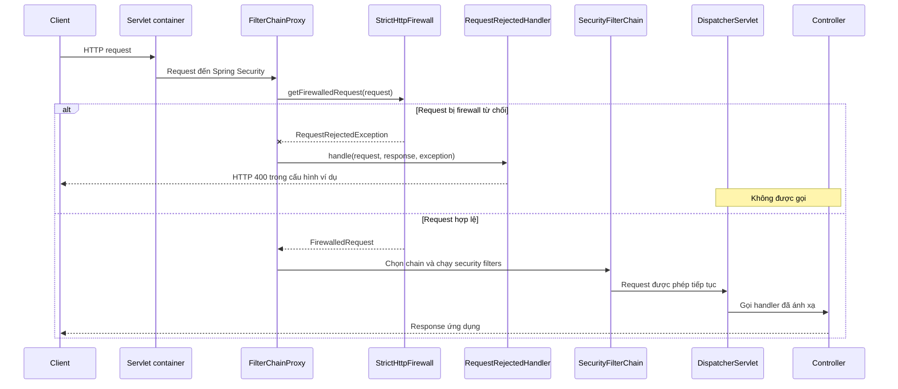

# Kiểm tra firewall và hành vi từ chối trước controller

## 1. Mục tiêu và phạm vi

Trong ứng dụng Spring MVC dùng **Spring Security HTTP Protection**, một request bất thường có thể bị từ chối ngay tại tầng **HTTP firewall** trước khi Spring MVC chọn handler và gọi controller. Bài học thuộc chương **Kiểm thử Servlet** này hướng dẫn cách chứng minh ranh giới đó bằng kiểm thử đơn vị và `MockMvc`, thay vì chỉ nhìn thấy mã lỗi HTTP rồi kết luận rằng hệ thống an toàn.

Sau bài học, bạn có thể:

- Giải thích vị trí của `HttpFirewall`, `FilterChainProxy`, `SecurityFilterChain` và `DispatcherServlet` trong đường đi của request Servlet.
- Cấu hình `StrictHttpFirewall` cùng `RequestRejectedHandler` có kết quả xác định để kiểm thử.
- Kiểm tra các request có URL, HTTP method hoặc dữ liệu đầu vào đáng ngờ; đồng thời có **đối chứng request hợp lệ**.
- Chứng minh request đã bị chặn **trước controller** bằng số lần controller được gọi và dấu vết dispatch.
- Phân biệt firewall rejection với 401/403 do xác thực, phân quyền, CSRF và với lỗi 404/405/400 do Spring MVC hoặc Servlet container.
- Biết lúc nào `MockMvc` đủ tin cậy và lúc nào cần kiểm thử HTTP thật qua container, reverse proxy hoặc gateway.

Ví dụ sử dụng **Java 17+, Spring Boot 3.x, Spring Security 6.x, Spring MVC Servlet** (import `jakarta.servlet.*`); các API firewall nêu ở đây cũng có trong nhánh Spring Security 7.x, nhưng cần đối chiếu dependency thực tế khi chuyển phiên bản. Bài học **không áp dụng trực tiếp cho WebFlux**, vốn sử dụng một chuỗi xử lý reactive khác.

## 2. Firewall nằm ở đâu trong request lifecycle?

Thông thường, `DelegatingFilterProxy` đưa request từ Servlet filter chain vào `FilterChainProxy` của Spring Security. `FilterChainProxy` sử dụng `HttpFirewall` để kiểm tra/bọc request trước khi chọn `SecurityFilterChain` phù hợp. Với `StrictHttpFirewall`, URL hoặc method không hợp lệ làm phát sinh `RequestRejectedException`; `RequestRejectedHandler` quyết định cách trả lỗi.



**Hai giới hạn quan trọng của sơ đồ:**

1. Servlet container, reverse proxy hoặc một filter khác đặt **trước** Spring Security có thể đã xử lý hoặc chặn request. Vì vậy không phải mọi HTTP 400 đều do `StrictHttpFirewall`.
2. “Trước controller” không có nghĩa là “không filter nào từng chạy”: các filter đăng ký trước `springSecurityFilterChain` vẫn có thể chạy. Điều cần khẳng định là request chưa đi vào handler của Spring MVC.

Firewall là bước bảo vệ cú pháp và cấu trúc HTTP nhằm tránh khác biệt khi chuẩn hóa URL, so khớp đường dẫn hoặc diễn giải dữ liệu. Nó **không thay thế** authentication, authorization, CSRF, CORS, security headers, validation tại controller hay service-layer security.

### Các trường hợp nên đưa vào ma trận kiểm thử

| Đầu vào | Kỳ vọng khi request tới `StrictHttpFirewall` mặc định | Điểm cần xác minh |
| --- | --- | --- |
| `GET /probe` | Cho qua firewall | Controller được gọi |
| `GET /probe;v=1` | Từ chối dấu `;` trong đường dẫn | Controller không được gọi |
| `GET /probe%2Fhidden` | Từ chối dấu `/` mã hóa thành `%2F` | Giữ nguyên URI đã mã hóa khi gửi request |
| `GET /a/../probe`, dấu `//` hoặc dạng path không chuẩn hóa | Từ chối **nếu** dạng thô đến được firewall | Container/proxy có thể chuẩn hóa hoặc từ chối trước |
| `TRACE /probe` | Từ chối vì method ngoài allowlist mặc định | Phân biệt với 405/501 của container/MVC |
| Tên/giá trị header hay parameter chứa ký tự điều khiển | Có thể bị từ chối theo các predicate của firewall | Một số ký tự không lọt qua HTTP client/container |
| `POST` hợp lệ nhưng thiếu CSRF token | Firewall cho qua; security filter có thể trả 403 | Đây **không phải** firewall rejection |

Theo cấu hình mặc định, `StrictHttpFirewall` cho phép các method `DELETE`, `GET`, `HEAD`, `OPTIONS`, `PATCH`, `POST` và `PUT`. Các quy tắc còn bao gồm URL chưa chuẩn hóa, ký tự không được phép, semicolon, encoded slash/backslash/percent, tên/giá trị header và parameter không hợp lệ. Không nên mặc định rằng mọi payload tấn công ứng dụng (ví dụ chuỗi SQL injection trong tham số hợp lệ) đều bị HTTP firewall phát hiện.

## 3. Cấu hình firewall và phản hồi lỗi có thể kiểm chứng

Để test khẳng định chính xác HTTP 400, hãy cấu hình `HttpStatusRequestRejectedHandler` thay vì phụ thuộc vào cách một phiên bản ứng dụng xử lý exception mặc định. Trong ứng dụng đã có `SecurityFilterChain`, chỉ cần thêm phần `WebSecurityCustomizer` phù hợp; mẫu đầy đủ sau sử dụng `permitAll()` **riêng cho môi trường minh họa** để kết quả không bị chi phối bởi đăng nhập hoặc phân quyền.

```java
import jakarta.servlet.http.HttpServletResponse;
import org.springframework.context.annotation.Bean;
import org.springframework.context.annotation.Configuration;
import org.springframework.security.config.annotation.web.builders.HttpSecurity;
import org.springframework.security.config.annotation.web.configuration.WebSecurityCustomizer;
import org.springframework.security.web.SecurityFilterChain;
import org.springframework.security.web.firewall.HttpStatusRequestRejectedHandler;
import org.springframework.security.web.firewall.StrictHttpFirewall;

@Configuration(proxyBeanMethods = false)
public class FirewallDemoSecurityConfig {

    @Bean
    SecurityFilterChain securityFilterChain(HttpSecurity http) throws Exception {
        http.authorizeHttpRequests(authorize ->
            authorize.anyRequest().permitAll()
        );
        return http.build();
    }

    @Bean
    WebSecurityCustomizer webSecurityCustomizer() {
        return web -> {
            StrictHttpFirewall firewall = new StrictHttpFirewall();
            web.httpFirewall(firewall);
            web.requestRejectedHandler(
                new HttpStatusRequestRejectedHandler(
                    HttpServletResponse.SC_BAD_REQUEST
                )
            );
        };
    }
}
```

Điểm cần hiểu:

- `web.httpFirewall(firewall)` gắn firewall vào `FilterChainProxy`. `StrictHttpFirewall` là lựa chọn mặc định trong Spring Security, nhưng khai báo tường minh giúp bài kiểm thử độc lập với các tùy chỉnh khác của dự án.
- `web.requestRejectedHandler(...)` nhận `RequestRejectedException` và gửi lỗi 400 theo cấu hình ví dụ. Nếu thay bằng handler ném lại exception hoặc một handler tùy biến, kết quả quan sát ở tầng HTTP có thể khác; khi đó phải đổi expected status theo **hợp đồng thực tế**.
- Cấu hình này thuộc **Servlet `WebSecurity`**, không nằm trong `HttpSecurity.exceptionHandling()`. `AuthenticationEntryPoint` và `AccessDeniedHandler` giải quyết loại lỗi khác.
- `@ControllerAdvice` / `@ExceptionHandler` thông thường không được gọi cho request đã bị firewall từ chối trước `DispatcherServlet`.

Nếu dự án đã có `WebSecurityCustomizer`, hãy bổ sung quy tắc vào bean hiện có hoặc kết hợp customizer một cách có kiểm soát; đừng vô tình thay đổi các cấu hình bỏ qua security hoặc firewall được duyệt sẵn.

## 4. Kiểm thử đơn vị: xác nhận chính sách của StrictHttpFirewall

Kiểm thử trực tiếp `getFirewalledRequest` trả lời câu hỏi: **chính firewall có từ chối request này không?** Cách này ít chịu ảnh hưởng của MVC, servlet container hay mã trạng thái HTTP, nên hữu ích khi xác định nguyên nhân một test tích hợp thất bại.

```java
import org.junit.jupiter.api.Test;
import org.springframework.mock.web.MockHttpServletRequest;
import org.springframework.security.web.firewall.RequestRejectedException;
import org.springframework.security.web.firewall.StrictHttpFirewall;

import static org.junit.jupiter.api.Assertions.assertDoesNotThrow;
import static org.junit.jupiter.api.Assertions.assertThrows;

class StrictHttpFirewallPolicyTest {
    private final StrictHttpFirewall firewall = new StrictHttpFirewall();

    @Test
    void acceptsNormalGet() {
        MockHttpServletRequest request =
            new MockHttpServletRequest("GET", "/probe");
        request.setServletPath("/probe");

        assertDoesNotThrow(() -> firewall.getFirewalledRequest(request));
    }

    @Test
    void rejectsTraceMethod() {
        MockHttpServletRequest request =
            new MockHttpServletRequest("TRACE", "/probe");
        request.setServletPath("/probe");

        assertThrows(RequestRejectedException.class,
            () -> firewall.getFirewalledRequest(request));
    }

    @Test
    void rejectsEncodedSlash() {
        MockHttpServletRequest request =
            new MockHttpServletRequest("GET", "/probe%2Fhidden");
        request.setServletPath("/probe%2Fhidden");

        assertThrows(RequestRejectedException.class,
            () -> firewall.getFirewalledRequest(request));
    }
}
```

**Chú ý:** Khi tạo `MockHttpServletRequest` thủ công, hãy đặt method rõ ràng (như `GET`). Method rỗng cũng bị `StrictHttpFirewall` từ chối, dễ làm test “request hợp lệ” thất bại vì fixture sai. Việc set `servletPath` giúp dữ liệu request mô phỏng nhất quán với URL được kiểm tra.

Test đơn vị trên kiểm chứng chính sách firewall nhưng **không chứng minh controller không được gọi**, vì ở đây không có `DispatcherServlet`. Mục tiêu đó cần test Servlet tích hợp dưới đây.

## 5. Kiểm thử MockMvc: chứng minh không tới controller

`MockMvc` phải chạy với filter của Spring Security. Với Spring Boot MVC slice, dùng `@WebMvcTest` cùng `@AutoConfigureMockMvc(addFilters = true)`; với cấu hình thủ công dựa trên `WebApplicationContext`, cần `MockMvcBuilders.webAppContextSetup(context).apply(springSecurity()).build()` và dependency `spring-security-test`.

Ví dụ sau là một test class độc lập cho **Spring Boot 3.x / Spring Security 6.x**. Test cấu hình phản hồi 400 một cách tường minh, cho phép mọi request *sau firewall* và dùng bộ đếm để nhận diện controller có thực thi hay không.

```java
import java.net.URI;
import java.util.concurrent.atomic.AtomicInteger;

import jakarta.servlet.http.HttpServletResponse;
import org.junit.jupiter.api.BeforeEach;
import org.junit.jupiter.api.Test;
import org.springframework.beans.factory.annotation.Autowired;
import org.springframework.boot.test.autoconfigure.web.servlet.AutoConfigureMockMvc;
import org.springframework.boot.test.autoconfigure.web.servlet.WebMvcTest;
import org.springframework.context.annotation.Bean;
import org.springframework.context.annotation.Configuration;
import org.springframework.context.annotation.Import;
import org.springframework.http.HttpMethod;
import org.springframework.security.config.annotation.web.builders.HttpSecurity;
import org.springframework.security.config.annotation.web.configuration.WebSecurityCustomizer;
import org.springframework.security.web.SecurityFilterChain;
import org.springframework.security.web.firewall.HttpStatusRequestRejectedHandler;
import org.springframework.security.web.firewall.StrictHttpFirewall;
import org.springframework.test.web.servlet.MockMvc;
import org.springframework.web.bind.annotation.GetMapping;
import org.springframework.web.bind.annotation.RestController;

import static org.junit.jupiter.api.Assertions.assertEquals;
import static org.junit.jupiter.api.Assertions.assertNull;
import static org.springframework.test.web.servlet.request.MockMvcRequestBuilders.get;
import static org.springframework.test.web.servlet.request.MockMvcRequestBuilders.request;
import static org.springframework.test.web.servlet.result.MockMvcResultMatchers.content;
import static org.springframework.test.web.servlet.result.MockMvcResultMatchers.status;

@WebMvcTest(controllers = FirewallMvcTest.ProbeController.class)
@AutoConfigureMockMvc(addFilters = true)
@Import(FirewallMvcTest.TestSecurityConfig.class)
class FirewallMvcTest {

    @Autowired MockMvc mvc;
    @Autowired ProbeController controller;

    @BeforeEach
    void resetInvocations() {
        controller.invocations.set(0);
    }

    @Test
    void validRequestReachesController() throws Exception {
        mvc.perform(get("/probe"))
            .andExpect(status().isOk())
            .andExpect(content().string("reached"));

        assertEquals(1, controller.invocations.get());
    }

    @Test
    void semicolonIsRejectedBeforeController() throws Exception {
        mvc.perform(get(URI.create("/probe;v=1")))
            .andExpect(status().isBadRequest())
            .andExpect(result -> assertNull(result.getHandler()));

        assertEquals(0, controller.invocations.get());
    }

    @Test
    void encodedSlashIsRejectedBeforeController() throws Exception {
        // Dùng URI trực tiếp để giữ nguyên "%2F" trong raw path.
        mvc.perform(get(URI.create("/probe%2Fhidden")))
            .andExpect(status().isBadRequest())
            .andExpect(result -> assertNull(result.getHandler()));

        assertEquals(0, controller.invocations.get());
    }

    @Test
    void traceIsRejectedBeforeController() throws Exception {
        mvc.perform(request(HttpMethod.TRACE, URI.create("/probe")))
            .andExpect(status().isBadRequest())
            .andExpect(result -> assertNull(result.getHandler()));

        assertEquals(0, controller.invocations.get());
    }

    @RestController
    static class ProbeController {
        final AtomicInteger invocations = new AtomicInteger();

        @GetMapping("/probe")
        String probe() {
            invocations.incrementAndGet();
            return "reached";
        }
    }

    @Configuration(proxyBeanMethods = false)
    static class TestSecurityConfig {
        @Bean
        SecurityFilterChain testChain(HttpSecurity http) throws Exception {
            return http.authorizeHttpRequests(
                authorize -> authorize.anyRequest().permitAll()
            ).build();
        }

        @Bean
        WebSecurityCustomizer webSecurityCustomizer() {
            return web -> {
                web.httpFirewall(new StrictHttpFirewall());
                web.requestRejectedHandler(
                    new HttpStatusRequestRejectedHandler(
                        HttpServletResponse.SC_BAD_REQUEST
                    )
                );
            };
        }
    }
}
```

Trong ví dụ trên, `@WebMvcTest` đã cung cấp cấu hình MVC cần thiết; `@Import` bổ sung chain và firewall dành riêng cho test. Ứng dụng cần `spring-boot-starter-security`; phần kiểm thử cần `spring-boot-starter-test` trong test scope. Bổ sung `spring-security-test` trong test scope khi sử dụng `springSecurity()`, `with(user())`, `csrf()` hoặc các tiện ích kiểm thử bảo mật khác.

Phân tích từng assertion:

1. **Đối chứng dương** `GET /probe` phải trả 200 và tăng counter lên 1. Nếu không có đối chứng này, test trả 400 có thể “đậu” dù ứng dụng chưa định tuyến được đến controller.
2. **Response assertion** là `status().isBadRequest()` vì ta chủ động chọn `HttpStatusRequestRejectedHandler(400)`. Mã trạng thái một mình chưa đủ để xác nhận firewall chặn.
3. **Không có MVC handler** `assertNull(result.getHandler())` bổ sung bằng chứng rằng `DispatcherServlet` không tìm/chạy handler; `invocations == 0` chứng minh phương thức controller không được gọi.
4. **Giữ raw URI**: dùng `URI.create(...)` với `%2F`. Một số helper, HTTP client, server hay gateway có thể mã hóa lại hoặc chuẩn hóa URL; nếu request đổi trước khi tới firewall, test không còn kiểm tra input ban đầu.
5. **Không trộn cơ chế**: `TRACE` bị firewall từ chối do method không nằm trong allowlist; request method `POST` hợp lệ nhưng thiếu CSRF token bị chặn tại filter CSRF với lý do khác.

Trong dự án thật, bạn có thể thay bộ đếm bằng Mockito `verify(controller, never()).handle(...)` hoặc `verifyNoInteractions(service)` nếu controller/service là mock được inject; hãy xác nhận mock là đối tượng thực sự được Spring MVC dùng. Chỉ kiểm tra “service chưa được gọi” là bằng chứng yếu hơn nếu controller có thể được gọi rồi trả về trước khi chạm service.

### Trường hợp test báo kết quả sai

| Hiện tượng | Nguyên nhân thường gặp | Cách kiểm chứng |
| --- | --- | --- |
| URL có dấu `;` trả 200 | Chưa gắn security filter vào `MockMvc`, hoặc firewall cho phép semicolon | Kiểm tra `addFilters`, `springSecurity()` và `WebSecurityCustomizer` |
| Test kỳ vọng 400 nhưng ném `RequestRejectedException` | Handler đang ném lại exception, không phải HTTP status handler | Xem `WebSecurity.requestRejectedHandler` của context test |
| Request đáng ngờ trả 404/405 | Đã vào MVC hoặc request bị biến đổi trước firewall | Kiểm tra `MvcResult.getHandler()`, raw URL và method |
| Request bị 403 | CSRF/authorization hoặc filter khác từ chối | Soát security configuration, request method và dấu vết filter |
| Test hợp lệ bị reject | Fixture có method rỗng, path bị đổi hoặc thêm ký tự không hợp lệ | Tạo request với method/URI rõ ràng; thử test firewall đơn vị |
| Unit test reject nhưng test HTTP thật trả lỗi khác | Servlet container hoặc proxy đã chặn/chuẩn hóa trước | So sánh request ngay sau ingress và log đúng tầng |

## 6. Kiểm thử tích hợp qua HTTP thật

`MockMvc` chạy Servlet/MVC trong môi trường mô phỏng, không tái hiện đầy đủ cách Tomcat/Jetty/Undertow hay reverse proxy giải mã và chuẩn hóa URL. Với những quy tắc phụ thuộc raw path, thêm test `@SpringBootTest(webEnvironment = RANDOM_PORT)` và một HTTP client cho phép kiểm soát path thô, hoặc chạy yêu cầu kiểm tra thủ công:

```bash
# Gửi raw path, tránh curl tự loại bỏ đoạn "../".
curl --path-as-is -i 'http://localhost:8080/a/../probe'

# Giữ nguyên encoded slash; kết quả cụ thể phụ thuộc ingress/container.
curl --path-as-is -i 'http://localhost:8080/probe%2Fhidden'

# Đối chứng dương.
curl -i 'http://localhost:8080/probe'
```

Lệnh chỉ minh họa cho môi trường local nơi `/probe` tồn tại. Trong hệ thống thật, nên chạy cùng ingress, domain, TLS, context path và cấu hình container như khi triển khai; tuyệt đối không suy diễn “firewall trả 400” chỉ từ HTTP 400 ngoài mạng. Muốn quy trách nhiệm cho Spring Security, cần một dấu vết đủ tin cậy cho `RequestRejectedHandler` hoặc kiểm thử trực tiếp firewall, đồng thời chứng minh endpoint không chạy.

Đối với hệ thống có proxy/WAF, nên kiểm tra ít nhất ba trạng thái: **đầu vào trước proxy**, **request mà ứng dụng thực sự nhận**, và **response cuối cùng** (nếu có quyền quan sát); không ghi toàn bộ header chứa token/cookie vào log. Chỉ ghi loại lý do rejection, request ID và counter/metric phù hợp để tránh lộ dữ liệu nhạy cảm hoặc tạo log quá lớn.

## 7. Phân biệt nguyên nhân từ chối để không “pass nhầm”

Các trạng thái HTTP dưới đây **không phải ánh xạ một-một** với thành phần nội bộ:

| Biểu hiện | Nơi có thể phát sinh | Bằng chứng mong muốn |
| --- | --- | --- |
| 400 do `RequestRejectedHandler` đã cấu hình | `FilterChainProxy` / `HttpFirewall` | Tái hiện exception ở unit test, handler được gọi, controller = 0 |
| 400 do body/parameter sai | MVC binding/validation hoặc container | Controller/handler mapping và `BindingResult` hoặc error của container |
| 401 / 403 do xác thực, phân quyền | Security filters và exception handling | Thử lại với principal/role đúng, không phải input URL bị firewall cấm |
| 403 do CSRF | `CsrfFilter` trong security chain | Request unsafe method có/không có token CSRF |
| 404 | MVC không tìm mapping hoặc ingress đổi đường dẫn | Kiểm tra raw URI, servlet path, handler mapping |
| 405 | MVC có URL nhưng HTTP method không được controller hỗ trợ | Phân biệt với method bị firewall cấm từ đầu |

Điểm dễ nhầm khác: `web.ignoring().requestMatchers(...)` tạo security chain rỗng cho đường dẫn tương ứng, nhưng `HttpFirewall` vẫn áp dụng **nếu request đi qua `FilterChainProxy`**. Nếu filter proxy hoàn toàn không được đăng ký cho một URL hoặc request bị chặn từ trước, kết luận sẽ khác. Khi muốn cho phép public endpoint mà vẫn sử dụng lớp phòng vệ chung, thông thường chọn `permitAll()` trong security chain.

### Khi nghiệp vụ buộc phải nới firewall

Ví dụ Spring MVC matrix variables cần dấu `;` trong path:

```java
StrictHttpFirewall firewall = new StrictHttpFirewall();
firewall.setAllowSemicolon(true);
web.httpFirewall(firewall);
```

Quyết định này thay đổi chính sách chung của `FilterChainProxy`. Trước khi áp dụng, cần kiểm tra tương tác với path matcher, URL encoding, container/proxy và các trường hợp đường dẫn tương đương; sau đó viết lại cả test **allowed** lẫn **rejected**. Tránh mở rộng bằng `setUnsafeAllowAnyHttpMethod(true)` hoặc `DefaultHttpFirewall` chỉ để làm một test đỏ chuyển xanh. Với đường dẫn không chuẩn hóa, `StrictHttpFirewall` cố ý không cung cấp tùy chọn tắt kiểm tra chuẩn hóa.

## 8. Checklist nghiệm thu

- [ ] `MockMvc` thực sự đăng ký `springSecurityFilterChain`; test không dùng `addFilters = false`.
- [ ] Có request chuẩn trả 200 và chứng minh controller chạy.
- [ ] Có tối thiểu một payload path/method bị `StrictHttpFirewall` từ chối ở unit test.
- [ ] Test tích hợp chứng minh đồng thời **mã lỗi theo cấu hình** và **controller chưa chạy**.
- [ ] Không đánh đồng 400 với `RequestRejectedException` nếu chưa kiểm tra nguồn lỗi.
- [ ] Kiểm thử raw URL ở HTTP/container thật cho các case encoded path, dot-segment, double slash hoặc ingress rewrite quan trọng.
- [ ] Mọi nới lỏng chính sách firewall đều có lý do nghiệp vụ, đánh giá đường dẫn và regression test.

**Bài tập vận dụng:** thêm một endpoint `GET /public/items` và so sánh ba trường hợp: `GET /public/items`, `GET /public/items;v=2`, `TRACE /public/items`. Ghi lại status, số lần controller chạy và lý do rejection. Sau đó thử `setAllowSemicolon(true)` trong **test configuration riêng**, giải thích vì sao HTTP 200/404 của trường hợp thứ hai còn phụ thuộc vào mapping MVC.

## Tham khảo

- [Spring Security – HttpFirewall (Servlet)](https://docs.spring.io/spring-security/reference/servlet/exploits/firewall.html)
- [Spring Security – Setting Up MockMvc and Spring Security](https://docs.spring.io/spring-security/reference/servlet/test/mockmvc/setup.html)
- [JavaDoc – StrictHttpFirewall](https://docs.spring.io/spring-security/reference/api/java/org/springframework/security/web/firewall/StrictHttpFirewall.html)
- [JavaDoc – WebSecurity / requestRejectedHandler](https://docs.spring.io/spring-security/reference/api/java/org/springframework/security/config/annotation/web/builders/WebSecurity.html)
