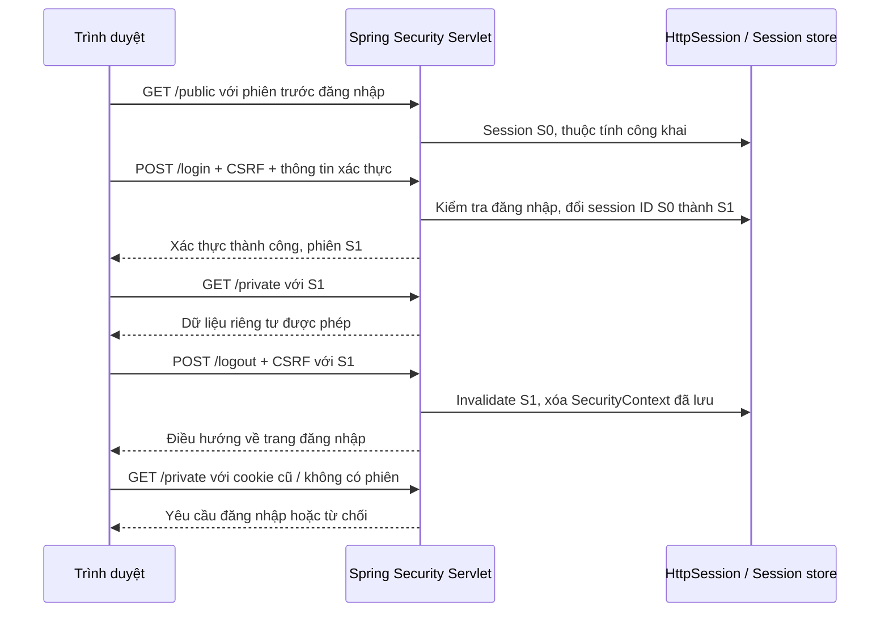

# Kiểm tra đổi session ID và dữ liệu sau đăng xuất

## 1. Vì sao cần kiểm thử cả vòng đời phiên đăng nhập?

Trong ứng dụng Servlet dùng Spring Security, đăng nhập thành công thường tạo ra một ranh giới quyền mới: từ người dùng chưa xác thực thành người dùng có quyền truy cập tài nguyên riêng tư. Nếu ứng dụng tiếp tục sử dụng cùng một session ID mà bên thứ ba đã biết trước khi người dùng đăng nhập, kẻ tấn công có thể khai thác **session fixation**. Khi người dùng đăng xuất, một rủi ro khác xuất hiện: giao diện báo “đã đăng xuất”, nhưng dữ liệu gắn với phiên cũ, `SecurityContext` hoặc một cơ chế xác thực phụ vẫn còn hiệu lực.

Bài **“Kiểm tra đổi session ID và dữ liệu sau đăng xuất”** thuộc chương **Kiểm thử Servlet** của mô-đun `SPRING_SECURITY_HTTP_PROTECTION`. Người học đang triển khai các lớp phòng vệ HTTP và trình duyệt của Spring Security, gồm CSRF, CORS, security headers, CSP, HSTS, HTTP firewall và bảo vệ session, cả Servlet lẫn Reactive. Bài này tập trung vào **Servlet, `HttpSession`, `SecurityFilterChain`, `MockMvc` và `spring-security-test`**. Các kiểu `WebSession`/`WebTestClient` của WebFlux có mô hình kiểm thử khác, không áp dụng trực tiếp các đoạn code ở đây.

Sau bài học, người đọc có thể:

- Chứng minh session ID **đổi khi xác thực thành công**, nhưng không đổi tùy tiện ở mọi request hoặc sau đăng nhập thất bại.
- Xác minh dữ liệu trong session được giữ hay loại bỏ theo chiến lược `changeSessionId`, `migrateSession` hoặc `newSession`.
- Kiểm tra logout thực sự **vô hiệu hóa phiên**, xóa trạng thái xác thực, xử lý CSRF token và chặn truy cập tài nguyên riêng tư.
- Phân biệt kiểm thử bằng `MockHttpSession` với kiểm thử HTTP thật dùng `JSESSIONID`, cookie và session store.
- Lập ma trận hồi quy cho remember-me, cache trình duyệt, dữ liệu lưu phía client, session phân tán và đăng xuất liên kết.

## 2. Mô hình hai chuyển tiếp bảo mật

Có hai chuyển tiếp cần quan sát độc lập.



| Thời điểm | Điều phải đúng | Điều chưa đủ để kết luận an toàn |
|---|---|---|
| Trước đăng nhập | Phiên S0 có thể tồn tại nhưng chưa được xác thực | Có cookie `JSESSIONID` không có nghĩa đã đăng nhập |
| Sau đăng nhập thành công | ID S1 khác S0, `SecurityContext` hợp lệ, quyền truy cập đúng | Chỉ nhận HTTP 302 từ POST `/login` |
| Đăng nhập sai | Không trở thành người dùng đã xác thực; không quay vòng ID do đăng nhập thành công | Chỉ kiểm tra trang hiển thị báo sai mật khẩu |
| Sau logout | Session S1 bị invalidate, xác thực không còn, request riêng tư bị chặn | Chỉ thấy redirect sang `/login?logout` |
| Sau khi bấm Back | Dữ liệu riêng tư không thể lấy lại từ server bằng phiên cũ | Trang cũ còn xuất hiện tạm thời từ bộ nhớ trình duyệt không tự chứng minh session vẫn hợp lệ |

**Session fixation** là việc cố gắng buộc nạn nhân xác thực với một định danh phiên đã bị kẻ tấn công biết hoặc kiểm soát. Đổi ID khi xác thực thành công cắt mối liên hệ giữa ID trước đăng nhập và phiên đã xác thực. **Logout** lại là thao tác kết thúc phiên đang được sử dụng: mặc định Spring Security invalidate session thay vì “đổi ID thêm lần nữa”.

Việc đổi ID **không tự xóa mọi dữ liệu trong session**. Việc xóa session **không tự thu hồi mọi token, cache hoặc dữ liệu phía trình duyệt**. Cần biết phạm vi lưu trữ của từng loại dữ liệu trước khi viết assertion.

## 3. Hiểu đúng chiến lược session fixation

Spring Security Servlet hỗ trợ ba chiến lược thường dùng:

| Chiến lược | Khi xác thực thành công | Ảnh hưởng tới thuộc tính trước đăng nhập |
|---|---|---|
| `changeSessionId()` | Gọi `HttpServletRequest.changeSessionId()` trên Servlet 3.1+; giữ đối tượng session hiện có và đổi ID | Thuộc tính trong cùng session vẫn tồn tại, trừ khi code riêng xóa chúng |
| `migrateSession()` | Tạo session mới, sao chép thuộc tính từ session cũ | Các thuộc tính cũ được di chuyển sang session mới |
| `newSession()` | Tạo session sạch, vẫn bảo tồn các thuộc tính Spring Security thiết yếu | Thuộc tính ứng dụng cũ nhìn chung không được sao chép |
| `none()` | Không chủ động thực hiện session fixation protection | **Không nên dùng** khi ứng dụng xác thực bằng session |

Trên Servlet 3.1+ chiến lược mặc định là `changeSessionId`. Khi xảy ra session fixation protection, Spring Security có thể phát `SessionFixationProtectionEvent`; với `changeSessionId`, Servlet container cũng thông báo cho `HttpSessionIdListener`. Nếu ứng dụng theo dõi cả hai sự kiện, cần tránh đếm trùng một lần đổi ID.

Ví dụ có giỏ hàng trước đăng nhập: với `changeSessionId`, dữ liệu giỏ hàng thường vẫn ở lại vì session được giữ. Đây có thể là hành vi nghiệp vụ đúng. Nhưng không nên vì vậy mà giữ cả một thuộc tính nhạy cảm thuộc người dùng trước, mã xác minh đã dùng hoặc thông tin quyền tự xây dựng; các dữ liệu đó cần vòng đời riêng.

### Đặc điểm của Spring Security 6+

Với các cơ chế đăng nhập do Spring Security cung cấp như form login, thành phần xác thực thường gọi `SessionAuthenticationStrategy` sau khi xác thực thành công. Từ Spring Security 6, `SessionManagementFilter` không còn mặc định quét mỗi request để phát hiện một xác thực mới như thiết kế cũ. Nếu viết **custom authentication filter/controller** chỉ đặt `SecurityContextHolder` thủ công mà không xử lý session strategy và lưu `SecurityContext` vào `SecurityContextRepository`, bài test đổi ID và giữ xác thực có thể thất bại. Hãy kiểm tra chính luồng xác thực thực tế thay vì tự “vá” bài test.

**Quy tắc đo:** lưu chuỗi `String oldId = session.getId()` **trước** login, sau đó mới so với `session.getId()`. Trong `MockMvc`, `MockHttpSession` có thể vẫn là cùng một đối tượng sau `changeSessionId`; so sánh hai tham chiếu session để chứng minh ID đã đổi sẽ cho kết luận sai.

## 4. Cấu hình Servlet minh họa cho kiểm thử

Các ví dụ dưới đây hướng tới ứng dụng Spring Boot có **Spring MVC, Spring Security Servlet, Spring Security Test, Spring Boot Starter Test**. Giả định có một endpoint thật `GET /private` cần đăng nhập. Phần user in-memory và mật khẩu `{noop}` chỉ để làm test fixture, không dùng làm cấu hình mật khẩu cho production.

```java
import org.springframework.context.annotation.Bean;
import org.springframework.context.annotation.Configuration;
import org.springframework.security.config.Customizer;
import org.springframework.security.config.annotation.web.builders.HttpSecurity;
import org.springframework.security.config.annotation.web.configuration.EnableWebSecurity;
import org.springframework.security.core.userdetails.User;
import org.springframework.security.core.userdetails.UserDetailsService;
import org.springframework.security.provisioning.InMemoryUserDetailsManager;
import org.springframework.security.web.SecurityFilterChain;

@Configuration
@EnableWebSecurity
class ServletSessionSecurityConfig {

    @Bean
    SecurityFilterChain webSecurity(HttpSecurity http) throws Exception {
        http
            .authorizeHttpRequests(auth -> auth
                .requestMatchers("/login", "/public").permitAll()
                .anyRequest().authenticated())
            .formLogin(Customizer.withDefaults())
            .sessionManagement(session -> session
                .sessionFixation(fixation -> fixation.changeSessionId()))
            .logout(logout -> logout
                .invalidateHttpSession(true)
                .clearAuthentication(true)
                .logoutSuccessUrl("/login?logout"));
        // CSRF được giữ nguyên theo mặc định, kể cả POST /logout.
        return http.build();
    }

    @Bean
    UserDetailsService testUsers() {
        return new InMemoryUserDetailsManager(
            User.withUsername("alice")
                .password("{noop}test-password") // CHỈ CHO FIXTURE
                .roles("USER")
                .build());
    }
}
```

Endpoint tối thiểu để test việc sử dụng phiên đã xác thực:

```java
import java.security.Principal;

import org.springframework.web.bind.annotation.GetMapping;
import org.springframework.web.bind.annotation.RestController;

@RestController
class PrivateController {

    @GetMapping("/private")
    String privateData(Principal principal) {
        return principal.getName();
    }
}
```

Cấu hình này nêu rõ hai chính sách để người học quan sát, dù chúng phù hợp với mặc định hiện đại: `changeSessionId()` khi đăng nhập và `invalidateHttpSession(true)`/`clearAuthentication(true)` khi logout. Route `/login` do form-login cung cấp, còn `/private` phải có controller như trên.

**Ranh giới phiên bản:** code dùng namespace `jakarta.servlet` và phong cách DSL của Spring Security 6.x trở lên. Nếu dùng Spring Security 5 và Servlet cũ, kiểm tra tài liệu tương ứng, kiểu import và chiến lược mặc định trước khi áp dụng.

## 5. Kiểm thử đổi ID khi đăng nhập bằng MockMvc

### 5.1. Điều kiện trước khi test

Dùng `@SpringBootTest` + `@AutoConfigureMockMvc` để nạp security filter chain thực của ứng dụng. Hoặc dùng `MockMvcBuilders.webAppContextSetup(context).apply(springSecurity()).build()`; nếu `MockMvc` không chạy qua `FilterChainProxy`, test không chứng minh được session fixation protection.

Không dùng `@WithMockUser` hoặc `with(user("alice"))` để kiểm tra đổi session ID. Hai cách này **giả lập người dùng đã đăng nhập** cho request; chúng không thực hiện POST tới form login và không chạy quá trình xác thực vốn kích hoạt session fixation protection.

### 5.2. Test thành công và giữ dữ liệu an toàn

Ví dụ JUnit Jupiter dùng các bean trong mục 4:

```java
import org.junit.jupiter.api.Test;
import org.springframework.beans.factory.annotation.Autowired;
import org.springframework.boot.test.autoconfigure.web.servlet.AutoConfigureMockMvc;
import org.springframework.boot.test.context.SpringBootTest;
import org.springframework.mock.web.MockHttpSession;
import org.springframework.test.web.servlet.MockMvc;
import org.springframework.test.web.servlet.MvcResult;

import static org.assertj.core.api.Assertions.assertThat;
import static org.springframework.security.test.web.servlet.request
    .SecurityMockMvcRequestPostProcessors.csrf;
import static org.springframework.security.test.web.servlet.response
    .SecurityMockMvcResultMatchers.authenticated;
import static org.springframework.test.web.servlet.request
    .MockMvcRequestBuilders.get;
import static org.springframework.test.web.servlet.request
    .MockMvcRequestBuilders.post;
import static org.springframework.test.web.servlet.result
    .MockMvcResultMatchers.content;
import static org.springframework.test.web.servlet.result
    .MockMvcResultMatchers.status;

@SpringBootTest
@AutoConfigureMockMvc
class SessionIdChangeTests {

    @Autowired
    MockMvc mvc;

    @Test
    void rotatesIdAfterSuccessfulLoginAndPreservesCartDraft()
            throws Exception {
        MockHttpSession session = new MockHttpSession();
        session.setAttribute("cartDraft", "cart-42");
        String idBeforeLogin = session.getId();

        MvcResult login = mvc.perform(post("/login")
                    .session(session)
                    .with(csrf())
                    .param("username", "alice")
                    .param("password", "test-password"))
                .andExpect(status().is3xxRedirection())
                .andExpect(authenticated().withUsername("alice"))
                .andReturn();

        String idAfterLogin = session.getId();

        assertThat(idAfterLogin).isNotEqualTo(idBeforeLogin);
        assertThat(session.isInvalid()).isFalse();
        assertThat(login.getRequest().getSession(false)).isSameAs(session);
        assertThat(session.getAttribute("cartDraft")).isEqualTo("cart-42");

        mvc.perform(get("/private").session(session))
                .andExpect(status().isOk())
                .andExpect(content().string("alice"));
    }

    @Test
    void failedLoginDoesNotRotateIdOrAuthenticate() throws Exception {
        MockHttpSession session = new MockHttpSession();
        String idBeforeLogin = session.getId();

        mvc.perform(post("/login")
                    .session(session)
                    .with(csrf())
                    .param("username", "alice")
                    .param("password", "wrong-password"))
                .andExpect(status().is3xxRedirection());

        assertThat(session.getId()).isEqualTo(idBeforeLogin);
        assertThat(session.isInvalid()).isFalse();
    }
}
```

Kết quả chứng minh:

- **Đổi ID thực sự:** `idAfterLogin != idBeforeLogin`, thay vì chỉ kiểm tra response redirect.
- **Không tạo phiên mới ngoài ý muốn:** với `changeSessionId`, cùng `MockHttpSession` còn hiệu lực.
- **Giỏ hàng được giữ:** thuộc tính `cartDraft` tồn tại sau login vì chiến lược được chọn giữ session.
- **SecurityContext được lưu:** request kế tiếp dùng session đó thực sự đi qua endpoint riêng tư và trả tên người dùng đã xác thực.
- **Sai mật khẩu:** không có phiên được nâng quyền và không có lý do quay vòng ID theo nhánh login thành công.

Trong test âm tính, có thể bổ sung `.andExpect(unauthenticated())` sau request sai mật khẩu để xác nhận kết quả xác thực. Tránh so sánh ID với một literal hoặc dự đoán định dạng ID: nó được sinh bởi container hoặc session store.

Nếu chính sách chuyển sang `newSession`, test “cùng đối tượng session” và “giữ cartDraft” phải được **thiết kế lại**: lấy session sau login từ request, so ID hai phiên, kiểm tra thuộc tính nào được sao chép và xác minh session cũ không thể truy cập. Không sửa assertion thành “luôn giữ cartDraft” khi nghiệp vụ có chủ đích xóa dữ liệu trước đăng nhập.

### 5.3. Vì sao không kiểm chứng bằng cookie trong MockMvc?

`MockHttpSession` cung cấp mô phỏng session trực tiếp. Khi gọi `.session(session)`, test gắn đối tượng phiên vào request; nó **không thực hiện đầy đủ cơ chế cookie-to-session lookup** của Servlet container đang chạy trên cổng mạng. Vì vậy:

- Đọc `session.getId()` là phù hợp cho unit/integration test trong MockMvc.
- Không tự suy diễn `MockMvc` sẽ sinh `Set-Cookie: JSESSIONID=...` giống Tomcat/Jetty/Undertow thật.
- Không kiểm tra khả năng tái sử dụng ID cũ bằng cách chỉ gắn cookie tự tạo vào MockMvc rồi mong container tra session thật.
- Cần test HTTP thật ở mục 8 để chứng minh cookie trước đăng nhập không thể tái sử dụng sau khi ID đổi.

## 6. Kiểm thử logout: invalidation và dữ liệu còn tồn tại

Spring Security xử lý `POST /logout` mặc định qua `LogoutFilter`. Khi CSRF đang bật, request logout hợp lệ phải có CSRF token. Chuỗi handler mặc định xử lý các công việc quan trọng: invalidate `HttpSession`, xóa `SecurityContext` ở holder/repository, dọn remember-me nếu được bật, xóa CSRF token đã lưu và công bố sự kiện logout. Sau đó trình duyệt thường được chuyển tới `/login?logout`.

Để kiểm thử đúng, cần phân biệt:

1. **Phiên bị invalidate:** session cũ không còn chứa state có thể truy cập như trước.
2. **Xác thực bị xóa:** request mới không được đi tiếp với người dùng cũ.
3. **Dữ liệu ứng dụng đã xử lý:** bản nháp, dữ liệu trong session, external cache, refresh token hoặc storage phía client tuân theo hợp đồng riêng.
4. **Giao diện và cache sau logout:** một HTML đã render sẵn không được dùng như bằng chứng rằng session server còn hợp lệ.

### 6.1. Test logout thành công, dữ liệu trong phiên bị xóa

```java
import org.junit.jupiter.api.Test;
import org.springframework.beans.factory.annotation.Autowired;
import org.springframework.boot.test.autoconfigure.web.servlet.AutoConfigureMockMvc;
import org.springframework.boot.test.context.SpringBootTest;
import org.springframework.mock.web.MockHttpSession;
import org.springframework.test.web.servlet.MockMvc;
import org.springframework.test.web.servlet.MvcResult;

import static org.assertj.core.api.Assertions.assertThat;
import static org.junit.jupiter.api.Assertions.assertThrows;
import static org.springframework.security.test.web.servlet.request
    .SecurityMockMvcRequestPostProcessors.csrf;
import static org.springframework.security.test.web.servlet.request
    .SecurityMockMvcRequestBuilders.logout;
import static org.springframework.security.test.web.servlet.response
    .SecurityMockMvcResultMatchers.authenticated;
import static org.springframework.test.web.servlet.request
    .MockMvcRequestBuilders.get;
import static org.springframework.test.web.servlet.request
    .MockMvcRequestBuilders.post;
import static org.springframework.test.web.servlet.result
    .MockMvcResultMatchers.redirectedUrl;
import static org.springframework.test.web.servlet.result
    .MockMvcResultMatchers.status;

@SpringBootTest
@AutoConfigureMockMvc
class SessionLogoutTests {

    @Autowired
    MockMvc mvc;

    @Test
    void logoutInvalidatesSessionAndRemovesSessionData() throws Exception {
        MockHttpSession session = signIn();
        session.setAttribute("privateDraft", "user-private-content");

        MvcResult result = mvc.perform(post("/logout")
                    .session(session)
                    .with(csrf()))
                .andExpect(status().is3xxRedirection())
                .andExpect(redirectedUrl("/login?logout"))
                .andReturn();

        // Quan sát bằng chứng ở server thay vì chỉ redirect.
        assertThat(session.isInvalid()).isTrue();
        assertThat(result.getRequest().getSession(false)).isNull();
        assertThrows(IllegalStateException.class,
                () -> session.getAttribute("privateDraft"));

        // Request độc lập sau logout phải chịu authentication rule.
        mvc.perform(get("/private"))
                .andExpect(status().is3xxRedirection());
    }

    @Test
    void logoutWithoutCsrfIsRejectedAndKeepsSession() throws Exception {
        MockHttpSession session = signIn();

        mvc.perform(post("/logout").session(session))
                .andExpect(status().isForbidden());

        assertThat(session.isInvalid()).isFalse();

        mvc.perform(get("/private").session(session))
                .andExpect(status().isOk());
    }

    private MockHttpSession signIn() throws Exception {
        MockHttpSession session = new MockHttpSession();

        mvc.perform(post("/login")
                    .session(session)
                    .with(csrf())
                    .param("username", "alice")
                    .param("password", "test-password"))
                .andExpect(authenticated().withUsername("alice"));

        return session;
    }
}
```

Ở đây `MockHttpSession.isInvalid()` xác nhận phiên đã bị vô hiệu hóa. Sau invalidate, việc đọc thuộc tính qua `getAttribute(...)` ném `IllegalStateException` theo hành vi mock Servlet: đây là một bằng chứng cụ thể rằng dữ liệu gắn với session cũ không còn truy cập được qua phiên đó. Request riêng tư mới (không gắn trạng thái xác thực cũ) bị chuyển về login.

**Giới hạn cần hiểu:** test `mvc.perform(get("/private"))` sau logout dùng request **mới, không cookie**, nên chỉ chứng minh anonymous request bị chặn. Để chứng minh **cookie `JSESSIONID` cũ không còn quyền** sau logout, phải gửi cookie đó vào server thật và để session manager thực sự tra cứu nó; xem mục 8.

Có thể thay request thủ công bằng helper `logout()` của `SecurityMockMvcRequestBuilders` khi test không cần gắn session cụ thể. Helper này tạo request logout và CSRF token phù hợp. Ở bài này, dùng `post("/logout").session(session).with(csrf())` giúp giữ lại tham chiếu chính xác tới `MockHttpSession` để kiểm tra invalidation.

### 6.2. Ba ca âm tính dễ bị bỏ sót

**POST logout thiếu CSRF token.** Khi CSRF đang bật, đây là request nguy hiểm cần 403 và **không được vô hiệu hóa session**. Nếu một test nhận 302 thành công khi không có token, kiểm tra có vô tình `csrf().disable()` hoặc miễn trừ `/logout` hay không.

**GET logout.** Với mặc định khi bật CSRF, GET `/logout` dùng để hiển thị trang xác nhận, không phải hành động logout trực tiếp. Hãy thử GET và kiểm tra session vẫn còn hợp lệ. Nếu tự thiết kế logout bằng GET, cần xem lại rủi ro CSRF; thông thường nên dùng POST.

**Request đã đăng xuất nhưng còn `remember-me`.** Nếu ứng dụng bật remember-me, cần gửi cookie remember-me cũ qua server thật để xác nhận logout handler đã xóa cookie hoặc hủy token tương ứng. Nếu custom logout endpoint không chạy Spring Security logout handlers, người dùng có thể bị tự đăng nhập lại dù `HttpSession` đã invalidate.

### 6.3. Kiểm thử dữ liệu nào phải được loại bỏ?

| Loại dữ liệu | Sau logout thông thường | Cách kiểm tra |
|---|---|---|
| `SecurityContext` trong session | Phải không còn dùng để xác thực | Truy cập route bảo vệ qua client thật với cookie cũ; kiểm tra repository/session |
| Thuộc tính `HttpSession` như `privateDraft` | Không còn truy cập qua session đã invalidate | `MockHttpSession.isInvalid()` và kiểm tra thuộc tính không còn truy cập được |
| CSRF token gắn phiên | Được reset/xóa theo handler/repository phù hợp | Token cũ không còn là credential hợp lệ cho phiên mới; kiểm thử vòng đời token |
| `JSESSIONID` trong trình duyệt | ID cũ không còn ánh xạ tới phiên được xác thực; việc xóa cookie là việc bổ sung | Kiểm tra response, cookie jar và request với cookie cũ qua HTTP thật |
| Remember-me cookie/token | Phải được dọn theo cấu hình remember-me và logout | Kiểm tra cookie hết hạn/token lưu trữ không còn xác thực |
| Dữ liệu ở cache hoặc DB riêng | **Không tự xóa** chỉ vì `HttpSession.invalidate()` | Test custom logout handler/repository với định danh dữ liệu cụ thể |
| Access/refresh token ngoài session | Không mặc định bị thu hồi toàn bộ | Kiểm tra endpoint revoke, token store, TTL và chính sách client |
| `localStorage`/`sessionStorage`, DOM ở SPA | Không tự xóa từ server session | Browser test việc xóa local state và chặn API |
| Trang lưu trong browser cache/back-forward cache | Có thể còn hiển thị tạm thời | Kiểm tra cache headers, reload và request dữ liệu mới; không dựa vào nút Back đơn thuần |

Không nên viết một test có tiêu chí “sau logout **mọi** dữ liệu trên trình duyệt và trong hệ thống phải biến mất” khi chưa xác định phạm vi dữ liệu và cơ chế xóa. Mỗi loại dữ liệu có một contract riêng.

## 7. Tích hợp session với các lớp phòng vệ khác

### 7.1. CSRF và logout

Logout thay đổi trạng thái xác thực của người dùng. Spring Security sử dụng CSRF protection cho thao tác POST logout khi CSRF bật. Đoạn `.with(csrf())` trong test tạo token hợp lệ để đi vào logout handler; bỏ token giúp kiểm tra nhánh từ chối. Nếu test chỉ dùng `@WithMockUser` với một POST giả mà không đi qua `LogoutFilter`, có thể bỏ sót hoàn toàn việc kiểm tra CSRF và invalidate.

### 7.2. Cookie và session ID

`JSESSIONID` là credential mang định danh phiên. Cần kiểm tra cookie được phát lại phù hợp sau đổi ID ở Servlet container thật, có `Secure` trên HTTPS, `HttpOnly`, `SameSite` theo hành trình trình duyệt và thuộc tính `Path`/`Domain` chính xác. Không đưa session ID hoặc cookie hoàn chỉnh vào log. Với cấu hình reverse proxy chấm dứt TLS, kiểm tra forwarded headers tin cậy để tránh sai scheme/secure cookie.

Không phải mọi ứng dụng đều dùng tên `JSESSIONID`. Spring Session hoặc cấu hình container có thể thay cookie name; test nên đọc cấu hình đang chạy thay vì cố định tên một cách mù quáng.

### 7.3. Caching, CSP và lịch sử trình duyệt

Khi người dùng bấm Back sau logout, trình duyệt có thể hiện một bản HTML trước đó từ cache hoặc back-forward cache. Đó chưa phải bằng chứng backend chấp nhận session cũ. Với trang chứa dữ liệu riêng tư, kiểm tra `Cache-Control` phù hợp, đặc biệt `no-store` khi cần tránh lưu trữ nội dung nhạy cảm. Spring Security có cấu hình header mặc định cho cache; phải xác minh phản hồi thực tế vì controller hoặc gateway có thể ghi đè.

CSP giúp hạn chế nguy cơ script độc hại đọc dữ liệu trên trang nhưng **không thay thế logout hoặc session invalidation**. HSTS yêu cầu HTTPS giúp giảm rủi ro truyền cookie qua HTTP; CORS giới hạn script origin được đọc phản hồi; HTTP firewall kiểm tra request bất thường. Mỗi lớp cần test riêng vì bài test đổi session ID không tự chứng minh các lớp còn lại hoạt động.

### 7.4. Clear-Site-Data và xóa cookie

Nếu chính sách logout muốn trình duyệt xóa cookie hoặc storage, có thể thêm `HeaderWriterLogoutHandler` với `ClearSiteDataHeaderWriter`:

```java
import org.springframework.security.web.authentication.logout.HeaderWriterLogoutHandler;
import org.springframework.security.web.header.writers.ClearSiteDataHeaderWriter;
import org.springframework.security.web.header.writers.ClearSiteDataHeaderWriter.Directive;

// Trong cấu hình SecurityFilterChain:
var clearCookies = new HeaderWriterLogoutHandler(
        new ClearSiteDataHeaderWriter(Directive.COOKIES));

http.logout(logout -> logout
        .addLogoutHandler(clearCookies)
        .invalidateHttpSession(true));
```

`Clear-Site-Data: "cookies"` yêu cầu trình duyệt hỗ trợ xóa cookie site tương ứng. Không dùng `Directive.ALL` chỉ vì muốn đăng xuất: lựa chọn đó có thể xóa cả cache/storage khác, ảnh hưởng trải nghiệm hoặc dữ liệu ngoại tuyến. Hãy cân nhắc phạm vi và hỗ trợ của trình duyệt. Với `deleteCookies("JSESSIONID")`, hiệu quả phụ thuộc cách cookie được phát hành (`Path`, `Domain`) và Servlet container; cần kiểm thử bằng browser thật.

Kiểm thử MockMvc chỉ xác nhận **response có header/cookie theo cấu hình**. Nó không chứng minh Chrome/Firefox/Safari đã thực sự xóa cookie hay `localStorage`; cần browser automation hoặc test thủ công.

### 7.5. Dữ liệu phân tán và nhiều phiên

Nếu dùng `Spring Session` với Redis hoặc session store chia sẻ, invalidate cần được phản ánh ở store và các nút khác. Test ở một `MockHttpSession` không thay thế test truy cập qua hai instance. Nếu người dùng đăng nhập đồng thời ở thiết bị khác, logout phiên A không mặc định có nghĩa logout tất cả phiên B; nghiệp vụ “logout all devices” yêu cầu thiết kế và kiểm thử riêng.

Nếu tích hợp OIDC/SAML, “local logout” không nhất thiết kết thúc phiên tại Identity Provider. Kiểm thử front-channel/back-channel logout theo giao thức được triển khai, nhưng không đánh đồng redirect về trang login với xác nhận IdP đã kết thúc phiên.

## 8. Kiểm thử HTTP thật: bảo đảm ID cũ không dùng lại

`MockMvc` có thể khẳng định `MockHttpSession` đổi ID và bị invalidate, nhưng kiểm thử an ninh đầu-cuối phải đi qua Servlet container, session manager và cookie thật. Có thể dùng `@SpringBootTest(webEnvironment = RANDOM_PORT)` kết hợp một HTTP client duy trì cookie jar hoặc Playwright/Selenium điều khiển browser.

Ví dụ kịch bản quan sát (các đường dẫn và phản hồi tùy ứng dụng):

```text
Bước 1: GET /public
        Server phát JSESSIONID=S0 (nếu request tạo session)

Bước 2: POST /login, Cookie: JSESSIONID=S0,
        kèm username/password và CSRF token hợp lệ
        Server xác thực, thay session ID thành S1
        S1 != S0

Bước 3: GET /private, Cookie: JSESSIONID=S1
        -> được phép (200 với endpoint minh họa)

Bước 4: GET /private, cố ý dùng lại JSESSIONID=S0
        -> không còn được nhận là phiên đã đăng nhập

Bước 5: POST /logout, Cookie: JSESSIONID=S1,
        kèm CSRF token hợp lệ
        -> logout thành công, session S1 bị invalidate

Bước 6: GET /private, cố ý dùng lại JSESSIONID=S1
        -> không còn được nhận là phiên đã đăng nhập
```

**Cách đánh giá:** kiểm tra server phân biệt S0 và S1, kiểm tra cookie mới, không lộ ID trên URL, và kiểm tra request dùng ID cũ không được trả nội dung riêng tư. Không chỉ dựa vào status code cụ thể: ứng dụng form login thường trả 302 về `/login` cho anonymous, API thường trả 401; một ứng dụng có rule riêng có thể trả 403. Với trường hợp redirect, theo dõi redirect chain để đảm bảo không vô tình truy cập resource bảo vệ.

Để có S0 ổn định, request trước đăng nhập phải **thực sự tạo session** (chẳng hạn endpoint giỏ hàng hoặc CSRF token dùng session). Nếu request đầu chỉ đọc nội dung tĩnh mà không tạo session, không thể kiểm tra session fixation bằng cách so với một ID chưa tồn tại.

**Bẫy test phổ biến:** một HTTP client tự đi theo redirect và tự cập nhật cookie jar có thể xóa dấu vết S0/S1. Hãy ghi lại từng response và cookie theo bước, tách hai cookie jar để replay S0 và S1 đã lưu. Không lộ giá trị ID thật trong CI log; dùng so sánh hash hoặc che một phần khi cần quan sát.

## 9. Ma trận hồi quy cho session và logout

| Test | Trạng thái khởi đầu | Hành động | Kết quả cần chứng minh |
|---|---|---|---|
| Đổi session ID | Có S0 anonymous | Login hợp lệ | S1 khác S0, authenticated |
| Không đổi vì sai mật khẩu | Có S0 anonymous | Login sai | Không authenticated; không quay vòng do login success |
| Giữ state an toàn | Có `cartDraft` trong S0 | Login với `changeSessionId` | State vẫn có trong phiên S1 |
| Loại state theo chính sách | Có thuộc tính không được di chuyển | Login với `newSession`/custom cleanup | Thuộc tính không được giữ |
| Route riêng tư sau login | S1 đã xác thực | GET `/private` | Truy cập đúng principal/role |
| Logout hợp lệ | S1, CSRF token hợp lệ | POST `/logout` | Session invalid, SecurityContext không tiếp tục dùng |
| Logout thiếu CSRF | S1 | POST `/logout` không token | 403, phiên còn hiệu lực |
| GET logout | S1 | GET `/logout` | Chỉ xác nhận, không thực hiện logout khi dùng mặc định với CSRF |
| Replay ID cũ trước login | S0 đã bị thay thành S1 | GET riêng tư với S0 | Không xác thực |
| Replay ID cũ sau logout | S1 đã invalidate | GET riêng tư với S1 | Không xác thực |
| Remember-me sau logout | Có cookie remember-me | Logout rồi dùng cookie cũ | Không tự khôi phục xác thực nếu logout đã xử lý đúng |
| Browser back | Đã logout | Back/reload trang nhạy cảm | API bảo vệ từ chối; nội dung cache theo policy |
| Session store phân tán | S1 được lưu trên nhiều node | Logout tại node A, gọi node B | Không phục hồi phiên |
| Thay chiến lược session | `changeSessionId` → `newSession` | Chạy bộ regression | Hành vi giữ/xóa thuộc tính theo hợp đồng |
| Logout từ nhiều thiết bị | Hai session độc lập | Logout A | B theo chính sách (giữ hoặc kết thúc nếu logout-all) |

Không cần biến mọi ô của bảng thành một bài test trùng lặp. Nên có test ở mức phù hợp: MockMvc cho session strategy/logout handlers, HTTP integration cho cookie/session store, browser E2E cho cache và local storage, hợp đồng với IdP cho đăng xuất liên kết.

## 10. Chẩn đoán lỗi và cách sửa

| Triệu chứng | Nguyên nhân hay gặp | Hướng xử lý |
|---|---|---|
| Login 302 nhưng ID không đổi | Request chưa tạo session; không gọi auth filter thật; session fixation bị tắt hoặc custom auth bỏ qua strategy | Tạo S0 trước login, kiểm tra `SessionAuthenticationStrategy`, loại bỏ cách giả lập `@WithMockUser` |
| Login test trả 403 | Thiếu CSRF token; filter chain không đúng | Thêm `.with(csrf())`, kiểm tra `FilterChainProxy` và matcher |
| Login test trả 401 hoặc sai password | Fixture user/password không khớp, encoder sai | Kiểm tra `UserDetailsService`, `PasswordEncoder` và POST params |
| Sau login không truy cập được `/private` | `SecurityContext` không được lưu; test dùng session khác; sai role | Dùng cùng session sau login, kiểm tra `SecurityContextRepository` |
| ID đổi nhưng giỏ hàng biến mất | Đang dùng `newSession` hoặc custom logic xóa attribute | Kiểm tra chính sách session fixation và vòng đời thuộc tính |
| Logout 302 nhưng session không invalid | LogoutFilter không xử lý; custom controller chỉ redirect; `invalidateHttpSession(false)` | Dùng logout DSL/handler đúng, assert `session.isInvalid()` |
| Logout thiếu CSRF nhưng vẫn thành công | CSRF bị disable/ignored cho logout hoặc dùng GET logout | Khôi phục bảo vệ POST và kiểm tra matcher |
| Sau logout người dùng tự đăng nhập lại | Remember-me, IdP SSO hoặc refresh token còn hoạt động | Kiểm tra logout handlers và chính sách IdP/token |
| Cookie `JSESSIONID` còn hiển thị | Invalidate ở server không đảm bảo browser xóa cookie; sai Path/Domain | Test browser, cấu hình xóa cookie hoặc `Clear-Site-Data` phù hợp |
| Bấm Back vẫn thấy thông tin | Cache/bfcache/SPA giữ DOM, API có thể đã chặn | Test gọi API mới, kiểm tra `Cache-Control`, dọn UI/local state |
| Session B ở node khác vẫn còn | Logout chỉ ảnh hưởng local store hoặc propagation lỗi | Kiểm tra Spring Session, cache và load balancer |
| Test dùng cookie cũ trong MockMvc vẫn “thành công” | MockMvc không mô phỏng hoàn toàn cookie-to-session lookup | Chuyển sang kiểm thử HTTP container thật |

## 11. Bài tập thực hành

Ứng dụng bán hàng có giỏ hàng lưu trước login, khu vực `/private` chứa dữ liệu cá nhân và nút “Đăng xuất”. Yêu cầu:

1. Tạo `MockHttpSession` S0 có thuộc tính `cartDraft`; đăng nhập bằng POST `/login` với CSRF. Assert S1 khác S0, giỏ hàng vẫn tồn tại và GET `/private` với S1 trả đúng người dùng.
2. Kiểm tra đăng nhập sai mật khẩu; bảo đảm không nâng quyền và không thay đổi ID theo nhánh thành công.
3. Đăng xuất bằng POST `/logout` với CSRF. Assert session bị invalidate; việc truy cập thuộc tính của session cũ không còn hợp lệ.
4. Gửi POST logout thiếu CSRF và GET logout; xác nhận chúng không kết thúc phiên khi dùng cấu hình mặc định.
5. Chạy test HTTP thật với cookie jar riêng cho S0 và S1; sau login/lúc logout thử phát lại các ID cũ và xác minh không truy cập được `/private`.
6. Bổ sung một dữ liệu nhạy cảm bên ngoài `HttpSession` (ví dụ token tại DB/cache). Chỉ khi có chính sách nghiệp vụ và logout handler dọn dữ liệu đó, mới viết test khẳng định nó đã bị thu hồi.
7. Kiểm tra `Cache-Control` cho trang riêng tư, và nếu có SPA, kiểm tra hành vi nút Back, local storage và khả năng tải dữ liệu mới sau logout.

**Tiêu chí hoàn thành:** bài test bắt được lỗi khi tắt `sessionFixation`, lỗi khi đổi `invalidateHttpSession(true)` thành `false`, lỗi khi bỏ CSRF khỏi logout, và lỗi khi request dùng session cũ vẫn truy cập được tài nguyên riêng tư.

## 12. Tài liệu tham khảo

- [Spring Security Reference — Session Management và Session Fixation Protection](https://docs.spring.io/spring-security/reference/servlet/authentication/session-management.html).
- [Spring Security Reference — Handling Logouts](https://docs.spring.io/spring-security/reference/servlet/authentication/logout.html).
- [Spring Security Reference — MockMvc Security Setup](https://docs.spring.io/spring-security/reference/servlet/test/mockmvc/setup.html).
- [Spring Security Reference — MockMvc Authentication Result Matchers](https://docs.spring.io/spring-security/reference/servlet/test/mockmvc/result-matchers.html).
- [Spring Security Javadoc — MockMvc FormLogin/Logout Request Builders](https://docs.spring.io/spring-security/reference/api/java/org/springframework/security/test/web/servlet/request/SecurityMockMvcRequestBuilders.html).
- [Spring Framework Javadoc — MockHttpSession](https://docs.spring.io/spring-framework/docs/6.2.14/javadoc-api/org/springframework/mock/web/MockHttpSession.html).

## Kết luận

Để kiểm thử session bảo mật có giá trị, cần xác nhận **ID đổi khi chuyển từ anonymous sang authenticated**, và **phiên cũ, dữ liệu gắn phiên, trạng thái xác thực bị vô hiệu hóa sau logout**. `MockMvc` cung cấp bằng chứng rõ ràng về `MockHttpSession`, CSRF và Spring Security filter chain; HTTP integration và browser test hoàn thiện bằng chứng về `JSESSIONID`, cookie cũ, cache và dữ liệu phía client. Tách các phạm vi này giúp phát hiện đúng lỗi session fixation, logout và rò rỉ dữ liệu khi cấu hình hoặc nâng cấp Spring Security.

