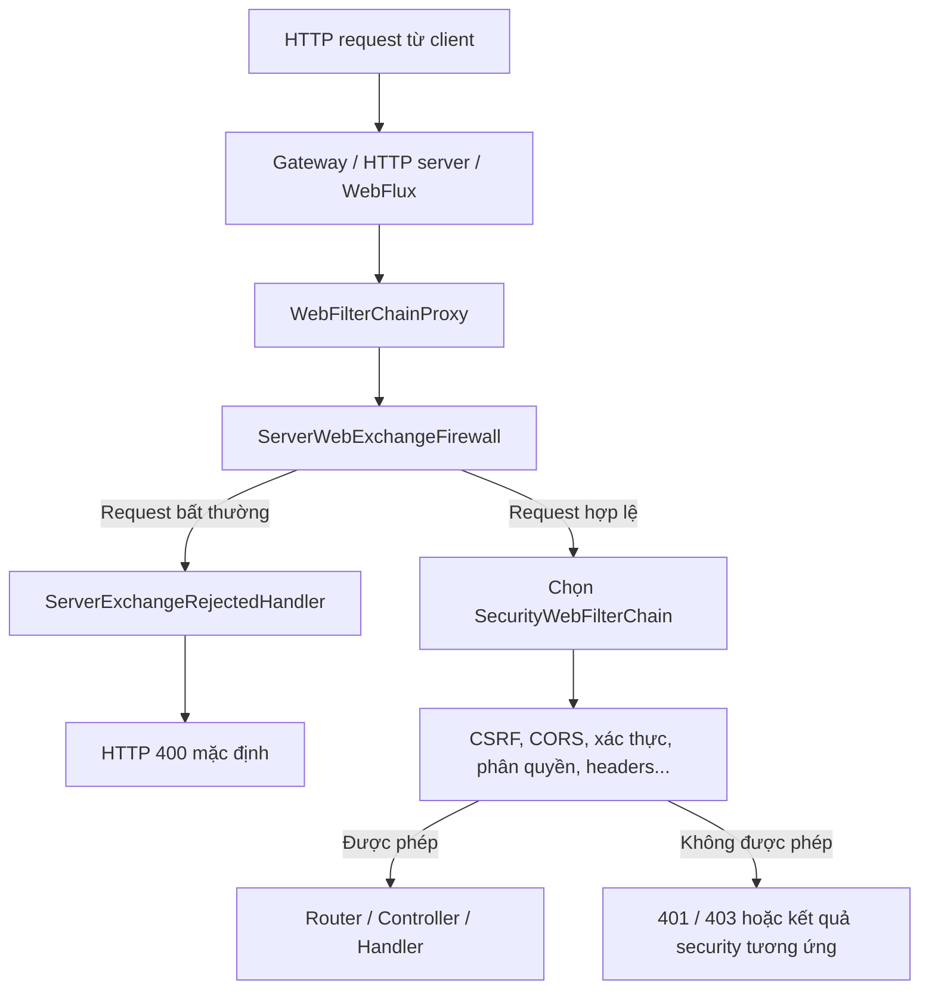

# Kiểm tra StrictServerWebExchangeFirewall khi được hỗ trợ

## 1. Bối cảnh: kiểm thử HTTP firewall trong ứng dụng Reactive

Trong một API xây dựng bằng Spring WebFlux, request không đáng tin cậy có thể mang đường dẫn chưa được chuẩn hóa, ký tự mã hóa gây mơ hồ, dấu chấm phẩy trong path, method không mong đợi hoặc header bất thường. Những đầu vào này có thể khiến các lớp gateway, định tuyến, Spring Security và handler ứng dụng **hiểu URL theo những cách khác nhau**. Nếu logic phân quyền dựa vào một đường dẫn nhưng backend lại xử lý đường dẫn khác, một request có thể vượt qua ranh giới an toàn.

Đây là bài thuộc chương **Kiểm thử Reactive** của mô-đun `SPRING_SECURITY_HTTP_PROTECTION`, nơi người học áp dụng các lớp bảo vệ HTTP và trình duyệt trong Spring Security: CSRF, CORS, security headers, CSP, HSTS, HTTP firewall và bảo vệ session. Trọng tâm là **kiểm tra `StrictServerWebExchangeFirewall` khi phiên bản Spring Security có hỗ trợ**, trong ngữ cảnh WebFlux; đồng thời phân biệt phạm vi của firewall với xác thực, phân quyền và các cơ chế bảo mật khác.

Sau bài này, người học có thể:

- Xác định phiên bản nào hỗ trợ Reactive HTTP firewall, phân biệt `StrictServerWebExchangeFirewall` và Servlet `StrictHttpFirewall`.
- Giải thích nơi firewall chạy trong chuỗi `WebFilterChainProxy` và vì sao request bị từ chối có thể nhận **400** thay vì **401/403**.
- Viết kiểm thử đơn vị dùng `MockServerWebExchange` và `StepVerifier`; kiểm thử tích hợp dùng `WebTestClient`.
- Xây dựng ma trận ca thử hợp lệ/bất thường cho method, path, encoding, header và parameter.
- Chẩn đoán khi test giả tạo request không giống dữ liệu thô được gửi ngoài thực tế, gateway chuẩn hóa URL, hoặc khi cấu hình firewall quá rộng làm hỏng hành trình hợp lệ.

## 2. Điều kiện hỗ trợ: cần xác nhận phiên bản trước khi viết test

API `org.springframework.security.web.server.firewall.StrictServerWebExchangeFirewall`, interface `ServerWebExchangeFirewall` và hỗ trợ tương ứng trong Reactive `WebFilterChainProxy` được giới thiệu từ **Spring Security 6.4**. Các nhánh 6.4+, 6.5 và 7.x có thể sử dụng API này; vẫn cần đối chiếu Javadoc đúng phiên bản artifact được chọn để biết các phương thức tùy chỉnh hiện có.

Đối với ứng dụng chạy **Spring Security trước 6.4**, không được viết test import `StrictServerWebExchangeFirewall` rồi mặc định rằng mã sẽ biên dịch. Khi ấy cần:

1. Khóa yêu cầu kiểm thử ở phiên bản mà ứng dụng đang chạy.
2. Duy trì kiểm thử WebFlux về URL routing, phân quyền và hành vi xử lý đường dẫn ở gateway/HTTP server hiện có.
3. Cân nhắc nâng cấp lên nhánh có Reactive firewall nếu đó là yêu cầu bảo vệ.
4. Không thay thế Reactive firewall bằng cách khai báo Servlet `StrictHttpFirewall`: hai loại firewall sử dụng request model và filter chain khác nhau.

| Đặc điểm | Servlet | Reactive WebFlux, Spring Security 6.4+ |
|---|---|---|
| Firewall cụ thể | `StrictHttpFirewall` | `StrictServerWebExchangeFirewall` |
| Interface | `HttpFirewall` | `ServerWebExchangeFirewall` |
| Filter proxy | `FilterChainProxy` | `WebFilterChainProxy` |
| Request | `HttpServletRequest` | `ServerWebExchange` |
| Kết quả từ chối | `RequestRejectedException` qua handler tương ứng | `ServerExchangeRejectedException` qua `ServerExchangeRejectedHandler` |
| Thư viện kiểm thử | `MockMvc` | `WebTestClient`; `StepVerifier` cho API reactive |

### Luồng xử lý cần kiểm chứng



`StrictServerWebExchangeFirewall` được cung cấp mặc định trong các phiên bản hỗ trợ và kiểm tra request tại Reactive `WebFilterChainProxy`. Quy tắc kiểm tra bao gồm method được phép, URL mơ hồ/chưa chuẩn hóa, nhiều ký tự nguy hiểm ở path, một số dữ liệu header và parameter, cùng hostname nếu cấu hình điều kiện bổ sung. Firewall giúp loại request có hình dạng đáng ngờ **trước** các bước match URL và quyền truy cập thông thường.

**Không đồng nhất khái niệm:**

- **Firewall từ chối** vì request không thỏa chính sách đầu vào → thông thường **HTTP 400 Bad Request**.
- **Authentication thất bại** vì không có/không hợp lệ credential → thường **401** ở API HTTP authentication.
- **Authorization hoặc CSRF từ chối** → thường **403**.
- **Không có route** → thường **404** nếu request đã vượt qua các lớp trước; chain bắt mọi đường dẫn và `denyAll` cũng có thể trả 403.

Khi viết assertion, cần biết request dừng ở lớp nào. Chỉ nhìn một mã trạng thái sẽ không chứng minh được mọi nguyên nhân.

## 3. Chính sách mặc định và các tình huống ưu tiên thử

Ở phiên bản có hỗ trợ, `StrictServerWebExchangeFirewall` áp dụng một danh sách HTTP method hợp lệ mặc định: `DELETE`, `GET`, `HEAD`, `OPTIONS`, `PATCH`, `POST` và `PUT`. Các method ít gặp như `TRACE` hoặc `TRACK` mặc định bị từ chối để giảm nguy cơ HTTP verb tampering và Cross-Site Tracing (XST).

Firewall còn có các ràng buộc về URL và dữ liệu metadata. Trước khi kết luận rằng một input cụ thể bị chặn, hãy xác minh request **thực sự đến** firewall với đúng raw path/method/header. Một HTTP server, client test hoặc proxy có thể từ chối, decode hoặc chuẩn hóa request trước.

| Nhóm ca thử | Ví dụ request gửi vào firewall | Điều mong đợi với cấu hình strict mặc định |
|---|---|---|
| Hợp lệ | `GET /api/orders/42` | Vượt firewall; bước sau quyết định 200/401/403/404 |
| Method bất thường | `TRACE /api/orders` | Bị từ chối |
| URL có dấu chấm phẩy | `GET /api/orders;role=admin` | Bị từ chối khi `allowSemicolon=false` |
| Encoded slash | Raw path `/api/a%2Fb` | Bị từ chối khi encoded slash bị cấm |
| Encoded percent | Raw path `/api/a%25b` | Bị từ chối khi encoded percent bị cấm |
| Backslash | Raw path có `\` hoặc `%5C` | Bị từ chối theo chính sách backslash |
| Null | Raw path có `%00` | Bị từ chối nếu đến được firewall |
| Path chưa chuẩn hóa | `/api/../admin`, `/api//orders` | Bị từ chối nếu các chuỗi thô được giữ đến firewall |
| Header/parameter bất thường | Tên hoặc giá trị chứa control character | Bị từ chối khi vượt qua parser của HTTP server |
| Header/parameter bình thường | `X-Request-ID: abc-123`, query `?page=2` | Vượt firewall; còn phụ thuộc các lớp khác |

**Thử cả mẫu được phép** để tránh một cấu hình quá nghiêm ngặt chặn mọi request và khiến toàn bộ negative test “đạt” một cách vô nghĩa. Ví dụ `OPTIONS` thường cần thiết cho CORS preflight; nếu ứng dụng thực sự dùng CORS mà cấu hình chỉ cho phép GET/POST, preflight có thể hỏng ngay tại firewall.

Không nhầm danh sách *decoded/encoded URL blocklist* của firewall với một bộ biểu thức chính quy tự viết. Các setter như `setAllowSemicolon(boolean)` và `setAllowUrlEncodedSlash(boolean)` được thiết kế để mở rộng một số ngoại lệ có chủ ý, nhưng cũng làm mở bề mặt tấn công. Đặc biệt, các URL chưa chuẩn hóa có thể bị từ chối cứng dù đã cho phép một ký tự riêng lẻ.

## 4. Cấu hình WebFlux tối thiểu có firewall để kiểm thử

Ví dụ sau dùng **Spring Security 6.4+** và WebFlux. Firewall được đăng ký bằng Spring bean để tích hợp vào `WebFilterChainProxy`. Nó cho phép `GET`, `POST` và `OPTIONS`; những method khác, gồm `TRACE`, sẽ bị từ chối. Giữ quy tắc chặn dấu chấm phẩy, encoded slash và các giá trị strict khác theo mặc định.

```java
import java.util.List;

import org.springframework.context.annotation.Bean;
import org.springframework.context.annotation.Configuration;
import org.springframework.http.HttpMethod;
import org.springframework.security.config.web.server.ServerHttpSecurity;
import org.springframework.security.config.annotation.web.reactive.EnableWebFluxSecurity;
import org.springframework.security.web.server.SecurityWebFilterChain;
import org.springframework.security.web.server.firewall.StrictServerWebExchangeFirewall;

@Configuration
@EnableWebFluxSecurity
class ReactiveFirewallSecurityConfiguration {

    @Bean
    StrictServerWebExchangeFirewall strictServerWebExchangeFirewall() {
        StrictServerWebExchangeFirewall firewall =
                new StrictServerWebExchangeFirewall();

        // Chỉ giữ method mà ứng dụng thật sự sử dụng.
        // OPTIONS cần cho những luồng CORS preflight.
        firewall.setAllowedHttpMethods(
                List.of(HttpMethod.GET, HttpMethod.POST, HttpMethod.OPTIONS));

        return firewall;
    }

    @Bean
    SecurityWebFilterChain apiSecurity(ServerHttpSecurity http) {
        return http
                .authorizeExchange(exchange -> exchange
                        .pathMatchers("/health").permitAll()
                        .pathMatchers("/api/**").authenticated()
                        .anyExchange().denyAll())
                .httpBasic(spec -> {})
                .build();
    }
}
```

Với ví dụ này, một GET hợp lệ tới `/health` sẽ đi qua firewall và được phép vào route nếu ứng dụng cung cấp handler tương ứng; một GET `/health;v=1` bị chặn trước handler. Request không thỏa authorization vẫn có thể nhận 401/403 ở lớp sau.

**Lưu ý về phạm vi mẫu:** đây là cấu hình minh họa cho việc test firewall. Tùy ứng dụng thật, cần bảo đảm các cơ chế xác thực, CSRF cho hành trình dùng cookie, CORS origin và security headers được cấu hình đúng. Không tắt CSRF chỉ để cho một bài kiểm thử về firewall trả mã dễ đoán. Với endpoint POST dùng cookie, thiếu CSRF token thường bị từ chối tại CSRF sau khi đã vượt firewall.

Có thể khai báo handler phản hồi riêng khi firewall từ chối, nhưng **mặc định là 400** và không nhất thiết phải thêm bean:

```java
import org.springframework.context.annotation.Bean;
import org.springframework.http.HttpStatus;
import org.springframework.security.web.server.firewall.HttpStatusExchangeRejectedHandler;
import org.springframework.security.web.server.firewall.ServerExchangeRejectedHandler;

// Tùy chọn: quy định rõ cùng hành vi mặc định HTTP 400.
@Bean
ServerExchangeRejectedHandler rejectedHandler() {
    return new HttpStatusExchangeRejectedHandler(HttpStatus.BAD_REQUEST);
}
```

Nếu dự án chủ ý trả **404** thay cho 400 ở lớp firewall, phải sửa các assertion tích hợp để khớp với hợp đồng đã chọn. Không lấy “status mặc định 400” làm quy luật bất biến cho mọi môi trường.

## 5. Kiểm thử đơn vị trực tiếp bằng MockServerWebExchange và StepVerifier

Kiểm thử trực tiếp `getFirewalledExchange(ServerWebExchange)` phù hợp khi cần xác định firewall có từ chối đầu vào hay không mà không phụ thuộc controller, OAuth/JWT, CORS, CSRF hay phân quyền. `getFirewalledExchange` trả `Mono<ServerWebExchange>`; khi quy tắc bị vi phạm, luồng phát `ServerExchangeRejectedException`.

Các thư viện thường cần cho ví dụ: `spring-security-web` và WebFlux trong runtime, `spring-test` (thường đến từ `spring-boot-starter-test`), `reactor-test` và JUnit Jupiter trong test scope. Trước khi dùng code, cần bảo đảm artifact Spring Security đã ở phiên bản có API Reactive firewall.

```java
import org.junit.jupiter.api.BeforeEach;
import org.junit.jupiter.api.Test;
import org.springframework.http.HttpMethod;
import org.springframework.mock.http.server.reactive.MockServerHttpRequest;
import org.springframework.mock.web.server.MockServerWebExchange;
import org.springframework.security.web.server.firewall.ServerExchangeRejectedException;
import org.springframework.security.web.server.firewall.StrictServerWebExchangeFirewall;
import reactor.core.publisher.Mono;
import reactor.test.StepVerifier;

import java.util.List;

import static org.assertj.core.api.Assertions.assertThat;

class StrictReactiveFirewallTest {

    private StrictServerWebExchangeFirewall firewall;

    @BeforeEach
    void setUp() {
        firewall = new StrictServerWebExchangeFirewall();
        firewall.setAllowedHttpMethods(
                List.of(HttpMethod.GET, HttpMethod.POST, HttpMethod.OPTIONS));
    }

    @Test
    void normalGetPassesFirewall() {
        var exchange = MockServerWebExchange.from(
                MockServerHttpRequest.get("/api/orders/42"));

        StepVerifier.create(
                Mono.defer(() -> firewall.getFirewalledExchange(exchange)))
                .assertNext(allowed -> assertThat(
                        allowed.getRequest().getPath().value())
                        .isEqualTo("/api/orders/42"))
                .verifyComplete();
    }

    @Test
    void traceIsRejected() {
        var exchange = MockServerWebExchange.from(
                MockServerHttpRequest.method(
                        HttpMethod.TRACE, "/api/orders"));

        StepVerifier.create(
                Mono.defer(() -> firewall.getFirewalledExchange(exchange)))
                .expectError(ServerExchangeRejectedException.class)
                .verify();
    }

    @Test
    void semicolonInPathIsRejected() {
        var exchange = MockServerWebExchange.from(
                MockServerHttpRequest.get("/api/orders;role=admin"));

        StepVerifier.create(
                Mono.defer(() -> firewall.getFirewalledExchange(exchange)))
                .expectError(ServerExchangeRejectedException.class)
                .verify();
    }

    @Test
    void postIsAcceptedByFirewallEvenWhenApplicationMayRejectIt() {
        var exchange = MockServerWebExchange.from(
                MockServerHttpRequest.post("/api/orders"));

        StepVerifier.create(
                Mono.defer(() -> firewall.getFirewalledExchange(exchange)))
                .expectNextCount(1)
                .verifyComplete();
    }
}
```

**Vì sao dùng `Mono.defer(...)`?** Nó trì hoãn lời gọi firewall đến lúc subscribe và giúp StepVerifier quan sát lỗi ngay cả khi một implementation phát lỗi đồng bộ trong lúc gọi phương thức. Chỉ cần test hành vi công khai: `Mono` phát exchange hợp lệ hoặc tín hiệu lỗi, không dựa vào detail nội bộ.

**Kết quả mong đợi:** GET bình thường và POST nằm trong danh sách method được phép vượt qua **firewall**, không phải mặc nhiên được endpoint cho phép. TRACE và path chứa semicolon trả `ServerExchangeRejectedException` trong kiểm thử trực tiếp.

### Kiểm thử raw URL và encoded payload cần thận trọng

Ở các request thử `%2F`, `%25`, `%00`, `..` hoặc `//`, khả năng tạo và giữ nguyên URL thô phụ thuộc cách test client dựng URI. Ví dụ API builder dùng URI template có thể encode thêm một lần; container có thể normalize hoặc từ chối trước Spring Security. Trước khi khẳng định một test kiểm tra encoded slash, hãy xác minh raw path thực sự là `/api/a%2Fb` ở điểm vào mong muốn.

Đối với các ca cần giữ byte chính xác trên đường truyền, dùng test HTTP qua server thật với client kiểm soát raw target, kết hợp log/quan sát an toàn ở gateway và ứng dụng. Nếu client đã biến `%2F` thành `%252F` thì đó là ca **double encoding**, không còn tương đương ca encoded slash ban đầu. Không tắt tính năng an ninh để ép client test gửi được payload.

Trong unit test, có thể thêm assertion đọc:

```java
String rawPath = exchange.getRequest().getURI().getRawPath();
assertThat(rawPath).isEqualTo("/api/orders;role=admin");
```

Với các chuỗi percent encoding, hãy kiểm tra `getRawPath()` **trước khi** dùng chúng để chứng minh firewall đã chặn đúng biến thể.

## 6. Kiểm thử tích hợp qua WebTestClient

Unit test ở mục trước kiểm tra đúng đối tượng firewall, nhưng không thể chứng minh bean firewall được đăng ký vào Spring Security WebFlux filter chain thật. Kiểm thử tích hợp giúp kiểm tra routing, xử lý lỗi và mã HTTP ngoài cùng.

Ví dụ với một ứng dụng Spring Boot WebFlux có cấu hình ở mục 4 và handler `GET /health`:

```java
import org.springframework.web.bind.annotation.GetMapping;
import org.springframework.web.bind.annotation.RestController;
import reactor.core.publisher.Mono;

@RestController
class HealthController {
    @GetMapping("/health")
    Mono<String> health() {
        return Mono.just("ok");
    }
}
```

```java
import org.junit.jupiter.api.Test;
import org.springframework.beans.factory.annotation.Autowired;
import org.springframework.boot.test.context.SpringBootTest;
import org.springframework.boot.test.autoconfigure.web.reactive.AutoConfigureWebTestClient;
import org.springframework.test.web.reactive.server.WebTestClient;

@SpringBootTest
@AutoConfigureWebTestClient
class ReactiveFirewallIntegrationTest {

    @Autowired
    WebTestClient webTestClient;

    @Test
    void allowsOrdinaryGet() {
        webTestClient.get()
                .uri("/health")
                .exchange()
                .expectStatus().isOk()
                .expectBody(String.class).isEqualTo("ok");
    }

    @Test
    void rejectsSemicolonPathWithBadRequest() {
        webTestClient.get()
                .uri("/health;v=1")
                .exchange()
                .expectStatus().isBadRequest();
    }
}
```

Điều kiện để test này có giá trị:

1. Context khởi chạy **WebFlux**, có `@EnableWebFluxSecurity` hoặc cấu hình Security WebFlux được Spring Boot thiết lập, và bean firewall đã thực sự áp dụng.
2. Test không bind trực tiếp vào một controller đơn lẻ bỏ qua `WebFilterChainProxy`. `WebTestClient.bindToController(...)` thường không đại diện cho toàn bộ Spring Security filter chain.
3. Handler `GET /health` tồn tại và phản hồi 200 cho request bình thường, giúp xác nhận negative test không chỉ nhận 404 vì thiếu route.
4. Nếu môi trường đổi `ServerExchangeRejectedHandler` sang 404, cần cập nhật assertion từ chối và có cách riêng để xác minh nguyên nhân.
5. Nếu cần bảo đảm raw request được bảo toàn qua **HTTP server thật, proxy, ingress**, hãy bổ sung test chạy qua cổng mạng thật vì `@AutoConfigureWebTestClient` thường kiểm thử trong application context.

Bổ sung test với URL không khớp route và user không xác thực giúp xác nhận firewall và authorization không bị lẫn:

| Request | Trạng thái thường thấy trong ví dụ | Nguyên nhân |
|---|---|---|
| `GET /health` | 200 | Hợp lệ, được `permitAll`, có handler |
| `GET /health;v=1` | 400 | Firewall strict từ chối semicolon |
| `GET /api/orders` khi chưa xác thực | 401 hoặc entry point được cấu hình | Vượt firewall nhưng thiếu credential |
| `GET /unknown` | 403 trong cấu hình `denyAll` | Vượt firewall nhưng matcher dự phòng từ chối |
| `POST /health` thiếu CSRF token | Có thể 403 | CSRF xử lý sau khi vượt firewall |
| `TRACE /health` | 400 nếu method thô đi tới firewall | Method bị chặn theo danh sách |

Kết quả thực tế phụ thuộc security chain, handler và endpoint được khai báo. Đối với test hệ thống thật, hãy assert theo hợp đồng đã chốt và điều tra bất kỳ mã trạng thái không mong đợi nào.

## 7. Ma trận kiểm thử: chứng minh cả an toàn và tính tương thích

Một bộ test có giá trị nên phân biệt *đầu vào nguy hiểm*, *đầu vào hợp lệ* và *đầu vào hợp lệ về hình dạng nhưng không được phép về nghiệp vụ*.

| Mục tiêu | Positive test | Negative test | Điều cần đối chiếu |
|---|---|---|---|
| Method allowlist | GET/POST/OPTIONS đã cho phép | TRACE/TRACK, method lạ | Không làm hỏng preflight hoặc endpoint cần method hợp lệ |
| Path normalization | `/api/orders/42` | `/api/../admin`, `/api//orders` | Raw path tại client/server/gateway |
| Semicolon | Route thông thường | `/api/orders;v=1` | Không nới toàn hệ thống vì một endpoint matrix variable |
| Encoded slash/percent | `/api/file/42` | `/api/a%2Fb`, `/api/a%25b` | Encoding được giữ nguyên hay đã đổi |
| Header/parameter | Header, query thông thường | Tên/giá trị chứa control character | HTTP server có thể chặn sớm |
| Host | Host được phê duyệt, nếu cấu hình predicate | Host không thuộc danh sách | Proxy, forwarded host và trust boundary |
| Authorization | Người dùng có scope/role đúng | Người dùng thiếu quyền | Firewall không thay thế authorization |
| CSRF | POST cookie với token hợp lệ | POST cookie thiếu token | Firewall không thay thế CSRF |
| CORS | Preflight origin được cho phép | Preflight từ origin lạ | OPTIONS không bị chặn nhầm tại firewall |
| Security headers | Response HTTPS hợp lệ | Thiếu CSP/HSTS trên trang cần bảo vệ | Firewall không tự kiểm tra CSP/HSTS |

Khi test header/parameter chứa ký tự điều khiển, mock HTTP request builder hoặc HTTP server có thể ném lỗi **ngay lúc dựng request**. Đây là tín hiệu parser đã chặn input nhưng **không chứng minh** `StrictServerWebExchangeFirewall` đã chạy. Muốn kiểm thử riêng predicate của firewall, có thể test chính sách predicate bằng unit test độc lập hoặc dựng test exchange hợp lệ theo API của phiên bản; muốn kiểm thử toàn hệ thống thì ghi nhận tầng nào từ chối.

### Kiểm thử thay đổi cấu hình có chủ ý

Giả sử một tích hợp cũ cần matrix variable. Spring Security cho phép:

```java
@Bean
StrictServerWebExchangeFirewall firewall() {
    StrictServerWebExchangeFirewall firewall =
            new StrictServerWebExchangeFirewall();
    firewall.setAllowSemicolon(true); // Chỉ dùng sau khi đánh giá rủi ro.
    return firewall;
}
```

Điều này phải kéo theo cả test cho URL hợp lệ thật sự sử dụng matrix variable và test không cho bypass bảo vệ ở các route nhạy cảm. Dấu chấm phẩy là nguồn tạo khác biệt về URL matching nên chỉ bật khi có lý do rõ và kiểm tra ở cả gateway, router và authorization layer. Nên ưu tiên sửa thiết kế URL hoặc dùng query parameter khi khả thi.

Tương tự, `setAllowUrlEncodedSlash(true)` có thể hợp thức hóa request mà gateway và ứng dụng hiểu khác nhau. Đừng đặt `setUnsafeAllowAnyHttpMethod(true)` để “sửa” test TRACE; cách này vô hiệu hóa bảo vệ method. Với hostname, header name/value và parameter name/value có thể cấu hình predicate, nhưng predicate quá rộng như `value -> true` làm mất lớp lọc đầu vào. Bất kỳ ngoại lệ nào cũng cần test phủ định để phát hiện bypass sau khi nâng cấp.

## 8. Chẩn đoán khi test thất bại

| Hiện tượng | Nguyên nhân có khả năng | Bước xử lý |
|---|---|---|
| Import `StrictServerWebExchangeFirewall` không tồn tại | Spring Security chưa đạt phiên bản hỗ trợ hoặc nhầm dependency | Kiểm tra dependency đã resolve, dùng nhánh 6.4+ và import từ `org.springframework.security.web.server.firewall` |
| `WebTestClient` trả 404 với input xấu | Test không đi qua filter chain, route không tồn tại, hoặc custom reject handler trả 404 | Xác minh context/filter chain và unit test `getFirewalledExchange` |
| Input xấu trả 200 | Firewall chưa được gắn, bean sai context, proxy đã biến đổi URL, hoặc rule được nới | So sánh unit test với integration test, kiểm tra raw path thực nhận |
| Expect 400 nhưng nhận 401/403 | Request đã qua firewall; bị auth/CSRF/authorization từ chối | Kiểm tra method, URI builder, các matcher và Spring Security DEBUG log phù hợp |
| Hầu hết request nhận 400 | Allowlist quá hẹp, encoded path/header bị client thay đổi, HTTP proxy gửi metadata bất thường | Thử baseline GET/OPTIONS và xác minh input trước firewall |
| OPTIONS/CORS preflight bị 400 | Đã loại OPTIONS khỏi method allowlist | Bổ sung OPTIONS nếu nghiệp vụ dùng CORS preflight; kiểm thử CORS riêng |
| Test `%2F` không tái hiện lỗi | URI builder tự encode thành `%252F` hoặc server normalize sớm | Kiểm tra `getRawPath()`, dùng client kiểm soát raw target |
| Có chặn ở gateway nhưng Spring test không chặn | Hai môi trường có parser/normalization khác nhau | Kiểm thử ở hai lớp và thống nhất hợp đồng nhận URL |
| Có CSRF/CORS/HSTS/CSP lỗi dù firewall test xanh | Các lớp bảo vệ độc lập chưa được cấu hình/kiểm thử | Chạy bộ test CSRF, CORS, headers, cookie/session riêng |

**Theo dõi trong môi trường thật:** ghi nhận method, route pattern, loại lỗi từ chối và correlation ID ở mức cần thiết; tránh ghi lại đầy đủ cookie, authorization header, token, query string nhạy cảm hay dữ liệu có thể chứa payload độc hại. Tập trung vào số lượng reject và thay đổi bất thường sau khi triển khai.

## 9. Bài thực hành: kiểm tra từ đơn vị đến ứng dụng thật

Một đội WebFlux triển khai API đặt hàng `/api/orders` sau reverse proxy. Yêu cầu:

- Người dùng chỉ gửi `GET`, `POST` và `OPTIONS`; endpoint có quyền riêng và POST dùng cơ chế xác thực được thiết kế phù hợp.
- Request bất thường như `TRACE /api/orders`, `GET /api/orders;admin=true` hoặc raw path encoded slash phải bị chặn theo chính sách strict.
- CORS preflight từ frontend đã cho phép vẫn hoạt động.
- Người dùng chưa xác thực không được truy cập `/api/orders`, kể cả khi URL bình thường.

Quy trình:

1. **Xác minh phiên bản** Spring Security hiện chạy, khả năng sử dụng API Reactive firewall, `spring-security-test` và `reactor-test`.
2. **Viết test đơn vị** cho normal GET, allowed POST và ít nhất hai trường hợp reject (`TRACE`, semicolon), dùng `StepVerifier` để kiểm tra lỗi loại `ServerExchangeRejectedException`.
3. **Gắn bean firewall**, giữ OPTIONS nếu cần CORS; giữ security chain có quy tắc `denyAll` cho các route chưa định nghĩa.
4. **Kiểm thử tích hợp** với `WebTestClient` và một route baseline được phép, ghi lại 200 vs 400 vs 401/403 theo hợp đồng của ứng dụng.
5. **Thử qua reverse proxy thật** cho encoded path và normalization, đối chiếu raw URL; đánh giá bảo vệ ở cả gateway và backend.
6. **Kiểm thử hồi quy** sau khi đổi security chain, nâng cấp Spring Security hoặc sửa cấu hình proxy, đặc biệt với URL encoding, CORS preflight và các ngoại lệ được bật.

### Tiêu chí đạt

Bộ test chỉ được coi là đủ khi:

- Ca hợp lệ **vượt firewall** và đi đúng route.
- Ca xấu thực sự chạm lớp firewall hoặc có bằng chứng được parser/gateway từ chối sớm.
- Test phân biệt 400 vì firewall với 401/403 vì xác thực, phân quyền hoặc CSRF.
- Thay đổi `setAllow...` được phản ánh trong cả positive và negative test.
- Có kiểm tra luồng end-to-end cho các raw URL dễ bị client/proxy chuẩn hóa.
- Chức năng CORS/CSRF, CSP, HSTS và session vẫn được kiểm thử riêng trong phạm vi bảo vệ HTTP.

## 10. Tài liệu tham khảo chính thức

- [Spring Security Reference — ServerWebExchangeFirewall (Reactive)](https://docs.spring.io/spring-security/reference/reactive/exploits/firewall.html): giải thích vai trò firewall, mặc định strict, tùy chỉnh và rejected handler.
- [Spring Security 6.5 Javadoc — StrictServerWebExchangeFirewall](https://docs.spring.io/spring-security/site/docs/6.5.x/api/org/springframework/security/web/server/firewall/StrictServerWebExchangeFirewall.html): `getFirewalledExchange`, các setter và dấu mốc API.
- [Spring Security Javadoc — ServerWebExchangeFirewall](https://docs.spring.io/spring-security/reference/api/java/org/springframework/security/web/server/firewall/ServerWebExchangeFirewall.html): interface Reactive và hợp đồng xử lý lỗi.
- [Spring Security Reference — HttpFirewall (Servlet)](https://docs.spring.io/spring-security/reference/servlet/exploits/firewall.html): dùng để đối chiếu, tránh dùng nhầm Servlet API trong WebFlux.

## Kết luận

`StrictServerWebExchangeFirewall` cung cấp lớp sàng lọc đầu vào HTTP cho ứng dụng WebFlux từ Spring Security 6.4 trở lên. Cách kiểm thử đáng tin cậy là kết hợp **`StepVerifier` để xác nhận quy tắc firewall**, **`WebTestClient` để xác minh Spring Security filter chain** và **test qua HTTP server/gateway thật** cho những raw URL dễ bị biến đổi. Giữ sự khác biệt giữa firewall, CSRF, CORS, xác thực và phân quyền giúp tìm đúng lỗi và duy trì các lớp phòng vệ HTTP nhất quán khi triển khai.
