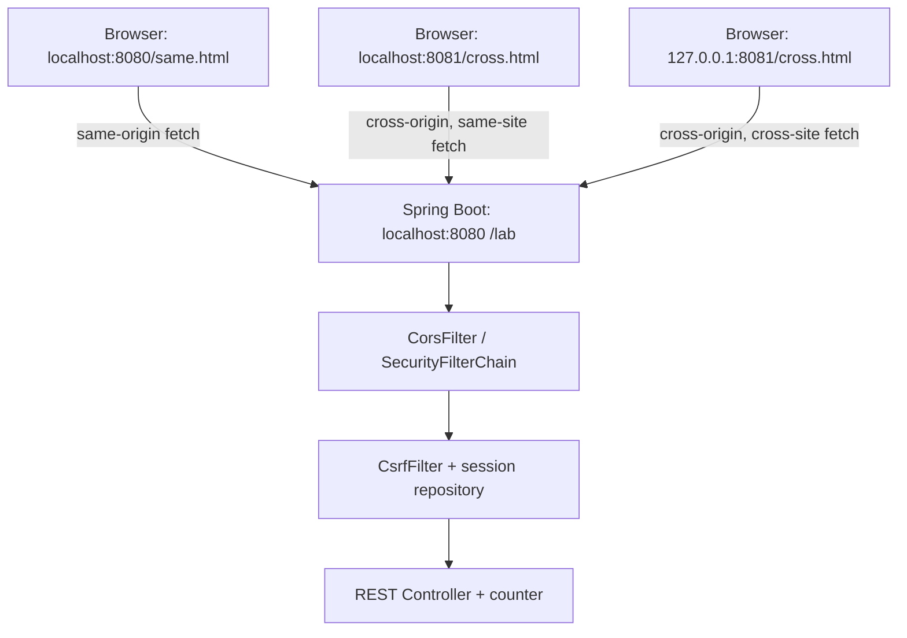

# Xây dựng các trang thử ở cùng origin và khác origin

Một API có thể vượt qua `MockMvc` nhưng vẫn thất bại trong trình duyệt vì **Same-Origin Policy**, CORS preflight, cookie `SameSite`, `Secure`, `HttpOnly`, CSP hoặc quy tắc chuyển hướng. Ngược lại, một trang ở origin không được phép đọc response vẫn có thể **gửi một số loại request** đến server; đây là lý do CORS không thể thay cho CSRF protection. Muốn kiểm thử bảo mật HTTP có giá trị thực tế, cần dựng **các trang thử nằm ở origin được kiểm soát**, thay đổi từng điều kiện và quan sát hành vi browser trước khi quy kết một lỗi `403`, lỗi `fetch` hay cookie bị mất.

Bài thuộc chương **Kiểm thử trình duyệt** của module **SPRING_SECURITY_HTTP_PROTECTION**. Module áp dụng các lớp phòng vệ HTTP và trình duyệt trong Spring Security, từ CSRF, CORS, security headers, CSP, HSTS đến HTTP firewall và bảo vệ session, trên cả Servlet lẫn Reactive. Bài này xây dựng một phòng thí nghiệm trình duyệt nhỏ với **Spring Security Servlet**, một trang cùng origin và một trang khác origin; đồng thời chỉ ra cách mở rộng kiểm tra sang WebFlux mà không dùng nhầm API.

**Mục tiêu:** phân biệt *origin* và *site*; chạy được các trang test ở hai origin; chứng minh browser có thể gửi nhưng không đọc được một số cross-origin request; kiểm tra CORS, cookie/session, CSRF token và preflight trong DevTools; tổ chức các bài kiểm thử tự động và chẩn đoán kết quả không mang tính chủ quan.

## 1. Phân biệt origin, site và host trước khi dựng lab

**Origin** được xác định bởi bộ ba **scheme + hostname + port** của URL. Hai trang khác một trong ba thành phần này là *cross-origin*.

| URL trang | URL API | Quan hệ |
| --- | --- | --- |
| `http://localhost:8080` | `http://localhost:8080` | **Same-origin** |
| `http://localhost:8081` | `http://localhost:8080` | **Cross-origin** do khác port |
| `http://127.0.0.1:8081` | `http://localhost:8080` | **Cross-origin** do khác hostname và port |
| `https://app.example.test` | `https://api.example.test` | **Cross-origin** do khác hostname |
| `http://app.example.test` | `https://app.example.test` | **Cross-origin** do khác scheme |

**Site** trong chính sách cookie `SameSite` không đồng nhất với origin. Với khái niệm *schemeful same-site*, trình duyệt thường xét scheme và **registrable domain** (eTLD+1); port không làm thay đổi site. Với IP hoặc hostname đặc biệt như `localhost`, các quy tắc nhận diện site có chi tiết riêng.

Ví dụ `http://localhost:8080` và `http://localhost:8081` có **hai origin khác nhau nhưng cùng site**. Trong môi trường HTTPS, `https://app.example.test` và `https://api.example.test` thường khác origin nhưng cùng site `https://example.test`. Trong khi đó `https://attacker.other.test` khác site với `https://api.example.test`.

Điểm này quan trọng vì:

- **CORS** kiểm soát khả năng mã JavaScript ở origin A đọc response và thực hiện một số request tới origin B.
- **Cookie `SameSite`** có thể quyết định cookie có được gửi trong ngữ cảnh cross-site hay không, kể cả với một request mà CORS không cho đọc response.
- **CSRF** bảo vệ những request thay đổi trạng thái sử dụng credentials mà browser có thể tự đính kèm.
- **CSP**, nhất là `connect-src`, có thể chặn thao tác `fetch` trước khi quan sát kết quả CORS.

Không viết test dựa trên giả định “cross-origin luôn là cross-site” hoặc “CORS chặn thì server không nhận được request”.

## 2. Mô hình phòng thí nghiệm

Ta tạo ba điểm truy cập đến **hai server**:

| Vai trò | URL | Mục đích |
| --- | --- | --- |
| API + trang thử cùng origin | `http://localhost:8080/same.html` | Kiểm tra fetch, cookie và CSRF không có rào cản CORS |
| Trang thử khác origin nhưng cùng site | `http://localhost:8081/cross.html` | Kiểm tra CORS, preflight, `credentials` và cookie khi **khác port** |
| Trang thử khác hostname/site | `http://127.0.0.1:8081/cross.html` | Quan sát CORS không cho phép, khác biệt cookie scope và `SameSite` |
| API đích của mọi trang | `http://localhost:8080/lab/...` | Backend Spring Security với CSRF được bật |



**Điều kiện an toàn:** tất cả URL là môi trường local, dữ liệu giả và bộ đếm thử nghiệm. Không dùng tài khoản thật, không đặt API lab trên internet công cộng, không cho phép CORS wildcard với credentials và không tắt CSRF chỉ để một trang test hoạt động.

### Vì sao dùng cả `localhost` và `127.0.0.1`?

Cả hai có thể cùng trỏ tới máy đang chạy nhưng **không phải cùng hostname/origin** trong browser. Cookie host-only được lưu cho `localhost` không được xem là cookie của `127.0.0.1`, và browser có thể coi một request từ trang `127.0.0.1` tới API `localhost` là cross-site.

Đây là bài thử trực quan, **chưa phải mô phỏng hoàn hảo** triển khai khác site ngoài internet: `localhost` và loopback có một số ngoại lệ bảo mật của trình duyệt. Để đánh giá đầy đủ `Secure`, `SameSite=None`, third-party cookies và HSTS, cần bổ sung lab **HTTPS với hostname/domain thật trong môi trường test**.

## 3. Những gì cần quan sát để kết luận chính xác

Trong Chrome/Edge/Firefox, mở DevTools trước khi thử, bật **Preserve log** và tắt cache khi so sánh response. Theo dõi cả Network và Application/Storage:

| Quan sát | Câu hỏi được trả lời |
| --- | --- |
| **Request URL** và origin của trang | Request là same-origin hay cross-origin? |
| Request header `Origin` | Browser khai báo origin gọi API thế nào? |
| `Sec-Fetch-Site`, `Sec-Fetch-Mode`, `Sec-Fetch-Dest` | Browser đang gửi request trong ngữ cảnh nào? |
| Có preflight `OPTIONS` trước POST không? | Request có cần và vượt qua kiểm tra CORS preflight không? |
| `Access-Control-Allow-Origin` | Response có cho phép **đúng origin** gọi đọc không? |
| `Access-Control-Allow-Credentials` | Cross-origin fetch có credentials có được CORS cho phép không? |
| Request `Cookie` và response `Set-Cookie` | Cookie nào browser thực sự gửi hoặc chấp nhận? |
| Header CSRF và status response | Server có nhận token client gửi và qua `CsrfFilter` không? |
| Console error | Lỗi từ CORS, CSP, cookie policy, network hay script? |
| Response body mà JavaScript thấy | Client **có quyền đọc** response hay không? |

Một request trong DevTools có thể thấy status HTTP nhưng **JavaScript vẫn nhận `TypeError: Failed to fetch`** do CORS hoặc policy của browser. Không được lấy status mà DevTools hiển thị làm bằng chứng script đã đọc được body.

### Tách ba lớp kiểm tra

```text
Browser quyết định có gửi request (preflight, cookie, CSP, network)
    ↓
Backend quyết định request có hợp lệ (CORS, CSRF, auth, firewall)
    ↓
Browser quyết định script có đọc response được không (SOP/CORS)
```

Tùy kiểu request, có thể **chưa gửi POST chính thức** vì preflight thất bại; hoặc **đã gửi POST** nhưng browser giấu response khỏi JavaScript. Muốn test đúng, phải xác định request dừng ở lớp nào.

## 4. Thiết kế hành vi backend để không bị nhầm lỗi authentication

Trong lab này, một bộ đếm `AtomicInteger` là tài nguyên thay đổi trạng thái, nhưng **không lưu dữ liệu nhạy cảm**. Chúng ta đặt các endpoint lab ở chế độ `permitAll()` để không phải đăng nhập, **nhưng vẫn bật CSRF cho POST**. Đây là cách tách lỗi CSRF/CORS khỏi lỗi thiếu quyền truy cập khi học.

| Endpoint | Method | Hành vi |
| --- | --- | --- |
| `/lab/counter` | `GET` | Trả giá trị bộ đếm, không thay đổi trạng thái |
| `/lab/csrf` | `GET` | Trả tên header/parameter và masked CSRF token; nếu cần tạo session |
| `/lab/increment` | `POST` | Tăng bộ đếm **chỉ sau khi vượt qua security filters** |
| `/same.html` | `GET` | Trang tĩnh cùng origin |

Các điểm chủ ý:

1. `GET` không được dùng để tăng bộ đếm, vì GET là method an toàn và CSRF matcher mặc định không yêu cầu token.
2. `POST` luôn cần CSRF token theo cấu hình lab, kể cả khi `permitAll()`.
3. Có thể đọc `/lab/counter` để xem server-side effect có xảy ra hay không.
4. Không xuất session ID hoặc raw token gốc vào JSON hay log; frontend chỉ nhận biểu diễn token mà handler công bố.
5. Bộ đếm là trạng thái trong bộ nhớ của **một tiến trình test**, không phải cơ sở dữ liệu bền vững; restart backend sẽ reset số đếm.

## 5. Backend Spring Boot: bật CSRF, cho CORS đúng một origin

Sử dụng một ứng dụng **Spring Boot 3.x / Spring Security Servlet 6.x** có các dependency `spring-boot-starter-web` và `spring-boot-starter-security`. Ví dụ dùng Java 17 trở lên, API cấu hình lambda và `jakarta.servlet`. Trong dự án Spring Security phiên bản khác, cần đối chiếu API tương ứng.

### 5.1. `LabSecurityConfig.java`

```java
import java.util.List;
import org.springframework.context.annotation.Bean;
import org.springframework.context.annotation.Configuration;
import org.springframework.security.config.Customizer;
import org.springframework.security.config.annotation.web.builders.HttpSecurity;
import org.springframework.security.web.SecurityFilterChain;
import org.springframework.security.web.csrf.HttpSessionCsrfTokenRepository;
import org.springframework.security.web.csrf.XorCsrfTokenRequestAttributeHandler;
import org.springframework.web.cors.CorsConfiguration;
import org.springframework.web.cors.CorsConfigurationSource;
import org.springframework.web.cors.UrlBasedCorsConfigurationSource;

@Configuration
public class LabSecurityConfig {

    @Bean
    SecurityFilterChain labSecurity(HttpSecurity http) throws Exception {
        http
            // Spring Security xử lý CORS trước khi CSRF kiểm tra POST.
            .cors(Customizer.withDefaults())
            .authorizeHttpRequests(auth -> auth
                .requestMatchers(
                    "/same.html",
                    "/lab/counter",
                    "/lab/csrf",
                    "/lab/increment").permitAll()
                .anyRequest().denyAll())
            // Không tắt CSRF dù endpoint được permitAll.
            .csrf(csrf -> csrf
                .csrfTokenRepository(
                    new HttpSessionCsrfTokenRepository())
                .csrfTokenRequestHandler(
                    new XorCsrfTokenRequestAttributeHandler()));

        return http.build();
    }

    @Bean
    CorsConfigurationSource corsConfigurationSource() {
        CorsConfiguration config = new CorsConfiguration();
        config.setAllowedOrigins(List.of("http://localhost:8081"));
        config.setAllowedMethods(List.of(
            "GET", "POST", "OPTIONS"));
        config.setAllowedHeaders(List.of(
            "Content-Type", "X-CSRF-TOKEN"));
        config.setAllowCredentials(true);

        UrlBasedCorsConfigurationSource source =
            new UrlBasedCorsConfigurationSource();
        source.registerCorsConfiguration("/lab/*", config);
        return source;
    }
}
```

**Vì sao cấu hình như vậy?**

- **`permitAll()` không vô hiệu hóa CSRF**: `POST /lab/increment` vẫn phải có CSRF token hợp lệ.
- `HttpSessionCsrfTokenRepository` giữ **token gốc kỳ vọng** trong session, để request có/không có cookie session tạo sự khác biệt rõ ràng.
- `XorCsrfTokenRequestAttributeHandler` công bố **masked token** cho frontend. Client gửi nguyên biểu diễn đó về `X-CSRF-TOKEN`; không lấy raw token từ session.
- `.cors(Customizer.withDefaults())` cho Spring Security sử dụng cấu hình CORS, để browser có thể thực hiện preflight và nhận response theo chính sách.
- Chỉ `http://localhost:8081` được cho đọc response từ các route `/lab/` theo CORS. Origin `http://127.0.0.1:8081` **không** nằm trong danh sách cho phép.
- `setAllowCredentials(true)` cho phép trường hợp request có cookie, nhưng phải dùng **origin cụ thể**, không dùng wildcard `*` ở `Access-Control-Allow-Origin` cho phản hồi có credentials.
- Header tùy chỉnh `X-CSRF-TOKEN` và `Content-Type: application/json` làm POST cross-origin cần preflight. CORS là kiểm soát trình duyệt, không bảo đảm mọi HTTP client đều tuân theo.

Trong môi trường thật, nếu có nhiều `SecurityFilterChain`, phải kiểm tra **chain nào khớp request đầu tiên**, và cấu hình CORS/CSRF có thực sự được áp dụng ở chain đó không. Lab chọn một chain duy nhất để giảm nhiễu.

### 5.2. Session cookie cho bài thực hành

Trong môi trường local HTTP, ví dụ cấu hình `application.properties`:

```properties
server.port=8080
server.servlet.session.cookie.same-site=lax
```

Vì cả trang `localhost:8080` và `localhost:8081` cùng site, cookie `SameSite=Lax` có thể được gửi ở request cross-origin giữa hai port **khi `fetch` dùng `credentials: "include"`**. Nếu request dùng `credentials: "same-origin"` từ port 8081, browser **không** đính kèm cookie cho API khác origin, dù hai origin cùng site.

**Chỉ dành cho lab HTTP local.** Khi triển khai thực tế, cần HTTPS, cấu hình `Secure`, xem xét session cookie `HttpOnly`, `SameSite`, domain/path và các chính sách hạ tầng. `localhost` có ngoại lệ bảo mật của browser nên không dùng kết quả HTTP local để kết luận behavior HTTPS production.

## 6. Controller: tách cấp token, đọc state và thay đổi state

Tạo controller sau trong ứng dụng Spring Boot. Không phải tạo database; bộ đếm trong bộ nhớ đủ để thấy **request có làm state thay đổi**.

### `BrowserLabController.java`

```java
import java.util.Map;
import java.util.concurrent.atomic.AtomicInteger;
import org.springframework.http.CacheControl;
import org.springframework.http.ResponseEntity;
import org.springframework.security.web.csrf.CsrfToken;
import org.springframework.web.bind.annotation.GetMapping;
import org.springframework.web.bind.annotation.PostMapping;
import org.springframework.web.bind.annotation.RequestAttribute;
import org.springframework.web.bind.annotation.RequestMapping;
import org.springframework.web.bind.annotation.RestController;

@RestController
@RequestMapping("/lab")
public class BrowserLabController {

    private final AtomicInteger counter = new AtomicInteger();

    @GetMapping("/counter")
    Map<String, Integer> counter() {
        return Map.of("value", counter.get());
    }

    @GetMapping("/csrf")
    ResponseEntity<CsrfPayload> csrf(
            @RequestAttribute("_csrf") CsrfToken csrfToken) {

        // Lệnh getToken() materialize deferred token nếu cần.
        CsrfPayload body = new CsrfPayload(
            csrfToken.getHeaderName(),
            csrfToken.getParameterName(),
            csrfToken.getToken());

        return ResponseEntity.ok()
            .cacheControl(CacheControl.noStore())
            .body(body);
    }

    @PostMapping("/increment")
    Map<String, Integer> increment() {
        // CsrfFilter đã xác minh trước khi vào đây.
        return Map.of("value", counter.incrementAndGet());
    }

    record CsrfPayload(
        String headerName,
        String parameterName,
        String token) {}
}
```

Tại `GET /lab/csrf`, `csrfToken.getToken()` làm deferred token được giải quyết: nếu session chưa có raw token, repository có thể sinh/lưu và server phát session cookie. Giá trị `token` trong JSON do XOR handler công bố thường là **masked token**, khác raw token nằm trong `HttpSession`.

**Không log hoặc in token vào bảng kết quả UI.** Những trang test bên dưới chỉ lưu chuỗi trong biến JavaScript rồi gửi lại; vùng hiển thị chỉ in tên header, độ dài token, status, response bộ đếm hoặc thông báo lỗi. Bộ đếm được chia sẻ giữa các trang test để một request thay đổi state hiện lên ngay khi đọc lại.

### Vì sao endpoint `GET /lab/counter` không dùng CSRF?

Nó chỉ đọc trạng thái, không cần token. Theo matcher CSRF mặc định, các method `GET`, `HEAD`, `OPTIONS`, `TRACE` không bắt buộc CSRF. Điều này **không** có nghĩa GET được phép thay đổi state. Nếu lập trình một endpoint GET có side effect, bạn đang làm sai ngữ nghĩa HTTP và tạo đường tấn công mà CSRF protection mặc định có thể không chặn.

## 7. Trang thử cùng origin: `same.html`

Đặt trang sau vào `src/main/resources/static/same.html` của ứng dụng Spring Boot. Khi backend chạy trên port 8080, truy cập:

```text
http://localhost:8080/same.html
```

Trang có bốn nút: đọc state, lấy token, thử POST thiếu token, thử POST có token. Tất cả request đều là **same-origin** nên không cần CORS cho JavaScript đọc response.

```html
<!doctype html>
<html lang="vi">
<head>
  <meta charset="utf-8">
  <title>Browser Lab — Same Origin</title>
</head>
<body>
  <h1>Same-origin: localhost:8080</h1>
  <p>API: <code>/lab/</code> trên chính origin này.</p>

  <button id="read">Đọc bộ đếm</button>
  <button id="issue">Cấp CSRF token</button>
  <button id="without">POST không gửi CSRF</button>
  <button id="with">POST gửi CSRF hợp lệ</button>
  <pre id="result" aria-live="polite">Chưa chạy thử nghiệm.</pre>

  <script>
    let csrf = null;
    const result = document.querySelector("#result");
    const show = (message) => { result.textContent = message; };

    async function showResponse(response) {
      const body = await response.text();
      show(`HTTP ${response.status}\n${body.slice(0, 500)}`);
    }

    async function issueCsrf() {
      const response = await fetch("/lab/csrf", {
        credentials: "same-origin",
        cache: "no-store"
      });
      if (!response.ok) throw new Error(`GET /csrf: ${response.status}`);
      csrf = await response.json();
      show(`CSRF đã cấp; header=${csrf.headerName}; `
          + `độ dài biểu diễn=${csrf.token.length}`);
    }

    document.querySelector("#read").addEventListener("click", async () => {
      try {
        const response = await fetch("/lab/counter");
        await showResponse(response);
      } catch (error) { show(String(error)); }
    });

    document.querySelector("#issue").addEventListener("click", async () => {
      try { await issueCsrf(); }
      catch (error) { show(String(error)); }
    });

    document.querySelector("#without").addEventListener("click", async () => {
      try {
        await issueCsrf(); // Tạo expected token trước khi thử thiếu actual.
        const response = await fetch("/lab/increment", {
          method: "POST",
          credentials: "same-origin",
          headers: { "Content-Type": "application/json" },
          body: "{}"
        });
        await showResponse(response);
      } catch (error) { show(String(error)); }
    });

    document.querySelector("#with").addEventListener("click", async () => {
      try {
        await issueCsrf();
        const response = await fetch("/lab/increment", {
          method: "POST",
          credentials: "same-origin",
          headers: {
            "Content-Type": "application/json",
            [csrf.headerName]: csrf.token
          },
          body: "{}"
        });
        await showResponse(response);
      } catch (error) { show(String(error)); }
    });
  </script>
</body>
</html>
```

**Cách thử:** bấm “Đọc bộ đếm”, “POST không gửi CSRF”, rồi “POST gửi CSRF hợp lệ”, sau cùng đọc bộ đếm lại. Bạn nên thấy POST không gửi token trả `403` và **không làm tăng** bộ đếm; POST hợp lệ trả `200` với số mới.

Trang lấy token mới ở mỗi thao tác để thao tác thử ổn định với session hiện hành. Đó là cách đơn giản cho bài lab, không phải yêu cầu một SPA production phải gọi `/csrf` cho **mọi** POST. Trong ứng dụng thật, cần thiết kế vòng đời token cho login/logout, session timeout và cached token.

**Lưu ý kết quả quan sát:** `showResponse()` có thể in body `403` do container trả về; bài lab không giả định response lỗi luôn là JSON. Không xem response HTML lỗi là bằng chứng CSRF sai cấu hình; phần status và bộ đếm quan trọng hơn.

## 8. Máy chủ static thứ hai trên port 8081

Để tạo origin khác, **không** mở trang HTML trực tiếp từ `file://`. Origin của `file://` có cách xử lý đặc biệt, một số request dùng `Origin: null`, và kết quả không phản ánh một website HTTP thông thường. Hãy phục vụ trang qua một HTTP server riêng.

Nếu đã có Node.js, có thể dùng module `node:http` sẵn có, **không cần cài thêm package**. Trong thư mục thực hành, đặt cạnh nhau:

```text
browser-lab/
  lab-server.mjs
  cross.html
```

File `lab-server.mjs`:

```javascript
import http from "node:http";
import { readFile } from "node:fs/promises";

const html = await readFile(
  new URL("./cross.html", import.meta.url)
);

const server = http.createServer((request, response) => {
  if (request.method !== "GET" ||
      request.url !== "/cross.html") {
    response.writeHead(404, {
      "Content-Type": "text/plain; charset=utf-8"
    });
    response.end("Not found");
    return;
  }

  response.writeHead(200, {
    "Content-Type": "text/html; charset=utf-8",
    "Cache-Control": "no-store",
    "X-Content-Type-Options": "nosniff"
  });
  response.end(html);
});

// Chỉ lắng nghe loopback IPv4, không mở ra mạng LAN.
server.listen(8081, "127.0.0.1", () => {
  process.stdout.write("Lab static server: port 8081\n");
});
```

Chạy trong thư mục chứa hai file:

```bash
node lab-server.mjs
```

Mở trang dưới hai hostname:

```text
http://localhost:8081/cross.html
http://127.0.0.1:8081/cross.html
```

Nếu môi trường ưu tiên IPv6 `::1` cho `localhost` và không tự thử lại IPv4, `localhost:8081` có thể không kết nối được với listener chỉ dùng `127.0.0.1`. Hãy chỉnh cấu hình DNS/listener phù hợp cho môi trường lab, hoặc dùng local host mapping kiểm soát được. **Không** đổi sang bind tất cả interface trên máy dùng chung/mạng công ty mà chưa kiểm soát firewall và quyền truy cập.

Đây là HTTP static server **chỉ phục vụ trang test**; nó không có quyền xử lý, đọc hoặc xác minh CSRF token của API. Toàn bộ chính sách CORS/CSRF nằm ở Spring Security trên port 8080.

## 9. Trang khác origin: `cross.html`

Tạo file `cross.html` phục vụ từ Node server port 8081. Trang cố ý gọi API ở `http://localhost:8080`; khi bản thân trang được mở từ port 8081, mọi `fetch` tới port 8080 là **cross-origin**.

```html
<!doctype html>
<html lang="vi">
<head>
  <meta charset="utf-8">
  <title>Browser Lab — Cross Origin</title>
</head>
<body>
  <h1>Cross-origin browser lab</h1>
  <p>Origin hiện tại: <code id="origin"></code></p>
  <p>API đích: <code>http://localhost:8080/lab</code></p>

  <button id="read">GET counter qua CORS</button>
  <button id="bootstrap">GET token với credentials=include</button>
  <button id="valid">POST có token + cookie</button>
  <button id="invalid">POST thiếu CSRF header</button>
  <button id="omit">POST đúng token nhưng credentials=omit</button>

  <p>Form thuần sau không dùng fetch và không gửi token:</p>
  <form method="post"
        action="http://localhost:8080/lab/increment"
        target="_blank">
    <button type="submit">Gửi HTML form cross-origin</button>
  </form>

  <pre id="result" aria-live="polite">Chưa chạy.</pre>

  <script>
    const API = "http://localhost:8080";
    let csrf = null;
    const output = document.querySelector("#result");
    const show = (text) => { output.textContent = text; };
    document.querySelector("#origin").textContent = location.origin;

    async function inspect(response) {
      const body = await response.text();
      show(`HTTP ${response.status}\n${body.slice(0, 500)}`);
    }

    async function bootstrap() {
      const response = await fetch(`${API}/lab/csrf`, {
        method: "GET",
        mode: "cors",
        credentials: "include",
        cache: "no-store"
      });

      if (!response.ok) {
        throw new Error(`GET /lab/csrf: ${response.status}`);
      }

      csrf = await response.json();
      show(`Đã cấp token; header=${csrf.headerName}; `
         + `độ dài=${csrf.token.length}`);
    }

    async function postIncrement(withHeader, credentials) {
      if (!csrf) await bootstrap();
      const headers = { "Content-Type": "application/json" };
      if (withHeader) {
        headers[csrf.headerName] = csrf.token;
      }

      return fetch(`${API}/lab/increment`, {
        method: "POST",
        mode: "cors",
        credentials,
        headers,
        body: "{}"
      });
    }

    function onClick(id, task) {
      document.querySelector(id).addEventListener("click", async () => {
        try { await task(); }
        catch (error) {
          show(`Browser hoặc network từ chối: ${String(error)}`);
        }
      });
    }

    onClick("#read", async () => {
      const response = await fetch(`${API}/lab/counter`, {
        mode: "cors",
        credentials: "include"
      });
      await inspect(response);
    });

    onClick("#bootstrap", bootstrap);

    onClick("#valid", async () => {
      await bootstrap();
      await inspect(await postIncrement(true, "include"));
    });

    onClick("#invalid", async () => {
      await bootstrap();
      await inspect(await postIncrement(false, "include"));
    });

    onClick("#omit", async () => {
      await bootstrap();
      await inspect(await postIncrement(true, "omit"));
    });
  </script>
</body>
</html>
```

Tất cả trường hiển thị sử dụng `textContent` thay vì ghép dữ liệu vào `innerHTML`, giảm nguy cơ một trang test tự tạo thêm XSS. Token chỉ nằm trong biến `csrf` và request header; UI **không in token**, session ID hoặc cookie.

### Cách chạy ba trường hợp

**Trường hợp A — mở `http://localhost:8081/cross.html`:**

1. Bấm “GET counter qua CORS”: server cho đọc JSON vì origin `localhost:8081` được cấp quyền trong cấu hình CORS.
2. Bấm “GET token với credentials=include”: browser nhận masked token và session cookie cho API nếu chưa có.
3. Bấm “POST có token + cookie”: browser gửi preflight (do JSON content type/custom header), rồi POST mang session cookie và CSRF header; bộ đếm tăng nếu request hợp lệ.
4. Bấm “POST thiếu CSRF header”: preflight có thể vẫn diễn ra do `Content-Type: application/json`, POST được gửi nhưng `CsrfFilter` từ chối; bộ đếm không tăng.
5. Bấm “POST đúng token nhưng credentials=omit”: header token có thể được gửi, nhưng không có session cookie để backend tìm expected token; POST thường nhận `403`.

**Trường hợp B — mở `http://127.0.0.1:8081/cross.html`:**

- `location.origin` là `http://127.0.0.1:8081`, **không** nằm trong `setAllowedOrigins(...)`.
- `fetch` cross-origin thường bị CORS chặn quyền đọc response; thao tác cần preflight có thể bị chặn **trước POST thực tế**.
- Cookie session của API `localhost` và chính sách `SameSite` cũng có thể khiến hành vi khác trường hợp A.
- Trong DevTools có thể thấy request/preflight và lỗi CORS; **không** đồng nghĩa controller đích đã được gọi.

**Trường hợp C — form HTML thuần:**

- Form `method="post"` **không dùng Fetch API** và không cần một CORS preflight để trình duyệt bắt đầu điều hướng.
- Browser có thể gửi request tới API khác origin, dù script ở trang nguồn không được quyền đọc response theo SOP.
- `CsrfFilter` phải bảo vệ POST; nếu form không gửi token hợp lệ thì counter không được tăng.
- Với origin không được cho phép, lớp CORS phía server có thể từ chối request trước cả CSRF. Cần xem security logs để biết **lớp nào** đã chặn.

Hãy dùng form để chứng minh **“không đọc được response” không tương đương “không gửi được request”**. Không dùng các site ngoài đời làm mục tiêu thử form cross-origin.

## 10. Ma trận kết quả kỳ vọng

Các kết quả dưới đây giả định backend và CORS đúng ví dụ, browser chấp nhận session cookie trong tình huống local same-site và không có extension/policy ngoài lab can thiệp.

| Trang nguồn và hành động | Browser/Network | Kỳ vọng phía API |
| --- | --- | --- |
| `localhost:8080` GET counter | Same-origin, không cần CORS | `200`, đọc được giá trị |
| `localhost:8080` POST thiếu token | Request được gửi, CSRF kiểm tra | `403`, counter không đổi |
| `localhost:8080` POST masked token đúng | Request được gửi | `200`, counter tăng |
| `localhost:8081` GET counter | Cross-origin, CORS cho phép | `200`, JS đọc được JSON |
| `localhost:8081` GET `/lab/csrf`, credentials include | Cross-origin, ACAO + ACAC phù hợp | Token cấp được; cookie phiên có thể được lưu/gửi |
| `localhost:8081` POST token đúng, credentials include | Preflight cho phép, actual POST được gửi | `200`, counter tăng |
| `localhost:8081` POST thiếu token | Preflight cho phép, POST được gửi | `403` từ CSRF, counter không đổi |
| `localhost:8081` POST token đúng, credentials omit | Không gửi session cookie | Thường `403` do expected token không còn cùng phiên |
| `127.0.0.1:8081` fetch GET counter | Origin không được cấp CORS | JS không đọc được response; server có thể đã nhận GET |
| `127.0.0.1:8081` POST JSON + header CSRF | Preflight không được cấp CORS | Browser thường **không gửi POST thực tế** |
| Form HTML cross-origin thiếu token | Có thể gửi POST không preflight | CSRF/CORS policy phía server từ chối, không tăng counter |

Đừng coi mỗi trạng thái `403` là cùng một exception. Khi không có token kỳ vọng trong session, `CsrfFilter` có thể báo `MissingCsrfTokenException`; khi repository đã có token kỳ vọng nhưng actual token thiếu/sai, có thể báo `InvalidCsrfTokenException`. Riêng một preflight CORS thất bại có thể **không tới `CsrfFilter` kiểm tra POST**.

## 11. Đọc một preflight CORS hoàn chỉnh trong DevTools

Khi trang `http://localhost:8081` gửi POST JSON với header `X-CSRF-TOKEN`, browser thường cần hỏi API trước rằng origin đó có được dùng method/header tương ứng không.

Ví dụ request **preflight**:

```http
OPTIONS /lab/increment HTTP/1.1
Host: localhost:8080
Origin: http://localhost:8081
Access-Control-Request-Method: POST
Access-Control-Request-Headers: content-type,x-csrf-token
```

Một response thành công theo cấu hình lab có thể mang:

```http
HTTP/1.1 200 OK
Access-Control-Allow-Origin: http://localhost:8081
Access-Control-Allow-Methods: GET,POST,OPTIONS
Access-Control-Allow-Headers: Content-Type,X-CSRF-TOKEN
Access-Control-Allow-Credentials: true
Vary: Origin
```

Trình duyệt kiểm tra các header trả về rồi mới quyết định có gửi **actual POST** không. Response preflight không phải response của `/lab/increment` được xử lý nghiệp vụ, và **không tăng bộ đếm**.

**Lưu ý:**

- Preflight CORS thông thường **không mang cookie/session credentials**; server phải xử lý preflight dựa trên origin, method và requested headers thay vì yêu cầu user đã đăng nhập.
- Header `Access-Control-Request-Headers` liệt kê **tên header**, không chứa giá trị CSRF token.
- Browser có thể **cache kết quả preflight** theo chính sách; không thấy `OPTIONS` ở lần thử thứ hai chưa chắc CORS bị tắt.
- Một request có `Content-Type: application/json` là đủ để thường kích hoạt preflight cross-origin; custom header CSRF cũng có thể làm điều đó.
- CORS response hợp lệ còn cần đúng cấu hình với **actual response**, không chỉ preflight. Browser kiểm tra quyền đọc response POST.

Nếu request tới từ `http://127.0.0.1:8081`, cấu hình lab không cho phép origin đó; preflight thường bị từ chối. Đừng gán ngay lỗi thành `InvalidCsrfTokenException`: **POST có thể chưa được gửi**, nên `CsrfFilter` chưa xác minh actual token của POST.

### CORS không phải một cơ chế xác thực origin tuyệt đối

Browser áp dụng CORS cho các API mà trang web gọi. Một script hoặc HTTP client bên ngoài browser có thể tự đặt header `Origin` hoặc bỏ qua các kiểm tra browser. CORS **không chứng minh ai là chủ sở hữu request**, không bảo đảm xác thực hoặc phân quyền và không thay CSRF token.

Khi `setAllowCredentials(true)`, **không** cấu hình `Access-Control-Allow-Origin: *` cho response dùng credentials. Chỉ cho phép những origin đã được tin cậy và kiểm soát, không phản chiếu bất kỳ giá trị `Origin` nào mà client gửi.

## 12. Tách `credentials` khỏi `SameSite` trong kiểm thử

Tùy chọn `fetch.credentials` và thuộc tính cookie `SameSite` kiểm soát hai khía cạnh khác nhau:

| Cấu hình `fetch` | Khi gọi từ `localhost:8081` tới `localhost:8080` |
| --- | --- |
| `credentials: "omit"` | Không gửi cookie/HTTP credentials; cũng không nhận/lưu `Set-Cookie` theo cơ chế credentials của fetch |
| `credentials: "same-origin"` | Không gửi cookie tới API vì **khác origin**, dù hostname và site giống nhau |
| `credentials: "include"` | Cho phép gửi/nhận cookie cross-origin **nếu** cookie policy, trình duyệt và CORS cho phép |

`include` **không ép browser** gửi cookie bị chặn bởi `SameSite`, `Secure`, `Domain`, `Path`, third-party-cookie policy hoặc trạng thái lưu cookie. Nó chỉ cho phép gửi credentials theo fetch; chính sách cookie vẫn được áp dụng.

Trong lab, hai cổng `8080` và `8081` của `localhost` là **same-site** nên cookie `SameSite=Lax` không bị chặn chỉ vì khác port. Tuy nhiên JavaScript từ port 8081 vẫn cần CORS để **đọc response**, bởi hai cổng là khác origin.

### Phân biệt ba dấu hiệu

**Dấu hiệu A — session cookie không được gửi:** API không tìm được token trong `HttpSession`. POST mang masked token của session trước có thể bị `403`. Request không có cookie không nhất thiết là lỗi CORS.

**Dấu hiệu B — CORS bị từ chối:** browser chặn quyền đọc response hoặc không gửi actual POST do preflight. Client có thể nhận lỗi `TypeError` và **không có status HTTP đọc được từ JavaScript**.

**Dấu hiệu C — CSRF token sai:** CORS cho phép browser gửi và đọc phản hồi; Spring Security xử lý POST nhưng `CsrfFilter` trả `403`. Đây là tình huống backend từ chối do expected/actual token không khớp.

Một thử nghiệm chuẩn nên ghi nhận đủ ba câu hỏi: **Có preflight? Có actual request? Có cookie session và CSRF header ở actual request?**

## 13. Thử `mode: "no-cors"` không có nghĩa là vượt qua CORS

Một mẹo sai thường được chia sẻ là đổi:

```javascript
fetch("http://localhost:8080/lab/counter", { mode: "cors" });
```

thành:

```javascript
fetch("http://localhost:8080/lab/counter", {
  mode: "no-cors"
}).then((response) => {
  // Thường là opaque response: không đọc được status/body thực.
  console.log(response.type, response.status);
});
```

Với cross-origin `no-cors`, response thường thuộc loại **opaque**: JavaScript không được đọc body hoặc status thật (thường thấy `status === 0`), chứ không phải server trả `HTTP 0`. Ngoài ra `no-cors` hạn chế những method/header có thể gửi; **không thể** dùng nó để tùy tiện đính kèm custom CSRF header và đọc response JSON.

Quan trọng hơn, một số request `no-cors` hoặc HTML form đơn giản vẫn **có thể tới server**. Vì vậy server phải tự bảo vệ những thao tác thay đổi trạng thái bằng CSRF, authentication, authorization và các chính sách phù hợp. Không xem việc script không đọc được response là đủ để loại bỏ nguy cơ CSRF.

### Bài thử đối chứng với HTML form

Với trang `cross.html`, form cross-origin gửi:

```html
<form method="post"
      action="http://localhost:8080/lab/increment"
      target="_blank">
  <button>Gửi POST không có token</button>
</form>
```

Form navigation không dùng `fetch` và không cần script đọc response để gửi request. Khi trang nguồn là `localhost:8081`, API có thể nhận POST (cookie session có thể được đính kèm do cùng site), nhưng `CsrfFilter` phải từ chối do thiếu actual token. Kiểm tra `/lab/counter` không đổi để xác nhận **không có side effect**.

Nếu mở form từ `127.0.0.1:8081`, cookie có thể bị `SameSite` hoặc scope chặn; CORS filter phía server cũng có thể từ chối origin không cho phép. Dù nguyên nhân cụ thể là lớp nào, bài học vẫn là **server không thể dựa vào CORS thay CSRF**.

## 14. Mở rộng từ cross-origin same-site sang cross-site thực sự

Lab hai port là tốt để học **CORS**, nhưng chưa kiểm chứng đầy đủ chính sách `SameSite`. Khi cần test gần production, cấu hình ba hostname local có DNS/hosts-file và HTTPS đáng tin cậy:

| Vai trò | URL minh họa | Quan hệ với API |
| --- | --- | --- |
| API | `https://api.example.test` | Origin đích |
| Frontend được tin cậy | `https://app.example.test` | Cross-origin, **same-site** với API |
| Trang mô phỏng attacker kiểm soát | `https://attacker.other.test` | Cross-origin, **cross-site** với API |

Các tên `.test` được dành cho mục đích thử nghiệm. Bạn cần cấu hình phân giải tên và chứng chỉ HTTPS tin cậy trong môi trường lab; **đừng** trỏ chúng tới hệ thống production hoặc bỏ qua cảnh báo TLS chỉ để thử nghiệm. Cấu hình CORS/API và cookie scope phải được cập nhật theo hostname thực tế.

### Bảng thử cookie `SameSite`

| Thuộc tính cookie | Cross-site fetch/subresource | Cross-site top-level navigation |
| --- | --- | --- |
| `SameSite=Strict` | Thường không gửi cookie | Thường không gửi cookie |
| `SameSite=Lax` | Thường không gửi cookie | Có thể gửi ở điều hướng top-level bằng method an toàn như GET |
| `SameSite=None; Secure` | Cookie có thể được gửi nếu các chính sách khác cho phép | Cookie có thể được gửi nếu các chính sách khác cho phép |

Từ “có thể” là có chủ đích: browser còn áp dụng third-party cookie blocking, phân vùng cookie, cookie scope và các chính sách riêng. Một số browser có ngoại lệ tạm thời đối với cookie **không chỉ rõ `SameSite`**; đừng lấy ngoại lệ đó làm cơ sở thiết kế. Nên đặt `SameSite` tường minh khi kiểm thử.

**Không cần và không nên đổi session cookie production sang `SameSite=None` chỉ để minh họa CSRF.** Hãy dùng tài khoản/dữ liệu giả và một môi trường HTTPS cô lập; nếu buộc phải thử `SameSite=None; Secure`, phải bảo đảm kiểm soát đúng các tác động bảo mật.

### Same-site vẫn có thể có nguy cơ CSRF

Subdomain không tin cậy có thể ở **cùng site** với API dù khác origin. Cookie `SameSite` có thể vẫn được gửi trong các tương tác cùng site, nên kiểm soát subdomain, session, `Origin`/`Referer` khi phù hợp và CSRF token vẫn cần được đánh giá. **CORS không xác thực origin của một HTML form POST**, và `SameSite` không tự bảo đảm loại bỏ mọi request giả mạo.

## 15. Kiểm tra CSP, security headers và cơ chế chặn trước CORS

Ngay cả khi API có CORS đúng, một trang frontend có **Content Security Policy (CSP)** giới hạn `connect-src` có thể chặn JavaScript gọi API.

Ví dụ thêm header CSP vào response **của trang thử** trên port 8081:

```http
Content-Security-Policy: default-src 'self'; script-src 'unsafe-inline'; connect-src 'self'
```

Với header này, đoạn script inline của lab được cho chạy, nhưng `fetch` tới `http://localhost:8080` bị `connect-src 'self'` chặn trước. Console có thể báo lỗi CSP **không phải CORS**.

Muốn cho phép endpoint lab:

```http
Content-Security-Policy: default-src 'self'; script-src 'unsafe-inline'; connect-src 'self' http://localhost:8080
```

`'unsafe-inline'` chỉ được dùng ở đây để **giữ đoạn mã demo trong file HTML** và cô lập bài test `connect-src`; đây **không phải** cấu hình CSP khuyến nghị cho production. Ứng dụng thật nên dùng script external hoặc nonce/hash phù hợp, kiểm soát script sources và tránh inline script không an toàn.

### Tại sao security headers có thể làm kết quả khác đi?

| Header/cơ chế | Ảnh hưởng đến lab |
| --- | --- |
| CSP `connect-src` | Quyết định script được mở kết nối `fetch` tới API nào |
| CSP `form-action` | Có thể hạn chế nơi HTML form được submit, độc lập với CORS |
| `X-Frame-Options` / CSP `frame-ancestors` | Có thể chặn nhúng response API vào iframe; không có nghĩa POST không được gửi |
| `X-Content-Type-Options: nosniff` | Giúp ngăn một số kiểu sniff MIME; không xử lý CSRF token |
| HSTS | Quy định nâng cấp HTTP lên HTTPS trên host đã có chính sách; nên test trong môi trường HTTPS phù hợp |
| Cookie `Secure` | Ảnh hưởng cookie có được gửi qua HTTP/HTTPS hay không |
| HTTP firewall | Có thể từ chối đường dẫn/header bất thường trước controller, độc lập lỗi CORS/CSRF |

Lab dùng form `target="_blank"` thay vì iframe để tránh nhầm với `X-Frame-Options` mặc định của Spring Security. Tránh tự động gỡ header bảo mật chỉ vì một phép thử không render được response trong iframe.

### Mixed content và HTTPS

Nếu frontend là `https://app.example.test` nhưng cố `fetch("http://api.example.test/...")`, browser có thể chặn mixed content trước khi CORS/CSRF được kiểm tra. **Không** giải quyết bằng cách tắt kiểm tra chứng chỉ hoặc dùng mixed-content exceptions cho production. Hãy triển khai API HTTPS và điều chỉnh CSP `connect-src` chính xác.

## 16. Phân biệt CORS, CSRF, authentication, authorization và firewall

| Kết quả | Thành phần có thể tạo ra | Chẩn đoán đúng |
| --- | --- | --- |
| Console báo `blocked by CORS policy` | Browser/CORS filter | Xem `Origin`, preflight, ACAO/ACAC và actual request |
| Console báo `Refused to connect` do CSP | Browser/CSP | Xem `connect-src`, đừng sửa CORS nếu CORS chưa được gọi |
| `403` và request POST đã vào `CsrfFilter` | CSRF | Xem token kỳ vọng, header/form thực tế và raw/masked resolver |
| `401`, redirect login hoặc `403` dù CSRF hợp lệ | Authentication/authorization | Xem trạng thái user, `SecurityFilterChain` và quyền |
| `400` hoặc request bị chặn rất sớm | HTTP firewall/container/validation | Xem URL đã chuẩn hóa, header/path và log filter |
| Không có request mạng tới API | CSP, mixed content, DNS, TLS hoặc script lỗi | Xem Console/Network và kiểm tra code gọi |
| POST được gửi, response opaque/unreadable | SOP/CORS/no-cors mode | Không suy từ việc không đọc body rằng server không xử lý |

Hãy giữ một nguyên tắc khi debug: **tìm request HTTP thật sự đã được gửi hay chưa, sau đó mới tìm filter đã xử lý nó**. Một backend log hoàn toàn không có actual POST khác hẳn backend có POST bị `CsrfFilter` trả `403`.

## 17. Tự động hóa bằng Playwright ở cấp browser

Unit test Java hoặc MockMvc có thể xác minh `CsrfFilter`, nhưng **không mô phỏng đầy đủ** Same-Origin Policy, preflight, cookie policy hoặc việc JavaScript bị từ chối đọc response. Để kiểm chứng chính các quy tắc browser, có thể dùng **Playwright** chạy Chromium/Firefox/WebKit trong môi trường test được kiểm soát.

Giả định:

- Backend Spring Boot đang chạy ở `http://localhost:8080`.
- Node static server đang chạy ở `http://localhost:8081`.
- Hai trang `same.html`, `cross.html` có đúng các ID/button của bài.
- Máy chạy test có Node.js, Playwright và browser binaries.
- Các test được chạy độc lập; không có tác vụ khác cùng tăng bộ đếm.

Ví dụ lệnh chuẩn bị trong **dự án kiểm thử riêng**, không phải yêu cầu chạy build của module nội dung:

```bash
npm install --save-dev @playwright/test
npx playwright install chromium
```

Tạo file test minh họa `tests/browser-lab.spec.ts`:

```typescript
import { test, expect } from "@playwright/test";

test("same-origin: POST thiếu token bị chặn, token hợp lệ tăng counter",
  async ({ page }) => {
    await page.goto("http://localhost:8080/same.html");

    const counter = () => page.evaluate(async () => {
      const response = await fetch("/lab/counter", {
        cache: "no-store"
      });
      if (!response.ok) throw new Error("GET counter thất bại");
      const body = await response.json();
      return Number(body.value);
    });

    const before = await counter();

    await page.locator("#without").click();
    await expect(page.locator("#result"))
      .toContainText("HTTP 403");
    expect(await counter()).toBe(before);

    await page.locator("#with").click();
    await expect(page.locator("#result"))
      .toContainText("HTTP 200");
    expect(await counter()).toBe(before + 1);
  }
);

test("cross-origin được cấp CORS: có token + cookie thì POST được",
  async ({ page }) => {
    await page.goto("http://localhost:8081/cross.html");

    await page.locator("#valid").click();
    await expect(page.locator("#result"))
      .toContainText("HTTP 200");

    await page.locator("#invalid").click();
    await expect(page.locator("#result"))
      .toContainText("HTTP 403");
  }
);

test("cross-origin không gửi session cookie: token cũ không đủ",
  async ({ page }) => {
    await page.goto("http://localhost:8081/cross.html");

    await page.locator("#omit").click();
    await expect(page.locator("#result"))
      .toContainText("HTTP 403");
  }
);

test("origin 127.0.0.1 không được CORS cho đọc response",
  async ({ page }) => {
    await page.goto("http://127.0.0.1:8081/cross.html");

    await page.locator("#read").click();
    await expect(page.locator("#result"))
      .toContainText("Browser hoặc network từ chối");
  }
);
```

Chạy browser test:

```bash
npx playwright test tests/browser-lab.spec.ts --project=chromium
```

Với lệnh này, project Playwright phải có `project` tên `chromium`; nếu chưa cấu hình `playwright.config.ts`, hãy bỏ `--project=chromium` hoặc khai báo project tương ứng. Các server lab phải **đang chạy** trước khi thực hiện.

### Vì sao phải kiểm tra counter, không chỉ status?

Một request có thể trả `403` trong khi logic nghiệp vụ đã vô tình bị gọi trước khi kiểm tra hoặc một middleware không đúng thứ tự. Test âm có giá trị khi chứng minh **không có state change**. Vì thế test đầu tiên lấy counter **trước và sau POST thiếu CSRF**, rồi kiểm tra POST hợp lệ làm tăng đúng một đơn vị.

Trong ứng dụng thật, thay `AtomicInteger` bằng dữ liệu test cô lập theo request/user/test ID. Tránh dùng một global counter khi chạy nhiều test **song song** và cần assert chênh lệch chính xác; thứ tự test và tiến trình khác có thể làm số đếm thay đổi.

### Vì sao không assert luôn có `OPTIONS`?

Browser có thể cache kết quả preflight, hoặc một test khác đã điền CORS preflight cache. Vì vậy assertion “mọi POST phải có ngay một request OPTIONS đứng trước” dễ flaky. Khi cần xác minh preflight, dùng **browser context mới**, tắt/kiểm soát cache phù hợp, quan sát method thật trong Network, và chỉ kết luận theo điều kiện cụ thể của từng browser.

### Kiểm thử đa browser

Sau khi ổn định trên Chromium, có thể chạy thêm Firefox và WebKit nếu môi trường hỗ trợ. Browser có thể khác về cookie policy, third-party cookies, HSTS, cache preflight và thông điệp Console, nên ưu tiên **kết quả an ninh cốt lõi**:

- Unsafe request thiếu CSRF token **không thay đổi trạng thái**.
- CORS chỉ cho các origin đã định và phản hồi credentials đúng chính sách.
- Token hợp lệ cùng session được chấp nhận.
- Browser không thể đọc cross-origin response khi chưa được cho phép.

Không viết test dựa trên câu chữ chính xác của thông báo lỗi Console ở từng browser nếu có thể kiểm tra bằng thuộc tính và side effect rõ ràng hơn.

## 18. Ghi nhận HTTP request/response mà không lộ bí mật

Trong browser test, có thể cần ghi metadata để xác định request có được phát đi hay không. Nhưng **không** ghi toàn bộ headers vào log vì có thể chứa `Cookie`, `Authorization` hoặc `X-CSRF-TOKEN`.

Ví dụ Playwright ghi **chỉ method và đường dẫn** của request tới lab:

```typescript
page.on("request", (request) => {
  const url = new URL(request.url());
  if (url.hostname === "localhost" && url.port === "8080") {
    console.log(`[LAB] ${request.method()} ${url.pathname}`);
  }
});
```

Đoạn trên dùng trong một Playwright test đã có biến `page`. Nó chỉ ghi route và method, không ghi query string hoặc header token. Đối với API production, ngay cả đường dẫn có ID nhạy cảm cũng nên được chuẩn hóa trước khi đưa vào log.

Với một trang manual DevTools, có thể dùng JavaScript xem origin mà không đọc cookie:

```javascript
console.log({
  origin: location.origin,
  protocol: location.protocol,
  hostname: location.hostname,
  port: location.port
});
```

**Không thể lấy đầy đủ request cross-origin thông qua script tự do**: browser cấm script tự đặt một số header như `Origin`, `Cookie` và `Sec-Fetch-*` để tránh giả mạo ngữ cảnh browser. Sử dụng Network panel hoặc API test instrumentation phù hợp thay vì cố tự đặt những header bị giới hạn trong `fetch`.

### Mẫu biên bản test

| Trường cần ghi | Ví dụ |
| --- | --- |
| Test case | `CORS-ALLOW-POST-01` |
| Browser và phiên bản | Chromium theo bản test runner thực tế |
| Trang nguồn | `http://localhost:8081/cross.html` |
| API đích | `http://localhost:8080/lab/increment` |
| Origin/site relation | Cross-origin, same-site |
| Method/header | POST, `Content-Type`, có `X-CSRF-TOKEN` |
| Credentials mode | `include` |
| Có preflight? | Có/không/cached, theo Network |
| Có actual POST? | Có/không, theo Network/server log |
| Kết quả JS thấy | HTTP status hoặc lỗi fetch |
| Cookie/session | Có hay không (**không ghi value**) |
| Side effect | Counter tăng/không tăng |
| Kết luận | CORS/CSRF/cookie/CSP/khác |

Một testcase chỉ “đã hiện 403” chưa đủ. Phải biết **request gì**, **từ origin nào**, **có đi tới backend không**, và **state có thay đổi không**.

## 19. Tránh các nguồn gây nhiễu khi lặp lại lab

Browser test dễ cho kết quả không ổn định nếu bỏ qua trạng thái tích lũy:

| Nguồn gây nhiễu | Cách cô lập |
| --- | --- |
| Session cookie còn từ lần test trước | Dùng browser context mới hoặc xóa **cookie lab cụ thể** |
| Preflight cache | Kiểm tra context mới; không giả định OPTIONS xuất hiện ở mọi lần |
| Service worker cũ | Kiểm tra Application → Service Workers; tắt/gỡ service worker **của lab** khi cần |
| HTTP cache / cached HTML | Bật Disable cache khi DevTools mở; dùng `cache: "no-store"` cho bootstrap |
| Extension/enterprise policy | So sánh trong browser profile test sạch, không dùng profile làm việc chứa secrets |
| Node server bind IPv4, browser dùng IPv6 | Kiểm tra `localhost` có kết nối tới listener hay không |
| API/proxy đổi hostname hoặc port | Ghi rõ origin trang và URL API của mỗi lần thử |
| Browser chặn third-party cookies | Ghi rõ chính sách hiện hành, không ép bỏ bảo vệ trên profile thật |
| Nhiều test cùng dùng counter | Chạy test độc lập hoặc tạo counter riêng từng test |
| TLS/HSTS không ổn định | Dùng hostname, cert và môi trường HTTPS test được kiểm soát |

### Vì sao không dùng `curl` để chứng minh CORS được browser chấp nhận?

`curl` có thể gửi header `Origin` để quan sát phản hồi backend:

```bash
curl -i -H "Origin: http://localhost:8081" \
  http://localhost:8080/lab/counter
```

Lệnh đó hữu ích để kiểm tra **header CORS server phát ra** nhưng `curl` không áp dụng Same-Origin Policy như browser, không thực thi CSP và không tự tái hiện cookie/preflight behavior. Vì vậy:

- **Unit/MockMvc** kiểm tra logic filter và controller.
- **HTTP client** kiểm tra request/response server.
- **Browser/Playwright** xác minh chính sách thực thi của browser.

Không thay cả ba lớp kiểm thử bằng một lớp duy nhất.

## 20. Áp dụng cùng bài thử cho Spring Security WebFlux

Browser không quan tâm backend là Servlet hay Reactive: origin, site, cookies, CORS, CSP và SOP vẫn là **chính sách của trình duyệt**. Vì vậy cùng hai trang `same.html`/`cross.html` và ma trận kiểm thử có thể tái sử dụng khi chuyển API sang WebFlux.

Tuy nhiên, ở phía server cần đổi API đúng stack:

| Servlet | Reactive WebFlux |
| --- | --- |
| `HttpSecurity` | `ServerHttpSecurity` |
| `SecurityFilterChain` | `SecurityWebFilterChain` |
| `CsrfFilter` | `CsrfWebFilter` |
| `CsrfTokenRepository` | `ServerCsrfTokenRepository` |
| `HttpSessionCsrfTokenRepository` | `WebSessionServerCsrfTokenRepository` |
| `CookieCsrfTokenRepository` | `CookieServerCsrfTokenRepository` |
| `CsrfTokenRequestHandler` | `ServerCsrfTokenRequestHandler` |
| Servlet CORS integration | WebFlux CORS integration theo `ServerWebExchange` |

Không trộn `HttpServletRequest`/`HttpSecurity` với `ServerWebExchange`/`ServerHttpSecurity`. Một endpoint WebFlux cấp token có thể phải sử dụng `Mono<CsrfToken>` và bảo đảm **subscribe/resolve khi cần**, thay vì áp dụng trực tiếp ví dụ `@RequestAttribute("_csrf")` trong controller Servlet.

**Lưu ý quan trọng về mục tiêu kiểm thử:** backend thay đổi nhưng test browser vẫn phải trả lời cùng các câu hỏi: actual POST có được gửi không, cookie/session có được gửi không, token CSRF được giải quyết đúng không và state có thay đổi sau request bị từ chối không?

## 21. Các bài thực hành có đáp án kỳ vọng

### Bài A — Chứng minh khác origin chỉ vì khác port

Mở `http://localhost:8080/same.html`, rồi `http://localhost:8081/cross.html`. Dùng Console in `location.origin`, so sánh `hostname`, `protocol`, `port`. Kiểm tra API đích luôn là `http://localhost:8080`.

**Kỳ vọng:** hai trang khác origin dù hostname và scheme giống nhau; bản cross-origin cần CORS để đọc response, nhưng cookie vẫn có thể là same-site.

### Bài B — Phân biệt thiếu token và CORS bị chặn

Trên trang `localhost:8081`, bấm “POST thiếu CSRF header” sau khi bootstrap. Trên trang `127.0.0.1:8081`, bấm “POST có token + cookie”.

**Kỳ vọng:** trường hợp đầu có thể có actual POST nhận `403` từ CSRF; trường hợp sau có thể thất bại từ preflight/CORS trước POST. Xác nhận bằng method và request thực trong Network, không chỉ bằng chữ `403`.

### Bài C — Chứng minh CORS không ngăn HTML form gửi POST

Từ `localhost:8081`, submit form HTML cross-origin thiếu CSRF token vào `/lab/increment`; sau đó đọc counter trên API.

**Kỳ vọng:** browser có thể gửi request form cross-origin mà không cần preflight CORS như fetch JSON. Spring Security từ chối request thiếu CSRF token, counter giữ nguyên. Nếu controller đã thay đổi state, cần kiểm tra lại cấu hình và thứ tự filter.

### Bài D — Chuyển giữa ba `credentials` mode

Ở trang cross-origin cùng site, thử `omit`, `same-origin`, `include` với các lần GET bootstrap và POST token tương ứng.

**Kỳ vọng:** chỉ `include` cho phép gửi/nhận session cookie giữa **hai origin khác nhau**, giả sử cookie policy cho phép. CORS vẫn phải cho phép origin với credentials. Ghi lại request `Cookie` có mặt hay không; không ghi giá trị cookie.

### Bài E — CSP chặn trước CORS

Thêm response CSP cho trang 8081 với `connect-src 'self'`, sau đó cho phép thêm API đích trong `connect-src`. Giữ nguyên CORS backend.

**Kỳ vọng:** khi CSP chặn, DevTools báo lỗi CSP và có thể không có request thực tới API; khi CSP cho phép, CORS/CSRF tiếp tục quyết định khả năng gửi và đọc.

### Bài F — Chính sách cookie khác site

Trong môi trường HTTPS với các tên miền test riêng, so sánh `SameSite=Strict`, `Lax`, `None; Secure` khi thực hiện top-level navigation, HTML form POST và cross-site `fetch`.

**Kỳ vọng:** thuộc tính cookie ảnh hưởng việc browser gửi credentials trong ngữ cảnh cross-site; CORS không thay đổi việc `SameSite` chặn cookie. Third-party cookie policies có thể khiến kết quả thực tế nghiêm ngặt hơn.

### Bài G — Lỗi sau login/logout

Thêm một luồng xác thực vào backend test rồi thực hiện: bootstrap CSRF → login thành công → thử lại token cũ → bootstrap token mới → POST mới.

**Kỳ vọng:** `CsrfAuthenticationStrategy` hoặc cơ chế tương ứng trong đường xác thực có thể vô hiệu hóa token trước login; token mới cần được cấp đúng vòng đời. Đây là một bài mở rộng, không phải hành vi có sẵn trong bộ đếm `permitAll()` của lab cơ bản.

### Bài H — Không nhầm CSRF với authorization

Thêm một endpoint riêng chỉ cho `ROLE_ADMIN`. Gửi request có CSRF token hợp lệ bằng tài khoản thường.

**Kỳ vọng:** request có thể vượt qua CSRF nhưng vẫn bị từ chối ở authorization. Token mới không sửa được thiếu quyền. Tránh trả cùng mã lỗi ứng dụng cho mọi phản hồi `403`.

## 22. Checklist trước khi kết luận một vấn đề browser security

| Hạng mục | Tiêu chí xác minh |
| --- | --- |
| Nguồn test | URL trang nguồn và URL đích đã được ghi rõ, không dùng `file://` ngoài ý muốn |
| Origin | Đã so scheme, host, port |
| Site | Đã phân biệt same-site/cross-site và chính sách cookie |
| HTTP/HTTPS | Không dùng kết quả localhost HTTP để suy toàn bộ hành vi HTTPS/HSTS |
| CORS | Origin được allow-list chính xác; actual response và preflight đúng |
| Credentials | `fetch.credentials` và cookie scope/`SameSite` phù hợp |
| CSRF | Unsafe request không có actual token hợp lệ phải bị từ chối |
| Raw/masked token | Client gửi biểu diễn mà request handler server biết giải quyết |
| Session | GET cấp token và POST dùng đúng phiên/cookie |
| CSP | `connect-src` và `form-action` không vô tình chặn bài thử |
| Browser Network | Đã xác nhận preflight, actual request và response JS được đọc |
| Server-side effects | Request bị chặn **không** làm counter hoặc dữ liệu thật thay đổi |
| Security headers | Không tắt hàng rào bảo mật chỉ để một tình huống test chạy được |
| Công cụ | Dùng DevTools/Playwright cho browser behavior; không kết luận chỉ bằng curl |
| Log/telemetry | Không lưu CSRF token, cookie, session ID hay credentials |
| Tính lặp lại | Có môi trường sạch, cookie/cache được kiểm soát và test không tranh chấp state |
| Mở rộng WebFlux | Đã dùng đúng API Reactive và giữ nguyên mục tiêu browser test |

## 23. Câu hỏi tự kiểm tra

1. Tại sao hai URL cùng `localhost` nhưng khác port lại thuộc hai origin khác nhau?
2. Vì sao một cặp URL có thể cross-origin nhưng vẫn same-site?
3. Sự khác biệt giữa `fetch` từ origin được CORS cho phép và một HTML form cross-origin là gì?
4. Lỗi `TypeError: Failed to fetch` có chứng minh server không nhận được request không? Cần quan sát thêm gì?
5. Vì sao `credentials: "include"` không bảo đảm mọi cookie đều được gửi?
6. Trong lab, tại sao `POST /lab/increment` vẫn cần CSRF token dù endpoint được `permitAll()`?
7. `XorCsrfTokenRequestAttributeHandler` ảnh hưởng cách frontend gửi token nào? Vì sao không nên tự lấy raw token từ session?
8. Tại sao một request cross-origin POST với custom header có thể cần preflight?
9. Nếu preflight CORS thất bại, actual POST có chắc đã tới `CsrfFilter` không?
10. `Access-Control-Allow-Origin: *` có phù hợp với response cross-origin dùng credentials không?
11. Vì sao `mode: "no-cors"` không phải giải pháp đọc một JSON API bị CORS chặn?
12. Browser có thể gửi POST từ trang khác origin nhưng không đọc được response như thế nào?
13. Dùng `SameSite=Lax` ở cookie làm thay đổi điều gì giữa same-site cross-origin và cross-site?
14. Vì sao không nên dùng `127.0.0.1`/`localhost` HTTP làm bằng chứng cuối cùng cho `SameSite=None; Secure` trong production?
15. CSP `connect-src` có thể tạo lỗi giống CORS ở bước nào?
16. Một request `403` từ `CsrfFilter` khác gì `403` do authorization trong cách xử lý frontend?
17. Vì sao kiểm tra counter không đổi quan trọng hơn chỉ assert status `403`?
18. Tại sao một Playwright test chỉ dựa vào thông điệp Console cụ thể có thể không ổn định giữa các browser?
19. Nếu chuyển backend Servlet sang WebFlux, phần nào của lab giữ nguyên và những API Spring Security nào phải đổi?
20. Những thông tin nào cần được ghi trong báo cáo thử nghiệm mà không làm lộ token/cookie thật?

**Ghi nhớ:** **Cùng origin hay khác origin phải được chứng minh bằng scheme, hostname và port; còn same-site là một khái niệm khác ảnh hưởng cookie.** Hãy dùng một trang cùng origin, một trang khác origin được CORS cho phép và một trang khác origin không được cho phép để kiểm thử. Quan sát **preflight → actual request → cookie/CSRF header → HTTP response → quyền đọc của JavaScript → thay đổi trạng thái server**. Chỉ khi phân biệt được những lớp này, bạn mới chẩn đoán chính xác xung đột CSRF, CORS, CSP, HSTS, session và security headers trong Spring Security.
