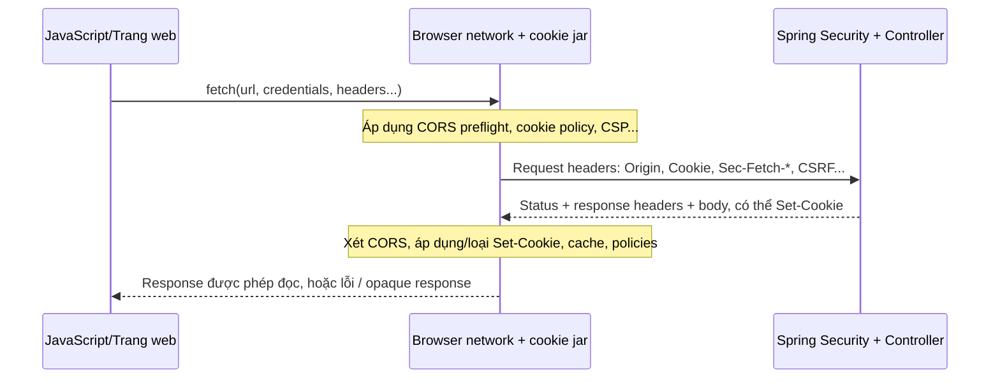
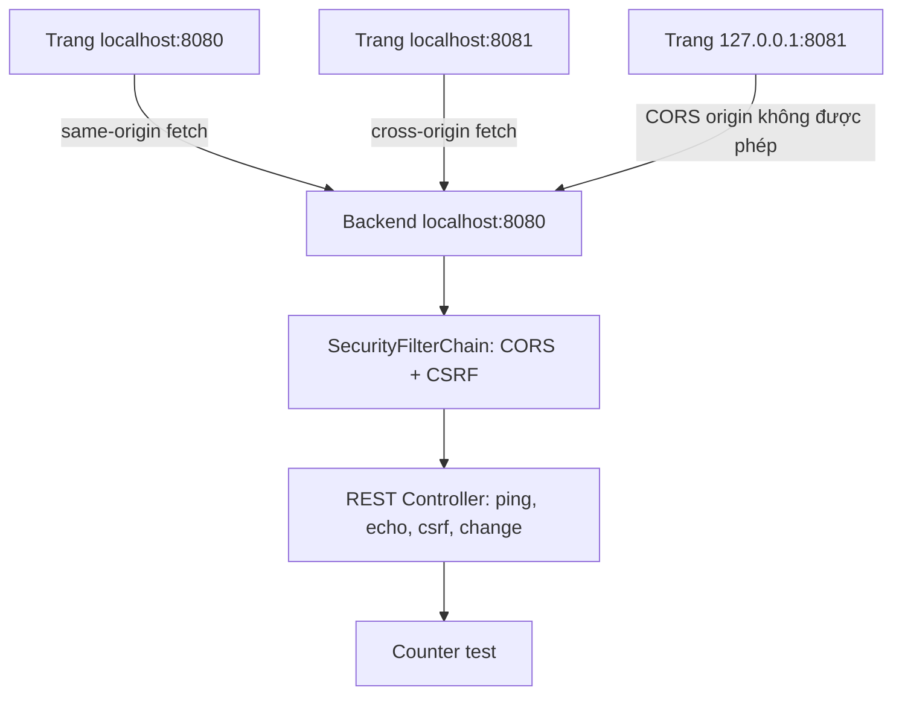
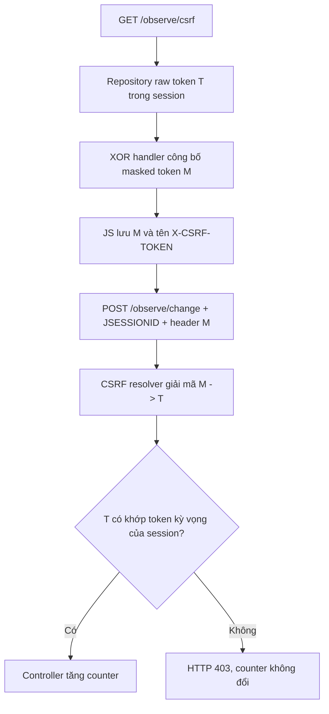

# Quan sát cookie, request header và response header

Trong kiểm thử bảo mật trình duyệt, nhìn thấy một cookie trên tab **Application** chưa chứng minh browser đã gửi cookie đó trong request; nhìn thấy `Set-Cookie` trên tab **Network** cũng chưa chứng minh browser đã chấp nhận và lưu nó. Tương tự, JavaScript có thể không đọc được response dù server đã trả HTTP `200`, hoặc một POST đã tới backend nhưng response bị chính sách CORS che khỏi script. Muốn kết luận chính xác lỗi CSRF, CORS, session hay security headers, người kiểm thử phải theo dõi **request thực tế → response thực tế → trạng thái cookie sau response → khả năng script truy cập**.

Bài thuộc chương **Kiểm thử trình duyệt**, module **SPRING_SECURITY_HTTP_PROTECTION**. Module tập trung vào các lớp phòng vệ HTTP và trình duyệt của Spring Security — CSRF, CORS, security headers, CSP, HSTS, HTTP firewall và bảo vệ session — trên cả Servlet và Reactive, kèm thực hành chẩn đoán các xung đột bảo mật khi triển khai. Bài này dùng **Spring Security Servlet 6.x** để dựng ví dụ có thể thực hành, nhưng nguyên tắc quan sát của browser cũng áp dụng khi backend dùng WebFlux.

**Kết quả cần đạt:** phân biệt các loại header và nơi có thể quan sát; sử dụng DevTools mà không nhầm cookie lưu với cookie gửi; giải thích `HttpOnly`, `Secure`, `SameSite`, `Domain`, `Path`, `Expires`, `Max-Age`; xác nhận CSRF header và CORS preflight; kiểm chứng các response security headers; tự động hóa quan sát bằng Playwright; phân loại sự cố đúng tầng và bảo vệ dữ liệu bí mật trong log/report.

## 1. Bốn lớp thông tin cần tách biệt

Một vòng HTTP trong browser có các đối tượng khác nhau:



| Đối tượng | Ví dụ | Nơi kiểm tra đáng tin hơn |
| --- | --- | --- |
| **Request headers** | `Cookie`, `Origin`, `X-CSRF-TOKEN`, `Sec-Fetch-Site` | Network → chọn **request cụ thể** → Headers → Request Headers; phía server quan sát có kiểm soát |
| **Response headers** | `Set-Cookie`, `Access-Control-Allow-Origin`, `Content-Security-Policy` | Network → Response Headers; phía server/proxy |
| **Cookie jar** | Cookie `JSESSIONID` đã lưu cho `localhost` | Application/Storage → Cookies, gồm trạng thái/chính sách chặn nếu có |
| **Response JavaScript nhận được** | `response.status`, `response.headers`, `await response.json()` | Browser Console / code của trang; bị giới hạn bởi CORS và Fetch |

Một cookie xuất hiện trên **response** không tự xuất hiện trong `request.getCookies()` của **chính request đó**. Browser chỉ có thể gửi cookie mới trong request **tiếp theo**, sau khi đã chấp nhận `Set-Cookie` và kiểm tra phạm vi cookie.

### Ví dụ sai khác rất dễ gặp

```text
GET /observe/csrf lần đầu
  Request Cookie: có thể CHƯA có JSESSIONID
  Response Set-Cookie: JSESSIONID=...
  Cookie jar: có thể xuất hiện JSESSIONID sau response

POST /observe/change ở request tiếp theo
  Request Cookie: JSESSIONID=... nếu browser được phép gửi
  Request X-CSRF-TOKEN: <token do client chủ động gửi>
  Response: 200 nếu CSRF hợp lệ, 403 nếu không
```

Nhầm hai bước này có thể dẫn đến chẩn đoán sai: *“GET đã phát cookie thì vì sao request GET không gửi cookie?”* — vì browser chưa thể gửi cookie vừa nhận trong request đã hoàn tất.

## 2. Origin và site ảnh hưởng cách đọc header/cookie

**Origin = scheme + hostname + port.** Hai URL chỉ khác port đã là *cross-origin*. **Site** là khái niệm khác, thường dựa trên scheme và registrable domain; port không phân biệt site.

| Trang nguồn | API đích | Quan hệ cần nhớ |
| --- | --- | --- |
| `http://localhost:8080` | `http://localhost:8080` | Same-origin |
| `http://localhost:8081` | `http://localhost:8080` | Cross-origin, thường same-site |
| `http://127.0.0.1:8081` | `http://localhost:8080` | Cross-origin; khác hostname và có thể được xem cross-site |
| `https://app.example.test` | `https://api.example.test` | Cross-origin, thường same-site |
| `https://portal.other.test` | `https://api.example.test` | Cross-origin và cross-site |

`SameSite` áp dụng theo ngữ cảnh **site**, còn CORS là chính sách **origin**. Một cookie **không được phân vùng theo port**: cookie host-only đặt cho `localhost` có thể được gửi tới những port khác của cùng host nếu `Path`, scheme và chính sách khác cho phép. Điều đó **không làm hai port trở thành same-origin**.

Trong lab, hãy luôn ghi rõ URL của **trang nguồn** và **API đích**. Không suy rằng cookie bị chặn chỉ vì `fetch` là cross-origin, cũng không suy rằng CORS cho phép thì cookie chắc chắn được gửi.

## 3. Bảng kiểm tra DevTools: Network và Application

Trên Chrome/Edge (tên mục có thể hơi khác theo phiên bản):

1. Mở trang thử và nhấn **F12** hoặc **Ctrl+Shift+I**, vào **Network**.
2. Bật **Preserve log** để không mất request khi redirect/login/logout; có thể bật **Disable cache** khi tái hiện lỗi.
3. Chọn filter **Fetch/XHR**, hoặc **All** nếu cần thấy HTML form navigation, redirect, static asset và preflight `OPTIONS`.
4. Thực hiện **một thao tác**; tìm request theo URL/method, không chọn nhầm `OPTIONS` với `POST`.
5. Mở **Headers**: xem **General**, **Request Headers**, **Response Headers** và **Query String/Form Data/Payload** tùy request.
6. Xem mục **Cookies** của request nếu có, để thấy request cookies, response cookies và các lý do bị browser chặn (tùy phiên bản).
7. Mở **Application → Storage → Cookies** và chọn đúng host để xem cookie **hiện đang lưu**.
8. Cuối cùng kiểm tra **Console**, nhất là lỗi CORS, CSP, cookie policy, mixed content và JavaScript.

Firefox thường dùng **Network** và **Storage** trong Developer Tools; thuật ngữ và vị trí menu có thể khác. Đừng dựa vào một nhãn UI cố định như “Blocked Reason” ở mọi bản browser. Cần hiểu sự kiện HTTP và cookie tương ứng.

### Phân biệt ba loại “không thấy header”

| Hiện tượng | Giải thích có thể |
| --- | --- |
| Không có request trong Network | JavaScript chưa chạy, CSP chặn, mixed content, DNS/TLS hoặc request bị hủy trước khi gửi |
| Có request nhưng không thấy `Cookie` | Cookie jar thiếu cookie phù hợp, `fetch.credentials` không cho gửi, hoặc browser policy đã chặn |
| Có response `Set-Cookie` nhưng cookie jar không thay đổi | Cookie bị từ chối, hết hạn tức thì, sai scope, policy third-party hoặc request credential mode không cho lưu |

**Chú ý:** DevTools đôi khi hiển thị *provisional headers*, nhóm header được browser xử lý hoặc thông tin đã bị ẩn/chuẩn hóa. Với lỗi khó, đối chiếu thêm những metadata an toàn mà server thực sự nhận, nhưng không ghi nguyên cookie hoặc token vào log.

## 4. Những điều JavaScript đọc được khác với DevTools

JavaScript chạy trên trang không có quyền tương đương công cụ DevTools hoặc mã Node.js điều khiển browser.

| Dữ liệu | JavaScript trong trang có đọc được không? | Ghi chú |
| --- | --- | --- |
| `response.status` của same-origin fetch | Thường có | Nếu request hoàn thành và không bị policy chặn |
| Response header thông thường của same-origin fetch | Thường có | Trừ các header bị Fetch cấm lộ cho script |
| `Set-Cookie` từ `response.headers.get("set-cookie")` | **Không** | Là *forbidden response-header name*, kể cả same-origin |
| `Cookie` request header từ `fetch` | Không được tự đặt bằng `headers: {Cookie: ...}` | Browser kiểm soát cookie jar và credentials |
| `Origin`, `Sec-Fetch-*` request headers | Không được tự giả mạo tùy ý | Browser sinh theo ngữ cảnh request |
| Cookie **không** `HttpOnly` qua `document.cookie` | Có thể, nếu phù hợp host/path và chính sách | Không đọc được cookie `HttpOnly` |
| Cookie `HttpOnly` trong DevTools | Có thể xem với công cụ phát triển | Không có nghĩa page JS có thể đọc |
| Cross-origin response không được CORS cho phép | Không đọc được body/status qua `fetch` | DevTools vẫn có thể thấy network event |
| Header tùy chỉnh trên cross-origin response | Chỉ khi CORS cho phép và header được expose | Trừ các header bị cấm như `Set-Cookie` |

Thử trong Console của trang cùng origin:

```javascript
const response = await fetch("/observe/ping", {
  credentials: "same-origin"
});

console.log(response.status);
console.log(response.headers.get("content-type"));
console.log(response.headers.get("set-cookie")); // null, không phải mất cookie.
console.log(document.cookie); // Không hiển thị JSESSIONID HttpOnly.
```

`response.headers.get("set-cookie") === null` **không chứng minh server không gửi `Set-Cookie`**. Hãy xem Response Headers trong DevTools. Và không in `document.cookie` trong sản phẩm thật hoặc tài liệu log chia sẻ: nó có thể chứa các cookie khác không `HttpOnly` mà vẫn nhạy cảm.

## 5. Lab tự chứa: hai origin, một backend Spring Security

Để quan sát từng lớp mà không đụng hệ thống thật, tạo mô hình:

```text
Backend Spring Boot 3.x, Servlet: http://localhost:8080
  /probe.html            Trang kiểm thử same-origin
  /observe/ping          GET không tạo session có chủ đích
  /observe/echo          GET phản ánh metadata an toàn của request
  /observe/csrf          GET cấp CSRF token và tạo session khi cần
  /observe/change        POST tăng bộ đếm sau CsrfFilter

Static server riêng: http://localhost:8081/probe.html
  Cùng file HTML, nhưng origin khác backend do khác port

Trang không được CORS allow-list:
  http://127.0.0.1:8081/probe.html
```

Lab dùng dữ liệu giả và bộ đếm trong bộ nhớ. Không dùng thông tin đăng nhập thật, không đặt backend lab trực tiếp trên internet, không nới CORS wildcard cho request dùng cookie, và không tắt CSRF chỉ để test “thành công”.



Ở lab HTTP local, đừng dùng kết quả làm kết luận tuyệt đối cho các chính sách `Secure`, HSTS và cookie third-party trên HTTPS production. Có thể dùng hostname test riêng với chứng chỉ tin cậy khi mở rộng, nhưng không cần phức tạp đó để hiểu request/response headers.

## 6. Cấu hình Spring Security Servlet cho lab

Giả định Java 17+, Spring Boot 3.x, `spring-boot-starter-web` và `spring-boot-starter-security`. Để chạy test Java ở phần sau cần thêm `spring-boot-starter-test` và `spring-security-test` trong phạm vi test. Các ví dụ dùng `jakarta.servlet` và DSL lambda của Spring Security 6.x.

Tạo class `LabSecurityConfiguration.java`:

```java
import java.util.List;
import org.springframework.context.annotation.Bean;
import org.springframework.context.annotation.Configuration;
import org.springframework.security.config.Customizer;
import org.springframework.security.config.annotation.web.builders.HttpSecurity;
import org.springframework.security.web.SecurityFilterChain;
import org.springframework.security.web.csrf.HttpSessionCsrfTokenRepository;
import org.springframework.security.web.csrf.XorCsrfTokenRequestAttributeHandler;
import org.springframework.web.cors.CorsConfiguration;
import org.springframework.web.cors.CorsConfigurationSource;
import org.springframework.web.cors.UrlBasedCorsConfigurationSource;

@Configuration
public class LabSecurityConfiguration {

    @Bean
    SecurityFilterChain labSecurity(HttpSecurity http) throws Exception {
        http
            .cors(Customizer.withDefaults())
            .authorizeHttpRequests(auth -> auth
                .requestMatchers("/probe.html", "/observe/**").permitAll()
                .anyRequest().denyAll())
            .csrf(csrf -> csrf
                .csrfTokenRepository(
                    new HttpSessionCsrfTokenRepository())
                .csrfTokenRequestHandler(
                    new XorCsrfTokenRequestAttributeHandler()));
        return http.build();
    }

    @Bean
    CorsConfigurationSource labCorsSource() {
        CorsConfiguration cors = new CorsConfiguration();
        cors.setAllowedOrigins(List.of("http://localhost:8081"));
        cors.setAllowedMethods(List.of("GET", "POST", "OPTIONS"));
        cors.setAllowedHeaders(List.of(
            "Content-Type", "X-CSRF-TOKEN", "X-Lab-Client"));
        cors.setExposedHeaders(List.of("X-Lab-Response"));
        cors.setAllowCredentials(true);
        cors.setMaxAge(600L);

        UrlBasedCorsConfigurationSource source =
            new UrlBasedCorsConfigurationSource();
        source.registerCorsConfiguration("/observe/**", cors);
        return source;
    }
}
```

**Giải thích các quyết định:**

- `permitAll()` để cô lập lỗi CSRF/CORS khỏi lỗi đăng nhập và phân quyền, **không bỏ qua `CsrfFilter`**. POST `/observe/change` vẫn cần token.
- `HttpSessionCsrfTokenRepository` dùng session lưu **raw token kỳ vọng**. Khi controller đọc `_csrf.token`, repository có thể tạo session và response phát `Set-Cookie: JSESSIONID=...`.
- `XorCsrfTokenRequestAttributeHandler` thường công bố **masked token** cho trang/browser; frontend phải gửi lại đúng biểu diễn đó, không tự giải mã.
- Chỉ cho `http://localhost:8081` gọi **cross-origin** theo CORS; origin `http://127.0.0.1:8081` không được cấp phép.
- `X-Lab-Response` được `Access-Control-Expose-Headers` cho script khác origin đọc, nhưng `X-Lab-Hidden` cố ý không được expose để so sánh.
- `allowCredentials(true)` đòi origin cụ thể, không dùng `*` cho response dùng credentials.

Để quan sát session cookie trên HTTP local:

```properties
server.port=8080
server.servlet.session.cookie.http-only=true
server.servlet.session.cookie.same-site=lax
```

Trong môi trường HTTPS thực, nên đánh giá `Secure`, `HttpOnly`, `SameSite`, `Domain`, `Path`, HSTS và hạ tầng TLS. **Không tắt `HttpOnly` của session cookie** chỉ để quan sát trong `document.cookie`: DevTools vẫn xem được metadata/cookie, còn browser vẫn gửi cookie khi chính sách cho phép.

### Vì sao lab chỉ cho CORS ở `/observe/**`?

Trang cùng origin `/probe.html` không cần CORS để tải hoặc đọc các API trên port 8080. Chúng ta chỉ kiểm tra CORS cho API, tránh nhầm lẫn với việc trình duyệt tải HTML static. Khi ứng dụng có nhiều `SecurityFilterChain`, cấu hình CORS và CSRF phải ở **chain thực sự khớp URL**; lab dùng một chain cho dễ xác minh.

## 7. Controller để quan sát request và response mà không rò rỉ cookie

Tạo `LabObservationController.java`:

```java
import jakarta.servlet.http.HttpServletRequest;
import java.util.Map;
import java.util.concurrent.atomic.AtomicInteger;
import org.springframework.http.CacheControl;
import org.springframework.http.HttpHeaders;
import org.springframework.http.ResponseEntity;
import org.springframework.security.web.csrf.CsrfToken;
import org.springframework.web.bind.annotation.GetMapping;
import org.springframework.web.bind.annotation.PostMapping;
import org.springframework.web.bind.annotation.RequestAttribute;
import org.springframework.web.bind.annotation.RequestMapping;
import org.springframework.web.bind.annotation.RestController;

@RestController
@RequestMapping("/observe")
public class LabObservationController {

    private final AtomicInteger updates = new AtomicInteger();

    @GetMapping("/ping")
    ResponseEntity<Map<String, Boolean>> ping() {
        return ResponseEntity.ok()
            .header("X-Lab-Response", "visible-when-exposed")
            .header("X-Lab-Hidden", "not-exposed-cross-origin")
            .cacheControl(CacheControl.noStore())
            .body(Map.of("ok", true));
    }

    @GetMapping("/echo")
    RequestMetadata echo(HttpServletRequest request) {
        // Không trả Cookie, Authorization hoặc giá trị CSRF token.
        return new RequestMetadata(
            request.getMethod(),
            request.getHeader("Origin") != null,
            request.getHeader("Cookie") != null,
            request.getHeader("X-Lab-Client") != null,
            request.getHeader("Sec-Fetch-Site"),
            request.getSession(false) != null);
    }

    @GetMapping("/csrf")
    ResponseEntity<CsrfResponse> csrf(
            @RequestAttribute("_csrf") CsrfToken token) {
        // getToken() kích hoạt việc nạp/tạo token khi cần.
        return ResponseEntity.ok()
            .cacheControl(CacheControl.noStore())
            .body(new CsrfResponse(
                token.getHeaderName(),
                token.getParameterName(),
                token.getToken()));
    }

    @GetMapping("/counter")
    Map<String, Integer> counter() {
        return Map.of("updates", updates.get());
    }

    @PostMapping("/change")
    Map<String, Integer> change() {
        return Map.of("updates", updates.incrementAndGet());
    }

    record RequestMetadata(
        String method,
        boolean originPresent,
        boolean cookieHeaderPresent,
        boolean demoHeaderPresent,
        String fetchSite,
        boolean serverSessionPresent) {}

    record CsrfResponse(
        String headerName,
        String parameterName,
        String token) {}
}
```

Endpoint `/observe/echo` chỉ báo một số header **có mặt hay không**, không trả nguyên cookie hay token. Trường `fetchSite` là tín hiệu do browser thường thêm vào request nhưng không được xem là nguồn xác thực danh tính tuyệt đối: một HTTP client ngoài browser có thể tự gửi/giả lập header tương tự. `request.getSession(false)` **không tạo session mới**; nó chỉ kiểm tra có session hiện hữu được gắn với request không.

`/observe/ping` cố ý phát hai header tùy chỉnh: cùng origin JavaScript thường đọc được cả hai; ở origin đã được CORS cho phép, script chỉ đọc được header đã được expose (`X-Lab-Response`). Cả hai header vẫn có thể xuất hiện ở **Response Headers** trong DevTools.

`/observe/counter` và `POST /observe/change` tách **quan sát response** khỏi **side effect**. Khi POST bị CSRF từ chối, counter không được tăng. Đây là kiểm tra an ninh quan trọng hơn việc chỉ nhìn một HTTP status.

## 8. Trang quan sát dùng được ở cả hai origin

Đặt file `probe.html` tại `src/main/resources/static/probe.html` của Spring Boot và dùng **cùng nội dung** trên một HTTP static server ở port 8081. JavaScript cố định API URL là `http://localhost:8080`; từ trang port 8080 nó là same-origin, còn từ trang port 8081 là cross-origin.

```html
<!doctype html>
<html lang="vi">
<head>
  <meta charset="utf-8">
  <title>HTTP Header & Cookie Observation Lab</title>
</head>
<body>
  <h1>Kiểm tra HTTP headers và cookie</h1>
  <p>Origin trang: <output id="origin"></output></p>
  <button id="ping">GET ping + response headers</button>
  <button id="echo">GET echo request metadata</button>
  <button id="csrf">GET CSRF, quan sát Set-Cookie</button>
  <button id="invalid">POST thiếu CSRF header</button>
  <button id="valid">POST có CSRF header</button>
  <button id="omit">POST có token, không gửi credentials</button>
  <button id="counter">GET counter</button>
  <pre id="result" aria-live="polite">Chưa chạy.</pre>

  <script>
    const API = "http://localhost:8080/observe";
    const result = document.querySelector("#result");
    const display = value => { result.textContent = value; };
    document.querySelector("#origin").textContent = location.origin;

    let csrf = null;
    const mode = location.origin === "http://localhost:8080"
      ? "same-origin" : "include";

    async function getCsrf() {
      const response = await fetch(`${API}/csrf`, {
        mode: "cors",
        credentials: mode,
        cache: "no-store"
      });
      if (!response.ok) throw new Error(`CSRF GET: ${response.status}`);
      csrf = await response.json();
      // Không in token, session ID hoặc document.cookie.
      display(`Đã cấp token; header=${csrf.headerName}; `
        + `độ dài biểu diễn=${csrf.token.length}`);
    }

    async function show(response) {
      const body = (await response.text()).slice(0, 400);
      display(
        `HTTP ${response.status}\n`
        + `X-Lab-Response: ${response.headers.get("x-lab-response")}\n`
        + `X-Lab-Hidden: ${response.headers.get("x-lab-hidden")}\n`
        + `Set-Cookie qua JS: ${response.headers.get("set-cookie")}\n`
        + body);
    }

    function bind(id, fn) {
      document.querySelector(id).addEventListener("click", async () => {
        try { await fn(); }
        catch (error) { display(`Không đọc/gửi được: ${String(error)}`); }
      });
    }

    bind("#ping", async () => {
      await show(await fetch(`${API}/ping`, {
        mode: "cors", credentials: mode
      }));
    });
    bind("#echo", async () => {
      await show(await fetch(`${API}/echo`, {
        mode: "cors",
        credentials: mode,
        headers: { "X-Lab-Client": "browser-demo" }
      }));
    });
    bind("#csrf", getCsrf);
    bind("#counter", async () => {
      await show(await fetch(`${API}/counter`, {
        mode: "cors", credentials: mode
      }));
    });

    async function sendChange(withHeader, credentials) {
      if (!csrf) await getCsrf();
      const headers = { "Content-Type": "application/json" };
      if (withHeader) headers[csrf.headerName] = csrf.token;
      await show(await fetch(`${API}/change`, {
        method: "POST",
        mode: "cors",
        credentials,
        headers,
        body: "{}"
      }));
    }

    bind("#invalid", () => sendChange(false, mode));
    bind("#valid", () => sendChange(true, mode));
    bind("#omit", () => sendChange(true, "omit"));
  </script>
</body>
</html>
```

Trang luôn hiển thị bằng `textContent`, không sử dụng `innerHTML` để đưa response về DOM. Đoạn code minh họa này vẫn in **một phần response body** của lab, chỉ nên dùng với endpoint test đã biết an toàn; không tái sử dụng nó để in phản hồi có dữ liệu cá nhân hoặc token.

**Các bước quan sát:**

1. `GET ping`: kiểm tra cả hai custom header ở Network, rồi đối chiếu với kết quả đọc bằng `response.headers.get(...)`.
2. `GET echo`: thấy request có header demo `X-Lab-Client` hay không; khi cross-origin, có thể thấy preflight do custom header.
3. `GET CSRF`: xem `Set-Cookie` và cookie jar; response token không được in ra UI.
4. `POST thiếu CSRF`: thường trả `403`, counter không thay đổi.
5. `POST có CSRF`: gửi đúng header chứa masked token và đúng session, counter tăng.
6. `POST credentials=omit`: header CSRF có thể vẫn được gửi nhưng session cookie không đi cùng; server thường từ chối vì expected token nằm ở session khác hoặc chưa có.

**Quan trọng:** với nút `POST thiếu CSRF`, nên bấm `GET CSRF` trước để tạo token kỳ vọng trong session; nhờ đó phân biệt được *repository đã có token nhưng client không gửi* với *repository chưa hề có token*. Sau khi dùng nút `credentials=omit`, không suy token đã bị xóa ở session trước: request mới đơn giản không gửi cookie phiên.

## 9. Tạo origin thứ hai mà không dùng `file://`

Nếu mở `probe.html` trực tiếp bằng `file://`, browser có thể áp dụng **opaque origin** hoặc gửi `Origin: null`, làm kết quả khác website HTTP thông thường. Hãy phục vụ cùng file HTML qua một static server riêng ở port `8081`.

Trong thư mục lab tách biệt, đặt hai file:

```text
header-probe-static/
  static-server.mjs
  probe.html
```

`probe.html` là bản sao nội dung ở mục 8 (ví dụ trong bài; không tự tạo bất kỳ file nào ngoài phạm vi được giao của worker). Có Node.js, tạo `static-server.mjs`:

```javascript
import http from "node:http";
import { readFile } from "node:fs/promises";

const page = await readFile(new URL("./probe.html", import.meta.url));

http.createServer((request, response) => {
  if (request.method !== "GET" ||
      request.url !== "/probe.html") {
    response.writeHead(404, {
      "Content-Type": "text/plain; charset=utf-8"
    });
    response.end("Not found");
    return;
  }
  response.writeHead(200, {
    "Content-Type": "text/html; charset=utf-8",
    "Cache-Control": "no-store",
    "X-Content-Type-Options": "nosniff"
  });
  response.end(page);
}).listen(8081, "127.0.0.1", () => {
  process.stdout.write("Static probe on loopback port 8081\n");
});
```

Chạy Node server trong thư mục chứa hai file:

```bash
node static-server.mjs
```

Mở lần lượt:

```text
http://localhost:8080/probe.html
http://localhost:8081/probe.html
http://127.0.0.1:8081/probe.html
```

Trên một số hệ điều hành, `localhost` ưu tiên `::1` (IPv6), trong khi server Node trên cố ý chỉ bind `127.0.0.1` (IPv4). Nếu URL `localhost:8081` không kết nối được, cần sửa loopback hostname/listener tương ứng; không bind ra toàn mạng LAN chỉ để khắc phục bài test.

Hai trang cùng nội dung JavaScript nhưng **khác origin**. Backend cho phép `http://localhost:8081`, không cho `http://127.0.0.1:8081`, nhờ đó có thể quan sát sự khác biệt CORS mà **không cần** dùng một website khác làm mục tiêu.

## 10. Quan sát request headers theo nhóm chức năng

Trên một request trong tab Network, đừng coi tất cả request headers là “header do JavaScript tạo”. Browser và HTTP stack tự thêm nhiều header.

| Header | Nguồn và ý nghĩa | Điều cần xác minh |
| --- | --- | --- |
| `Host` hoặc `:authority` (HTTP/2) | Host/authority đích | Có đúng hostname/port API không? |
| `Origin` | Browser khai báo origin nguồn cho nhiều request CORS/unsafe | Có khớp origin thực tế của trang không? |
| `Referer` | Nguồn điều hướng theo `Referrer-Policy` | Có thể bị rút gọn hoặc vắng mặt |
| `Sec-Fetch-Site` | Ngữ cảnh same-origin/same-site/cross-site khi browser hỗ trợ | Không gán mọi request cross-origin là cross-site |
| `Sec-Fetch-Mode` | Ngữ cảnh như `cors`, `navigate`, `no-cors` | Form navigation khác fetch |
| `Sec-Fetch-Dest` | Đích như `empty`, `document`, `image` | Hữu ích khi phân biệt fetch với iframe/form |
| `Cookie` | Browser chọn từ cookie jar theo policy | Có cookie session phù hợp không? |
| `X-CSRF-TOKEN` | Token do ứng dụng chủ động đặt trong request header | Đúng tên, đúng biểu diễn raw/masked? |
| `Content-Type` | Kiểu request body, ví dụ `application/json` | Có làm CORS cần preflight không? |
| `Accept` | Định dạng response client ưu tiên | Không phải bằng chứng request đã được xác thực |
| `Authorization` | Header credentials nếu ứng dụng chủ động dùng | Không hiển thị/ghi giá trị vào báo cáo |
| `Access-Control-Request-Method` | **Chỉ ở preflight OPTIONS** | Method actual request mà browser đang hỏi |
| `Access-Control-Request-Headers` | **Chỉ ở preflight OPTIONS** | **Tên** những header mà actual request dự định gửi |

Ví dụ request gửi đúng CSRF token (các giá trị đã được thay bằng chỗ giữ chỗ):

```http
POST /observe/change HTTP/1.1
Host: localhost:8080
Origin: http://localhost:8081
Cookie: JSESSIONID=<gia-tri-da-an>
Content-Type: application/json
X-CSRF-TOKEN: <masked-token-da-an>
Sec-Fetch-Site: same-site
Sec-Fetch-Mode: cors

{}
```

`Sec-Fetch-Site: same-site` trong ví dụ minh họa điểm quan trọng: **trang port 8081 gọi API port 8080 là cross-origin nhưng có thể same-site**. Các `Sec-Fetch-*` không hiện diện ở mọi HTTP client hoặc mọi môi trường; không ép mọi testcase phải có những header này nếu browser/điều kiện không hỗ trợ.

### Nhiều request cùng một URL

`POST /observe/change` với `Content-Type: application/json` và CSRF header thường có **preflight OPTIONS**. Trong Network có thể thấy:

```text
OPTIONS /observe/change  (preflight)
POST    /observe/change  (actual request)
```

Khi phân tích cookie hoặc CSRF, phải chọn **POST actual**: preflight thường không kèm credentials và **không** phải nơi `CsrfFilter` xác minh token của POST. Header `Access-Control-Request-Headers: x-csrf-token` chỉ báo tên header, không phải giá trị CSRF token.

### Header nào không nên hard-code?

Browser có thể quản lý `Origin`, `Cookie`, `Sec-Fetch-*`, `Host` và nhiều header kết nối. JavaScript không được tùy tiện gắn giá trị của chúng để giả mạo ngữ cảnh browser. Sử dụng `fetch.credentials` và chính sách cookie để điều khiển gửi cookie; sử dụng CORS ở server để quyết định origin được đọc response; chỉ tự gắn những header ứng dụng như `X-CSRF-TOKEN`.

## 11. Phân biệt `Cookie` request header và `Set-Cookie` response header

Đây là hai header khác nhau về chiều truyền và vai trò:

| Đặc điểm | `Cookie` | `Set-Cookie` |
| --- | --- | --- |
| Chiều HTTP | **Client → Server** | **Server → Browser** |
| Ai tạo? | Browser chọn cookie từ cookie jar | Server/proxy đặt hoặc xóa cookie |
| Nội dung | `name=value; other=value` | Mỗi cookie có tên, giá trị và thuộc tính |
| Có `HttpOnly`, `Secure`, `SameSite` trong header này? | **Không**: request chỉ mang các cặp name/value | **Có**: response mang thuộc tính khi đặt cookie |
| JavaScript tự đặt qua `fetch`? | Không thể tự đặt header `Cookie` thông thường | Không thể tự tạo `Set-Cookie` ở response |
| Có thể đọc qua `response.headers.get(...)`? | Không áp dụng cho request cookie | `Set-Cookie` bị cấm lộ qua Fetch API |

Ví dụ:

```http
HTTP/1.1 200 OK
Set-Cookie: JSESSIONID=<gia-tri-da-an>; Path=/; HttpOnly; SameSite=Lax
```

Request tiếp theo có thể gửi:

```http
GET /observe/echo HTTP/1.1
Host: localhost:8080
Cookie: JSESSIONID=<gia-tri-da-an>
```

Bạn **không** thấy `HttpOnly; SameSite=Lax` trong request header `Cookie`. Những thuộc tính này đã được browser dùng để **quyết định có gửi cookie hay không** và nằm trong cookie store/response cấp cookie, không được truyền lại kèm mỗi request.

### Một response có thể có nhiều `Set-Cookie`

Theo giao thức, server có thể phát nhiều trường header `Set-Cookie`, mỗi trường đặt một cookie. Một số giao diện DevTools hiển thị thành danh sách; **không coi chúng giống một header comma-separated thông thường**, bởi thuộc tính `Expires` có thể chứa dấu phẩy.

Khi debug, xem **từng cookie được đặt/xóa** với name, domain, path và lý do browser chấp nhận/chặn. Không copy toàn bộ `Set-Cookie` kèm giá trị cookie vào ticket, Slack hoặc log không được bảo vệ.

## 12. Đọc thuộc tính cookie để hiểu vì sao cookie không được gửi

| Thuộc tính | Tác dụng chính | Lỗi thực tế thường gặp |
| --- | --- | --- |
| `Domain` | Phạm vi hostname được cookie áp dụng; bỏ qua thường là host-only | Đặt domain sai hoặc mở rộng quá nhiều subdomain |
| `Path` | Giới hạn đường dẫn request browser gửi cookie | Cookie `Path=/account` không đi tới `/api` |
| `Secure` | Cookie chỉ được gửi qua kênh an toàn theo quy tắc browser | HTTP local/proxy TLS termination gây hành vi khác HTTPS |
| `HttpOnly` | Script không đọc cookie bằng `document.cookie` | JS không thấy session cookie dù browser vẫn gửi |
| `SameSite=Strict` | Hạn chế gửi cookie trong tương tác cross-site | Cross-site navigation/fetch không có cookie |
| `SameSite=Lax` | Thường cho top-level cross-site navigation an toàn, hạn chế cross-site subresource/unsafe request | POST form từ site khác không có cookie |
| `SameSite=None` | Cho phép cookie trong nhiều ngữ cảnh cross-site, **cần `Secure`** | Cookie bị reject nếu thiếu `Secure`; third-party policy có thể vẫn chặn |
| `Max-Age` | Thời hạn tương đối; `0` thường yêu cầu xóa | Cookie bị xóa ngay hoặc TTL không như dự kiến |
| `Expires` | Mốc hết hạn tuyệt đối | Clock skew hoặc kỳ vọng khác với `Max-Age` |
| `Partitioned` | Cookie được phân vùng theo top-level site ở browser hỗ trợ CHIPS | Cookie không có trong ngữ cảnh phân vùng khác |
| Prefix `__Host-` | Yêu cầu `Secure`, `Path=/`, không có `Domain` trong browser hỗ trợ | Browser từ chối cookie không đáp ứng điều kiện |

Cookie **host-only** cho `localhost` có thể được gửi tới cả port 8080 và 8081 của `localhost` nếu các thuộc tính khác cho phép; cookie **không tách riêng theo port**. Ngược lại, cookie cho `localhost` không tự trở thành cookie của hostname `127.0.0.1`.

Ví dụ một cookie session trong production:

```http
Set-Cookie: JSESSIONID=<an>; Path=/; Secure; HttpOnly; SameSite=Lax
```

Với ứng dụng cần giữ cookie host-only, không đặt `Domain` chỉ để JavaScript trên subdomain khác có thể đọc. **Cookie scope là ranh giới tin cậy**, đặc biệt khi các subdomain không có cùng mức độ bảo vệ.

### `SameSite` không phải CORS

Trang `http://localhost:8081` fetch API `http://localhost:8080` là **cross-origin** nhưng thường **same-site**. Cookie `SameSite=Lax` có thể vẫn được gửi nếu request sử dụng `credentials: "include"` và cookie khác phù hợp. Tuy nhiên JavaScript vẫn cần CORS để đọc response.

Một trang khác site có thể bị `SameSite=Lax` chặn cookie trong cross-site POST, nhưng **không** có nghĩa CORS tự chống mọi CSRF. Form HTML, top-level navigation, cách dùng cookie và các ngoại lệ browser phải được đánh giá riêng.

### Xóa cookie cần đúng phạm vi

Khi logout, server có thể phát:

```http
Set-Cookie: JSESSIONID=; Path=/; Max-Age=0; HttpOnly
```

Browser xóa cookie theo **tên, domain và path** phù hợp. Nếu cookie cũ đã được tạo với `Path=/portal` hoặc domain khác, một response xóa ở `Path=/` không nhất thiết xóa đúng cookie đó. Trong Network, quan sát response logout; sau đó kiểm tra cookie jar và **request kế tiếp**, thay vì nhìn `request.getCookies()` của request logout để kết luận việc xóa đã có hiệu lực.

## 13. Đọc response headers: dữ liệu, cache, CORS và chính sách bảo mật

Trong Network → Response Headers, nhóm các header theo **mục tiêu** thay vì tìm một “header bảo mật” duy nhất:

| Nhóm | Header tiêu biểu | Câu hỏi cần trả lời |
| --- | --- | --- |
| Content | `Content-Type`, `Content-Encoding`, `Content-Length` | Body được trình bày/nén thế nào? |
| Cache | `Cache-Control`, `ETag`, `Vary`, `Expires` | Response có thể được cache hay dùng lại không? |
| Cookie | `Set-Cookie` | Browser được yêu cầu lưu/xóa cookie nào? |
| CORS | `Access-Control-Allow-Origin`, `Access-Control-Allow-Credentials`, `Access-Control-Expose-Headers` | Origin gọi có quyền đọc response không? |
| Preflight CORS | `Access-Control-Allow-Methods`, `Access-Control-Allow-Headers`, `Access-Control-Max-Age` | Browser có được gửi method/header actual request không? |
| CSP | `Content-Security-Policy`, `Content-Security-Policy-Report-Only` | Browser được tải/chạy/kết nối nội dung nào? |
| HTTPS | `Strict-Transport-Security` | Browser có phải nâng kết nối lên HTTPS cho host đó không? |
| MIME | `X-Content-Type-Options: nosniff` | Browser có phải tôn trọng MIME type thay vì sniff? |
| Frame | `X-Frame-Options`, CSP `frame-ancestors` | Trang có được nhúng vào frame không? |
| Referrer | `Referrer-Policy` | URL nguồn được gửi bao nhiêu thông tin trong `Referer`? |
| Cross-origin isolation | `Cross-Origin-Opener-Policy`, `Cross-Origin-Embedder-Policy`, `Cross-Origin-Resource-Policy` | Các ngữ cảnh và resource cross-origin có những ràng buộc nào? |

**Không phải mọi header trong bảng đều được Spring Security bật mặc định**. Chẳng hạn Spring Security Servlet có một số response security headers mặc định, nhưng **CSP không được tự cấu hình thành một chính sách ứng dụng phù hợp**: bạn phải lựa chọn CSP rõ ràng. HSTS thường chỉ được Spring Security phát cho **request HTTPS**, không phải mọi response HTTP localhost.

### Quan sát header tồn tại và header áp dụng là hai việc khác nhau

Ví dụ response có `Content-Security-Policy: connect-src 'self'` là **chính sách được áp dụng cho tài liệu nhận CSP**. Nó không tự nói rằng API cross-origin bị CORS chặn. Một request `fetch` có thể bị **CSP của trang nguồn** ngăn trước khi browser gửi request tới API, dù backend đã cấu hình CORS đúng.

`X-Frame-Options: DENY` có thể chặn trang khi nhúng trong iframe nhưng không ngăn một HTML form từ trang khác **gửi POST**. HSTS chỉ có ý nghĩa khi browser xử lý policy qua HTTPS hợp lệ và nhớ policy cho host; kiểm tra HTTP localhost không đủ để đánh giá sản phẩm thật.

### Response bị cache và phép thử tưởng như “không cập nhật”

Để quan sát đúng `Set-Cookie` và các headers mới nhất, cần chú ý response có thể đến từ HTTP cache, service worker hoặc proxy. Khi đang debug, bật Disable cache, kiểm tra cột **Size/Transferred**, và dùng endpoint bootstrap `Cache-Control: no-store` cho dữ liệu có token. Không xóa toàn bộ cache/profile làm việc của người dùng như bước đầu tiên; ưu tiên cô lập một browser context test.

## 14. CORS: preflight headers khác actual response headers

Từ trang `http://localhost:8081`, một POST JSON có `X-CSRF-TOKEN` có thể bắt đầu bằng request **OPTIONS**:

```http
OPTIONS /observe/change HTTP/1.1
Host: localhost:8080
Origin: http://localhost:8081
Access-Control-Request-Method: POST
Access-Control-Request-Headers: content-type,x-csrf-token
```

Response preflight khi server cho phép có thể như sau (thứ tự/tên chữ hoa khác theo triển khai):

```http
HTTP/1.1 200 OK
Access-Control-Allow-Origin: http://localhost:8081
Access-Control-Allow-Credentials: true
Access-Control-Allow-Methods: GET,POST,OPTIONS
Access-Control-Allow-Headers: Content-Type,X-CSRF-TOKEN,X-Lab-Client
Access-Control-Max-Age: 600
Vary: Origin,Access-Control-Request-Method,Access-Control-Request-Headers
```

Sau đó mới đến **actual request**:

```http
POST /observe/change HTTP/1.1
Host: localhost:8080
Origin: http://localhost:8081
Cookie: JSESSIONID=<an>
Content-Type: application/json
X-CSRF-TOKEN: <masked-token-an>

{}
```

Và **actual response** cũng cần các CORS response headers thích hợp nếu browser được phép đọc:

```http
HTTP/1.1 200 OK
Content-Type: application/json
Access-Control-Allow-Origin: http://localhost:8081
Access-Control-Allow-Credentials: true

{"updates":1}
```

**Quan sát riêng** ba phần: OPTIONS request, OPTIONS response và POST request/response. Khi preflight thất bại, browser thường **không gửi actual POST**; không có bằng chứng controller đã chạy hoặc `CsrfFilter` đã kiểm tra token POST.

### Preflight không phải nơi tìm session cookie

Preflight CORS thông thường được browser gửi **không mang credentials**, kể cả khi actual request sau đó dùng `credentials: "include"`. Nếu backend bắt preflight phải có cookie/session trước khi cho CORS, ứng dụng dễ tạo lỗi mà người dùng chỉ thấy là CORS. Cấu hình CORS trong Spring Security nên cho preflight được đánh giá trước các cơ chế cần user context.

`Access-Control-Request-Headers` chứa **tên** header actual request dự kiến gửi, không chứa giá trị token. Do đó nếu nhìn OPTIONS không thấy `X-CSRF-TOKEN: ...`, đây là điều bình thường, không phải client quên CSRF ở POST.

### CORS có cho phép script đọc tất cả response headers?

**Không.** Với cross-origin fetch được CORS cho phép, JavaScript chỉ truy cập được các CORS-safelisted response headers và các header được liệt kê trong `Access-Control-Expose-Headers`.

Lab minh họa:

```http
HTTP/1.1 200 OK
Access-Control-Allow-Origin: http://localhost:8081
Access-Control-Allow-Credentials: true
Access-Control-Expose-Headers: X-Lab-Response
X-Lab-Response: visible-when-exposed
X-Lab-Hidden: not-exposed-cross-origin
```

Trên trang `localhost:8081`:

```javascript
const response = await fetch("http://localhost:8080/observe/ping", {
  credentials: "include",
  mode: "cors"
});

console.log(response.headers.get("x-lab-response"));
// "visible-when-exposed"

console.log(response.headers.get("x-lab-hidden"));
// null, dù DevTools có thể thấy response header đó.

console.log(response.headers.get("set-cookie"));
// null, kể cả nếu server phát Set-Cookie.
```

`Set-Cookie` vẫn là **forbidden response-header name** đối với Fetch API, không thể cho JS đọc bằng cách thêm `Set-Cookie` vào `Access-Control-Expose-Headers`. Nếu muốn frontend lấy CSRF token, dùng một hợp đồng bootstrap rõ ràng như JSON endpoint hoặc cookie không `HttpOnly` khi threat model phù hợp — **không** dựa vào việc đọc raw `Set-Cookie` qua JS.

### `Access-Control-Allow-Origin: *` và credentials

Khi trang cross-origin gửi request có credentials (`credentials: "include"`), không dùng `Access-Control-Allow-Origin: *` để cho script đọc response. Server cần phản hồi một origin cụ thể được cho phép và `Access-Control-Allow-Credentials: true`; browser còn áp dụng cookie policy riêng. Nếu API được phép nhiều origin, cấu hình allow-list và `Vary: Origin` đúng để cache không chia sẻ response CORS sai origin.

### Một request không cần OPTIONS vẫn có thể bị CORS từ chối

GET đơn giản cross-origin thường được browser gửi **không cần preflight**. Nếu server không trả ACAO phù hợp, browser chặn JS đọc response, nhưng server có thể đã xử lý GET. Vì thế **không thấy OPTIONS không có nghĩa CORS được bỏ qua** hoặc GET không bị kiểm tra CORS ở phía browser.

## 15. Quan sát CSRF header và token kỳ vọng

Với cấu hình lab:

- Repository `HttpSessionCsrfTokenRepository` giữ **raw token kỳ vọng** ở server session.
- `XorCsrfTokenRequestAttributeHandler` thường công bố **masked token** qua đối tượng `_csrf`.
- `GET /observe/csrf` trả JSON chứa `headerName`, `parameterName`, `token`; `getToken()` có thể tạo/lưu token theo nhu cầu.
- Trang JavaScript gửi biểu diễn token được cấp trong request header `X-CSRF-TOKEN`; request handler giải quyết masked token rồi `CsrfFilter` so sánh với raw expected token.



Một số tình huống cần phân biệt:

| Quan sát actual POST | Nguyên nhân có thể nếu `403` |
| --- | --- |
| Có `JSESSIONID` nhưng thiếu `X-CSRF-TOKEN` | Client không gửi actual token; expected token vẫn có thể tồn tại |
| Có `X-CSRF-TOKEN` nhưng không có `JSESSIONID` | Token thuộc session khác, server không đọc được expected token cũ |
| Cookie đúng và header có token nhưng sai dạng raw/masked | Resolver không khôi phục đúng token kỳ vọng |
| Cookie và header đúng nhưng vẫn 403 | Có thể là authorization/filter khác; cần xem nguồn lỗi |
| Header trong Network có chữ hoa khác | HTTP header name không phân biệt hoa/thường; xem tên logic thay vì so case |

**Đừng in token trong UI hoặc server log để chứng minh hai giá trị có bằng nhau.** Với kiểm thử, hãy dùng request hợp lệ/sai token giả, theo dõi kết quả filter và counter. Nếu bắt buộc kiểm tra raw token ở unit test, dùng token giả do test tạo, không in giá trị từ production.

### HTTP header `X-XSRF-TOKEN` và cookie `XSRF-TOKEN`

Một cấu hình SPA khác sử dụng `CookieCsrfTokenRepository` có thể tạo cookie `XSRF-TOKEN` (raw) và chờ header `X-XSRF-TOKEN`. Trong trường hợp đó, JavaScript có thể cần đọc cookie CSRF không `HttpOnly` rồi gửi header raw theo hợp đồng của request handler. Tuy nhiên **XOR request handler mặc định không nhất thiết chấp nhận raw token đưa vào header**: phải chọn resolver phù hợp hoặc dùng endpoint cấp masked token.

Do đó, khi chuyển từ session repository trong lab sang cookie repository, không chỉ thay tên cookie/header rồi kỳ vọng mọi request vẫn hoạt động; cần kiểm thử đường **lưu expected token và cách giải quyết actual token** riêng.

## 16. Header bảo mật: kiểm tra theo HTTPS và đường đi filter

Spring Security Servlet có thể thêm một số header bảo mật mặc định cho response đi qua filter chain, ví dụ:

```http
X-Content-Type-Options: nosniff
X-Frame-Options: DENY
Cache-Control: no-cache, no-store, max-age=0, must-revalidate
```

Chúng là **ví dụ header thường gặp**, không phải cam kết rằng mọi endpoint/mọi bản Spring Security trả đúng nguyên văn. Cache headers có thể khác theo controller/proxy; `Cache-Control: no-store` của endpoint token vẫn nên được kiểm tra thực tế.

**HSTS:** header `Strict-Transport-Security` thường được Spring Security phát khi request HTTPS hợp lệ, chẳng hạn:

```http
Strict-Transport-Security: max-age=31536000 ; includeSubDomains
```

Không nên mong thấy HSTS trên backend lab HTTP `localhost:8080`. Muốn đánh giá HSTS, dùng HTTPS đúng chứng chỉ, cấu hình reverse proxy/forwarded headers chính xác và quan sát response tại **browser thực sự nhận**. Trước khi bật `includeSubDomains` hoặc `preload` trong production, phải bảo đảm toàn bộ phạm vi hostname đáp ứng yêu cầu HTTPS; không bật tùy tiện để làm đẹp header report.

**CSP:** Spring Security không thể tự đoán chính sách JavaScript/font/image/connect phù hợp ứng dụng. Nếu cấu hình:

```http
Content-Security-Policy: default-src 'self'; connect-src 'self'
```

trên **trang nguồn** port 8081, `fetch` tới API port 8080 có thể bị CSP `connect-src` chặn trước khi CORS được xét. Ví dụ này còn thiếu `script-src`/nonce cho script inline của `probe.html`, vì vậy browser có thể chặn chính script trang. Để thử `connect-src` có kiểm soát, cần đưa script sang file external cùng origin hoặc cấp nonce/hash phù hợp. **Không dùng `script-src 'unsafe-inline'` làm cấu hình CSP production** chỉ để lab chạy thuận tiện.

**`Referrer-Policy`:** policy có thể làm `Referer` bị rút gọn hoặc vắng mặt. Không suy rằng browser đã bỏ `Origin` chỉ vì thiếu `Referer`; hai header có mục đích khác nhau, và browser có thể gửi `Origin` mà không gửi URL đầy đủ của trang nguồn.

**Error response:** kiểm tra security headers cả trên response `403`, redirect login và response `2xx`. Nếu có reverse proxy, gateway hoặc handler trả lỗi tùy biến, browser có thể nhận tập header khác endpoint thành công. Đừng tắt `X-Frame-Options`, CSP, HSTS hay `nosniff` để “sửa” một lỗi CORS/CSRF không liên quan.

## 17. Ma trận thí nghiệm và kết quả dự kiến

Bắt đầu từ browser context sạch, chạy backend port 8080 và static server port 8081. Trước các POST, bấm `GET CSRF` để có expected token. Kết quả dự kiến dưới đây giả định browser không có extension hoặc enterprise policy can thiệp và cookie localhost được lưu đúng.

| Trang nguồn / thao tác | Request headers quan trọng | Response/JS dự kiến | Kết luận |
| --- | --- | --- | --- |
| `localhost:8080` GET ping | Same-origin; `Origin` có thể vắng | `200`, JS đọc được `X-Lab-Response` và `X-Lab-Hidden` | Không cần CORS |
| `localhost:8081` GET ping | `Origin: http://localhost:8081` | `200`, JS đọc `X-Lab-Response`, không đọc `X-Lab-Hidden` | CORS expose chỉ một custom header |
| `127.0.0.1:8081` GET ping | `Origin: http://127.0.0.1:8081` | Script không đọc được response do origin không được phép | Network/JS có góc nhìn khác nhau |
| `localhost:8080` GET CSRF lần đầu | Có thể chưa có `Cookie` | Response có thể có `Set-Cookie: JSESSIONID` | Cookie được phát **ở response** |
| `localhost:8080` POST thiếu CSRF sau GET | Có `Cookie: JSESSIONID`; thiếu `X-CSRF-TOKEN` | `403`, counter không tăng | CSRF từ chối actual token thiếu |
| `localhost:8080` POST token đúng | Có JSESSIONID và CSRF header | `200`, counter tăng | Server nhận đúng phiên/token |
| `localhost:8081` GET CSRF với `include` | `Origin`, credentials mode cho phép cookie | CORS cho phép, cookie có thể được nhận/gửi | Cross-origin nhưng same-site |
| `localhost:8081` POST token đúng với `include` | Preflight; actual POST có cookie + CSRF header | `200`, counter tăng | CORS và CSRF cùng đạt |
| `localhost:8081` POST token đúng với `omit` | Có CSRF header nhưng thiếu cookie phiên | Thường `403`, counter không tăng | Token từ phiên trước không đủ |
| `localhost:8081` POST thiếu CSRF | Preflight có thể vẫn xuất hiện do JSON body | Actual POST `403` | CORS cho gửi không có nghĩa CSRF hợp lệ |
| `127.0.0.1:8081` POST JSON/CSRF | OPTIONS origin không được cho phép | Browser thường không gửi actual POST | Thất bại ở CORS preflight |

**Kết quả có điều kiện:** Chrome, Firefox, WebKit và các phiên bản browser có thể khác chính sách cookie third-party, trạng thái cache preflight và nội dung thông báo Console. Ưu tiên kiểm tra **actual request, status nhìn thấy ở JS, cookie đã gửi và counter có thay đổi** hơn là so chính xác câu chữ lỗi.

### Test cùng site không đồng nghĩa cùng origin

Khi chuyển từ trang port 8080 sang 8081, cookie cho `localhost` vẫn có thể được gửi nếu `credentials: "include"`; nhưng CORS cần cấp quyền đọc response. Đừng thay CORS bằng việc mở rộng `Domain` cookie: cookie không được phân biệt theo port, và CORS không giải quyết cơ chế session.

### Test origin không được phép

Nếu GET ping từ `127.0.0.1:8081` bị CORS chặn, browser có thể **đã gửi request GET** tới backend rồi chặn JavaScript đọc response. Nếu POST JSON bị preflight chặn, browser có thể **chưa gửi actual POST**. Hai tình huống cùng hiện lỗi CORS trong Console nhưng khác hoàn toàn về phía server.

## 18. Playwright: kiểm chứng cookie metadata và quyền đọc header trong browser

`MockMvc` kiểm tra hành vi Servlet server; nó **không áp dụng Same-Origin Policy, cookie jar hay Fetch response-header filtering** như browser. Để đánh giá đúng hành vi người dùng, sử dụng Playwright hoặc công cụ browser automation tương đương trong môi trường lab.

Giả định đã có Node.js, server backend/static của bài đang chạy, và **một dự án kiểm thử riêng**:

```bash
npm install --save-dev @playwright/test
npx playwright install chromium
```

Tạo `tests/headers-and-cookies.spec.ts` trong dự án test mẫu:

```typescript
import { test, expect } from "@playwright/test";

test("same-origin: cookie được lưu nhưng token vẫn bắt buộc",
  async ({ page, context }) => {
    await page.goto("http://localhost:8080/probe.html");
    await page.locator("#csrf").click();
    await expect(page.locator("#result")).toContainText("Đã cấp token");

    const cookies = await context.cookies("http://localhost:8080");
    const session = cookies.find(cookie => cookie.name === "JSESSIONID");
    expect(session).toBeDefined();
    expect(session?.httpOnly).toBe(true);
    // Chỉ kiểm tra metadata, không ghi cookie.value vào log.

    const readCounter = async () =>
      page.evaluate(async () => {
        const response = await fetch("/observe/counter", {
          cache: "no-store"
        });
        if (!response.ok) throw new Error("Cannot read counter");
        const body = await response.json();
        return Number(body.updates);
      });

    const before = await readCounter();
    await page.locator("#invalid").click();
    await expect(page.locator("#result")).toContainText("HTTP 403");
    expect(await readCounter()).toBe(before);

    await page.locator("#valid").click();
    await expect(page.locator("#result")).toContainText("HTTP 200");
    expect(await readCounter()).toBe(before + 1);
  }
);

test("cross-origin: chỉ header được expose mới đọc được",
  async ({ page }) => {
    await page.goto("http://localhost:8081/probe.html");
    await page.locator("#ping").click();

    await expect(page.locator("#result"))
      .toContainText("HTTP 200");
    await expect(page.locator("#result"))
      .toContainText("X-Lab-Response: visible-when-exposed");
    await expect(page.locator("#result"))
      .toContainText("X-Lab-Hidden: null");
    await expect(page.locator("#result"))
      .toContainText("Set-Cookie qua JS: null");
  }
);

test("cross-origin được cho phép: credentials include hoạt động",
  async ({ page }) => {
    await page.goto("http://localhost:8081/probe.html");
    await page.locator("#csrf").click();
    await expect(page.locator("#result")).toContainText("Đã cấp token");
    await page.locator("#valid").click();
    await expect(page.locator("#result")).toContainText("HTTP 200");
    await page.locator("#omit").click();
    await expect(page.locator("#result")).toContainText("HTTP 403");
  }
);

test("origin không được cấp CORS: script không đọc response",
  async ({ page }) => {
    await page.goto("http://127.0.0.1:8081/probe.html");
    await page.locator("#ping").click();
    await expect(page.locator("#result"))
      .toContainText("Không đọc/gửi được");
  }
);
```

Chạy trong dự án Playwright đã cấu hình:

```bash
npx playwright test tests/headers-and-cookies.spec.ts
```

Test đầu kiểm tra `JSESSIONID` **có mặt và `HttpOnly=true`** bằng API của Playwright chạy ngoài trang; không log `cookie.value`. **Playwright có quyền automation cao hơn JavaScript trong trang**, vì thế việc `context.cookies()` đọc được metadata (thậm chí giá trị nếu lập trình viên yêu cầu) không chứng minh script của trang có thể đọc cookie `HttpOnly`.

### Không dùng Playwright network API để thay thế phép thử CORS

Ví dụ `page.request.get(...)` hoặc một HTTP client chạy phía Node có thể đọc response **mà browser page JavaScript không được đọc**. Để kiểm tra CORS, các test trên bấm nút trên trang và quan sát kết quả từ **`fetch` chạy trong browser**, không dùng API request cấp đặc quyền làm nguồn kết luận.

Khi cần quan sát request events bằng Playwright:

```typescript
page.on("request", request => {
  const url = new URL(request.url());
  if (url.hostname === "localhost" && url.port === "8080") {
    console.log(`${request.method()} ${url.pathname}`);
  }
});
```

Đoạn này chỉ ghi method/path, không in `Cookie`, `Authorization`, CSRF token hoặc query string. Không mặc định Playwright event log luôn hiển thị **mọi preflight OPTIONS** trên mọi browser: nếu cần xác minh preflight, kết hợp DevTools, network instrumentation phù hợp và trạng thái preflight cache.

### Khi nào assertion về cookie dễ sai?

- Một test khác đã tạo session trong cùng browser context.
- Browser áp dụng third-party-cookie restrictions hoặc cookie store phân vùng.
- Backend chạy trên hostname khác `localhost` nên cookie trả về có domain/path khác.
- Security/container đã tùy chỉnh tên cookie session, không còn `JSESSIONID`.
- Test chạy song song dùng cùng counter, khiến assertion `before + 1` không còn độc lập.

Vì vậy dùng **context sạch cho mỗi test**, cố định hostname và tránh chạy đồng thời các testcase thay cùng global counter. Nếu ứng dụng thay tên cookie, cập nhật assertion theo tên thực tế thay vì kết luận session không tồn tại.

## 19. MockMvc: kiểm tra header phía server, không thay browser

Dùng Spring Boot Test + Spring Security Test để xác nhận response thực sự do backend tạo và policy CORS được khai báo đúng.

```java
import org.junit.jupiter.api.Test;
import org.springframework.beans.factory.annotation.Autowired;
import org.springframework.boot.test.autoconfigure.web.servlet.AutoConfigureMockMvc;
import org.springframework.boot.test.context.SpringBootTest;
import org.springframework.test.web.servlet.MockMvc;

import static org.hamcrest.Matchers.containsString;
import static org.springframework.test.web.servlet.request.MockMvcRequestBuilders.*;
import static org.springframework.test.web.servlet.result.MockMvcResultMatchers.*;

@SpringBootTest
@AutoConfigureMockMvc
class HeaderObservationMvcTest {

    @Autowired MockMvc mvc;

    @Test
    void responseContainsBothCustomHeadersOnServer() throws Exception {
        mvc.perform(get("/observe/ping"))
            .andExpect(status().isOk())
            .andExpect(header().string(
                "X-Lab-Response", "visible-when-exposed"))
            .andExpect(header().string(
                "X-Lab-Hidden", "not-exposed-cross-origin"))
            .andExpect(header().string(
                "Cache-Control", containsString("no-store")));
    }

    @Test
    void allowedOriginGetsCorsHeaders() throws Exception {
        mvc.perform(get("/observe/ping")
                .header("Origin", "http://localhost:8081"))
            .andExpect(status().isOk())
            .andExpect(header().string(
                "Access-Control-Allow-Origin",
                "http://localhost:8081"))
            .andExpect(header().string(
                "Access-Control-Allow-Credentials", "true"))
            .andExpect(header().string(
                "Access-Control-Expose-Headers",
                containsString("X-Lab-Response")));
    }

    @Test
    void preflightCanRequestCustomCsrfHeader() throws Exception {
        mvc.perform(options("/observe/change")
                .header("Origin", "http://localhost:8081")
                .header("Access-Control-Request-Method", "POST")
                .header("Access-Control-Request-Headers",
                    "content-type,x-csrf-token"))
            .andExpect(status().isOk())
            .andExpect(header().string(
                "Access-Control-Allow-Origin",
                "http://localhost:8081"))
            .andExpect(header().exists(
                "Access-Control-Allow-Headers"));
    }

    @Test
    void unsafeRequestWithoutCsrfTokenIsRejected() throws Exception {
        mvc.perform(post("/observe/change"))
            .andExpect(status().isForbidden());
    }
}
```

Test này chứng minh **server phát header và chặn request CSRF sai**, nhưng **không chứng minh** browser đã gửi cookie hay JavaScript được đọc `X-Lab-Hidden`. Việc header tùy chỉnh xuất hiện ở response MockMvc không mâu thuẫn với browser filtering; điều đó chính là mục tiêu phép thử Playwright.

Nếu đã cấu hình nhiều `SecurityFilterChain` hoặc custom CORS filter, hãy tạo test riêng cho từng route/chain. `MockMvc` không tái hiện đầy đủ TLS, HSTS, DNS, proxy và các chính sách browser.

## 20. Ma trận chẩn đoán: header đã có nhưng chức năng vẫn thất bại

| Triệu chứng | Không nên kết luận vội | Nên kiểm tra |
| --- | --- | --- |
| Response có `Set-Cookie`, nhưng Application không có cookie | Server chắc chắn không phát cookie | DevTools → blocked reason; `Domain`, `Path`, `SameSite`, `Secure`, credentials mode, third-party policy |
| Application có `JSESSIONID` nhưng request thiếu `Cookie` | Session server đã bị xóa | Origin/hostname, path, `fetch.credentials`, cookie blocking và request thực tế |
| `document.cookie` không thấy `JSESSIONID` | Browser không lưu cookie | `HttpOnly` có thể chặn JS đọc trong khi browser vẫn gửi |
| JavaScript thấy `response.headers.get("set-cookie") === null` | Server không gửi cookie | `Set-Cookie` luôn bị Fetch cấm lộ; xem Network |
| JavaScript đọc được `X-Lab-Response` nhưng không đọc được `X-Lab-Hidden` | Backend không phát header `X-Lab-Hidden` | `Access-Control-Expose-Headers` của actual response |
| Network có `200` nhưng `fetch` báo `TypeError` | Request đã lỗi nghiệp vụ | CORS response, CSP, mixed content, browser policy và có quyền đọc không |
| Browser không gửi actual POST | CSRF filter đã trả `403` | Preflight OPTIONS và kết quả CORS trước POST |
| POST có CSRF header nhưng nhận `403` | Token đã được gửi là đủ | Có cùng session không, raw/masked resolver, expected token, authorization |
| Cookie CSRF và header CSRF có cùng chuỗi nhưng `403` | Spring Security không hoạt động | XOR handler có thể mong masked token trong khi SPA gửi raw |
| `GET /observe/csrf` có `JSESSIONID` mới | GET đã làm thao tác nghiệp vụ | Controller `getToken()` có thể tạo session để lưu CSRF token |
| Header `Origin` vắng mặt ở một GET | Browser bỏ qua tất cả chính sách origin | Không phải mọi same-origin/simple GET đều có Origin; xem context khác |
| Header `Sec-Fetch-Site` không xuất hiện | Request là từ bên ngoài browser | Không phải mọi client/browser gửi Fetch Metadata |
| HSTS không thấy trên `http://localhost:8080` | Security headers của app bị tắt | HSTS thường áp dụng trên HTTPS, không đánh giá từ HTTP local |
| CSP chặn `fetch` mặc dù ACAO đúng | Backend CORS sai | CSP `connect-src` của trang nguồn và Console |
| Cookie biến mất sau logout nhưng request logout vẫn có nó | Cookie deletion thất bại | Phân biệt request hiện tại với cookie jar **sau response** |
| CORS hoạt động trên một node nhưng không node khác | Browser ngẫu nhiên | Gateway, load balancer, `Vary: Origin`, header rewrite, nhiều chain |
| Header bảo mật có ở `200` nhưng không có ở `403` | App luôn bỏ bảo vệ trên lỗi | Error dispatch/proxy/handler khác; test đường lỗi thật |

### Quy trình điều tra 7 bước

1. **Xác định đúng origin của trang và API** theo scheme/host/port. Ghi rõ URL đang chạy, đừng dùng tên mô tả chung “frontend” và “backend”.
2. **Xác định browser thực sự gửi những request nào**: có OPTIONS không; có actual GET/POST không; có redirect, service worker hoặc cache phục vụ response không?
3. **Kiểm tra request headers ở actual request**: `Origin`, `Cookie` (chỉ đánh dấu có/không, không sao chép giá trị), CSRF header, `Content-Type`, `Sec-Fetch-*`.
4. **Kiểm tra response headers từ đúng request**: status, ACAO/ACAC/Expose-Headers, `Set-Cookie`, CSP, HSTS, cache headers và các chỉ thị khác.
5. **Kiểm tra cookie jar sau response**: tên, host/domain, path, SameSite, Secure, HttpOnly, expiry và lý do blocked/rejected.
6. **Kiểm tra quyền đọc của JavaScript và side effect server**: đọc được status/body không; nếu request phải bị chặn, counter hay dữ liệu nghiệp vụ có thay đổi không?
7. **Xác nhận bằng test độc lập**: MockMvc để kiểm tra header server phát, Playwright/DevTools để kiểm tra chính sách browser, test HTTPS nếu lỗi phụ thuộc TLS/HSTS.

Không bỏ qua bước 2. Ví dụ GET cross-origin đơn giản có thể **tới backend** nhưng JS bị chặn đọc response; còn POST có preflight thất bại có thể **không bao giờ tới controller**.

## 21. Redirect, proxy và service worker khiến header khó quan sát

Trong ứng dụng Spring Security thực, một thao tác có thể tạo nhiều vòng HTTP:

```text
POST /login
  -> 302 Found
     Set-Cookie: JSESSIONID=...
     Location: /home
  -> GET /home
     Cookie: JSESSIONID=...
  -> 200 OK
```

Nếu chỉ chọn request `GET /home` cuối cùng, bạn có thể bỏ lỡ **`Set-Cookie` trên response redirect**. Bật **Preserve log**, chọn từng request `POST`, `302`, `GET` và kiểm tra headers riêng. Cần xác định **request nào tạo cookie**, **request nào gửi cookie**, không gom thành một response tưởng tượng.

### Proxy/reverse proxy có thể sửa header

Khi Spring Boot nằm sau Nginx, load balancer hoặc gateway:

- Backend có thể nhận HTTP nội bộ, browser dùng HTTPS bên ngoài.
- Proxy có thể thêm, xóa hoặc ghi đè `Set-Cookie` attributes, HSTS, CSP, ACAO hoặc cache headers.
- Path rewrite có thể thay `Path`/route cookie kỳ vọng.
- Nếu app xử lý forwarded headers sai, nó có thể tạo redirect sai scheme hoặc cookie `Secure` không như mong đợi.
- Cache không tôn trọng `Vary: Origin` có thể phục vụ một CORS response cho origin khác.

**Nguồn chân lý cho hành vi browser là response mà browser thực nhận**, không chỉ output của một unit test server hoặc console backend. Vẫn cần kiểm tra server-side để xác định tầng nào thay đổi header.

### Service worker và cache

Service worker có thể intercept `fetch` và trả response được cache hoặc tự tạo theo logic của ứng dụng. Khi tái hiện vấn đề:

1. Kiểm tra DevTools **Application → Service Workers** và Network indication.
2. Chỉ bypass/unregister service worker **của origin lab**, không xóa dữ liệu trình duyệt làm việc bừa bãi.
3. Xác minh request có thật sự qua network tới Spring Boot không.
4. Dùng browser context sạch cho test lặp.

Không dùng việc `curl` trả header đúng để bác bỏ lỗi browser nếu request browser bị service worker/CSP/cookie policy xử lý theo cách khác.

## 22. Ghi nhận bằng chứng mà không làm lộ bí mật

Trong DevTools, thao tác **Copy as cURL** hoặc export **HAR** có thể chứa `Cookie`, `Authorization`, bearer token, CSRF token, query string và dữ liệu cá nhân. **Không dán nguyên** vào tài liệu, issue tracker hoặc kênh chat công khai. Nếu cần chia sẻ, dùng một browser profile test, token giả, và redact tất cả giá trị nhạy cảm.

### Mẫu biên bản một request

| Trường | Giá trị ví dụ |
| --- | --- |
| Test ID | `HEADER-COOKIE-POST-03` |
| Browser | Chromium/Firefox/WebKit và phiên bản thực tế |
| Trang nguồn | `http://localhost:8081/probe.html` |
| API đích | `http://localhost:8080/observe/change` |
| Quan hệ | Cross-origin, same-site |
| Method actual | POST |
| Có preflight? | Có / không / cached |
| CORS response | ACAO đúng origin, ACAC true |
| Request cookie | Có/không (**không ghi giá trị**) |
| CSRF header | Có/không; đúng tên/định dạng dự kiến |
| Cookie jar sau response | Tên cookie, HttpOnly/Secure/SameSite, blocked reason |
| JavaScript đọc được response? | Có/không và lý do nếu xác định được |
| HTTP status | Status thực từ Network và status JS thấy nếu có |
| Side effect | Counter tăng hay không |
| Kết luận | CORS, cookie policy, CSRF, CSP, session hoặc chưa xác định |

### Log request header an toàn phía server

Không log toàn bộ `request.getHeaderNames()` kèm values, bởi nhiều header chứa credentials. Với endpoint lab, chỉ trả **presence boolean**. Trong hệ thống sản xuất, telemetry nên gồm route chuẩn hóa, method, một vài tên header được quan tâm, security chain và correlation ID không nhạy cảm.

Ví dụ khái niệm:

```text
event=http_protection_debug
route=/observe/change
method=POST
origin_present=true
cookie_present=true
csrf_header_present=false
status=403
correlation_id=<random-non-secret-id>
```

Không dùng nguyên session ID hoặc CSRF token làm correlation ID. Khi log `Origin`, URL hoặc user-agent do client gửi, cần kiểm soát độ dài và ký tự đặc biệt để giảm log injection, lộ dữ liệu và cardinality cao.

### Công cụ HTTP client khác browser

Lệnh `curl` có thể kiểm tra header server:

```bash
curl -i -H "Origin: http://localhost:8081" \
  http://localhost:8080/observe/ping
```

`curl` **không thực thi Same-Origin Policy, CSP, third-party cookie policy hay JavaScript Fetch response filtering** như một browser. Nó có thể đọc `Set-Cookie` thẳng từ response và có thể tự gửi header `Origin`. Vì vậy đây là công cụ kiểm tra **server response**, không chứng minh JavaScript ở origin đó được phép đọc dữ liệu.

## 23. Mở rộng quan sát với Spring Security Reactive

Phần browser — Network, Storage, CORS, SameSite, CSP, Fetch API, preflight, HSTS — vẫn là cùng một mô hình dù API dùng **Spring Security Servlet** hay **WebFlux**. Những tên class phía server phải thay:

| Servlet | WebFlux tương ứng |
| --- | --- |
| `HttpSecurity` | `ServerHttpSecurity` |
| `SecurityFilterChain` | `SecurityWebFilterChain` |
| `CsrfFilter` | `CsrfWebFilter` |
| `CsrfTokenRepository` | `ServerCsrfTokenRepository` |
| `HttpSessionCsrfTokenRepository` | `WebSessionServerCsrfTokenRepository` |
| `CookieCsrfTokenRepository` | `CookieServerCsrfTokenRepository` |
| `CsrfTokenRequestHandler` | `ServerCsrfTokenRequestHandler` |
| `HttpServletRequest` | `ServerWebExchange` |

Reactive endpoint có thể cần xử lý `Mono<CsrfToken>` hoặc deferred token theo hợp đồng WebFlux, không lấy nguyên đoạn code `@RequestAttribute("_csrf") CsrfToken` của Servlet rồi dùng với `ServerHttpSecurity`.

Khi đổi backend, **giữ ma trận browser test**: GET token có tạo/lưu cookie theo nhu cầu không, actual POST có cookie và CSRF header không, CORS preflight có thành công không, JS có được đọc response không và request bị từ chối có để lại side effect không. So sánh kết quả theo cơ chế HTTP thay vì chỉ theo tên class.

## 24. Bài tập thực hành theo tình huống

### Bài A — Tìm đúng request cấp session cookie

Mở trang `http://localhost:8080/probe.html` trong browser context sạch, bật Preserve log, bấm `GET CSRF`, rồi bấm `GET echo request metadata`.

**Nhiệm vụ:** chỉ ra request nào **chưa gửi** `JSESSIONID`, response nào **phát** `Set-Cookie`, request nào **sau đó gửi** `Cookie`. Ghi lại `HttpOnly`, `SameSite` và `Path` mà không sao chép giá trị cookie.

**Đáp án kỳ vọng:** token theo session có thể khiến server tạo session khi `/observe/csrf` materialize token. `JSESSIONID` được đặt qua response, rồi xuất hiện ở request tiếp theo nếu cookie policy cho phép. `HttpOnly` không ngăn browser gửi cookie.

### Bài B — Hai response headers, một header JavaScript đọc được

Ở trang same-origin và trang `localhost:8081`, bấm `GET ping`. So sánh Network Response Headers với các dòng `X-Lab-Response` và `X-Lab-Hidden` trong UI.

**Đáp án kỳ vọng:** response server có cả hai header; cùng origin JS có thể đọc cả hai, còn khác origin JS chỉ đọc `X-Lab-Response` được expose. `response.headers.get("set-cookie")` không cung cấp cookie cho JS.

### Bài C — Cookie tồn tại nhưng request không gửi

Từ `localhost:8081`, bấm GET CSRF với credentials include rồi POST bằng nút `credentials=omit`.

**Nhiệm vụ:** kiểm tra request POST trong Network có/không có `Cookie`, so status và bộ đếm. **Đáp án kỳ vọng:** client vẫn có thể gửi CSRF header đã lưu trong JS, nhưng không gửi session cookie; backend không tìm được raw token kỳ vọng của phiên trước và POST bị từ chối.

### Bài D — So sánh preflight và actual request

Từ trang port 8081, bấm `POST có CSRF header`; trong Network tìm `OPTIONS /observe/change` và `POST /observe/change`.

**Nhiệm vụ:** phân loại header nào thuộc preflight, header nào thuộc actual request. **Đáp án kỳ vọng:** `Access-Control-Request-Method` và `Access-Control-Request-Headers` nằm ở OPTIONS; cookie và giá trị CSRF header nằm ở POST nếu policy cho phép. Nếu OPTIONS được cache, cần làm mới context phù hợp để quan sát lại.

### Bài E — Origin không được CORS cho phép

Mở `http://127.0.0.1:8081/probe.html`, bấm `GET ping`, rồi thử POST JSON.

**Nhiệm vụ:** chỉ ra lỗi GET không đọc được response khác gì với POST không được gửi do preflight. **Đáp án kỳ vọng:** GET đơn giản có thể đã tới backend nhưng JS bị CORS chặn đọc; POST cần preflight có thể không tới backend nếu origin bị từ chối ở OPTIONS.

### Bài F — Cookie scope và tên host

Với session cookie đang được lưu cho `localhost`, so sánh request đến `localhost:8080`, `localhost:8081` và `127.0.0.1:8081`.

**Đáp án kỳ vọng:** cookie không tách theo port, nhưng có phạm vi hostname/path và các điều kiện `Secure`, `SameSite`, credentials khác; cookie của `localhost` không tự biến thành cookie của `127.0.0.1`.

### Bài G — CSP chặn trước CORS

Trong một bản sao lab test tách biệt, thêm CSP cho trang nguồn:

```http
Content-Security-Policy: default-src 'self'; connect-src 'self'
```

Hãy chuyển JavaScript của trang test sang script external cùng origin hoặc cấu hình CSP script thích hợp, rồi thử fetch tới API ở port 8080.

**Đáp án kỳ vọng:** browser có thể chặn `fetch` bằng `connect-src` của trang nguồn, dù backend CORS allow-list vẫn đúng. Đây là lỗi CSP, không phải lỗi CSRF token.

### Bài H — Quan sát response 403 và 200

So sánh response headers của POST thiếu token và POST có token hợp lệ. Ghi nhận `Content-Type`, cache headers, security headers và khả năng JavaScript đọc response.

**Đáp án kỳ vọng:** request thiếu token không làm thay đổi bộ đếm, và response có thể là error page/403 từ Spring Security thay vì JSON của controller. Không kết luận mọi response 403 đều do CSRF nếu không biết filter phát sinh lỗi.

### Bài I — Kiểm tra ứng dụng qua reverse proxy

Đặt backend lab sau một proxy HTTPS **chỉ trong môi trường kiểm thử** và quan sát `Set-Cookie`, `Strict-Transport-Security`, `Content-Security-Policy`, `Access-Control-Allow-Origin` ở browser. So sánh với server nội bộ để tìm tầng thêm/xóa header.

**Đáp án kỳ vọng:** browser chỉ áp dụng chính sách theo response cuối cùng mà nó nhận; một header có trong `MockMvc` không bảo đảm proxy giữ nguyên hoặc browser chấp nhận cookie.

## 25. Câu hỏi tự kiểm tra

1. `Cookie` và `Set-Cookie` khác nhau về hướng truyền và nội dung như thế nào?
2. Vì sao request đầu tiên có thể không có cookie session nhưng response lại chứa `Set-Cookie`?
3. Tại sao `response.headers.get("set-cookie")` trả `null` không chứng minh backend không phát cookie?
4. `HttpOnly` khác `Secure` và `SameSite` ở điều kiện nào?
5. Vì sao cookie `localhost` có thể được gửi tới hai port khác nhau trong khi CORS vẫn coi chúng khác origin?
6. Nếu cookie xuất hiện trong Application nhưng không có trên POST, bạn kiểm tra những điều kiện nào?
7. `Access-Control-Expose-Headers` có thể làm JavaScript đọc `Set-Cookie` được không? Vì sao?
8. Những header nào được browser tạo cho preflight OPTIONS, và chúng có mang giá trị CSRF token không?
9. Nếu preflight thất bại, có thể khẳng định `CsrfFilter` đã từ chối actual POST không?
10. Vì sao GET đơn giản khác origin có thể tới backend nhưng `fetch` không đọc được response?
11. `Origin` và `Referer` có cùng mục đích và lúc nào cũng có mặt cùng nhau không?
12. `Sec-Fetch-Site: same-site` có thể xuất hiện trên một request cross-origin không? Nêu ví dụ.
13. Khi nào custom header `X-CSRF-TOKEN` khiến browser phải gửi preflight?
14. Vì sao có CSRF header nhưng thiếu session cookie vẫn có thể nhận 403?
15. Vì sao không so masked token HTML với raw token trong cookie/session bằng phép so chuỗi đơn giản?
16. `ResponseEntity` trả header `X-Lab-Hidden` nhưng JavaScript cross-origin thấy `null` có phải bug server không?
17. Những header bảo mật nào nên xem ở response HTTPS mà không thể kết luận đầy đủ từ HTTP localhost?
18. CSP `connect-src` và CORS khác nhau ở điểm nào?
19. Vì sao Playwright `context.cookies()` và JavaScript `document.cookie` có quyền truy cập khác nhau?
20. Điều gì khiến test dựa vào số lượng preflight OPTIONS bị flaky?
21. Vì sao HAR hoặc “Copy as cURL” cần được redact trước khi chia sẻ?
22. Làm sao biết response có bị service worker hoặc proxy thay đổi header?
23. Nếu cùng test được chạy với Spring Security WebFlux, phần kiểm thử nào không đổi và class nào phải thay?
24. Vì sao kiểm tra **side effect không xảy ra** cần thiết hơn chỉ nhìn `403`?

## 26. Checklist nghiệm thu kiểm thử trình duyệt

| Nội dung kiểm tra | Điều kiện đạt |
| --- | --- |
| Origin của trang nguồn/đích | Đã ghi scheme, hostname và port thực |
| Origin so với site | Không dùng cross-origin như đồng nghĩa cross-site |
| Preflight | Đã phân biệt OPTIONS và actual request, tính cả preflight cache |
| Request headers | Xem đúng request, không dùng provisional headers làm bằng chứng duy nhất |
| Cookie gửi | Quan sát có/không ở actual request, không sao chép cookie value |
| Response `Set-Cookie` | Kiểm tra tên/scope/flags và lý do browser chặn nếu có |
| Cookie jar | Kiểm tra trạng thái sau response, không nhầm cookie phát với cookie gửi |
| `HttpOnly` | Xác nhận JavaScript không cần đọc session ID |
| `Secure`, `SameSite`, `Path`, `Domain` | Xác nhận theo môi trường và HTTPS thật khi cần |
| Credentials mode | `same-origin`, `include` và `omit` đã được phân biệt |
| CORS allow-list | Origin đúng, ACAC/ACAO và `Vary` hợp lệ |
| Exposed headers | Đã so DevTools Response Headers với Fetch API |
| Forbidden headers | Không yêu cầu JS đọc `Set-Cookie` hoặc tự đặt `Cookie`/`Origin` |
| CSRF | Token đúng header/form, đúng session và đúng raw/masked resolver |
| Side effect | Request CSRF sai không thay đổi counter hoặc dữ liệu |
| CSP | Kiểm tra `connect-src`, `form-action` và script policy của **trang nguồn** |
| HSTS | Đánh giá trên HTTPS đúng hostname; không suy từ HTTP local |
| Security headers lỗi | Kiểm tra cả 2xx, 3xx và 403, sau proxy nếu có |
| Browser automation | Dùng browser context sạch, không dựa vào HTTP client để kiểm chứng CORS |
| Thông tin nhạy cảm | Không ghi cookie/token/auth headers, HAR chưa redact |
| Tính tái lập | Xác định browser version, server ports, cache, service worker và proxy |
| Servlet/Reactive | Phân biệt API backend nhưng giữ các câu hỏi browser-level |

**Ghi nhớ:** **Cookie jar, request `Cookie`, response `Set-Cookie` và những gì JavaScript đọc được là bốn lớp khác nhau**. Kiểm thử Spring Security trong browser phải theo đúng chuỗi **origin của trang → request headers thực gửi → response headers → browser chấp nhận cookie/chính sách → JavaScript được đọc gì → server có thay đổi trạng thái không**. Kết luận chỉ đáng tin khi bạn tách được lỗi CORS, CSRF, cookie, CSP, HSTS, session, authorization và các thay đổi do proxy hoặc browser thực thi.
