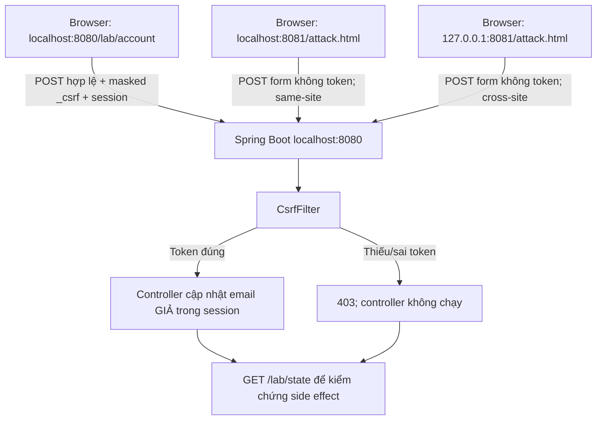
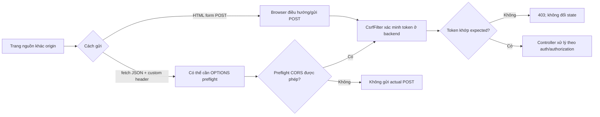
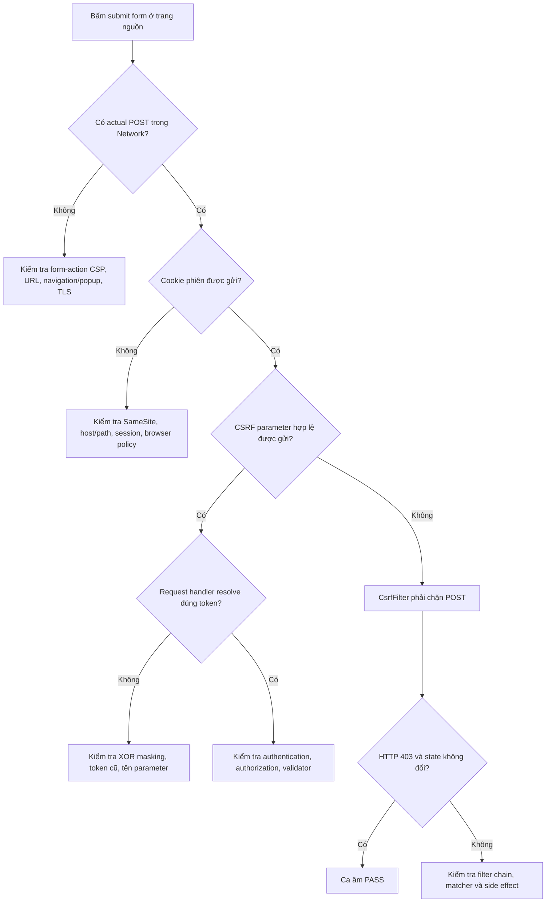

# Kiểm tra gửi form liên trang trong môi trường kiểm thử riêng

Một form HTML nằm trên trang khác origin vẫn có thể yêu cầu trình duyệt gửi `POST` tới ứng dụng Spring Security của bạn. **Same-Origin Policy (SOP) không ngăn form navigation chỉ vì khác origin**, và **CORS không phải cơ chế chống CSRF**: một form HTML thông thường không cần gọi `fetch`, không cần đọc response bằng JavaScript và thường không phát CORS preflight. Đây là lý do những ứng dụng dùng cookie phiên phải kiểm chứng hàng rào CSRF ngay cả khi đã hạn chế CORS.

Bài thuộc chương **Kiểm thử trình duyệt** của module **SPRING_SECURITY_HTTP_PROTECTION**. Module tập trung vào phòng vệ HTTP và trình duyệt trong Spring Security — từ CSRF, CORS, security headers, CSP, HSTS tới HTTP firewall và bảo vệ session — cho cả Servlet và Reactive, kết hợp kiểm thử kịch bản tấn công web và chẩn đoán xung đột lúc triển khai. Trong bài này ta dựng một **phòng thí nghiệm hoàn toàn cục bộ, không dùng tài khoản hoặc dịch vụ thật**, với backend **Spring Security Servlet 6.x**, trang form hợp lệ, trang gửi form liên trang và các bước kiểm chứng bằng DevTools, MockMvc, Playwright.

**Sau bài học, bạn có thể:**

- Giải thích vì sao form cross-origin có thể gửi request mà không cần CORS.
- Phân biệt **same-origin**, **cross-origin nhưng same-site** và **cross-site**, đặc biệt khi cookie dùng `SameSite=Lax`.
- Dựng trang thử riêng để xác minh `CsrfFilter` ngăn thay đổi trạng thái trước controller.
- Quan sát actual `POST`, request `Cookie`, `Origin`, `Sec-Fetch-Site`, form body, response `403` và dữ liệu sau request.
- So sánh form có token với form không có/sai token; xác minh không có side effect khi bị từ chối.
- Phân biệt lỗi của CSRF, SameSite, CORS, CSP, session và authorization mà không bỏ bớt các lớp bảo vệ.

## 1. Nguy cơ cần thử: website khác gửi form vào ứng dụng đang có phiên

Giả sử browser đã truy cập một ứng dụng web và đang giữ cookie phiên đăng nhập:

```http
Cookie: JSESSIONID=<session-bi-an>
```

Ứng dụng có form thay đổi địa chỉ email qua `POST /account/email`. Nếu không kiểm tra CSRF, trang khác có thể tạo một form với `action` trỏ tới endpoint này:

```html
<form action="https://app.example.test/account/email"
      method="post">
  <input type="hidden" name="email" value="changed@example.test">
  <button type="submit">Gửi yêu cầu</button>
</form>
```

Khi người dùng kích hoạt form, browser có thể gửi **request tới origin của ứng dụng**. Nếu cookie xác thực được phép gửi theo chính sách cookie và server không có phòng vệ phù hợp, hành động có thể diễn ra dưới danh tính của người dùng. Trang nguồn không cần đọc response để gây một side effect.

Với Spring Security được cấu hình đúng, `CsrfFilter` yêu cầu thêm **token hợp lệ do client chủ động gửi**, thường là hidden field `_csrf` hoặc HTTP header. Form đến từ trang không có token phù hợp bị từ chối, thông thường **HTTP `403 Forbidden`**, trước khi method controller thực thi.

**Phạm vi đạo đức thực hành:** chỉ chạy các ví dụ bên dưới trên máy hoặc môi trường test do bạn kiểm soát. Không gắn form thử nghiệm vào website bên thứ ba, không dùng cookie/tài khoản người thật và không thu thập session ID hay CSRF token ngoài hệ thống lab.

## 2. Form liên trang khác `fetch` cross-origin như thế nào?

Một thao tác từ trang `http://localhost:8081` tới API `http://localhost:8080` có thể được khởi tạo bằng nhiều cách:

| Cơ chế | Browser thường làm gì? | JavaScript ở trang nguồn đọc response? |
| --- | --- | --- |
| `<form method="post" action="...">` với `application/x-www-form-urlencoded` | **Gửi form navigation**; không cần preflight CORS thông thường | Không có `Response` object của Fetch; script nguồn không được đọc DOM của trang đích cross-origin |
| `<form method="post" enctype="multipart/form-data">` | Gửi form navigation có multipart body | Vẫn bị SOP hạn chế đọc trang đích |
| `<form method="post" enctype="text/plain">` | Gửi form navigation với text body | Không đồng nghĩa server chấp nhận kiểu body |
| `fetch(..., {method:"POST", headers:{"Content-Type":"application/json"}})` | Cross-origin request thường cần **CORS preflight** | Chỉ đọc được khi CORS cho phép |
| `fetch(..., {method:"POST", body: new URLSearchParams(...)})` | Có thể là CORS simple request **không preflight** nếu không thêm header không safelisted | Browser vẫn kiểm soát việc script đọc response |
| `<a href="...">` hoặc form `GET` | Top-level navigation, không cần CORS để mở trang | GET phải không làm thay đổi trạng thái |

**Không có preflight không có nghĩa không có chính sách bảo mật.** Browser vẫn áp dụng CSP `form-action`, cookie `SameSite`, mixed-content/TLS, navigation restrictions và các chính sách khác. Server vẫn có thể kiểm tra `Origin`/Fetch Metadata hoặc từ chối request. Tuy nhiên không thể thiết kế CSRF protection chỉ dựa trên giả định “CORS sẽ chặn form”.

### Form có thể mở trang response nhưng script nguồn vẫn không đọc được

Khi form dùng `target="_blank"`, browser có thể mở một tab mới hiển thị response của ứng dụng đích. Đây là **navigation**, không phải cấp quyền cho JavaScript trang nguồn đọc toàn bộ DOM của tab cross-origin. Người dùng có thể nhìn thấy trang đích; script ở origin nguồn không tự có quyền đọc nội dung đó. **Hành động ở backend có thể đã xảy ra dù script không đọc được kết quả.**

## 3. Origin và site: phân biệt trước khi diễn giải cookie

**Origin = scheme + hostname + port.** Site, theo mô hình schemeful same-site, thường xét scheme và registrable domain; port không làm site khác đi.

| Trang chứa form | Endpoint form đích | Quan hệ | Điều cần xem |
| --- | --- | --- | --- |
| `http://localhost:8080` | `http://localhost:8080` | Same-origin | Form hợp lệ có thể render token |
| `http://localhost:8081` | `http://localhost:8080` | **Cross-origin nhưng thường same-site** | Cookie `SameSite=Lax` có thể được gửi |
| `http://127.0.0.1:8081` | `http://localhost:8080` | Cross-origin, thường **cross-site** | Cookie Lax thường bị chặn ở cross-site POST |
| `https://sub.example.test` | `https://api.example.test` | Cross-origin nhưng cùng site `https://example.test` | Không mặc định tin mọi subdomain |
| `https://other.test` | `https://api.example.test` | Cross-site | Cookie policies và CSRF đều cần đánh giá |

Trong lab local, `localhost` và `127.0.0.1` có thể tới cùng máy, nhưng browser **không coi hostname giống nhau**. Một cookie host-only cho `localhost` không tự trở thành cookie của `127.0.0.1`. Đồng thời, cookie thường **không phân biệt theo port**: cookie cho `localhost` có thể được gửi tới cả port 8080 và 8081 nếu cookie policy cho phép.

Đối với một **cross-site top-level POST**, cookie có `SameSite=Lax` được đặt tường minh thường **không** được gửi. Nhưng đối với form từ **same-site khác origin** (`localhost:8081` → `localhost:8080`), cookie Lax có thể được gửi. Đây là lý do kiểm tra ở hai port có ích để chứng minh **CSRF vẫn cần thiết dù cookie SameSite được bật**.

**Không dùng kết quả HTTP localhost làm bằng chứng cuối cùng cho HTTPS production**: browser có các xử lý đặc biệt với loopback, `Secure`, cookie third-party, HSTS và TLS. Phần mở rộng sẽ trình bày test bằng HTTPS và các hostname test khi cần.

## 4. Kiến trúc lab: trang hợp lệ, trang gửi form, server kiểm tra trạng thái

Ta tạo **hai server**, ba URL trang:

| Vai trò | URL | Nội dung |
| --- | --- | --- |
| Ứng dụng test (đích) | `http://localhost:8080/lab/account` | Form hợp lệ chứa CSRF token do Spring Security cấp |
| API đọc trạng thái test | `http://localhost:8080/lab/state` | Đọc email giả trong phiên test |
| API thay đổi trạng thái | `http://localhost:8080/lab/email` | Chỉ `POST`, yêu cầu CSRF hợp lệ |
| Trang gửi form khác origin, cùng site | `http://localhost:8081/attack.html` | Form POST không token tới port 8080 |
| Trang gửi form khác origin, khác site theo host | `http://127.0.0.1:8081/attack.html` | Cùng form POST nhưng cookie Lax có thể bị chặn |



Ta dùng email giả trong session như `initial@lab.test` và `safe@lab.test`, không gửi email thực và không tạo tài khoản. Trong ứng dụng production, endpoint thay đổi email phải yêu cầu authentication, authorization, validation và có thể cần re-authentication. Trong lab, endpoint được `permitAll()` **có chủ đích để cô lập CSRF**, nhưng vẫn bị `CsrfFilter` kiểm tra khi `POST`.

### Vì sao không dùng bộ đếm toàn cục?

Đối với form liên trang, cần phân biệt trạng thái của **browser đã có session** với browser không gửi cookie. Bởi vậy lab lưu email giả trong **`HttpSession`**. Nếu một POST cross-site không gửi cookie, việc tạo session mới hoặc bị từ chối không làm thay đổi email ở phiên browser đích. Kiểm tra lại chính session của trang hợp lệ sẽ cho bằng chứng side effect rõ ràng.

### Các biên giới an toàn

- Chỉ dùng loopback `127.0.0.1`/`localhost`, không public cổng lên internet.
- Dùng form test không token để kiểm tra phòng vệ, **không** mô phỏng lấy cắp cookie/token.
- Không thay đổi cấu hình CSRF ở hệ thống thật để tạo tình huống dễ khai thác.
- Không lưu HAR chứa session ID; nếu phải chia sẻ ảnh DevTools, che toàn bộ cookie/token.
- Chạy một browser profile/test context sạch, không dùng profile chứa đăng nhập thật.

## 5. Spring Boot Servlet: giữ CSRF, cô lập authorization cho lab

Sử dụng Spring Boot 3.x, Spring Security Servlet 6.x, Java 17+, các dependency:

```text
spring-boot-starter-web
spring-boot-starter-security
spring-boot-starter-thymeleaf
spring-boot-starter-test          (phạm vi test)
spring-security-test             (phạm vi test)
```

Tạo class `LabSecurityConfiguration.java`:

```java
import org.springframework.context.annotation.Bean;
import org.springframework.context.annotation.Configuration;
import org.springframework.security.config.annotation.web.builders.HttpSecurity;
import org.springframework.security.web.SecurityFilterChain;
import org.springframework.security.web.csrf.HttpSessionCsrfTokenRepository;
import org.springframework.security.web.csrf.XorCsrfTokenRequestAttributeHandler;

@Configuration
public class LabSecurityConfiguration {

    @Bean
    SecurityFilterChain labChain(HttpSecurity http) throws Exception {
        http
            .authorizeHttpRequests(auth -> auth
                // CHỈ TRONG LAB: không cần đăng nhập để cô lập CSRF.
                .anyRequest().permitAll())
            .csrf(csrf -> csrf
                .csrfTokenRepository(
                    new HttpSessionCsrfTokenRepository())
                .csrfTokenRequestHandler(
                    new XorCsrfTokenRequestAttributeHandler()));

        // Cố ý KHÔNG thêm cors() ở lab cơ bản.
        // Mục đích: quan sát form navigation độc lập
        // với CORS, không dùng CORS như CSRF protection.
        return http.build();
    }
}
```

`HttpSessionCsrfTokenRepository` giữ **raw token kỳ vọng** trong session. `XorCsrfTokenRequestAttributeHandler` công bố masked token cho form hợp lệ và giải quyết token client gửi trước khi `CsrfFilter` so sánh, giúp hạn chế nguy cơ BREACH khi token phản chiếu vào HTML nén.

Đừng nhầm `permitAll()` với vô hiệu hóa CSRF. Theo matcher mặc định, `POST /lab/email` vẫn yêu cầu token. Với các method an toàn như `GET`, `HEAD`, `OPTIONS`, `TRACE`, `CsrfFilter` thường không yêu cầu token; vì vậy lab **không dùng GET để cập nhật dữ liệu**.

Trong lab cơ bản, không cấu hình CORS để dễ tách hai ý: **form navigation có thể gửi cross-origin** và **browser không cấp quyền script đọc response cross-origin**. Nếu môi trường bật `CorsFilter` hoặc origin checks ở server, form có thể bị server từ chối ở lớp khác; đó là phòng vệ **phía server**, không chứng minh rằng SOP tự ngăn việc gửi form.

`application.properties` cho backend HTTP local:

```properties
server.port=8080
server.servlet.session.cookie.http-only=true
server.servlet.session.cookie.same-site=lax
```

Đây là cấu hình lab local. Production nên dùng HTTPS và cookie `Secure`, `HttpOnly`, SameSite được chọn theo threat model, cùng chính sách session fixation và logout phù hợp. Không tắt `HttpOnly` của `JSESSIONID` để JavaScript đọc session cookie.

## 6. Controller: chỉ POST hợp lệ mới thay đổi email giả trong phiên

Tạo `LabAccountController.java`:

```java
import jakarta.servlet.http.HttpSession;
import java.util.Map;
import org.springframework.stereotype.Controller;
import org.springframework.ui.Model;
import org.springframework.web.bind.annotation.GetMapping;
import org.springframework.web.bind.annotation.PostMapping;
import org.springframework.web.bind.annotation.RequestMapping;
import org.springframework.web.bind.annotation.RequestParam;
import org.springframework.web.bind.annotation.ResponseBody;

@Controller
@RequestMapping("/lab")
public class LabAccountController {

    private static final String EMAIL_KEY = "LAB_TEST_EMAIL";
    private static final String INITIAL_EMAIL = "initial@lab.test";

    private String currentEmail(HttpSession session) {
        Object value = session.getAttribute(EMAIL_KEY);
        return value instanceof String text ? text : INITIAL_EMAIL;
    }

    @GetMapping("/account")
    String account(HttpSession session, Model model) {
        model.addAttribute("currentEmail", currentEmail(session));
        return "lab-account";
    }

    @GetMapping("/state")
    @ResponseBody
    Map<String, String> state(HttpSession session) {
        return Map.of("email", currentEmail(session));
    }

    @PostMapping("/email")
    String updateEmail(
            @RequestParam("email") String email,
            HttpSession session) {
        // Chỉ phục vụ lab cục bộ, không gửi mail hay cập nhật user thật.
        if (email.length() > 100 || !email.endsWith("@lab.test")) {
            throw new IllegalArgumentException(
                "Chỉ dùng địa chỉ giả thuộc @lab.test");
        }

        session.setAttribute(EMAIL_KEY, email);
        return "redirect:/lab/account";
    }
}
```

Controller chỉ có `POST /lab/email` để ghi. Request `GET /lab/email?email=...` không được dùng làm cập nhật, nên không có mapping GET cho cùng action. `GET /lab/state` **chỉ đọc** trạng thái, phục vụ việc chứng minh request giả mạo không tạo side effect.

**Đây không phải controller production:** nó cố ý không có authentication/authorization để cô lập CSRF, xác thực email chỉ mang tính minh họa và lưu state trong `HttpSession`. Ứng dụng thật phải có validation, kiểm tra quyền sở hữu tài khoản, xử lý lỗi phù hợp, CSRF protection và có thể yêu cầu người dùng xác thực lại trước khi đổi email.

### Tại sao side effect nằm trong controller?

Với Spring Security Servlet, request đi qua filter chain trước khi gọi controller. Nếu `CsrfFilter` từ chối `POST` không có token hợp lệ, `updateEmail()` **không chạy** và session attribute không đổi. Đây là bằng chứng trực tiếp hơn so với chỉ quan sát `403`: nếu bộ lọc hoặc security chain được cấu hình sai, một request có thể bất ngờ tới controller.

### Vì sao dùng `HttpSession` thay vì một biến static?

Một người dùng thử nghiệm có session riêng. Nếu browser không gửi `JSESSIONID` ở cross-site POST, server không nên lấy đó làm cùng state phiên đã được xem trên trang hợp lệ. Trong lab, controller chỉ sửa email của **session gắn với request tới controller**, và `CsrfFilter` phải chặn trước khi có bất kỳ cập nhật nào.

## 7. Trang form hợp lệ cùng origin: Thymeleaf nhận CSRF token

Tạo template `src/main/resources/templates/lab-account.html`:

```html
<!doctype html>
<html lang="vi" xmlns:th="http://www.thymeleaf.org">
<head>
  <meta charset="utf-8">
  <title>Lab — form cùng origin, có CSRF</title>
</head>
<body>
  <h1>Trang tài khoản GIẢ</h1>
  <p>Giá trị hiện tại:
    <strong data-testid="current-email"
            th:text="${currentEmail}">initial@lab.test</strong>
  </p>

  <!-- Dùng action cố định ở context path gốc cho lab. -->
  <form action="/lab/email" method="post">
    <label for="email">Email giả mới</label>
    <input id="email" name="email" type="email"
           value="safe@lab.test" required>

    <!-- Request attribute _csrf chứa CsrfToken. -->
    <input type="hidden"
           th:name="${_csrf.parameterName}"
           th:value="${_csrf.token}">

    <button type="submit">Lưu email giả</button>
  </form>

  <p><a href="/lab/state">Đọc state JSON của phiên này</a></p>
</body>
</html>
```

Khi browser mở `http://localhost:8080/lab/account`, template truy cập `_csrf.token`. Với `HttpSessionCsrfTokenRepository`, Spring Security có thể tạo và lưu raw token kỳ vọng vào session. Với `XorCsrfTokenRequestAttributeHandler`, hidden field nhận **masked token**:

```html
<!-- HTML được render: ví dụ hình dạng, không phải token thật -->
<input type="hidden" name="_csrf" value="<masked-token>">
```

Form `POST /lab/email` sẽ gửi field `_csrf` cùng `email`. Request handler giải quyết masked token về raw token để `CsrfFilter` so sánh với token kỳ vọng lưu trong session. Browser cũng gửi `JSESSIONID` nếu cookie policy cho phép.

**Kỳ vọng:** Submit form hợp lệ làm email giả đổi thành `safe@lab.test` (hoặc giá trị bạn nhập), controller redirect lại `/lab/account`, và trang hiển thị giá trị mới.

### Vì sao dùng `action` chứ không dùng `th:action` ở ví dụ?

Một số tích hợp Thymeleaf/Spring MVC có thể **tự thêm CSRF hidden field** khi dùng `th:action` thông qua `RequestDataValueProcessor`. Lab đã viết rõ hidden field nên dùng `action` thông thường để tránh vô tình tạo hai field token trùng tên. Trong dự án thật có context path khác `/`, dùng URI sinh bởi framework cho đúng đường dẫn và chọn **một** cơ chế thêm CSRF field nhất quán; đừng dựa vào URL hard-code của lab.

### Token bị che không phải raw token mới cho mỗi lần tải

Hai lần tải `/lab/account` có thể hiển thị hai chuỗi masked khác nhau nhưng cùng giải quyết về một raw token gốc trong session. Không dùng so sánh chuỗi HTML để suy rằng server đã rotate CSRF token. Muốn kiểm tra vòng đời token qua login/logout, cần kiểm tra repository và session state riêng.

## 8. Trang gửi form khác origin: không có CSRF token

Tạo `attack.html` cho **máy chủ static local ở port 8081**, không đặt file này trong backend port 8080. Trang thử cố ý chỉ có field dữ liệu giả, **không** có `_csrf` và không cố truy xuất token của ứng dụng đích.

```html
<!doctype html>
<html lang="vi">
<head>
  <meta charset="utf-8">
  <title>Lab — gửi form liên trang</title>
</head>
<body>
  <h1>Trang nguồn khác origin — chỉ dùng trong lab</h1>
  <p>Origin hiện tại: <output id="origin"></output></p>
  <p>Đích: <code>http://localhost:8080/lab/email</code></p>

  <form id="cross-post"
        method="post"
        action="http://localhost:8080/lab/email"
        target="_blank"
        enctype="application/x-www-form-urlencoded">
    <input type="hidden" name="email" value="changed@lab.test">
    <!-- Cố ý KHÔNG có input _csrf. -->
    <button type="submit">Gửi POST liên origin (không token)</button>
  </form>

  <form id="cross-plain"
        method="post"
        action="http://localhost:8080/lab/email"
        target="_blank"
        enctype="text/plain">
    <input type="hidden" name="email" value="changed@lab.test">
    <button type="submit">Gửi text/plain POST (không token)</button>
  </form>

  <p>
    <a href="http://localhost:8080/lab/email?email=changed@lab.test"
       target="_blank" rel="noopener">
      Thử GET tới action POST-only
    </a>
  </p>

  <script>
    document.querySelector("#origin").textContent = location.origin;
  </script>
</body>
</html>
```

**Điểm kiểm thử:** form `method="post"` có thể làm browser tạo một actual POST tới origin khác mà **không cần một đoạn `fetch` hoặc preflight OPTIONS**. Vì thiếu CSRF token, Spring Security phải từ chối và controller không được đổi email của phiên test.

`target="_blank"` giúp trang nguồn vẫn mở để bạn tiếp tục thử; tab đích có thể hiển thị trang lỗi `403` do server tạo. Trang nguồn không tự có quyền đọc nội dung trang đích bằng JavaScript khi hai origin khác nhau. Không suy “đã mở tab response” nghĩa là SOP đã cấp quyền đọc cross-origin.

`text/plain` cũng có thể được một form HTML gửi đi mà không cần preflight CORS. Tuy vậy, **server có thể không parse `@RequestParam` từ text/plain**. Kết quả từ form này có thể bị cả CSRF và quy tắc xử lý content type của endpoint từ chối; đây là một bài thử bổ sung, không phải cách “vượt qua CSRF” hoặc bằng chứng form text/plain sẽ được API chấp nhận.

### Test thủ công cần duy trì cùng browser context

Để tái hiện người dùng đã có session, hãy mở trang hợp lệ và trang nguồn thử trong **cùng browser profile/context**, nhưng khác origin. Nếu mở trang gửi form trong một cửa sổ ẩn danh khác hoàn toàn, cookie session của trang hợp lệ sẽ không được chia sẻ; đó là một bài test **khác** về thiếu cookie, không còn mô phỏng chính xác browser có phiên đang hoạt động.

## 9. Phục vụ trang gửi form ở port 8081

Không mở `attack.html` bằng `file://`, vì một số browser xử lý file local với opaque origin hoặc `Origin: null`, dễ làm nhiễu kết luận. Dùng một HTTP server nhỏ trên loopback.

Trong thư mục lab độc lập:

```text
cross-site-form-lab/
  attacker-server.mjs
  attack.html
```

`attacker-server.mjs` dùng Node.js có sẵn:

```javascript
import http from "node:http";
import { readFile } from "node:fs/promises";

const html = await readFile(new URL("./attack.html", import.meta.url));

http.createServer((request, response) => {
  if (request.method !== "GET" ||
      request.url !== "/attack.html") {
    response.writeHead(404, {
      "Content-Type": "text/plain; charset=utf-8"
    });
    response.end("Not found");
    return;
  }

  response.writeHead(200, {
    "Content-Type": "text/html; charset=utf-8",
    "Cache-Control": "no-store",
    "X-Content-Type-Options": "nosniff"
  });
  response.end(html);
}).listen(8081, "127.0.0.1", () => {
  process.stdout.write("Form test page on loopback port 8081\n");
});
```

Chạy trong thư mục chứa hai file:

```bash
node attacker-server.mjs
```

Mở các URL sau trong cùng browser context:

```text
http://localhost:8080/lab/account
http://localhost:8081/attack.html
http://127.0.0.1:8081/attack.html
```

**Lưu ý IPv4/IPv6:** Node server này chỉ bind `127.0.0.1`. Một số môi trường ưu tiên địa chỉ IPv6 `::1` khi phân giải `localhost`; nếu `http://localhost:8081` không tải được, cần điều chỉnh listener/host mapping trong lab. Đừng bind server thử nghiệm ra toàn mạng LAN hoặc internet chỉ để khắc phục lỗi hostname.

### Vì sao cùng một trang nhưng mở hai hostname?

`localhost:8081` và `127.0.0.1:8081` cho phép bạn thay đổi **site context** của trang gửi form mà giữ nguyên body, method và endpoint đích. Nếu browser coi trang `127.0.0.1` khác site với API `localhost`, `SameSite=Lax` có thể làm browser **không gửi cookie phiên ở cross-site POST**. Đây là kết quả cần phân tích riêng với việc `CsrfFilter` từ chối token thiếu.

## 10. Trình tự chạy lab thủ công từ một phiên sạch

Nên dùng một **browser profile test riêng**, mở DevTools → Network, bật **Preserve log** và chọn **All** để nhìn thấy cả form navigation chứ không chỉ Fetch/XHR. Với thao tác thử riêng lẻ, quan sát lần lượt request/response rồi mới làm bước tiếp theo.

### Bước 1 — mở form hợp lệ để tạo session và token

Mở:

```text
http://localhost:8080/lab/account
```

Kiểm tra:

- Browser nhận trang `200` chứa hidden input `_csrf` (giá trị thực cần được che khi chụp màn hình).
- Response có thể phát `Set-Cookie: JSESSIONID=...`; trong DevTools Application/Storage cookie jar có cookie phiên.
- `JSESSIONID` nên được đánh dấu `HttpOnly` theo cấu hình lab.
- Cookie `SameSite=Lax` được đặt tường minh; DevTools có thể hiển thị thuộc tính trong cookie jar.

Chỉ truy cập `_csrf.token` lúc render có thể materialize token trong session. Đừng giả định cookie đã được gửi ở **request GET đầu tiên**; nó có thể vừa được server tạo và chỉ xuất hiện ở **request tiếp theo**.

### Bước 2 — submit form hợp lệ

Nhập `safe@lab.test` và nhấn “Lưu email giả”. Form POST có:

```http
POST /lab/email HTTP/1.1
Host: localhost:8080
Cookie: JSESSIONID=<session-da-che>
Content-Type: application/x-www-form-urlencoded

email=safe%40lab.test&_csrf=<masked-token-da-che>
```

Server kiểm tra token rồi chạy controller, thường trả redirect `302` tới `/lab/account`; browser GET lại trang và nhìn thấy `safe@lab.test`.

**Bằng chứng:** route `GET /lab/state` trong cùng browser hiện:

```json
{"email":"safe@lab.test"}
```

Lưu ý ví dụ HTTP trên là **minh họa nội dung**; browser có thể thêm `Origin`, `Referer`, `Sec-Fetch-*`, `Accept` và các header khác. Không chụp hay chia sẻ nguyên token/cookie.

### Bước 3 — từ trang khác origin nhưng cùng site, gửi POST thiếu token

Mở một tab mới:

```text
http://localhost:8081/attack.html
```

Nhấn **“Gửi POST liên origin (không token)”**. Browser có thể mở tab đích với response lỗi. Trong Network, tìm actual request:

```http
POST /lab/email HTTP/1.1
Host: localhost:8080
Origin: http://localhost:8081
Cookie: JSESSIONID=<session-da-che>
Content-Type: application/x-www-form-urlencoded
Sec-Fetch-Site: same-site

email=changed%40lab.test
```

Header có mặt chính xác có thể thay đổi theo browser; đặc biệt `Origin`/`Sec-Fetch-Site` là ví dụ điển hình, không phải chuỗi bắt buộc cho mọi client. Điểm cần thấy là:

1. Actual POST **có thể được gửi** dù trang nguồn khác origin.
2. Với `SameSite=Lax` và hai URL dùng cùng hostname/scheme, cookie session **có thể đi kèm** POST.
3. Không có form parameter `_csrf` hợp lệ.
4. `CsrfFilter` từ chối, thường trả **HTTP `403`**.
5. Reload trang `http://localhost:8080/lab/account` từ tab hợp lệ vẫn thấy **`safe@lab.test`**, không bị đổi thành `changed@lab.test`.

Đây là phép thử quan trọng nhất: **request có thể tới server với cookie phiên, nhưng server vẫn không thực hiện thay đổi vì thiếu CSRF token**.

### Bước 4 — từ trang khác hostname/site, gửi cùng form

Mở thêm tab:

```text
http://127.0.0.1:8081/attack.html
```

Nhấn cùng nút POST. Vì nguồn là `127.0.0.1` còn đích là `localhost`, browser thường coi đây là **cross-site**, và cookie `SameSite=Lax` đặt tường minh thường **không được gửi** trên cross-site top-level POST. Bởi vậy request có thể tới server nhưng không mang `JSESSIONID` của phiên đích.

Nếu cookie không được gửi, server không tìm thấy session/token kỳ vọng của browser trước đó; `CsrfFilter` vẫn từ chối và dữ liệu của phiên hợp lệ không đổi. Phép thử này chứng minh **cả cookie policy và CSRF đều góp phần phòng vệ**, không chứng minh một cơ chế thay thế hoàn toàn cơ chế kia.

Quan sát `Cookie` ở **actual POST**, không quan sát request GET tải trang nguồn. Nên ghi nhận `Sec-Fetch-Site` khi browser hỗ trợ, nhưng không dựa duy nhất vào header đó nếu dùng browser đặc thù.

### Bước 5 — thử đường GET

Trên trang nguồn, nhấn link `GET /lab/email?email=...`. Endpoint chỉ có `@PostMapping`, nên Spring MVC thông thường trả **`405 Method Not Allowed`** (status/body cụ thể có thể chịu ảnh hưởng của cấu hình lỗi). Dữ liệu test không được đổi.

Điều này nhấn mạnh quy tắc: **không dùng GET để thay đổi trạng thái**. CSRF matcher mặc định thường bỏ qua GET, vì đây là method phải an toàn; nếu API vô tình thực hiện thay đổi qua GET, chính thiết kế endpoint đã tạo đường rủi ro ngoài cách bảo vệ POST thông thường.

## 11. Ma trận kỳ vọng: cookie, CSRF, controller và trạng thái

| Nguồn thao tác | Token gửi | Cookie `JSESSIONID` | Kết quả thường gặp | State của phiên hợp lệ |
| --- | --- | --- | --- | --- |
| Form `/lab/account` cùng origin | Masked token hợp lệ | Có | Qua `CsrfFilter`, redirect thành công | **Đổi** theo input |
| Form trang `localhost:8081`, POST khác origin cùng site | **Không có** | Có thể có với Lax | `403` do CSRF | **Giữ nguyên** |
| Form trang `127.0.0.1:8081`, POST khác site | **Không có** | Thường không có với Lax | `403` do CSRF | **Giữ nguyên** |
| Form cùng origin nhưng xóa field `_csrf` | **Không có** | Có | `403` do CSRF | **Giữ nguyên** |
| Form cùng origin với `_csrf` tùy ý sai | Sai | Có | `403` do CSRF | **Giữ nguyên** |
| Form cùng origin với token cũ sau session timeout | Token không còn phù hợp | Session cũ hết hạn hoặc mới | `403` | **Không được tự ghi đè** |
| Link `GET /lab/email?email=...` | Không cần CSRF theo matcher GET | Có thể có | Thường `405`; endpoint không tồn tại cho GET | **Giữ nguyên** |
| Form cross-origin `text/plain` không token | Không có | Tùy context | Thường bị CSRF chặn trước controller | **Giữ nguyên** |

Kết quả cụ thể có thể khác do browser version, cookie policies, reverse proxy, custom filters hoặc CORS/Origin policy **ở phía server**. Nếu request thiếu CSRF token lại làm thay đổi state, **đó là dấu hiệu cần điều tra nghiêm túc** về security chain/matcher/endpoint; không bỏ qua chỉ vì status cuối cùng là lỗi.

### `403` không nhất thiết là `MissingCsrfTokenException`

Nếu repository chưa có expected token và deferred token phải sinh mới, `CsrfFilter` có thể phân loại thành `MissingCsrfTokenException`. Nếu repository **đã có expected token** nhưng request thiếu `_csrf` hoặc gửi sai token, filter có thể tạo `InvalidCsrfTokenException`. Cả hai thường trả `403`. Để biết loại thực tế, cần nhìn **trạng thái token kỳ vọng**, không suy chỉ từ việc form có/không có hidden input.

### Không dùng `SameSite=Lax` như lời bảo đảm cho mọi cross-site request

Lax thường không gửi cookie trong cross-site POST, nhưng có thể gửi trong **top-level navigation với method an toàn như GET**. Browser còn có những biến thể/ngoại lệ khi cookie **không khai báo SameSite**; lab cố ý đặt `Lax` tường minh để tránh phụ thuộc hành vi mặc định. Hơn nữa, same-site khác origin vẫn có thể gửi cookie.

## 12. Vì sao CORS không được xem là lớp chống form CSRF?

CORS kiểm soát việc một trang web gọi tài nguyên cross-origin bằng API web và **được đọc response** theo chính sách browser. Với request không-safelisted, browser thường thực hiện **preflight OPTIONS**. Nhưng một HTML form navigation thông thường sử dụng `application/x-www-form-urlencoded`, `multipart/form-data` hoặc `text/plain` có thể gửi POST **không cần CORS preflight**.



Điểm tinh tế: **server hoàn toàn có thể chọn từ chối form cross-origin vì `Origin` hoặc vì một `CorsFilter` được cấu hình chặt**. Đó là một cơ chế server-side riêng, không phải bằng chứng “HTML form không thể gửi nếu thiếu ACAO”. Ngay cả khi một lớp chặn thêm tồn tại, CSRF token vẫn là một phòng vệ độc lập cần kiểm tra theo threat model.

### Không thể khắc phục bằng `mode: "no-cors"`

`fetch(..., {mode:"no-cors"})` không biến một request thành form HTML không có giới hạn. Nó hạn chế các header/method có thể gửi và thường trả **opaque response** mà script không đọc được body/status thật. Nó **không** làm một POST thiếu token trở nên hợp lệ với `CsrfFilter`, cũng không chứng minh server chưa nhận request.

### Cross-origin form khác đọc cross-origin response

Form có thể điều hướng sang response đích, nhưng trang nguồn không tự đọc được DOM của tài liệu cross-origin. Nếu kẻ xấu chỉ muốn **thực hiện** một thay đổi, không cần đọc phản hồi. SOP bảo vệ bí mật response giữa origin, **không thay thế xác thực hành động có side effect** bằng CSRF token.

## 13. HTML form không thể tự gắn HTTP CSRF header tùy ý

Một form HTML chuẩn gửi dữ liệu dưới dạng các field, không có API để đặt header tùy ý như:

```http
X-CSRF-TOKEN: <masked-token>
```

Nếu ứng dụng chấp nhận CSRF token qua **hidden field** `_csrf`, form hợp lệ có thể mang token trong body. Trang nguồn khác origin không được đọc biểu mẫu của ứng dụng đích qua SOP, nên thông thường **không biết token đúng** để tự gắn field.

Một trang có JavaScript có thể dùng `fetch` để đặt header ứng dụng, nhưng request cross-origin có custom header thường cần CORS preflight. Điều này là một yếu tố phòng vệ bổ sung có ích, **không phải lý do tắt `CsrfFilter` hoặc mặc định tin mọi request JSON**.

### Content type của form và endpoint JSON

| Encoding | Body thường gặp | Server xử lý |
| --- | --- | --- |
| `application/x-www-form-urlencoded` | `email=changed%40lab.test` | Thường được MVC bind thành `@RequestParam` |
| `multipart/form-data` | Nhiều part, kèm boundary | Cần parser multipart phù hợp |
| `text/plain` | Văn bản theo quy tắc form | Có thể **không** bind được vào `@RequestParam` của endpoint |
| `application/json` | `{"email":"changed@lab.test"}` | Không phải `enctype` chuẩn của form HTML thông thường; JavaScript thường dùng `fetch` |

Không dựa hoàn toàn vào `Content-Type: application/json` để kết luận CSRF không còn phù hợp. Một số ứng dụng hoặc framework xử lý body không chặt, hỗ trợ nhiều kiểu content type, hoặc có những endpoint unsafe khác có thể bị form gửi tới. Mọi endpoint dùng credentials tự động của browser cần đánh giá threat model và cơ chế CSRF nhất quán.

**Không khuyến nghị tự thêm logic “nếu có `X-Requested-With` thì bỏ qua CSRF”** mà không đánh giá kỹ origin, CORS và các client được tin cậy. Một header tùy chỉnh có thể hữu ích trong thiết kế cụ thể nhưng không tự đại diện cho quyền thực hiện thao tác.

## 14. Đọc `Origin`, `Referer` và Fetch Metadata trong actual POST

Đối với form cross-origin, Network → Headers trên **actual POST** có thể hiển thị:

```http
POST /lab/email HTTP/1.1
Host: localhost:8080
Origin: http://localhost:8081
Referer: http://localhost:8081/
Sec-Fetch-Site: same-site
Sec-Fetch-Mode: navigate
Sec-Fetch-Dest: document
Content-Type: application/x-www-form-urlencoded
Cookie: JSESSIONID=<an>

email=changed%40lab.test
```

Giá trị chính xác thay đổi theo browser, URL thực tế, `Referrer-Policy` và cách navigation được tạo. Ví dụ `Referer` có thể chỉ chứa origin hoặc không xuất hiện; **không** giả định URL chi tiết luôn được gửi. Một request `POST` từ tab `127.0.0.1` có thể mang `Sec-Fetch-Site: cross-site` và **không có cookie session** nếu SameSite Lax chặn.

| Header | Ý nghĩa trong lab | Giới hạn |
| --- | --- | --- |
| `Origin` | Origin chứa form gửi request | Có thể không có trong một số bối cảnh; có thể là `null`; không phải authentication |
| `Referer` | URL/origin trang nguồn tùy chính sách referrer | Có thể bị cắt bớt hoặc loại bỏ |
| `Sec-Fetch-Site` | `same-origin`, `same-site`, `cross-site`, `none` tùy ngữ cảnh | Browser không bắt buộc mọi HTTP client gửi; không là bằng chứng định danh |
| `Sec-Fetch-Mode` | Form navigation thường là `navigate`; fetch có thể là `cors` | Không tự biểu thị token hợp lệ |
| `Sec-Fetch-Dest` | Navigation trang có thể là `document` | Iframe, form và tài nguyên khác có giá trị khác |
| `Cookie` | Cookie browser **thực sự gửi** | Không cho biết vì sao cookie khác đã bị chặn nếu không xem cookie jar/policy |

**Các header này hữu ích để phát hiện bối cảnh cross-origin/cross-site, không thay cho token CSRF.** Origin check và Fetch Metadata policy là lớp bổ sung có giá trị khi thiết kế chặt chẽ, nhưng phải đánh giá các ngoại lệ như điều hướng hợp lệ, embedded clients, redirects, callback của bên thứ ba và request thiếu header.

### `Origin`/Fetch Metadata kiểm tra thêm thế nào?

Một ứng dụng có thể chủ động từ chối unsafe request đến từ origin/site không đáng tin trước khi xét logic nghiệp vụ. Ví dụ policy khái niệm:

```text
Nếu request là POST/PUT/PATCH/DELETE:
    Nếu có Origin:
        Yêu cầu Origin thuộc allow-list nghiêm ngặt
    Nếu có Sec-Fetch-Site:
        Cân nhắc chặn cross-site theo endpoint policy
    Vẫn xác minh CSRF token khi endpoint dùng cookie credentials
```

Đây là **nguyên tắc phòng vệ chiều sâu**, không phải một bộ filter Java copy-paste. Không hard-code chính sách “chặn mọi cross-site” cho OAuth/OIDC callbacks, webhook hoặc tích hợp cần cross-site mà chưa xác định hợp đồng thực tế. Với những request được miễn CSRF bởi thiết kế, hãy kiểm chứng phương thức xác thực/phân quyền riêng và phạm vi miễn trừ thật hẹp.

## 15. Cookie không phân chia theo port: cảnh báo riêng cho lab cùng hostname

Đây là một chi tiết thường bị bỏ qua. Browser không dùng port để chia cookie. Nếu backend port 8080 đặt cookie host-only cho `localhost` với `Path=/`, browser **có thể gửi cùng cookie đó** khi tải trang `http://localhost:8081/attack.html`.

```text
Cookie JSESSIONID cho host localhost, Path=/
    ├─ Request tới localhost:8080/lab/account  -> có thể gửi cookie
    └─ Request tới localhost:8081/attack.html   -> cũng có thể gửi cookie
```

`HttpOnly` **ngăn JavaScript đọc `document.cookie`**, nhưng **không ngăn server ở cùng hostname khác port nhận header Cookie**. Trong lab, Node server là **máy chủ do chính bạn kiểm soát**, không log cookie, không chuyển tiếp thông tin nhạy cảm. Không xem port 8081 là ranh giới cô lập bảo mật đủ mạnh khi triển khai hệ thống thật.

**Khuyến nghị triển khai:** không cho dịch vụ hoặc người thuê không đáng tin chạy cùng hostname chỉ vì chúng dùng port khác. Dùng hostname tách biệt và cookie host-only/chính sách phiên phù hợp. Trong lab nâng cao, nên dùng các hostname test riêng và HTTPS để mô phỏng ranh giới tin cậy chính xác hơn.

### Vậy tại sao lab vẫn dùng hai port?

Vì chúng dễ kiểm soát và cho phép kiểm chứng chính xác **cross-origin nhưng same-site** với `SameSite=Lax`. Bài dùng dữ liệu giả, server nguồn do bạn sở hữu và không có cookie thật. Kết luận về **CORS, CSRF và cookie site** vẫn hữu ích, nhưng không được hiểu thành khuyến nghị đặt website không tin cậy cùng host khác port trong production.

## 16. Mở rộng cookie `SameSite=Strict`, `Lax`, `None; Secure`

Một bảng diễn giải sơ bộ với browser hiện đại:

| Cookie policy | Cross-site top-level `GET` | Cross-site top-level `POST` | Cross-origin nhưng same-site `POST` |
| --- | --- | --- | --- |
| `SameSite=Strict` | Thường không gửi | Thường không gửi | Có thể gửi nếu các điều kiện khác phù hợp |
| `SameSite=Lax` | Thường gửi nếu là điều hướng top-level an toàn | Thường **không gửi** | Có thể gửi |
| `SameSite=None; Secure` | Có thể gửi, theo browser policy | Có thể gửi, theo browser policy | Có thể gửi |

`SameSite=None` yêu cầu `Secure` ở browser hiện đại. Trên HTTP localhost, một số trình duyệt có ngoại lệ loopback nhưng không thể dựa vào đó để đánh giá production. Ngoài ra, các chính sách third-party cookie blocking/partitioned cookies có thể chặn cookie ngay cả khi thuộc tính là `None; Secure`.

### Mô hình HTTPS test chặt chẽ hơn

Khi cần kiểm tra một **cross-site POST mang cookie** trong môi trường phù hợp, dựng hai hostname riêng với chứng chỉ HTTPS đáng tin cậy, chẳng hạn:

```text
Đích/victim test:  https://app.example.test
Nguồn test:        https://attacker.other.test
```

Tên `.test` là tên dùng cho thử nghiệm; cần tự cấu hình DNS/hosts và chứng chỉ thích hợp. Trong **môi trường cô lập với dữ liệu giả**, có thể thử policy cookie theo từng ca (`Lax`, `Strict`, `None; Secure`) rồi quan sát actual POST. Không sửa cookie session production sang `SameSite=None` chỉ để một bài lab thành công, và không vô hiệu xác thực TLS để lách lỗi chứng chỉ.

### Tại sao vẫn phải giữ CSRF nếu SameSite đã chặn cookie cross-site?

- Same-site không đồng nghĩa same-origin: một subdomain hoặc dịch vụ khác có thể cùng site.
- Cookie có thể phải dùng `SameSite=None` cho một số trường hợp tương thích được thiết kế.
- Browser và client có những tình huống đặc biệt về điều hướng, legacy behavior và third-party policies.
- Một số endpoint có side effect trên GET là sai thiết kế và nằm ngoài sự bảo vệ của CSRF matcher mặc định.
- Token CSRF giúp phân biệt request thực sự phát sinh từ giao diện mà ứng dụng có quyền cấp token, thay vì chỉ dựa trên việc cookie được gửi hay không.

SameSite là **phòng vệ chiều sâu**, không nên được xem là lý do để bỏ `CsrfFilter` cho các endpoint sử dụng credentials được browser tự gửi.

## 17. CSP, iframe, navigation và form submission

Các security headers có thể làm thay đổi đường đi của form:

| Cơ chế | Áp dụng ở đâu? | Điều có thể xảy ra |
| --- | --- | --- |
| CSP `form-action` | **Tài liệu chứa form** | Browser có thể chặn form submit tới origin đích không được cho phép |
| CSP `frame-ancestors` | **Response trang đích** | Có thể chặn trang đích được nhúng trong iframe |
| `X-Frame-Options` | Response trang đích | Có thể chặn hiển thị trong frame; không phải cơ chế chống top-level POST |
| CSP `connect-src` | **Trang nguồn** gọi `fetch`/WebSocket | Có thể chặn JS kết nối tới API; không trực tiếp điều khiển form navigation |
| HTTPS/HSTS | Nguồn và đích, browser | Có thể nâng HTTP lên HTTPS, từ chối mixed content, ảnh hưởng cookie |
| Cookie `SameSite` | Cookie jar và bối cảnh request | Browser quyết định có gửi cookie trong POST/navigation |
| `CsrfFilter` | **Backend Spring Security** | Xác minh actual token với expected token trước controller |

Ví dụ một trang nguồn có:

```http
Content-Security-Policy: default-src 'self'; form-action 'self'
```

thì form trên trang đó có thể bị browser chặn khi submit tới origin khác. **Đây là CSP của trang nguồn, không phải CORS của server đích.** Trong lab cơ bản, static server không thêm `form-action` để form được gửi và backend CSRF được kiểm tra. Ở một ứng dụng tin cậy, `form-action 'self'` có thể là phòng vệ hữu ích chống thao tác submit không mong muốn, nhưng trang của kẻ tấn công do họ kiểm soát thì họ không có lý do đặt policy tự hạn chế.

**Không dùng iframe để thay `target="_blank"` nếu chưa kiểm tra `frame-ancestors`/`X-Frame-Options`.** Một response bị chặn hiển thị trong iframe không chứng minh actual POST đã bị từ chối trước khi controller chạy. Để kiểm chứng side effect, luôn xem trạng thái server sau request.

### Form ở trang nguồn có script nhưng không cần script

Trang `attack.html` có một dòng script chỉ để hiển thị `location.origin`. **Ngay cả khi JavaScript bị tắt**, HTML form vẫn có thể gửi khi người dùng submit. Vì vậy việc chặn `fetch` bằng CSP `connect-src` hoặc tắt JavaScript không tự ngăn một form navigation.

### HTTP firewall khác CSRF

HTTP firewall có thể từ chối path, method, encoding hoặc header bất thường. Nếu request chưa tới `CsrfFilter`, một `400`/`403` do firewall không chứng minh logic token đã hoạt động. Trong lab, URL, method và encoding đều thông thường để có thể tách bạch trường hợp thiếu CSRF token.

## 18. MockMvc: test form hợp lệ và form không token trong cùng session

`MockMvc` phù hợp để kiểm tra controller **không được gọi** khi CSRF token thiếu hoặc sai. Nó không tái hiện browser SameSite/CORS, nên ta kiểm tra riêng phần browser ở mục tiếp theo.

Giả sử các class Spring Boot, Security configuration và template ở mục 5–7 đang có trong dự án. Test dùng `spring-boot-starter-test`, `spring-security-test` và ứng dụng Servlet:

```java
import org.junit.jupiter.api.Test;
import org.springframework.beans.factory.annotation.Autowired;
import org.springframework.boot.test.autoconfigure.web.servlet.AutoConfigureMockMvc;
import org.springframework.boot.test.context.SpringBootTest;
import org.springframework.mock.web.MockHttpSession;
import org.springframework.security.web.csrf.CsrfToken;
import org.springframework.test.web.servlet.MockMvc;
import org.springframework.test.web.servlet.MvcResult;

import static org.junit.jupiter.api.Assertions.*;
import static org.springframework.test.web.servlet.request.MockMvcRequestBuilders.*;
import static org.springframework.test.web.servlet.result.MockMvcResultMatchers.*;

@SpringBootTest
@AutoConfigureMockMvc
class CrossOriginFormCsrfMvcTest {

    @Autowired
    MockMvc mvc;

    @Test
    void legitimateFormChangesStateButMissingAndWrongTokensDoNot()
            throws Exception {
        // 1. GET form thật -> view materialize CSRF token.
        MvcResult form = mvc.perform(get("/lab/account"))
            .andExpect(status().isOk())
            .andReturn();

        MockHttpSession session = (MockHttpSession)
            form.getRequest().getSession(false);
        assertNotNull(session);

        CsrfToken exposed =
            (CsrfToken) form.getRequest().getAttribute("_csrf");
        assertNotNull(exposed);
        String maskedToken = exposed.getToken();
        assertFalse(maskedToken.isBlank());

        // 2. Submit token đúng: controller ghi email giả.
        mvc.perform(post("/lab/email")
                .session(session)
                .param("email", "safe@lab.test")
                .param(exposed.getParameterName(), maskedToken))
            .andExpect(status().is3xxRedirection());

        mvc.perform(get("/lab/state").session(session))
            .andExpect(status().isOk())
            .andExpect(jsonPath("$.email").value("safe@lab.test"));

        // 3. Form khác origin: giả lập actual POST có Origin
        //    nhưng KHÔNG gửi hidden field CSRF.
        mvc.perform(post("/lab/email")
                .session(session)
                .header("Origin", "http://localhost:8081")
                .param("email", "changed@lab.test"))
            .andExpect(status().isForbidden());

        mvc.perform(get("/lab/state").session(session))
            .andExpect(jsonPath("$.email").value("safe@lab.test"));

        // 4. Field CSRF sai cũng không làm thay đổi state.
        mvc.perform(post("/lab/email")
                .session(session)
                .param("email", "changed@lab.test")
                .param(exposed.getParameterName(), "incorrect-token"))
            .andExpect(status().isForbidden());

        mvc.perform(get("/lab/state").session(session))
            .andExpect(jsonPath("$.email").value("safe@lab.test"));
    }

    @Test
    void getDoesNotExposeAnEmailChangeOperation() throws Exception {
        mvc.perform(get("/lab/email")
                .param("email", "changed@lab.test"))
            .andExpect(status().isMethodNotAllowed());
    }
}
```

**Điểm cần hiểu:** `MockMvc` trong test **tự đặt header `Origin`** và cookie/session theo test code; nó **không chứng minh browser đã gửi đúng các header đó**, cũng không xác minh `SameSite` hay SOP. Test chỉ chứng minh **một POST thiếu/sai token bị `CsrfFilter` chặn dù có session**, và state của session vẫn như cũ.

### Vì sao lấy token từ GET form thay vì hard-code?

Request handler XOR thường công bố **masked token** theo từng request. Dùng `exposed.getToken()` từ request `GET /lab/account` giúp test mô phỏng form đã render thực tế và gửi đúng biểu diễn token. Nếu tự lấy raw token từ session rồi gửi vào XOR resolver, test có thể nhận `403` vì **định dạng token không phù hợp**, không phải vì controller/CSRF bị hỏng.

### Không coi `403` là thành công của test nếu state vẫn bị thay đổi

Test kiểm tra **hai điều cùng lúc**: POST trả `403`, và `GET /lab/state` sau đó vẫn là `safe@lab.test`. Nếu một ứng dụng ghi dữ liệu trong filter trước `CsrfFilter` hoặc bỏ qua security chain cho một route, việc chỉ assert status có thể bỏ sót side effect đã xảy ra.

### Phân biệt cookie/session của MockMvc với browser thật

Trong unit/integration test server, `.session(session)` gắn session trực tiếp vào request. **Browser thật không có API `fetch` để tự gắn một `HttpSession` Java**; nó chỉ gửi cookie và server tìm session. Vì vậy test browser ở mục 19 là bắt buộc nếu mục tiêu là kiểm chứng hành vi form liên trang.

## 19. Playwright: xác minh actual POST từ trang khác origin bị từ chối

Với browser automation, ta dùng **hai tab trong cùng `BrowserContext`** để chúng chia sẻ cookie jar và cùng mô phỏng một browser đang có phiên.

Giả định:

```text
Spring Boot: http://localhost:8080
Node static: http://localhost:8081 và http://127.0.0.1:8081
```

Trong dự án test Playwright riêng, cài công cụ khi có môi trường Node.js:

```bash
npm install --save-dev @playwright/test
npx playwright install chromium
```

Tạo file `tests/cross-origin-form.spec.ts`:

```typescript
import { test, expect } from "@playwright/test";

const VICTIM = "http://localhost:8080/lab/account";
const ATTACK_SAME_SITE = "http://localhost:8081/attack.html";
const ATTACK_CROSS_SITE = "http://127.0.0.1:8081/attack.html";

test("form cùng origin đổi state qua token hợp lệ", async ({ page }) => {
  await page.goto(VICTIM);
  await page.locator("#email").fill("safe@lab.test");
  await page.getByRole("button", { name: "Lưu email giả" }).click();

  await expect(page.locator('[data-testid="current-email"]'))
    .toHaveText("safe@lab.test");
});

test("form khác origin cùng site không token bị CSRF chặn",
  async ({ context, page: victim }) => {
    await victim.goto(VICTIM);
    await victim.locator("#email").fill("safe@lab.test");
    await victim.getByRole("button", { name: "Lưu email giả" }).click();
    await expect(victim.locator('[data-testid="current-email"]'))
      .toHaveText("safe@lab.test");

    // Tab nguồn cùng browser context, khác origin với victim.
    const attacker = await context.newPage();
    await attacker.goto(ATTACK_SAME_SITE);

    // Theo dõi actual POST thay vì chỉ quan sát tab mới.
    const denied = context.waitForEvent("response", {
      predicate: response =>
        response.url().startsWith("http://localhost:8080/lab/email") &&
        response.request().method() === "POST"
    });
    const popupOpened = attacker.waitForEvent("popup");

    await attacker.locator("#cross-post button").click();
    const [postResponse, popup] = await Promise.all([
      denied, popupOpened
    ]);

    expect(postResponse.status()).toBe(403);
    await popup.close();

    // Quan trọng hơn status: email của session victim KHÔNG đổi.
    await victim.reload();
    await expect(victim.locator('[data-testid="current-email"]'))
      .toHaveText("safe@lab.test");
  }
);

test("form khác site thiếu token không đổi phiên hợp lệ",
  async ({ context, page: victim }) => {
    await victim.goto(VICTIM);
    await victim.locator("#email").fill("safe@lab.test");
    await victim.getByRole("button", { name: "Lưu email giả" }).click();
    await expect(victim.locator('[data-testid="current-email"]'))
      .toHaveText("safe@lab.test");

    const attacker = await context.newPage();
    await attacker.goto(ATTACK_CROSS_SITE);

    const responseReady = context.waitForEvent("response", {
      predicate: response =>
        response.url().startsWith("http://localhost:8080/lab/email") &&
        response.request().method() === "POST"
    });
    const popupReady = attacker.waitForEvent("popup");
    await attacker.locator("#cross-post button").click();

    const [response, popup] = await Promise.all([
      responseReady, popupReady
    ]);
    expect(response.status()).toBe(403);
    await popup.close();

    await victim.reload();
    await expect(victim.locator('[data-testid="current-email"]'))
      .toHaveText("safe@lab.test");
  }
);
```

Chạy (sau khi **hai server đã chạy**):

```bash
npx playwright test tests/cross-origin-form.spec.ts
```

**Lưu ý về scope:** `BrowserContext` có cookie jar dùng chung, còn mỗi test Playwright thường nhận context mới. Nhờ đó session test không vô tình dùng chung dữ liệu giữa các ca. Backend lab không có email toàn cục nên cũng tránh tranh chấp khi nhiều test chạy.

### Vì sao Playwright đọc được response mà script nguồn không đọc được?

`context.waitForEvent("response")` là **instrumentation cấp browser automation**, không phải quyền của JavaScript chạy trong `attack.html`. Automation có thể quan sát HTTP status của request trong tab popup, nhưng script ở trang khác origin vẫn không tự có quyền đọc tài liệu đích. Không lấy khả năng của công cụ test làm bằng chứng SOP cho phép truy cập cross-origin.

### Không dựa vào thông điệp lỗi HTML để kiểm tra CSRF

Spring Security có thể trả trang lỗi container khác nhau theo cấu hình. Test chỉ yêu cầu `403` và **state của session không đổi**. Nếu trong môi trường riêng ứng dụng trả JSON lỗi, có thể bổ sung kiểm tra mã lỗi, nhưng **không** cần hard-code một HTML error page mặc định.

### Khi test bị flaky

- Đảm bảo Node server dùng đúng listener/hostname để cả `localhost:8081` và `127.0.0.1:8081` truy cập được.
- Không dùng `file://` cho trang thử; dùng HTTP origin thật.
- Không bật CSP `form-action` ở trang nguồn trong ca đang kiểm tra CSRF, vì nó có thể ngăn actual POST.
- Kiểm tra browser có chặn popup do hành động không bắt nguồn từ user gesture hay không; ở test trên, click trực tiếp vào button.
- Dùng browser context sạch, tránh service worker, extension và cache xen vào kết quả.
- Không chạy song song các kịch bản nếu đã thay backend thành một biến state toàn cục.

## 20. Kiểm chứng browser thực sự đã gửi cookie hay chưa

Playwright có thể quan sát metadata request ở cấp automation, nhưng **không nên in nguyên header `Cookie` hoặc token**. Nếu cần chỉ xác minh **sự hiện diện** của session cookie trong form POST:

```typescript
// Minh họa trong test đã có postResponse từ mục 19.
const cookieHeader = await postResponse.request().headerValue("cookie");
const hasSessionCookie = cookieHeader?.includes("JSESSIONID=") ?? false;

console.log({
  caseName: "same-site-cross-origin-form",
  sessionCookiePresent: hasSessionCookie
});
```

Đây là **đoạn bổ sung trong test**, không phải script đặt vào trang nguồn. Với case `localhost:8081` → `localhost:8080`, browser có thể gửi cookie SameSite Lax; với case `127.0.0.1:8081` → `localhost:8080`, cookie Lax có thể không được gửi do cross-site POST. Ghi **boolean** thay vì giá trị. Không ép assertion cookie phải giống nhau trên mọi browser nếu mục tiêu chính của test là chứng minh CSRF chặn side effect.

### Không thấy OPTIONS là bình thường đối với form

Có thể ghi **chỉ method và URL path** của những request đến endpoint lab:

```typescript
// Đăng ký trước khi bấm submit, trong test có BrowserContext.
context.on("request", request => {
  const url = new URL(request.url());
  if (url.hostname === "localhost" && url.port === "8080" &&
      url.pathname === "/lab/email") {
    console.log(`[FORM LAB] ${request.method()} ${url.pathname}`);
  }
});
```

Một HTML form POST thông thường **không phải tạo CORS preflight** chỉ vì khác origin. Nếu Network cho thấy OPTIONS, hãy xác định request đó có đến từ `fetch` của script khác, service worker hoặc chính sách hạ tầng, thay vì mặc định đó là preflight của HTML navigation. Một số browser/test runners có thể cache hoặc lọc sự kiện; Network DevTools và server-side logs an toàn là điểm đối chiếu.

### Không tự động xem mọi `403` là lỗi CSRF

Automation có thể trả `403` do authorization, CORS filter phía server, HTTP firewall hoặc CSP/redirect chain. Vì vậy:

1. Giữ backend lab **không yêu cầu authentication**, nhưng vẫn bật CSRF.
2. Gửi form cùng origin với token hợp lệ và bảo đảm **thành công**.
3. Gửi form khác origin với cùng session nhưng **không token**, bảo đảm bị từ chối.
4. Kiểm tra controller không ghi dữ liệu và log/filter cho thấy đường lỗi CSRF.

Chỉ khi có **cả test dương và test âm** mới có bằng chứng thuyết phục rằng lab đo đúng cơ chế mong muốn.

## 21. Khi bài thử thất bại: phân loại theo request thật, không theo cảm giác

| Hiện tượng | Nguyên nhân có thể | Cách xác minh |
| --- | --- | --- |
| Không mở được `localhost:8081/attack.html` | Node chỉ bind IPv4, browser ưu tiên IPv6; server chưa chạy | Kiểm tra listener, DNS loopback, Network |
| Nhấn form nhưng không thấy POST | CSP `form-action`, popup/navigation bị chặn, script/HTML lỗi, mixed content | Console và Network của tab nguồn |
| Không có OPTIONS trước POST | Đây là **form navigation** thông thường | Không phải lỗi; xem actual POST |
| Có actual POST từ `localhost:8081`, nhưng không có cookie | Browser context khác, cookie path/scope sai, third-party policy hoặc credentials/cookie context khác kỳ vọng | Application Cookies và actual Request Headers |
| Có cookie nhưng POST thiếu token trả `403` | `CsrfFilter` từ chối theo thiết kế | Test dương với form thật và kiểm tra state |
| Có POST từ `127.0.0.1`, không có cookie | Cookie host `localhost`/SameSite Lax không áp dụng theo cách cũ | Phân biệt hostname của request và site nguồn |
| Form không token trả `302` sang login | Authorization/authentication xử lý trước/ngoài đường CSRF dự kiến | Kiểm tra chain, URL, method, custom filters |
| POST thiếu token trả `200` và state đổi | Có thể CSRF bị tắt/ignore, chain khác hoặc side effect trước filter | Kiểm tra `FilterChainProxy`, matchers, controller |
| POST thiếu token trả `200` nhưng state không đổi | Endpoint không xử lý body, request tới route khác hoặc validation chặn | Xem actual URL, content type, controller logs |
| Form hợp lệ của `/lab/account` cũng trả `403` | Session cookie thiếu, hidden `_csrf` thiếu/sai, XOR resolver không tương thích | Render HTML, Request Headers/Form Data, session |
| Token form thay đổi giữa các GET | XOR masking tạo biểu diễn khác | Không đồng nghĩa raw token rotate |
| POST với `text/plain` trả `400`/`415` | Endpoint không hỗ trợ body tương ứng | Xác nhận CSRF được kiểm tra trước khi kết luận |
| Response tab mới bị `X-Frame-Options` chặn khi dùng iframe | Chính sách frame của trang đích | Dùng top-level navigation hoặc `_blank`; kiểm tra state riêng |
| CORS Console error sau `fetch` | Script không được phép đọc response hoặc preflight chặn | Không quy lỗi cho form HTML nếu request khác |
| GET có token nhưng POST sau login/logout trả `403` | CSRF token cũ bị xóa hoặc session thay | Tải form/GET token mới và kiểm tra vòng đời |
| Chỉ lỗi sau deploy với nhiều node | Session store/affinity/proxy không nhất quán | Session management, load balancer, cookie scope |

### Thử nghiệm âm tính có thể cho kết quả “đúng” vì lý do sai

Nếu `POST` từ trang khác site không mang cookie do `SameSite=Lax`, việc state không đổi **chưa riêng biệt chứng minh `CsrfFilter` hoạt động**. Cùng request đó có thể thất bại vì server không nhận diện được phiên hiện hành, hoặc một filter khác chặn trước.

Vì thế lab bắt buộc có **hai đối chứng**:

1. **Form hợp lệ same-origin, có token:** đã chứng minh endpoint có thể thực sự thay đổi state.
2. **Form khác origin nhưng same-site, browser có cookie mà không có token:** đã chứng minh `CsrfFilter` vẫn chặn thao tác trong trường hợp browser có thể gửi credentials.

Ca cross-site Lax là **phòng vệ bổ sung**, không phải bằng chứng duy nhất về CSRF.

### Phân biệt `MissingCsrfTokenException` và `InvalidCsrfTokenException`

Trong Servlet 6.x, nếu repository chưa tìm thấy expected token và phải sinh mới khi kiểm tra, lỗi có thể là `MissingCsrfTokenException`. Nếu đã có expected token nhưng actual token thiếu/sai, có thể là `InvalidCsrfTokenException`. Cả hai thường trả `403`, và tên class không chỉ phụ thuộc form có hidden field hay không.

Lúc debug, hãy kiểm tra:

```text
Session/cookie hiện tại có expected CSRF token không?
Form có gửi parameter đúng tên không?
Handler đang mong raw hay XOR-masked token?
Request tới đúng SecurityFilterChain không?
Controller có chạy không?
```

Không log token thật hoặc nguyên exception message nếu có thể chứa token. Với lab, chỉ cần biết session/token **có tồn tại hay không** và bộ đếm/state **có bị thay đổi hay không**.

## 22. Phạm vi form, đăng nhập, logout và request đồng thời

Các kịch bản `POST /login`, `POST /logout`, form đổi mật khẩu hoặc đổi email thường phụ thuộc phiên và vòng đời token. Trong Spring Security Servlet thông dụng:

- `POST /login` có thể cần CSRF token **trước** khi xác thực username/password.
- `CsrfAuthenticationStrategy` có thể xóa token CSRF cũ **sau khi xác thực thành công** trong đường xác thực được tích hợp.
- `CsrfLogoutHandler` có thể xóa token khi logout.
- Token mới có thể chưa được materialize ngay do `DeferredCsrfToken`; view hoặc endpoint bootstrap ở request sau có thể cấp token mới.
- Tab khác vẫn giữ hidden field từ form cũ có thể nhận `403`, dù người dùng đang ở cùng browser.

Vì vậy khi kiểm thử form cross-origin, **đừng thay state đăng nhập giữa ca đối chứng dương và âm** trừ khi chủ đích đang kiểm tra login/logout. Một session hết hạn hoặc bị thay giữa hai bước có thể khiến request thiếu cookie và dẫn tới kết luận sai.

### Mở rộng lab với authentication

Khi đã kiểm chứng CSRF cơ bản, có thể thêm cơ chế đăng nhập thử nghiệm vào backend và yêu cầu user giả trên `/lab/email`. Lúc này cần kiểm tra thêm:

| Thời điểm | Điều cần xác minh |
| --- | --- |
| Trước login | Form login có CSRF token phù hợp với phiên |
| Login thành công | Phiên/cookie và CSRF token được xử lý đúng chiến lược |
| GET form sau login | Form nhận token hiện hành, không dùng token cũ |
| Cross-origin form sau login | Cookie xác thực có thể được gửi, nhưng **không có CSRF token** thì controller không cập nhật |
| Logout | Unsafe logout có CSRF và xóa trạng thái đúng |
| Sau logout | Form/browser cần token mới theo thiết kế trước request tiếp theo |

Không dùng tài khoản thật và không tự động lặp lại các hành động nhạy cảm khi gặp `403`. Việc mở tab mới và tải lại form có thể làm mất dữ liệu nhập; một UI production nên có hướng dẫn khôi phục phù hợp.

### Nhiều form cùng một phiên

Hai form có masked token khác nhau vẫn có thể cùng giải quyết về một raw token kỳ vọng khi session chưa thay. Nhưng sau logout hoặc xác thực lại, raw token cũ có thể bị xóa. Đừng so sánh chuỗi masked của hai trang để kết luận ngay có sự cố; xác minh repository và session state trong test server.

## 23. Phân lớp bảo vệ: không cơ chế nào thay hoàn toàn cơ chế khác

| Lớp | Mục tiêu | Tại sao không đủ để thay CSRF token? |
| --- | --- | --- |
| **CSRF token + `CsrfFilter`** | Xác minh unsafe request mang token hợp lệ cho ngữ cảnh của ứng dụng | Đây là lớp chính của bài test |
| **Cookie `SameSite`** | Hạn chế gửi cookie theo ngữ cảnh site | Cross-origin nhưng same-site vẫn có thể gửi cookie; còn ngoại lệ và yêu cầu tích hợp |
| **`HttpOnly`** | Không cho script đọc cookie | Browser vẫn tự gửi cookie, nên CSRF vẫn có thể xảy ra |
| **`Secure` và HTTPS** | Hạn chế cookie trên kênh không an toàn, bảo vệ đường truyền | Không xác minh ý định của người dùng khi browser tự gửi cookie |
| **CORS** | Kiểm soát quyền truy cập cross-origin của script và preflight | HTML form navigation không cần CORS preflight thông thường |
| **Origin/Referer checks** | Có thể phát hiện một số request từ nguồn không mong đợi | Cần fallback/ngoại lệ, không phải authentication tuyệt đối |
| **Fetch Metadata (`Sec-Fetch-*`)** | Ngữ cảnh cross-site/same-site/navigate | Không được gửi bởi mọi client và không thay per-request CSRF token |
| **CSP `form-action`** | Giới hạn form submit từ một tài liệu theo policy của nó | Trang nguồn độc hại có thể tự không áp dụng policy đó |
| **CSP chống XSS** | Hạn chế script không tin cậy chạy cùng origin | XSS có thể đọc/dùng token mà trang hợp lệ truy cập |
| **`X-Frame-Options` / `frame-ancestors`** | Hạn chế embedding/clickjacking | Không ngăn top-level form submit |
| **Authentication/authorization** | Xác định ai và ai được làm gì | CSRF có thể lợi dụng chính phiên đã xác thực của user |
| **HTTP firewall** | Chặn request bất thường về path/header | Một form x-www-form-urlencoded hợp lệ vẫn có thể gây CSRF |

### Lưu ý đặc biệt về cookie `XSRF-TOKEN` cho SPA

Một số SPA dùng `CookieCsrfTokenRepository` để đọc raw token từ cookie không `HttpOnly` và gửi lại qua header `X-XSRF-TOKEN`. Cookie **không phân biệt port**, vì vậy đặt một origin không tin cậy trên **cùng hostname khác port** có thể tạo rủi ro nghiêm trọng: script ở origin đó có thể đọc cookie không `HttpOnly` trong phạm vi host/path của nó, hoặc server cùng host có thể nhận cookie request.

Trong lab này dùng `HttpSessionCsrfTokenRepository` và `JSESSIONID` có `HttpOnly` để giảm việc lộ raw token trong trang test. Ở hệ thống thật, cần chọn **hostname/domain scope và mô hình tin cậy** phù hợp, không mặc định mọi origin khác port trên cùng host là vùng an toàn cách ly.

### API hoàn toàn stateless có cần CSRF không?

Không suy từ chữ “REST”, “JSON” hoặc “stateless” rằng CSRF không liên quan. Nếu browser tự gửi credentials như session cookie hoặc JWT trong cookie, cần đánh giá CSRF. Nếu API chỉ nhận bearer token do client chủ động đặt trong `Authorization` header và không có ambient browser credentials, threat model có thể khác. Hãy thiết kế theo **cách browser gửi credentials**, không chỉ tên kiến trúc.

## 24. Ghi bằng chứng có thể chia sẻ mà không rò rỉ dữ liệu

Trong DevTools, thao tác **Copy as cURL** hoặc export HAR có thể chứa `JSESSIONID`, CSRF token, `Authorization` và dữ liệu form. Không chia sẻ nguyên file HAR hoặc ảnh chụp chưa che trong issue tracker/kênh chat. Sử dụng data giả của lab; che mọi giá trị cookie/token trước khi lưu tài liệu học tập.

### Mẫu biên bản cho một test form cross-origin

| Trường | Ví dụ |
| --- | --- |
| Case ID | `FORM-CSRF-SAMESITE-01` |
| Trang chứa form | `http://localhost:8081/attack.html` |
| Endpoint đích | `http://localhost:8080/lab/email` |
| Quan hệ | Cross-origin, same-site |
| Browser | Chromium/Firefox/WebKit, ghi phiên bản thực |
| Method/encoding | POST, `application/x-www-form-urlencoded` |
| Có OPTIONS preflight? | Không, theo Network |
| Có actual POST? | Có |
| Có request Cookie? | Có/không, **không ghi value** |
| Có `_csrf` form parameter? | Không |
| `Sec-Fetch-Site` | `same-site` nếu browser có |
| HTTP status | `403` |
| Cùng session sau thử | Email vẫn là `safe@lab.test` |
| Kết luận | Unsafe form không token bị chặn trước controller |

Một báo cáo chỉ ghi **“có 403”** chưa đủ để giải thích vì sao yêu cầu thất bại. Nên kèm theo bằng chứng actual POST đã được gửi, cookie/session context có hợp lệ không và state có thay đổi hay không.

### Log an toàn ở backend

Khi cần kiểm tra, có thể bật log tạm thời ở môi trường phát triển:

```properties
logging.level.org.springframework.security.web.FilterChainProxy=DEBUG
logging.level.org.springframework.security.web.csrf=TRACE
```

Không sao chép nguyên log có token, session cookie, username/password hoặc body form vào tài liệu. Telemetry nên chỉ ghi method, route chuẩn hóa, chain, trạng thái có/không có cookie/token, loại exception và correlation ID không nhạy cảm.

Ví dụ **schema log giả**:

```text
event=csrf_form_rejected
route=/lab/email
method=POST
source_relation=cross_origin_same_site
request_cookie_present=true
csrf_parameter_present=false
reason_class=InvalidCsrfTokenException
side_effect=false
correlation_id=<random-non-secret-id>
```

Tên exception trong ví dụ chỉ hợp lý nếu repository đã có expected token; với session chưa có expected token có thể là `MissingCsrfTokenException`. **Không dùng ví dụ log để suy rằng mọi form thiếu token đều có cùng loại exception.**

## 25. Sơ đồ chẩn đoán một form liên trang bị từ chối

Khi thấy một tab mới hiển thị lỗi hoặc email không đổi, làm theo trình tự:



**Điểm then chốt:** nếu cookie không được gửi trên cross-site POST, bạn đang thấy **ít nhất một lớp cookie defense**. Để đo CSRF rõ ràng, chạy thêm case **same-site cross-origin** nơi cookie phiên vẫn được gửi, sau đó xác minh `CsrfFilter` từ chối vì thiếu actual token.

### Cách tránh kết luận thiếu cơ sở

- “Không có OPTIONS → CORS đã tắt”: sai, form navigation không cần preflight thông thường.
- “Có cookie trong Application → chắc chắn có cookie trong POST”: sai, cookie policy áp dụng theo từng request.
- “Có HTTP 403 → chắc chắn CSRF đã chặn”: sai, cần xác định filter/exception.
- “Không đọc được response cross-origin → request chưa tới server”: sai, form có thể tạo side effect mà không cần script đọc response.
- “SameSite=Lax → không bao giờ gửi cookie cross-origin”: sai, cross-origin có thể vẫn cùng site.
- “Form hợp lệ có masked token khác mỗi GET → token đã bị rotate”: sai, XOR masking có thể đổi biểu diễn nhưng raw token giữ nguyên.
- “`HttpOnly` ngăn CSRF”: sai, browser vẫn có thể tự gửi cookie phiên.

### Kiểm tra trạng thái thay đổi là bước cuối bắt buộc

Sau mỗi thao tác, quay lại tab hợp lệ, reload `/lab/account` hoặc gọi `/lab/state` **trong đúng session**. Trường hợp bảo vệ thành công phải có:

```text
Trước POST từ trang khác origin: email = safe@lab.test
Actual POST không có CSRF:         HTTP 403
Sau POST, cùng session:           email = safe@lab.test
```

Ngược lại, form hợp lệ có token:

```text
Trước POST cùng origin:           email = initial@lab.test
POST có _csrf đúng:               redirect thành công
Sau POST, cùng session:           email = safe@lab.test
```

Không chỉ nhìn body HTML của trang lỗi: nhiều application và proxy có thể thay body nhưng vẫn giữ/ngược lại thay status. Một side effect không mong muốn mới là dấu hiệu quan trọng để đánh giá hàng rào security chain.

## 26. Chuyển cùng mô hình test sang Spring Security WebFlux

Phần **HTML form**, Browser Network, Same-Origin Policy, SameSite, CORS preflight, CSP, cookie jar và kiểm chứng side effect đều **không thay đổi về nguyên tắc** khi API chuyển từ Servlet sang Reactive. Nhưng **server APIs và test framework khác**:

| Spring Security Servlet | Spring Security Reactive/WebFlux |
| --- | --- |
| `HttpSecurity` | `ServerHttpSecurity` |
| `SecurityFilterChain` | `SecurityWebFilterChain` |
| `CsrfFilter` | `CsrfWebFilter` |
| `HttpSessionCsrfTokenRepository` | `WebSessionServerCsrfTokenRepository` |
| `CookieCsrfTokenRepository` | `CookieServerCsrfTokenRepository` |
| `CsrfTokenRequestHandler` | `ServerCsrfTokenRequestHandler` |
| `HttpServletRequest` | `ServerWebExchange` |
| `HttpSession` | `WebSession` |
| `MockMvc` | `WebTestClient` |

Một `SecurityWebFilterChain` Reactive cần cấu hình qua `ServerHttpSecurity` và một `ServerCsrfTokenRepository` tương ứng. Không sao chép nguyên code Servlet `HttpSession`, `HttpSecurity`, `@RequestAttribute("_csrf") CsrfToken` vào một reactive controller mà không điều chỉnh kiểu dữ liệu và deferred token handling.

**Tiêu chí bảo mật giữ nguyên:** có request same-origin hợp lệ với token làm thay đổi state; form cross-origin/same-site không token có thể gửi actual POST nhưng bị từ chối; form cross-site có thể thiếu cookie vì SameSite; và **không có side effect** trong bất cứ ca bị chặn nào.

### Không quên phản hồi CSRF với Reactive

Thành phần xử lý lỗi và nội dung `403` của WebFlux là reactive, không dùng trực tiếp Servlet `AccessDeniedHandler`. Khi kiểm tra bằng browser, hãy phân biệt status/body được thấy ở DevTools, trạng thái cookie và actual POST, thay vì giả định React/WebFlux đồng nghĩa CORS tự xử lý mọi form.

## 27. Bài tập thực hành và kết quả mong đợi

### Bài A — Phân biệt CORS với form navigation

Mở `localhost:8081/attack.html`, submit form không token, rồi thử một `fetch` cross-origin JSON trong trang test phụ do bạn kiểm soát. Quan sát method, có/không có OPTIONS và việc JS đọc được response.

**Kỳ vọng:** form thông thường có actual POST mà không cần CORS preflight, nhưng CSRF chặn trước controller. `fetch` JSON/có header riêng có thể cần preflight và bị CORS chặn. Không dùng `no-cors` để tuyên bố đọc được response.

### Bài B — Xác nhận cookie vẫn được gửi ở same-site khác origin

Đăng nhập vào session giả bằng GET form (lab không dùng xác thực thật), submit form hợp lệ để tạo `safe@lab.test`. Mở `localhost:8081/attack.html` cùng browser context và xem request POST.

**Kỳ vọng:** với `SameSite=Lax` và cùng hostname/scheme, cookie có thể đi tới API khác port. Tuy vậy thiếu `_csrf` nên `CsrfFilter` chặn và email không thay đổi.

### Bài C — So sánh với cross-site POST

Thay trang nguồn bằng `127.0.0.1:8081`, giữ đích `localhost:8080`. Quan sát actual POST và cookie header.

**Kỳ vọng:** browser có thể không gửi session cookie do hostname/site và `SameSite=Lax`. Request vẫn thiếu CSRF; việc state không đổi đến từ các hàng rào phù hợp. Phải nêu rõ có/không có cookie trước khi kết luận.

### Bài D — Thử GET để hiểu giới hạn CSRF matcher

Kích link GET tới `/lab/email?email=changed@lab.test` trên trang nguồn. Kiểm tra status và state.

**Kỳ vọng:** route chỉ chấp nhận POST, GET không làm thay đổi state. Giải thích vì sao một thiết kế dùng GET để cập nhật dữ liệu có thể mở đường CSRF dù CSRF matcher không kiểm tra GET theo mặc định.

### Bài E — Đổi `SameSite` trong môi trường HTTPS riêng

Nếu có lab HTTPS với hostname/test certificate phù hợp, so sánh Strict, Lax và None; Secure với cross-site top-level GET/POST.

**Kỳ vọng:** cookie được gửi khác nhau theo context; third-party-cookie controls có thể tác động. **Không** đổi cookie production hoặc bỏ qua TLS verification để thực hành.

### Bài F — Trang nguồn bị CSP `form-action` chặn

Trong một bản sao `attack.html` riêng, cấu hình response CSP `form-action 'self'`, rồi thử submit tới API khác origin. So sánh Network với test gốc.

**Kỳ vọng:** có thể không có actual POST do browser chặn form theo CSP của trang nguồn. Đây **không** phải bằng chứng server `CsrfFilter` đã được chạy.

### Bài G — Session timeout và token cũ

Mở form hợp lệ, giữ trang ở tab A, làm session hết hạn trong lab, rồi submit lại. Sau đó tải form mới và thử lại.

**Kỳ vọng:** token form cũ có thể không khớp expected token của phiên hiện tại, dẫn đến `403`; form mới cần nhận token của phiên mới. Không đánh đồng lỗi này với form khác origin không biết token.

### Bài H — Authentication/authorization riêng

Mở rộng backend thử nghiệm bằng login giả và quyền `ROLE_USER`. So sánh ba request: (1) thiếu CSRF, (2) có token đúng nhưng thiếu quyền, (3) token đúng và đủ quyền.

**Kỳ vọng:** thiếu token bị CSRF chặn; token đúng nhưng thiếu quyền vẫn có thể bị `403` bởi authorization; chỉ trường hợp đủ cả hai mới được thay đổi state. Frontend không nên tự lấy token mới để “sửa” lỗi thiếu quyền.

### Bài I — Report tái lập

Viết báo cáo cho bốn ca chính với method, origin, site relation, request cookie có/không, CSRF field có/không, status, side effect và filter tạo lỗi. Dùng screenshot/metadata đã che token, session ID và các header chứa credentials.

**Kỳ vọng:** một người khác có thể tái hiện được kết quả mà không cần bạn chia sẻ HAR hay cookie thật.

## 28. Câu hỏi tự kiểm tra

1. Vì sao một form POST cross-origin thông thường không cần CORS preflight?
2. Form navigation và `fetch` cross-origin khác nhau ở quyền đọc response của JavaScript thế nào?
3. Một request POST từ `localhost:8081` tới `localhost:8080` là cross-origin hay cross-site? Vì sao?
4. Tại sao cookie `SameSite=Lax` có thể được gửi trong trường hợp khác port nhưng không được gửi trong một cross-site POST?
5. Tại sao xem `Cookie` ở request GET tải trang nguồn không đủ để biết actual POST gửi cookie gì?
6. Vì sao `HttpOnly` không ngăn browser gửi cookie phiên khi submit form?
7. Vì sao hai dịch vụ chạy cùng hostname khác port không được xem là hai vùng cách ly cookie?
8. Form có hidden `_csrf` được render từ Spring Security khác form tự tạo không token ở điểm nào?
9. `XorCsrfTokenRequestAttributeHandler` giải quyết masked token trước khi `CsrfFilter` so sánh với expected raw token ra sao?
10. Tại sao thiếu `_csrf` trong form có thể dẫn tới `InvalidCsrfTokenException` chứ không nhất thiết `MissingCsrfTokenException`?
11. Nếu form liên trang trả `403` nhưng state đã thay đổi, bạn kiểm tra tầng nào trước?
12. Tại sao test dương bằng form cùng origin cần chạy trước khi kết luận test âm có ý nghĩa?
13. Browser có thể thực hiện form navigation nhưng JavaScript trang nguồn không đọc được response như thế nào?
14. Header `Origin`, `Referer` và `Sec-Fetch-Site` dùng để phân loại nguồn request khác nhau ra sao?
15. Vì sao CSP `form-action` của trang nguồn không phải lớp chống CSRF mà server đích có thể dựa vào?
16. `X-Frame-Options: DENY` có ngăn một POST từ form `target="_blank"` hay không?
17. Tại sao việc endpoint chỉ nhận JSON không tự chứng minh an toàn khỏi mọi CSRF trong hệ thống?
18. Vì sao không được tắt CSRF chỉ để một Playwright cross-origin form test đổi được state?
19. Playwright có quyền thấy HTTP status của tab khác origin thì script bình thường cũng thấy được hay không?
20. Khi chuyển ví dụ sang WebFlux, những class/filter nào phải thay và điều kiện nghiệm thu nào được giữ?

## 29. Checklist nghiệm thu trước khi kết luận phòng vệ form liên trang đạt

| Hạng mục | Điều kiện PASS |
| --- | --- |
| Phạm vi test | Chỉ dùng server local/HTTPS test do mình kiểm soát, dữ liệu giả |
| Origin của trang | Đã ghi scheme, hostname và port nguồn/đích |
| Site context | Phân biệt same-origin, cross-origin same-site, cross-site |
| Browser profile | Dùng đúng **cùng context** khi mô phỏng phiên nạn nhân |
| Backend | `CsrfFilter` có mặt trong chain của `POST /lab/email` |
| CSRF matcher | Unsafe POST không bị loại khỏi bảo vệ ngoài ý muốn |
| Form hợp lệ | Có field `_csrf` do Spring Security cấp; submit đổi state thành công |
| Form nguồn khác origin | Không có token, actual POST vẫn có thể được gửi |
| Cookie same-site | Đã kiểm tra cookie có mặt trên actual POST khi phù hợp |
| Cookie cross-site | Đã kiểm tra SameSite/hostname và lý do cookie bị chặn |
| Kết quả âm | POST thiếu/sai token bị từ chối, HTTP status phù hợp |
| Side effect | Email phiên hợp lệ **không đổi** sau request giả mạo |
| CORS | Không coi absence của OPTIONS là lỗi hoặc bằng chứng chống CSRF |
| Request headers | Kiểm tra `Origin`, `Cookie`, `Sec-Fetch-*`, form body của actual POST |
| Content type | Biết các form encoding và giới hạn binding của server |
| CSP | Biết liệu `form-action`/navigation policy có chặn request trước server hay không |
| GET route | Không dùng GET để thực hiện thay đổi trạng thái |
| Session lifecycle | Không thay đổi login/logout/session timeout giữa đối chứng khi không chủ đích |
| Cookie isolation | Không đưa ứng dụng không tin cậy vào cùng hostname khác port |
| Test MockMvc | Có kiểm tra token đúng thành công, token thiếu/sai bị chặn |
| Test browser | Có kiểm tra actual POST, 403 và dữ liệu không đổi sau form liên trang |
| Production security | Authentication, authorization, HTTPS, SameSite, CSP, HSTS và CSRF được đánh giá độc lập |
| Báo cáo | Không phát tán CSRF token, `JSESSIONID`, credentials hoặc HAR chưa che |

**Ghi nhớ:** **HTML form có thể gửi POST liên origin mà không cần CORS preflight; khả năng đọc response bị SOP hạn chế không làm một request có side effect trở nên vô hại.** Khi cookie phiên có thể được browser tự gửi, `CsrfFilter` cần xác minh token hợp lệ trước controller. Hãy thử **form thật cùng origin có token → form khác origin cùng site không token → form khác site không token**, rồi đối chiếu **actual POST, request cookie, token field, status và trạng thái phiên sau thao tác**. Chỉ kết luận bảo vệ CSRF hoạt động khi request giả mạo bị từ chối **và không làm thay đổi dữ liệu**.
