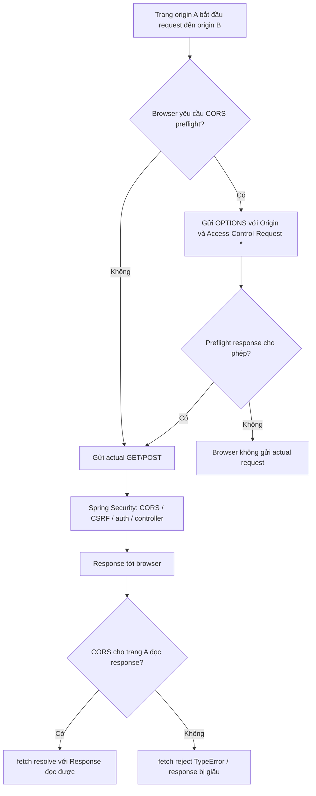
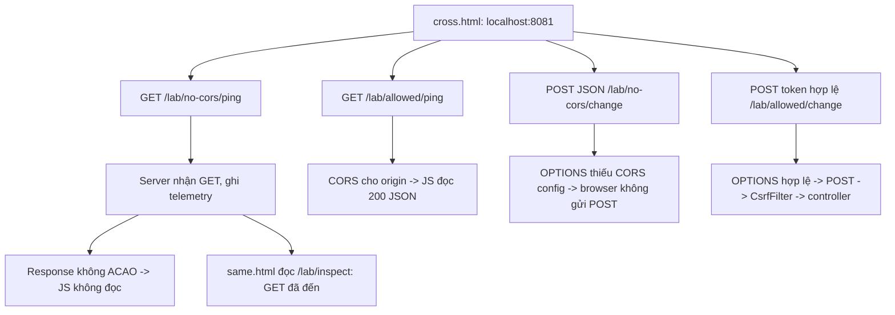

# Kiểm tra CORS chặn đọc phản hồi cùng hành vi gửi yêu cầu

Khi một trang gọi API ở **origin khác**, hai câu hỏi tưởng giống nhau thực ra hoàn toàn khác: **“Browser có gửi request tới server không?”** và **“JavaScript của trang có được đọc response không?”**. Một request cross-origin đơn giản có thể đã đi tới Spring Boot, controller đã chạy và server trả `200`, nhưng `fetch()` vẫn thất bại với `TypeError` do response không có header CORS phù hợp. Ngược lại, một request dùng header tùy chỉnh có thể thất bại ngay ở **CORS preflight**, khiến browser **không gửi actual POST**. Đây là khác biệt phải kiểm chứng bằng DevTools, dấu vết server và trạng thái dữ liệu, thay vì đoán từ thông báo Console.

Bài nằm trong chương **Kiểm thử trình duyệt** của module **SPRING_SECURITY_HTTP_PROTECTION**. Module hướng tới việc áp dụng phòng vệ HTTP/trình duyệt trong Spring Security — CSRF, CORS, security headers, CSP, HSTS, HTTP firewall và bảo vệ session — cho cả Servlet lẫn Reactive, đồng thời kiểm thử tình huống tấn công web và chẩn đoán xung đột triển khai. Phần thực hành dùng **Spring Security Servlet 6.x** với trang thử ở hai origin; tư duy và tiêu chí browser-level cũng áp dụng cho WebFlux.

**Sau bài học bạn có thể:** phân biệt việc browser gửi request với việc script đọc response; giải thích CORS simple request, preflight và response filtering; tạo lab mà GET thực sự tới controller dù script bị chặn đọc; chứng minh JSON POST có preflight thất bại thì actual POST không đi; so sánh route được cấp CORS với route không được cấp; kiểm tra CSRF/cookie/session độc lập với CORS; và viết kiểm thử DevTools, MockMvc, Playwright có đối chứng dương/âm.

## 1. Một response bị browser giấu không có nghĩa request chưa xảy ra

Giả sử một trang chạy tại:

```text
http://localhost:8081/cross.html
```

và gọi:

```javascript
const response = await fetch("http://localhost:8080/lab/no-cors/ping");
```

Hai URL khác **port** nên là **cross-origin**. Nếu backend xử lý GET và trả `200` nhưng **không có `Access-Control-Allow-Origin`**, JavaScript thông thường **không nhận được `Response` object để đọc**; Promise của `fetch()` có thể bị reject với `TypeError`. Tuy nhiên backend **có thể đã nhận GET và trả response**.

Ba quan sát dễ bị nhầm:

| Nơi quan sát | Có thể thấy | Không được suy ra |
| --- | --- | --- |
| Server log/diagnostics | Controller đã xử lý GET | JavaScript chắc chắn đọc được response |
| DevTools → Network | Actual GET, có thể thấy status HTTP và headers | Trang nguồn có quyền đọc body/status bằng `fetch()` |
| JavaScript `catch` | `TypeError` hoặc “Failed to fetch” | Request chắc chắn chưa tới server |

Nếu request thay đổi trạng thái — chẳng hạn một POST gửi form từ site khác — việc script **không đọc được kết quả** không tự khiến side effect biến mất. **CORS không phải CSRF protection**. Ứng dụng dùng browser cookie để xác thực vẫn phải bảo vệ unsafe methods bằng CSRF token, authorization và các cơ chế thích hợp.

### Hai câu hỏi độc lập

1. **Send decision:** Browser có phát **actual request** hay không? Có bước `OPTIONS` preflight thất bại ngăn nó không? CSP, mixed content, DNS, TLS hoặc cookie policy có can thiệp không?
2. **Read decision:** Nếu actual request đã được gửi và response quay về, browser có cho **JavaScript của origin nguồn** đọc status/headers/body không? CORS response headers có hợp lệ không?

Ngoài ra cần câu hỏi thứ ba: **Server có cho phép thao tác nghiệp vụ không?** `CsrfFilter` hoặc authorization có thể từ chối actual POST dù CORS cho browser đọc response. Ba quyết định này không được gộp thành một.

## 2. Same-origin, cross-origin và same-site không giống nhau

**Origin** được xác định bởi **scheme + hostname + port**; chỉ cần khác một thành phần là cross-origin.

| Trang nguồn | API đích | Quan hệ origin | Quan hệ site thường gặp |
| --- | --- | --- | --- |
| `http://localhost:8080` | `http://localhost:8080` | Same-origin | Same-site |
| `http://localhost:8081` | `http://localhost:8080` | **Cross-origin** vì khác port | **Same-site** vì cùng scheme và hostname |
| `http://127.0.0.1:8081` | `http://localhost:8080` | Cross-origin vì khác hostname/port | Thường được xét **cross-site** |
| `https://app.example.test` | `https://api.example.test` | Cross-origin vì khác hostname | Thường same-site |
| `https://app.example.test` | `http://api.example.test` | Cross-origin vì khác scheme/hostname | Schemeful site khác |

Site thường được tính theo scheme và registrable domain; với host đặc biệt như `localhost`/IP, browser áp dụng quy tắc riêng. **CORS dùng origin**, trong khi cookie `SameSite` chủ yếu dùng **site**. Vì vậy hai port `localhost` có thể cần CORS để JavaScript đọc response nhưng vẫn có thể gửi cookie `SameSite=Lax`, nếu `fetch` chọn chế độ credentials phù hợp.

Cookie cũng **không được phân vùng theo port**. Một dịch vụ không tin cậy cùng hostname nhưng khác port không phải một ranh giới cô lập cookie đáng tin cậy. Lab chỉ dùng dữ liệu giả và cả hai server đều do người học kiểm soát.

## 3. CORS là chính sách browser kiểm soát quyền đọc, không phải authentication

**Cross-Origin Resource Sharing (CORS)** là cơ chế HTTP headers cho phép server công bố origin, method, headers và credential mode mà browser có thể dùng khi truy cập từ mã của một origin khác.

Ví dụ response cho origin được phép:

```http
HTTP/1.1 200 OK
Access-Control-Allow-Origin: http://localhost:8081
Access-Control-Allow-Credentials: true
Content-Type: application/json

{"message":"allowed"}
```

Nếu frontend dùng `credentials: "include"`, browser cần một `Access-Control-Allow-Origin` **cụ thể, phù hợp** và `Access-Control-Allow-Credentials: true` để cho script đọc response. `Access-Control-Allow-Origin: *` **không hợp lệ với credentialed CORS response**.

Cần phân biệt:

- **CORS không xác thực người dùng.** Một origin được cho phép đọc response không tự có quyền cập nhật dữ liệu.
- **CORS không thay CSRF token.** Một HTML form hoặc một số simple requests vẫn có thể được gửi cross-origin mà không cần preflight.
- **CORS không phải firewall dành cho mọi client.** `curl`, server-to-server client hoặc script ngoài browser không thực thi SOP/CORS như trình duyệt.
- **CORS response không tự mở quyền đọc mọi header.** Cross-origin JavaScript chỉ thấy các safelisted response headers và header được expose; `Set-Cookie` bị cấm lộ qua Fetch API.
- **Server-side CORS filter có thể từ chối request sớm.** Một CORS policy không cho origin nào có thể trả `403` trước controller; khi đó request đã tới server nhưng **chưa chạy nghiệp vụ**.

Trong lab, ta sẽ cố ý tạo **hai vùng route** để thấy cả trường hợp backend xử lý xong nhưng response bị browser giấu, và trường hợp một filter CORS từ chối request.

## 4. Simple request và preflight: khi nào actual request đi tới server?

Theo mô hình Fetch/CORS, một số request có method/header safelisted có thể gửi **trực tiếp**, không cần CORS preflight. Ví dụ `GET` thông thường hoặc `POST` với body `URLSearchParams` và content type phù hợp. “Simple request” là tên gọi dễ nhớ; tiêu chí thực tế phụ thuộc **CORS-safelisted method, request headers và content type**.

Một số ví dụ:

| JavaScript/browser thao tác | Thường có preflight? | Kết quả cần theo dõi |
| --- | --- | --- |
| `fetch(url)` GET không có custom header | **Không** | GET có thể chạy, script có thể bị chặn đọc response |
| `fetch(url,{method:"POST",body:new URLSearchParams(...)})` | Thường **không** | Actual POST có thể chạy dù response không đọc được |
| `fetch(url,{method:"POST",headers:{"Content-Type":"application/json"},body:"{}"})` | Thường **có** | Nếu OPTIONS không được CORS cho phép, **POST không được gửi** |
| `fetch(url,{method:"POST",headers:{"X-CSRF-TOKEN":"..."}})` | Thường **có** | Preflight hỏi tên header, không gửi giá trị token |
| HTML `<form method="post" action="...">` navigation | **Không cần CORS preflight** cho form chuẩn | Browser có thể gửi POST; SOP giới hạn trang nguồn đọc response |
| `fetch(url,{mode:"no-cors"})` | Cơ chế riêng, giới hạn request | Response opaque, không đọc được status/body thực |



**Một cảnh báo về sơ đồ:** ngay ở bước `S`, server có thể từ chối request vì CORS policy, CSRF, authorization hoặc firewall; status HTTP có thể là `403`. Đây là **server response**. Ngược lại, bước `V` là browser không cho JavaScript truy cập response; nó không tạo một HTTP status mới như `0` hay `403`. Nếu `fetch()` reject, JavaScript **không thể đọc `response.status`** của request đó.

### Preflight thông thường không mang cookie

Browser gửi CORS preflight mà không mang credentials của request actual. `Access-Control-Request-Method` và `Access-Control-Request-Headers` cho biết browser định gửi method và **tên header** nào; chúng không mang CSRF token thật. Vì thế không nên yêu cầu phiên đăng nhập hoặc CSRF token trên `OPTIONS` preflight. Trong Spring Security, tích hợp CORS trước các filter đòi cookie/authentication là quan trọng.

## 5. Mục tiêu lab: ba kết luận riêng biệt

Ta triển khai hai server cục bộ:

| Thành phần | URL | Mục đích |
| --- | --- | --- |
| Spring Boot Servlet | `http://localhost:8080` | API và trang kiểm tra cùng origin |
| Trang cùng origin | `http://localhost:8080/same.html` | Đọc thống kê backend không bị CORS chặn |
| Static server ngoài origin | `http://localhost:8081/cross.html` | Tạo các request cross-origin được phép/bị chặn |
| Static server dưới tên khác | `http://127.0.0.1:8081/cross.html` | Thử origin **không có trong allow-list** |

Backend có hai nhóm route:

| Route | CORS policy | Chủ đích kiểm thử |
| --- | --- | --- |
| `/lab/no-cors/ping` | **Không có CORS config** cho path này | Cross-origin GET **tới controller** nhưng JS không đọc được |
| `/lab/no-cors/change` | **Không có CORS config** cho path này | Simple POST có thể tới security chain rồi bị CSRF từ chối; preflight JSON bị từ chối |
| `/lab/allowed/ping` | Chỉ cho `http://localhost:8081` | Script từ origin hợp lệ **đọc được** response |
| `/lab/allowed/csrf` | Chỉ cho origin hợp lệ | Bootstrap CSRF token theo session, kiểm tra cookies |
| `/lab/allowed/change` | Chỉ cho origin hợp lệ | CORS qua preflight **chưa đủ**, token CSRF vẫn phải đúng |
| `/lab/inspect` | Không cấp CORS cho trang 8081 | Trang **cùng origin** xem counters để chứng minh request đã tới controller |



**Cam kết an toàn:** toàn bộ ví dụ chỉ dùng loopback và counters giả, không lấy cookie của hệ thống khác, không dùng credentials thật, không vô hiệu hóa CSRF để tạo kết quả và không công khai cổng server lên mạng. Bộ đếm quan sát request GET trong lab là **telemetry**, không phải một nghiệp vụ ghi dữ liệu qua GET.

## 6. Chuẩn bị công cụ và tiêu chí quan sát

Các ví dụ dùng Java 17+, Spring Boot 3.x / Spring Security Servlet 6.x với dependency `spring-boot-starter-web`, `spring-boot-starter-security`. Kiểm thử Java cần `spring-boot-starter-test` và `spring-security-test`; kiểm thử browser dùng Node.js/Playwright trong **dự án lab riêng**. Không cần tài khoản, database hay dịch vụ cloud.

Trong DevTools của browser:

1. Mở **Network**, bật **Preserve log** và khi cần bật **Disable cache**.
2. Chọn **All** để thấy `OPTIONS`, `GET`, `POST`, redirect và navigation; không chỉ xem filter Fetch/XHR.
3. Ghi **URL, method, Origin, status, Access-Control-Allow-Origin, Access-Control-Allow-Credentials**.
4. Phân biệt rõ **OPTIONS preflight** và **actual request**.
5. Xem **Console** và kết quả `fetch()` trong UI: Promise resolve hay reject; nếu reject thì script **không đọc được status/body**.
6. Xem `Cookie` trên **actual POST**, không dùng cookie của OPTIONS làm bằng chứng; xem `Set-Cookie` trong response/Storage chứ không qua JS.
7. Mở trang cùng origin và đọc `/lab/inspect` để xác minh counters trước/sau.

Một phép thử PASS cần trả lời đủ: **Có OPTIONS không? Có actual request không? Controller có chạy không? JavaScript có đọc response không? Dữ liệu/counter có đổi không?**

## 7. Cấu hình Spring Security Servlet: route có và không có CORS config

Tạo `LabSecurityConfiguration.java` trong ứng dụng Spring Boot 3.x:

```java
import java.util.List;
import org.springframework.context.annotation.Bean;
import org.springframework.context.annotation.Configuration;
import org.springframework.security.config.annotation.web.builders.HttpSecurity;
import org.springframework.security.web.SecurityFilterChain;
import org.springframework.security.web.csrf.HttpSessionCsrfTokenRepository;
import org.springframework.security.web.csrf.XorCsrfTokenRequestAttributeHandler;
import org.springframework.web.cors.CorsConfiguration;
import org.springframework.web.cors.CorsConfigurationSource;
import org.springframework.web.cors.UrlBasedCorsConfigurationSource;

@Configuration
public class LabSecurityConfiguration {

    @Bean
    SecurityFilterChain labSecurity(
            HttpSecurity http,
            CorsConfigurationSource labCorsConfigurationSource)
            throws Exception {

        http
            .cors(cors -> cors.configurationSource(
                labCorsConfigurationSource))
            .authorizeHttpRequests(auth -> auth
                .requestMatchers("/same.html", "/lab/**").permitAll()
                .anyRequest().denyAll())
            .csrf(csrf -> csrf
                .csrfTokenRepository(
                    new HttpSessionCsrfTokenRepository())
                .csrfTokenRequestHandler(
                    new XorCsrfTokenRequestAttributeHandler()));

        return http.build();
    }

    @Bean
    CorsConfigurationSource labCorsConfigurationSource() {
        CorsConfiguration allowed = new CorsConfiguration();
        allowed.setAllowedOrigins(
            List.of("http://localhost:8081"));
        allowed.setAllowedMethods(
            List.of("GET", "POST", "OPTIONS"));
        allowed.setAllowedHeaders(
            List.of("Content-Type", "X-CSRF-TOKEN"));
        allowed.setExposedHeaders(
            List.of("X-Lab-Visible"));
        allowed.setAllowCredentials(true);
        allowed.setMaxAge(300L);

        UrlBasedCorsConfigurationSource source =
            new UrlBasedCorsConfigurationSource();

        // CORS policy chỉ áp dụng cho vùng này.
        source.registerCorsConfiguration(
            "/lab/allowed/**", allowed);

        // KHÔNG đăng ký CORS config cho /lab/no-cors/**.
        return source;
    }
}
```

`application.properties` cho lab:

```properties
server.port=8080
server.servlet.session.cookie.http-only=true
server.servlet.session.cookie.same-site=lax
```

**Phân tích cấu hình:**

1. `permitAll()` loại yếu tố authentication/authorization khỏi lab, nhưng **không vô hiệu hóa CSRF**. `POST /lab/allowed/change` và `/lab/no-cors/change` vẫn cần CSRF token.
2. `.cors(...)` tích hợp CORS với Spring Security **trước các bước cần authentication/CSRF**, để preflight được xử lý đúng.
3. Với `/lab/allowed/**`, chỉ `Origin: http://localhost:8081` được phép; header `X-CSRF-TOKEN` và content type JSON cũng được cho phép ở preflight.
4. Với `/lab/no-cors/**`, `CorsConfigurationSource` trả **`null`**. Trong `DefaultCorsProcessor` thông dụng, **actual simple CORS request** không có policy sẽ được cho qua ở tầng xử lý CORS nhưng response **không có ACAO**; **preflight** không có policy bị từ chối.
5. Với `/lab/allowed/**` và `Origin: http://127.0.0.1:8081`, CORS config **có tồn tại** nhưng origin **không được phép**, nên server có thể từ chối request ngay tại CORS filter. Đừng mặc định controller đã chạy.
6. `HttpSessionCsrfTokenRepository` giữ expected raw token trong session; `XorCsrfTokenRequestAttributeHandler` công bố masked token để client gửi qua header hoặc form.

Mục 4 là **lựa chọn cố ý cho lab** để tách trường hợp *backend xử lý GET xong nhưng browser không cho đọc* khỏi trường hợp *preflight không cho gửi*. Không khuyến nghị triển khai các route không cấu hình CORS để xử lý dữ liệu nhạy cảm của production. Trong ứng dụng thật, cần chính sách CORS rõ ràng cho từng API, CSRF/authorization nghiêm ngặt và các lớp phòng vệ tương ứng.

### Không để `@CrossOrigin` vô tình đổi kết quả lab

Các controller mẫu bên dưới **không** gắn `@CrossOrigin`. Nếu có CORS mapping bổ sung trong MVC, proxy hoặc filter tự viết, `/lab/no-cors/**` có thể phát ACAO hoặc bị từ chối theo cơ chế khác, làm sai mục tiêu kiểm thử. Giữ môi trường lab tối giản, chỉ dùng `CorsConfigurationSource` ở ví dụ này.

### Một số khác biệt cần lưu ý giữa các bản thư viện

Ví dụ dành cho Spring Security Servlet 6.x với Spring Framework CORS integration phổ biến. Nếu đổi phiên bản hoặc thêm gateway, **hãy kiểm tra thực tế**: request no-policy có được chuyển tiếp hay không, preflight trả status gì, và browser thấy header gì. Không dựa vào một status duy nhất như `403` để kết luận CORS đã ngăn controller.

## 8. Controller: tách telemetry “GET đã đến” khỏi nghiệp vụ POST

Tạo `BrowserCorsLabController.java`:

```java
import java.util.Map;
import java.util.concurrent.atomic.AtomicInteger;
import org.springframework.http.CacheControl;
import org.springframework.http.ResponseEntity;
import org.springframework.security.web.csrf.CsrfToken;
import org.springframework.web.bind.annotation.GetMapping;
import org.springframework.web.bind.annotation.PostMapping;
import org.springframework.web.bind.annotation.RequestAttribute;
import org.springframework.web.bind.annotation.RequestMapping;
import org.springframework.web.bind.annotation.RestController;

@RestController
@RequestMapping("/lab")
public class BrowserCorsLabController {

    // Đây là COUNTER QUAN SÁT request tới controller, không phải nghiệp vụ.
    private final AtomicInteger noCorsGetSeen = new AtomicInteger();

    private final RequestArrivalProbeFilter arrivalProbe;

    public BrowserCorsLabController(RequestArrivalProbeFilter arrivalProbe) {
        this.arrivalProbe = arrivalProbe;
    }

    // Hai counter nghiệp vụ giả, chỉ cập nhật bởi POST.
    private final AtomicInteger allowedChanges = new AtomicInteger();
    private final AtomicInteger noCorsChanges = new AtomicInteger();

    @GetMapping("/no-cors/ping")
    ResponseEntity<Map<String, Object>> noCorsPing() {
        int seen = noCorsGetSeen.incrementAndGet();
        return ResponseEntity.ok()
            .cacheControl(CacheControl.noStore())
            .body(Map.of(
                "message", "server-handled-get",
                "observedRequests", seen));
    }

    @GetMapping("/allowed/ping")
    ResponseEntity<Map<String, String>> allowedPing() {
        return ResponseEntity.ok()
            .header("X-Lab-Visible", "exposed")
            .header("X-Lab-Hidden", "not-exposed")
            .cacheControl(CacheControl.noStore())
            .body(Map.of("message", "cors-readable"));
    }

    @GetMapping("/allowed/csrf")
    ResponseEntity<CsrfPayload> csrf(
            @RequestAttribute("_csrf") CsrfToken csrfToken) {
        // getToken() materialize deferred token và có thể tạo session.
        CsrfPayload payload = new CsrfPayload(
            csrfToken.getHeaderName(),
            csrfToken.getParameterName(),
            csrfToken.getToken());
        return ResponseEntity.ok()
            .cacheControl(CacheControl.noStore())
            .body(payload);
    }

    @PostMapping("/allowed/change")
    Map<String, Integer> allowedChange() {
        return Map.of(
            "allowedChanges", allowedChanges.incrementAndGet());
    }

    @PostMapping("/no-cors/change")
    Map<String, Integer> noCorsChange() {
        return Map.of(
            "noCorsChanges", noCorsChanges.incrementAndGet());
    }

    @GetMapping("/inspect")
    ResponseEntity<Map<String, Integer>> inspect() {
        return ResponseEntity.ok()
            .cacheControl(CacheControl.noStore())
            .body(Map.of(
                "noCorsGetSeen", noCorsGetSeen.get(),
                "noCorsPostArrivals", arrivalProbe.noCorsPostArrivals(),
                "noCorsPreflightArrivals", arrivalProbe.noCorsPreflightArrivals(),
                "allowedChanges", allowedChanges.get(),
                "noCorsChanges", noCorsChanges.get()));
    }

    record CsrfPayload(
        String headerName,
        String parameterName,
        String token) {}
}
```

**Một chi tiết có chủ ý:** `GET /lab/no-cors/ping` tăng `noCorsGetSeen` — **chỉ là telemetry thử nghiệm**, tương tự đếm số lượt truy cập trong server log. Nó không thay đổi email, số dư hay dữ liệu người dùng và không phải khuyến nghị thiết kế GET thực hiện thay đổi nghiệp vụ. Bằng cách đọc `/lab/inspect` từ trang **cùng origin**, ta chứng minh GET **đã tới controller** dù browser ở origin khác không cho JavaScript đọc JSON của GET đó.

`POST /lab/no-cors/change` giữ CSRF bật. Simple cross-origin POST **không có token** có thể được gửi đến filter nhưng `CsrfFilter` chặn trước khi controller chạy, nên `noCorsChanges` không tăng. Nếu preflight bị chặn, actual POST **không hề được gửi**. Phân biệt hai đường đi này là mục tiêu chính của bài.

### Vì sao dùng một `HttpSessionCsrfTokenRepository` trong chain?

Khi browser GET `/lab/allowed/csrf`, repository sinh/lưu expected raw token theo session nếu chưa có; request handler XOR công bố masked token. Frontend gửi **masked token đúng như nhận được** qua header trong request POST và dùng cùng cookie session. `HttpOnly` của `JSESSIONID` không ngăn browser gửi cookie, chỉ ngăn JavaScript đọc giá trị qua `document.cookie`.

### Tại sao không gửi lại token trong response lỗi?

Một response `403` có thể đến từ CSRF, authorization hoặc CORS filter. Không nên tiết lộ raw token kỳ vọng qua response lỗi. Luồng cấp token hợp lệ được tách vào `GET /lab/allowed/csrf`, có `Cache-Control: no-store`, giúp người học thấy rõ thời điểm bootstrap và thời điểm thực hiện unsafe request.

## 9. Trang same-origin: quan sát counters server bằng Fetch bình thường

Tạo file `src/main/resources/static/same.html`:

```html
<!doctype html>
<html lang="vi">
<head>
  <meta charset="utf-8">
  <title>Lab — Same-origin inspector</title>
</head>
<body>
  <h1>Same-origin inspector: localhost:8080</h1>
  <p>Đây là trang giám sát lab, chỉ chạy trong môi trường local.</p>
  <button id="inspect">Đọc thống kê server</button>
  <button id="same-get">GET no-CORS endpoint cùng origin</button>
  <pre id="result" aria-live="polite">Chưa thử.</pre>

  <script>
    const output = document.querySelector("#result");

    async function getJson(path) {
      const response = await fetch(path, {
        credentials: "same-origin",
        cache: "no-store"
      });
      if (!response.ok) throw new Error(`HTTP ${response.status}`);
      return response.json();
    }

    async function display(path) {
      try {
        const data = await getJson(path);
        output.textContent = JSON.stringify(data, null, 2);
      } catch (error) {
        output.textContent = String(error);
      }
    }

    document.querySelector("#inspect").addEventListener(
      "click", () => display("/lab/inspect"));
    document.querySelector("#same-get").addEventListener(
      "click", () => display("/lab/no-cors/ping"));
  </script>
</body>
</html>
```

Mở `http://localhost:8080/same.html` ở tab thứ nhất. Bấm “Đọc thống kê server” trước thử nghiệm để ghi `noCorsGetSeen`, `allowedChanges`, `noCorsChanges` hiện tại. Sau khi thử từ trang khác origin, quay lại tab này và bấm lại để kiểm tra request nào thực sự vào controller.

**Vì sao trang này đọc được `/lab/no-cors/ping`?** Vì URL của trang và URL API cùng origin. CORS không phải cơ chế cần thiết để JavaScript cùng origin đọc response của server đó. Tên route `no-cors` ở đây nghĩa là **không công bố quyền đọc cho origin khác**, không phải chặn mọi request từ mọi nơi.

## 10. Trang cross-origin: phát từng loại request

Tạo `cross.html` cho static server ở `http://localhost:8081`. Tất cả call đích dùng **URL tuyệt đối** tới `http://localhost:8080`; nếu script dùng `/lab/...` tương đối, request sẽ đi nhầm vào Node static server thay vì API Spring Boot.

```html
<!doctype html>
<html lang="vi">
<head>
  <meta charset="utf-8">
  <title>Lab — CORS send versus read</title>
</head>
<body>
  <h1>CORS: request đã gửi hay response được đọc?</h1>
  <p>Trang nguồn: <output id="origin"></output></p>
  <p>API: <code>http://localhost:8080</code></p>

  <button id="blocked-get">GET no-CORS (server có nhận?)</button>
  <button id="opaque-get">GET mode=no-cors (opaque)</button>
  <button id="allowed-get">GET allowed-CORS</button>
  <button id="get-token">GET cấp token qua CORS</button>
  <button id="simple-post">POST form-encoded tới no-CORS</button>
  <button id="preflight-post">POST JSON tới no-CORS</button>
  <button id="invalid-post">POST JSON allowed, không CSRF</button>
  <button id="valid-post">POST JSON allowed, có CSRF</button>

  <pre id="result" aria-live="polite">Chưa thử.</pre>

  <script>
    const API = "http://localhost:8080";
    const output = document.querySelector("#result");
    let csrf = null;

    document.querySelector("#origin").textContent = location.origin;
    const show = value => { output.textContent = value; };

    function bind(id, task) {
      document.querySelector(id).addEventListener("click", async () => {
        try {
          await task();
        } catch (error) {
          // Không có Response.status trong nhánh fetch bị CORS chặn.
          show(`Fetch rejected: ${String(error)}`);
        }
      });
    }

    async function showResponse(response) {
      const content = (await response.text()).slice(0, 300);
      show(`Response JS đọc được: HTTP ${response.status}\n`
        + `X-Lab-Visible: ${response.headers.get("X-Lab-Visible")}\n`
        + `X-Lab-Hidden: ${response.headers.get("X-Lab-Hidden")}\n`
        + content);
    }

    async function bootstrapCsrf() {
      const response = await fetch(`${API}/lab/allowed/csrf`, {
        method: "GET",
        mode: "cors",
        credentials: "include",
        cache: "no-store"
      });
      if (!response.ok) {
        throw new Error(`CSRF bootstrap: HTTP ${response.status}`);
      }
      csrf = await response.json();
      show(`Token đã cấp; header=${csrf.headerName}; `
        + `độ dài biểu diễn=${csrf.token.length}`);
      // Không hiển thị raw/masked token hoặc session ID.
    }

    bind("#blocked-get", async () => {
      const response = await fetch(`${API}/lab/no-cors/ping`, {
        mode: "cors",
        credentials: "include",
        cache: "no-store"
      });
      await showResponse(response); // Thường không tới đây.
    });

    bind("#opaque-get", async () => {
      const response = await fetch(`${API}/lab/no-cors/ping`, {
        mode: "no-cors",
        credentials: "include",
        cache: "no-store"
      });
      show(`type=${response.type}; status=${response.status}`);
      // Opaque thường có status=0, không phải HTTP status thật.
    });

    bind("#allowed-get", async () => {
      const response = await fetch(`${API}/lab/allowed/ping`, {
        mode: "cors", credentials: "include"
      });
      await showResponse(response);
    });

    bind("#get-token", bootstrapCsrf);

    bind("#simple-post", async () => {
      const response = await fetch(`${API}/lab/no-cors/change`, {
        method: "POST",
        mode: "cors",
        credentials: "include",
        // URLSearchParams có safelisted Content-Type cho CORS.
        body: new URLSearchParams({ operation: "lab-only" })
      });
      await showResponse(response); // Thường bị CORS giấu.
    });

    bind("#preflight-post", async () => {
      const response = await fetch(`${API}/lab/no-cors/change`, {
        method: "POST",
        mode: "cors",
        credentials: "include",
        headers: { "Content-Type": "application/json" },
        body: '{"operation":"lab-only"}'
      });
      await showResponse(response); // Preflight thường chặn trước.
    });

    bind("#invalid-post", async () => {
      await bootstrapCsrf();
      const response = await fetch(`${API}/lab/allowed/change`, {
        method: "POST",
        mode: "cors",
        credentials: "include",
        headers: { "Content-Type": "application/json" },
        body: "{}"
      });
      await showResponse(response); // HTTP 403 nhìn thấy qua CORS.
    });

    bind("#valid-post", async () => {
      await bootstrapCsrf();
      const response = await fetch(`${API}/lab/allowed/change`, {
        method: "POST",
        mode: "cors",
        credentials: "include",
        headers: {
          "Content-Type": "application/json",
          [csrf.headerName]: csrf.token
        },
        body: "{}"
      });
      await showResponse(response); // HTTP 200, allowedChanges tăng.
    });
  </script>
</body>
</html>
```

Trang này cố ý **không in CSRF token, cookie hoặc Authorization header**. Nó chỉ hiển thị tình trạng `fetch` resolve/reject và các header không nhạy cảm. Sử dụng `textContent` thay vì chèn response vào `innerHTML`.

**Quan trọng:** `#simple-post` và `#preflight-post` **không** có token CSRF. `CsrfFilter` vẫn bật; mục đích là quan sát request có tới filter hay không, không phải tạo một endpoint không bảo vệ. `#valid-post` lấy token từ endpoint CORS được phép và sử dụng lại **đúng cookie session** (`credentials:"include"`).

## 11. Bộ lọc chỉ quan sát: phân biệt OPTIONS tới server và actual POST tới server

Để chứng minh một request **đã tới Servlet container**, không chỉ dựa vào Network panel, ta thêm một filter quan sát rất nhỏ được thực thi **trước Spring Security**. Filter này **không ghi body, không đọc token và không thay đổi response**; nó chỉ đếm actual POST và preflight OPTIONS đến `/lab/no-cors/change`.

Tạo class `RequestArrivalProbeFilter.java`:

```java
import jakarta.servlet.FilterChain;
import jakarta.servlet.ServletException;
import jakarta.servlet.http.HttpServletRequest;
import jakarta.servlet.http.HttpServletResponse;
import java.io.IOException;
import java.util.concurrent.atomic.AtomicInteger;
import org.springframework.core.Ordered;
import org.springframework.core.annotation.Order;
import org.springframework.stereotype.Component;
import org.springframework.web.filter.OncePerRequestFilter;

@Component
@Order(Ordered.HIGHEST_PRECEDENCE)
public class RequestArrivalProbeFilter
        extends OncePerRequestFilter {

    private final AtomicInteger postArrivals = new AtomicInteger();
    private final AtomicInteger preflightArrivals = new AtomicInteger();

    @Override
    protected void doFilterInternal(
            HttpServletRequest request,
            HttpServletResponse response,
            FilterChain chain)
            throws ServletException, IOException {

        if ("/lab/no-cors/change".equals(request.getServletPath())) {
            if ("POST".equals(request.getMethod())) {
                postArrivals.incrementAndGet();
            }
            if ("OPTIONS".equals(request.getMethod())
                    && request.getHeader("Origin") != null
                    && request.getHeader(
                        "Access-Control-Request-Method") != null) {
                preflightArrivals.incrementAndGet();
            }
        }

        // Không chặn, không xác thực, không bỏ qua SecurityFilterChain.
        chain.doFilter(request, response);
    }

    public int noCorsPostArrivals() {
        return postArrivals.get();
    }

    public int noCorsPreflightArrivals() {
        return preflightArrivals.get();
    }
}
```

Controller ở mục 8 **inject `RequestArrivalProbeFilter` qua constructor** và trả thêm `noCorsPostArrivals`, `noCorsPreflightArrivals` trong `/lab/inspect`. Do đó:

```json
{
  "noCorsGetSeen": 0,
  "noCorsPostArrivals": 0,
  "noCorsPreflightArrivals": 0,
  "allowedChanges": 0,
  "noCorsChanges": 0
}
```

Đây chỉ là ví dụ counters ngay sau khi khởi động; các giá trị thực phụ thuộc request đã chạy. Với môi trường có context path, custom servlet mapping hoặc proxy rewrite, cần chỉnh điều kiện `getServletPath()` phù hợp. Filter `@Order(HIGHEST_PRECEDENCE)` được đặt trước security filters cho lab để nhận biết **request vào server** kể cả khi CORS/CSRF xử lý và trả lỗi sớm.

**Khác biệt ba con số:**

- `noCorsPreflightArrivals` tăng nghĩa là **OPTIONS preflight đã tới Servlet filter**.
- `noCorsPostArrivals` tăng nghĩa là **actual POST đã tới Servlet filter**, không có nghĩa nó được chấp thuận.
- `noCorsChanges` tăng nghĩa là **controller unsafe endpoint đã chạy**, tức POST vượt qua CSRF và các filter cần thiết.

Một POST không token có thể làm `noCorsPostArrivals` tăng nhưng **không** làm `noCorsChanges` tăng. Một JSON POST bị CORS preflight chặn có thể làm `noCorsPreflightArrivals` tăng trong khi **`noCorsPostArrivals` không tăng**. Đây là bằng chứng rõ ràng hơn chỉ nhìn một `TypeError` trong JavaScript.

### Vì sao không dùng filter đếm request làm cơ chế chống CSRF?

Filter chỉ ghi telemetry: **nó không phải hàng rào bảo mật**, không cho phép thay thế `CsrfFilter`, authorization hoặc HTTP firewall. Không log hoặc lưu `Cookie`, `Authorization`, CSRF token, URL query string và request body. Khi triển khai production, nên dùng telemetry đã có và kiểm soát cardinality thay vì thêm bộ lọc lab để ghi counters mọi request.

## 12. Static server thứ hai ở port 8081

Không mở `cross.html` qua `file://` vì file local có thể có origin đặc biệt như `null`; điều đó làm kết quả CORS không phản ánh website HTTP bình thường. Dùng HTTP server Node.js trên loopback, **không cần cài thêm package**.

Trong một thư mục thực hành riêng:

```text
cors-send-read-lab/
  cross.html
  static-server.mjs
```

`static-server.mjs`:

```javascript
import http from "node:http";
import { readFile } from "node:fs/promises";

const html = await readFile(
  new URL("./cross.html", import.meta.url)
);

http.createServer((request, response) => {
  if (request.method !== "GET" ||
      request.url !== "/cross.html") {
    response.writeHead(404, {
      "Content-Type": "text/plain; charset=utf-8"
    });
    response.end("Not found");
    return;
  }
  response.writeHead(200, {
    "Content-Type": "text/html; charset=utf-8",
    "Cache-Control": "no-store",
    "X-Content-Type-Options": "nosniff"
  });
  response.end(html);
}).listen(8081, "127.0.0.1", () => {
  process.stdout.write("Cross-origin lab on port 8081\n");
});
```

Chạy trong thư mục chứa hai file:

```bash
node static-server.mjs
```

Mở:

```text
http://localhost:8081/cross.html
http://127.0.0.1:8081/cross.html
```

Node server ở đây chỉ bind IPv4 `127.0.0.1`, còn một số máy ưu tiên IPv6 `::1` cho `localhost`. Nếu `localhost:8081` không kết nối được, hãy cấu hình loopback listener/DNS phù hợp; **không** bind công khai `0.0.0.0` để lab “dễ truy cập”.

**Lưu ý cô lập cookie:** cookie host-only cho `localhost` có thể được gửi tới cả port 8080 và port 8081 nếu `Path`/policy phù hợp, vì cookie không phân biệt port. Node server là server **của chính bạn**; không log request cookies. Không đặt một trang “attacker” thực sự không đáng tin trên cùng hostname khác port với ứng dụng production.

## 13. Thử nghiệm A: simple GET đã tới backend nhưng `fetch` không đọc được

Trước khi thử, mở trang inspector:

```text
http://localhost:8080/same.html
```

Bấm **Đọc thống kê server**, ghi `noCorsGetSeen = N` tại thời điểm bắt đầu. Sau đó mở:

```text
http://localhost:8081/cross.html
```

Bấm **GET no-CORS (server có nhận?)**.

### Điều cần nhìn trong DevTools

Ở Network thường có **actual GET**:

```http
GET /lab/no-cors/ping HTTP/1.1
Host: localhost:8080
Origin: http://localhost:8081
```

Response backend có thể là:

```http
HTTP/1.1 200 OK
Content-Type: application/json
Cache-Control: no-store

{"message":"server-handled-get","observedRequests":1}
```

Điểm quan trọng: **không có `Access-Control-Allow-Origin` phù hợp**. Trong Console, browser có thể báo “blocked by CORS policy”. JavaScript chạy trong nút thử đi vào `catch` và hiển thị lỗi kiểu `TypeError`; nó không được đọc status `200`/body trên, dù DevTools hoặc server-side instrumentation có thể thấy response đã xảy ra.

Quay lại trang same-origin, bấm **Đọc thống kê server**. Nếu GET đã tới controller, `noCorsGetSeen` sẽ tăng từ `N` lên `N+1` (giả định không có tab/test nào khác gọi endpoint). Đây là phép chứng minh:

```text
Actual GET được gửi:             CÓ
Controller xử lý GET:            CÓ
Backend trả HTTP response:       CÓ
JavaScript ở origin khác đọc:    KHÔNG
```

**Kết luận:** CORS đã ngăn **quyền đọc response của JavaScript**, **không ngăn actual GET được gửi và xử lý** trong case này. Không được biến kết luận ấy thành quy tắc mọi CORS failure đều cho request đi qua: preflight và CORS filter có thể chặn sớm ở những trường hợp khác.

## 14. Thử nghiệm B: `mode: "no-cors"` không cấp quyền đọc response

Ở `cross.html`, bấm **GET mode=no-cors (opaque)**.

Trong JavaScript, request:

```javascript
const response = await fetch(
  "http://localhost:8080/lab/no-cors/ping",
  { mode: "no-cors", credentials: "include" }
);

console.log(response.type, response.status);
// Thường: "opaque", 0
```

Một **opaque response** không cho JavaScript xem status/body hoặc các headers HTTP thật. Giá trị `status === 0` **không phải** HTTP status mà server trả; server có thể đã trả `200`. Quay lại inspector, `noCorsGetSeen` có thể lại tăng thêm một đơn vị.

`no-cors` còn **giới hạn method/header** mà script có thể gửi, nên không thể dùng như một mẹo vượt CORS để đọc JSON API hoặc tùy ý đính kèm custom CSRF header. Kết quả opaque chỉ chứng minh browser giữ response ngoài tầm script, không chứng minh endpoint an toàn trước request thay đổi trạng thái.

## 15. Thử nghiệm C: origin được CORS cấp phép đọc response

Ở trang `http://localhost:8081/cross.html`, bấm **GET allowed-CORS**.

Request:

```http
GET /lab/allowed/ping HTTP/1.1
Host: localhost:8080
Origin: http://localhost:8081
```

Server có thể trả:

```http
HTTP/1.1 200 OK
Access-Control-Allow-Origin: http://localhost:8081
Access-Control-Allow-Credentials: true
Access-Control-Expose-Headers: X-Lab-Visible
X-Lab-Visible: exposed
X-Lab-Hidden: not-exposed
Content-Type: application/json

{"message":"cors-readable"}
```

JavaScript đọc được:

```text
Response JS đọc được: HTTP 200
X-Lab-Visible: exposed
X-Lab-Hidden: null
{"message":"cors-readable"}
```

Header `X-Lab-Hidden` **có trong response server** nhưng không nằm trong `Access-Control-Expose-Headers`, nên không đọc được qua Fetch ở origin khác. `Access-Control-Expose-Headers` không thể làm cho JavaScript đọc `Set-Cookie` vì đó là **forbidden response-header name**.

Đây là đối chứng dương: cùng browser và API đích, nhưng route **có CORS policy phù hợp** nên JavaScript nhận được `Response` với status/body thật.

### Thử từ origin không có trong allow-list

Mở `http://127.0.0.1:8081/cross.html`, bấm **GET allowed-CORS**. Trong trường hợp này origin nguồn **không trùng** `http://localhost:8081`. Khác với route `/lab/no-cors/ping`, route `/lab/allowed/ping` có policy nhưng **origin không được cho phép**, nên `CorsFilter` có thể trả `403` **trước khi controller chạy**; browser cũng không cho script đọc response.

Không nói “CORS chỉ chặn đọc chứ server vẫn xử lý controller” trong ca này. Cần phân biệt hai triển khai **server bỏ qua actual request thiếu policy** và **server chủ động từ chối request do policy**.

## 16. Thử nghiệm D: simple POST được gửi nhưng không đọc được phản hồi

Ở trang `http://localhost:8081/cross.html`, bấm **POST form-encoded tới no-CORS**.

JavaScript đã gửi một POST kiểu CORS-safelisted:

```javascript
await fetch("http://localhost:8080/lab/no-cors/change", {
  method: "POST",
  mode: "cors",
  credentials: "include",
  body: new URLSearchParams({ operation: "lab-only" })
});
```

Với các điều kiện của lab, `URLSearchParams` làm body có content type `application/x-www-form-urlencoded;charset=UTF-8`, thường **không cần CORS preflight**. Browser có thể gửi actual POST ngay. Request tới Servlet filter quan sát:

```http
POST /lab/no-cors/change HTTP/1.1
Host: localhost:8080
Origin: http://localhost:8081
Content-Type: application/x-www-form-urlencoded;charset=UTF-8
Cookie: JSESSIONID=<neu-browser-cho-phep>

operation=lab-only
```

POST **không có CSRF token hợp lệ**, nên `CsrfFilter` từ chối trước controller. Backend thường trả HTTP `403`, và route không có CORS policy, nên JavaScript origin 8081 có thể chỉ thấy `TypeError` thay vì đọc được `403`. Đó là **hai hiện tượng khác nhau xảy ra trong cùng request**:

1. **Browser đã gửi actual POST.**
2. **Server từ chối POST do CSRF.**
3. **Browser chặn JavaScript đọc response vì thiếu ACAO.**

Sau thao tác, ở inspector same-origin:

```text
noCorsPostArrivals:     tăng 1
noCorsPreflightArrivals: không tăng vì simple POST này
noCorsChanges:          không tăng
```

Sự tăng của `noCorsPostArrivals` chứng minh **actual POST tới server**, trong khi `noCorsChanges` không tăng chứng minh **controller chưa thực hiện thay đổi trạng thái**. Đừng kết luận một request đã thực hiện side effect chỉ vì nó được gửi.

### Nếu đổi sang HTML form thật thì sao?

Một form HTML `method="post"` với `action` là URL cross-origin cũng có thể gửi navigation POST mà không cần CORS preflight thông thường. SOP không cấp cho trang nguồn quyền đọc DOM của trang đích. Nếu cookie xác thực được browser tự gửi, cần CSRF protection tại backend để ngăn thao tác sai ý định của user.

Ví dụ **chỉ cho lab**:

```html
<form action="http://localhost:8080/lab/no-cors/change"
      method="post" target="_blank">
  <input type="hidden" name="operation" value="lab-only">
  <button type="submit">Gửi form POST không CSRF token</button>
</form>
```

Form này vẫn bị `CsrfFilter` chặn. Không dùng form thử nghiệm đối với tài khoản hoặc trang thuộc tổ chức/website không do bạn kiểm soát.

## 17. Thử nghiệm E: preflight thất bại nên actual POST không được gửi

Tiếp theo bấm **POST JSON tới no-CORS**. Mã gửi:

```javascript
await fetch("http://localhost:8080/lab/no-cors/change", {
  method: "POST",
  mode: "cors",
  credentials: "include",
  headers: { "Content-Type": "application/json" },
  body: '{"operation":"lab-only"}'
});
```

Vì `application/json` **không thuộc nhóm CORS-safelisted Content-Type**, browser thường cần preflight:

```http
OPTIONS /lab/no-cors/change HTTP/1.1
Host: localhost:8080
Origin: http://localhost:8081
Access-Control-Request-Method: POST
Access-Control-Request-Headers: content-type
```

Trong cấu hình lab, `/lab/no-cors/**` **không có CORS configuration**, nên `CorsFilter` thường từ chối preflight. Browser không có quyền tiếp tục gửi actual POST.

Kiểm tra `/lab/inspect` từ trang same-origin:

```text
noCorsPreflightArrivals: tăng 1
noCorsPostArrivals:      không tăng bởi thao tác này
noCorsChanges:          không tăng
```

Đây là trường hợp **CORS ảnh hưởng việc gửi actual request**, khác hẳn simple GET/POST ở mục 13 và 16. JavaScript có thể vẫn chỉ báo `TypeError`, nên **chỉ đọc lỗi Console không thể phân biệt hai tình huống**.

### Nếu browser không phát một OPTIONS mới?

Browser có thể lưu **CORS preflight cache** theo origin/URL/method/header và điều kiện bảo mật. Để quan sát rõ, dùng browser context mới và không có kết quả preflight cũ. Lab không cấp CORS cho route này nên preflight thường thất bại; vì thế không tạo quyền gửi actual POST. Tuy vậy khi triển khai thật, proxy, service worker hoặc CORS config khác có thể làm diễn biến thay đổi — ưu tiên chứng cứ actual request/counters thay vì mặc định mỗi lần click phải có một OPTIONS.

### Chỗ dễ nhầm: `OPTIONS 403` không phải `POST 403`

Preflight có thể nhận `403` từ CORS filter trong backend, **nhưng POST chưa từng được gửi**. Đây không phải bằng chứng `CsrfFilter` đã từ chối **actual POST**, càng không phải bằng chứng controller đã chạy. Phải xem **method của request bị từ chối**, không chỉ số status.

## 18. Thử nghiệm F: CORS cho phép POST nhưng CSRF vẫn từ chối

Ở trang `http://localhost:8081/cross.html`, bấm **POST JSON allowed, không CSRF**. Trang trước tiên GET `/lab/allowed/csrf` để browser có token kỳ vọng lưu trong session; sau đó cố ý gửi POST JSON **không gắn header token**.

Preflight thường hỏi:

```http
OPTIONS /lab/allowed/change HTTP/1.1
Origin: http://localhost:8081
Access-Control-Request-Method: POST
Access-Control-Request-Headers: content-type
```

Vì origin, method, header được cho phép, preflight thành công. Actual POST tới `CsrfFilter`:

```http
POST /lab/allowed/change HTTP/1.1
Origin: http://localhost:8081
Cookie: JSESSIONID=<an>
Content-Type: application/json

{}
```

Repository đã có expected token nhưng actual token thiếu. `CsrfFilter` thường trả HTTP `403`; CORS filter đã áp dụng headers phù hợp nên **JavaScript được phép đọc status `403`** và có thể hiển thị response/body lỗi nếu body hợp lệ.

Kết quả điển hình:

```text
CORS preflight:        PASS
Actual POST sent:      YES
JavaScript can read:   YES (status 403)
CSRF validation:       FAIL
allowedChanges:        không tăng
```

**CORS PASS không đồng nghĩa thao tác được cho phép.** Người dùng có thể không được xác thực, thiếu quyền, thiếu CSRF token hoặc vi phạm validation ngay cả khi frontend được CORS cho phép đọc response.

### Vì sao test phải bootstrap expected token trước?

Nếu request POST là lần đầu tiên và repository chưa có expected token, Spring Security có thể vừa sinh token mới khi kiểm tra vừa trả lỗi. Khi GET `/lab/allowed/csrf` trước, ta chứng minh rõ trạng thái **expected token đã tồn tại nhưng client quên gửi actual token**. Đây là một kịch bản `InvalidCsrfTokenException` phổ biến trong Servlet, nhưng không lấy tên exception làm dữ liệu công khai bắt buộc của API.

## 19. Thử nghiệm G: preflight hợp lệ + token CSRF đúng → controller chạy

Bấm **POST JSON allowed, có CSRF**. Trang lấy token mới qua `GET /lab/allowed/csrf`, rồi gửi token masked dưới tên header mà server công bố:

```javascript
const csrfResponse = await fetch(
  "http://localhost:8080/lab/allowed/csrf",
  { credentials: "include", mode: "cors", cache: "no-store" }
);
const csrf = await csrfResponse.json();

const result = await fetch(
  "http://localhost:8080/lab/allowed/change",
  {
    method: "POST",
    credentials: "include",
    mode: "cors",
    headers: {
      "Content-Type": "application/json",
      [csrf.headerName]: csrf.token
    },
    body: "{}"
  }
);
```

Browser hỏi preflight với các header được yêu cầu:

```http
OPTIONS /lab/allowed/change HTTP/1.1
Origin: http://localhost:8081
Access-Control-Request-Method: POST
Access-Control-Request-Headers: content-type,x-csrf-token
```

CORS cho phép, browser gửi POST kèm cookie phiên và masked token. `XorCsrfTokenRequestAttributeHandler` giải quyết token về raw token để `CsrfFilter` so sánh với raw token kỳ vọng trong session. Nếu session/cookie khớp, controller `allowedChange()` chạy:

```json
{"allowedChanges":1}
```

Giá trị `1` chỉ là ví dụ lần đầu sau khởi động; các lần sau có số lớn hơn. JavaScript **đọc được** status `200` và body JSON nhờ CORS.

**Điểm học được:** để một browser request cross-origin có side effect thành công trong lab, phải thỏa **cả hai**: quyền tương tác/trả response theo CORS **và** điều kiện an ninh riêng của server như CSRF, session, authentication/authorization (nếu được bật).

### Lỗi cookie có thể bị nhầm là lỗi token

Nếu client GET CSRF bằng `credentials:"include"` nhưng POST dùng `credentials:"omit"` hoặc `"same-origin"` trong bối cảnh **cross-origin**, browser có thể không gửi `JSESSIONID`. Server không tìm được expected token của session đã cấp và trả `403` dù header vẫn chứa token cũ. Cần kiểm tra request **Cookie** ở actual POST, không suy từ việc client đã có `csrf.token` trong bộ nhớ.

## 20. Ma trận kết quả cần ghi lại

| Nguồn và hành động | Actual request đến server? | JS đọc được response? | Kết quả nghiệp vụ |
| --- | --- | --- | --- |
| `localhost:8080` → GET `/lab/no-cors/ping` | Có | **Có** vì same-origin | Telemetry GET tăng |
| `localhost:8081` → GET `/lab/no-cors/ping` | **Có** | **Không** do thiếu ACAO | Telemetry GET tăng |
| `localhost:8081` → GET `/lab/no-cors/ping`, `mode:no-cors` | **Có** | **Không** (opaque response) | Telemetry GET tăng |
| `localhost:8081` → GET `/lab/allowed/ping` | Có | **Có** | Không đổi nghiệp vụ |
| `127.0.0.1:8081` → GET `/lab/allowed/ping` | Tới CORS filter; controller có thể **không** chạy | **Không** | Không đổi nghiệp vụ |
| `localhost:8081` → simple POST `/lab/no-cors/change` không token | **Có** | **Không** do CORS | CSRF `403`, không tăng `noCorsChanges` |
| `localhost:8081` → POST JSON `/lab/no-cors/change` | **OPTIONS có**, **POST không** nếu preflight bị chặn | **Không** | Không đổi nghiệp vụ |
| `localhost:8081` → POST JSON `/lab/allowed/change` thiếu token | **Có** sau preflight đạt | **Có** (thấy `403`) | Không tăng `allowedChanges` |
| `localhost:8081` → POST JSON `/lab/allowed/change` có token | **Có** sau preflight đạt | **Có** (thấy `200`) | `allowedChanges` tăng |

Kết quả “có” và “không” trong bảng áp dụng **với cấu hình lab này** và điều kiện browser hỗ trợ đúng chính sách. Các proxy, security chains, extensions, service workers, TLS hoặc cookie settings khác có thể thay đổi đường đi. **Không dùng bảng như một cam kết cho mọi ứng dụng Spring Security.**

### Thống kê server phân biệt rõ ba ca POST

Giả sử vừa khởi động lab và không có request khác:

| Ca POST | `noCorsPreflightArrivals` | `noCorsPostArrivals` | `noCorsChanges` |
| --- | ---: | ---: | ---: |
| Trước thử | 0 | 0 | 0 |
| Simple POST không token | 0 | 1 | 0 |
| JSON POST sau preflight bị chặn | 1 | 1 | 0 |

Lần thứ hai, `noCorsPostArrivals` **không tăng thêm** vì actual JSON POST chưa được gửi. Nếu dùng thêm tab hoặc chạy test song song, hãy so sánh **delta trước/sau mỗi thao tác**, không yêu cầu counters luôn bắt đầu từ 0.

## 21. MockMvc: xác minh server tạo response và security filters thực sự hoạt động

`MockMvc` rất hữu ích để kiểm tra **server-side** status, CORS response headers, `CsrfFilter` và controller. Nhưng MockMvc **không thực thi Fetch/SOP của browser**, nên nó **không** chứng minh JavaScript cross-origin đọc được hay bị chặn; phần đó phải dùng browser test.

Với `spring-boot-starter-test` và `spring-security-test`, tạo class `CorsSendReadMvcTest.java`:

```java
import org.junit.jupiter.api.Test;
import org.springframework.beans.factory.annotation.Autowired;
import org.springframework.boot.test.autoconfigure.web.servlet.AutoConfigureMockMvc;
import org.springframework.boot.test.context.SpringBootTest;
import org.springframework.http.MediaType;
import org.springframework.mock.web.MockHttpSession;
import org.springframework.security.web.csrf.CsrfToken;
import org.springframework.test.web.servlet.MockMvc;
import org.springframework.test.web.servlet.MvcResult;

import static org.junit.jupiter.api.Assertions.*;
import static org.springframework.test.web.servlet.request.MockMvcRequestBuilders.*;
import static org.springframework.test.web.servlet.result.MockMvcResultMatchers.*;

@SpringBootTest
@AutoConfigureMockMvc
class CorsSendReadMvcTest {

    private static final String TRUSTED_ORIGIN =
        "http://localhost:8081";

    @Autowired MockMvc mvc;

    @Test
    void simpleGetWithNoCorsPolicyCanStillReachController()
            throws Exception {
        mvc.perform(get("/lab/no-cors/ping")
                .header("Origin", TRUSTED_ORIGIN))
            .andExpect(status().isOk())
            .andExpect(jsonPath("$.message")
                .value("server-handled-get"))
            .andExpect(header().doesNotExist(
                "Access-Control-Allow-Origin"));
    }

    @Test
    void preflightWithoutCorsPolicyIsRejected()
            throws Exception {
        mvc.perform(options("/lab/no-cors/change")
                .header("Origin", TRUSTED_ORIGIN)
                .header("Access-Control-Request-Method", "POST")
                .header("Access-Control-Request-Headers",
                    "content-type"))
            .andExpect(status().isForbidden());
    }

    @Test
    void allowedPreflightAdvertisesOriginAndHeaders()
            throws Exception {
        mvc.perform(options("/lab/allowed/change")
                .header("Origin", TRUSTED_ORIGIN)
                .header("Access-Control-Request-Method", "POST")
                .header("Access-Control-Request-Headers",
                    "content-type,x-csrf-token"))
            .andExpect(status().isOk())
            .andExpect(header().string(
                "Access-Control-Allow-Origin", TRUSTED_ORIGIN))
            .andExpect(header().string(
                "Access-Control-Allow-Credentials", "true"))
            .andExpect(header().exists(
                "Access-Control-Allow-Headers"));
    }

    @Test
    void allowedOriginCanReceiveCorsResponse()
            throws Exception {
        mvc.perform(get("/lab/allowed/ping")
                .header("Origin", TRUSTED_ORIGIN))
            .andExpect(status().isOk())
            .andExpect(header().string(
                "Access-Control-Allow-Origin", TRUSTED_ORIGIN))
            .andExpect(header().string(
                "X-Lab-Visible", "exposed"))
            .andExpect(header().exists(
                "Access-Control-Expose-Headers"));
    }

    @Test
    void originNotOnAllowListIsRejectedByCorsFilter()
            throws Exception {
        mvc.perform(get("/lab/allowed/ping")
                .header("Origin", "http://127.0.0.1:8081"))
            .andExpect(status().isForbidden());
    }

    @Test
    void simplePostWithoutTokenIsRejectedByCsrf()
            throws Exception {
        mvc.perform(post("/lab/no-cors/change")
                .header("Origin", TRUSTED_ORIGIN)
                .contentType(MediaType.APPLICATION_FORM_URLENCODED)
                .param("operation", "lab-only"))
            .andExpect(status().isForbidden());
    }
}
```

**Ý nghĩa:** test GET `no-cors` chứng minh backend controller đã chạy và response không có ACAO; test OPTIONS `no-cors` chứng minh server từ chối preflight; test allowed route chứng minh server phát CORS headers; test `POST` chứng minh CSRF vẫn bảo vệ unsafe request. **Không** có test nào trong số này chứng minh browser đã gửi cookie hoặc script được đọc response.

### Test CORS thành công nhưng CSRF chưa hợp lệ

Thêm method vào cùng class:

```java
@Test
void allowedCorsDoesNotBypassCsrf() throws Exception {
    mvc.perform(post("/lab/allowed/change")
            .header("Origin", TRUSTED_ORIGIN)
            .contentType(MediaType.APPLICATION_JSON)
            .content("{}"))
        .andExpect(status().isForbidden())
        .andExpect(header().string(
            "Access-Control-Allow-Origin", TRUSTED_ORIGIN));
}
```

`403` trên actual POST ở đây là từ CSRF khi request không có token hợp lệ, mặc dù CORS headers có mặt. Điều này trái với ca **preflight `403`** ở `/lab/no-cors/change`, nơi actual POST có thể chưa được gửi.

### Test dương: masked token từ GET cùng session đi qua CSRF

Thêm một method nữa:

```java
@Test
void validMaskedTokenAndSessionCanChangeState()
        throws Exception {

    MvcResult issued = mvc.perform(get("/lab/allowed/csrf")
            .header("Origin", TRUSTED_ORIGIN))
        .andExpect(status().isOk())
        .andReturn();

    MockHttpSession session = (MockHttpSession)
        issued.getRequest().getSession(false);
    assertNotNull(session);

    CsrfToken exposed = (CsrfToken)
        issued.getRequest().getAttribute("_csrf");
    assertNotNull(exposed);
    String masked = exposed.getToken();

    mvc.perform(post("/lab/allowed/change")
            .session(session)
            .header("Origin", TRUSTED_ORIGIN)
            .header(exposed.getHeaderName(), masked)
            .contentType(MediaType.APPLICATION_JSON)
            .content("{}"))
        .andExpect(status().isOk())
        .andExpect(jsonPath("$.allowedChanges").isNumber());
}
```

Test dương dùng **token mà `CsrfTokenRequestHandler` công bố trên GET**, không hard-code raw token trong session, tránh nhầm raw/masked khi dùng XOR handler. Các `import` đã nằm ở đầu class mẫu. Đường `@RequestAttribute("_csrf")` trong GET controller đã materialize token và có thể tạo session.

**Lưu ý cô lập test:** Counter của controller tồn tại trong một Spring application context, nên không assert `allowedChanges` luôn bằng `1` nếu chạy nhiều test hay có request khác; kiểm tra giá trị là số, hoặc thiết kế state reset/cô lập theo test ID khi cần assert chính xác.

## 22. Playwright: chứng minh browser không đọc được dù server đã xử lý GET

Để kiểm tra Fetch/CORS và cookies của **trình duyệt thật**, dùng Playwright. Trong một dự án kiểm thử **riêng** đã có Node.js, có thể chuẩn bị:

```bash
npm install --save-dev @playwright/test
npx playwright install chromium
```

Giả định backend Spring Boot ở port 8080, static server ở port 8081, và các trang ở mục 9–10 đã được tạo.

Tạo `tests/cors-send-read.spec.ts`:

```typescript
import { test, expect, Page } from "@playwright/test";

const SAME = "http://localhost:8080/same.html";
const CROSS = "http://localhost:8081/cross.html";

type Counters = {
  noCorsGetSeen: number;
  noCorsPostArrivals: number;
  noCorsPreflightArrivals: number;
  allowedChanges: number;
  noCorsChanges: number;
};

async function inspectFromSameOrigin(page: Page): Promise<Counters> {
  return page.evaluate(async () => {
    const response = await fetch("/lab/inspect", {
      credentials: "same-origin",
      cache: "no-store"
    });
    if (!response.ok) {
      throw new Error(`Inspect failed: ${response.status}`);
    }
    return response.json();
  });
}

test("CORS có thể chặn đọc dù actual GET đã chạy",
  async ({ context }) => {
    const inspector = await context.newPage();
    await inspector.goto(SAME);
    const before = await inspectFromSameOrigin(inspector);

    const source = await context.newPage();
    await source.goto(CROSS);
    await source.locator("#blocked-get").click();
    await expect(source.locator("#result"))
      .toContainText("Fetch rejected");

    const after = await inspectFromSameOrigin(inspector);
    expect(after.noCorsGetSeen).toBe(before.noCorsGetSeen + 1);
  }
);

test("simple POST đã tới server nhưng CSRF chặn side effect",
  async ({ context }) => {
    const inspector = await context.newPage();
    await inspector.goto(SAME);
    const before = await inspectFromSameOrigin(inspector);

    const source = await context.newPage();
    await source.goto(CROSS);
    await source.locator("#simple-post").click();
    await expect(source.locator("#result"))
      .toContainText("Fetch rejected");

    const after = await inspectFromSameOrigin(inspector);
    expect(after.noCorsPostArrivals)
      .toBe(before.noCorsPostArrivals + 1);
    expect(after.noCorsChanges).toBe(before.noCorsChanges);
  }
);

test("preflight bị từ chối: OPTIONS tới server, actual POST không tới",
  async ({ context }) => {
    const inspector = await context.newPage();
    await inspector.goto(SAME);
    const before = await inspectFromSameOrigin(inspector);

    const source = await context.newPage();
    await source.goto(CROSS);
    await source.locator("#preflight-post").click();
    await expect(source.locator("#result"))
      .toContainText("Fetch rejected");

    const after = await inspectFromSameOrigin(inspector);
    expect(after.noCorsPreflightArrivals)
      .toBe(before.noCorsPreflightArrivals + 1);
    expect(after.noCorsPostArrivals)
      .toBe(before.noCorsPostArrivals);
    expect(after.noCorsChanges).toBe(before.noCorsChanges);
  }
);

test("route được CORS cho đọc, gồm một header được expose",
  async ({ page }) => {
    await page.goto(CROSS);
    await page.locator("#allowed-get").click();
    await expect(page.locator("#result"))
      .toContainText("Response JS đọc được: HTTP 200");
    await expect(page.locator("#result"))
      .toContainText("X-Lab-Visible: exposed");
    await expect(page.locator("#result"))
      .toContainText("X-Lab-Hidden: null");
  }
);
```

Test này có **đối chứng dùng `fetch()` trong trang same-origin** để đọc counters, không dùng một HTTP client Node giả lập để nói về quyền đọc của JavaScript. `BrowserContext` chứa nhiều tab chia sẻ cookie jar, gần với thao tác người dùng thực.

### Vì sao không chỉ dựa vào `page.on("request")`?

Browser automation có thể thấy nhiều sự kiện ở các tầng khác nhau, kể cả request được khởi tạo rồi bị chặn trước khi truyền trên mạng. Tùy browser/protocol, việc xuất hiện một event trong automation **không luôn đủ** để kết luận actual POST đã tới Servlet container. Bộ lọc `RequestArrivalProbeFilter` và counters phía server kiểm tra chính điều đó.

### Tránh test flaky do counters dùng chung

Các test trên dùng **delta trước/sau một action**, nhưng bộ đếm là state chung của một ứng dụng test. Nếu chạy nhiều test đồng thời, request từ test khác có thể chen vào giữa hai lần đọc. Chạy tuần tự:

```bash
npx playwright test tests/cors-send-read.spec.ts --workers=1
```

Nếu chạy các suite khác đồng thời, cần cô lập backend/counters theo test ID thay vì dùng một global counter. Không thiết kế logic nghiệp vụ GET thay đổi dữ liệu thật chỉ để có số đo trong bài kiểm thử.

## 23. Playwright: đối chứng CORS được phép nhưng CSRF vẫn bắt buộc

Thêm các test dưới đây vào **cùng file** `tests/cors-send-read.spec.ts` đã có import `test`, `expect` và hằng `CROSS` ở mục 22:

```typescript
test("CORS cho phép đọc HTTP 403 khi CSRF thiếu",
  async ({ page }) => {
    await page.goto(CROSS);
    await page.locator("#invalid-post").click();
    await expect(page.locator("#result"))
      .toContainText("Response JS đọc được: HTTP 403");
  }
);

test("CORS và CSRF đều đạt: controller trả HTTP 200",
  async ({ page }) => {
    await page.goto(CROSS);
    await page.locator("#valid-post").click();
    await expect(page.locator("#result"))
      .toContainText("Response JS đọc được: HTTP 200");
    await expect(page.locator("#result"))
      .toContainText("allowedChanges");
  }
);

test("origin không nằm trong allow-list bị CORS từ chối",
  async ({ page }) => {
    await page.goto("http://127.0.0.1:8081/cross.html");
    await page.locator("#allowed-get").click();
    await expect(page.locator("#result"))
      .toContainText("Fetch rejected");
  }
);

test("no-cors trả opaque Response, không trả HTTP 0",
  async ({ page, context }) => {
    const inspector = await context.newPage();
    await inspector.goto(SAME);
    const before = await inspectFromSameOrigin(inspector);

    await page.goto(CROSS);
    await page.locator("#opaque-get").click();
    await expect(page.locator("#result"))
      .toContainText("type=opaque; status=0");

    const after = await inspectFromSameOrigin(inspector);
    expect(after.noCorsGetSeen).toBe(before.noCorsGetSeen + 1);
  }
);
```

**Phân biệt rõ hai chữ `403`:**

- `POST /lab/no-cors/change` **preflight thất bại**: status `403` có thể thuộc **OPTIONS**, không có actual POST.
- `POST /lab/allowed/change` **thiếu CSRF**: OPTIONS đạt, actual **POST** đến `CsrfFilter` và bị từ chối; nhờ CORS hợp lệ, JavaScript **đọc được** status `403`.

Vì vậy frontend nên xử lý **response HTTP `403` đã được đọc** theo mã lỗi ứng dụng, nhưng khi `fetch()` **reject `TypeError`** thì chưa đủ dữ kiện để gán đó là lỗi CSRF. Cần phân tích network, preflight, CSP, cookie và server log.

### `Page` và Node API không có cùng quyền

Trong Playwright, `page.evaluate(...)` chạy mã JavaScript bên trong browser với các giới hạn SOP/CORS. Ngược lại, `context.request`/`page.request` có thể tạo HTTP requests từ automation runtime và đọc response **không đi qua cơ chế JavaScript Fetch ở page**. Nếu dùng API đó để gọi một endpoint không có ACAO rồi thấy JSON, bạn chỉ chứng minh HTTP client đọc được; **không** chứng minh frontend cross-origin đọc được.

## 24. Chẩn đoán lỗi: bản chất khác nhau của các `TypeError`

`TypeError: Failed to fetch`, `NetworkError when attempting to fetch resource` hoặc các thông điệp tương đương **không cho biết chính xác** tầng lỗi. Tùy browser, cùng kiểu reject có thể xuất phát từ CORS, DNS/TLS, mixed content, CSP hoặc request bị hủy.

| Hiện tượng | Khả năng cần kiểm tra | Bằng chứng nên tìm |
| --- | --- | --- |
| GET no-CORS trả `200` trên Network, JS báo TypeError | Response không có ACAO | `noCorsGetSeen` tăng, thiếu ACAO |
| POST JSON báo TypeError, chỉ có OPTIONS | Preflight thất bại | `noCorsPreflightArrivals` tăng, `noCorsPostArrivals` không |
| Simple POST báo TypeError nhưng server có POST `403` | Actual POST được gửi, CSRF chặn, response không đọc được | `noCorsPostArrivals` tăng, `noCorsChanges` không |
| Allowed GET trả HTTP `403`, JS TypeError từ origin `127.0.0.1` | CORS filter chủ động từ chối origin | Xem origin allow-list, controller không chạy |
| Allowed POST thiếu token trả HTTP `403` **đọc được** | CORS hợp lệ nhưng CSRF không hợp lệ | ACAO phù hợp, request có POST, thiếu CSRF header |
| Allowed POST có token và cookie nhưng vẫn `403` | Raw/masked sai, session không khớp hoặc authorization | Kiểm tra expected token, header, `Cookie` của actual POST |
| Browser không gửi request nào | CSP `connect-src`, mixed content, TLS/DNS hoặc script lỗi | Console, Network, source code |
| Response có ACAO nhưng JS không đọc được khi credentials include | ACAO là `*`, ACAC thiếu hoặc origin không khớp | Response actual, `Access-Control-Allow-Credentials` |
| Không thấy OPTIONS ở mỗi lần POST | Preflight cache hoặc request không cần preflight | Xem `Access-Control-Max-Age`, method/headers và request actual |
| `response.status === 0` với `no-cors` | Opaque response | Kiểm tra `response.type`, không gọi đó là HTTP 0 |
| Cookie hiển thị trong Application nhưng actual POST không có | `credentials`/SameSite/Path/Domain/Secure policy | Request Cookies và blocked reason |
| GET/POST hoạt động qua curl nhưng browser thất bại | curl không thực thi SOP/CORS/CSP như browser | Dùng DevTools/Playwright page để đối chứng |

### Quy trình điều tra 8 bước

1. **Xác định origin nguồn và đích:** so scheme, hostname, port; đừng bỏ qua khác port.
2. **Xác định loại request:** simple GET/POST, form navigation hay JSON/custom-header fetch?
3. **Tìm preflight `OPTIONS`:** có không, response cho phép đúng origin/method/headers không? Đã cache kết quả chưa?
4. **Tìm actual request:** GET/POST có thực sự tới server không? Bộ đếm ở đầu security chain có tăng không?
5. **Xem status phía server:** là lỗi từ `CorsFilter`, `CsrfFilter`, authorization hay controller?
6. **Xem response CORS headers:** ACAO, ACAC, expose headers và `Vary: Origin` trên **actual response**, không chỉ OPTIONS.
7. **Xem cookie/CSRF:** browser có gửi session cookie trong actual POST không? Token header hoặc form có đúng tên và biểu diễn không?
8. **Đối chiếu side effect:** controller có làm thay đổi trạng thái hay không? Không dựa vào một thông báo Console.

Khi thao tác có side effect được gửi đến server, **lỗi CORS ở browser không có nghĩa server đã rollback giao dịch**. Nếu response không đọc được sau một POST, frontend không nên tự động gửi lại vô hạn một hành động không idempotent; hãy dùng endpoint kiểm tra trạng thái hoặc cơ chế idempotency phù hợp trong sản phẩm thật.

## 25. `Cookie`, `SameSite` và `credentials` không bị CORS điều khiển thay

Một token CSRF hợp lệ ở JavaScript không tự bảo đảm cookie session được đính kèm trong cross-origin fetch. Với `fetch`:

| `credentials` | Khi trang `localhost:8081` gọi API `localhost:8080` |
| --- | --- |
| `"omit"` | Không gửi cookie/HTTP credentials, không nhận cookie theo Fetch credential policy |
| `"same-origin"` | Không gửi cookie cho API vì **khác origin**, dù cùng site |
| `"include"` | Cho phép gửi/nhận cookie cross-origin, **vẫn phụ thuộc** SameSite, Secure, host/path, third-party policies |

Trong lab, `JSESSIONID` có `SameSite=Lax`, `HttpOnly` và host `localhost`. Giữa hai port cùng scheme/host, browser có thể gửi cookie khi `credentials:"include"`. Nhưng từ trang `127.0.0.1:8081`, nguồn có thể được xét **cross-site**, khiến cookie Lax không được gửi trên một số request. Việc cookie không được gửi và việc JavaScript bị CORS chặn đọc là **hai quyết định độc lập**.

**`HttpOnly` không ngăn CSRF:** nó chỉ ngăn script đọc cookie qua `document.cookie`. Browser vẫn có thể tự gửi cookie vào request phù hợp. Đây là lý do các hệ thống dùng session/JWT trong cookie vẫn cần đánh giá CSRF bên cạnh CORS.

### Cookie vừa được tạo trên GET bootstrap

`GET /lab/allowed/csrf` có thể gây `Set-Cookie: JSESSIONID=...` khi repository tạo session để lưu expected token. Cookie **được phát trên response** của request đó; browser có thể gửi nó **ở request tiếp theo**. Không tìm `JSESSIONID` trong Request Headers của **lần GET đầu tiên** rồi kết luận bootstrap lỗi. Kiểm tra:

```text
GET /lab/allowed/csrf
  Request Cookie: có thể chưa có session
  Response Set-Cookie: session mới được tạo

POST /lab/allowed/change
  Request Cookie: session của GET trước, nếu browser đã lưu và gửi
  Request X-CSRF-TOKEN: masked token do GET trước cấp
```

JavaScript không thể đọc `Set-Cookie` qua `response.headers.get("set-cookie")`, kể cả CORS cho phép; dùng DevTools Application/Network để quan sát metadata cookie, không in cookie value ra báo cáo.

## 26. CORS trong mối quan hệ với CSRF, CSP, HSTS và HTTP firewall

| Cơ chế | Có thể ngăn actual request được gửi? | Có thể giới hạn JavaScript đọc response? | Vai trò |
| --- | --- | --- | --- |
| **CORS preflight** | Có, nếu preflight không được cấp phép | Có | Browser kiểm tra trước với non-safelisted cross-origin request |
| **CORS actual response check** | Không quay ngược request đã gửi; server CORS filter có thể tự từ chối sớm | **Có** | Browser quyết định script được đọc response không |
| **`CsrfFilter`** | Server nhận request rồi từ chối trước controller | Không phải SOP/CORS | Bảo vệ unsafe request mang credentials tự gửi |
| **Authentication/Authorization** | Server có thể từ chối sau khi request đến | Không thay CORS | Kiểm tra danh tính và quyền |
| **Cookie `SameSite`** | Thường điều chỉnh **cookie được gửi**, không nhất thiết chặn cả request | Không trực tiếp | Giảm một số trường hợp gửi credentials cross-site |
| **CSP `connect-src`** | Có thể chặn fetch trước network | Có theo policy trang nguồn | Chỉ định nơi script được kết nối |
| **CSP `form-action`** | Có thể chặn form navigation | Không phải quyền đọc Fetch | Giới hạn đích submit của form |
| **Mixed content / TLS / HSTS** | Có thể chặn hoặc chuyển scheme request | Có thể dẫn tới lỗi network | Bảo vệ tính an toàn kết nối |
| **HTTP firewall** | Có thể từ chối request tại server rất sớm | Không thay SOP | Chuẩn hóa/từ chối URL và header bất thường |

### CSP `connect-src` có thể giả dạng lỗi CORS

Nếu trang `cross.html` được server static trả:

```http
Content-Security-Policy: default-src 'self'; connect-src 'self'
```

thì `fetch()` tới `localhost:8080` có thể bị **CSP của chính trang nguồn** chặn trước khi request tới backend. Bản demo có inline script nên để test CSP thực tế cần dùng script external cùng origin hoặc CSP nonce/hash phù hợp; không khuyến nghị `script-src 'unsafe-inline'` trong production.

Nếu không có actual request và Console ghi lỗi `connect-src`, **đừng sửa ACAO của backend**: request chưa đi tới CORS filter để nhận header.

### HTTPS, HSTS và mixed content

Nếu một trang nguồn chạy `https://app.example.test` nhưng cố gọi `http://api.example.test`, browser có thể chặn mixed content hoặc nâng cấp scheme theo policy. Lúc này lỗi mạng xảy ra trước/khác CORS và CSRF. HSTS thường chỉ được thiết lập từ HTTPS response hợp lệ; lab `http://localhost` không dùng để kết luận HSTS production.

Không tắt TLS validation, HSTS hoặc CSP chỉ để làm một phép thử CORS chạy được. Hãy dùng hostname test và chứng chỉ HTTPS phù hợp khi kiểm tra lớp này.

### CORS response có thể khác do reverse proxy

Gateway/load balancer có thể thêm hoặc ghi đè `Access-Control-Allow-Origin`, `Access-Control-Allow-Credentials`, `Vary: Origin` hay `Set-Cookie`. Browser chỉ áp dụng **response cuối cùng nó nhận**. Khi thấy behavior khác MockMvc, kiểm tra proxy, cache và error dispatch; không coi output controller đơn lẻ là nguồn chân lý browser.

Với allow-list nhiều origin, `Vary: Origin` giúp cache phân biệt những response tùy theo Origin. Không phản chiếu Origin client gửi một cách vô điều kiện, không dùng wildcard ACAO cho credentialed requests, và không coi một header `Origin` tự đặt bằng curl là bằng chứng danh tính đáng tin.

## 27. Curl, MockMvc và Playwright chứng minh những điều khác nhau

Một lỗi phổ biến là dùng `curl` hoặc MockMvc để kết luận browser có thể đọc response cross-origin. Cần phân biệt **server response** với **browser security enforcement**.

| Công cụ | Xác minh tốt nhất | Giới hạn |
| --- | --- | --- |
| `curl`/HTTP client | Server nhận request gì, trả status/headers/body ra sao | Không tự thực thi SOP/CORS, CSP, `SameSite` như browser |
| MockMvc | `CorsFilter`, `CsrfFilter`, controller, filter chain, response headers | Không mô phỏng cookie jar, Fetch API/preflight cache, trình duyệt thật |
| DevTools Network | Actual request, OPTIONS, request/response headers, cookie decisions | Có thể hiện response mà JavaScript trang nguồn không đọc được |
| JavaScript `fetch` trong trang | Quyền đọc status/headers/body thực tế của script ở origin đó | Khi Promise reject không có `Response.status` để kết luận status backend |
| Playwright `page.evaluate` và tương tác UI | Thực thi policy browser giống người dùng | Phụ thuộc browser context, cookies, cache và môi trường test |
| Playwright `context.request` | HTTP client tiện lợi để kiểm tra backend | Có thể đọc cross-origin data ngoài giới hạn Fetch của page |
| Telemetry/filter server | Request có thực sự tới filter/controller hay không | Không tự chứng minh browser cho JS đọc response |

Ví dụ gửi một GET với header `Origin` bằng curl:

```bash
curl -i -H "Origin: http://localhost:8081" \
  http://localhost:8080/lab/no-cors/ping
```

Lệnh này có thể hiển thị JSON và `HTTP/1.1 200 OK` vì curl **không từ chối đọc response** chỉ do thiếu ACAO. Ngược lại, `fetch()` từ trang browser tại `http://localhost:8081` có thể reject. Hai kết quả **không mâu thuẫn**: chính sách trình duyệt và khả năng HTTP client là khác nhau.

### Không giả mạo header cấm trong mã frontend

JavaScript không được tự do đặt một số header do browser quản lý như `Origin`, `Cookie`, `Host`, `Sec-Fetch-*`. Sử dụng `fetch.credentials`, chính sách cookie và CORS config thay vì cố nhét `headers: {Cookie:"..."}`. Server-to-server client có thể tự đặt `Origin`, vì vậy CORS **không thể là phương thức authentication**.

### Đừng xuất HAR chưa che

DevTools “Copy as cURL” và export HAR có thể mang `Cookie`, bearer token, CSRF token và payload cá nhân. Với báo cáo lab, chỉ cần lưu method, route, origin, **có/không có** cookie/header, preflight hay actual, status, counters và kết luận. Nếu cần ảnh chụp màn hình, che toàn bộ giá trị nhạy cảm.

## 28. Áp dụng cùng ma trận cho Spring Security Reactive

Trình duyệt thực thi SOP/CORS, CSP và cookie policy **không phụ thuộc backend dùng Servlet hay Reactive**. Vì vậy cùng trang `same.html`/`cross.html` và các phép thử GET, simple POST, preflight, token/side effect vẫn dùng được khi API được thay bằng WebFlux.

Tuy nhiên phải chuyển đổi những API phía server:

| Spring Security Servlet trong lab | Tương ứng Spring Security WebFlux |
| --- | --- |
| `HttpSecurity` | `ServerHttpSecurity` |
| `SecurityFilterChain` | `SecurityWebFilterChain` |
| `CsrfFilter` | `CsrfWebFilter` |
| `CsrfTokenRepository` | `ServerCsrfTokenRepository` |
| `HttpSessionCsrfTokenRepository` | `WebSessionServerCsrfTokenRepository` |
| `CookieCsrfTokenRepository` | `CookieServerCsrfTokenRepository` |
| `CsrfTokenRequestHandler` | `ServerCsrfTokenRequestHandler` |
| `HttpServletRequest` | `ServerWebExchange` |
| `MockMvc` | `WebTestClient` |

Ở WebFlux, filter observation cần được thiết kế theo **`WebFilter`/`ServerWebExchange`**, không sao chép nguyên `OncePerRequestFilter` hoặc `@Order` trong Servlet. Bộ đếm arrival có thể được cập nhật tại một điểm phù hợp trong reactive web filter chain, trước security web filters, nhưng phải xác minh ordering thật của cấu hình.

Một controller reactive trả CSRF token thường xử lý `Mono<CsrfToken>`/deferred token theo WebFlux, không dùng nguyên `@RequestAttribute("_csrf") CsrfToken` như Servlet. Nếu chuyển stack, hãy kiểm tra token thực sự materialize và cookie/session được xử lý đúng trong browser.

**Những câu hỏi browser-level giữ nguyên:**

- Preflight OPTIONS đã được gửi? Actual POST có được gửi?
- Controller hoặc server filter có nhận request?
- Nếu response không có CORS permission, JavaScript có đọc được status/body không?
- Browser có gửi cookie/session phù hợp?
- Unsafe request có token hợp lệ không và dữ liệu có thay đổi không?

Việc hai stack có những class khác nhau **không thay đổi ngữ nghĩa** của CORS: chặn quyền đọc response khác với chặn actual request tại preflight, và cả hai khác với CSRF/authorization.

## 29. Bài tập thực hành có tiêu chí PASS rõ ràng

### Bài A — GET được server xử lý nhưng JavaScript bị chặn đọc

Từ `localhost:8081`, bấm GET `/lab/no-cors/ping` và đo `noCorsGetSeen` trước/sau bằng trang same-origin.

**PASS:** actual GET có trong Network, counter tăng, `fetch()` reject và response không có ACAO cho origin nguồn. Giải thích vì sao `TypeError` không phải HTTP status.

### Bài B — Đổi sang `mode:"no-cors"`

Gọi cùng endpoint nhưng đặt `mode:"no-cors"`. Quan sát `response.type` và `response.status`.

**PASS:** response thường `opaque`, JavaScript không đọc body/status thật, server vẫn ghi nhận GET. Giải thích vì sao `status:0` không phải HTTP 0 và không được dùng `no-cors` để “chữa” lỗi đọc JSON.

### Bài C — Simple POST khác preflight POST

Từ trang cùng origin inspector ghi counters; ở trang cross-origin thử POST `URLSearchParams` và POST JSON tới `/lab/no-cors/change`.

**PASS:** simple POST tăng `noCorsPostArrivals` mà không tăng `noCorsChanges`; JSON POST làm preflight được quan sát, actual POST không tăng nếu bị CORS chặn. Không quy simple POST `403` cho CORS preflight vì nó không có bước đó.

### Bài D — Một `403` có thể được đọc, một `403` khác không

Thử `/lab/allowed/change` với JSON và **không** token, rồi `/lab/no-cors/change` với simple POST.

**PASS:** actual POST ở route allowed bị `CsrfFilter` từ chối với status `403` mà frontend đọc được; ở route no-CORS, browser có thể reject và không cho script đọc status mặc dù server đã trả `403`.

### Bài E — Token hợp lệ chưa có nghĩa CORS được phép

Trong môi trường lab, bootstrap CSRF token qua origin được phép rồi thử gửi token phù hợp đến endpoint no-CORS bằng request cần preflight.

**PASS:** nhận ra token hợp lệ **không cho browser vượt qua CORS preflight** ở một route không cấp CORS. Không được dùng CSRF token làm cơ chế cho phép origin tùy ý đọc response.

### Bài F — CORS được phép chưa có nghĩa được làm nghiệp vụ

Từ `localhost:8081`, bootstrap token, thử POST thiếu token, rồi POST có token kèm cookie/session.

**PASS:** trường hợp thiếu token trả `403` có thể đọc được; trường hợp token đúng đi qua CSRF và `allowedChanges` tăng. Thảo luận thêm việc production vẫn cần authentication/authorization.

### Bài G — Origin không trong allow-list

Mở `127.0.0.1:8081/cross.html`, gọi GET `/lab/allowed/ping`; so với GET `/lab/no-cors/ping` từ cùng trang.

**PASS:** nhận biết ở route allowed, origin bị CORS filter từ chối **trước controller**; còn route no-policy simple GET có thể tới controller nhưng không được browser đọc. Không gộp hai hiện tượng thành “CORS luôn chỉ chặn đọc”.

### Bài H — Cookie `SameSite` và `credentials`

Lấy token trên origin cho phép bằng `include`, rồi đổi POST thành `omit` và `same-origin` trong bối cảnh cross-origin.

**PASS:** thấy request không gửi session cookie khi credential mode không cho phép, có thể bị CSRF từ chối dù client giữ token. Phân biệt lỗi cookie với lỗi ACAO.

### Bài I — CSP chặn trước mọi CORS check

Trên một bản sao trang thử, thêm CSP `connect-src 'self'` với script source hợp lệ; gọi API khác origin.

**PASS:** Console báo CSP, backend không thấy actual request của thao tác bị CSP chặn. Khác với GET no-CORS đã tới backend nhưng browser giấu response.

### Bài J — Tái hiện bằng HTTP client

Gửi curl GET với `Origin` tùy chọn và quan sát HTTP 200/JSON từ endpoint không có ACAO.

**PASS:** giải thích curl đọc được JSON không chứng minh JavaScript trên cross-origin page đọc được; dùng page-level Fetch để kiểm tra SOP/CORS.

## 30. Câu hỏi tự kiểm tra

1. Nếu `fetch()` reject `TypeError`, có thể khẳng định server chưa nhận request hay không?
2. Một simple cross-origin GET khác preflight JSON POST ở quyết định gửi actual request như thế nào?
3. Vì sao không thể dùng `response.status` trong nhánh `catch` của một `fetch()` bị CORS chặn?
4. HTTP `403` ở OPTIONS và HTTP `403` ở actual POST khác gì về việc controller có cơ hội chạy?
5. Tại sao `Access-Control-Allow-Origin` trên **actual response** vẫn quan trọng sau một preflight thành công?
6. CORS cho phép `credentials:"include"` cần gì ngoài ACAO đúng origin?
7. Tại sao `Access-Control-Allow-Origin: *` không phù hợp với request dùng credentials?
8. Vì sao `mode:"no-cors"` thường trả opaque response với status bằng `0`?
9. `Access-Control-Expose-Headers` có thể khiến JS đọc `Set-Cookie` không?
10. Trong lab, `noCorsGetSeen` chứng minh điều gì khác với `noCorsPostArrivals`?
11. Khi `noCorsPreflightArrivals` tăng nhưng `noCorsPostArrivals` đứng yên, kết luận hợp lý là gì?
12. Simple POST không token tới server nhưng JavaScript không đọc được response có nghĩa controller đã thay đổi state không?
13. Vì sao `CsrfFilter` vẫn quan trọng khi CORS đã có allow-list?
14. Tại sao `SameSite=Lax` và `credentials:"include"` không đồng nghĩa với cùng origin?
15. Token đã được cấp trên GET nhưng POST vẫn 403: cần kiểm tra cookie và raw/masked token thế nào?
16. Có thể dùng MockMvc để xác minh Fetch API của browser bị SOP chặn đọc hay không?
17. Tại sao Playwright `context.request` đọc được response không chứng minh JavaScript trong page cũng đọc được?
18. Một origin không được allow-list trên route có cấu hình CORS có thể bị từ chối ở bước nào?
19. Vì sao CSP `connect-src` có thể tạo `TypeError` dù server CORS config đúng?
20. Những khác biệt nào phải xử lý khi chuyển lab Servlet sang WebFlux?
21. Vì sao không nên tự động retry một POST không idempotent sau khi browser không đọc được response?
22. Những bằng chứng nào đủ để kết luận một simple POST đã được gửi nhưng không tạo side effect?

## 31. Checklist nghiệm thu bài kiểm thử CORS gửi/đọc

| Tiêu chí | Điều kiện đạt |
| --- | --- |
| Môi trường | Chỉ dùng local/HTTPS test cô lập, không gửi request tới hệ thống ngoài quyền sở hữu |
| Origin nguồn/đích | Đã ghi rõ scheme, hostname, port |
| Same-site | Không nhầm khác port với khác site hoặc cookie scope |
| Phân loại request | Phân biệt simple GET, simple POST, JSON/custom-header POST, HTML form |
| Network | Xem đúng OPTIONS và actual GET/POST, bao gồm redirect/cache nếu có |
| CORS preflight | Kiểm tra Origin, requested method/headers và preflight response |
| Actual request | Có bằng chứng server-side arrivals, không chỉ suy từ Console |
| CORS actual response | ACAO, ACAC, exposed headers đúng và không trùng lặp/sai origin |
| Browser read access | Kiểm tra bằng `fetch()` chạy trong trang ở origin tương ứng |
| Opaque response | Không gọi `status:0` là HTTP status thật |
| No-CORS GET | Controller đã chạy nhưng script khác origin không đọc được |
| No-CORS simple POST | Actual POST tới server, CSRF chặn, side effect không xảy ra |
| No-CORS JSON POST | OPTIONS thất bại thì actual POST không tới |
| Allowed POST thiếu token | CORS thành công, HTTP 403 CSRF vẫn hiện rõ |
| Allowed POST có token | CSRF và session hợp lệ, controller chạy |
| Cookie | Kiểm tra session cookie ở actual POST; không log giá trị |
| CSP/TLS | Không nhầm CSP/mixed content/HSTS với CORS |
| Authorization | Không suy CORS success có nghĩa user được quyền thao tác |
| Reverse proxy | Phân biệt header ở app nội bộ với response cuối browser nhận |
| Test tự động | MockMvc cho server, Playwright page cho browser, counters đo arrival |
| Tính lặp lại | Browser context sạch, hạn chế preflight cache và test chạy song song |
| Báo cáo an toàn | Không chia sẻ token, session ID, Authorization hay HAR chưa redact |
| Reactive | Nếu dùng WebFlux, giữ tiêu chí HTTP/browser và đổi đúng API server |

**Ghi nhớ:** **CORS có hai tác động phải kiểm tra riêng: preflight có thể ngăn browser gửi actual request, còn kiểm tra CORS trên response có thể ngăn JavaScript đọc kết quả của một request đã được gửi.** Một simple GET/POST cross-origin có thể đã tới Spring Security dù `fetch()` báo `TypeError`; ngược lại JSON POST có preflight thất bại có thể chưa bao giờ gửi actual POST. Hãy đối chiếu **OPTIONS → actual request → CORS/CSRF filters → response headers → quyền đọc của JavaScript → counters/side effect**. Chỉ từ chuỗi bằng chứng đó mới kết luận chính xác nguyên nhân và giữ đúng các phòng vệ CSRF, CORS, cookie, CSP, HSTS và session.
