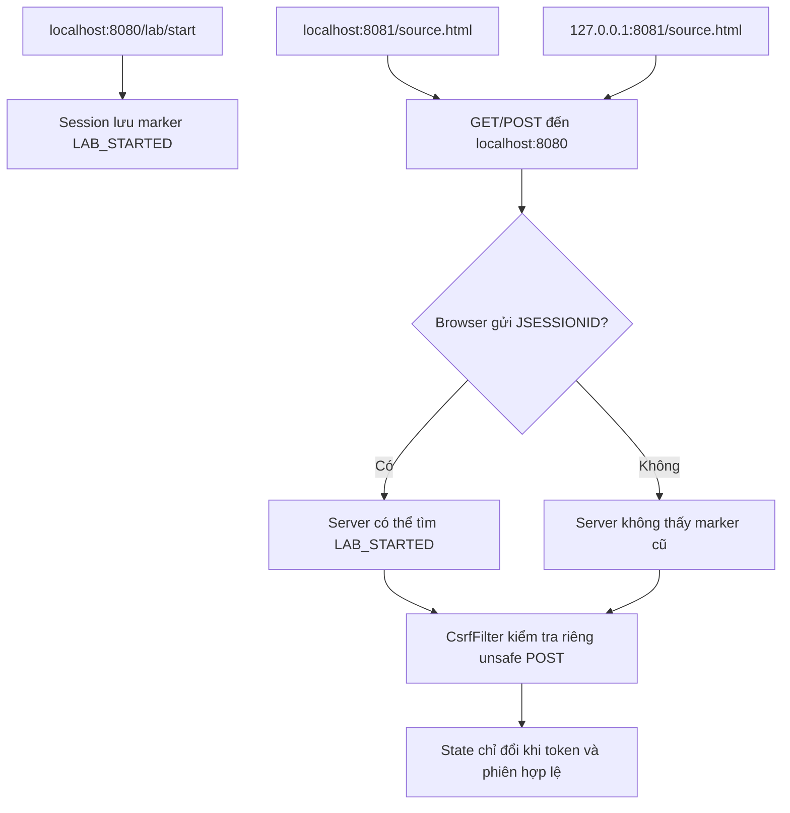
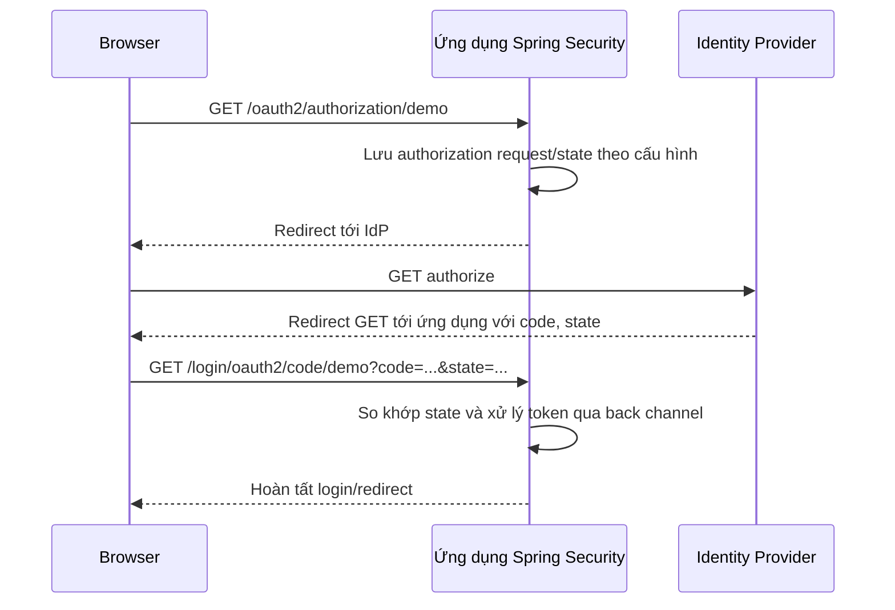
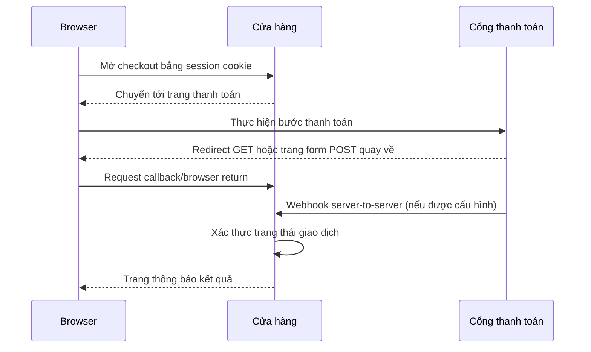
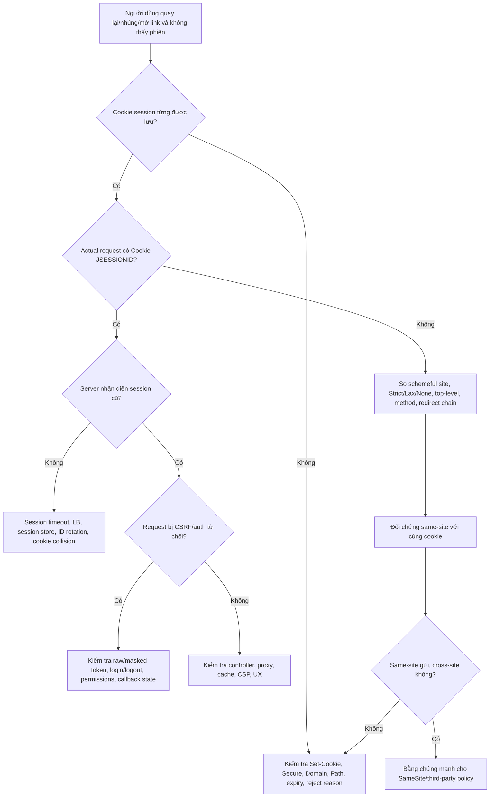

# Kiểm tra cookie SameSite trên các hành trình thực tế

Một người dùng đã đăng nhập có thể mở ứng dụng từ bookmark, nhấn liên kết trong email, quay về từ cổng thanh toán, hoàn tất đăng nhập SSO, gửi form từ một trang khác, hoặc sử dụng giao diện nhúng trong iframe. Trong các hành trình này, **cookie phiên có lúc được trình duyệt gửi và có lúc không**, dù hostname đích, tài khoản và ứng dụng Spring Security không thay đổi. Một nguyên nhân quan trọng là thuộc tính cookie **`SameSite`**, được áp dụng theo **ngữ cảnh của request** thay vì chỉ theo trang đích.

Ví dụ, với cookie `JSESSIONID; SameSite=Lax` được khai báo tường minh, một lần **điều hướng top-level bằng GET từ site khác** thường mang cookie vào ứng dụng, nhưng **form POST cross-site** thường không mang cookie. Trong khi đó, một SPA chạy trên subdomain khác nhưng **cùng site** có thể gửi cookie Lax qua `fetch(..., {credentials: "include"})`, dù request vẫn là **cross-origin và cần CORS để script đọc response**. Một popup SSO hoặc iframe còn có thể đi qua nhiều redirect và chịu chính sách third-party cookies, tạo ra kết quả khác bài thử GET đơn giản.

Bài học thuộc chương **Kiểm thử trình duyệt** của module **SPRING_SECURITY_HTTP_PROTECTION**. Module nghiên cứu các lớp phòng vệ HTTP và trình duyệt trong Spring Security: CSRF, CORS, security headers, CSP, HSTS, HTTP firewall và quản lý session, trên cả Servlet lẫn Reactive, với trọng tâm kiểm thử kịch bản web và chẩn đoán xung đột bảo mật khi triển khai. Phần thực hành chính sử dụng **Spring Security Servlet**, Spring Boot và browser; mục cuối giải thích cách chuyển tư duy sang WebFlux.

**Mục tiêu:** giải thích được `Strict`, `Lax`, `None; Secure`; phân biệt same-origin/same-site/cross-site và ảnh hưởng của scheme; quan sát cookie trên từng bước GET, POST, redirect, iframe và `fetch`; dựng lab riêng có session giả và CSRF bật; tự động hóa bằng Playwright và kiểm thử server qua MockMvc; áp dụng kết quả vào deep link, SSO/OIDC, checkout, SPA và logout mà không đổi chính sách cookie một cách tùy tiện.

## 1. `SameSite` trả lời câu hỏi nào?

`SameSite` là **thuộc tính của cookie do server đặt** bằng response `Set-Cookie`. Trình duyệt dùng nó cùng những yếu tố khác để quyết định **có đính kèm cookie vào request tiếp theo hay không**, xét theo quan hệ giữa **site khởi tạo thao tác** và **site đích**.

Ví dụ server phát cookie phiên:

```http
HTTP/1.1 200 OK
Set-Cookie: JSESSIONID=<gia-tri-duoc-an>; Path=/; HttpOnly; SameSite=Lax
```

Một request tiếp theo mà cookie được phép gửi sẽ có:

```http
GET /lab/probe HTTP/1.1
Host: localhost:8080
Cookie: JSESSIONID=<gia-tri-duoc-an>
```

Request `Cookie` **không lặp lại các thuộc tính** `HttpOnly`, `SameSite`, `Path` hoặc `Secure`. Những thuộc tính này là metadata được lưu trong cookie jar và dùng **trước khi browser tạo `Cookie` request header**.

**Bốn câu hỏi phải tách riêng:**

1. Browser **đã lưu** cookie hay chưa? Response `Set-Cookie` có bị từ chối không?
2. Cookie có **phù hợp URL đích** về hostname/domain, path, scheme, thời hạn và phân vùng không?
3. `SameSite` có **cho gửi trong ngữ cảnh thao tác** hiện tại không?
4. Request có thực sự được gửi, đi qua CORS/CSRF/authentication và có phản hồi mà script **được quyền đọc** không?

Không thể dùng `document.cookie` để xác nhận cookie `HttpOnly`: cookie có thể tồn tại và được browser gửi dù JavaScript không đọc được. Cũng không thể lấy `response.headers.get("set-cookie")` làm bằng chứng có/không có cookie, vì `Set-Cookie` bị Fetch API cấm lộ.

## 2. Tách `origin`, `site`, hostname và port

**Origin** là bộ ba **scheme + hostname + port**. Còn **schemeful site** thường dựa trên **scheme + registrable domain** (eTLD+1), không dựa trên port; với `localhost` và địa chỉ IP, browser có những quy tắc host đặc thù.

| Trang nguồn | Endpoint đích | Origin | Site (thường gặp) |
| --- | --- | --- | --- |
| `http://localhost:8080` | `http://localhost:8080` | Same-origin | Same-site |
| `http://localhost:8081` | `http://localhost:8080` | Cross-origin vì port | **Same-site** |
| `http://127.0.0.1:8081` | `http://localhost:8080` | Cross-origin vì hostname và port | **Cross-site** |
| `https://shop.example.test` | `https://api.example.test` | Cross-origin vì hostname | **Same-site** (`https://example.test`) |
| `https://idp.other.test` | `https://shop.example.test` | Cross-origin | **Cross-site** |
| `http://shop.example.test` | `https://shop.example.test` | Cross-origin vì scheme | **Cross-site** theo schemeful site |

Đây là lý do không được phát biểu “khác origin thì `SameSite=Lax` luôn chặn cookie”. Request từ `https://app.example.test` tới `https://api.example.test` có thể là **cross-origin nhưng same-site**, nên Lax/Strict vẫn có thể được gửi nếu `fetch` dùng credential mode thích hợp và các cookie constraints khác cho phép.

### Đừng dùng port làm ranh giới cookie

Cookie thường **không phân biệt theo port**. Cookie host-only đặt cho `localhost` với `Path=/` có thể được gửi tới cả port 8080 và 8081 của **cùng hostname**. Vì vậy lab dùng cả hai port phải kiểm soát cả hai server, không đặt dịch vụ **không tin cậy** trên cùng hostname khác port với ứng dụng thật.

### Schemeful site làm thay đổi kết quả HTTP → HTTPS

Hai URL cùng registrable domain nhưng khác `http`/`https` có thể bị xem là **cross-site** khi tính `SameSite`. Khi debug, ghi đủ scheme ở **nguồn lẫn đích**. Một luồng redirect từ site HTTP cũ sang site HTTPS có thể kích hoạt SameSite behavior khác kết nối hoàn toàn HTTPS, ngoài những hạn chế mixed content, `Secure` và HSTS.

## 3. `Strict`, `Lax`, `None`: bảng quyết định nền tảng

| Thuộc tính cookie | Request **same-site** phù hợp cookie scope | Cross-site **top-level GET navigation** | Cross-site **top-level POST** | Cross-site `fetch`, subresource hoặc iframe |
| --- | --- | --- | --- | --- |
| **`SameSite=Strict`** | Thường gửi | **Không gửi** | **Không gửi** | **Không gửi** |
| **`SameSite=Lax`** | Thường gửi | **Thường gửi** với method an toàn | **Thường không gửi** | **Thường không gửi** |
| **`SameSite=None; Secure`** | Có thể gửi | Có thể gửi | Có thể gửi | Có thể gửi, **nhưng** còn third-party cookie policy |

Từ “có thể” và “thường” là có chủ đích: cookie còn phải đúng `Domain`, `Path`, `Secure`, hết hạn, partition key, cookie-jar policy và browser support. `None; Secure` **không ép** browser chấp nhận cookie bên thứ ba khi browser có third-party-cookie blocking.

### `Strict`

`Strict` hạn chế cookie vào **ngữ cảnh same-site**. Nó hữu ích với phiên/tác vụ nhạy cảm nhưng có thể khiến người dùng click đường dẫn từ email hoặc trang đối tác rồi **tạm trông như chưa đăng nhập** ở request điều hướng đầu tiên. Nếu ứng dụng tự tạo session mới trong request đó, càng dễ tạo hành vi khó hiểu. Cần kiểm tra trải nghiệm deep link, redirect và login.

### `Lax`

`Lax` cho phép cookie trong ngữ cảnh same-site; ngoài ra còn cho một số **cross-site top-level navigation bằng method an toàn**, đặc biệt là GET. **Cross-site form POST** thường không mang cookie Lax. `Lax` là lựa chọn tương thích cho nhiều website dùng session và truy cập qua liên kết, nhưng **không thể thay thế CSRF token**: cross-origin **same-site** vẫn có thể gửi cookie, và GET không được có side effect.

### `None; Secure`

`None` cho phép cookie trong nhiều ngữ cảnh cross-site hơn, thường cần cho một số kịch bản nhúng hoặc callback POST, nhưng browser hiện đại yêu cầu **`Secure`**. Cookie này chỉ dùng được trên kênh phù hợp, chủ yếu là HTTPS; môi trường `localhost` có thể có ngoại lệ riêng. Vì `None` mở rộng nơi browser tự gửi credentials, phải đánh giá lại CSRF, session policy, origin trust, CORS và third-party cookie restrictions.

**Không đề nghị đổi toàn bộ session cookie sang `SameSite=None` chỉ vì một bước SSO hoặc thanh toán gặp lỗi.** Trước hết xác định request nào thiếu cookie, từ site nào, method gì, có đi qua redirect/iframe không và cơ chế auth tương ứng có cần giữ session ở callback hay không.

## 4. Bẫy quan trọng: `SameSite` **không khai báo** khác `SameSite=Lax` tường minh

Một số browser áp dụng Lax **theo mặc định** khi cookie không có thuộc tính `SameSite`. Tuy nhiên biến thể mặc định này trong một số browser có thể **thoáng hơn `Lax` được khai báo rõ**, chẳng hạn cho cookie mới được đặt **không quá khoảng hai phút** đi kèm một số **cross-site top-level POST**.

```http
Set-Cookie: DEMO=<an>; Path=/; HttpOnly
```

không được xem là tương đương tuyệt đối với:

```http
Set-Cookie: DEMO=<an>; Path=/; HttpOnly; SameSite=Lax
```

**Hệ quả kiểm thử:** một POST cross-site thử **ngay sau khi login** có thể mang cookie ở browser áp dụng ngoại lệ “Lax-by-default” và **không** mang cookie sau vài phút, gây lỗi khó tái hiện. Ngược lại, với `SameSite=Lax` **tường minh**, không được mặc định có ngoại lệ này. Không dùng ngoại lệ làm hành vi mong muốn trong thiết kế.

Các browser và phiên bản có thể khác nhau. Cần ghi **browser name/version, cookie được khai báo tường minh hay không, thời điểm cookie được đặt và request thực tế**. Nếu đang kiểm tra chính sách, luôn kiểm tra dòng `Set-Cookie` ở response đã thực sự đến browser, không suy từ property file.

## 5. `HttpOnly`, `Secure`, `Domain`, `Path`, `Partitioned` không phải `SameSite`

| Thuộc tính | Quy tắc chủ yếu | Lỗi thường gặp |
| --- | --- | --- |
| `HttpOnly` | JavaScript trang không đọc được cookie bằng `document.cookie` | Cho rằng cookie bị mất vì Console không thấy nó |
| `Secure` | Hạn chế gửi cookie qua kênh không an toàn, có ngoại lệ loopback | HTTP local không phản ánh triển khai HTTPS |
| `Domain` | Quyết định cookie host-only hoặc mở rộng cho các subdomain phù hợp | Cookie bị gửi tới subdomain không đáng tin hoặc không phù hợp domain |
| `Path` | Giới hạn những path nhận cookie | Callback `/login/oauth2/code/...` thiếu cookie đặt cho `/app` |
| `Expires`/`Max-Age` | Điều khiển thời hạn, với `Max-Age=0` thường xóa cookie | Cookie hết hạn ngay hoặc chưa bị xóa đúng scope |
| `SameSite` | Xét ngữ cảnh same-site/cross-site của request | Deep link/iframe/callback POST thiếu session |
| `Partitioned` (CHIPS) | Phân vùng một số cookie theo top-level site ở browser hỗ trợ | Cookie tồn tại ở partition khác, không phải phiên top-level tương ứng |
| Prefix `__Host-` | Yêu cầu `Secure`, `Path=/`, không `Domain` ở browser hỗ trợ | Cookie bị reject do cấu hình không đáp ứng |

Cookie `Partitioned` và cơ chế Storage Access có thể hữu ích trong một số mô hình nhúng; chúng **không tự làm một cookie session truyền thống có thể dùng xuyên mọi top-level site**. Nếu phát triển third-party widget, kiểm thử theo partition key, browser support và policy hiện hành thay vì tin `SameSite=None; Secure` sẽ đủ.

### Phân biệt đặt cookie với gửi cookie

Một response có:

```http
Set-Cookie: JSESSIONID=<an>; Path=/; HttpOnly; Secure; SameSite=Lax
```

chỉ cho biết server **yêu cầu** browser lưu cookie. Browser còn có thể **từ chối** cookie do sai scheme/domain/policy. Nếu cookie đã được lưu, request tiếp theo mới xét các điều kiện gửi. Khi debug, xem cả **Network → Response Headers/Response Cookies** và **Application/Storage → Cookies**, sau đó xem **Request Cookies của từng actual request**.

## 6. Thiết kế phép đo: chỉ kiểm tra cookie ở request thực

Một test tốt phải xác định:

```text
Nguồn thao tác là site nào?
    ↓
Điều hướng top-level, form POST, fetch, iframe hay subresource?
    ↓
Method của request thực cuối cùng là GET hay POST?
    ↓
Cookie đã được lưu trước đó chưa? Thuộc tính thực là gì?
    ↓
Actual request có Cookie: JSESSIONID không?
    ↓
Spring Security/Controller có nhận ra session ban đầu không?
    ↓
Request có cần CSRF, authorization hoặc kiểm tra state/nonce không?
```

Trong lab, chỉ gửi **session giả** và trường boolean về trạng thái. Không phản chiếu session ID hoặc token thực vào JSON, URL, log hay HTML. Với response lỗi, đừng xem `403` là bằng chứng browser đã gửi hoặc không gửi cookie: CSRF, CORS, authorization và HTTP firewall đều có thể từ chối ở những điểm khác nhau.

### Bằng chứng từ DevTools

Mở DevTools trước thao tác, bật **Preserve log**; dùng filter **All** để thấy navigation, iframe, form POST, redirect và subresource, không chỉ Fetch/XHR. Trên mỗi actual request kiểm tra **Request URL, Method, `Cookie`, `Origin`, `Sec-Fetch-Site` (nếu có), status và redirect chain**. Sau mỗi response xem cookie jar; không dùng `document.cookie` để xác minh `HttpOnly` session.

### Bằng chứng từ phía server

Một endpoint GET an toàn có thể trả:

```json
{
  "hasSessionMarker": true,
  "sessionCookiePresent": true
}
```

Nó **không** cho phép frontend tự suy ra “người dùng được cấp quyền truy cập tài nguyên”; marker chỉ dùng cho lab. Endpoint **không được gọi `getSession(true)`** khi đang đo cookie: nếu tự tạo một session mới, nó có thể che mất việc session cũ **không được gửi**.

## 7. Sơ đồ lab an toàn: phiên giả và ba loại trang nguồn

Thiết kế **hai HTTP server do chính người học kiểm soát** và một phiên giả:

| Thành phần | URL | Vai trò |
| --- | --- | --- |
| Spring Boot Servlet | `http://localhost:8080` | Phát cookie `JSESSIONID` và kiểm tra session |
| Trang khởi tạo session | `http://localhost:8080/lab/start` | Lưu marker giả trong session |
| Trang kiểm tra session | `http://localhost:8080/lab/probe` | GET chỉ đọc `hasSessionMarker`, không tạo session |
| Form hợp lệ cùng origin | `http://localhost:8080/lab/form` | Minh họa POST có CSRF token |
| Trang nguồn cross-origin, **same-site** | `http://localhost:8081/source.html` | So sánh cookie khi khác port |
| Trang nguồn **cross-site** | `http://127.0.0.1:8081/source.html` | Thử link, POST, `fetch`, ảnh và iframe |



**Hạn chế có chủ đích:** phiên chỉ chứa marker giả và ghi chú giả; không có tài khoản người thật, không gửi email, không sử dụng origin của tổ chức ngoài lab. Mô hình HTTP loopback phù hợp để so sánh `Strict`/`Lax` với site context. **Không** dùng nó để kết luận cuối cùng về `Secure`, `SameSite=None`, third-party cookies hay HSTS trong production: những chủ đề đó cần môi trường HTTPS test riêng.

### Ma trận hành trình phải được thử theo các biến độc lập

| Biến | Giá trị cần kiểm tra |
| --- | --- |
| Cookie attribute | `Strict`, `Lax`; `None; Secure` trên HTTPS |
| Nguồn | Same-origin, cross-origin same-site, cross-site |
| Cách khởi tạo | Link GET, form POST, `fetch`, iframe, image |
| Redirect | Không redirect, 303 thành GET, 307 giữ POST |
| Browser | Chromium, Firefox, WebKit tùy môi trường |
| Cookie age | Cookie mới và cookie đã tồn tại; nhất là khi **không** khai báo SameSite |
| State | Marker session có đọc được, POST có làm đổi ghi chú giả hay không |

Để thu được kết quả tái lập, mỗi ca cần browser context mới hoặc reset cookie lab, sau đó **khởi tạo marker trên backend** trước khi mở trang nguồn.

## 8. Cấu hình Spring Boot Servlet để chuyển đổi giữa `Strict` và `Lax`

Lab yêu cầu Java 17+, Spring Boot 3.x và Spring Security Servlet 6.x, với các dependency chính:

```text
spring-boot-starter-web
spring-boot-starter-security
spring-boot-starter-thymeleaf
spring-boot-starter-test        (test scope)
spring-security-test           (test scope)
```

`application.properties` cho ca `Lax`:

```properties
server.port=8080
server.servlet.session.cookie.same-site=lax
server.servlet.session.cookie.http-only=true
```

Để thử `Strict`, **dừng/restart backend test** với:

```properties
server.servlet.session.cookie.same-site=strict
```

Thuộc tính `server.servlet.session.cookie.same-site` được Spring Boot hỗ trợ cho session cookie trong môi trường servlet tương ứng (ví dụ auto-configured Tomcat/Jetty và Spring Session Servlet). Nhưng **phải xem `Set-Cookie` thực tế trong DevTools**: container, Spring Session, proxy hoặc cấu hình khác có thể là nơi cuối cùng thay đổi cookie.

**Không đưa `server.servlet.session.cookie.same-site=none` vào HTTP lab rồi suy ra kết quả trên HTTPS.** Khi test `None`, phải cấu hình HTTPS và đảm bảo cookie thực sự có `Secure`; kiểm tra browser có chấp nhận nó và có chặn third-party cookie không. Các ngoại lệ của localhost không phải tiêu chuẩn production.

### Security configuration: giữ CSRF bật

Tạo `BrowserSameSiteSecurity.java`:

```java
import java.util.List;
import org.springframework.context.annotation.Bean;
import org.springframework.context.annotation.Configuration;
import org.springframework.security.config.annotation.web.builders.HttpSecurity;
import org.springframework.security.web.SecurityFilterChain;
import org.springframework.security.web.csrf.HttpSessionCsrfTokenRepository;
import org.springframework.security.web.csrf.XorCsrfTokenRequestAttributeHandler;
import org.springframework.web.cors.CorsConfiguration;
import org.springframework.web.cors.CorsConfigurationSource;
import org.springframework.web.cors.UrlBasedCorsConfigurationSource;

@Configuration
class BrowserSameSiteSecurity {

    @Bean
    SecurityFilterChain labChain(
            HttpSecurity http,
            CorsConfigurationSource labCors) throws Exception {

        http
            // Chỉ cấp CORS cho endpoint probe không nhạy cảm.
            .cors(cors -> cors.configurationSource(labCors))
            .authorizeHttpRequests(auth -> auth
                .requestMatchers("/lab/**").permitAll()
                .anyRequest().denyAll())
            .csrf(csrf -> csrf
                .csrfTokenRepository(
                    new HttpSessionCsrfTokenRepository())
                .csrfTokenRequestHandler(
                    new XorCsrfTokenRequestAttributeHandler()));

        return http.build();
    }

    @Bean
    CorsConfigurationSource labCors() {
        CorsConfiguration config = new CorsConfiguration();
        config.setAllowedOrigins(List.of(
            "http://localhost:8081",
            "http://127.0.0.1:8081"));
        config.setAllowedMethods(List.of("GET"));
        config.setAllowCredentials(true);

        UrlBasedCorsConfigurationSource source =
            new UrlBasedCorsConfigurationSource();
        source.registerCorsConfiguration(
            "/lab/probe", config);
        return source;
    }
}
```

Ở đây `permitAll()` **không tắt CSRF**. Endpoint `POST /lab/change` vẫn phải có CSRF token. CORS allow-list **chỉ dành cho GET `/lab/probe` có dữ liệu giả**, bao gồm hai origin do người học sở hữu để quan sát response. Không sao chép allow-list này để cho phép một origin không đáng tin đọc dữ liệu phiên thật trong production.

Việc `/lab/probe` được CORS cho phép giúp script ở trang nguồn đọc `{hasSessionMarker: true/false}`. **Đây là một phép đo cookie có chủ đích**, không phải thiết kế cho endpoint chứa hồ sơ cá nhân. Nếu không cấp CORS, request có thể vẫn tới server nhưng JavaScript bị cấm đọc response, khiến việc đo hành vi cookie phải dựa vào DevTools và browser automation.

## 9. Controller: tạo marker một lần, các phép đo sau không tạo session mới

Tạo `SameSiteLabController.java`. Tất cả dữ liệu chỉ tồn tại trong session test; không có tài khoản hoặc database:

```java
import jakarta.servlet.http.Cookie;
import jakarta.servlet.http.HttpServletRequest;
import jakarta.servlet.http.HttpSession;
import java.util.Base64;
import java.util.Map;
import org.springframework.http.CacheControl;
import org.springframework.http.HttpStatus;
import org.springframework.http.MediaType;
import org.springframework.http.ResponseEntity;
import org.springframework.stereotype.Controller;
import org.springframework.ui.Model;
import org.springframework.web.bind.annotation.GetMapping;
import org.springframework.web.bind.annotation.PostMapping;
import org.springframework.web.bind.annotation.RequestMapping;
import org.springframework.web.bind.annotation.RequestParam;
import org.springframework.web.bind.annotation.ResponseBody;

@Controller
@RequestMapping("/lab")
public class SameSiteLabController {

    private static final String MARKER = "LAB_STARTED";
    private static final String NOTE = "LAB_NOTE";

    private boolean hasMarker(HttpServletRequest request) {
        // QUAN TRỌNG: false nghĩa là KHÔNG tạo session.
        HttpSession session = request.getSession(false);
        return session != null &&
            Boolean.TRUE.equals(session.getAttribute(MARKER));
    }

    private boolean sessionCookiePresent(HttpServletRequest request) {
        Cookie[] cookies = request.getCookies();
        if (cookies == null) return false;
        for (Cookie cookie : cookies) {
            // Lab dùng tên mặc định JSESSIONID, không đọc value.
            if ("JSESSIONID".equals(cookie.getName())) return true;
        }
        return false;
    }

    @GetMapping("/start")
    @ResponseBody
    ResponseEntity<Map<String, String>> start(
            HttpServletRequest request) {
        HttpSession session = request.getSession(true);
        session.setAttribute(MARKER, true);
        session.setAttribute(NOTE, "initial@lab.test");
        return ResponseEntity.ok()
            .cacheControl(CacheControl.noStore())
            .body(Map.of("message", "lab-session-initialized"));
    }

    @GetMapping("/probe")
    @ResponseBody
    ResponseEntity<Map<String, Boolean>> probe(
            HttpServletRequest request) {
        return ResponseEntity.ok()
            .cacheControl(CacheControl.noStore())
            .body(Map.of(
                "hasSessionMarker", hasMarker(request),
                "sessionCookiePresent", sessionCookiePresent(request)));
    }

    @GetMapping("/state")
    @ResponseBody
    ResponseEntity<Map<String, String>> state(
            HttpServletRequest request) {
        HttpSession session = request.getSession(false);
        String note = session == null ? "no-session" :
            String.valueOf(session.getAttribute(NOTE));
        return ResponseEntity.ok()
            .cacheControl(CacheControl.noStore())
            .body(Map.of("note", note));
    }

    @GetMapping("/form")
    String form(HttpServletRequest request, Model model) {
        model.addAttribute("hasMarker", hasMarker(request));
        return "lab-form";
    }

    @PostMapping("/change")
    @ResponseBody
    ResponseEntity<Map<String, Object>> change(
            HttpServletRequest request,
            @RequestParam("note") String note) {
        HttpSession session = request.getSession(false);
        if (!hasMarker(request) || session == null) {
            return ResponseEntity.status(HttpStatus.FORBIDDEN)
                .body(Map.of("changed", false));
        }
        if (note.length() > 80 || !note.endsWith("@lab.test")) {
            return ResponseEntity.badRequest()
                .body(Map.of("changed", false));
        }
        session.setAttribute(NOTE, note);
        return ResponseEntity.ok(Map.of(
            "changed", true, "note", note));
    }

    @GetMapping(
        value = "/pixel",
        produces = MediaType.IMAGE_GIF_VALUE)
    @ResponseBody
    ResponseEntity<byte[]> pixel() {
        byte[] gif = Base64.getDecoder().decode(
            "R0lGODlhAQABAAD/ACwAAAAAAQABAAACADs=");
        return ResponseEntity.ok()
            .cacheControl(CacheControl.noStore())
            .body(gif);
    }
}
```

**Chủ đích của controller:**

- `/lab/start` **tạo session và marker**; nó là thao tác setup dành riêng cho lab, không phải ví dụ cho GET có thay đổi nghiệp vụ. Trong production, hãy giữ safe methods chỉ đọc; ở đây việc chuẩn bị state kỹ thuật tương tự khởi tạo session để test.
- `/lab/probe` dùng `getSession(false)` để **không tạo session mới** khi cookie bị SameSite chặn.
- `/lab/state` đọc ghi chú giả, giúp kiểm tra POST không token không làm thay đổi state.
- `/lab/change` chỉ ghi khi có marker, có CSRF token hợp lệ và input giả. `CsrfFilter` chạy trước controller; không có token thì thường trả `403`.
- `/lab/pixel` cho phép quan sát request **subresource ``**; hình có thể tải mà script nguồn không đọc được response.

**Phân biệt `sessionCookiePresent` và `hasSessionMarker`:** cookie có thể tồn tại nhưng trỏ tới session đã hết hạn/mất ở server. Khi đó `sessionCookiePresent=true`, `hasSessionMarker=false`. Không suy “cookie đã gửi = authenticated”; marker cũng chỉ là dữ liệu giả của lab.

### Sử dụng `Cookie` ở backend thế nào cho an toàn?

Controller chỉ duyệt **tên cookie** để trả một boolean, không lấy `cookie.getValue()`. Trong log production, không in `Cookie`/`Set-Cookie`, token hoặc session ID. Nếu ứng dụng thực tế đổi tên cookie khỏi `JSESSIONID` hoặc dùng Spring Session cookie custom, test phải kiểm tra theo tên thực tế.

## 10. Form cùng origin: đối chứng dương để bảo đảm CSRF còn hoạt động

Đặt template `src/main/resources/templates/lab-form.html` trong **dự án ví dụ**:

```html
<!doctype html>
<html lang="vi" xmlns:th="http://www.thymeleaf.org">
<head>
  <meta charset="utf-8">
  <title>SameSite lab — form cùng origin</title>
</head>
<body>
  <h1>Form hợp lệ cùng origin</h1>
  <p>Có session marker: <span th:text="${hasMarker}">false</span></p>

  <form method="post" action="/lab/change">
    <label for="note">Ghi chú giả</label>
    <input id="note" name="note"
           value="changed-by-valid-form@lab.test"
           maxlength="80" required>

    <input type="hidden"
           th:name="${_csrf.parameterName}"
           th:value="${_csrf.token}">
    <button type="submit">Gửi POST có CSRF</button>
  </form>

  <p>
    <a href="/lab/state">Xem trạng thái cùng phiên</a>
  </p>
</body>
</html>
```

Hãy mở `/lab/start` trước, sau đó `/lab/form` trong **cùng browser context**. Thymeleaf render hidden field `_csrf` với token do `CsrfTokenRequestHandler` công bố. Với `XorCsrfTokenRequestAttributeHandler`, trường này thường chứa **masked token**, còn expected raw token được lưu trong session.

Khi submit form hợp lệ, browser gửi `JSESSIONID` và `_csrf`; server giải quyết token rồi cho controller ghi ghi chú giả, trả JSON `{"changed":true,...}`. Đây là đối chứng dương: **backend thật sự có khả năng thực hiện POST khi cookie + CSRF hợp lệ**.

**Lưu ý Thymeleaf:** một số thiết lập `th:action` có thể tự thêm hidden CSRF field. Template lab đã chủ động khai báo field và dùng `action` HTML thông thường để tránh hai field trùng tên khác giá trị. Ứng dụng có context path khác `/` cần xây URL theo context thay vì hard-code đường dẫn lab.

### Vì sao form POST từ site khác không có token?

Một trang cross-site có thể **gửi form** tới `/lab/change`, nhưng bình thường không được đọc token do ứng dụng nguồn cấp trên `/lab/form` thông qua SOP. Chúng ta cố ý thử form **không có `_csrf`** để kiểm tra `CsrfFilter` chặn side effect, cho dù SameSite có gửi hoặc chặn cookie.

## 11. Trang nguồn chung: link, form, fetch, image và iframe

Tạo một file `source.html` để phục vụ từ **hai URL**:

```text
http://localhost:8081/source.html
http://127.0.0.1:8081/source.html
```

Nhờ đó chỉ thay đổi quan hệ **same-site/cross-site** của trang nguồn, còn API đích và kiểu thao tác giữ nguyên.

```html
<!doctype html>
<html lang="vi">
<head>
  <meta charset="utf-8">
  <title>SameSite lab — source journey</title>
</head>
<body>
  <h1>Kiểm tra hành trình cookie SameSite</h1>
  <p>Origin trang nguồn: <code id="origin"></code></p>
  <p>Đích: <code>http://localhost:8080</code></p>

  <a id="external-link"
     target="_blank" rel="noopener"
     href="http://localhost:8080/lab/probe">
    Mở liên kết GET top-level tới ứng dụng
  </a>

  <form id="external-post"
        method="post"
        action="http://localhost:8080/lab/change"
        target="_blank">
    <input type="hidden"
           name="note" value="changed-by-external-form@lab.test">
    <!-- Không có field _csrf: chỉ để thử CSRF trong lab. -->
    <button type="submit">Gửi POST từ trang nguồn</button>
  </form>

  <button id="fetch-probe">Cross-origin fetch có credentials</button>
  <button id="image-probe">Tải image subresource</button>
  <button id="iframe-probe">Nhúng GET trong iframe</button>
  <button id="redirect303">Thử redirect POST → GET (303)</button>
  <button id="redirect307">Thử redirect giữ POST (307)</button>

  <div id="media"></div>
  <pre id="result" aria-live="polite">Chưa thử.</pre>

  <script>
    const API = "http://localhost:8080";
    const result = document.querySelector("#result");
    const media = document.querySelector("#media");
    const show = text => { result.textContent = text; };

    document.querySelector("#origin").textContent =
      location.origin;

    document.querySelector("#fetch-probe")
      .addEventListener("click", async () => {
        try {
          const response = await fetch(`${API}/lab/probe`, {
            mode: "cors",
            credentials: "include",
            cache: "no-store"
          });
          if (!response.ok) throw new Error(`HTTP ${response.status}`);
          const data = await response.json();
          show(JSON.stringify(data, null, 2));
        } catch (error) {
          show(`Không đọc response: ${String(error)}`);
        }
      });

    document.querySelector("#image-probe")
      .addEventListener("click", () => {
        const img = document.createElement("img");
        img.width = 1;
        img.height = 1;
        img.alt = "pixel test";
        img.src = `${API}/lab/pixel?case=image&n=${Date.now()}`;
        media.replaceChildren(img);
        show("Đã yêu cầu image; kiểm tra Cookie ở Network.");
      });

    document.querySelector("#iframe-probe")
      .addEventListener("click", () => {
        const frame = document.createElement("iframe");
        frame.title = "Iframe session probe";
        frame.width = "400";
        frame.height = "130";
        frame.src = `${API}/lab/probe?case=iframe&n=${Date.now()}`;
        media.replaceChildren(frame);
        show("Đã yêu cầu iframe; xem actual GET ở Network.");
      });

    function postToRedirect(path) {
      const form = document.createElement("form");
      form.method = "POST";
      form.action = path;
      form.target = "_blank";
      const field = document.createElement("input");
      field.type = "hidden";
      field.name = "note";
      field.value = "redirected@lab.test";
      form.append(field);
      document.body.append(form);
      form.submit();
      form.remove();
    }

    document.querySelector("#redirect303")
      .addEventListener("click", () => postToRedirect("/relay303"));

    document.querySelector("#redirect307")
      .addEventListener("click", () => postToRedirect("/relay307"));
  </script>
</body>
</html>
```

Trang không tự gửi các request có thể thay đổi state ngay lúc load: mọi thao tác được kích hoạt bằng nút. Điều này giúp DevTools/Playwright dễ so **trước/sau một hành động**. `textContent` được dùng để in metadata thay vì đẩy JSON vào `innerHTML`. Không in cookie, CSRF token hoặc session ID.

### Vì sao `iframe` có thể không hiển thị JSON?

Spring Security Servlet thường có header `X-Frame-Options: DENY` hoặc CSP `frame-ancestors` do ứng dụng cấu hình. Header đó có thể ngăn **hiển thị response trong iframe**, nhưng Network vẫn có thể ghi nhận request GET tới `/lab/probe`. Mục tiêu phép thử là **Cookie request header trên iframe GET**, không phải ép iframe render thành công. Không tắt `X-Frame-Options` ở production chỉ để một test nhúng hiển thị.

### Vì sao `` không cần CORS để bắt đầu tải?

`` thông thường có thể yêu cầu resource cross-origin mà không cần preflight; browser có thể không cho script đọc pixels nếu bị taint bởi canvas security, nhưng request vẫn có thể được gửi. Trong bài này chỉ nhìn **request cookie**, không thử trích xuất dữ liệu ảnh hay dùng hình cho mục đích theo dõi người dùng.

## 12. Static server thứ hai: cô lập nguồn thử nghiệm trên loopback

Để tránh `file://` tạo opaque origin hoặc `Origin: null`, phục vụ `source.html` qua Node HTTP server nhỏ **do bạn sở hữu**.

Trong một thư mục lab riêng:

```text
samesite-source-lab/
  source.html
  static-server.mjs
```

Tạo `static-server.mjs`:

```javascript
import http from "node:http";
import { readFile } from "node:fs/promises";

const html = await readFile(
  new URL("./source.html", import.meta.url)
);

http.createServer((request, response) => {
  if (request.method === "GET" &&
      request.url === "/source.html") {
    response.writeHead(200, {
      "Content-Type": "text/html; charset=utf-8",
      "Cache-Control": "no-store",
      "X-Content-Type-Options": "nosniff"
    });
    response.end(html);
    return;
  }

  if (request.method === "POST" &&
      request.url === "/relay303") {
    response.writeHead(303, {
      "Location": "http://localhost:8080/lab/probe",
      "Cache-Control": "no-store"
    });
    response.end();
    return;
  }

  if (request.method === "POST" &&
      request.url === "/relay307") {
    response.writeHead(307, {
      "Location": "http://localhost:8080/lab/change",
      "Cache-Control": "no-store"
    });
    response.end();
    return;
  }

  response.writeHead(404, {
    "Content-Type": "text/plain; charset=utf-8"
  });
  response.end("Not found");
}).listen(8081, "127.0.0.1", () => {
  process.stdout.write("SameSite source: loopback port 8081\n");
});
```

Chạy:

```bash
node static-server.mjs
```

Không cần cài package ngoài Node.js. Server **không log request headers, cookies hoặc form body**; nó chỉ phục vụ trang và phát redirect trong lab. Không dùng cấu hình listener công khai trên mạng LAN/Internet. Một số hệ điều hành ưu tiên IPv6 `::1` cho `localhost`; vì ví dụ bind IPv4 `127.0.0.1`, nếu `localhost:8081` không hoạt động cần chỉnh loopback listener/host mapping phù hợp, **không** mở server ra mọi network interfaces.

### Cần hiểu gì khi redirect 303 và 307?

- **303 See Other** hướng browser chuyển thao tác POST sang **GET** tới URL trong `Location`. Với top-level navigation GET cross-site, `SameSite=Lax` thường được gửi.
- **307 Temporary Redirect** giữ nguyên **method và body POST** khi theo redirect. Cookie Lax thường **không** được gửi trong một cross-site top-level POST, và actual POST thiếu CSRF token vẫn phải bị từ chối.
- **302 Found** thường có hành vi đổi POST thành GET theo thực tế browser, nhưng không dùng suy luận từ số status thay việc quan sát method thật.
- **308 Permanent Redirect** giữ method/body tương tự 307, không tự biến POST thành GET.

Browser có thể xét **redirect chain, site-for-cookies và chính sách navigation** khi áp dụng SameSite. Vì thế dự đoán ở trên là điểm xuất phát; **kết luận cuối cùng phải dựa vào actual redirected request** trong Network của browser/version đang test. Không dựa vào một redirect GET để thực hiện thay đổi dữ liệu: safe methods phải không có side effect nghiệp vụ.

## 13. Bước khởi tạo phiên: kiểm tra cookie thật trước khi rời site

Mở browser context sạch và truy cập:

```text
http://localhost:8080/lab/start
```

Backend tạo `HttpSession` và lưu marker `LAB_STARTED=true`. Trên tab Network của **response này**, kiểm tra có `Set-Cookie` session và thuộc tính `SameSite=Lax` hoặc `Strict` đúng ca thử. **Che giá trị `JSESSIONID`** khi ghi lại bằng chứng. Nếu không có cookie/session được tạo, đừng tiếp tục kết luận request sau thiếu cookie do SameSite.

Tiếp theo mở **một tab cùng origin**:

```text
http://localhost:8080/lab/probe
```

Kết quả trước khi rời site thường là:

```json
{
  "hasSessionMarker": true,
  "sessionCookiePresent": true
}
```

Đây là đối chứng dương chứng minh cookie **đã được lưu, browser đang gửi nó tới API trong ngữ cảnh cùng origin và server tìm được session**. Nếu kết quả là `false`, cần kiểm tra cookie scope, session timeout, backend restart, load balancer hoặc cookie policy trước khi thử hành trình cross-site.

**Không đổi session/cookie giữa hai bước đo**, trừ khi bài thử chủ đích kiểm tra login/logout. Nếu server không tìm thấy marker trước khi mở external link, test SameSite không còn căn cứ.
## 14. Hành trình 1: mở deep link từ email hoặc trang đối tác

Giả sử người dùng đã có phiên ở `http://localhost:8080`, sau đó click một liên kết tới ứng dụng từ trang thuộc **site khác**:

```text
http://127.0.0.1:8081/source.html
    └── click liên kết GET top-level
        └── http://localhost:8080/lab/probe
```

**Với `SameSite=Lax` tường minh:** top-level navigation GET thường cho phép gửi cookie; controller có thể trả `hasSessionMarker=true`.

**Với `SameSite=Strict`:** request **đầu tiên** từ site khác vào ứng dụng thường **không mang cookie session Strict**; controller thấy `hasSessionMarker=false`. Cookie không nhất thiết đã bị xóa khỏi browser: nó chỉ không được gửi trong **ngữ cảnh cross-site này**.

Sau khi browser đã ở trang ứng dụng, một **navigation hoặc reload cùng site tiếp theo** có thể lại gửi cookie Strict. Bởi vậy trang đầu tiên sau click deep link có thể trông như chưa login, còn trang tiếp theo nhận ra session cũ. Không tự động kết luận hệ thống logout hoặc cookie đã biến mất.

| Request | Cookie Lax | Cookie Strict | Ý nghĩa |
| --- | --- | --- | --- |
| GET `/lab/probe` từ cùng origin | Thường có | Thường có | Same-site |
| Top-level GET từ site khác | Thường có | **Không có** lần đầu | Lax cho phép safe top-level navigation |
| GET nội bộ sau khi tới site đích | Thường có | Có thể có | Site context có thể trở thành same-site |
| GET trong iframe của site khác | Thường không | Không | Không phải top-level navigation |

**Kiểm chứng:** xem `Cookie` của **actual GET đầu tiên** tạo bởi click liên kết, không chỉ cookie jar hay request sau refresh. Với redirect chain, xem từng request trong Network/Preserve log.

Nếu chính sách session thật sự cần `Strict`, hãy thiết kế landing page không ghi đè session khi GET đầu thiếu cookie; đưa ra UX hợp lý để tiếp tục vào site. Không đổi cookie thành Lax hoặc bắt người dùng đăng nhập lại chỉ dựa vào một request điều hướng đầu tiên.

## 15. Hành trình 2: form POST từ site khác

Từ `http://127.0.0.1:8081/source.html`, bấm **Gửi POST từ trang nguồn**. Browser tạo top-level form navigation tới `http://localhost:8080/lab/change`, **không chứa `_csrf`**.

Với `SameSite=Lax` **tường minh**, cookie phiên thường **không được gửi** trên cross-site top-level POST; với Strict cũng vậy. Nhưng **actual POST vẫn có thể tới backend** — SameSite chủ yếu quyết định **cookie**, không tự chặn cả request.

```http
POST /lab/change HTTP/1.1
Host: localhost:8080
Origin: http://127.0.0.1:8081
Content-Type: application/x-www-form-urlencoded
Sec-Fetch-Site: cross-site

note=changed-by-external-form%40lab.test
```

Đây là request minh họa; headers có thể khác theo browser. Vì form thiếu `_csrf`, `CsrfFilter` phải từ chối trước khi controller ghi state, thường trả `403`.

**Lưu ý khi kiểm thử:** một POST không mang session cookie có thể khiến `CsrfFilter` giải quyết deferred expected token và tạo session **ẩn danh mới** để trả lỗi. Browser có thể chấp nhận cookie được phát trên response tùy policy; do đó **không chạy các ca nối tiếp mà không reset cookie jar** và không coi session mới sau `403` là session ban đầu.

Quy trình một ca độc lập:

1. Khởi tạo session marker trong browser context **sạch**.
2. Xem same-origin `/lab/probe` trả marker true.
3. Mở trang khác site **trong cùng context**.
4. Submit form và xem **Request Cookies** của actual POST.
5. Xác nhận HTTP `403`, không có nghiệp vụ thành công.
6. Tạo context mới cho ca kế tiếp nếu POST lỗi tạo cookie/session mới.

### Form khác origin nhưng **same-site**

Lặp lại với `http://localhost:8081/source.html`, vẫn gửi tới `localhost:8080`. Đây là **cross-origin nhưng same-site**. Cookie Lax/Strict **có thể vẫn được đính kèm** vào POST, nhưng form thiếu `_csrf` nên backend phải chặn.

**SameSite không thay thế CSRF token**, đặc biệt khi một subdomain/origin same-site có thể không đáng tin. Cookie không được phân chia theo port nên Node test server trên `localhost:8081` có thể nhận `JSESSIONID` ngay khi trình duyệt tải `source.html`. Lab kiểm soát cả hai server và không ghi cookie; đừng áp dụng mô hình này cho một host thật có dịch vụ khác không tin cậy.

## 16. Hành trình 3: SPA cross-origin same-site so với cross-site

Một frontend `https://app.example.test` gọi `https://api.example.test` là **cross-origin nhưng thường same-site**. Cookie Lax/Strict có thể gửi tới API khi tất cả điều kiện đều phù hợp: cookie scope đích, `Secure`/HTTPS, `fetch` có `credentials: "include"`, chính sách cookie và backend CORS cho phép đọc response.

```javascript
const response = await fetch("https://api.example.test/profile", {
  method: "GET",
  mode: "cors",
  credentials: "include"
});
if (!response.ok) throw new Error(`HTTP ${response.status}`);
const profile = await response.json();
```

Đây là topology minh họa, không phải endpoint thật. **Cookie session host-only cho `api.example.test` là đủ để browser gửi cookie đến API đích**; không cần đổi thành `Domain=.example.test` chỉ vì frontend ở subdomain khác. Việc mở rộng Domain có thể làm cookie được gửi tới những subdomain không nên nhận nó.

Nếu frontend ở `https://portal.other.test`, request tới API `https://api.example.test` lại **cross-site**. Với Lax/Strict, cookie thường không được gửi qua fetch, **dù** `credentials: "include"` và **dù** CORS đã cấp quyền đọc:

```javascript
// CORS có thể cho JS đọc response, nhưng SameSite vẫn chặn cookie.
fetch("https://api.example.test/profile", {
  mode: "cors",
  credentials: "include"
});
```

**Đối chứng ngay trong lab:** dùng nút **Cross-origin fetch có credentials** ở `source.html`, đổi giữa hai origin nguồn:

| Trang nguồn | Origin so với API | Site so với API | Marker thường thấy với Lax/Strict |
| --- | --- | --- | --- |
| `localhost:8081` | Cross-origin | Same-site | `hasSessionMarker=true` |
| `127.0.0.1:8081` | Cross-origin | Cross-site | `hasSessionMarker=false` |

Trong lab, chỉ GET `/lab/probe` mang **boolean giả** được CORS cho hai origin. Không được hiểu ví dụ này như lời khuyên cho origin bên ngoài quyền kiểm soát đọc response chứa dữ liệu cá nhân. Khi quan sát, đối chiếu Request Cookie và `getSession(false)` của server thay vì chỉ nhìn thông báo lỗi `fetch`.
## 17. Hành trình 4: iframe, ảnh và chính sách third-party cookies

Từ trang **cross-site** `http://127.0.0.1:8081/source.html`, bấm **Tải image subresource** rồi **Nhúng GET trong iframe**. Cả hai dẫn tới API `localhost:8080`, nhưng không phải điều hướng top-level.

| Request cross-site | Strict | Lax | None; Secure trên HTTPS |
| --- | --- | --- | --- |
| `` | Không gửi | Thường không gửi | Có thể gửi |
| `<iframe src="...">` | Không gửi | Thường không gửi | Có thể gửi |
| `fetch(...,{credentials:"include"})` | Không gửi | Thường không gửi | Có thể gửi |
| Top-level `<a href="...">` GET | Không gửi | Thường gửi | Có thể gửi |

Ngay cả với `SameSite=None; Secure`, trình duyệt có thể chặn hoặc **phân vùng** third-party cookies; một số môi trường hỗ trợ Storage Access API hoặc CHIPS `Partitioned` cho trường hợp nhúng. **Không** giả định cùng cookie session được tái sử dụng ở mọi iframe, mọi top-level site và mọi browser.

### Kiểm thử ảnh và iframe mà không nhầm chính sách hiển thị

Mở Network → All, bấm từng nút, chọn **actual GET** `/lab/pixel` hoặc `/lab/probe?case=iframe`, xem **Request Cookies** và blocked reason.

- `X-Frame-Options: DENY` hoặc CSP `frame-ancestors` có thể chặn **render iframe** dù request đã đến server.
- CSP `img-src` trên **trang nguồn** có thể chặn request image trước khi tới API.
- SameSite quyết định **cookie được gửi**, không quyết định quyền script đọc DOM cross-origin.
- CORS thường không bắt buộc để trình duyệt thử tải một ảnh cross-origin thông thường; khi đọc pixel qua canvas có quy tắc bảo mật khác.

Nếu ứng dụng cần được nhúng trên site đối tác, hãy xác minh user gesture, third-party storage policy, partition key, authentication và clickjacking protections. Không tắt `frame-ancestors` hoặc chuyển toàn bộ cookie sang None chỉ để iframe mẫu hiển thị.

## 18. Hành trình 5: redirect 303 so với 307 từ một POST

Từ trang source **khác site**, thử hai nút redirect, mỗi lần với browser context mới để tránh ảnh hưởng session do POST trước đó.

Luồng 303:

```text
POST http://127.0.0.1:8081/relay303
  -> HTTP 303 See Other
     Location: http://localhost:8080/lab/probe
  -> Browser theo redirect bằng GET /lab/probe
```

Nếu là **top-level navigation GET**, cookie `SameSite=Lax` thường được phép theo ngữ cảnh cross-site; Strict thường không được gửi trên request đầu. Tuy nhiên browser xét **redirect chain/site-for-cookies** và context, vì vậy phải quan sát actual redirected GET thay vì bảo đảm mọi trường hợp đều giống nhau.

Luồng 307:

```text
POST http://127.0.0.1:8081/relay307
  -> HTTP 307 Temporary Redirect
     Location: http://localhost:8080/lab/change
  -> Browser theo redirect bằng POST giữ body ban đầu
```

Với **cross-site top-level POST**, Lax tường minh thường không gửi cookie và Strict cũng vậy. Request vẫn không mang `_csrf`, nên `CsrfFilter` phải từ chối; không làm thay đổi ghi chú giả.

| Redirect | Đặc điểm HTTP | Điều cần kiểm tra SameSite |
| --- | --- | --- |
| `302 Found` sau POST | Nhiều browser đổi sang GET theo quy tắc hiện hành | Không suy method; xem actual request |
| `303 See Other` | Chuyển sang GET | Lax có thể gửi trên top-level safe navigation |
| `307 Temporary Redirect` | Giữ method/body | Nếu vẫn POST cross-site, Lax thường bị chặn |
| `308 Permanent Redirect` | Giữ method/body | Kiểm tra giống nhóm giữ method; không tự biến POST thành GET |

**Không đặt tác vụ thay đổi trạng thái lên GET** để “làm callback tương thích Lax”. GET cần an toàn và chỉ đọc. Nếu callback thật cần ghi dữ liệu, dùng xác minh trạng thái và giao thức tương ứng ở backend; với payment, ưu tiên xác thực trạng thái qua API/webhook server-to-server.

## 19. Hành trình 6: đăng nhập SSO/OAuth2/OIDC với callback GET

Một quy trình đăng nhập liên kết điển hình:



Trong Spring Security Servlet, luồng OAuth2 authorization code mặc định có thể dùng `HttpSessionOAuth2AuthorizationRequestRepository` để lưu authorization request trong session giữa lúc bắt đầu và lúc callback. Nếu browser **không gửi cookie session ở callback**, ứng dụng có thể không tìm được state/authorization request trước đó và đăng nhập thất bại.

**GET callback từ IdP khác site:**

- `SameSite=Lax` tường minh thường **cho cookie** trên top-level GET navigation; thuận lợi cho nhiều luồng authorization-code redirect thông dụng.
- `SameSite=Strict` thường **không gửi cookie** trên request GET đầu từ IdP khác site; có thể làm correlation với state lưu ở session thất bại.
- `SameSite=None; Secure` có thể gửi, nhưng cần HTTPS, third-party policy và threat model; không bắt buộc phải dùng None chỉ vì “có SSO”.

**Đừng tùy tiện tắt CSRF** tại mọi route liên quan SSO. OAuth2 `state` và OIDC `nonce` có vai trò chống tấn công/correlation theo giao thức; việc bảo vệ form/unsafe endpoints còn cần chính sách CSRF riêng. Callback mặc định thông dụng GET không tương đương một POST form của người dùng và phải được xử lý theo đúng security filter.

### Lỗi hay gặp khi Strict quá chặt

Người dùng bắt đầu login ở ứng dụng, browser chuyển tới IdP, sau đó callback GET quay lại ứng dụng. Một response callback hoặc failure handler có thể báo “invalid state”, “authorization request not found” hoặc dẫn về login. Cần **xác minh cookie request trên callback** và repository lưu authorization request, không lập tức kết luận IdP trả code sai.

Nếu callback đi qua reverse proxy hoặc khác hostname/path/scheme so với lúc tạo session, kiểm tra thêm `Secure`, `Path`, `Domain`, forwarded headers, session store và cookie phát thực tế. Các lỗi này có thể trông giống SameSite nhưng là **scope của cookie** hoặc **session không nhất quán**.

## 20. Hành trình 7: SSO/OIDC `response_mode=form_post`

Một số tích hợp identity dùng `response_mode=form_post`: thay vì redirect callback bằng GET có code/state trong query, IdP trả một HTML form được trình duyệt gửi **POST** về callback của ứng dụng.

```text
Browser ở IdP khác site
  └── HTML form POST /login/oauth2/callback/...
       ├─ Có thể chứa code/state theo giao thức
       └─ Không tự nhiên là top-level GET
```

**Vấn đề SameSite:** với cookie phiên `Lax` **tường minh**, cross-site top-level POST thường **không mang cookie**. Nếu Spring Security/lớp tích hợp đang giữ correlation state trong `HttpSession`, callback có thể không tìm thấy session cũ và đăng nhập lỗi, dù mã code/`state` được IdP trả đúng.

Các hướng xử lý cần được cân nhắc theo **giao thức và threat model**, không chọn theo mẹo cookie:

1. Kiểm tra IdP/client có hỗ trợ **response mode bằng GET redirect** theo thiết kế và yêu cầu bảo mật không.
2. Nếu bắt buộc dùng cross-site POST, đánh giá nhu cầu về cookie có thể đi cross-site (`None; Secure` trên HTTPS) cùng **bảo vệ state/nonce/CSRF**, session fixation, origin trust, cookie scope và third-party policy.
3. Xem xét repository/correlation mechanism phù hợp với quy trình mà **không lộ state/token ra URL hoặc cho phép request giả mạo**, theo tài liệu phiên bản Spring Security và IdP tương ứng.
4. Giới hạn mọi **CSRF exception** chỉ ở callback thật sự cần thiết, nếu giao thức yêu cầu, với xác minh `state`, mã authorization và audience/issuer; **không** dùng `.csrf().disable()` trên toàn bộ ứng dụng.

**Không hứa rằng `SameSite=None; Secure` luôn giải quyết được**: iframe, browser chống theo dõi, third-party-cookie partitioning, session expiration và callback domain không khớp vẫn có thể làm SSO thất bại.

### Ghi nhận tương thích thay vì đoán

Một báo cáo SSO hữu ích cần: *IdP → app là GET hay POST?*; *callback top-level hay trong iframe?*; *request thực có `JSESSIONID`?*; *`SameSite`/`Secure` được phát thế nào?*; *state/nonce/correlation ở đâu?*; *Spring Security filter nào xử lý callback?* Dữ liệu này đáng tin hơn kết luận “SSO không chạy vì SameSite” chỉ dựa vào một lần nhận HTTP 401/403.

## 21. Hành trình 8: quay lại website từ cổng thanh toán

Một hành trình checkout có thể trải qua:



**GET browser return từ site khác** thường có thể gửi cookie `SameSite=Lax` nếu là top-level navigation an toàn; cookie `Strict` có thể bị chặn trên request đầu. **POST browser return** có thể không gửi session Lax. Nếu cổng thanh toán dùng iframe, điều kiện lại khác do third-party cookie policies và frame controls.

Điểm kiến trúc quan trọng: **không coi browser return tự nó là bằng chứng thanh toán thành công**. Người dùng có thể không quay lại, mất cookie hoặc đóng tab, và URL return có thể bị giả mạo. Trạng thái đơn hàng cần được xác minh qua **webhook được xác thực chữ ký hoặc server-to-server verification API**, xử lý idempotent và liên kết với order ID không bí mật theo giao thức.

| Hành trình | Nguy cơ SameSite | Thiết kế bền vững |
| --- | --- | --- |
| Cổng thanh toán redirect GET về cửa hàng | Strict có thể không gửi cookie lần đầu | Landing page an toàn, xác minh đơn hàng ở server |
| Cổng thanh toán POST form về cửa hàng | Lax thường không gửi cookie | Không phụ thuộc riêng vào session browser để ghi nhận thanh toán |
| Cổng thanh toán nhúng trong iframe | Third-party cookie bị chặn/phân vùng | Đánh giá topology và browser support, tránh phụ thuộc iframe state |
| Webhook server-to-server | **Không chịu SameSite của browser** | Xác minh chữ ký/nguồn theo hợp đồng, idempotency |
| Người dùng reload trang sau return | Cookie có thể lại được gửi | Truy vấn trạng thái đã xác thực, không lặp giao dịch |

**Không bỏ CSRF ở toàn bộ đường checkout** để khắc phục callback POST. Nếu một webhook hoặc callback đặc biệt cần ngoại lệ theo thiết kế, tách endpoint và bảo vệ bằng giao thức xác thực riêng, kiểm chứng chữ ký/state và hạn chế phạm vi thật hẹp. Tránh xử lý đơn hàng thông qua GET có side effect.

## 22. Hành trình 9: login, session fixation, CSRF token mới và logout

`SameSite` quyết định **browser gửi cookie** theo ngữ cảnh, trong khi cơ chế xác thực của Spring Security có thể **đổi session ID hoặc xóa CSRF token cũ**.

Trong Spring Security Servlet thông dụng:

- Sau xác thực thành công, session fixation protection có thể **đổi session ID** hoặc điều chỉnh session state theo cấu hình.
- `CsrfAuthenticationStrategy` có thể **xóa CSRF token trước login** khi đường xác thực được tích hợp.
- `CsrfLogoutHandler` có thể xóa CSRF token ở logout.
- `DeferredCsrfToken` có thể trì hoãn tạo token mới cho tới khi có view/endpoint thật sự sử dụng.

Do đó sau login, SPA có thể gặp `403` vì giữ CSRF token cũ **ngay cả khi cookie SameSite đang được gửi bình thường**. Ngược lại, callback SSO có thể không tìm thấy session vì cookie bị SameSite chặn **trước khi** bước xác thực hoàn tất. Hai lỗi ở **hai thời điểm khác nhau**.

| Triệu chứng | Có thể do SameSite? | Cần kiểm tra thêm |
| --- | --- | --- |
| Callback GET từ IdP không tìm được auth request | Có, nhất là Strict | Session scope, redirect_uri, state, repository, proxy |
| Callback POST từ IdP không có cookie Lax | Có | `response_mode=form_post`, None; Secure, anti-CSRF/state |
| Login thành công nhưng POST đầu của SPA bị 403 | Có thể, **không chắc** | CSRF token invalidation, session ID và bootstrap mới |
| Logout POST không thực hiện | Có thể thiếu cookie, nhưng cũng có thể thiếu token | `CsrfFilter`, `LogoutFilter`, request method, actual POST |
| Sau logout truy cập link ngoài quay về không thấy phiên cũ | Có thể là **đúng thiết kế** | Session đã invalidate chưa, cookie có bị xóa không |
| Hai tab cùng site nhận khác phiên | Không mặc định do SameSite | Path/domain, session timeout, gateway, trình duyệt partitioning |

**Không cho phép `GET /logout` thay vì POST chỉ vì cookie Lax cho top-level GET từ site khác.** GET logout có thể bị bên ngoài kích hoạt qua navigation; logout là hành động thay đổi trạng thái cần chính sách chống giả mạo phù hợp.

### Login cross-site không phải cứ bỏ `HttpOnly` là xong

`HttpOnly` không kiểm soát browser gửi cookie — nó ngăn JavaScript đọc. Nếu một callback thiếu cookie vì SameSite hoặc cookie scope, **tắt `HttpOnly` không khắc phục nguyên nhân** mà làm tăng rủi ro nếu ứng dụng có XSS. Không sửa cookie scope/flags khi chưa xem thực tế `Set-Cookie` và request cookie.

## 23. Hành trình 10: top-level navigation, popup và iframe không giống nhau

Cùng một URL đích `/lab/probe` nhưng cách mở có thể thay đổi ngữ cảnh site:

```text
(a) Click link top-level từ site khác
    -> Site đích là top-level document

(b) Mở popup/tab mới từ site khác
    -> Top-level document mới, request do trang khác khởi tạo

(c) Nhúng iframe trong site khác
    -> Site đích chỉ là nested browsing context

(d) fetch GET từ script ở site khác
    -> Không thay top-level page

(e)  trên trang site khác
    -> Subresource
```

`Lax` đặc biệt cho phép một số **top-level safe-method navigations**; nó không cấp miễn trừ tương tự cho iframe/fetch/image. `Strict` không gửi cookie cho cross-site navigation đầu; `None; Secure` cho phép rộng hơn nhưng còn phụ thuộc browser privacy policy.

Một redirect hoặc `window.open()` còn có thể giữ dấu vết **site khởi tạo** trong chuỗi điều hướng. Nếu thử trên nhiều browser, **ghi nhận cách tạo navigation** (click link, form, redirect, address bar, reload), không ghi đơn giản “GET /lab/probe”.

### Nhập trực tiếp URL vào address bar khác click link từ site khác

Mở URL bằng address bar có thể thuộc ngữ cảnh `Sec-Fetch-Site: none` hoặc user-initiated navigation tùy browser, trong khi click link từ site khác có ngữ cảnh cross-site. Vì vậy **không dùng `page.goto()` thẳng tới API** làm bản thay thế hoàn toàn cho một test “người dùng click link từ email/IdP”.

Một browser test cần **trang nguồn thật** và hành động click/submit theo đúng hành trình. Các request đặt thủ công bằng `curl` hoặc Playwright `context.request` cũng không phản ánh site-for-cookies của browser.

## 24. DevTools: đọc cookie ở **actual request**, không nhìn mỗi cookie jar

Trong Chrome/Edge/Firefox, vị trí menu thay đổi theo phiên bản nhưng trình tự điều tra tương tự:

1. Mở DevTools → **Network** trước khi tạo hành trình; bật **Preserve log**.
2. Mở browser context test sạch, truy cập `/lab/start` để tạo marker.
3. Tại response `/lab/start`, xem `Set-Cookie`: tên, `Path`, `HttpOnly`, `Secure`, `SameSite`, domain và blocked reason nếu có.
4. Trong tab **Application/Storage → Cookies**, xác nhận cookie đã được **lưu** cho host API.
5. Thực hiện một thao tác từ **đúng origin nguồn**: link, POST, iframe hoặc fetch.
6. Chọn **actual request tới `localhost:8080`** trong Network, xem Request Headers/Request Cookies. Đặc biệt phân biệt `OPTIONS` với actual POST nếu có preflight.
7. Ghi **có/không có `JSESSIONID`**, không sao chép giá trị. Xem `Sec-Fetch-Site`, `Sec-Fetch-Mode`, `Sec-Fetch-Dest`, `Origin` và method khi có.
8. Quan sát response server; với GET `/lab/probe`, so `hasSessionMarker` với `sessionCookiePresent`.
9. Nếu request là POST, kiểm tra `CsrfFilter` đã chặn hay request đã tới controller; **không** đánh giá SameSite chỉ bằng status `403`.
10. Reset browser context và cookie trước kịch bản tiếp theo.

### Bảng đọc dấu hiệu

| Dấu hiệu | Điều chứng minh | Điều chưa chứng minh |
| --- | --- | --- |
| `Set-Cookie` trên response | Server **yêu cầu** đặt cookie | Browser đã chấp nhận lưu |
| Cookie nằm trong Application | Browser có một cookie cho host/scope | Cookie được gửi trên request cụ thể |
| Request có `Cookie: JSESSIONID` | Browser đã gửi một cookie với tên đó | Server còn session tương ứng |
| `sessionCookiePresent=true` | Cookie tên lab có trên request | Phiên authenticated/được cấp quyền |
| `hasSessionMarker=true` | Server tìm được session test có marker | User thực đã đăng nhập |
| `Sec-Fetch-Site: cross-site` | Browser báo ngữ cảnh request cross-site | Nguyên nhân duy nhất làm cookie thiếu |
| `403` trên form POST | Server từ chối request | Cookie đã gửi hay đã bị chặn do SameSite |
| Không có response mà JS đọc được | Browser có thể chặn CORS/CSP/network | Request chưa từng tới server |

### `Cookie` có mặt nhưng marker không có

Nếu request có `JSESSIONID` mà `hasSessionMarker=false`, không mặc định đó là “bug SameSite”. Cookie có thể trỏ tới session đã hết hạn, server restart, cluster node khác chưa chia sẻ session, cookie path/domain trùng tên gây nhiễu hoặc session data đã bị thay. SameSite không quyết định **server có nhớ session tương ứng không**.

## 25. Ma trận chẩn đoán các hành trình thường gặp

| Triệu chứng | Khả năng liên quan SameSite | Cần xác minh thêm |
| --- | --- | --- |
| Vào từ email link lần đầu trông chưa login | Strict chặn cookie cross-site GET | Cookie vẫn trong jar? Internal navigation kế tiếp có marker? |
| Vào từ link được nhưng form POST đối tác lỗi | Lax cho top-level GET, chặn cross-site POST | Actual POST Cookie, CSRF, callback contract |
| SPA khác subdomain gọi API thiếu cookie | Có thể do schemeful site hoặc credential mode | `credentials:"include"`, host, path, HTTPS, CORS |
| SPA khác site có ACAO đúng nhưng không có session | Lax/Strict chặn cookie cross-site fetch | SameSite, cookie scope, browser privacy |
| Iframe bị logout | Cookie third-party không đi hoặc bị phân vùng | `None; Secure`, partition, Storage Access, frame headers |
| Popup/redirect IdP mất state | Strict hoặc callback form_post với Lax | Request callback method, session repository, state/nonce |
| Payment browser return GET không nhận session | Strict hoặc cookie scope/HTTPS | Có webhook xác minh đơn hàng không? |
| Payment POST return không có session | Lax/Strict cross-site POST | Không phụ thuộc browser session để xác nhận thanh toán |
| Form cross-site thiếu cookie nhưng vẫn `403` | Có thể SameSite chặn cookie | CSRF đã từ chối trước controller? |
| Cookie vừa được đặt vẫn đi trên POST dù không khai báo SameSite | Có thể Lax-by-default ngoại lệ thời gian | Phân biệt explicit Lax, cookie age và browser |
| Cookie None; Secure vẫn không có trong iframe | Third-party policy/partition | Browser/version, user interaction, HTTPS |
| Status `403` sau login nhưng cookie có đủ | Chưa chắc SameSite | CSRF token rotation, authorization, session timeout |
| Cross-origin fetch có cookie nhưng JS báo CORS lỗi | Cookie send và response read khác nhau | ACAO/ACAC/preflight/CSP |
| HSTS thay đổi HTTP thành HTTPS | Schemeful site và Secure cookie thay đổi | Redirect chain và external URL thực tế |
| Chỉ lỗi trên môi trường nhiều node | Không mặc định do SameSite | Session replication, LB affinity, proxy Set-Cookie |

**Nguyên tắc:** một lỗi có thể có nhiều tầng nguyên nhân. Chỉ kết luận SameSite khi chứng minh **cookie đã được lưu và phù hợp URL**, nhưng **không được gửi trong đúng cross-site context**, trong khi cùng cookie được gửi ở một đối chứng same-site.
## 26. MockMvc: xác nhận server session và CSRF hoạt động độc lập với browser policy

`MockMvc` giúp chứng minh **logic phía server**, nhưng **không có cookie jar và SameSite enforcement như browser**. Trong một MockMvc test, `.session(session)` gắn `MockHttpSession` trực tiếp vào request; điều đó không có nghĩa browser sẽ gửi `JSESSIONID` trong một cross-site POST.

Ví dụ Spring Boot Test + Spring Security Test:

```java
import org.junit.jupiter.api.Test;
import org.springframework.beans.factory.annotation.Autowired;
import org.springframework.boot.test.autoconfigure.web.servlet.AutoConfigureMockMvc;
import org.springframework.boot.test.context.SpringBootTest;
import org.springframework.mock.web.MockHttpSession;
import org.springframework.security.web.csrf.CsrfToken;
import org.springframework.test.web.servlet.MockMvc;
import org.springframework.test.web.servlet.MvcResult;

import static org.junit.jupiter.api.Assertions.*;
import static org.springframework.test.web.servlet.request.MockMvcRequestBuilders.*;
import static org.springframework.test.web.servlet.result.MockMvcResultMatchers.*;

@SpringBootTest
@AutoConfigureMockMvc
class SameSiteLabMvcTest {

    @Autowired MockMvc mvc;

    @Test
    void probeDoesNotCreateSessionWhenNoneWasSent() throws Exception {
        MvcResult result = mvc.perform(get("/lab/probe"))
            .andExpect(status().isOk())
            .andExpect(jsonPath("$.hasSessionMarker").value(false))
            .andExpect(jsonPath("$.sessionCookiePresent").value(false))
            .andReturn();

        assertNull(result.getRequest().getSession(false));
    }

    @Test
    void sameSessionCanReadMarker() throws Exception {
        MvcResult start = mvc.perform(get("/lab/start"))
            .andExpect(status().isOk())
            .andReturn();

        MockHttpSession session = (MockHttpSession)
            start.getRequest().getSession(false);
        assertNotNull(session);

        mvc.perform(get("/lab/probe").session(session))
            .andExpect(status().isOk())
            .andExpect(jsonPath("$.hasSessionMarker").value(true));
    }

    @Test
    void legitimateFormWorksButCrossOriginFormWithoutCsrfDoesNot()
            throws Exception {

        MvcResult start = mvc.perform(get("/lab/start"))
            .andExpect(status().isOk())
            .andReturn();
        MockHttpSession session = (MockHttpSession)
            start.getRequest().getSession(false);

        // GET Thymeleaf form tạo/công bố masked CSRF token.
        MvcResult form = mvc.perform(get("/lab/form")
                .session(session))
            .andExpect(status().isOk())
            .andReturn();

        CsrfToken token = (CsrfToken)
            form.getRequest().getAttribute("_csrf");
        assertNotNull(token);

        // Form hợp lệ, same-origin về logic server.
        mvc.perform(post("/lab/change")
                .session(session)
                .param("note", "valid@lab.test")
                .param(token.getParameterName(), token.getToken()))
            .andExpect(status().isOk())
            .andExpect(jsonPath("$.changed").value(true));

        // Form khác origin chỉ là Origin metadata trong MockMvc;
        // nó không có actual CSRF token.
        mvc.perform(post("/lab/change")
                .session(session)
                .header("Origin", "http://127.0.0.1:8081")
                .param("note", "forged@lab.test"))
            .andExpect(status().isForbidden());

        mvc.perform(get("/lab/state").session(session))
            .andExpect(status().isOk())
            .andExpect(jsonPath("$.note").value("valid@lab.test"));
    }

    @Test
    void corsAllowsOnlyProbeMetadataForTestSources() throws Exception {
        mvc.perform(get("/lab/probe")
                .header("Origin", "http://127.0.0.1:8081"))
            .andExpect(status().isOk())
            .andExpect(header().string(
                "Access-Control-Allow-Origin",
                "http://127.0.0.1:8081"))
            .andExpect(header().string(
                "Access-Control-Allow-Credentials", "true"));
    }
}
```

Đường form dùng **token do handler công bố khi render GET**, không tự gửi một raw token mà XOR handler chưa chắc chấp nhận. Test âm xác minh **POST không CSRF không đổi dữ liệu** dù đã gắn cùng server session.

### Vì sao test này chưa chứng minh `SameSite=Lax`?

`MockMvc` không có thuật toán browser quyết định có gửi cookie dựa trên site nguồn. `.session(session)` luôn cấp session theo ý test. Ta cần test **trong browser thật** để xác minh `Strict`, `Lax`, `None` và redirect/iframe. Sự khác biệt giữa MockMvc và Playwright ở đây là **chủ đích**, không phải mâu thuẫn.

### Test server nào nên có thêm?

Nếu ứng dụng có nhiều `SecurityFilterChain`, custom session repository hoặc reverse proxy, viết test cho route thực tế được chain nào xử lý. Một Spring MVC controller có response `200` trong MockMvc chưa bảo đảm browser nhận cùng cookies/headers sau gateway.

## 27. Playwright: đo `SameSite` bằng navigation thật

Chuẩn bị trong **dự án kiểm thử riêng** có Node.js:

```bash
npm install --save-dev @playwright/test
npx playwright install chromium
```

Khởi động Spring Boot port 8080 với `SameSite=Lax` và Node static server port 8081. Tạo `tests/samesite-journey.spec.ts`:

```typescript
import { test, expect, Page } from "@playwright/test";

const API = "http://localhost:8080";
const SAME_SITE_SOURCE = "http://localhost:8081/source.html";
const CROSS_SITE_SOURCE = "http://127.0.0.1:8081/source.html";

// Giá trị "Lax" hoặc "Strict" phải khớp cấu hình server
// và Set-Cookie thực tế, không lấy từ một giả định trong test.
const EXPECTED = process.env.TEST_SAMESITE || "Lax";

async function initializeSession(page: Page) {
  const start = await page.goto(`${API}/lab/start`);
  expect(start?.ok()).toBe(true);

  const cookies = await page.context().cookies(API);
  const session = cookies.find(cookie => cookie.name === "JSESSIONID");
  expect(session).toBeDefined();
  expect(session?.sameSite).toBe(EXPECTED);

  // Đối chứng same-origin: session marker đã được lưu.
  const probe = await page.goto(`${API}/lab/probe`);
  expect(probe?.ok()).toBe(true);
  const data = await probe!.json();
  expect(data.hasSessionMarker).toBe(true);

  // Không in session.value vào log!
}

test("Lax cho phép cross-site top-level GET; Strict thường không",
  async ({ context, page: victim }) => {
    await initializeSession(victim);

    const source = await context.newPage();
    await source.goto(CROSS_SITE_SOURCE);

    // Lắng nghe response của navigation do click thật tạo.
    const gotProbe = context.waitForEvent("response", {
      predicate: response =>
        response.url().startsWith(`${API}/lab/probe`) &&
        response.request().method() === "GET"
    });

    await source.locator("#external-link").click();
    const response = await gotProbe;
    const body = await response.json();

    expect(body.hasSessionMarker)
      .toBe(EXPECTED === "Lax");
  }
);

test("same-site cross-origin fetch có thể mang Strict/Lax cookie",
  async ({ context, page: victim }) => {
    await initializeSession(victim);

    const source = await context.newPage();
    await source.goto(SAME_SITE_SOURCE);
    await source.locator("#fetch-probe").click();

    await expect(source.locator("#result"))
      .toContainText('"hasSessionMarker": true');
  }
);

test("cross-site fetch không mang Strict/Lax cookie",
  async ({ context, page: victim }) => {
    await initializeSession(victim);

    const source = await context.newPage();
    await source.goto(CROSS_SITE_SOURCE);
    await source.locator("#fetch-probe").click();

    await expect(source.locator("#result"))
      .toContainText('"hasSessionMarker": false');
  }
);
```

`page.goto()` được dùng **chỉ để chuẩn bị session**; ca deep link sử dụng **click link thực từ trang nguồn khác site**, không dùng `page.goto(API + "/lab/probe")` làm giả một navigation cross-site.

**Chạy tuần tự để dễ đối chiếu DevTools:**

```bash
npx playwright test tests/samesite-journey.spec.ts --workers=1
```

Để thử `Strict`, đổi `server.servlet.session.cookie.same-site=strict` ở backend test, restart server, dùng browser context sạch và chạy lại:

```bash
TEST_SAMESITE=Strict npx playwright test tests/samesite-journey.spec.ts --workers=1
```

Lệnh gán biến môi trường trên phù hợp shell POSIX; với PowerShell dùng `$env:TEST_SAMESITE = "Strict"` rồi chạy `npx playwright test ...`. **Đây là mã/hướng dẫn mẫu cho người học**, không phải yêu cầu worker thực hiện build hoặc khởi động bất kỳ dịch vụ nào.

### Vì sao automation có thể đọc response navigation?

Playwright `context.waitForEvent("response")` hoạt động ở **tầng automation**, không phải một `fetch()` của script nằm ở origin nguồn. Nó có thể xem HTTP status/body của navigation ngay cả khi script ở trang trước không có quyền truy cập DOM cross-origin của trang mới. Test đo cookie bằng **response của endpoint `/lab/probe`** và thực tế session marker; không suy từ quyền đọc của một browser script.

### Những nguyên nhân làm test trên không ổn định

- Browser không xem `127.0.0.1` và `localhost` là hai site theo đúng kỳ vọng của môi trường; hãy kiểm tra `Sec-Fetch-Site` và dùng hostname HTTPS test nếu cần.
- Server không phát `SameSite` đúng property (cookie bị proxy hoặc container ghi đè).
- Browser context đã có cookie từ lần chạy trước; dùng context mới.
- `localhost:8081` không kết nối vì Node bind IPv4 còn browser ưu tiên IPv6.
- Redirect, extension, service worker hoặc browser privacy policy thay đổi behavior.
- Cookie bị đổi/xóa bởi request POST 403 trước khi test kế tiếp; **mỗi test phải có session mới**.
- Test chạy trong Firefox/WebKit có hành vi hoặc giới hạn khác với Chromium; cần ghi version và điều chỉnh kỳ vọng theo browser sau khi xác nhận.

**Tránh overfit:** ma trận `Strict`/`Lax` là nền tảng; test cần coi actual request và cookie policy thực tế là nguồn kết luận cuối cùng, đặc biệt với browser embedded, incognito, partitioned cookies và redirect chain.
## 28. Playwright: quan sát actual form POST, ảnh và redirect

Bổ sung vào **cùng file Playwright** của mục 27. Các test dùng `BrowserContext` mới cho mỗi case và **không** xuất cookie value:

```typescript
test("cross-site form POST thiếu CSRF, cookie Lax/Strict không đi",
  async ({ context, page: victim }) => {
    await initializeSession(victim);

    const source = await context.newPage();
    await source.goto(CROSS_SITE_SOURCE);

    const requestReady = context.waitForEvent("request", {
      predicate: request =>
        request.url().startsWith(`${API}/lab/change`) &&
        request.method() === "POST"
    });
    const responseReady = context.waitForEvent("response", {
      predicate: response =>
        response.url().startsWith(`${API}/lab/change`) &&
        response.request().method() === "POST"
    });

    await source.locator("#external-post button").click();
    const [request, response] = await Promise.all([
      requestReady, responseReady
    ]);

    const cookieHeader = await request.headerValue("cookie");
    const sentSessionCookie =
      cookieHeader?.includes("JSESSIONID=") ?? false;

    // Lax tường minh và Strict: cross-site top-level POST
    // thường không gửi session cookie.
    expect(sentSessionCookie).toBe(false);
    expect(response.status()).toBe(403);
  }
);

test("same-site khác port có thể mang session dù form thiếu CSRF",
  async ({ context, page: victim }) => {
    await initializeSession(victim);

    const source = await context.newPage();
    await source.goto(SAME_SITE_SOURCE);

    const requestReady = context.waitForEvent("request", {
      predicate: request =>
        request.url().startsWith(`${API}/lab/change`) &&
        request.method() === "POST"
    });
    const responseReady = context.waitForEvent("response", {
      predicate: response =>
        response.url().startsWith(`${API}/lab/change`) &&
        response.request().method() === "POST"
    });

    await source.locator("#external-post button").click();
    const [request, response] = await Promise.all([
      requestReady, responseReady
    ]);

    const cookieHeader = await request.headerValue("cookie");
    const sentSessionCookie =
      cookieHeader?.includes("JSESSIONID=") ?? false;

    // Same-site: Strict/Lax có thể được gửi dù khác origin.
    expect(sentSessionCookie).toBe(true);
    expect(response.status()).toBe(403); // Thiếu _csrf.
  }
);

test("cross-site image request không mang Lax/Strict cookie",
  async ({ context, page: victim }) => {
    await initializeSession(victim);

    const source = await context.newPage();
    await source.goto(CROSS_SITE_SOURCE);

    const imageRequest = context.waitForEvent("request", {
      predicate: request =>
        request.url().startsWith(`${API}/lab/pixel`) &&
        request.method() === "GET"
    });
    await source.locator("#image-probe").click();
    const request = await imageRequest;

    const cookieHeader = await request.headerValue("cookie");
    expect(cookieHeader?.includes("JSESSIONID=") ?? false)
      .toBe(false);
  }
);

test("redirect 303 chuyển thành GET, redirect 307 giữ POST",
  async ({ context, page: victim }) => {
    await initializeSession(victim);

    const source = await context.newPage();
    await source.goto(CROSS_SITE_SOURCE);

    const getReady = context.waitForEvent("request", {
      predicate: request =>
        request.url().startsWith(`${API}/lab/probe`) &&
        request.method() === "GET"
    });
    await source.locator("#redirect303").click();
    const get = await getReady;
    expect(get.method()).toBe("GET");

    // 307 được thử tiếp trong môi trường thật; để cô lập cookie
    // tốt hơn, đặt riêng vào test/context khác.
  }
);
```

**Chú ý khi triển khai test:** mỗi request cross-site `POST` thiếu CSRF có thể kích hoạt xử lý token/session mới ở response lỗi. Không lấy cookie jar **sau `403`** để suy rằng cookie cũ đã được gửi **trên request đó**; phải xem `request.headerValue("cookie")` đã capture trước/đúng lúc request. Mỗi case dùng context mới là lựa chọn an toàn hơn.

### Kiểm tra 307 trong test riêng

```typescript
test("redirect 307 thực sự giữ POST đến endpoint đích",
  async ({ context, page: victim }) => {
    await initializeSession(victim);

    const source = await context.newPage();
    await source.goto(CROSS_SITE_SOURCE);

    const posted = context.waitForEvent("request", {
      predicate: request =>
        request.url().startsWith(`${API}/lab/change`) &&
        request.method() === "POST"
    });

    await source.locator("#redirect307").click();
    const actual = await posted;
    expect(actual.method()).toBe("POST");
    // Xem Cookie presence bằng headerValue("cookie")
    // và xem HTTP 403 qua Network/response event.
  }
);
```

Câu hỏi chính của redirect test là **method và Cookie ở actual request cuối**, không phải cookie của request đến Node server hay method ban đầu của form.

### Vì sao không dùng `page.request.post(...)` để kiểm tra SameSite?

`page.request`/`context.request` là API HTTP phía automation, không phải một navigation/fetch từ tài liệu browser nguồn với site-for-cookies tương ứng. Nó có thể cho request đi kèm cookie theo cách **không đại diện cho browser navigation**, nên không dùng làm bằng chứng SameSite. Hãy click link/submit form/gọi `fetch` **trong trang**, rồi quan sát request từ browser.

### Không nhầm header automation với quyền của JavaScript trang

Playwright có thể quan sát `request.headerValue("cookie")` ở tầng automation. Điều đó **không có nghĩa** JavaScript của trang có thể đọc `HttpOnly` session cookie hay tự đặt `Cookie` request header. Test chỉ ghi boolean `sentSessionCookie`, không log giá trị.

## 29. Test `SameSite=None; Secure` chỉ trong môi trường HTTPS kiểm soát được

Muốn kiểm chứng `None; Secure`, chuẩn bị một mô hình HTTPS có **hostname và chứng chỉ đáng tin cậy** trong môi trường test:

```text
Ứng dụng:           https://app.example.test
Frontend cùng site: https://ui.example.test
Site đối tác:       https://partner.other.test
```

Tên `.test` dành cho thử nghiệm; cần cấu hình phân giải host và CA/cert phù hợp. Không trỏ domain test đến hệ thống production, không bỏ qua lỗi chứng chỉ và không sử dụng cookie/tài khoản thật.

Trong cấu hình Spring Boot Servlet cho **HTTPS test**, có thể dùng:

```properties
server.servlet.session.cookie.same-site=none
server.servlet.session.cookie.secure=true
server.servlet.session.cookie.http-only=true
```

Ngoài các property này, phải cấu hình **TLS/HTTPS đúng ở server hoặc reverse proxy**. Thuộc tính `Secure` trong response **không tự tạo HTTPS**.

### Những điều cần quan sát

| Bước | Bằng chứng |
| --- | --- |
| Tải app HTTPS | Chứng chỉ hợp lệ; browser thấy scheme HTTPS thật |
| Response tạo session | `Set-Cookie` có `SameSite=None; Secure; HttpOnly` |
| Cookie jar | Cookie được chấp nhận hay blocked, thuộc partition nào |
| Cross-site top-level GET | Cookie có đi trên actual request không? |
| Cross-site top-level POST | Cookie có đi không? Server có CSRF/authorization bảo vệ? |
| Cross-site iframe | Browser có chặn third-party cookie hoặc partitioning không? |
| Cross-site fetch | `credentials:"include"` + CORS hợp lệ **vẫn cần** browser cho gửi cookie |
| Logout | Cookie có bị xóa với đúng tên/path/domain không? |

Không dùng kết quả `localhost` HTTP để kết luận tính đúng của `None; Secure` trong production. Browser có thể áp dụng **ngoại lệ loopback**, third-party cookie blocking, partitioning và user privacy settings khác nhau.

### Không mở rộng session cookie scope quá rộng

Một API `api.example.test` có thể dùng cookie host-only cho chính API. Đặt `Domain=.example.test` chỉ để frontend `app.example.test` “nhìn thấy session” có thể mở rộng vùng nhận cookie cho những subdomain không đáng tin. Hãy nhớ frontend **không cần đọc `HttpOnly` cookie**, còn browser có thể gửi cookie host-only **đến API** khi URL request khớp API host.

Nếu có nhu cầu cookie cross-site thực sự, hãy đánh giá cả CSRF, clickjacking, cross-site data access, cookie prefixes, session fixation, browser storage policy và luật/đồng ý người dùng phù hợp; không dùng `None` như cấu hình mặc định cho mọi cookie.

## 30. Spring Security Reactive/WebFlux: giữ bài test browser, đổi API server

Các quy tắc SameSite được browser áp dụng **không phụ thuộc stack Java**. Những ca deep link, form POST, fetch/iframe, redirect 303/307, SSO và thanh toán vẫn cần kiểm tra tương tự khi backend dùng **Spring Security WebFlux**. Tuy nhiên cấu hình server/session khác:
 
| Servlet trong lab | Reactive/WebFlux |
| --- | --- |
| `HttpSecurity` | `ServerHttpSecurity` |
| `SecurityFilterChain` | `SecurityWebFilterChain` |
| `CsrfFilter` | `CsrfWebFilter` |
| `HttpSession` | `WebSession` |
| `HttpSessionCsrfTokenRepository` | `WebSessionServerCsrfTokenRepository` |
| `CookieCsrfTokenRepository` | `CookieServerCsrfTokenRepository` |
| `CsrfTokenRequestHandler` | `ServerCsrfTokenRequestHandler` |
| `HttpServletRequest` | `ServerWebExchange` |
| `MockMvc` | `WebTestClient` |

WebFlux dùng các cơ chế cookie/session phù hợp môi trường Reactive, chẳng hạn `CookieWebSessionIdResolver`/Spring Session khi được cấu hình. **Không** chép nguyên `server.servlet.session.cookie.same-site` vào một dịch vụ Reactive rồi mặc định nó sẽ thiết lập cookie giống servlet container; phải dùng cấu hình WebFlux/Spring Session thực tế và kiểm tra `Set-Cookie` ở browser.

Một endpoint Reactive đo session nên tránh **tạo session mới chỉ để kiểm tra có cookie hay không**. Với WebFlux, việc truy xuất `WebSession` và gọi `start()` hoặc thay đổi session data có thể ảnh hưởng phiên; thiết kế probe theo đúng semantics của reactive session store và xác minh response/cookie trong browser.

**Điều kiện nghiệm thu không đổi:** cùng cookie đã được lưu, source site xác định, actual request có/không có session cookie theo `Strict`/`Lax`/`None`, CSRF chặn unsafe POST sai token, GET không có side effect nghiệp vụ, CORS chỉ quyết định đọc response và session/redirect không bị nhầm với auth lỗi.
## 31. Cây quyết định khi người dùng “mất phiên” sau một hành trình



### Nguyên tắc xác định đúng nguyên nhân

Nếu cookie **không được lưu**, sửa `SameSite` chưa chắc giải quyết vì cookie có thể bị reject do `Secure`, `Domain` hoặc third-party policy. Nếu cookie **đã gửi** nhưng server không có session, vấn đề có thể ở session store, load balancer hoặc session ID. Nếu cookie và session đầy đủ nhưng POST nhận `403`, lỗi có thể đến từ CSRF token hoặc authorization.

Đừng tự động retry một giao dịch/POST nhạy cảm khi cookie hoặc callback thất bại. Hãy xác minh **trạng thái server-side** và tính idempotency; với thanh toán, đối chiếu kết quả qua webhook/server-to-server verification thay vì phát lại browser return.

## 32. Bài tập thực hành với tiêu chí PASS

### Bài A — Deep link từ site ngoài với Strict và Lax

Khởi tạo session tại `/lab/start` và xác nhận `/lab/probe` trong cùng origin có marker. Mở `127.0.0.1:8081/source.html`, click liên kết top-level GET tới API. Chạy hai lần với `Lax` và `Strict` tường minh, mỗi lần browser context sạch.

**PASS:** ghi actual Cookie của GET đầu tiên và giá trị `hasSessionMarker`. Giải thích vì sao Strict có thể cho kết quả khác giữa request đầu và navigation nội bộ tiếp theo.

### Bài B — Form POST khác site và cookie Lax

Từ trang nguồn cross-site gửi form POST đến `/lab/change` không có `_csrf`. Kiểm tra request Cookie, status và dữ liệu lab.

**PASS:** phân biệt việc **cookie Lax không được gửi** với việc **`CsrfFilter` từ chối unsafe request**. Request có thể tới server nhưng không được cập nhật ghi chú giả. Không kết luận chỉ từ `403`.

### Bài C — Form khác origin nhưng same-site

Mở cùng trang nguồn bằng `localhost:8081`, không dùng `127.0.0.1:8081`. Submit cùng form POST thiếu CSRF.

**PASS:** chứng minh cookie Lax/Strict có thể được gửi khi **same-site** dù hai origin khác port; `CsrfFilter` vẫn ngăn side effect. Nêu rủi ro khi một subdomain/port không đáng tin dùng chung site/hostname.

### Bài D — `fetch` có/không có credentials

Trong trang nguồn same-site khác origin, thử GET `/lab/probe` với `credentials:"include"`, `"same-origin"` và `"omit"`.

**PASS:** xác định khi nào session cookie thực sự được gửi. Giải thích vì sao `SameSite=Lax` không thay `fetch.credentials` và vì sao CORS response check là lớp riêng.

### Bài E — Cross-site image và iframe

Từ source cross-site, thử `/lab/pixel` và iframe `/lab/probe`.

**PASS:** trên actual GET, cookie Lax/Strict thường không được gửi. Nếu iframe bị `X-Frame-Options`/CSP chặn hiển thị, phân biệt **rendering blocked** với **request sent**.

### Bài F — 303 và 307

Submit POST từ source cross-site tới hai route redirect trong Node server: `relay303` và `relay307`.

**PASS:** ghi từng hop, chứng minh 303 chuyển thành GET còn 307 giữ POST. Xác minh Cookie ở request đến API đích và giải thích điều kiện top-level safe method của Lax.

### Bài G — OAuth2/OIDC callback

Lập sơ đồ authorization-code SSO có GET callback và một biến thể `form_post`. Xác định nơi lưu state/authorization request, request nào cần session cookie và phương thức callback nào được IdP dùng.

**PASS:** không đánh đồng tất cả callback với GET; giải thích vì sao Lax có thể tương thích GET nhưng gây lỗi POST. Đề xuất xử lý theo giao thức, HTTPS và CSRF/state thay vì tắt CSRF toàn ứng dụng.

### Bài H — Cổng thanh toán

Phân tích browser return GET, browser return POST và webhook server-to-server cho một checkout giả.

**PASS:** ghi cookie behavior từng đường và khẳng định **trạng thái thanh toán không được xác nhận chỉ từ URL/browser return**. Nêu việc xác minh webhook/chữ ký và idempotency.

### Bài I — `SameSite=None; Secure` trong HTTPS test

Trên các hostname `.test` có chứng chỉ HTTPS tin cậy, kiểm tra cookie `None; Secure` qua iframe và cross-site fetch.

**PASS:** response có đúng flags, browser chấp nhận cookie hay nêu blocked reason, thực tế có/không gửi cookie. Không suy rằng `None; Secure` vượt được mọi third-party cookie restrictions.

### Bài J — Ngoại lệ “Lax-by-default”

So sánh cookie không khai báo `SameSite` với cookie khai báo rõ `SameSite=Lax`, trên một browser đã xác minh hành vi hỗ trợ ngoại lệ thời gian đối với cookie mới.

**PASS:** nêu khác biệt **có điều kiện theo browser và tuổi cookie**, không xây sản phẩm dựa vào cửa sổ khoảng hai phút hoặc tự nhận mọi browser giống nhau.

### Bài K — Lỗi sau login/logout

Mở form cũ, thực hiện đăng nhập hoặc đăng xuất trong một tab, sau đó gửi POST với CSRF token cũ ở tab kia.

**PASS:** phân biệt session cookie có/không có vì SameSite với CSRF token đã bị invalidated bởi chiến lược xác thực/logout. Không sửa `403` bằng cách đổi SameSite khi cookie đã được gửi đúng.

### Bài L — Báo cáo bảo mật có thể tái hiện

Tạo một bảng kiểm thử cho ít nhất sáu hành trình: same-origin GET, cross-site link GET, cross-site POST, same-site cross-origin POST, iframe, redirect.

**PASS:** có browser/version, URL nguồn/đích, method thực, site relation, cookie policy, presence của session cookie, expected vs observed và side effect. Không chụp hoặc lưu token/session ID thật.

## 33. Câu hỏi tự kiểm tra

1. `SameSite` khác `HttpOnly`, `Secure`, `Domain` và `Path` ở điểm nào?
2. Vì sao scheme + hostname + port tạo origin, nhưng site thường không tính port?
3. `http://localhost:8081` và `http://localhost:8080` là cross-origin nhưng vẫn same-site như thế nào?
4. Vì sao cùng registrable domain nhưng khác HTTP/HTTPS có thể là cross-site?
5. `SameSite=Strict` có thể gây trải nghiệm gì khi người dùng click deep link từ email?
6. Vì sao một link GET cross-site thường mang cookie `Lax`, còn form POST cross-site không?
7. Cookie không khai báo `SameSite` có luôn tương đương `SameSite=Lax` tường minh không?
8. Ngoại lệ khoảng hai phút của một số browser áp dụng khi nào, và vì sao không nên dựa vào nó?
9. `SameSite=None` có hợp lệ khi không có `Secure` trong browser hiện đại không?
10. Vì sao `SameSite=None; Secure` vẫn có thể không hoạt động trong iframe?
11. Tại sao mở cookie Domain rộng ra mọi subdomain có thể nguy hiểm?
12. Một cookie `HttpOnly` có thể được browser gửi trên POST mà script không đọc được hay không?
13. Nếu cookie xuất hiện trong Application nhưng request không có `Cookie`, cần kiểm tra gì?
14. `fetch.credentials:"include"` có thể ép browser gửi cookie bị SameSite chặn không?
15. CORS được cấp phép đọc response có đồng nghĩa session cookie được gửi không?
16. Vì sao iframe GET khác top-level GET dưới chính sách Lax?
17. Redirect 303 và 307 khác nhau thế nào đối với method cuối và hành vi Lax?
18. Vì sao không sửa quy trình thanh toán bằng cách cập nhật đơn hàng khi browser GET `/return`?
19. Vì sao cookie Strict có thể làm callback OAuth2 GET không tìm thấy state session?
20. `response_mode=form_post` tạo nguy cơ tương thích nào với session cookie Lax?
21. Có thể giải quyết mọi lỗi OIDC `form_post` bằng cách tắt CSRF trên ứng dụng không?
22. Tại sao response `Set-Cookie` không chứng minh cookie đã được lưu và gửi ở request sau?
23. Khi request có cookie nhưng server không có session marker, có nên kết luận lỗi SameSite không?
24. Vì sao test server MockMvc không đủ để đo cookie SameSite của trình duyệt?
25. Playwright `context.request` có mô phỏng cùng site-for-cookies như click link trong browser không?
26. Nếu form cross-site POST trả `403`, cần chứng minh thêm gì về CSRF và side effect?
27. Vì sao session cookie không nên chia sẻ với dịch vụ khác chỉ vì dùng port khác?
28. Khi chuyển từ Servlet sang WebFlux, quy tắc SameSite có đổi không? API session nào cần đổi?
29. Với cross-site cookie có `Partitioned`, partition theo top-level site ảnh hưởng điều gì?
30. Khi điều tra lỗi chỉ xảy ra sau login, làm sao phân biệt cookie SameSite với CSRF token cũ?

## 34. Checklist nghiệm thu SameSite trên hành trình thực tế

| Kiểm tra | Tiêu chí PASS |
| --- | --- |
| Phạm vi môi trường | Chỉ dùng origin/domain test do người học kiểm soát và dữ liệu giả |
| Origin/source | Ghi đầy đủ scheme, hostname, port của nguồn và đích |
| Site relation | Đã phân biệt same-origin, cross-origin same-site, cross-site và schemeful site |
| Cookie thực tế | Response `Set-Cookie` chứa SameSite đúng giá trị đã cấu hình |
| Cookie jar | Xác minh cookie đã được browser chấp nhận và còn hiệu lực |
| Request cụ thể | Kiểm tra **actual Cookie header** trên request cần đánh giá |
| `HttpOnly` | Không yêu cầu JavaScript đọc session ID |
| `Secure`/HTTPS | Kiểm tra với HTTPS tin cậy khi đánh giá `None; Secure` |
| `Domain`/`Path` | Cookie phù hợp URL đích, không mở rộng scope tùy tiện |
| Deep link GET | Lax/Strict được so bằng click link thật từ site khác |
| Form POST cross-site | Đo cookie và `CsrfFilter` riêng, không kết luận từ 403 đơn lẻ |
| Form POST same-site khác origin | Có test đối chứng với cookie có thể đi và CSRF vẫn chặn |
| SPA fetch | `credentials` và CORS được đánh giá riêng với SameSite |
| Iframe/subresource | Đã xét third-party cookie controls và frame/CSP policies |
| Redirect 303/307 | Có actual method, Cookie và từng hop trong Preserve log |
| SSO/OIDC | Ghi callback GET/form_post, state/nonce/correlation session, redirect URI |
| Payment return | Không dựa browser return một mình để đánh dấu thanh toán thành công |
| Webhook | Có xác minh nguồn/chữ ký và xử lý idempotent theo giao thức |
| Login/logout | CSRF token rotation và session fixation không bị nhầm với SameSite |
| `None; Secure` | Được kiểm thử trên HTTPS, không dựa vào localhost exception |
| Browser compatibility | Có version/browser profile, third-party cookie policy và partition notes |
| Test tự động | MockMvc đo server; Playwright đo browser navigation/cookie |
| Lặp lại | Mỗi ca reset browser context hoặc cookie và chuẩn bị marker trước |
| Side effect | POST thiếu token không làm thay đổi state dù cookie có thể được gửi |
| Log | Chỉ presence/metadata, không lưu cookie/token/Authorization |
| Reverse proxy | Kiểm tra cookie theo response **browser thực nhận**, không chỉ backend |
| Reactive | Nếu dùng WebFlux, kiểm tra resolver/session config theo đúng stack |

**Ghi nhớ:** **`SameSite` không quyết định đơn giản theo URL đích mà theo *site nguồn, kiểu điều hướng, method, redirect context và chính sách browser*.** `Lax` thường giữ session cho top-level GET từ site ngoài nhưng không cho cross-site POST; `Strict` có thể làm mất session tạm thời ở deep link đầu; `None; Secure` mở rộng khả năng gửi nhưng không vượt mọi third-party-cookie policy. Hãy kiểm tra **Set-Cookie → cookie jar → actual request Cookie → session server → CSRF/authorization → side effect** và phân biệt CORS, CSP, HSTS, redirect, SSO và thanh toán trước khi sửa cấu hình.

## 35. Tài liệu tham khảo và phạm vi áp dụng

Các tài liệu kỹ thuật nên đối chiếu khi dùng phiên bản Spring Security/Spring Boot hoặc browser khác với lab:

- [MDN — HTTP `Set-Cookie` và thuộc tính `SameSite`](https://developer.mozilla.org/en-US/docs/Web/HTTP/Reference/Headers/Set-Cookie): Strict/Lax/None, `Secure`, ngoại lệ một số browser khi áp dụng Lax mặc định, `Partitioned` và cookie scope.
- [MDN — Using HTTP cookies](https://developer.mozilla.org/en-US/docs/Web/HTTP/Guides/Cookies): cookie storage, CSRF, prefix và các thuộc tính an toàn.
- [web.dev — Schemeful Same-Site](https://web.dev/articles/schemeful-samesite): lý do khác HTTP/HTTPS có thể tạo cross-site context.
- [Spring Boot — Servlet Web Applications / SameSite Cookies](https://docs.spring.io/spring-boot/reference/web/servlet.html): `server.servlet.session.cookie.same-site` và cơ chế tùy biến cookie trong Servlet.
- [Spring Security — CSRF trong Servlet](https://docs.spring.io/spring-security/reference/servlet/exploits/csrf.html): `CsrfFilter`, repository, token request handler và SPA.
- [Spring Security — OAuth2 Authorization Grants](https://docs.spring.io/spring-security/reference/servlet/oauth2/client/authorization-grants.html): `AuthorizationRequestRepository` và session correlation.
- [OWASP — CSRF Prevention Cheat Sheet](https://cheatsheetseries.owasp.org/cheatsheets/Cross-Site_Request_Forgery_Prevention_Cheat_Sheet.html): vì sao SameSite nên được dùng cùng CSRF token và các kiểm soát khác.

**Phạm vi cần nhớ:** các đoạn Java/TypeScript/HTML là **ví dụ thực hành có thể triển khai trong một dự án lab tương thích**, không phải cấu hình production mặc định. Chính sách browser, thứ tự redirect, phương thức callback và session store có thể khác theo phiên bản và hạ tầng. Trước khi đưa ra quyết định bảo mật, ưu tiên **actual network evidence, API docs đúng phiên bản và test tự động tái lập** thay vì suy kết quả chỉ từ nhãn `Strict`, `Lax` hoặc `None`.
