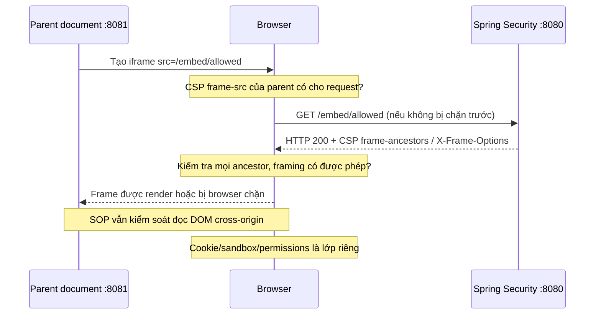
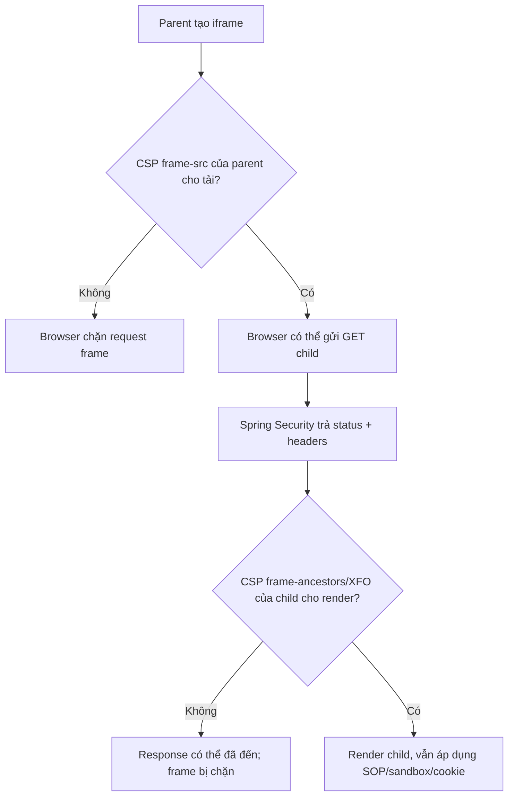
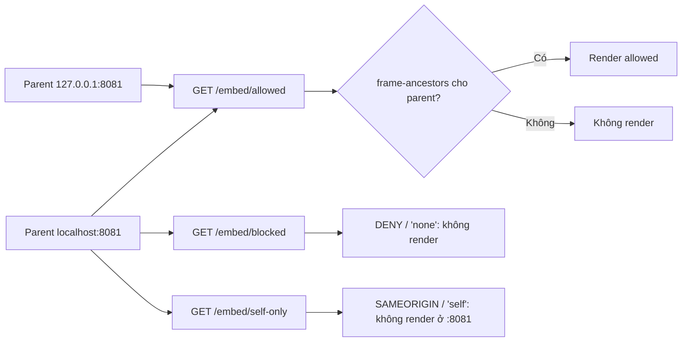
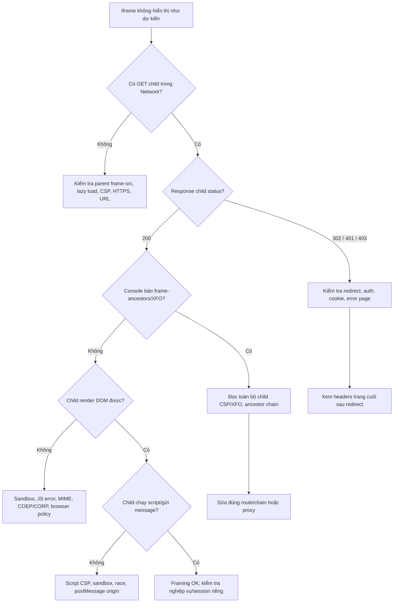

# Kiểm tra iframe được phép và bị chặn

Một trang HTML có thể nhúng nội dung từ một website khác bằng `<iframe src="...">`, nhưng **việc browser gửi request tới trang con** và **việc browser cho phép render trang con bên trong khung** không phải một quyết định. Response từ Spring Security có thể tới browser với HTTP `200 OK` nhưng iframe vẫn hiển thị trắng hoặc báo lỗi vì `X-Frame-Options: DENY` hoặc Content Security Policy (CSP) `frame-ancestors 'none'`. Ngược lại, một iframe có thể **render thành công** nhưng JavaScript của trang cha vẫn **không được đọc DOM trang con** vì Same-Origin Policy.

Đây là kiến thức nền tảng để kiểm thử nguy cơ **clickjacking** (đánh lừa người dùng bấm vào giao diện bị nhúng), xây dựng trang/ứng dụng nhúng hợp lệ, tích hợp cổng đăng nhập hoặc dashboard và chẩn đoán sự cố khi triển khai qua reverse proxy. Bài học thuộc chương **Kiểm thử trình duyệt** của module **SPRING_SECURITY_HTTP_PROTECTION**: áp dụng CSRF, CORS, security headers, CSP, HSTS, HTTP firewall, session protection cho Spring Security Servlet và Reactive; dựng các phép thử browser có đối chứng, quan sát network và phân biệt các tầng bảo mật.

Các ví dụ bên dưới dùng **Spring Boot 3.x, Spring Security Servlet 6.x, Java 17+** cùng một static server Node.js ở port khác. Mọi endpoint chỉ phục vụ **môi trường local do bạn sở hữu**, không chứa tài khoản hoặc dữ liệu người thật. Phần cuối đối chiếu WebFlux.

**Kết quả cần đạt:**

- Phân biệt iframe **request sent**, **response received**, **framing permitted**, **child DOM accessible**, **cookie sent** và **side effect permitted**.
- Đọc đúng ý nghĩa của `X-Frame-Options: DENY`, `SAMEORIGIN`, CSP `frame-ancestors`, CSP `frame-src` và sandbox của `<iframe>`.
- Tạo response Spring Security **cho phép một origin cha cụ thể** nhưng chặn origin khác và một endpoint **không được nhúng ở bất cứ đâu**.
- Kiểm thử bằng DevTools, MockMvc và Playwright; không dựa duy nhất vào `iframe.onload` hoặc status `200`.
- Chẩn đoán xung đột header, reverse proxy, nested iframe, SameSite cookies, third-party storage, CSP, CORS, CSRF và browser policies.

## 1. Threat model: clickjacking là gì và vì sao iframe có nguy cơ?

**Clickjacking** xảy ra khi một trang không đáng tin đặt nội dung/giao diện từ ứng dụng đích vào iframe, có thể dùng lớp phủ, độ trong suốt, vị trí các nút hoặc những thủ thuật UI để khiến người dùng tưởng đang bấm một thành phần vô hại, trong khi thực tế tương tác với ứng dụng đích.

```text
Trang do bên khác kiểm soát
┌────────────────────────────────────────┐
│ "Nhấn để nhận phần thưởng"              │
│                                        │
│  ┌──────────────────────────────────┐  │
│  │ iframe ứng dụng ngân hàng        │  │
│  │ [Xác nhận chuyển khoản]          │  │
│  └──────────────────────────────────┘  │
└────────────────────────────────────────┘
```

Sơ đồ chỉ minh họa nguy cơ: bài này **không yêu cầu dựng giao diện lừa người dùng**. Mục tiêu là **kiểm tra ứng dụng có chặn bị nhúng từ nơi không đáng tin hay không** và trường hợp nhúng hợp lệ được giới hạn đúng theo hợp đồng tích hợp.

Các biện pháp phòng vệ có vai trò khác nhau:

- **`X-Frame-Options`**: header truyền thống để hạn chế một trang được hiển thị trong iframe.
- **CSP `frame-ancestors`**: cơ chế hiện đại để kiểm soát **các origin/site được phép làm tổ tiên khung** của tài liệu được trả về.
- **Authentication/authorization**: vẫn quyết định người dùng có quyền xem hoặc thực hiện hành động.
- **CSRF token**: giúp từ chối unsafe requests không có token hợp lệ; không thay thế việc ngăn giao diện bị nhúng.
- **SameSite cookies**: điều chỉnh cookie gửi trong iframe cross-site, không tự bảo đảm UI không bị clickjacking.
- **CSP `frame-src` ở trang cha**: hạn chế trang cha được tải iframe từ đâu; **không** bảo vệ trang con khỏi một trang cha do kẻ khác kiểm soát.

Không nên xem một `403` do CSRF hoặc một cookie bị SameSite chặn là bằng chứng chắc chắn rằng **clickjacking defense đã đúng**. Trọng tâm của bài là kiểm tra **chính sách cho phép/không cho phép nhúng** tại browser.

## 2. Sáu kết quả độc lập của một iframe

Khi trang `http://localhost:8081/parent.html` chứa:

```html
<iframe src="http://localhost:8080/embed/allowed"
        title="Nội dung thử nghiệm"></iframe>
```

trình duyệt có các bước/điều kiện tách biệt:



| Lớp | Câu hỏi kiểm tra | Cách quan sát |
| --- | --- | --- |
| **Gửi request** | `GET /embed/allowed` có tới server không? | Network, server request metadata |
| **Response server** | Server trả HTTP status/headers gì? | Network → Headers, MockMvc |
| **Framing được phép** | Browser có render tài liệu con không? | Frame thực, Console CSP/XFO, Playwright `frameLocator` |
| **SOP/DOM** | Script của parent có đọc `iframe.contentDocument` không? | Browser Console với `try/catch`; browser automation khác quyền script |
| **Cookie/session** | Browser gửi cookie nào khi tải iframe? | Network → Request Cookies / blocked reason |
| **Quyền tương tác/side effect** | Form, nút và API trong frame có được phép thực hiện hành động? | Authentication, CSRF, authorization, state server |

Một iframe có thể **nhận response `200` nhưng bị chặn render**, có thể **render nhưng parent đọc DOM bị `SecurityError`**, hoặc có thể **render nhưng không có session cookie** nên trang con chuyển đến màn login. Cả ba hiện tượng khác nhau và phải tìm đúng nguyên nhân.

### Không dùng `iframe.onload` làm bằng chứng duy nhất

Các browser có thể vẫn phát sự kiện `load` cho `<iframe>` ngay cả khi nội dung bị ngăn bởi chính sách bảo mật, nhằm tránh tiết lộ thông tin qua sự kiện load/error. Bởi vậy:

```javascript
frame.addEventListener("load", () => {
  // Chưa đủ để khẳng định trang con đã render đúng!
});
```

Để xác minh một frame được phép **hiển thị đúng nội dung**, dùng browser automation quan sát phần tử bên trong frame hoặc tín hiệu test `postMessage` có xác minh origin/source. Để xác minh frame bị chặn, xem **actual response headers**, Console và trạng thái render; không chỉ dựa vào `load` hoặc một HTTP status.

## 3. `X-Frame-Options`: `DENY` và `SAMEORIGIN`

`X-Frame-Options` (viết tắt **XFO**) là response header truyền thống kiểm soát việc browser hiển thị tài liệu trong `<frame>`, `<iframe>`, `<embed>` hoặc `<object>` ở các ngữ cảnh được browser hỗ trợ.

```http
X-Frame-Options: DENY
```

**`DENY`** yêu cầu browser **không cho nhúng tài liệu**, kể cả khi trang cha **cùng origin**.

```http
X-Frame-Options: SAMEORIGIN
```

**`SAMEORIGIN`** cho nhúng theo ranh giới same-origin ở browser hỗ trợ. Với origin `http://localhost:8080`, một trang `http://localhost:8081` **khác origin** vì port khác nên thường bị chặn. Đối với cấu trúc iframe lồng nhiều tầng, cách các browser cũ kiểm tra top-level/chuỗi ancestor bằng XFO có khác biệt lịch sử; dùng `frame-ancestors` để khai báo chính sách hiện đại và kiểm thử browser mục tiêu.

| XFO trên response con | Trang cha `localhost:8080` | Trang cha `localhost:8081` | Trang cha `127.0.0.1:8081` |
| --- | --- | --- | --- |
| `DENY` | Chặn | Chặn | Chặn |
| `SAMEORIGIN` | Thường cho phép | Chặn | Chặn |
| Không có XFO | Không bị XFO chặn | Không bị XFO chặn | Không bị XFO chặn |

**Không có XFO không đồng nghĩa tự do nhúng:** response có thể bị **CSP `frame-ancestors`**, parent CSP `frame-src`, sandbox, COEP/CORP trong điều kiện khác hoặc browser policies hạn chế.

### `ALLOW-FROM` không phải cách tạo allow-list hiện đại

Chỉ thị cũ `X-Frame-Options: ALLOW-FROM https://partner.example.test` có mức hỗ trợ rất hạn chế và bị browser hiện đại bỏ qua/không hỗ trợ. Đừng dùng nó để thay thế allow-list; dùng **`Content-Security-Policy: frame-ancestors ...`** và kiểm tra browser mục tiêu.

### Spring Security thường gửi XFO mặc định

Trong cấu hình Spring Security Servlet thông dụng, response đi qua SecurityFilterChain có header phòng vệ mặc định `X-Frame-Options: DENY`. Do đó bạn có thể thêm CSP `frame-ancestors` cho phép một origin nhưng vẫn thấy iframe bị chặn ở một số môi trường nếu còn chính sách/hạ tầng khác xung đột. Với **endpoint thực sự cho phép nhúng**, nên cấu hình rõ XFO và CSP tương thích trong security chain phù hợp, không tắt XFO toàn ứng dụng.

## 4. CSP `frame-ancestors`: trang con được nhúng bởi ai?

CSP `frame-ancestors` được phát trong **response của tài liệu con**, ví dụ:

```http
Content-Security-Policy: frame-ancestors 'none'
```

**`'none'`**: chặn tài liệu bị nhúng bởi mọi tổ tiên.

```http
Content-Security-Policy: frame-ancestors 'self'
```

**`'self'`**: chỉ cho những tổ tiên phù hợp **origin của tài liệu con** theo ngữ nghĩa CSP.

```http
Content-Security-Policy: frame-ancestors 'self' http://localhost:8081
```

**Allow-list**: cho phép tổ tiên cùng origin hoặc origin cụ thể `http://localhost:8081`. Khi tài liệu con ở `http://localhost:8080`, trang cha `localhost:8081` được cho nhúng, còn `127.0.0.1:8081` không được phép dù đều chạy trên máy local.

### `frame-ancestors` kiểm tra **tất cả** ancestor

Không chỉ có một quan hệ parent → child. Với iframe nhiều tầng:

```text
Top-level: http://127.0.0.1:8081        (không được allow)
   └─ Middle: http://localhost:8081     (được allow)
      └─ Child: http://localhost:8080/embed/allowed
```

Một `frame-ancestors` chỉ allow `http://localhost:8081` vẫn **có thể chặn child** vì **top-level ancestor** `http://127.0.0.1:8081` không thuộc allow-list. Browser xét **chuỗi tổ tiên**, không chỉ parent trực tiếp. Một chính sách cho phép tích hợp hợp lệ phải được thiết kế dựa trên mọi top-level embedding scenario được cấp phép; không thêm wildcard rộng chỉ vì nested embed bị chặn.

### Không có fallback từ `default-src`

**`frame-ancestors` không kế thừa `default-src`.** Policy:

```http
Content-Security-Policy: default-src 'self'
```

**không** tự trở thành `frame-ancestors 'self'`. Nếu muốn bảo vệ chống clickjacking bằng CSP, phải cấu hình **`frame-ancestors` tường minh** hoặc dùng XFO phù hợp.

### Response header, không phải meta CSP

`frame-ancestors` phải được gửi dưới dạng **HTTP response header**. Viết:

```html
<meta http-equiv="Content-Security-Policy"
      content="frame-ancestors 'none'">
```

không phải cách đáng tin/hợp lệ để thiết lập `frame-ancestors` của tài liệu. Browser cần quyết định tài liệu có được nhúng ngay khi xử lý response, trước khi có thể phụ thuộc vào nội dung HTML.

### Cú pháp và những lỗi thường gặp

| Sai lầm | Hệ quả |
| --- | --- |
| Dùng `frame-ancestors none` không dấu nháy | Không phải source expression `'none'` đúng chuẩn |
| Dùng `http://localhost` khi đích cần `http://localhost:8081` | Origin khác port không khớp |
| Cho `localhost` nhưng parent thực ở `127.0.0.1` | Hostname không khớp |
| Chỉ allow parent trực tiếp, bỏ qua outer frame | Một ancestor không khớp làm nhúng thất bại |
| Chỉ khai báo `default-src 'self'` | Không áp dụng như `frame-ancestors` |
| Đặt `frame-ancestors` trong meta tag | Không có hiệu lực như response header |
| Chỉ ghi `Content-Security-Policy-Report-Only` | Không bảo đảm **chặn** framing; phải có policy enforce |
| Dùng CSP allow-list nhưng để XFO mâu thuẫn | Hành vi phụ thuộc browser/phiên bản; cần chính sách tương thích |

Đối với CSP, nhiều header/policy cùng được áp dụng có thể tạo **giao** các hạn chế; một policy cho phép không làm vô hiệu policy khác nghiêm ngặt hơn. Khi debug, xem **toàn bộ** header CSP/XFO mà browser thực nhận, bao gồm những header do gateway bổ sung.

## 5. `frame-ancestors` khác `frame-src` và `child-src`

Hai directive CSP có tên giống nhau nhưng **hướng kiểm soát ngược nhau**:

| Directive | Được phát ở | Kiểm soát |
| --- | --- | --- |
| `frame-ancestors` | **Response trang con** | **Ai được nhúng trang con này?** |
| `frame-src` | **Response trang cha** | **Trang cha được tải iframe từ đâu?** |
| `child-src` | Response trang cha | Directive cũ/chung cho frame/worker ở một số phiên bản; `frame-src` ưu tiên khi có |
| `default-src` | Response trang cha | Có thể làm fallback cho `frame-src` theo quy tắc CSP nếu không có directive cụ thể |

Ví dụ một parent **cho phép tải** child:

```http
Content-Security-Policy: default-src 'self'; frame-src http://localhost:8080
```

Nhưng child vẫn có quyền **từ chối**:

```http
Content-Security-Policy: frame-ancestors 'none'
```

Kết quả: iframe **không render**, dù parent có `frame-src` cho phép. Ngược lại, parent có:

```http
Content-Security-Policy: frame-src 'none'
```

thì browser có thể **chặn request iframe từ parent** trước khi server child trả response. Đây không phải bằng chứng `frame-ancestors`/XFO của child đã chạy.



**Không đổi `frame-src` ở child để giải quyết lỗi `frame-ancestors` của child**, cũng không đổi CSP ở parent khi response child thật sự nói `frame-ancestors 'none'`. Từng directive có trách nhiệm riêng.

## 6. Khi iframe render được, Same-Origin Policy vẫn áp dụng

Từ một parent `http://localhost:8081`, child `http://localhost:8080` là **cross-origin**. Ngay cả khi CSP cho render:

```javascript
const iframe = document.querySelector("#allowed");

try {
  console.log(iframe.contentDocument.body.textContent);
} catch (error) {
  // Cross-origin DOM access có thể ném SecurityError.
  console.log("Không được đọc DOM child:", error.name);
}
```

Trang cha **không** được tự đọc DOM child chỉ vì được phép nhúng. Nếu sản phẩm cần giao tiếp giữa parent và child, dùng **`window.postMessage`** với `targetOrigin` cụ thể, và parent kiểm tra `event.origin`, `event.source`, schema dữ liệu trước khi tin message.

**CORS cũng không tự cấp quyền parent đọc `iframe.contentDocument`.** CORS áp dụng cho những yêu cầu web API như `fetch`/XHR theo ngữ nghĩa riêng; nó không phải cơ chế bỏ SOP của DOM giữa hai tài liệu cross-origin.

### Không dùng iframe làm kênh truyền dữ liệu nhạy cảm mặc định

Một frame đã được cho nhúng nhưng có quyền hiển thị dữ liệu người dùng vẫn cần authentication, authorization, cookie scope, CSRF và giảm thiểu rủi ro clickjacking từ phần giao diện có thao tác nhạy cảm. Không gửi access token/session ID qua `postMessage` hoặc query string chỉ để “iframe chạy được”.

## 7. Kiến trúc lab: ba response con và hai origin cha

Trong môi trường local cô lập, tạo:

| Thành phần | URL | Chính sách mong đợi |
| --- | --- | --- |
| Child **được cho nhúng** | `http://localhost:8080/embed/allowed` | CSP `frame-ancestors 'self' http://localhost:8081`; **không phát XFO** ở route này |
| Child **không được nhúng** | `http://localhost:8080/embed/blocked` | XFO `DENY` và CSP `frame-ancestors 'none'` |
| Child **chỉ cùng origin** | `http://localhost:8080/embed/self-only` | XFO `SAMEORIGIN` và CSP `frame-ancestors 'self'` |
| Parent cùng origin | `http://localhost:8080/parent-self.html` | Kiểm chứng `/embed/self-only` được render |
| Parent ngoài origin **được allow** | `http://localhost:8081/parent.html` | Được nhúng `/embed/allowed`, không được nhúng hai child còn lại |
| Parent ngoài origin **không allow** | `http://127.0.0.1:8081/parent.html` | Không được nhúng cả ba child |
| Parent có CSP **`frame-src 'none'`** | `http://localhost:8081/parent.html?restrict=1` | Parent tự chặn load iframe |
| Inspector cùng origin | `http://localhost:8080/lab/frame-stats` | Đếm GET child tới controller, không đo render |



Lab chỉ trả HTML tĩnh và telemetry đếm GET; **không có tài khoản, token, thanh toán hay thao tác nhạy cảm**. Các hostname `localhost` và `127.0.0.1` đều trỏ về loopback nhưng **không cùng origin** theo browser. Đặt chính sách cho **route có thể nhúng**, không xóa bảo vệ framing trên toàn ứng dụng.

### Vì sao dùng port 8081?

Port khác giúp tạo cross-origin đáng tin cậy trong lab: `http://localhost:8080` và `http://localhost:8081` khác origin dù cùng hostname và thường cùng site. Với `127.0.0.1:8081`, hostname cũng khác, tạo thêm một origin không thuộc CSP allow-list. **Cookie không phân biệt theo port**, nên cả hai server phải do bạn kiểm soát; không dùng mô hình hai port để giả lập ranh giới cookie an toàn trong production.

## 8. Cấu hình Spring Security Servlet bằng ba `SecurityFilterChain`

Giả sử dự án Spring Boot có `spring-boot-starter-web` và `spring-boot-starter-security`. Ví dụ dùng DSL lambda của Spring Security 6.x. Định nghĩa ba chain có thứ tự cụ thể:

```java
import org.springframework.context.annotation.Bean;
import org.springframework.context.annotation.Configuration;
import org.springframework.core.annotation.Order;
import org.springframework.security.config.annotation.web.builders.HttpSecurity;
import org.springframework.security.web.SecurityFilterChain;

@Configuration
public class FramingLabSecurity {

    @Bean
    @Order(1)
    SecurityFilterChain allowedFrameChain(HttpSecurity http)
            throws Exception {
        http
            .securityMatcher("/embed/allowed")
            .authorizeHttpRequests(auth -> auth
                .anyRequest().permitAll())
            .headers(headers -> headers
                // Chỉ route này không phát X-Frame-Options.
                .frameOptions(frame -> frame.disable())
                .contentSecurityPolicy(csp -> csp
                    .policyDirectives(
                        "frame-ancestors 'self' http://localhost:8081")));
        return http.build();
    }

    @Bean
    @Order(2)
    SecurityFilterChain selfOnlyFrameChain(HttpSecurity http)
            throws Exception {
        http
            .securityMatcher("/embed/self-only")
            .authorizeHttpRequests(auth -> auth
                .anyRequest().permitAll())
            .headers(headers -> headers
                .frameOptions(frame -> frame.sameOrigin())
                .contentSecurityPolicy(csp -> csp
                    .policyDirectives("frame-ancestors 'self'")));
        return http.build();
    }

    @Bean
    @Order(3)
    SecurityFilterChain restOfLabChain(HttpSecurity http)
            throws Exception {
        http
            .authorizeHttpRequests(auth -> auth
                .requestMatchers(
                    "/embed/blocked",
                    "/parent-self.html",
                    "/lab/frame-stats").permitAll()
                .anyRequest().denyAll())
            .headers(headers -> headers
                .frameOptions(frame -> frame.deny())
                .contentSecurityPolicy(csp -> csp
                    .policyDirectives("frame-ancestors 'none'")));
        return http.build();
    }
}
```

`@Order` khiến chain match `/embed/allowed` hoặc `/embed/self-only` được chọn **trước** chain còn lại. Một request chỉ được xử lý bởi **SecurityFilterChain khớp đầu tiên**; không có chuyện mọi chain cùng cộng header vào response. Nếu thứ tự sai, route đáng lẽ được nhúng có thể đi vào chain `DENY`, gây lỗi khó nhận diện.

**Về phạm vi của `frameOptions(...disable())`:** ta chỉ tắt việc phát XFO ở chain dành riêng cho `/embed/allowed`, **không** tắt toàn bộ security headers hay CSRF. Các response còn lại vẫn có framing protection. Với CSP `frame-ancestors` tường minh, browser hiện đại biết chính xác parent nào được phép.

### Tại sao cả XFO và CSP của route bị chặn đều là deny?

`/embed/blocked` có XFO `DENY` và CSP `frame-ancestors 'none'` để phòng vệ sâu cho các browser hỗ trợ khác nhau. Trong các browser hiện đại khi có CSP `frame-ancestors` đang enforce, CSP có thể được ưu tiên hơn XFO; **không thiết kế một route với chính sách mâu thuẫn rồi phụ thuộc browser chọn cái nào**. Với route allowed, chúng ta chủ động **không phát XFO `DENY`** để tránh sự mâu thuẫn.

### Còn CSRF?

Spring Security vẫn bật CSRF theo mặc định khi không gọi `.csrf(csrf -> csrf.disable())`. Lab không có POST thay đổi dữ liệu, nhưng việc cho phép iframe **không** biến thành quyền bỏ CSRF hay authentication trong ứng dụng thực tế. Nếu sau này thêm endpoint unsafe dùng cookie, phải kiểm tra token/session và authorization như các trang không nhúng.

### Không cấu hình CORS cho phép iframe

Ví dụ cố ý **không** gọi `.cors()` hoặc `@CrossOrigin` để cho phép iframe. Một tài liệu được nhúng bằng navigation không dùng CORS như API `fetch`. **`frame-ancestors` của child** quyết định việc render child trong khung; parent/child cùng origin hay khác origin còn quyết định SOP. Đừng dùng ACAO để “sửa” một lỗi `Refused to frame`.

## 9. Controller trả các trang child và telemetry an toàn

Tạo `FrameLabController.java` với HTML tĩnh không có dữ liệu người dùng:

```java
import java.util.Map;
import java.util.concurrent.atomic.AtomicInteger;
import org.springframework.http.CacheControl;
import org.springframework.http.MediaType;
import org.springframework.http.ResponseEntity;
import org.springframework.web.bind.annotation.GetMapping;
import org.springframework.web.bind.annotation.RestController;

@RestController
public class FrameLabController {

    private final AtomicInteger allowedGets = new AtomicInteger();
    private final AtomicInteger blockedGets = new AtomicInteger();
    private final AtomicInteger selfOnlyGets = new AtomicInteger();

    @GetMapping(
        value = "/embed/allowed",
        produces = MediaType.TEXT_HTML_VALUE)
    ResponseEntity<String> allowed() {
        allowedGets.incrementAndGet();
        return html("""
            <!doctype html>
            <html lang="vi">
            <head><meta charset="utf-8"><title>Allowed child</title></head>
            <body>
              <h2 data-testid="allowed-child">Frame được cho phép</h2>
              <p>HTML giả, không chứa tài khoản hay token.</p>
              <script>
                // Chỉ báo một tín hiệu không nhạy cảm cho parent tin cậy.
                window.parent.postMessage(
                  {kind: "lab-frame-ready", page: "allowed"},
                  "http://localhost:8081");
              </script>
            </body>
            </html>
            """);
    }

    @GetMapping(
        value = "/embed/blocked",
        produces = MediaType.TEXT_HTML_VALUE)
    ResponseEntity<String> blocked() {
        blockedGets.incrementAndGet();
        return html("""
            <!doctype html>
            <html lang="vi">
            <head><meta charset="utf-8"><title>Blocked child</title></head>
            <body>
              <h2 data-testid="blocked-child">Không được nhúng</h2>
              <p>Chỉ đọc trực tiếp khi không nằm trong iframe.</p>
            </body>
            </html>
            """);
    }

    @GetMapping(
        value = "/embed/self-only",
        produces = MediaType.TEXT_HTML_VALUE)
    ResponseEntity<String> selfOnly() {
        selfOnlyGets.incrementAndGet();
        return html("""
            <!doctype html>
            <html lang="vi">
            <head><meta charset="utf-8"><title>Self-only child</title></head>
            <body>
              <h2 data-testid="self-child">Chỉ cho same-origin parent</h2>
            </body>
            </html>
            """);
    }

    @GetMapping("/lab/frame-stats")
    ResponseEntity<Map<String, Integer>> stats() {
        return ResponseEntity.ok()
            .cacheControl(CacheControl.noStore())
            .body(Map.of(
                "allowedGets", allowedGets.get(),
                "blockedGets", blockedGets.get(),
                "selfOnlyGets", selfOnlyGets.get()));
    }

    private ResponseEntity<String> html(String body) {
        return ResponseEntity.ok()
            .contentType(MediaType.TEXT_HTML)
            .cacheControl(CacheControl.noStore())
            .body(body);
    }
}
```

### Đọc đúng số đếm

`allowedGets`, `blockedGets`, `selfOnlyGets` tăng khi **controller xử lý GET**, không phải khi browser render thành công. Một response có thể tới browser rồi bị chặn do `frame-ancestors`/XFO nhưng counter vẫn tăng. Đây là phép đo chủ động để chứng minh **framing blocked khác request blocked**.

Nếu parent CSP `frame-src 'none'` chặn trước network, counter tương ứng **có thể không tăng**, vì browser chưa gửi GET child. Khi làm test tự động, dùng **delta trước/sau**, tránh số tuyệt đối nếu có tab khác hoặc test đang chạy đồng thời.

Endpoint `/lab/frame-stats` không tạo session, không trả cookie, token, email hay thông tin cá nhân. Lab chỉ dùng telemetry giả; không đưa bộ đếm global này thành logic nghiệp vụ.

### `Content-Type` và cache cũng cần đúng

Các response child đặt `Content-Type: text/html` và `Cache-Control: no-store`. Header frame policy chỉ có ý nghĩa khi browser xử lý đúng tài liệu; cache hoặc proxy có thể trả response với chính sách cũ, khiến người kiểm thử nghĩ thay đổi Spring Security không có hiệu lực. Khi debug, sử dụng context sạch hoặc Disable cache; kiểm tra Response Headers trên **response thực tế**.

## 10. Parent cùng origin: chứng minh `SAMEORIGIN` hoạt động

Tạo file `src/main/resources/static/parent-self.html`:

```html
<!doctype html>
<html lang="vi">
<head>
  <meta charset="utf-8">
  <title>Parent cùng origin</title>
</head>
<body>
  <h1>Parent cùng origin: localhost:8080</h1>
  <p>Frame self-only phải hiển thị; frame blocked phải bị chặn.</p>

  <iframe id="self-frame"
          title="Self-only child"
          src="/embed/self-only"
          width="500" height="140"></iframe>

  <iframe id="blocked-frame"
          title="Blocked child"
          src="/embed/blocked"
          width="500" height="140"></iframe>
</body>
</html>
```

Mở:

```text
http://localhost:8080/parent-self.html
```

**Kỳ vọng:**

- `/embed/self-only` hiển thị dòng “Chỉ cho same-origin parent”; CSP `frame-ancestors 'self'` và XFO `SAMEORIGIN` cùng cho phép.
- `/embed/blocked` **không render**, mặc dù parent cùng origin; `frame-ancestors 'none'`/XFO `DENY` chặn.
- Network có thể ghi nhận cả hai GET child và status `200`, nhưng chỉ một frame hiển thị.

Để kiểm tra cấu hình server, mở trực tiếp:

```text
http://localhost:8080/embed/blocked
```

Tài liệu bị cấm **nhúng** vẫn thường **mở trực tiếp như top-level document** được, vì lúc này **không có framing ancestor**. Đây là phân biệt quan trọng: XFO/CSP `frame-ancestors` không phải authentication hoặc firewall chặn truy cập tài liệu.

## 11. Parent khác origin: một frame được allow, hai frame bị chặn

Tại server static `http://localhost:8081`, tạo `parent.html`:

```html
<!doctype html>
<html lang="vi">
<head>
  <meta charset="utf-8">
  <title>Framing policy lab</title>
</head>
<body>
  <h1>Parent: <span id="origin"></span></h1>

  <h2>1. Allowed child</h2>
  <iframe id="allowed"
          title="Allowed from localhost port 8081"
          src="http://localhost:8080/embed/allowed"
          width="540" height="145"></iframe>

  <h2>2. Blocked child</h2>
  <iframe id="blocked"
          title="Denied by server"
          src="http://localhost:8080/embed/blocked"
          width="540" height="145"></iframe>

  <h2>3. Self-only child</h2>
  <iframe id="self-only"
          title="Same origin only"
          src="http://localhost:8080/embed/self-only"
          width="540" height="145"></iframe>

  <p>Tín hiệu từ frame được phép:
    <output id="result">Chưa có tín hiệu xác thực.</output>
  </p>
  <script src="/parent.js" defer></script>
</body>
</html>
```

Vì child `allowed` ở `localhost:8080` còn parent ở `localhost:8081`, chúng khác origin. Browser có thể render child allowed nhưng script parent **không được truy cập DOM child**. Chúng ta sử dụng một tín hiệu `postMessage` với kiểm tra nguồn để làm bằng chứng test tiện lợi.

Tạo `parent.js` tại cùng static server:

```javascript
"use strict";

document.querySelector("#origin").textContent = location.origin;

const expectedChildOrigin = "http://localhost:8080";
const trustedFrame = document.querySelector("#allowed");

window.addEventListener("message", event => {
  // Không tin message chỉ vì có kind/page trông đúng.
  if (event.origin !== expectedChildOrigin) return;
  if (event.source !== trustedFrame.contentWindow) return;

  const data = event.data;
  if (!data || typeof data !== "object") return;
  if (data.kind !== "lab-frame-ready") return;
  if (data.page !== "allowed") return;

  // Chỉ chứa trạng thái giả, không nhận token/cookie.
  document.querySelector("#result").textContent =
      "Allowed iframe đã gửi tín hiệu hợp lệ";
});
```

Ở child, `postMessage` đặt `targetOrigin` **chính xác** là `http://localhost:8081`. Parent cũng kiểm tra `event.origin` và `event.source`. Đây là mẫu giao tiếp an toàn hơn dùng `"*"` hoặc chỉ kiểm tra `event.data.page`; nhưng **trạng thái “ready” không phải authentication**, và chỉ được dùng như tín hiệu lab, không cấp quyền thực hiện giao dịch.

### Tại sao không dựa hoàn toàn vào `postMessage`?

Một iframe có thể **render được nhưng script trong iframe không chạy** vì sandbox, CSP `script-src`, JavaScript bị tắt hoặc lỗi ứng dụng. Khi đó sẽ không có message dù framing policy cho phép. Vì vậy test chính cần kiểm tra **DOM/hiển thị frame**, còn `postMessage` là bằng chứng bổ sung về giao tiếp cross-origin.

## 12. Static server Node.js và CSP `frame-src` của parent

Trong một dự án lab **riêng**, đặt ba file ở cùng thư mục:

```text
iframe-parent-lab/
  parent.html
  parent.js
  static-server.mjs
```

`parent.html` và `parent.js` là hai file từ mục 11. Tạo `static-server.mjs` để chạy trang nguồn ở hai hostname local:

```javascript
import http from "node:http";
import { readFile } from "node:fs/promises";

const parentHtml = await readFile(
  new URL("./parent.html", import.meta.url));
const parentJs = await readFile(
  new URL("./parent.js", import.meta.url));

const outerHtml = Buffer.from(`
  <!doctype html><html lang="vi">
  <head><meta charset="utf-8"><title>Outer frame</title></head>
  <body>
    <h1>Outer: 127.0.0.1:8081</h1>
    <iframe id="middle"
      title="Middle trusted parent"
      width="700" height="850"
      src="http://localhost:8081/parent.html"></iframe>
  </body></html>`, "utf8");

http.createServer((request, response) => {
  if (request.method !== "GET") {
    response.writeHead(405, {
      "Content-Type": "text/plain; charset=utf-8"
    });
    response.end("Method Not Allowed");
    return;
  }

  const url = new URL(
    request.url ?? "/", "http://127.0.0.1:8081");

  if (url.pathname === "/parent.js") {
    response.writeHead(200, {
      "Content-Type": "text/javascript; charset=utf-8",
      "Cache-Control": "no-store",
      "X-Content-Type-Options": "nosniff"
    });
    response.end(parentJs);
    return;
  }

  if (url.pathname === "/parent.html") {
    const restrict = url.searchParams.get("restrict") === "1";
    const frameSrc = restrict
      ? "'none'"
      : "http://localhost:8080";

    response.writeHead(200, {
      "Content-Type": "text/html; charset=utf-8",
      "Cache-Control": "no-store",
      "Content-Security-Policy":
        "default-src 'self'; script-src 'self'; " +
        "object-src 'none'; base-uri 'none'; " +
        `frame-src ${frameSrc}`
    });
    response.end(parentHtml);
    return;
  }

  if (url.pathname === "/outer.html") {
    response.writeHead(200, {
      "Content-Type": "text/html; charset=utf-8",
      "Cache-Control": "no-store",
      "Content-Security-Policy":
        "default-src 'self'; object-src 'none'; " +
        "frame-src http://localhost:8081"
    });
    response.end(outerHtml);
    return;
  }

  response.writeHead(404, {
    "Content-Type": "text/plain; charset=utf-8"
  });
  response.end("Not found");
}).listen(8081, "127.0.0.1", () => {
  process.stdout.write("Iframe lab: loopback port 8081\n");
});
```

Chạy trong thư mục chứa các file lab:

```bash
node static-server.mjs
```

Không có package ngoài Node.js. Server chỉ bind loopback IPv4, **không** đưa các endpoint test lên mạng LAN/Internet. Một số máy ưu tiên IPv6 `::1` khi phân giải `localhost`; nếu `http://localhost:8081` không kết nối, điều chỉnh loopback listener/host mapping cho đúng. **Không** sửa thành `0.0.0.0` chỉ để vượt lỗi kết nối của lab.

### Phân biệt hai biến thể của parent

Với:

```text
http://localhost:8081/parent.html
```

parent CSP cho phép tải frames từ `http://localhost:8080`, sau đó browser **còn kiểm tra policy của từng child**.

Với:

```text
http://localhost:8081/parent.html?restrict=1
```

parent nhận `frame-src 'none'`, nên có thể chặn iframe **ngay tại parent** trước khi request child được gửi. Cùng child CSP nhưng hành vi khác vì **người khởi tạo** đã tự từ chối.

### Parent “được tin” trong bài có nghĩa gì?

Chúng ta chỉ allow origin chính xác `http://localhost:8081` trong child CSP, vì cả hai server thuộc phạm vi lab. Trong production, cần xác minh quyền sở hữu/vòng đời của hostname partner, tránh origin dùng chung với mã không tin cậy và hạn chế origin được phép nhúng theo nhu cầu. CSP allow-list không xác thực danh tính người đang sử dụng frame.

## 13. Ma trận hành vi dự kiến cho các trang thử

| Parent / Child | `allowed` | `blocked` | `self-only` |
| --- | --- | --- | --- |
| `localhost:8080/parent-self.html` | Có thể nhúng nếu được tham chiếu | **Bị chặn** (`DENY`, `'none'`) | **Được nhúng** (`SAMEORIGIN`, `'self'`) |
| `localhost:8081/parent.html` | **Được nhúng** theo allow-list | **Bị chặn** | **Bị chặn** (khác origin) |
| `127.0.0.1:8081/parent.html` | **Bị chặn** (không trong ancestor allow-list) | **Bị chặn** | **Bị chặn** |
| `localhost:8081/parent.html?restrict=1` | **Bị parent chặn trước** | **Bị parent chặn trước** | **Bị parent chặn trước** |
| Mở `/embed/blocked` trực tiếp ở tab | **Không áp dụng tình huống iframe** | **Trang vẫn có thể hiển thị top-level** | **Không áp dụng tình huống iframe** |

Các kết quả trên giả định browser hỗ trợ CSP `frame-ancestors`/XFO đúng chuẩn, các server sẵn sàng và không có proxy/header ngoài lab sửa policy. Luôn xác minh **Response Headers thực nhận**; không coi ma trận này là cam kết tuyệt đối cho một browser cũ hoặc môi trường khác.

## 14. Thí nghiệm A: iframe được phép ở parent tin cậy

1. Mở DevTools → **Network → All**, bật **Preserve log** và khi cần **Disable cache**.
2. Mở `http://localhost:8081/parent.html`.
3. Quan sát frame `Allowed child` hiển thị tiêu đề **“Frame được cho phép”**.
4. Trên parent, dòng output có thể đổi thành **“Allowed iframe đã gửi tín hiệu hợp lệ”**.
5. Trong Network, chọn GET `http://localhost:8080/embed/allowed`; xem status và response headers.

Response dự kiến có:

```http
HTTP/1.1 200 OK
Content-Type: text/html
Content-Security-Policy: frame-ancestors 'self' http://localhost:8081
Cache-Control: no-store
```

**Không có `X-Frame-Options`** trên route này do chain allowed tắt header XFO riêng. Browser kiểm tra origin parent `http://localhost:8081` được CSP cho phép, nên render child.

### Kiểm tra JavaScript của parent vẫn bị SOP giới hạn

Trong Console của trang parent, thử:

```javascript
const child = document.querySelector("#allowed");

try {
  console.log(child.contentDocument?.body?.innerText);
} catch (error) {
  console.log("DOM cross-origin bị hạn chế:", error.name);
}
```

Với hai origin khác port, `contentDocument` có thể là `null` hoặc truy cập thuộc tính bị `SecurityError` tùy cách truy xuất/browser. Điều đó **không mâu thuẫn** với việc child render được. Giao tiếp test qua `postMessage` vẫn hợp lệ nhờ xác minh `event.origin`/`event.source`.

### Không nhầm tín hiệu `postMessage` với cấp quyền

`postMessage` chỉ là một API giao tiếp được browser hỗ trợ giữa các browsing contexts. Nó **không mở khóa DOM**, không xác thực user và không phải tiêu chí duy nhất để cấp quyền cho hành động nhạy cảm. Một tích hợp production cần schema message, expected origin, expected source, authorization và có thể cơ chế tương quan/nonce riêng không chứa bí mật.

## 15. Thí nghiệm B: response `200` nhưng iframe bị chặn render

Trên cùng parent `http://localhost:8081/parent.html`, quan sát hai frame còn lại:

```text
/embed/blocked   -> X-Frame-Options: DENY
                    Content-Security-Policy: frame-ancestors 'none'

/embed/self-only -> X-Frame-Options: SAMEORIGIN
                    Content-Security-Policy: frame-ancestors 'self'
```

Ở Network, browser có thể vẫn nhận HTTP `200` cho mỗi GET child. Nhưng trong Console có thể xuất hiện thông báo đại ý:

```text
Refused to frame ... because an ancestor violates
Content Security Policy: "frame-ancestors 'none'".
```

Hoặc thông báo liên quan `X-Frame-Options: DENY`/`SAMEORIGIN`, tùy browser, version và chính sách ưu tiên thực tế.

Quay lại tab cùng origin, mở:

```text
http://localhost:8080/lab/frame-stats
```

Nếu server xử lý GET child, `blockedGets` và `selfOnlyGets` có thể tăng dù iframe **không hiển thị**. Các counters này là **telemetry**, không chứng minh nội dung được phép render.

**Kết luận:** server xử lý request và trả `200` **không đồng nghĩa browser đã cho hiển thị tài liệu trong frame**. Framing policy nằm ở response headers và được browser thực thi sau khi nhận đủ thông tin cần thiết.

### Vì sao mở URL bị chặn trực tiếp vẫn được?

`X-Frame-Options` và CSP `frame-ancestors` hạn chế **bối cảnh nhúng**, không nhất thiết cấm **top-level navigation**. Mở `/embed/blocked` ở tab mới không có framing ancestor, do đó trình duyệt có thể hiển thị HTML. Nếu URL chứa dữ liệu nhạy cảm, cần authentication/authorization riêng; **framing policy không biến URL thành private**.

## 16. Thí nghiệm C: origin không được allow-list

Mở:

```text
http://127.0.0.1:8081/parent.html
```

Trang này có cùng nội dung và cùng child URLs với parent tin cậy, nhưng **origin thực** là `http://127.0.0.1:8081`, không phải `http://localhost:8081`.

Child `/embed/allowed` chỉ có CSP:

```http
Content-Security-Policy: frame-ancestors 'self' http://localhost:8081
```

Không có source expression cho `http://127.0.0.1:8081`. Browser phải từ chối render, dù cả hai hostname trỏ tới loopback và Node server phục vụ cùng file. Tín hiệu `postMessage` từ allowed child cũng không được dùng để kết luận, vì child chưa render và targetOrigin của message cũng chỉ là `http://localhost:8081`.

**Bài học:** policy dựa trên **origin string phù hợp scheme/hostname/port**, không dựa trên IP đích thực tế hay tên máy trong cảm nhận của người dùng. Không thêm `*` hoặc wildcard domain vào allow-list chỉ vì gặp một hostname trong môi trường test.

## 17. Thí nghiệm D: parent `frame-src 'none'` chặn trước child

Mở:

```text
http://localhost:8081/parent.html?restrict=1
```

Static server trả:

```http
Content-Security-Policy: default-src 'self'; script-src 'self'; object-src 'none'; base-uri 'none'; frame-src 'none'
```

Browser có thể chặn cả ba iframe **ngay khi parent tạo request**, trước khi GET child tới Spring Boot. So sánh `allowedGets`, `blockedGets`, `selfOnlyGets` trước và sau bằng `/lab/frame-stats` trong một lab không có request cạnh tranh: counters có thể **không tăng** nếu parent CSP chặn trước network.

Thí nghiệm này phân biệt:

- **Parent CSP `frame-src`**: parent **không cho tải** iframe từ origin khác, nên request có thể chưa được gửi.
- **Child CSP `frame-ancestors`/XFO**: request có thể đã tới child; response **không cho tài liệu render** trong parent.

Không sửa `frame-ancestors` của child khi Console báo `frame-src 'none'` của **parent**. Không sửa `frame-src` của parent khi response **child** đã chặn vì `frame-ancestors`.

## 18. Thí nghiệm E: iframe lồng nhiều tầng

Static server đã có URL:

```text
http://127.0.0.1:8081/outer.html
```

Nó nhúng một parent trung gian ở `http://localhost:8081/parent.html`, rồi parent trung gian cố nhúng child ở `http://localhost:8080/embed/allowed`.

```text
Outer parent:  http://127.0.0.1:8081
      ↓
Middle parent: http://localhost:8081
      ↓
Child:         http://localhost:8080/embed/allowed
```

CSP child chỉ cho `frame-ancestors 'self' http://localhost:8081`. Middle parent **khớp**, nhưng outer parent **không khớp**, vì thế child **bị chặn**. Một policy hiện đại không được chỉ nhìn parent trực tiếp mà bỏ qua toàn bộ chuỗi ancestor.

**Bằng chứng:** ghi URL và origin của **mọi frame trong cây**, quan sát Console/Network của child. Khi có partner nhúng qua một cổng trung gian, cần xác định toàn bộ embedding architecture trước khi điều chỉnh allow-list; không cấp quyền cho tất cả origin để “chữa” lỗi nested frame.

## 19. `sandbox` của iframe: giới hạn năng lực, không thay allow-list

Parent có thể thêm thuộc tính HTML `sandbox` để hạn chế những gì child được làm. Đây là **lớp riêng** với XFO và `frame-ancestors`:

```html
<iframe
    src="http://localhost:8080/embed/allowed"
    title="Widget sandboxed"
    sandbox
    width="540" height="145"></iframe>
```

Thuộc tính `sandbox` rỗng bật tập hạn chế mạnh. Tùy token được khai báo, browser có thể chặn script, form submission, popup, top-level navigation và coi child như một **opaque origin**.

| `sandbox` / token | Ảnh hưởng đáng chú ý |
| --- | --- |
| `sandbox` | Bật hạn chế mặc định; script thường không chạy |
| `allow-scripts` | Cho phép script chạy trong frame, **không tự khôi phục same-origin** |
| `allow-same-origin` | Cho phép child giữ origin thay vì bị ép opaque; **không tự bật script** |
| `allow-forms` | Cho phép form submission trong frame |
| `allow-popups` | Cho phép mở popup theo các giới hạn khác |
| `allow-top-navigation` | Nới quyền điều hướng top-level |
| `allow-downloads` | Nới quyền tải file trong ngữ cảnh được hỗ trợ |

**Cảnh báo:** với **nội dung same-origin mà bạn không tin cậy**, kết hợp `sandbox="allow-scripts allow-same-origin"` có thể làm suy yếu đáng kể khả năng sandbox bảo vệ, vì script cùng origin có thể tìm cách gỡ thuộc tính/reload trong một số mô hình. Đừng xem hai token này là mặc định an toàn cho nội dung không đáng tin; hãy cách ly bằng **origin riêng**, CSP và sandbox tối thiểu.

### Khi CSP cho nhúng nhưng `postMessage` không tới

Nếu parent dùng:

```html
<iframe sandbox
        src="http://localhost:8080/embed/allowed"></iframe>
```

child có thể vẫn **hiển thị HTML** nếu `frame-ancestors` cho phép parent, nhưng inline script trong child **không chạy**, nên tín hiệu `lab-frame-ready` không được gửi. Đây là lỗi/năng lực sandbox, **không phải** lỗi `frame-ancestors`.

Với `sandbox="allow-scripts"` nhưng **không** có `allow-same-origin`, child có thể chạy script trong **opaque origin**: `event.origin` của message gửi từ child có thể là `"null"`. Parent test của bài **cố ý từ chối message không đúng origin**; không tự đổi thành “tin tất cả message origin null”. Cần thiết kế giao thức thích hợp hoặc dùng mô hình nhúng có origin xác định.

### CSP sandbox response còn khác iframe sandbox attribute

Một response có thể chứa chỉ thị CSP `sandbox`, khiến browser áp dụng hạn chế sandbox cho tài liệu đó. Đây cũng không phải `frame-ancestors`; cùng là bảo vệ browser nhưng giải quyết vấn đề khác. Khi thấy script/form trong frame không hoạt động, kiểm tra cả **thuộc tính `sandbox` của iframe** và **CSP response child**.

## 20. `allow`/Permissions Policy không quyết định có render frame

Thuộc tính `allow` của iframe và response `Permissions-Policy` kiểm soát các khả năng như camera, microphone hoặc một số APIs của tài liệu con:

```html
<iframe
  src="http://localhost:8080/embed/allowed"
  title="Widget"
  allow="fullscreen"></iframe>
```

Một frame có thể **render hoàn toàn bình thường** nhưng không được phép dùng camera hoặc fullscreen. Ngược lại, việc cấp một feature bằng `allow` **không vượt được** `frame-ancestors 'none'` hay XFO `DENY`.

Nếu widget được cho nhúng nhưng không gọi được một browser API, hãy xem feature-specific permissions, user gesture, `Permissions-Policy`, iframe `allow`, HTTPS secure context và CSP — **không** vội tắt framing protection.

## 21. SameSite, session cookie và iframe cross-site

**Framing permitted** và **cookie sent** là hai quyết định độc lập. Một child có thể được CSP allow-list cho render trong parent, nhưng **không có session cookie** vì iframe nằm trong bối cảnh cross-site hoặc browser chặn third-party storage.

| Child/parent relation | Cookie `SameSite=Strict` | `SameSite=Lax` | `SameSite=None; Secure` qua HTTPS |
| --- | --- | --- | --- |
| Same-origin iframe | Thường gửi | Thường gửi | Có thể gửi |
| Cross-origin nhưng same-site iframe | Có thể gửi | Có thể gửi | Có thể gửi |
| Cross-site iframe | Thường không gửi | Thường không gửi | Có thể gửi, còn third-party policy |

Port không phân chia cookie; `localhost:8081` nhúng `localhost:8080` thường **same-site**, nên Lax/Strict **có thể** được gửi nếu cookie scope phù hợp. Nhưng `127.0.0.1:8081` → `localhost:8080` thường **cross-site** và có thể thiếu cookie Lax/Strict. Trong lab chính, frame allowed ở origin `127.0.0.1:8081` đã **bị chặn do `frame-ancestors`**, nên **không dùng case này một mình để đo SameSite cookie**.

### Muốn đo SameSite, phải tạo một ca riêng có framing được phép

Trong **môi trường test độc lập**, tạm tạo một endpoint child không nhạy cảm với allow-list bao gồm origin cross-site test, bảo đảm framing được phép; sau đó kiểm tra `Cookie` trên **actual iframe GET**. Đừng mở rộng allow-list của endpoint nhạy cảm production. Cần nhớ `SameSite=None; Secure` chỉ có ý nghĩa đúng khi thử qua HTTPS với chứng chỉ tin cậy và browser policy hiện hành; ngoại lệ loopback không đủ để kết luận.

### Iframe đã hiển thị login screen không chứng minh XFO sai

Nếu iframe load và hiển thị trang đăng nhập, framing policy có thể đã cho phép, nhưng session cookie không được gửi hoặc server không còn phiên. Ngược lại, một màn frame trắng với Console `Refused to frame` có thể là **XFO/CSP** dù cookie/session đầy đủ. Đây là hai nhóm chẩn đoán khác nhau.

### Cookie `HttpOnly` và CSP framing

`HttpOnly` ngăn script đọc cookie, không ngăn browser gửi nó trong request thích hợp. `SameSite` hạn chế ngữ cảnh cookie được gửi. `frame-ancestors` hạn chế tài liệu được **render trong iframe**. Không cái nào thay thế xác thực, phân quyền, CSRF token hoặc quản lý session phía server.

## 22. Vì sao CORS không sửa được lỗi iframe bị chặn?

CORS dành cho quyền truy cập cross-origin qua các API như `fetch`/XHR và một số cơ chế tải tài nguyên. Một **iframe navigation** có ngữ nghĩa riêng: browser tải tài liệu đích, áp dụng CSP parent `frame-src`, CSP child `frame-ancestors`, XFO và SOP.

Ví dụ, backend trả:

```http
HTTP/1.1 200 OK
Access-Control-Allow-Origin: *
X-Frame-Options: DENY
Content-Type: text/html
```

Header `Access-Control-Allow-Origin: *` **không vô hiệu hóa** `X-Frame-Options: DENY`. Iframe vẫn bị chặn theo XFO. Ngược lại, nếu child được allow framing nhưng parent dùng `fetch()` gọi API khác origin, **fetch đó** vẫn cần CORS để JavaScript đọc response nếu thuộc trường hợp browser yêu cầu.

**Không cấu hình `@CrossOrigin("*")` trên controller nhạy cảm chỉ để iframe chạy.** Việc mở quyền đọc response không liên quan trực tiếp đến framing; nó còn tạo phạm vi truy cập dữ liệu rộng hơn và có thể không hợp lệ với credentialed requests.

### Iframe form POST và CSRF

Nếu người dùng tương tác với form trong một iframe được phép render, unsafe POST do frame thực hiện vẫn đi qua Spring Security. Ứng dụng dùng cookie/session cần **CSRF token hợp lệ** và authentication/authorization:

```text
Iframe render được
    ≠ Người dùng đã đăng nhập
    ≠ Browser chắc chắn gửi cookie
    ≠ Form POST chắc chắn có CSRF token
    ≠ Controller được quyền thay đổi state
```

Vì vậy, một widget được phép nhúng phải được thiết kế theo **cả framing contract lẫn session/CSRF contract**, không chỉ một response header.

## 23. Header bảo mật và hạ tầng khác có thể ảnh hưởng iframe

| Tầng | Ví dụ | Cần kiểm tra |
| --- | --- | --- |
| Parent CSP | `frame-src`, `child-src`, `default-src` fallback | Parent có cho **tải** origin child không? |
| Child CSP | `frame-ancestors` | **Toàn bộ ancestor chain** có được allow không? |
| Child XFO | `DENY`, `SAMEORIGIN` | Có mâu thuẫn CSP không? |
| Parent iframe | `sandbox`, `allow`, `loading="lazy"` | Script/navigation/feature có bị hạn chế, có lazy load không? |
| SOP | Cross-origin DOM restrictions | Parent đọc DOM con hay chỉ giao tiếp `postMessage`? |
| Cookie policy | `SameSite`, `Secure`, `Domain`, `Path`, third-party cookies | Actual iframe GET có session cookie không? |
| HTTPS/HSTS | Upgrade/redirect scheme, mixed content | Browser có tải đúng HTTPS origin không? |
| Response MIME | `Content-Type`, `X-Content-Type-Options: nosniff` | Resource có được xử lý như tài liệu đúng loại không? |
| COEP/CORP/COOP | Cross-origin isolation/resource policy | Có chính sách cross-origin bổ sung cản resource không? |
| Authentication/CSRF | 302 login, 401, 403 | Framing bị chặn hay session/authorization thất bại? |
| Reverse proxy/gateway | Viết thêm XFO/CSP, rewrite headers | Browser cuối cùng nhận chính sách nào? |

### Vấn đề HTTPS và mixed content

Một parent HTTPS nhúng child HTTP có thể bị browser nâng cấp hoặc chặn mixed content tùy tài nguyên/chính sách. Khi đó browser có thể không gửi GET HTTP như kỳ vọng hoặc chuyển sang URL HTTPS khác. HSTS có thể làm browser tự nâng cấp request đến hostname đã ghi nhớ policy. Đừng kết luận nguyên nhân là `frame-ancestors` trước khi xem **actual URL/scheme sau redirect**.

### Lazy-loading

Nếu iframe có `loading="lazy"`, browser có thể trì hoãn request cho đến khi frame gần vùng nhìn thấy. Khi đo counter và Network, cuộn tới iframe hoặc dùng `loading="eager"` trong lab. **Không thấy GET** ở thời điểm mới mở trang chưa chắc CSP chặn; có thể iframe đơn giản chưa được tải.

### Reverse proxy có thể thêm header không mong đợi

Ví dụ app Spring Security route allowed chỉ phát CSP allow-list, nhưng Nginx/gateway lại thêm:

```http
X-Frame-Options: DENY
```

hoặc CSP khác:

```http
Content-Security-Policy: frame-ancestors 'none'
```

Browser có thể chặn iframe dù MockMvc test cho phép. **Response mà browser thực nhận** là nguồn phải đối chiếu. Tránh thêm nhiều CSP policies trái nhau từ app và gateway rồi hy vọng một policy “override” policy khác; nhiều enforce policies có thể được áp dụng đồng thời, làm phạm vi nhúng **hẹp hơn** dự kiến.

## 24. Redirect, login và error page trong iframe

Một iframe có thể truy cập `/embed/allowed` nhưng được server redirect tới `/login`:

```text
GET /embed/allowed
  -> 302 Location: /login
GET /login
  -> 200 OK + X-Frame-Options: DENY
```

Trong trường hợp đó, **final login page** có framing policy chặt hơn và bị chặn, trong khi endpoint ban đầu được allow. Đây thường là **đúng thiết kế**: không nhất thiết nên cho phép nhúng toàn bộ trang login chỉ để widget hiển thị.

Khi debug, mở **Preserve log**, xem:

- Actual request ban đầu và các redirect trong chain.
- Status/Location của từng hop.
- Chính sách XFO/CSP của **tài liệu cuối được browser cố hiển thị**, cùng các header liên quan.
- Cookie phiên có được gửi không, login/session có hợp lệ không.
- Có sandbox/third-party cookie blocking hay không.

Không tắt clickjacking protection trên `/login`, `/error` hoặc toàn bộ chain chỉ để một iframe khác path không bị trắng. Thiết kế endpoint embed có authentication/authorization phù hợp và policy tách biệt.

### Iframe báo `401`/`403` không nhất thiết là framing bị chặn

Nếu Network trả HTTP `401`/`403` từ backend, server đã từ chối request nghiệp vụ. Nếu Network trả `200` nhưng Console nói `frame-ancestors`/XFO violation, browser đang từ chối **render**. Có thể đồng thời xảy ra cả hai (ví dụ error page `403` cũng không cho nhúng). Cần ghi riêng **HTTP status** và **browser framing decision**.

## 25. Quy trình DevTools: tìm policy chặn đúng tầng

### Các bước trên Chrome/Edge/Firefox

1. Mở DevTools ở trang parent, vào **Network**, bật **Preserve log** và có thể bật **Disable cache** trong phiên debug.
2. Chọn filter **All** hoặc **Doc/Document**, không chỉ Fetch/XHR — iframe là **navigation của frame**, không phải API fetch thông thường.
3. Mở parent `localhost:8081/parent.html`, tìm các request con `/embed/allowed`, `/embed/blocked`, `/embed/self-only`. Ghi URL đầy đủ, method và status.
4. Với từng request, đọc **Response Headers**: `X-Frame-Options`, `Content-Security-Policy`, `Content-Type`, redirect headers.
5. Kiểm tra response **của parent** để xác định CSP `frame-src`. Không lấy policy child làm policy parent hoặc ngược lại.
6. Mở **Console** để xem thông báo **framing policy violation**; browser có thể dùng thông điệp khác nhau theo phiên bản.
7. Kiểm tra **Elements/Frames** xem tài liệu child có thật sự được render không. Không dùng event `load` đơn độc để kết luận.
8. Với child được phép, thử parent DOM read (phải bị SOP hạn chế khi cross-origin) và xem tín hiệu `postMessage` nếu script hoạt động.
9. Với iframe bị chặn, đọc `/lab/frame-stats` từ trang same-origin để xác định controller **có xử lý GET** hay không.
10. Kiểm tra browser context khác, third-party cookie blocking, sandbox, CSP, HTTPS và proxy **chỉ khi** chính sách framing đã được xác nhận.

**Nhớ phân biệt:**

```text
Không có GET iframe:
  Có thể parent frame-src chặn, lazy load, CSP hoặc network chặn trước.

Có GET và server trả 200 nhưng iframe không render:
  Kiểm tra XFO / frame-ancestors, sandbox / các giới hạn khác.

Iframe render nhưng không nhận session:
  Kiểm tra Cookie, SameSite, third-party storage, session store.

Iframe render nhưng parent không đọc được DOM:
  Đây có thể là SOP đúng thiết kế, không phải lỗi framing.

Iframe render nhưng nút/JS không hoạt động:
  Kiểm tra sandbox, script CSP, Permissions Policy và JS errors.
```

### Đừng dựa vào icon hoặc trang trắng

Một browser có thể hiển thị vùng trắng, thông báo “refused to connect”, trang lỗi nội bộ hoặc vẫn giữ `iframe` element trong DOM. **Giao diện lỗi không phải hợp đồng ổn định** giữa Chromium/Firefox/WebKit. Một test đáng tin cần kết hợp policy từ HTTP, việc child element có xuất hiện ở browsing context, event/log phù hợp và trạng thái server.

### Security metadata nên được ghi như thế nào?

Ghi **origin của parent**, **URL child**, **tên và giá trị directive** (không chứa secrets), **HTTP status**, và **render success/failure**. Nếu response có `Set-Cookie` hoặc `Authorization` trong request, chỉ ghi **presence boolean** hoặc thuộc tính không nhạy cảm; không sao chép cookie value, CSRF token hay session ID.

## 26. MockMvc: kiểm tra đúng response headers theo SecurityFilterChain

`MockMvc` kiểm thử được các response headers do server phát, nhưng **không mô phỏng browser thực thi** `frame-ancestors`/XFO. Ví dụ với `spring-boot-starter-test` và `spring-security-test`:

```java
import org.junit.jupiter.api.Test;
import org.springframework.beans.factory.annotation.Autowired;
import org.springframework.boot.test.autoconfigure.web.servlet.AutoConfigureMockMvc;
import org.springframework.boot.test.context.SpringBootTest;
import org.springframework.test.web.servlet.MockMvc;

import static org.hamcrest.Matchers.containsString;
import static org.springframework.test.web.servlet.request.MockMvcRequestBuilders.*;
import static org.springframework.test.web.servlet.result.MockMvcResultMatchers.*;

@SpringBootTest
@AutoConfigureMockMvc
class FrameHeadersMvcTest {

    @Autowired
    MockMvc mvc;

    @Test
    void allowedRouteHasCspAllowListButNoXfo()
            throws Exception {
        mvc.perform(get("/embed/allowed"))
            .andExpect(status().isOk())
            .andExpect(header().string(
                "Content-Security-Policy",
                "frame-ancestors 'self' http://localhost:8081"))
            .andExpect(header().doesNotExist("X-Frame-Options"))
            .andExpect(header().string(
                "X-Content-Type-Options", "nosniff"))
            .andExpect(content().string(
                containsString("Frame được cho phép")));
    }

    @Test
    void blockedRouteHasDenyAndNone()
            throws Exception {
        mvc.perform(get("/embed/blocked"))
            .andExpect(status().isOk())
            .andExpect(header().string(
                "X-Frame-Options", "DENY"))
            .andExpect(header().string(
                "Content-Security-Policy",
                "frame-ancestors 'none'"));
    }

    @Test
    void selfOnlyRouteUsesSameOriginPolicies()
            throws Exception {
        mvc.perform(get("/embed/self-only"))
            .andExpect(status().isOk())
            .andExpect(header().string(
                "X-Frame-Options", "SAMEORIGIN"))
            .andExpect(header().string(
                "Content-Security-Policy",
                "frame-ancestors 'self'"));
    }

    @Test
    void inspectorIsReadableAsTopLevelEndpoint()
            throws Exception {
        mvc.perform(get("/lab/frame-stats"))
            .andExpect(status().isOk())
            .andExpect(jsonPath("$.allowedGets").isNumber())
            .andExpect(jsonPath("$.blockedGets").isNumber())
            .andExpect(jsonPath("$.selfOnlyGets").isNumber());
    }
}
```

**Giải thích:** test cho route allowed chứng minh **chỉ XFO bị tắt ở chain đã chỉ định**, còn header phòng vệ khác như `X-Content-Type-Options: nosniff` vẫn tồn tại. Test blocked chứng minh default/remainder chain giữ `DENY` và `'none'`. Điều này giúp phát hiện sớm lỗi cấu hình như `.headers(h -> h.frameOptions(...disable()))` đặt vào **toàn bộ ứng dụng**.

### Vì sao không thêm assertion “iframe render thành công” vào MockMvc?

MockMvc không có khái niệm browsing context, ancestor chain, CSP `frame-src` của trang cha, iframe sandbox hoặc browser DOM. Nó chỉ mô phỏng request/response trong Servlet stack. Thậm chí response có allow-list đúng **chưa chứng minh** browser sẽ render frame vì parent CSP, nested ancestor hoặc reverse proxy có thể chặn. Cần Playwright/DevTools cho phần đó.

### Test khi có reverse proxy

Nếu gateway thêm `X-Frame-Options: DENY` hoặc CSP policy khác **sau** Spring Boot, MockMvc chỉ thấy server-side headers, không thấy response cuối. Hãy bổ sung integration test tại điểm truy cập HTTPS/browser thực và một kiểm tra Response Headers ở gateway. Đừng khắc phục bằng cách mở rộng allow-list khi chính proxy đang thêm deny.

## 27. Playwright: kiểm tra iframe thực sự render hay bị chặn

`Playwright` chạy browser thật giúp phân biệt **server trả 200** và **browser cho render frame**. Trong một **dự án test riêng** với Node.js:

```bash
npm install --save-dev @playwright/test
npx playwright install chromium
```

Giả định Spring Boot port 8080 và Node server port 8081 đã chạy. Tạo `tests/iframe-policy.spec.ts`:

```typescript
import { test, expect } from "@playwright/test";

const APP = "http://localhost:8080";
const TRUSTED_PARENT = "http://localhost:8081/parent.html";
const UNTRUSTED_PARENT =
  "http://127.0.0.1:8081/parent.html";

test("trusted parent render allowed child", async ({ page }) => {
  await page.goto(TRUSTED_PARENT);

  await expect(
    page.frameLocator("#allowed")
      .getByTestId("allowed-child"))
    .toBeVisible();
});

test("same-origin parent render self-only child",
  async ({ page }) => {
    await page.goto(`${APP}/parent-self.html`);

    await expect(
      page.frameLocator("#self-frame")
        .getByTestId("self-child"))
      .toBeVisible();

    await expect(
      page.frameLocator("#blocked-frame")
        .getByTestId("blocked-child"))
      .toHaveCount(0);
  }
);

test("untrusted parent receives response but cannot render child",
  async ({ page }) => {
    // Đăng ký lắng nghe TRƯỚC khi điều hướng.
    const responseReady = page.waitForResponse(
      response => response.url() === `${APP}/embed/allowed`);

    await page.goto(UNTRUSTED_PARENT);
    const response = await responseReady;

    // Server có thể đã trả 200, nhưng browser chặn rendering.
    expect(response.status()).toBe(200);
    await expect(
      page.frameLocator("#allowed")
        .getByTestId("allowed-child"))
      .toHaveCount(0);
  }
);

test("blocked child is not rendered despite HTTP 200",
  async ({ page }) => {
    const responseReady = page.waitForResponse(
      response => response.url() === `${APP}/embed/blocked`);

    await page.goto(TRUSTED_PARENT);
    const response = await responseReady;

    expect(response.status()).toBe(200);
    await expect(
      page.frameLocator("#blocked")
        .getByTestId("blocked-child"))
      .toHaveCount(0);
  }
);
```

**Hai assertion phải được đọc cùng nhau:** `response.status() === 200` chứng minh response đã tới browser automation; `frameLocator(...).getByTestId(...)` không tìm thấy child cho biết browser **không render tài liệu child** theo cách quan sát của test. Không dùng `page.locator("#blocked").count() === 0`: phần tử `<iframe>` ở **parent DOM vẫn tồn tại** ngay cả khi tài liệu bên trong bị chặn.

### Playwright có thể xem nội dung cross-origin mà page JavaScript không được xem

`frameLocator()` là API **automation**; nó có thể tìm phần tử trong iframe cross-origin được render, dù JavaScript chạy bên trong trang cha **không** được truy cập `iframe.contentDocument`. Do đó test:

```typescript
test("SOP still blocks parent DOM access",
  async ({ page }) => {
    await page.goto(TRUSTED_PARENT);
    await expect(
      page.frameLocator("#allowed")
        .getByTestId("allowed-child"))
      .toBeVisible();

    const parentCanRead = await page.evaluate(() => {
      const frame = document.querySelector<HTMLIFrameElement>(
        "#allowed");
      try {
        return Boolean(frame?.contentDocument?.body);
      } catch {
        return false;
      }
    });

    expect(parentCanRead).toBe(false);
  }
);
```

Browser đã **render** child nhưng page JavaScript **không** đọc được DOM child; đây là hai điều kiện độc lập và không mâu thuẫn.

### Kiểm tra phản hồi đúng origin của `postMessage`

Trong parent lab, JavaScript chỉ chấp nhận message từ child có `event.origin === "http://localhost:8080"` và `event.source` trùng `contentWindow` của iframe allowed. Có thể bổ sung assertion:

```typescript
await expect(page.locator("#result"))
  .toContainText("Allowed iframe đã gửi tín hiệu hợp lệ");
```

**Lưu ý độ ổn định:** nếu child phát message trước khi script parent cài listener, tín hiệu có thể bị mất. Vì vậy đây là **assertion bổ sung tùy chọn**, không thay test DOM. Trong tích hợp thật nên dùng **giao thức handshake** (parent ping → child reply, kiểm tra origin/source) thay vì phụ thuộc duy nhất vào message gửi ngay khi child load.

## 28. Playwright: phân biệt parent `frame-src` với child `frame-ancestors`

Thêm hai test vào **cùng file** `tests/iframe-policy.spec.ts` đã có import `test` và `expect`:

```typescript
type FrameCounters = {
  allowedGets: number;
  blockedGets: number;
  selfOnlyGets: number;
};

async function frameStats(page: import("@playwright/test").Page) {
  const response = await page.goto(`${APP}/lab/frame-stats`);
  if (!response?.ok()) throw new Error("GET stats failed");
  return (await response.json()) as FrameCounters;
}

test("parent frame-src none prevents child GET",
  async ({ context }) => {
    const inspector = await context.newPage();
    const before = await frameStats(inspector);

    const parent = await context.newPage();
    await parent.goto(
      "http://localhost:8081/parent.html?restrict=1");

    const after = await frameStats(inspector);
    // Trong lab cô lập, các iframe của parent không được gửi.
    expect(after).toEqual(before);
    await expect(
      parent.frameLocator("#allowed")
        .getByTestId("allowed-child"))
      .toHaveCount(0);
  }
);

test("outer ancestor not on allow-list blocks nested child",
  async ({ page }) => {
    await page.goto("http://127.0.0.1:8081/outer.html");

    // Middle parent allowed, nhưng top-level ancestor không allowed.
    await expect(
      page.frameLocator("#middle")
        .frameLocator("#allowed")
        .getByTestId("allowed-child"))
      .toHaveCount(0);
  }
);
```

Test đầu đọc counter phía backend **trước/sau parent có `frame-src 'none'`**. Nếu các counters không tăng, browser không gửi GET tới child, khác với trường hợp response child trả `200` rồi bị `frame-ancestors` chặn. Test hai kiểm tra **toàn bộ ancestor chain**. Nếu chưa có server `/outer.html`, dùng code Node ở mục 12.

### Tránh race condition và kết luận sai vì cache

`frameStats()` chỉ quan sát counters của backend hiện hành. Trong một test runner khác hoặc khi nhiều tab đang gọi child đồng thời, số đếm có thể thay đổi và assertion bằng nhau sẽ thất bại. Chạy lab tuần tự:

```bash
npx playwright test tests/iframe-policy.spec.ts --workers=1
```

Nếu chạy nhiều worker hoặc chia sẻ backend giữa các suite, thiết kế test ID/counters độc lập thay vì dùng các `AtomicInteger` toàn cục. Với cache, giữ `Cache-Control: no-store`, sử dụng context test sạch và xác minh Network **có actual GET hay không**.

### Kiểm tra status và trình duyệt thực, không đoán từ message Console

Những câu như “Refused to frame ...” có thể thay đổi theo Chrome/Edge, Firefox, WebKit và phiên bản. Đừng đặt assertion cứng dựa trên toàn bộ chuỗi lỗi Console. Ưu tiên:

1. Response headers của child/parent được cấu hình như dự kiến.
2. Actual request tới server hay bị parent chặn trước.
3. Child element có **render** trong browsing context không.
4. Có vi phạm CSP/XFO trong Console nếu browser cung cấp.

## 29. Kiểm thử đa browser và những điều cần ghi lại

Sau khi một ca chạy ổn định trên Chromium, mở rộng sang Firefox và WebKit nếu môi trường test hỗ trợ:

```typescript
// Ví dụ cấu hình Playwright riêng trong dự án test
import { defineConfig, devices } from "@playwright/test";

export default defineConfig({
  testDir: "./tests",
  workers: 1,
  projects: [
    { name: "chromium", use: { ...devices["Desktop Chrome"] } },
    { name: "firefox", use: { ...devices["Desktop Firefox"] } },
    { name: "webkit", use: { ...devices["Desktop Safari"] } }
  ]
});
```

Trong môi trường thật, các browser có thể khác về thông điệp lỗi, chính sách XFO legacy, CSP parsing, nested frame handling, lazy-loading và third-party cookie blocking. **Kết quả an ninh cốt lõi** cần thống nhất cho browser được hỗ trợ:

- Route `blocked` **không render** ở mọi parent.
- Route `self-only` chỉ render khi tổ tiên đúng same-origin.
- Route `allowed` chỉ render ở các tổ tiên khớp CSP allow-list.
- Parent `frame-src 'none'` không được tải child dù child cho phép.
- Iframe được render khác origin **không cấp quyền đọc DOM cho parent**.
- Cookie/session và API quyền hạn không được nhầm với framing.

### Mẫu biên bản kết quả

| Trường | Ví dụ |
| --- | --- |
| Test ID | `FRAME-CSP-ALLOW-01` |
| Browser/version | Chromium + phiên bản thực của runner |
| Parent origin | `http://localhost:8081` |
| Child URL | `http://localhost:8080/embed/allowed` |
| Ancestor chain | `localhost:8081` → `localhost:8080` |
| Parent `frame-src` | `http://localhost:8080` |
| Child `frame-ancestors` | `'self' http://localhost:8081` |
| Child XFO | Không có |
| Actual GET child | Có |
| HTTP response | `200`, `text/html` |
| Browser render | Có |
| Parent đọc DOM child? | Không (SOP) |
| Cookie/session | Không yêu cầu trong lab |
| Side effect | Không có |
| Kết luận | Policy allow-list khớp, render đúng |

Với một case bị chặn, ghi thêm **tầng chặn**: parent CSP, child CSP, XFO, sandbox, cookie/session, authorization hay lý do khác. Báo cáo chỉ nói “iframe không chạy” không có đủ bằng chứng để sửa đúng cấu hình.

## 30. Spring Security Reactive/WebFlux: nguyên tắc giống, API cấu hình khác

Các quy tắc của browser về CSP `frame-ancestors`, `frame-src`, XFO, SOP và iframe sandbox **không phụ thuộc backend là Servlet hay Reactive**. Nhưng class/cách cấu hình thay đổi:

| Spring Security Servlet | Spring Security Reactive/WebFlux |
| --- | --- |
| `HttpSecurity` | `ServerHttpSecurity` |
| `SecurityFilterChain` | `SecurityWebFilterChain` |
| `CsrfFilter` | `CsrfWebFilter` |
| `HttpServletRequest` | `ServerWebExchange` |
| `HttpSession` | `WebSession` |
| `MockMvc` | `WebTestClient` |
| `@Order` và matcher của Servlet chains | Matcher/filter chains của WebFlux theo `SecurityWebFilterChain` |

Ví dụ cấu hình **một WebFlux chain minh họa** cho endpoint iframe được phép:

```java
import org.springframework.context.annotation.Bean;
import org.springframework.context.annotation.Configuration;
import org.springframework.core.annotation.Order;
import org.springframework.security.config.web.server.ServerHttpSecurity;
import org.springframework.security.web.server.SecurityWebFilterChain;
import org.springframework.security.web.server.util.matcher.PathPatternParserServerWebExchangeMatcher;

@Configuration
class ReactiveFrameSecurity {

    @Bean
    @Order(1)
    SecurityWebFilterChain allowedReactiveFrame(
            ServerHttpSecurity http) {
        return http
            .securityMatcher(
                new PathPatternParserServerWebExchangeMatcher(
                    "/embed/allowed"))
            .authorizeExchange(exchange -> exchange
                .anyExchange().permitAll())
            .headers(headers -> headers
                .frameOptions(frame -> frame.disable())
                .contentSecurityPolicy(csp -> csp
                    .policyDirectives(
                        "frame-ancestors 'self' http://localhost:8081")))
            .build();
    }
}
```

Đây là **một chain ví dụ**, **chưa phải cấu hình WebFlux đầy đủ**: cần thêm chain fallback chặn frame cho các route khác và các policies CSRF/authentication/authorization của ứng dụng thật. Tên API và DSL có thể thay đổi theo phiên bản Spring Security; kiểm tra reference chính xác cho phiên bản đang dùng trước khi sao chép code.

**Điều không thay đổi khi kiểm thử:** parent có tải child không, actual response có XFO/CSP gì, mọi ancestor có khớp không, frame có render không, script parent có được đọc DOM không và cookie/CSRF/session có hoạt động theo đúng contract không. Với WebFlux, dùng `WebTestClient` để kiểm thử response headers; vẫn cần browser/Playwright để xác minh rendering.

### Đừng lẫn CSP response header của WebFlux với Servlet

Nếu frontend WebFlux đặt CSP ở một handler/filter khác, response cuối có thể chứa nhiều policy hoặc bị gateway thêm deny. Hãy xác định **response cuối cùng browser nhận**. Không đặt quy tắc framing chỉ trong logic controller nếu các security headers mặc định, filter hoặc gateway có thể ghi đè/trùng lặp.

## 31. Cây chẩn đoán: từ iframe trắng đến đúng nguyên nhân



### Ma trận lỗi điển hình

| Triệu chứng | Không nên kết luận vội | Cách xác minh |
| --- | --- | --- |
| Iframe trắng, Network `200` | Server chưa gửi response | XFO/CSP child; liệu tài liệu có render? |
| Iframe `load` event chạy nhưng không có nội dung | Framing đã được phép | Browser có thể fire load dù bị chặn |
| Console: `frame-ancestors 'none'` | Parent CSP sai | Chính response **child** đang cấm ancestor |
| Console: `frame-src 'none'` | Child cần thêm origin vào `frame-ancestors` | **Parent** tự chặn tải frame |
| Parent ở `localhost:8081` chạy, `127.0.0.1:8081` lỗi | Backend/người dùng ngẫu nhiên | Origin allow-list không có hostname `127.0.0.1` |
| Parent trực tiếp chạy nhưng nested iframe lỗi | `frame-src` chắc chắn sai | `frame-ancestors` kiểm tra **mọi ancestor** |
| `X-Frame-Options: DENY` trên route được cho nhúng | CSP allow-list quá hẹp | XFO còn từ chain/proxy; tránh policy mâu thuẫn |
| MockMvc cho phép nhưng production chặn | Spring Security không lưu config | Header cuối từ gateway/load balancer/cache |
| Iframe render nhưng không thể dùng `contentDocument` | Browser chặn iframe | **SOP cross-origin** đúng thiết kế |
| Iframe render nhưng không thấy `postMessage` | `frame-ancestors` không hoạt động | Script/sandbox/targetOrigin/event.origin/source/handshake |
| Iframe render nhưng trang con đòi login | Frame bị chặn bởi XFO | Cookie/third-party policy/session/authentication |
| Iframe gọi API nhận `403` | Frame policy chặn | Kiểm tra CSRF token, authorization và request thật |
| Parent HTTPS iframe HTTP bị chặn | `frame-ancestors` không allow scheme | Mixed content, HSTS, network/TLS |
| Chỉ lỗi sau redirect login/error | CSP của route đầu sai | Header của **trang cuối** có thể deny |
| Header duplicate CSP | Policy sau ghi đè policy trước | Nhiều enforce policies có thể cùng áp dụng |
| CSP report-only đã được cấu hình, frame vẫn hiển thị | Browser vi phạm policy | Report-only không phải cơ chế enforce block |

**Tư duy cốt lõi:** xác định **request có được gửi**, **status/headers server đã trả**, **framing decision** và **quyền script** trước khi sửa cấu hình. Không đổi đồng thời XFO, CSP, SameSite, CORS và CSRF rồi không biết yếu tố nào gây thay đổi kết quả.

## 32. Bài tập thực hành và kết quả kỳ vọng

### Bài A — `DENY` có chặn cả parent cùng origin không?

Mở `/parent-self.html` và quan sát `/embed/blocked` cùng `/embed/self-only`.

**Kỳ vọng:** `blocked` không render dù parent ở cùng origin; `self-only` render. Giải thích bằng XFO `DENY` vs `SAMEORIGIN` và CSP `'none'` vs `'self'`.

### Bài B — Cross-origin allow-list chính xác

Mở `localhost:8081/parent.html`, sau đó cùng file từ `127.0.0.1:8081/parent.html`.

**Kỳ vọng:** chỉ parent origin `http://localhost:8081` được nhúng `/embed/allowed`. Với `127.0.0.1`, child không render. Không sửa CSP bằng wildcard chỉ để môi trường test khác hostname thành công.

### Bài C — CORS không thay thế `frame-ancestors`

Quan sát `/embed/blocked` không render. Tại một bản sao lab, thêm `Access-Control-Allow-Origin` cho response blocked mà giữ XFO/CSP deny.

**Kỳ vọng:** iframe vẫn bị chặn. Giải thích CORS khác framing policy và việc parent script không được đọc DOM cross-origin dù frame allowed.

### Bài D — Parent chặn trước response child

Thử `parent.html?restrict=1` và so GET counters ở `/lab/frame-stats` trước/sau.

**Kỳ vọng:** `frame-src 'none'` của parent có thể ngăn gửi request iframe; counters không tăng trong lab cô lập. Khác với child `frame-ancestors 'none'` — khi đó server có thể đã trả `200` và counter tăng.

### Bài E — Nested ancestor chain

Mở `127.0.0.1:8081/outer.html`. Parent trung gian dùng `localhost:8081` được CSP child allow, nhưng outer origin khác.

**Kỳ vọng:** child `/embed/allowed` vẫn không render vì **outer ancestor** không được cấp phép. Vẽ sơ đồ tất cả origin tổ tiên và giải thích tại sao kiểm tra parent trực tiếp chưa đủ.

### Bài F — Same-Origin Policy sau khi framing thành công

Tại parent tin cậy, xác minh `/embed/allowed` render. Sau đó thử `iframe.contentDocument` từ Console của parent và xem tín hiệu `postMessage`.

**Kỳ vọng:** parent không đọc được DOM child vì cross-origin, nhưng nhận được tín hiệu lab không nhạy cảm qua `postMessage` nếu script chạy và message tới sau khi listener sẵn sàng. `postMessage` phải kiểm tra `event.origin` và `event.source`.

### Bài G — Sandbox cản script, không nhất thiết cản rendering

Trên bản sao riêng của `parent.html`, thêm `sandbox` vào iframe allowed, không thêm `allow-scripts`.

**Kỳ vọng:** child có thể hiển thị HTML nhưng không gửi tín hiệu `postMessage` từ script. Không suy rằng `frame-ancestors` thất bại chỉ vì không có message.

### Bài H — Iframe báo login sau khi được allow

Thêm một endpoint child cần session trong một **môi trường test độc lập**. Kiểm tra cookie `SameSite=Lax` trong iframe same-site và cross-site (chỉ sau khi tạo policy framing cho phép từng parent test).

**Kỳ vọng:** frame có thể render nhưng thiếu session ở ngữ cảnh cross-site do cookie policy. Phân biệt lỗi login/third-party storage với clickjacking defense. Không đưa tài khoản thật vào iframe thử nghiệm.

### Bài I — Reverse proxy thêm XFO deny

Trên hệ thống HTTPS test do bạn sở hữu, giả lập proxy ghi thêm `X-Frame-Options: DENY` cho route allowed.

**Kỳ vọng:** xem browser nhận header gì, so với MockMvc; xác định tầng tạo header trước khi sửa. Không bỏ framing protection trên toàn module.

### Bài J — Trang lỗi và redirect

Trong lab phụ, cho endpoint widget redirect tới một trang login/error có policy deny, sau đó thử nhúng.

**Kỳ vọng:** endpoint đầu có thể allow, nhưng tài liệu cuối không render. Phải đọc **redirect chain** và policy response cuối, không chỉ status/headers endpoint ban đầu.

### Bài K — Chuyển sang Reactive

Viết lại một chain WebFlux cho route allowed, tạo chain fallback deny, dùng `WebTestClient` kiểm tra CSP/XFO và Playwright kiểm tra browser.

**Kỳ vọng:** backend API/DSL đổi, còn quyết định `frame-src`/`frame-ancestors`/XFO/SOP/cookie của browser **không đổi về nguyên tắc**.

### Bài L — Biên bản kiểm thử tái lập

Chọn ít nhất sáu case trong ma trận mục 13. Với mỗi case ghi parent origin, child URL, CSP parent/child, XFO, actual GET có/không, HTTP status, browser render có/không và Console message nếu có.

**Kỳ vọng:** người khác có thể xác minh được kết luận mà không cần HAR chứa session/cookie, screenshot lộ token hoặc quyền truy cập hệ thống production.

## 33. Câu hỏi tự kiểm tra

1. Vì sao HTTP `200` của một iframe không chứng minh tài liệu đã render?
2. `X-Frame-Options: DENY` và `SAMEORIGIN` khác nhau trong trường hợp parent cùng origin?
3. Vì sao `X-Frame-Options: ALLOW-FROM` không phù hợp để tạo partner allow-list hiện đại?
4. `frame-ancestors` phải được đặt trong response của parent hay child?
5. `frame-src` phải được đặt ở trang nào và kiểm soát điều gì?
6. `default-src 'self'` có tự áp dụng làm `frame-ancestors 'self'` không?
7. Có thể sử dụng HTML meta CSP để enforce `frame-ancestors` không?
8. Vì sao parent được CSP allow vẫn không thể đọc DOM child khác origin?
9. Vai trò của `postMessage` và các điều kiện kiểm tra `origin`/`source` là gì?
10. Tại sao `iframe.onload` không đủ để kết luận iframe render thành công?
11. `iframe sandbox` hạn chế những gì ngoài policy framing?
12. Vì sao kết hợp `allow-scripts` và `allow-same-origin` có thể nguy hiểm với nội dung cùng origin không đáng tin?
13. Tại sao CSP `frame-ancestors` kiểm tra toàn bộ nested ancestor chain thay vì chỉ parent gần nhất?
14. Nếu GET iframe chưa được gửi do `frame-src 'none'`, có thể kết luận XFO của child chặn không?
15. Khi `/embed/blocked` không được iframe render nhưng mở trực tiếp được, điều đó có mâu thuẫn không?
16. Tại sao `localhost:8081` và `127.0.0.1:8081` được xử lý khác nhau trong allow-list?
17. Nếu iframe render nhưng không có session cookie, cần điều tra những thuộc tính/policies nào?
18. Vì sao CORS không thể dùng để sửa lỗi `X-Frame-Options: DENY`?
19. `frame-ancestors 'none'` có thay thế authentication và authorization không?
20. Vì sao widget có nút POST vẫn cần CSRF khi iframe đã được allow?
21. Hai CSP headers có thể khiến policy bị hạn chế hơn như thế nào?
22. Nếu Spring Boot trả đúng CSP nhưng production browser vẫn chặn, cần kiểm tra lớp proxy nào?
23. Playwright `frameLocator()` thấy DOM child khác origin có chứng minh JavaScript parent được đọc DOM không?
24. Khi backend chuyển sang WebFlux, API/filter nào thay và điều kiện nghiệm thu nào giữ nguyên?
25. Một iframe bị CSP `frame-src` chặn trước network khác gì một iframe nhận response `200` rồi bị `frame-ancestors` chặn?

## 34. Checklist nghiệm thu chính sách iframe

| Hạng mục | Tiêu chí PASS |
| --- | --- |
| Phạm vi | Chỉ thử trên hệ thống/local lab do mình kiểm soát, dữ liệu giả |
| Trang cha | Đã ghi rõ origin scheme + hostname + port |
| Trang con | Đã ghi URL thật, redirect chain và response cuối |
| XFO | `DENY`, `SAMEORIGIN` hoặc không có theo route được thiết kế |
| CSP child | `frame-ancestors` xuất hiện trong **HTTP header**, không chỉ meta |
| CSP parent | `frame-src` cho đúng tập nguồn iframe hoặc chủ động chặn |
| Không fallback nhầm | Không suy `default-src` tự tạo `frame-ancestors` |
| Multiple policies | Không có CSP/XFO trái ngược từ app/proxy |
| Multiple chains | SecurityFilterChain cho allowed route được match đúng thứ tự |
| Trusted parent | `/embed/allowed` render đúng origin allow-list |
| Untrusted parent | Child không render dù response có thể tới browser |
| Self-only | Render cùng origin, không render từ origin khác port |
| Blocked | Không render ở mọi parent, kể cả same-origin |
| Nested frames | Mọi ancestor đều khớp chính sách cho phép |
| Parent frame-src denied | GET child có thể bị chặn **trước network** |
| Actual response | Có status và headers quan sát tại browser |
| Frame DOM | Xác minh nội dung child render, không chỉ iframe element có mặt |
| SOP | Parent không đọc DOM child cross-origin trực tiếp |
| postMessage | Chỉ chấp nhận expected origin/source/data; không gửi secrets |
| Sandbox | Không vô tình chặn script/form rồi quy lỗi cho CSP ancestor |
| Permissions Policy | Không nhầm chặn browser API với chặn render |
| Cookie/session | Kiểm tra actual Request Cookie và third-party policy khi cần |
| CSRF/auth | Không vô hiệu hóa chỉ để widget hiển thị |
| HTTPS | Không nhầm mixed content, HSTS hoặc redirect với XFO/CSP |
| Lazy load/cache | Đã kiểm tra viewport, network và response mới nhất |
| Error pages | Không mở nhúng `/login`/`/error` rộng chỉ để sửa một route |
| Server tests | MockMvc/WebTestClient xác minh header đúng theo chain |
| Browser tests | Playwright/DevTools xác minh render và parent/child policy |
| Phòng chống clickjacking | Các trang nhạy cảm mặc định deny; ngoại lệ embed thật hẹp |
| Báo cáo | Không đưa cookie, CSRF token, Authorization hoặc HAR thô vào ticket |

**Ghi nhớ:** **Cho phép iframe là một quyết định có phạm vi của *response trang con***. `X-Frame-Options` và CSP `frame-ancestors` bảo vệ trang con không bị nhúng trái phép; `frame-src` của trang cha quyết định cha có được tải frame; `sandbox` giới hạn năng lực; SOP vẫn chặn đọc DOM cross-origin; cookie, CSRF và authentication bảo vệ session/nghiệp vụ. Hãy lần theo **parent policy → actual GET child → child response headers → toàn bộ ancestor chain → browser render → SOP/sandbox/cookie/session** trước khi sửa một header. Chỉ mở allow-list cho những trang thực sự cần nhúng và có mô hình tin cậy rõ ràng.

## 35. Tài liệu tham khảo

- [MDN — X-Frame-Options](https://developer.mozilla.org/en-US/docs/Web/HTTP/Reference/Headers/X-Frame-Options): `DENY`, `SAMEORIGIN`, tình trạng không còn hỗ trợ rộng của `ALLOW-FROM`.
- [MDN — CSP `frame-ancestors`](https://developer.mozilla.org/en-US/docs/Web/HTTP/Reference/Headers/Content-Security-Policy/frame-ancestors): source expressions, ancestor checks, sự khác biệt với `frame-src`.
- [MDN — CSP `frame-src`](https://developer.mozilla.org/en-US/docs/Web/HTTP/Reference/Headers/Content-Security-Policy/frame-src): kiểm soát những frame mà trang cha được tải.
- [MDN — `<iframe>` element](https://developer.mozilla.org/en-US/docs/Web/HTML/Reference/Elements/iframe): sandbox, permissions, navigation, tải frame và đặc tính trình duyệt.
- [MDN — Window.postMessage](https://developer.mozilla.org/en-US/docs/Web/API/Window/postMessage): giao tiếp cross-origin, `targetOrigin`, `event.origin`, `event.source`.
- [OWASP — Clickjacking Defense Cheat Sheet](https://cheatsheetseries.owasp.org/cheatsheets/Clickjacking_Defense_Cheat_Sheet.html): framing defenses và phòng vệ chiều sâu.
- [Spring Security — Servlet Security HTTP Response Headers](https://docs.spring.io/spring-security/reference/servlet/exploits/headers.html): header mặc định, XFO và CSP trong Servlet.
- [Spring Security — WebFlux Security HTTP Response Headers](https://docs.spring.io/spring-security/reference/reactive/exploits/headers.html): cấu hình security headers trong Reactive.
- [Spring Security — Java Configuration](https://docs.spring.io/spring-security/reference/servlet/configuration/java.html): nhiều SecurityFilterChain, matcher và thứ tự chain.

**Phạm vi:** bài hướng dẫn kỹ thuật và code là **lab mẫu**, không phải policy production có thể copy nguyên. Khi triển khai thật, kiểm tra API đúng phiên bản Spring Security, browser support, tổ tiên iframe thực tế, proxy, HTTPS, session và threat model ứng dụng. Một kết luận bảo mật chỉ đáng tin khi vừa xác minh được **headers server phát** vừa xác minh được **hành vi browser** với đúng origin và đúng hành trình nhúng.
