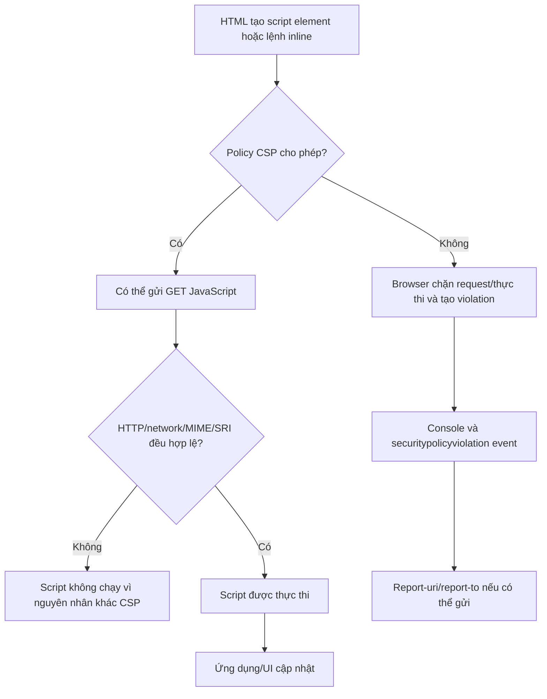
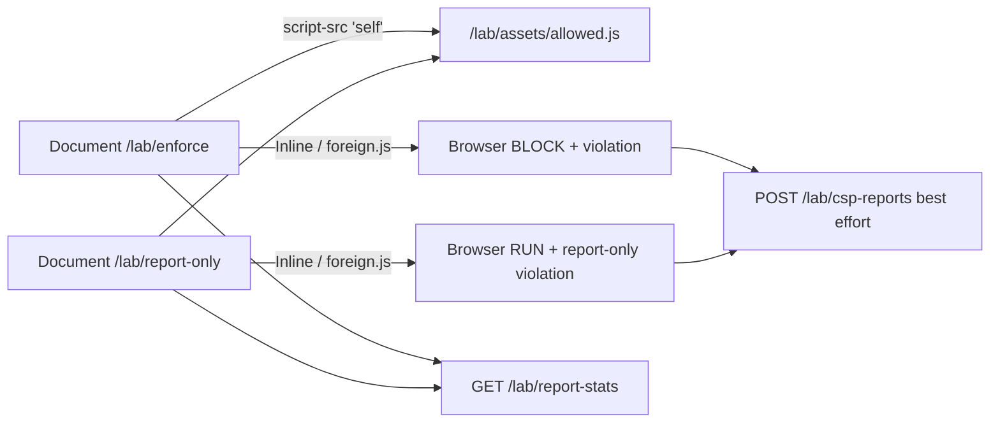
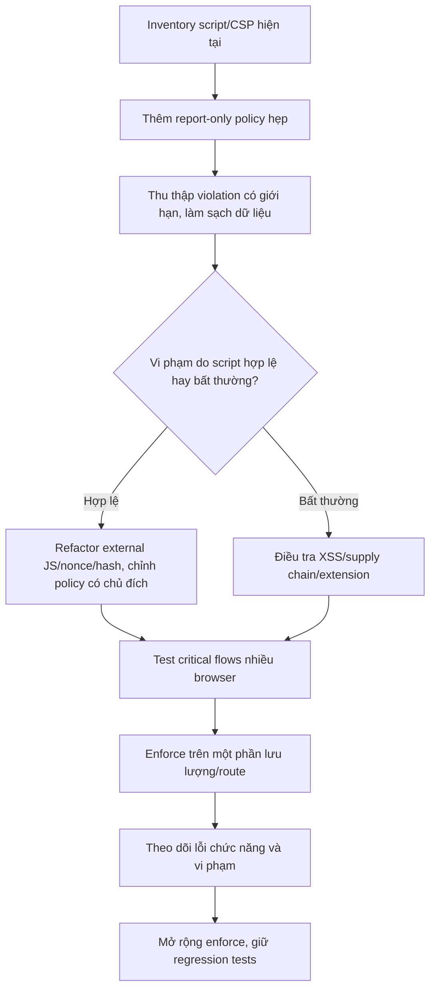

# Kiểm tra script hợp lệ, script bị CSP chặn và báo cáo vi phạm

**Content Security Policy (CSP)** là một lớp phòng vệ trình duyệt giúp ứng dụng công bố **nguồn và cách thực thi script nào được phép**. Khi trang Spring Boot trả `Content-Security-Policy: script-src 'self'`, trình duyệt có thể cho chạy một file JavaScript tải từ **chính origin của trang**, đồng thời chặn `<script>` inline, inline event handler và `<script src>` từ origin không có trong chính sách. Quan trọng hơn, CSP có hai chế độ cần thử riêng: **enforce** (chặn thật) và **report-only** (báo vi phạm nhưng không chặn vì chính sách đó).

Trong lúc kiểm thử, đừng gộp các kết luận **“đã tải file JS”**, **“đã chạy script”**, **“browser đã chặn thực thi”** và **“server nhận báo cáo CSP”** thành một. Một script có thể chưa được tải do CSP; một response JS có thể trả `200` nhưng không được thực thi; một vi phạm có thể xuất hiện trong Console mà không có HTTP report vì report delivery là **best effort**. Ngược lại, một trang dùng policy report-only vẫn có thể thực thi script bị đánh dấu vi phạm.

Bài thuộc chương **Kiểm thử trình duyệt** của module **SPRING_SECURITY_HTTP_PROTECTION**, tập trung vào CSRF, CORS, HTTP security headers, CSP, HSTS, HTTP firewall, session và kiểm thử các kịch bản bảo mật trên Spring Security **Servlet lẫn Reactive**. Lab chính sử dụng Spring Boot 3.x, Spring Security Servlet 6.x, Java 17+, một origin local phụ và Playwright; các tình huống chỉ dùng tài nguyên giả do người học kiểm soát.

**Sau bài học, bạn có thể:** kiểm tra external script cùng origin chạy được, inline/cross-origin script bị CSP chặn; phân biệt `script-src` với `script-src-elem`, `script-src-attr`, `default-src`; đo CSP enforce/report-only, Console và sự kiện `securitypolicyviolation`; tiếp nhận `report-uri`/Reporting API an toàn; hiểu nonce, hash, `strict-dynamic`; chẩn đoán CSP so với CORS, SRI, MIME, sandbox, HTTPS, CSRF; viết test MockMvc/Playwright có đối chứng và đánh giá việc triển khai qua proxy.

## 1. Threat model: CSP giúp giảm tác hại của script không mong muốn như thế nào?

Ứng dụng web có thể có các vị trí nhận dữ liệu đầu vào: bình luận, tìm kiếm, mô tả sản phẩm, rich text hoặc dữ liệu bên thứ ba. Nếu phần dữ liệu ấy bị xử lý sai thành HTML/JavaScript, kẻ tấn công có thể tìm cách chạy script trong origin của ứng dụng (**cross-site scripting, XSS**). CSP không sửa lỗi output escaping/injection, nhưng là **phòng vệ chiều sâu** có thể hạn chế một số con đường tải/thực thi script.

Ví dụ trang trả một policy:

```http
Content-Security-Policy: default-src 'none'; script-src 'self'; object-src 'none'; base-uri 'none'
```

thì browser hiện đại thường:

| Thành phần trên trang | `script-src 'self'` cho chạy? | Giải thích |
| --- | --- | --- |
| `<script src="/lab/assets/allowed.js"></script>` | **Có**, nếu các policy khác cũng cho phép | File nằm cùng origin, path hợp lệ |
| `<script>console.log("inline")</script>` | **Không** | Inline script không được cấp nonce/hash hoặc `'unsafe-inline'` |
| `<button onclick="doSomething()">` | **Không** | Inline event handler bị hạn chế; có nuance với `script-src-attr` |
| `<script src="http://127.0.0.1:8081/foreign.js"></script>` | **Không** | Khác origin và không được allow-list |
| `eval("...")` / `new Function("...")` | **Không** theo policy này | Thiếu `'unsafe-eval'` |
| JavaScript hợp lệ dùng `addEventListener(...)` | **Có** | Listener được đăng ký từ script đã được phép chạy |

**Không coi CSP là biện pháp duy nhất chống XSS.** Hãy tiếp tục escape/output encode theo ngữ cảnh, dùng template/sanitizer an toàn, tránh chèn HTML không tin cậy, có authentication/authorization, CSRF và cookie/session protection đúng threat model. Một script đã được CSP tin cậy nhưng tồn tại lỗ hổng DOM XSS vẫn có thể gây hại.

### Phạm vi đạo đức và bảo mật của lab

Mọi “script bị chặn” ở đây chỉ đổi một dòng trạng thái HTML giả hoặc ghi `console.log`, **không thu thập cookie, token, dữ liệu tài khoản hoặc gửi request tới bên thứ ba**. Chỉ thử trên hệ thống local/HTTPS test do bạn kiểm soát. CSP violation report có thể chứa URL hoặc nội dung nhạy cảm; endpoint nhận báo cáo phải coi dữ liệu là **không tin cậy**.

## 2. Năm tầng cần quan sát khi kiểm thử CSP script



| Tầng | Điều cần khẳng định | Bằng chứng |
| --- | --- | --- |
| **Policy** | Browser nhận header `Content-Security-Policy` nào, enforce hay report-only? | Network → Response Headers |
| **Network** | External JS có actual GET không, trả MIME/status gì? | Network → JS/All |
| **Execution** | Script có thực sự chạy, cập nhật DOM hoặc đăng ký handler không? | UI/DOM và Playwright |
| **Violation** | Có CSP directive vi phạm, browser báo gì? | Console, `securitypolicyviolation` event |
| **Reporting** | Server nhận report không, đã xử lý an toàn chưa? | Endpoint telemetry; không dựa vào report count tuyệt đối |

**Một script bị chặn tải bởi CSP có thể không tạo GET tới origin script.** Ngược lại, browser có thể nhận response JavaScript rồi từ chối **thực thi** vì MIME type, integrity check hoặc cơ chế khác. Không dùng mỗi HTTP `200` để tuyên bố CSP cho script chạy.

## 3. `Content-Security-Policy` và `Content-Security-Policy-Report-Only`

Hai tên HTTP response header rất dễ bị nhầm:

```http
Content-Security-Policy: script-src 'self'
```

Header **enforce**: vi phạm bị browser chặn theo chính sách, ngoài các hình thức báo lỗi/telemetry được hỗ trợ.

```http
Content-Security-Policy-Report-Only: script-src 'self'; report-uri /lab/csp-reports
```

Header **report-only**: vi phạm có thể được phát hiện/báo cáo, nhưng **chính report-only policy không ngăn script chạy**. Nếu cùng response có **một CSP enforce khác**, enforce policy vẫn có thể chặn script.

| Trường hợp | Inline script không nonce/hash | Console | HTTP report |
| --- | --- | --- | --- |
| Chỉ CSP enforce `script-src 'self'` | **Bị chặn** | Thường có violation | Có thể gửi nếu policy khai báo reporting endpoint |
| Chỉ CSP report-only `script-src 'self'` | **Được chạy** nếu không bị lớp khác chặn | Thường có cảnh báo report-only | Có thể gửi nếu khai báo endpoint |
| Cả enforce lẫn report-only | Theo **enforce** policy | Có thể có cả hai loại báo | Phụ thuộc cả hai policies và delivery |
| Không có CSP | Không bị CSP chặn | Không có CSP violation từ policy đó | Không có CSP report từ policy đó |

**Report-only không phải bảo vệ chống XSS.** Nó hữu ích để đo mức tương thích trước khi siết chính sách. Không để một policy **chỉ** report-only trong production rồi tuyên bố ứng dụng đã chặn script không tin cậy.

## 4. Các directive quyết định script nào được phép

| Directive / source expression | Vai trò |
| --- | --- |
| `script-src` | Quy tắc tổng thể cho nguồn và một số kiểu thực thi script |
| `script-src-elem` | Quy tắc cho `<script>` elements khi khai báo; fallback theo CSP |
| `script-src-attr` | Quy tắc cho script attributes như `onclick` khi khai báo |
| `default-src` | Fallback cho nhiều fetch directives, bao gồm script khi không có directive cụ thể |
| `'self'` | Chính origin của **tài liệu**: scheme, host, port phù hợp |
| `'none'` | Không cho nguồn nào trong directive đó |
| `https://cdn.example.test` | Nguồn được allow cụ thể theo scheme/host (và port nếu nêu) |
| `'nonce-<giá trị>'` | Cho inline/external script element có nonce khớp theo CSP |
| `'sha256-<base64>'` | Cho nội dung inline có hash khớp chính xác |
| `'strict-dynamic'` | Trust propagation từ script nonce/hash tin cậy sang script tải động trong CSP3 |
| `'unsafe-inline'` | Mở rộng thực thi inline; không nên dùng đại trà |
| `'unsafe-eval'` | Cho phép cơ chế eval/chuỗi mã trong các ngữ cảnh bị CSP hạn chế; cần tránh |
| `report-uri` / `report-to` | Cấu hình báo cáo vi phạm; **không** quyết định script được chạy |

### `default-src` không phải tùy chọn bỏ qua

Nếu chỉ có:

```http
Content-Security-Policy: default-src 'self'
```

thì nhiều browser áp dụng `'self'` làm **fallback cho script**. Inline `<script>` vẫn bị chặn nếu không có nonce/hash hoặc chính sách cho inline; không phải tất cả script đều được phép. Nhưng khi bạn khai báo `script-src` riêng, hãy đọc theo **quy tắc fallback và mức ưu tiên** của CSP3 (`script-src-elem`/`script-src-attr`) thay vì chỉ nhìn mỗi `default-src`.

### `script-src 'self'` không có nghĩa same-site

Trang `http://localhost:8080` và file JS ở `http://localhost:8081` khác **origin** vì port khác, dù chúng thường same-site. `'self'` không tự cho phép origin port 8081. Tương tự, `https://app.example.test` và `https://cdn.example.test` có thể cùng site nhưng **khác origin**; nếu muốn cho CDN đó, phải có chính sách phù hợp.

## 5. Đọc header ở đúng response: chính sách của trang chứa script

Với:

```html
<script src="http://127.0.0.1:8081/foreign.js"></script>
```

policy `script-src` dùng để quyết định được tải/thực thi file là **CSP của document chứa thẻ script** — ví dụ response `http://localhost:8080/lab/enforce` — **không phải** CSP được server static gắn riêng lên `foreign.js`. Một JS resource có `200` và không có CSP header vẫn có thể bị parent document CSP từ chối.

Khi debug, mở Network → chọn **Document** `/lab/enforce` hoặc `/lab/report-only` → xem **Response Headers**. Sau đó tìm request script. Nếu script chưa từng được tải do CSP, URL foreign có thể không có actual GET hoặc xuất hiện dòng “blocked:csp” theo browser. Đừng chỉ mở trực tiếp `foreign.js` và tuyên bố nó chạy được trong trang.

## 6. Mô hình lab: một tài liệu, hai chính sách

Ta cố ý dùng **cùng một HTML template** cho hai đường dẫn để mọi khác biệt về kết quả chủ yếu đến từ response policy:

| Thành phần | URL | Chức năng |
| --- | --- | --- |
| Trang **enforce** | `http://localhost:8080/lab/enforce` | Chạy self-hosted script; chặn inline và foreign script |
| Trang **report-only** | `http://localhost:8080/lab/report-only` | Ghi nhận vi phạm nhưng **không chặn** script vì policy đó |
| Self-hosted script | `http://localhost:8080/lab/assets/allowed.js` | Cập nhật UI bằng `addEventListener` |
| Observer script | `http://localhost:8080/lab/assets/observer.js` | Bắt `securitypolicyviolation` từ sớm |
| Foreign script thử nghiệm | `http://127.0.0.1:8081/foreign.js` | Chỉ đánh dấu một field trong HTML giả |
| Report sink | `POST http://localhost:8080/lab/csp-reports` | Nhận report và chỉ đếm |
| Report telemetry | `GET http://localhost:8080/lab/report-stats` | Đọc số report đã nhận |
| Trang nonce riêng (mở rộng) | `http://localhost:8080/lab/nonce` | Minh họa nonce mới mỗi response |



Lab chỉ chạy trên loopback, không dùng tài khoản hoặc dịch vụ thật, không tải thư viện CDN không do mình quản lý. **JavaScript ở foreign origin chỉ chứa một thao tác vô hại để nhìn thấy sự khác biệt**, không thực hiện kết nối ra internet.

## 7. SecurityFilterChain Servlet: enforce và report-only tách riêng

Với Spring Boot 3.x / Spring Security 6.x, chuẩn bị dependency:

```text
spring-boot-starter-web
spring-boot-starter-security
spring-boot-starter-thymeleaf
spring-boot-starter-test       (test scope)
spring-security-test          (test scope)
```

File `application.properties` của **lab**:

```properties
server.port=8080
server.servlet.session.cookie.http-only=true
```

Cấu hình `CspLabSecurity.java`:

```java
import org.springframework.context.annotation.Bean;
import org.springframework.context.annotation.Configuration;
import org.springframework.core.annotation.Order;
import org.springframework.security.config.annotation.web.builders.HttpSecurity;
import org.springframework.security.web.SecurityFilterChain;

@Configuration
public class CspLabSecurity {

    // Policy cố ý giống hệt giữa hai chế độ.
    private static final String POLICY =
        "default-src 'none'; " +
        "script-src 'self'; " +
        "connect-src 'self'; " +
        "img-src 'self'; " +
        "style-src 'self'; " +
        "object-src 'none'; " +
        "base-uri 'none'; " +
        "form-action 'self'; " +
        "report-uri /lab/csp-reports";

    @Bean
    @Order(1)
    SecurityFilterChain reportOnlyLab(HttpSecurity http)
            throws Exception {
        return http
            .securityMatcher("/lab/report-only")
            .authorizeHttpRequests(auth -> auth
                .anyRequest().permitAll())
            .headers(headers -> headers
                .contentSecurityPolicy(csp -> csp
                    .policyDirectives(POLICY)
                    .reportOnly()))
            .build();
    }

    @Bean
    @Order(2)
    SecurityFilterChain enforcedLab(HttpSecurity http)
            throws Exception {
        return http
            .securityMatcher("/lab/**")
            .authorizeHttpRequests(auth -> auth
                .anyRequest().permitAll())
            // Báo cáo tự động của browser không mang CSRF token.
            // Miễn trừ duy nhất endpoint report, không tắt CSRF toàn cục.
            .csrf(csrf -> csrf
                .ignoringRequestMatchers("/lab/csp-reports"))
            .headers(headers -> headers
                .contentSecurityPolicy(csp -> csp
                    .policyDirectives(POLICY)))
            .build();
    }
}
```

**Giải thích từng quyết định:**

1. Chain `@Order(1)` khớp **chỉ** `/lab/report-only`, trả `Content-Security-Policy-Report-Only` với cùng `script-src 'self'`. Inline/foreign script có thể chạy vì không bị **policy này** chặn.
2. Chain `@Order(2)` khớp các đường dẫn lab còn lại, trả `Content-Security-Policy` enforce và giữ security headers mặc định khác của Spring Security.
3. `permitAll()` chỉ giúp lab không cần đăng nhập, **không vô hiệu CSRF** ở những POST khác. Chỉ `POST /lab/csp-reports` được miễn CSRF để trình duyệt tự gửi violation report không có token. Endpoint này phải được xem như một điểm tiếp nhận **dữ liệu không tin cậy**, không phải API ghi nghiệp vụ.
4. `report-uri /lab/csp-reports` là đường dẫn cùng origin, giúp tránh vấn đề báo cáo cross-origin không cần thiết trong lab. Delivery có thể bị chặn bởi browser extension, privacy policy hoặc request rớt mạng.
5. `.contentSecurityPolicy(...)` không có nghĩa `script-src` đã được bật mặc định trên mọi ứng dụng Spring Security. **Bạn chủ động cấu hình CSP**, còn Spring Security thông dụng có các default headers khác như XFO, `X-Content-Type-Options`.

**Phạm vi:** đoạn cấu hình giả định Spring Security 6.x có DSL `reportOnly()` trên `ContentSecurityPolicyConfig`. Kiểm tra chính API/version đang dùng và **đối chiếu tên response header thật**; không lấy sự tồn tại của một bean làm bằng chứng policy đã áp dụng.

### Vì sao không gửi cả enforce và report-only cho cùng phép thử?

Nếu cùng response có **enforce CSP** chặn inline và **report-only CSP** cũng báo inline, bạn sẽ thấy inline **không chạy**, dù report-only đúng nguyên tắc. Để chứng minh riêng report-only “báo nhưng không chặn”, lab tách route sao cho `/lab/report-only` **không nhận enforce policy nào khác có script-src chặt hơn**. Reverse proxy có thể vô tình thêm enforce policy; khi đó phải kiểm tra response cuối cùng.

### CORS và CSRF không thay thế CSP

Một `<script src="http://127.0.0.1:8081/foreign.js">` kiểu **classic script** có thể được browser tải và thực thi **không cần ACAO**, nếu CSP cho phép. Với module script hoặc `fetch`, quy tắc CORS có thể khác. `CsrfFilter` chủ yếu kiểm tra unsafe HTTP requests, không quyết định inline JavaScript được chạy. CSP script policy là lớp phòng vệ khác với CORS và CSRF.

## 8. Controller trả cùng HTML và tiếp nhận báo cáo tối thiểu

Tạo `CspLabController.java`:

```java
import java.util.Map;
import java.util.concurrent.atomic.AtomicInteger;
import org.springframework.http.CacheControl;
import org.springframework.http.HttpStatus;
import org.springframework.http.ResponseEntity;
import org.springframework.stereotype.Controller;
import org.springframework.web.bind.annotation.GetMapping;
import org.springframework.web.bind.annotation.PostMapping;
import org.springframework.web.bind.annotation.RequestBody;
import org.springframework.web.bind.annotation.ResponseBody;

@Controller
public class CspLabController {

    private final AtomicInteger reportsReceived = new AtomicInteger();

    @GetMapping({"/lab/enforce", "/lab/report-only"})
    String page() {
        // Hai response body giống nhau; policy khác nhau theo chain.
        return "csp-lab";
    }

    @PostMapping("/lab/csp-reports")
    @ResponseBody
    ResponseEntity<Void> collectReport(
            @RequestBody(required = false) String body) {

        // Giới hạn minh họa ở ứng dụng. Production cần giới hạn
        // body ngay ở server/proxy, rate-limit và validate JSON schema.
        if (body == null || body.length() > 12_000) {
            return ResponseEntity.status(
                HttpStatus.PAYLOAD_TOO_LARGE).build();
        }

        // KHÔNG log body; có thể có document-uri,
        // blocked-uri, source-file và dữ liệu không đáng tin.
        reportsReceived.incrementAndGet();
        return ResponseEntity.noContent().build();
    }

    @GetMapping("/lab/report-stats")
    @ResponseBody
    ResponseEntity<Map<String, Integer>> reportStats() {
        return ResponseEntity.ok()
            .cacheControl(CacheControl.noStore())
            .body(Map.of(
                "reportsReceived", reportsReceived.get()));
    }
}
```

**Quan trọng:** `reportsReceived` chỉ đếm số request tới endpoint. Nó **không** phải số vi phạm thực tế, vì một HTTP request Reporting API có thể chứa **nhiều report**, có thể bị dedupe/batch, hoặc browser không gửi do offline/privacy/adblock. `@RequestBody String` chỉ giúp code dễ học; một receiver production phải cấu hình giới hạn body **trước khi đọc toàn bộ**, xác thực schema/content type, giảm cardinality và lưu dữ liệu đã được scrub theo chính sách retention.

Trong bài này **không** lưu `document-uri`, `blocked-uri`, URL query, cookies hoặc stack trace. Client hoàn toàn có thể giả mạo report bằng HTTP POST vì endpoint không yêu cầu authentication/CSRF; **không dùng report để ra quyết định phân quyền hoặc xử lý sự cố an ninh mà không có đối chứng**.

### Tại sao chỉ miễn CSRF cho report sink?

Browser tự gửi CSP violation report, không mang hidden field `_csrf` hay header CSRF của ứng dụng. Nếu giữ CSRF matcher mặc định trên `/lab/csp-reports`, request báo cáo có thể nhận `403` và telemetry biến mất. **Miễn trừ rất hẹp** chỉ cho endpoint thu thập không thay đổi nghiệp vụ, không suy từ đó rằng các route POST của ứng dụng được miễn CSRF.

Trong ứng dụng thật, endpoint nhận report phải được bảo vệ khỏi **spam/DoS**, áp dụng giới hạn tốc độ và kích thước, không thực hiện truy vấn/callback tới `blocked-uri`, và không tự động tin `document-uri` do client gửi.

## 9. HTML lab: tự tạo một script hợp lệ và ba trường hợp vi phạm

Tạo template `src/main/resources/templates/csp-lab.html`:

```html
<!doctype html>
<html lang="vi">
<head>
  <meta charset="utf-8">
  <title>CSP script lab</title>
</head>
<body>
  <h1>Enforce vs Report-Only — CSP script</h1>
  <p>Đường dẫn hiện tại:
    <output id="route">Chưa xác định</output>
  </p>

  <p>External same-origin:
    <output id="external-status">CHƯA chạy</output>
  </p>
  <p>Inline script:
    <output id="inline-status">CHƯA chạy</output>
  </p>
  <p>External cross-origin:
    <output id="foreign-status">CHƯA chạy</output>
  </p>
  <p>Inline onclick handler:
    <output id="handler-status">CHƯA chạy</output>
  </p>
  <p>Violation event:
    <output id="violation-status">Chưa nhận</output>
  </p>

  <button id="safe-click">Listener từ JS cùng origin</button>
  <button id="inline-click"
          onclick="document.querySelector('#handler-status').textContent='ĐÃ chạy'">
    Inline onclick
  </button>

  <!-- Observer từ same-origin chạy TRƯỚC các tình huống vi phạm. -->
  <script src="/lab/assets/observer.js"></script>

  <!-- Một inline script bị enforce CSP chặn. -->
  <script>
    document.querySelector("#inline-status").textContent = "ĐÃ chạy";
  </script>

  <!-- External JS hợp lệ từ chính origin của document. -->
  <script src="/lab/assets/allowed.js"></script>

  <!-- Script classic từ origin khác: bị enforce chặn. -->
  <script src="http://127.0.0.1:8081/foreign.js"></script>
</body>
</html>
```

Trong môi trường lab, toàn bộ URL đều thuộc hai HTTP servers do bạn sở hữu. **Không dùng file JS từ website lạ**, không dùng thư viện analytics thật trong bài đo, và không đưa tài khoản có dữ liệu cá nhân vào trang.

### Bốn điểm phải chú ý

- External same-origin script có source `/lab/assets/allowed.js`, được `script-src 'self'` cho phép.
- Inline `<script>...</script>` không có nonce/hash nên bị **enforce** chặn.
- Inline attribute `onclick="..."` bị chặn trong enforce; test bằng **click button**, không chỉ nhìn HTML chứa attribute.
- Foreign **classic script** ở `127.0.0.1:8081` là origin khác với `localhost:8080`, nên bị `script-src 'self'` chặn. Trong **report-only**, script có thể chạy mà không cần foreign server gửi ACAO, do cách classic `<script src>` hoạt động.

**Đừng dùng cùng tên “ngoại origin” và “ngoại site” thay cho nhau:** CSP `'self'` dựa trên **origin**, không phải schemeful site. Cũng không nhầm `script-src 'self'` với `frame-ancestors 'self'`: chúng kiểm soát các thao tác khác nhau.

## 10. File JavaScript hợp lệ: không cần inline handler

Tạo `src/main/resources/static/lab/assets/allowed.js`:

```javascript
"use strict";

document.querySelector("#route").textContent = location.pathname;
document.querySelector("#external-status").textContent = "ĐÃ chạy";

// addEventListener được đăng ký từ JS hợp lệ,
// không cần onclick="" trong HTML.
document.querySelector("#safe-click").addEventListener("click", () => {
  document.querySelector("#external-status").textContent =
    "ĐÃ click bằng listener hợp lệ";
});
```

Vì script được đặt cuối `<body>` **sau các element UI**, `querySelector` tìm được element ngay. Trong một cấu trúc khác có `defer`/module, cần kiểm tra DOM timing.

Khi mở **cả** `/lab/enforce` và `/lab/report-only`, external script cùng origin phải cập nhật:

```text
External same-origin: ĐÃ chạy
```

Nếu không, đừng vội kết luận CSP chặn: xem Network status, MIME type, URL/context path, cache và Console JavaScript error. Đây là **đối chứng dương** chứng minh trang không bị cấu hình CSP quá chặt khiến mọi script đều bất hoạt.

## 11. Observer: bắt sự kiện `securitypolicyviolation` sớm

Tạo `src/main/resources/static/lab/assets/observer.js`:

```javascript
"use strict";

const recentViolations = [];

document.addEventListener("securitypolicyviolation", event => {
  // Chỉ lưu metadata đã giới hạn; không log blockedURI/documentURI
  // vì chúng có thể chứa URL nhạy cảm.
  const item = {
    directive: event.effectiveDirective,
    disposition: event.disposition,
    lineNumber: event.lineNumber
  };
  recentViolations.push(item);

  const output = document.querySelector("#violation-status");
  if (output) {
    output.textContent =
      `${recentViolations.length} event; ` +
      `directive=${item.directive}; disposition=${item.disposition}`;
  }
});
```

Vì `observer.js` nằm trước inline/foreign scripts trong HTML, listener có cơ hội được đăng ký **trước khi những script sau đó vi phạm CSP**. Dù vậy, `securitypolicyviolation` không được xem là cơ chế telemetry **bảo đảm 100%** trên mọi browser hoặc mọi thời điểm; policy có thể chặn một thao tác trước khi script observer tải được.

**Cần phân biệt:**

- `event.disposition` thường là `"enforce"` hoặc `"report"` (report-only).
- `event.effectiveDirective` có thể là `script-src-elem` hoặc `script-src-attr` tùy loại vi phạm và browser; đừng hard-code chỉ chấp nhận `script-src`.
- `event.blockedURI` và `event.documentURI` có thể tiết lộ URL. Trong bài học chỉ hiển thị **directive/disposition** và tổng số sự kiện.

Observer là một **script đã được CSP cho phép**; chính nó cũng có thể bị chặn nếu về sau bạn thay `script-src`, thêm `script-src-elem`, SRI hoặc proxy CSP. Do đó server-side reports và browser DevTools vẫn là các nguồn đối chiếu độc lập.

## 12. Static server origin khác: file JavaScript hoàn toàn vô hại

Tạo thư mục độc lập trên máy làm lab:

```text
csp-foreign-script-lab/
  foreign-server.mjs
```

File `foreign-server.mjs`:

```javascript
import http from "node:http";

const foreignScript = `
  "use strict";
  document.querySelector("#foreign-status").textContent = "ĐÃ chạy";
  window.__foreignLabScriptRan = true;
`;

http.createServer((request, response) => {
  if (request.method === "GET" &&
      request.url === "/foreign.js") {
    response.writeHead(200, {
      "Content-Type": "text/javascript; charset=utf-8",
      "Cache-Control": "no-store",
      "X-Content-Type-Options": "nosniff"
    });
    response.end(foreignScript);
    return;
  }

  response.writeHead(404, {
    "Content-Type": "text/plain; charset=utf-8"
  });
  response.end("Not found");
}).listen(8081, "127.0.0.1", () => {
  process.stdout.write("Foreign JS lab at 127.0.0.1:8081\n");
});
```

Chạy trong thư mục vừa tạo:

```bash
node foreign-server.mjs
```

**Cố ý không có `Access-Control-Allow-Origin`** trên response foreign script. Với **classic `<script src>`**, browser có thể tải/thực thi từ origin khác **mà không cần CORS response permission**, nếu document CSP cho phép. Với **module script**, `fetch`, `crossorigin` hoặc một số yêu cầu SRI, cơ chế CORS khác; đừng rút quy tắc quá rộng.

Server chỉ bind IPv4 loopback `127.0.0.1`. Nếu máy dùng IPv6 hoặc port đã bị chiếm, cần cấu hình đúng loopback; **không** mở ra LAN/Internet chỉ để chạy bài. Với lab thực tế, cả backend port 8080 và server port 8081 đều thuộc quyền kiểm soát của người học.

### Tại sao không cấp ACAO cho foreign script?

Vì mục tiêu là **chứng minh CSP có thể chặn classic script ngay cả khi server file tồn tại và có HTTP 200**, còn **report-only không chặn script đó**. Thêm CORS không giúp sửa một vi phạm `script-src 'self'`; nó còn khiến các hiện tượng dễ bị đánh đồng. Nếu sau này đổi sang `<script type="module">`, cần tạo một test khác với CORS và MIME thích hợp.

## 13. Thử nghiệm A: CSP enforce cho external self, chặn inline và foreign

Khởi động Spring Boot ở port 8080 và Node server ở `127.0.0.1:8081`. Mở browser context/profile thử nghiệm sạch, vào:

```text
http://localhost:8080/lab/enforce
```

Đặt DevTools **Network → All** và **Console** ở trạng thái quan sát, khi cần bật **Preserve log** và **Disable cache**.

### Kết quả kỳ vọng trên UI

| Phần tử | Kết quả kỳ vọng |
| --- | --- |
| `#external-status` | **`ĐÃ chạy`** từ `allowed.js` |
| `#inline-status` | Vẫn `CHƯA chạy` |
| `#foreign-status` | Vẫn `CHƯA chạy` |
| `#handler-status` sau khi click | Vẫn `CHƯA chạy` |
| `#violation-status` | Thường hiển thị event `disposition=enforce` sau một hoặc nhiều vi phạm |
| `#safe-click` sau khi click | External status đổi thành `ĐÃ click bằng listener hợp lệ` |

Response của document phải có:

```http
Content-Security-Policy: default-src 'none'; script-src 'self'; connect-src 'self'; img-src 'self'; style-src 'self'; object-src 'none'; base-uri 'none'; form-action 'self'; report-uri /lab/csp-reports
```

Chuỗi whitespace/format có thể khác nếu hạ tầng chuẩn hóa header, nhưng cần kiểm tra đủ các directive trọng yếu và **đúng tên header enforce**.

### Network và Console có thể khác nhau thế nào?

- GET `/lab/assets/observer.js`: **gửi**, script chạy, đăng ký listener.
- GET `/lab/assets/allowed.js`: **gửi**, script chạy, UI đổi.
- Inline `<script>`: **không có URL file riêng để GET**, bị chặn **thực thi**.
- Inline `onclick`: sự kiện click có thể xảy ra nhưng **handler bị CSP từ chối thực thi**.
- Foreign `<script src="http://127.0.0.1:8081/foreign.js">`: browser có thể chặn ngay từ bước chuẩn bị tải; foreign server **có thể không thấy GET**. Nếu Network hiển thị một entry `blocked:csp`, đừng coi đó là HTTP status từ server foreign.
- Console có thể nêu `Refused to execute inline script` hoặc `Refused to load the script` vì vi phạm directive. Thông điệp đầy đủ không ổn định giữa browser/version.

**Kết luận đúng:** **script được phép và script bị chặn có thể tồn tại trên cùng một document**. CSP không phải công tắc tắt toàn bộ JavaScript; nó hạn chế nguồn/hình thức thực thi theo policy.

### Nếu external self cũng bị chặn?

Kiểm tra status `200`, MIME `text/javascript`, `X-Content-Type-Options`, path, CSP `script-src-elem` nếu có, SRI và lỗi syntax. Nếu document thực nhận thêm một policy từ proxy chặt hơn `script-src 'self'`, script self cũng có thể bị từ chối. Đừng “sửa nhanh” bằng `'unsafe-inline'` trước khi xác định nguyên nhân.

## 14. Thử nghiệm B: report-only ghi vi phạm nhưng không thực thi lệnh chặn

Trong **browser context mới** hoặc tab riêng không bị ảnh hưởng policy trước, mở:

```text
http://localhost:8080/lab/report-only
```

Response của **document** phải có:

```http
Content-Security-Policy-Report-Only: default-src 'none'; script-src 'self'; connect-src 'self'; img-src 'self'; style-src 'self'; object-src 'none'; base-uri 'none'; form-action 'self'; report-uri /lab/csp-reports
```

và **không có** `Content-Security-Policy` enforce khác áp dụng script restriction tương tự.

### Kết quả kỳ vọng

| Thành phần | Trong enforce | Trong report-only |
| --- | --- | --- |
| JS same-origin | Chạy | Chạy |
| Inline `<script>` | Chặn | **Chạy** |
| Inline `onclick` sau click | Chặn | **Chạy** |
| Foreign classic script | Chặn | **Chạy** nếu tải thành công |
| `securitypolicyviolation` | `disposition=enforce` | Thường `disposition=report` |
| Báo cáo tới server | Có thể gửi | Có thể gửi |

Trong report-only, các dòng `Inline script` và `External cross-origin` trên UI có thể chuyển thành `ĐÃ chạy`. Khi click **Inline onclick**, `handler-status` cũng đổi. Console vẫn có thể cảnh báo vi phạm **policy report-only**; sự tồn tại của cảnh báo **không đồng nghĩa script bị chặn**.

**Lưu ý:** nếu browser không tải được `foreign.js` vì server chưa chạy, MIME sai, TLS/network hoặc một enforce policy khác, script vẫn không chạy. Report-only chỉ nói rằng **report-only policy không chặn** nó; các điều kiện tải/thực thi khác vẫn có hiệu lực.

### Không dùng report-only để cấp quyền tùy tiện

Khi làm rollout CSP cho production, sử dụng report-only một thời gian để thu thập các script hợp lệ đang bị chính sách tương lai đánh dấu; sau đó chuyển sang enforce với allow-list/nonce/hash đã được kiểm thử. **Không** xây business logic dựa trên việc report-only “cho tất cả script chạy” vì bản thân đó **không phải phòng vệ**.

## 15. Thử nghiệm C: kiểm tra inline event handler khác `addEventListener`

Hai cách gắn handler có vẻ tương đương về UI nhưng khác về CSP:

```html
<!-- Inline attribute: vi phạm dưới CSP script-src 'self'. -->
<button onclick="doAction()">Inline onclick</button>

<!-- Không có inline JS; listener được đăng ký từ script hợp lệ. -->
<button id="safe-action">External listener</button>
<script src="/lab/assets/actions.js"></script>
```

Trong `/lab/assets/actions.js`:

```javascript
document.querySelector("#safe-action").addEventListener(
  "click", () => {
    console.log("Chạy từ external script đã được CSP cho phép");
  }
);
```

Khi `script-src 'self'` đang enforce và không có policy nới inline attributes, **listener đăng ký trong external script hợp lệ vẫn chạy**, còn inline attribute bị từ chối. Đó là động lực phổ biến để **loại bỏ inline handlers** trong codebase thay vì thêm `'unsafe-inline'`.

### `javascript:` URL và `eval`

Các mẫu như:

```html
<a href="javascript:doAction()">Link dùng javascript: URL</a>
```

hoặc:

```javascript
eval("doAction()");
```

cũng chịu hạn chế CSP tương ứng; không nên xây UI hoặc công cụ template trên những khả năng này khi áp dụng chính sách script chặt. Thay bằng route/link thường, `addEventListener`, ES modules và parser không thực thi chuỗi mã.

### `script-src-attr` có thể khác `script-src-elem`

Nếu thêm:

```http
Content-Security-Policy: script-src 'self'; script-src-attr 'none'; script-src-elem 'self'
```

thì browser dùng chính sách riêng cho **thuộc tính inline** và **script elements**. Một test chỉ thử `<script src>` không đủ để chứng minh `onclick` đã bị chặn. Tương tự, nếu `script-src-elem` được nới rộng hơn `script-src`, script elements có thể có behavior khác inline evaluation APIs. Phải kiểm tra từng loại thực thi trong ứng dụng thật.

## 16. Thử nghiệm D: theo dõi báo cáo vi phạm từ browser

Khi policy có:

```http
Content-Security-Policy: script-src 'self'; report-uri /lab/csp-reports
```

browser **có thể** gửi request POST tới report sink. Một payload legacy thường có hình dạng:

```json
{
  "csp-report": {
    "document-uri": "http://localhost:8080/lab/enforce",
    "effective-directive": "script-src-elem",
    "violated-directive": "script-src-elem",
    "blocked-uri": "inline",
    "disposition": "enforce",
    "status-code": 200
  }
}
```

Đây là **payload mô phỏng cấu trúc**, không phải bảo đảm mọi trường hoặc giá trị luôn xuất hiện. Browser có thể rút gọn `blocked-uri`, source-file, line/column, sample và URI vì quyền riêng tư. `status-code` trong report nói về document/response liên quan, **không phải status của report POST**.

Một báo cáo legacy `report-uri` thường dùng:

```http
POST /lab/csp-reports HTTP/1.1
Content-Type: application/csp-report

{"csp-report":{...}}
```

Endpoint của lab trả `204 No Content`. Trong browser, mở DevTools → Network → All, lọc `csp-reports` để xem có request hay không. **Không xuất HAR chưa làm sạch**, vì payload có thể chứa `document-uri`, `blocked-uri` hoặc source data.

### Vì sao số report có thể ít hơn số violation?

- Browser có thể gom, dedupe, giới hạn tần suất hoặc trì hoãn report.
- Extension/privacy setting có thể chặn gửi report.
- Request bị mất khi tab đóng, navigation quá nhanh, offline hoặc reporting cache.
- Policy không có `report-uri`/`report-to` hợp lệ thì không có network report dù Console báo vi phạm.
- Nhiều report có thể được gửi trong một request khi dùng Reporting API.
- Vi phạm đã được báo cho JavaScript qua `securitypolicyviolation` nhưng **không nhất thiết** có network report thành công.

Vì thế **không dùng số lượng HTTP reports chính xác làm assertion bắt buộc trong browser CI**. Hãy kiểm tra script allowed/blocked qua DOM và policy headers; network reporting được kiểm tra **bổ sung, có tính best effort**.

### Bước đo an toàn

Mở trang same-origin khác:

```text
http://localhost:8080/lab/report-stats
```

Nếu report được gửi thành công, bạn có thể thấy:

```json
{"reportsReceived":3}
```

Con số trên là **ví dụ**, có thể khác hoặc bằng `0` tùy browser. Không kết luận “CSP không hoạt động” chỉ vì counter không tăng. Kiểm tra trước tiên response CSP, Console violation và DOM execution.

## 17. `report-uri` và Reporting API `report-to`: không phải cùng một định dạng

Trong hệ thống hiện đại, có thể gặp hai cách khai báo đích báo cáo:

**Cách truyền thống — CSP `report-uri`:**

```http
Content-Security-Policy: script-src 'self'; report-uri /lab/csp-reports
```

Browser có thể gửi một JSON object bọc trong `{"csp-report": {...}}` với MIME type `application/csp-report`.

**Cách Reporting API — `Reporting-Endpoints` + CSP `report-to`:**

```http
Reporting-Endpoints: csp-endpoint="/lab/csp-reports"
Content-Security-Policy: script-src 'self'; report-to csp-endpoint; report-uri /lab/csp-reports
```

Browser hỗ trợ Reporting API có thể gửi một **array of reports** với MIME type `application/reports+json` và các trường như `type`, `url`, `body`. Một payload minh họa:

```json
[
  {
    "type": "csp-violation",
    "url": "http://localhost:8080/lab/enforce",
    "body": {
      "effectiveDirective": "script-src-elem",
      "blockedURL": "inline",
      "disposition": "enforce"
    }
  }
]
```

Đây là ví dụ cấu trúc, **không phải JSON schema duy nhất** của mọi browser/version. Sự hỗ trợ `report-to`, `Reporting-Endpoints`, chính sách bảo mật khi gửi endpoint và việc ưu tiên `report-uri` khác nhau theo browser; một số client hỗ trợ `report-to` có thể **bỏ qua `report-uri` khi cả hai cùng xuất hiện**. Không xem chúng như hai báo cáo chắc chắn đều được gửi.

### Tại sao lab ưu tiên `report-uri`?

Vì bài này cần tập trung vào **CSP script execution** và cách đọc sự khác biệt enforce/report-only. `report-uri` với same-origin POST có thể dễ quan sát trong nhiều môi trường; sau khi thành thạo, mở rộng sang `Reporting-Endpoints` và thiết kế receiver hỗ trợ **cả định dạng legacy lẫn Reporting API**.

### Receiver phải xem report là dữ liệu không tin cậy

Một request báo cáo có thể chứa:

- `document-uri`: URL trang xảy ra vi phạm, có thể có query parameters nhạy cảm.
- `blocked-uri`/`blockedURL`: URL tài nguyên bị từ chối, có thể bị rút gọn hoặc không xuất hiện.
- `source-file`, `line-number`, `column-number`, `sample`: thông tin vị trí, đôi khi chứa đoạn mã.
- `effective-directive`, `original-policy`, `disposition`: metadata về policy.

Endpoint có thể bị **client khác giả mạo payload** vì không có user authentication/CSRF; không được dùng report count làm bằng chứng tuyệt đối về tấn công, không tự động gọi `blocked-uri` để kiểm chứng, không lưu payload thô vô hạn và không gửi dữ liệu report tới analytics bên ngoài khi chưa đánh giá quyền riêng tư.

## 18. CSP nonce: cho phép inline script có chủ đích, chặn phần còn lại

Trong sản phẩm có server-side rendering, đôi khi cần một số inline script hợp lệ (ví dụ bootstrap config). Thay vì mở `'unsafe-inline'`, CSP có thể cho phép **nonce** riêng trên mỗi response:

```http
Content-Security-Policy: script-src 'nonce-BASE64_RANDOM_VALUE'
```

HTML tương ứng:

```html
<script nonce="BASE64_RANDOM_VALUE">
  document.querySelector("#status").textContent = "ĐÃ chạy";
</script>

<!-- Không có nonce: bị CSP script policy chặn. -->
<script>
  document.querySelector("#status").textContent = "KHÔNG nên chạy";
</script>
```

**Nonce phải khó đoán, có entropy đủ mạnh (thường ít nhất 128 bit) và được sinh mới cho mỗi response.** Nó phải khớp giữa CSP header và thuộc tính `nonce` trên script được phép. Không đặt nonce cố định trong code/repository, không reuse một nonce toàn ứng dụng và không lấy giá trị từ input client không đáng tin.

### Ví dụ độc lập tích hợp vào lab: thêm chain dành riêng cho nonce

Vì lab chính đang áp dụng `script-src 'self'` ở chain `/lab/**`, một endpoint nonce không được phát **thêm CSP nonce bên cạnh CSP chặt cũ**; nếu có hai enforce policies, cả hai được xét và inline có thể vẫn bị chặn. Hãy thêm chain **ưu tiên cao hơn** vào `CspLabSecurity` của mục 7:

```java
@Bean
@org.springframework.core.annotation.Order(0)
SecurityFilterChain nonceLab(HttpSecurity http) throws Exception {
    // Match chính xác route này; CSP riêng do controller trả.
    return http
        .securityMatcher("/lab/nonce")
        .authorizeHttpRequests(auth -> auth
            .anyRequest().permitAll())
        .build();
}
```

Chain này chỉ match `/lab/nonce`, nên nó không chạy qua chain enforce `/lab/**` có `script-src 'self'`. **Các security headers mặc định khác vẫn hoạt động**, và CSRF không bị tắt. Chúng ta sẽ đặt CSP nonce **trực tiếp trong response controller** vì chỉ response generator mới biết nonce vừa tạo.

Tạo `NonceCspController.java`:

```java
import java.security.SecureRandom;
import java.util.Base64;
import org.springframework.http.CacheControl;
import org.springframework.http.MediaType;
import org.springframework.http.ResponseEntity;
import org.springframework.web.bind.annotation.GetMapping;
import org.springframework.web.bind.annotation.RestController;

@RestController
public class NonceCspController {

    private final SecureRandom random = new SecureRandom();

    @GetMapping("/lab/nonce")
    ResponseEntity<String> noncePage() {
        // 128 bit ngẫu nhiên mới cho MỖI response.
        byte[] bytes = new byte[16];
        random.nextBytes(bytes);
        String nonce = Base64.getEncoder().encodeToString(bytes);

        String policy = "default-src 'none'; " +
            "script-src 'nonce-" + nonce + "'; " +
            "object-src 'none'; base-uri 'none'; " +
            "frame-ancestors 'none'";

        String html = """
            <!doctype html>
            <html lang="vi">
            <head><meta charset="utf-8"><title>Nonce lab</title></head>
            <body>
              <p id="status">CHƯA chạy</p>
              <script nonce="%s">
                document.querySelector("#status").textContent =
                  "NONCE OK";
              </script>
              <script>
                document.querySelector("#status").textContent =
                  "SCRIPT KHÔNG NONCE";
              </script>
            </body>
            </html>
            """.formatted(nonce);

        return ResponseEntity.ok()
            .contentType(MediaType.TEXT_HTML)
            .cacheControl(CacheControl.noStore())
            .header("Content-Security-Policy", policy)
            .body(html);
    }
}
```

**Kết quả:** mở `http://localhost:8080/lab/nonce`, dòng trạng thái thành **`NONCE OK`**, còn inline script thứ hai (không nonce) không được chạy. Không cần chèn `'unsafe-inline'`.

### Những rủi ro khi triển khai nonce

- Nonce phải có **một giá trị mới cho mỗi response**, nhưng header và HTML của **cùng response** phải khớp.
- Một lớp template cache/CDN không được cache HTML có nonce khác với CSP header; dùng `no-store` hoặc chiến lược cache đảm bảo đồng bộ.
- Nếu có nhiều enforce CSP headers, script phải thỏa **tất cả**; chỉ một policy cho nonce đúng chưa đủ.
- Không đặt nonce lên dữ liệu HTML không tin cậy hoặc cho attacker kiểm soát `nonce` attribute.
- Không log nonce/token/session ID cùng report payload. Nonce là một capability trong response, không phải cookie auth.
- Browser có thể không trả nonce như attribute thông thường khi script truy cập DOM theo một số cách; không dùng việc inspect attribute từ JS làm tiêu chí bảo mật.

**Không đánh đồng nonce CSP và CSRF token.** Nonce cho phép **script cụ thể chạy trong document**, còn CSRF token chứng minh request unsafe mang dữ liệu mà ứng dụng cấp theo ngữ cảnh. Chúng khác chức năng và không thay thế nhau.

## 19. CSP hash: phù hợp với inline script thực sự cố định

Nếu nội dung inline không thay đổi theo từng request, CSP có thể cho phép nó bằng **hash của đúng nội dung script**:

```html
<p id="hash-status">CHƯA chạy</p>
<script>document.querySelector("#hash-status").textContent = "HASH OK";</script>
```

Giả sử phần **bên trong** cặp `<script>` là:

```javascript
document.querySelector("#hash-status").textContent = "HASH OK";
```

Ta tính SHA-256 trên **đúng các byte UTF-8 của nội dung inline, không gồm thẻ `<script>`**, rồi Base64 hóa. Ví dụ trong dự án Node.js:

```javascript
import { createHash } from "node:crypto";

const exactScript =
  'document.querySelector("#hash-status").textContent = "HASH OK";';

const value = createHash("sha256")
  .update(exactScript, "utf8")
  .digest("base64");

console.log(`script-src 'sha256-${value}'`);
```

Gắn giá trị thực tạo được vào header:

```http
Content-Security-Policy: script-src 'sha256-<HASH_BASE64_TINH_TU_NOI_DUNG_THUC>'
```

Chuỗi `<HASH_BASE64_TINH_TU_NOI_DUNG_THUC>` là **placeholder**, không phải hash hợp lệ để copy trực tiếp. Hash **rất nhạy với dấu cách, newline, indentation, CRLF, chữ hoa/chữ thường và nội dung đã qua template engine**. Để tránh mismatch, cần tính hash từ **HTML script content cuối mà browser thực nhận**, không chỉ từ source TypeScript/Java chưa được build.

### Khi nào nên dùng hash thay nonce?

Hash phù hợp một đoạn bootstrap nhỏ, **bất biến** hoặc một bundle có nội dung cố định. Nonce phù hợp SSR/dữ liệu thay đổi ở mỗi response, nhưng yêu cầu cơ chế phát nonce đồng bộ. Với nhiều ứng dụng hiện đại, phương án dễ bảo trì nhất vẫn là **đưa logic JavaScript ra external module/bundle** và dùng CSP phù hợp.

### Hash cho inline handler là câu chuyện khác

`onclick="..."`/`javascript:` URLs không tự được mở chỉ bằng mọi hash script thông thường. CSP có cơ chế `'unsafe-hashes'` theo điều kiện và hỗ trợ browser, nhưng không nên chọn nó làm giải pháp đầu tiên để giữ hàng loạt inline attributes. Ưu tiên **loại bỏ inline handler** và dùng `addEventListener`.

## 20. `strict-dynamic`: tin script bootstrap được cấp nonce/hash

Với CSP3, có thể gặp policy:

```http
Content-Security-Policy: script-src 'nonce-<NONCE_MOI_RESPONSE>' 'strict-dynamic' 'self' https:
```

Khi browser hỗ trợ CSP3 và có nonce/hash hợp lệ, `'strict-dynamic'` có thể chuyển niềm tin từ script bootstrap được cấp phép sang các script nó **tải động theo mô hình script loader đáng tin**; các host allow-list như `'self'`/`https:` có thể bị browser CSP3 **bỏ qua trong quyết định tương ứng**. Một số phần được giữ như fallback cho browser cũ.

**Điểm nguy hiểm nếu hiểu sai:** `'strict-dynamic'` không bảo đảm script động là an toàn. Nếu bootstrap được tin cậy lại lấy URL script từ dữ liệu attacker kiểm soát rồi tạo `<script src=...>`, nó có thể trở thành kênh tải mã không đáng tin. Vì thế phải audit bootstrap/loader và quản lý dependency/supply chain, không chỉ nhìn header.

### Nonce, hash và `strict-dynamic` không phải “bật càng nhiều càng tốt”

Chọn chính sách theo mô hình frontend thật:

- **External scripts cùng origin:** có thể bắt đầu với `script-src 'self'`, bỏ inline handlers.
- **SSR inline bootstrap:** cấp nonce ngẫu nhiên per response hoặc hash đúng nội dung cố định.
- **Loader được đánh giá an toàn:** cân nhắc `'strict-dynamic'` với hiểu biết về trust propagation và fallback.
- **Third-party CDN:** chỉ allow origin có cơ sở, cân nhắc SRI, pin dependency, CSP report-only rollout.

Tránh mở `'unsafe-inline'`, wildcard `*`, `data:` hoặc `'unsafe-eval'` chỉ vì một thư viện báo lỗi. Chúng có thể làm giảm đáng kể giá trị bảo vệ của CSP, đặc biệt với các vị trí injection.

## 21. `unsafe-inline`, `unsafe-eval` và nới policy có điều kiện

Một cách giải quyết tạm thời rất dễ gặp là đổi:

```http
Content-Security-Policy: script-src 'self'
```

thành:

```http
Content-Security-Policy: script-src 'self' 'unsafe-inline' 'unsafe-eval'
```

Phương án này **có thể phá vỡ mục tiêu ban đầu** của CSP vì cho phép thêm các nguồn thực thi JavaScript nguy hiểm: inline code ở những vị trí có injection và chuỗi mã được thực thi qua eval-like APIs. Khi policy có nonce/hash, cách browser diễn giải `'unsafe-inline'` còn phụ thuộc CSP level/source expressions; không nên dùng nó như một “cờ luôn cho inline” trong mọi ngữ cảnh.

**Hướng cải tiến theo thứ tự ưu tiên:**

1. Chuyển inline event handlers `onclick=...` thành `addEventListener` ở file JS đáng tin.
2. Đưa logic inline dài ra external JavaScript có build/versioning rõ ràng.
3. Với bootstrap inline cần thiết: dùng **nonce per response** hoặc hash cho nội dung bất biến.
4. Loại bỏ `eval`, `new Function`, `setTimeout("chuỗi mã")` và các template thực thi chuỗi.
5. Audit thư viện bên thứ ba, chọn dependency đã hỗ trợ CSP thay vì mở `script-src` toàn cục.
6. Dùng report-only để phát hiện đường hợp lệ chưa được khai báo, sau đó chuyển enforce và kiểm thử browser.

Không viết cơ chế tự sinh nonce từ một secret cố định hoặc từ session ID để “đơn giản hóa”. Giá trị nonce phải là random phù hợp mỗi response, không phải token phiên.

## 22. CSP không đồng nghĩa CORS, SRI, MIME hoặc sandbox

| Cơ chế | Dấu hiệu | Điều nó kiểm soát |
| --- | --- | --- |
| **CSP `script-src`** | `Refused to load/execute ... because ... CSP` | Nguồn/hình thức script được tải hoặc chạy |
| **CORS** | `Access-Control-Allow-Origin`, preflight, lỗi đọc response | Quyền cross-origin của API như Fetch và module scripts |
| **Subresource Integrity (SRI)** | `integrity="sha384-..."` mismatch | Resource được tải có khớp hash kỳ vọng không |
| **MIME + `nosniff`** | Script response sai `Content-Type` | Browser từ chối dùng resource không phải JS |
| **Iframe `sandbox`** | Frame không được chạy script khi thiếu `allow-scripts` | Quyền của tài liệu bên trong iframe |
| **CSP `connect-src`** | `fetch`/WebSocket tới origin bị chặn | Kết nối do script thực hiện, **không** phải `<script src>` nói chung |
| **CSP `worker-src`** | Worker/Service Worker registration bị từ chối | Nguồn worker, với fallback theo CSP |
| **Mixed content / TLS / HSTS** | Trang HTTPS gọi HTTP, redirect/nâng cấp scheme | An toàn đường truyền và URL thực tế |
| **HTTP firewall/CSRF/auth** | HTTP 400/401/403 ở API backend | Request có đi qua bảo vệ server-side hay không |

### Classic script và module script khác nhau

Một thẻ classic:

```html
<script src="http://127.0.0.1:8081/foreign.js"></script>
```

có thể hoạt động cross-origin trong **report-only** dù server không trả ACAO. Nhưng:

```html
<script type="module"
        src="http://127.0.0.1:8081/module.js"></script>
```

thường yêu cầu CORS hợp lệ để module được tải, cùng MIME hợp lệ và CSP. Nếu module không chạy, phải xem **CSP violation** hay **CORS/network/MIME error**, không tự động thêm origin vào `script-src` rồi kết luận đã sửa được.

### SRI kiểm tra bytes, không cấp quyền CSP

```html
<script src="/lab/assets/allowed.js"
        integrity="sha384-<HASH_DUNG>"
        crossorigin="anonymous"></script>
```

Đây là mẫu **placeholder** để minh họa. `integrity` không cho script vượt qua `script-src`; CSP allow-list cũng không làm một SRI hash sai trở thành hợp lệ. Với resource cross-origin và SRI, có thể cần CORS phù hợp để browser xác minh nội dung. Không đưa hash giả vào code production.

### CSP `connect-src` còn có thể chặn request báo cáo tự viết

Nếu ứng dụng tự gửi telemetry bằng `fetch("/api/log")`, request đó chịu `connect-src` của document. **CSP violation report của browser** theo cơ chế `report-uri`/Reporting API có quy tắc gửi riêng, không đồng nghĩa một `fetch()` từ JavaScript. Trong lab, `connect-src 'self'` đủ để script observer (nếu cần) đọc `/lab/report-stats`; không cho kết nối ra origin khác.

## 23. Script từ CDN, analytics hoặc extension: đừng cho phép quá rộng

Ứng dụng thật có thể tải Google Tag Manager, analytics, consent manager, chat widget hoặc frontend bundles từ một CDN. Khi áp dụng CSP, báo cáo có thể xuất hiện cho các nguồn này.

**Phân loại trước khi đổi policy:**

- Script được ứng dụng tải có chủ đích, có owner và review bảo mật không?
- Script do một dependency gián tiếp sinh ra hay do extension trình duyệt chèn?
- Có inline bootstrap từ template/framework hay có dấu hiệu injection?
- Script đến từ CDN có thể bị thay đổi mà không có kiểm soát version/SRI?
- Một origin được allow có chứa **nhiều người dùng thuê** hoặc nội dung không đáng tin?
- Nếu dùng `'strict-dynamic'`, bootstrap được cấp nonce/hash có kiểm soát URL script tải động không?

Không thêm một domain lạ vào `script-src` chỉ vì nó xuất hiện trong một CSP report. Báo cáo có thể do script ngoài ý muốn, extension, trình duyệt đặc thù hoặc request giả mạo.

### Vì sao allow-list theo host chưa đủ?

Một origin CDN được trust có thể phục vụ nhiều file, đôi khi nhiều ứng dụng/nhà cung cấp. Nếu host cho phép load script từ một path mà attacker có thể kiểm soát, CSP vẫn có lỗ hổng về **trusted origins**. Khi cần mức bảo vệ cao, kết hợp dependency pinning, SRI cho assets phù hợp, nonce/hash, strict-dynamic đã audit và kiến trúc frontend không phụ thuộc origin đa thuê không tin cậy.

## 24. CSP report không phải nguồn sự thật duy nhất

Vi phạm được quan sát ở ba kênh chính:

| Kênh | Có ưu điểm | Có giới hạn |
| --- | --- | --- |
| **DevTools Console** | Dễ thấy lỗi ngay, có effective directive | Thông điệp/định dạng khác browser; không phải log hệ thống đầy đủ |
| **`securitypolicyviolation` event** | Script trong document có thể nhận metadata sớm | Observer script cũng có thể bị chặn; event không phải báo cáo bảo đảm |
| **`report-uri` / `report-to`** | Có telemetry tập trung ở server | Best effort; có thể bị trì hoãn, mất, giả mạo, chứa dữ liệu nhạy cảm |

Một thiết kế rollout CSP cần **kết hợp** ba kênh với những đối chứng chức năng:

```text
Script hợp lệ có thực sự chạy?
Script không được phép có thực sự bị chặn?
UI nghiệp vụ quan trọng còn hoạt động?
Response header enforce/report-only có đúng?
Các violation được phân loại theo directive và source?
Telemetry có giới hạn và không tiết lộ dữ liệu?
```

**Không kết luận policy an toàn chỉ vì số báo cáo bằng 0.** Có thể trang chưa được truy cập theo hành trình cần test, browser chặn báo cáo hoặc policy được cấu hình sai. Ngược lại, report count tăng không chứng minh có tấn công; có thể là một script hợp lệ vừa được deploy chưa khai báo.

## 25. CSP có hiệu lực trên response nào khi có redirect, error hoặc proxy?

Giả sử người dùng mở `/lab/enforce`, backend redirect:

```text
GET /lab/enforce
    -> 302 Location: /login
GET /login
    -> 200 OK + CSP khác
```

**Tài liệu cuối cùng** `/login` có CSP riêng và có thể cho/chặn script khác `/lab/enforce`. Khi debug, bật Preserve log và xem response **Document cuối** mà browser render. CSP trên một response redirect không tự bảo đảm policy của tài liệu cuối sẽ đúng như bạn dự định.

Với gateway/CDN, response browser nhận có thể chứa:

```http
Content-Security-Policy: script-src 'self'
Content-Security-Policy: script-src 'none'
```

Nhiều enforced CSP policies có thể được áp dụng **đồng thời**; browser yêu cầu script thỏa **tất cả policies**. Trong ví dụ, policy `script-src 'none'` làm ngay cả self-hosted script không được chạy. Một header “mở rộng allow-list” khác **không override** header chặt hơn theo kiểu cộng quyền.

### Những nguồn sinh CSP cần kiểm tra

- Spring Security `SecurityFilterChain` và headers configuration.
- `Filter`/`OncePerRequestFilter` hoặc custom response wrapper.
- Spring MVC/WebFlux controller tự set CSP.
- Nginx, Apache, API gateway, ingress, CDN, reverse proxy.
- Error dispatch, fallback pages, login redirects và caching layer.

**Không chỉnh cùng lúc tất cả các tầng.** Xác định response cuối trong Network, nơi mỗi header được tạo, sau đó chọn một ownership model rõ ràng cho CSP. Với nonce, cache và proxy phải giữ header/HTML đồng bộ trên **cùng response**.

## 26. Chẩn đoán HTTP 200 nhưng script vẫn không chạy

| Triệu chứng | Nhóm nguyên nhân | Cách xác minh |
| --- | --- | --- |
| `allowed.js` GET `200` nhưng `external-status` không đổi | JS error, MIME, SRI, CSP bổ sung | Console, Response Headers, resource body |
| Inline không chạy, Console có CSP violation | Enforce `script-src`, thiếu nonce/hash | Document CSP, script element |
| Inline **chạy** nhưng Console vẫn cảnh báo | Report-only | Header `Content-Security-Policy-Report-Only` |
| Foreign classic JS không có GET | CSP chặn nguồn trước network | Script-src của document, Console |
| Foreign JS GET `200` nhưng không chạy | MIME/SRI/JS error/other CSP | Content-Type, nosniff, integrity, Console |
| Script module không chạy từ origin khác | CORS/MIME/CSP | `Access-Control-Allow-Origin`, module network |
| `onclick` không chạy nhưng external listener chạy | Inline event handler bị CSP chặn | `script-src-attr`, click result |
| `eval` báo lỗi nhưng external file chạy | Thiếu `'unsafe-eval'` | Eval-like API/Console |
| `securitypolicyviolation` không xuất hiện | Observer chưa tải hoặc cài listener quá muộn | Network `observer.js`, Console |
| Report stats vẫn `0` | Browser không gửi/drop report, lỗi endpoint | Network POST/report-uri/report-to, CSRF exemption |
| Report endpoint trả `403` | CSRF chưa miễn đúng route, auth hoặc firewall | Filter chain/matcher, method, error source |
| CSP report được gửi nhưng không có thay đổi UI | Enforce đã chặn script **đúng** | DOM + Console + network |
| Cùng code chạy local nhưng lỗi production | Proxy thêm CSP, đổi origin, CDN, caching | Header cuối và redirect chain |
| HTTP localhost chạy nhưng HTTPS lỗi | Mixed content, `Secure`, CSP scheme/source | Final request URL, HSTS/TLS |
| Script bị chặn khi nhúng iframe | Sandbox/CSP trong frame | Iframe `sandbox`, CSP của child document |

### Một quy trình điều tra có thể tái hiện

1. Xác định **document URL** và origin (scheme + hostname + port).
2. Xem **Response Headers của document**: enforce CSP, report-only CSP, nhiều policies.
3. Xác định script là **external classic, module, inline block, inline attribute, eval hay dynamic loader**.
4. Kiểm tra effective directive, allow-list/nonce/hash/`strict-dynamic`.
5. Tìm actual GET script; nếu có, xem status, MIME, SRI và browser error.
6. Kiểm tra DOM marker hoặc tính năng thật có chạy; đừng suy chỉ từ Network `200`.
7. Dùng Console + `securitypolicyviolation` + report sink làm bằng chứng bổ sung, không yêu cầu report count chính xác.
8. Kiểm tra redirect, proxy, cache, iframe sandbox và browser extensions trước khi đổi policy.
9. Nếu test production, phân tích rủi ro thay đổi policy, chạy report-only/allow-list rollout rồi mới enforce.

**Ưu tiên sửa code/nguồn script, không mở CSP toàn cục để xóa cảnh báo.** Một policy quá lỏng có thể làm báo cáo biến mất nhưng cũng làm giảm phòng vệ XSS.

## 27. MockMvc: xác minh headers enforce/report-only đúng route

MockMvc có thể kiểm tra chính xác **response headers do Spring Security phát** và endpoint báo cáo; nó **không mô phỏng trình duyệt quyết định script có chạy hay không**. Giả sử bạn đã tạo cấu hình và template ở các mục 7–11.

Tạo `CspHeadersMvcTest.java`:

```java
import org.junit.jupiter.api.Test;
import org.springframework.beans.factory.annotation.Autowired;
import org.springframework.boot.test.autoconfigure.web.servlet.AutoConfigureMockMvc;
import org.springframework.boot.test.context.SpringBootTest;
import org.springframework.test.web.servlet.MockMvc;

import static org.hamcrest.Matchers.containsString;
import static org.springframework.test.web.servlet.request.MockMvcRequestBuilders.*;
import static org.springframework.test.web.servlet.result.MockMvcResultMatchers.*;

@SpringBootTest
@AutoConfigureMockMvc
class CspHeadersMvcTest {

    @Autowired
    MockMvc mvc;

    @Test
    void enforcePageUsesEnforcedCspHeader() throws Exception {
        mvc.perform(get("/lab/enforce"))
            .andExpect(status().isOk())
            .andExpect(header().string(
                "Content-Security-Policy",
                containsString("script-src 'self'")))
            .andExpect(header().string(
                "Content-Security-Policy",
                containsString("report-uri /lab/csp-reports")))
            .andExpect(header().doesNotExist(
                "Content-Security-Policy-Report-Only"))
            .andExpect(content().string(
                containsString("External same-origin")));
    }

    @Test
    void reportOnlyPageHasReportOnlyButNoEnforcePolicy()
            throws Exception {
        mvc.perform(get("/lab/report-only"))
            .andExpect(status().isOk())
            .andExpect(header().string(
                "Content-Security-Policy-Report-Only",
                containsString("script-src 'self'")))
            .andExpect(header().doesNotExist(
                "Content-Security-Policy"))
            .andExpect(content().string(
                containsString("Inline script")));
    }

    @Test
    void sameOriginScriptIsAvailableAsJavaScript()
            throws Exception {
        mvc.perform(get("/lab/assets/allowed.js"))
            .andExpect(status().isOk())
            .andExpect(content().string(
                containsString("addEventListener")));
    }

    @Test
    void reportingEndpointAcceptsBrowserPayloadWithoutCsrf()
            throws Exception {
        // Dữ liệu giả dùng để kiểm tra route, không phải report thật.
        String sample = """
            {"csp-report":{
                "effective-directive":"script-src-elem",
                "blocked-uri":"inline",
                "disposition":"enforce"
            }}
            """;

        mvc.perform(post("/lab/csp-reports")
                .contentType("application/csp-report")
                .content(sample))
            .andExpect(status().isNoContent());

        mvc.perform(get("/lab/report-stats"))
            .andExpect(status().isOk())
            .andExpect(jsonPath("$.reportsReceived").isNumber());
    }
}
```

Đây là **server-side test**, không chứng minh browser đã thực thi hay chặn các script. Muốn xác nhận UI/script thật, phải dùng browser như Playwright ở mục 28. Nếu proxy sản xuất thêm CSP enforce sau Spring Boot, MockMvc cũng **không nhìn thấy** header cuối mà browser nhận.

### Test báo cáo không được giả làm test “browser tự gửi report”

`mvc.perform(post(...))` gửi trực tiếp một payload giả tới controller. Nó chỉ chứng minh **CSRF exemption và route nhận POST 204**. Không chứng minh `securitypolicyviolation` event xuất hiện, browser gửi report hay định dạng body của browser thật. Với reporting thực, quan sát DevTools/Network và nhớ delivery không bảo đảm.

### Test thêm cho endpoint nonce (tùy chọn)

Nếu bạn đã bổ sung `@Order(0)` nonce chain và `NonceCspController`, có thể kiểm tra rằng mỗi GET phát nonce mới đồng bộ với HTML:

```java
import java.util.regex.Matcher;
import java.util.regex.Pattern;
import org.springframework.test.web.servlet.MvcResult;

@Test
void nonceChangesBetweenResponsesAndMatchesHtml()
        throws Exception {
    MvcResult first = mvc.perform(get("/lab/nonce"))
        .andExpect(status().isOk())
        .andReturn();
    MvcResult second = mvc.perform(get("/lab/nonce"))
        .andExpect(status().isOk())
        .andReturn();

    Pattern nonceInHeader =
        Pattern.compile("'nonce-([^']+)'");

    String firstPolicy = first.getResponse()
        .getHeader("Content-Security-Policy");
    String secondPolicy = second.getResponse()
        .getHeader("Content-Security-Policy");

    Matcher m1 = nonceInHeader.matcher(firstPolicy);
    Matcher m2 = nonceInHeader.matcher(secondPolicy);
    org.junit.jupiter.api.Assertions.assertTrue(m1.find());
    org.junit.jupiter.api.Assertions.assertTrue(m2.find());

    String n1 = m1.group(1);
    String n2 = m2.group(1);
    org.junit.jupiter.api.Assertions.assertNotEquals(n1, n2);
    org.junit.jupiter.api.Assertions.assertTrue(
        first.getResponse().getContentAsString()
            .contains("nonce=\"" + n1 + "\""));
}
```

Đoạn method này cần được **đưa vào class test cùng cấu hình Spring Boot/MockMvc và imports tương ứng**, không phải file Java độc lập. Kết quả `n1 != n2` thể hiện nonce được sinh ngẫu nhiên riêng cho từng response trong mô hình lab.

## 28. Playwright: browser thật xác minh script chạy hoặc bị chặn

Chuẩn bị công cụ trong **dự án kiểm thử riêng** có Node.js:

```bash
npm install --save-dev @playwright/test
npx playwright install chromium
```

Khi backend Spring Boot port 8080 và Node foreign server port 8081 đã chạy, tạo `tests/csp-script.spec.ts`:

```typescript
import { test, expect } from "@playwright/test";

const API = "http://localhost:8080";

test("enforce: self script chạy, inline và foreign bị chặn",
  async ({ page }) => {
    await page.goto(`${API}/lab/enforce`);

    // Script cùng origin được phép.
    await expect(page.locator("#external-status"))
      .toHaveText("ĐÃ chạy");

    // Script inline không nonce/hash và foreign classic script
    // đều bị policy enforce chặn.
    await expect(page.locator("#inline-status"))
      .toHaveText("CHƯA chạy");
    await expect(page.locator("#foreign-status"))
      .toHaveText("CHƯA chạy");

    // Inline event handler bị chặn; external listener vẫn chạy.
    await page.locator("#inline-click").click();
    await expect(page.locator("#handler-status"))
      .toHaveText("CHƯA chạy");

    await page.locator("#safe-click").click();
    await expect(page.locator("#external-status"))
      .toHaveText("ĐÃ click bằng listener hợp lệ");

    const header = await page.evaluate(() => {
      // JS trang không có API để đọc nguyên response header
      // của document hiện tại. Trả path để tránh hiểu nhầm.
      return location.pathname;
    });
    expect(header).toBe("/lab/enforce");
  }
);

test("report-only: script vẫn chạy dù có violation",
  async ({ page }) => {
    await page.goto(`${API}/lab/report-only`);

    await expect(page.locator("#external-status"))
      .toHaveText("ĐÃ chạy");
    await expect(page.locator("#inline-status"))
      .toHaveText("ĐÃ chạy");

    // Foreign classic script ở local Node server, MIME JS hợp lệ.
    await expect(page.locator("#foreign-status"))
      .toHaveText("ĐÃ chạy");

    await page.locator("#inline-click").click();
    await expect(page.locator("#handler-status"))
      .toHaveText("ĐÃ chạy");
  }
);

test("CSP nonce cho một inline script cụ thể",
  async ({ page }) => {
    // Test này yêu cầu đã thêm route nonce ở mục 18.
    await page.goto(`${API}/lab/nonce`);
    await expect(page.locator("#status"))
      .toHaveText("NONCE OK");
  }
);
```

**Tách ca nonce nếu chưa tạo route `/lab/nonce`**; đó là phần mở rộng, không phải dependency bắt buộc của hai ca enforce/report-only.

### Tại sao DOM marker tốt hơn số report?

Test enforce chứng minh script được phép **đã thực thi** và script bị cấm **chưa thực thi** bằng kết quả ở DOM. Test report-only chứng minh các script đã được thực thi dù policy ghi violation. Đó là điều kiện chính của bài. CSP reports là **best effort**, có thể bị chặn bởi privacy/network và không cần assert exact count.

### Đừng dựa vào `page.on("pageerror")` để nhận CSP violation

Script bị chặn bởi CSP không nhất thiết tạo một JavaScript exception trong trang giống lỗi code (`ReferenceError`, `TypeError`). Browser thường đưa thông báo CSP vào **Console** và phát `securitypolicyviolation` event. `page.on("pageerror")` hữu ích để bắt uncaught JS errors, nhưng **không thay** việc quan sát response policy và DOM.

## 29. Playwright: quan sát Console, response headers và violation event

Thêm một test/tập bước để ghi **metadata không nhạy cảm**:

```typescript
test("ghi nhận CSP header và violation disposition",
  async ({ page }) => {
    const consoleKinds: string[] = [];

    page.on("console", message => {
      const text = message.text();
      // Chỉ phân loại; không ghi URL đầy đủ/source snippet.
      if (text.includes("Content Security Policy") ||
          text.includes("Content-Security-Policy")) {
        consoleKinds.push(message.type());
      }
    });

    const response = await page.goto(`${API}/lab/enforce`);
    expect(response?.status()).toBe(200);

    const headers = response!.headers();
    expect(headers["content-security-policy"])
      .toContain("script-src 'self'");
    expect(headers["content-security-policy-report-only"])
      .toBeUndefined();

    // Observer được tải trước inline script vi phạm.
    await expect(page.locator("#violation-status"))
      .toContainText("disposition=enforce");

    // Console text không phải format cố định giữa browser.
    // Trên môi trường hỗ trợ, có thể xem consoleKinds
    // như telemetry bổ sung, KHÔNG cần assert exact count.
    expect(consoleKinds).toBeDefined();
  }
);
```

`response.headers()` được Playwright browser automation đọc ở tầng công cụ, **không phải API `fetch` đang chạy trong document**. Một trang web bình thường không có quyền lấy lại nguyên response headers của **document navigation hiện tại** chỉ bằng `location`. Test thể hiện rõ hai mức quyền khác nhau.

### Bắt securitypolicyviolation trước khi navigation

Nếu muốn thu thập event ở tầng page, Playwright có thể cài init script **trước navigation**:

```typescript
await page.addInitScript(() => {
  (window as any).__cspEvents = [];

  document.addEventListener("securitypolicyviolation", event => {
    (window as any).__cspEvents.push({
      directive: event.effectiveDirective,
      disposition: event.disposition
    });
  });
});

await page.goto(`${API}/lab/enforce`);

const events = await page.evaluate(() =>
  (window as any).__cspEvents as Array<{
    directive: string;
    disposition: string;
  }>
);

console.log(events.map(event => event.disposition));
```

Đây là **đoạn bổ sung trong một Playwright test**, không phải TypeScript được browser tải qua `<script src>` của ứng dụng. Các event cũng phụ thuộc browser; nếu kết quả trống, hãy đối chiếu policy/DOM/Console trước khi kết luận.

### Tránh làm test báo cáo flaky

Không viết:

```typescript
// KHÔNG nên dùng trong CI:
// expect(reportCountAfter).toBe(reportCountBefore + 3);
```

Một browser có thể gửi ít/nhiều report khác, hoặc gộp nhiều violation. Có thể kiểm tra receiver bằng MockMvc **và** quan sát một POST thật trong DevTools khi debugging thủ công, nhưng đừng biến timing/report delivery thành một điều kiện chức năng bắt buộc.

## 30. Quy trình rollout CSP vào ứng dụng đang vận hành

Với một ứng dụng lớn đang dùng nhiều inline script, việc chuyển ngay sang `script-src 'self'` enforce có thể làm hỏng frontend. Phương pháp an toàn hơn là **đo, phân loại, sửa code, xác minh rồi mới enforce**:



### Bước 1 — Kiểm kê các nguồn thực thi

Ghi danh sách script từ: HTML templates, frontend bundles, inline event handlers, third-party scripts, SSO/checkout widgets, browser-supported modules, dynamic loaders, eval-like template engines. **Không** chỉ tìm chuỗi `<script>` trong source; mã có thể được tạo từ build, SSR, thư viện hoặc runtime.

### Bước 2 — Dùng report-only như cơ chế đo

Thêm `Content-Security-Policy-Report-Only` với `script-src` bạn muốn hướng tới, báo cáo vi phạm tới receiver có rate limit, sampling/retention và bảo vệ dữ liệu. Lưu ý một số violation có thể không báo về; kết hợp **RUM chức năng**, Console và end-to-end tests.

### Bước 3 — Phân loại và sửa ứng dụng

Nhóm các reports theo directive, route, loại script, source được review. Inline event handlers chuyển sang `addEventListener`, dynamic inline script chuyển sang nonce/hash, eval-like APIs cần được loại bỏ/đánh giá. **Không** đưa wildcard domain hoặc `'unsafe-inline'` vào policy để xử lý một nhóm cảnh báo chưa rõ.

### Bước 4 — Kiểm thử trước enforce

Bao gồm login/logout, form CSRF, SPA navigation, checkout, iframe, error pages và các luồng JavaScript thực tế. Xác nhận CSP không chặn bootstrap CSRF token hoặc script tạo request hợp lệ. **CSP không bảo vệ CSRF thay ứng dụng**; frontend và backend phải được kiểm tra cùng nhau.

### Bước 5 — Enforce theo route hoặc phần lưu lượng

Bắt đầu ở các trang ít dependency, kiểm tra browser support và CSP headers cuối sau reverse proxy. Đặt alert cho lỗi chức năng, nhưng không tự rollback chỉ vì một report count bất thường; cần kết hợp tỷ lệ lỗi người dùng thực tế và đánh giá bảo mật.

### Bước 6 — Giữ regression suite

Mỗi release frontend/CDN có thể thêm inline code, loader hoặc dependency mới. Giữ test **allowed + blocked + report-only** và test nonce/cache/proxy trong CI phù hợp. Với một policy bảo mật, **điều không được phép chạy** cũng quan trọng như **điều được phép chạy**.

## 31. Quan hệ giữa CSP và CSRF, CORS, session, HSTS, firewall

| Lớp phòng vệ | Vấn đề chính | Vì sao không thay thế CSP script policy? |
| --- | --- | --- |
| **CSP `script-src`** | Quyền tải/thực thi JavaScript trong document | Là chủ đề của bài; giúp hạn chế một số đường XSS |
| **Output encoding/sanitization** | Tránh dữ liệu bị hiểu thành HTML/script | CSP là defense-in-depth, không thay xử lý dữ liệu an toàn |
| **CSRF token** | Ngăn unsafe requests giả mạo trong ngữ cảnh cookie | Không quyết định JavaScript inline có được thực thi không |
| **CORS** | Browser cho script origin khác đọc API response không | Không tự chặn classic script include theo CSP |
| **Cookie `SameSite`/`HttpOnly`** | Giảm gửi cookie cross-site/ngăn JS đọc cookie | Không giới hạn mọi tác động của XSS/script cùng origin |
| **HTTPS/HSTS** | Bảo vệ đường truyền/nâng cấp HTTP theo policy | Không xác định inline script nào được trust |
| **HTTP firewall** | Chặn URL/header bất thường ở server | Không kiểm soát code JS đã tải trong browser |
| **XFO/CSP `frame-ancestors`** | Ngăn nhúng trang trái phép/clickjacking | Không tự kiểm soát external/inline script trong document |
| **SRI** | Kiểm chứng bytes của một subresource | Không xác định nguồn/kiểu script được CSP cho phép |
| **Trusted Types** | Hạn chế một số DOM XSS sinks trong browser hỗ trợ | Bổ sung CSP, nhưng không thay toàn bộ `script-src`/sanitization |

### XSS có thể làm CSRF token protection kém hiệu quả

Nếu attacker đã chạy được JavaScript trong **origin ứng dụng**, script đó có thể tương tác với DOM/CSRF token mà UI hợp lệ dùng và tạo request cùng origin. Vì vậy giảm nguy cơ XSS có giá trị quan trọng ngay cả với hệ thống đã bật CSRF. Nhưng CSP **không bảo đảm chặn mọi XSS**; cần loại bỏ nguồn injection, bảo vệ session và kiểm soát quyền ở server.

### `HttpOnly` không bảo vệ mọi dữ liệu khỏi script độc hại

Một cookie session `HttpOnly` không thể bị script đọc bằng `document.cookie`, nhưng script cùng origin còn có thể **thực hiện các request được browser tự gửi cookie** hoặc đọc dữ liệu ứng dụng mà người dùng có quyền xem. Bởi vậy không nên coi “không lấy được cookie” là đủ an toàn trước XSS.

### CSP `frame-ancestors` và `script-src` cũng khác phạm vi

Policy:

```http
Content-Security-Policy: frame-ancestors 'none'
```

giúp chặn trang bị nhúng, **không** tự chặn inline scripts. Ngược lại:

```http
Content-Security-Policy: script-src 'self'
```

giới hạn script nhưng **không** tự định nghĩa ai được phép iframe trang. Nếu ứng dụng cần cả hai, khai báo riêng, kiểm thử cả các navigation, embedded widgets và trang lỗi.

## 32. Spring Security Reactive/WebFlux: cùng browser semantics, khác API

**CSP do browser thực thi**, nên `Content-Security-Policy`, `Content-Security-Policy-Report-Only`, `script-src`, nonce/hash, reporting và sự kiện `securitypolicyviolation` có ý nghĩa **giống nhau** dù backend dùng Spring MVC/Servlet hay Spring WebFlux/Reactive.

| Servlet trong lab | Reactive/WebFlux |
| --- | --- |
| `HttpSecurity` | `ServerHttpSecurity` |
| `SecurityFilterChain` | `SecurityWebFilterChain` |
| `CsrfFilter` | `CsrfWebFilter` |
| `HttpServletRequest` | `ServerWebExchange` |
| `HttpSession` | `WebSession` |
| Servlet `Filter`/`OncePerRequestFilter` | Reactive `WebFilter` |
| `MockMvc` | `WebTestClient` |
| MVC `@Controller` | WebFlux handler hoặc reactive controller |

Một cấu hình **minh họa** CSP enforce cho WebFlux:

```java
import org.springframework.context.annotation.Bean;
import org.springframework.context.annotation.Configuration;
import org.springframework.security.config.web.server.ServerHttpSecurity;
import org.springframework.security.web.server.SecurityWebFilterChain;

@Configuration
class ReactiveCspSecurity {

    @Bean
    SecurityWebFilterChain cspWebFlux(ServerHttpSecurity http) {
        return http
            .authorizeExchange(exchanges -> exchanges
                .pathMatchers("/lab/**").permitAll()
                .anyExchange().denyAll())
            .headers(headers -> headers
                .contentSecurityPolicy(csp -> csp
                    .policyDirectives(
                        "default-src 'none'; " +
                        "script-src 'self'; " +
                        "connect-src 'self'; " +
                        "object-src 'none'; " +
                        "base-uri 'none'; " +
                        "report-uri /lab/csp-reports")))
            .build();
    }
}
```

Đây là **ví dụ một chain enforce**, chưa phải ứng dụng WebFlux đầy đủ: muốn tách report-only và endpoint CSP reports, cần thêm matcher/chain hoặc chính sách theo route phù hợp, CSRF exemption **chỉ cho report sink**, giới hạn request body, an toàn telemetry và test response. Không dùng nguyên `HttpSecurity`, `MockMvc` hoặc `HttpServletRequest` trong Reactive.

### Receiver Reactive cần tránh xử lý blocking không cần thiết

Với WebFlux, endpoint nhận CSP report có thể xử lý `Mono`/`Flux` hoặc body JSON non-blocking, nhưng vẫn phải đặt giới hạn payload, rate limiting và sanitization. Không ghi payload chứa URL nguồn vào log hay gọi ra ngoài một URL do client cung cấp. Nếu dùng `WebSession`, không bắt client báo cáo phải có phiên đăng nhập hoặc CSRF token; các report request là telemetry **untrusted**.

### Dùng `WebTestClient` để xác minh header, Playwright để xác minh execution

`WebTestClient` phù hợp khẳng định document trả CSP enforce/report-only đúng. Nó **không thực thi CSP** như browser. Giữ cùng các Playwright tests ở mục 28 khi chuyển backend từ Servlet sang WebFlux, sau khi cập nhật URL/đường dẫn HTML nếu khác.

## 33. Kịch bản kiểm thử trong quy trình CI/CD

Để tránh regression, nên có ba nhóm test tách biệt:

| Nhóm | Công cụ phù hợp | Điều kiện |
| --- | --- | --- |
| **Server contract** | MockMvc/WebTestClient | CSP headers theo route, CSRF exemption đúng report sink, nonce đồng bộ |
| **Browser behavior** | Playwright/DevTools | JS self chạy, inline/foreign bị chặn enforce, report-only không chặn |
| **Deployment integration** | Browser qua HTTPS/proxy thật | Final headers, cache/nonce, CDN, redirects, error pages, SSO/checkout |

Một bộ **test tối thiểu không dễ nhầm** gồm:

1. GET enforce document có `Content-Security-Policy` `script-src 'self'`.
2. GET report-only document có `Content-Security-Policy-Report-Only` và không có enforce policy script tương đương.
3. Browser enforce chạy `allowed.js`, chặn inline script, foreign script, inline handler.
4. Browser report-only chạy cùng những script nếu network/MIME cho phép.
5. Observer phân biệt `disposition` khi browser hỗ trợ (không coi mất event là bằng chứng policy hỏng).
6. Report sink nhận payload thử `204` mà không vô hiệu CSRF toàn ứng dụng.
7. Nonce demo (nếu dùng) phát nonce mới từng response và script nonced chạy.
8. Production/proxy không thêm CSP thứ hai trái nhau hoặc cache HTML khác nonce header.

Không bắt test phải có **đúng ba violation HTTP reports**: trình duyệt gửi báo cáo best effort. Nếu muốn kiểm tra giao thức reporting end-to-end, dùng suite bổ sung, áp dụng timeout/điều kiện môi trường rõ ràng và không lấy report count làm điều kiện duy nhất.

## 34. Bài tập thực hành theo từng tình huống

### Bài A — Script được phép từ self origin

Mở `/lab/enforce`, kiểm tra `allowed.js` trong Network và `#external-status` trên UI, sau đó click nút có listener được đăng ký từ external JS.

**Kết quả mong đợi:** file JS same-origin được tải, MIME phù hợp, status `200`, UI đổi thành `ĐÃ chạy`; click safe button đổi thành `ĐÃ click bằng listener hợp lệ`. Giải thích vì sao không cần `'unsafe-inline'` để dùng `addEventListener`.

### Bài B — Inline `<script>` bị chặn

Trong cùng trang, kiểm tra `#inline-status`, Console và `#violation-status`.

**Kết quả mong đợi:** inline script không chạy dưới enforce `script-src 'self'`, UI giữ `CHƯA chạy`, browser thường báo violation. Không có URL file external cho inline script; **đừng tìm GET** tới một tài nguyên không tồn tại.

### Bài C — Inline handler khác script đã tải

Click `#inline-click`, rồi click `#safe-click`. Theo dõi hai dòng trạng thái.

**Kết quả mong đợi:** `onclick` bị hạn chế, nhưng listener đăng ký bởi external JS hợp lệ chạy. Giải thích `script-src-attr` và tại sao nên bỏ inline event handlers.

### Bài D — Classic script cross-origin khi policy enforce

Mở DevTools và kiểm tra `<script src="http://127.0.0.1:8081/foreign.js">` trên `/lab/enforce`.

**Kết quả mong đợi:** foreign script không chạy; browser có thể ngăn request trước network và báo CSP violation. Không thêm ACAO rồi tuyên bố đã vượt `script-src`; classic `<script src>` có quy tắc khác `fetch`/module.

### Bài E — Report-only khác enforce ở chỗ nào?

Mở `/lab/report-only` với cùng HTML. Kiểm tra inline status, foreign status và inline click.

**Kết quả mong đợi:** chúng chạy được nếu resource tải hợp lệ, dù Console hoặc violation event ghi **report-only**. Xác nhận document response có `Content-Security-Policy-Report-Only` và **không có enforce script policy khác**.

### Bài F — Receiver nhận violation report có đáng tin tuyệt đối không?

Quan sát `POST /lab/csp-reports` trong Network và `/lab/report-stats` sau một vài vi phạm. Gửi một payload **giả, không chứa dữ liệu nhạy cảm** bằng MockMvc.

**Kết quả mong đợi:** receiver trả `204` khi có request; số report có thể khác số violation. Nêu vì sao client có thể giả mạo báo cáo và vì sao endpoint cần body limits, rate limits và sanitization.

### Bài G — CSP nonce đúng per response

Thêm chain và controller nonce ở mục 18, mở `/lab/nonce` hai lần và xem header cùng HTML.

**Kết quả mong đợi:** nonce khác giữa hai response nhưng trùng header với script được phép trong từng response; script có nonce chạy, script không nonce bị chặn. Không đưa nonce cố định vào HTML lưu ở CDN.

### Bài H — CSP hash đổi khi whitespace thay đổi

Lấy một đoạn script inline tĩnh, tính SHA-256 Base64 trên **đúng nội dung** và thiết lập `script-src 'sha256-...'`. Sau đó thêm một newline vào nội dung giữa thẻ script.

**Kết quả mong đợi:** hash cũ không còn khớp nếu bytes khác; browser chặn. Giải thích vì sao hashing phải dựa vào script cuối cùng đã được render, không phải bản TypeScript trước build.

### Bài I — Hai CSP enforce policies mâu thuẫn

Trong một bản sao lab tách biệt, thêm CSP thứ hai từ một reverse proxy test:

```http
Content-Security-Policy: script-src 'none'
```

**Kết quả mong đợi:** even self-hosted `allowed.js` không chạy; `script-src 'self'` ở policy khác **không mở khóa** policy `'none'`. Không sửa bằng cách thêm wildcard vào policy đầu tiên.

### Bài J — `script-src-elem` và `script-src-attr`

Thử policy có `script-src-elem 'self'` và `script-src-attr 'none'`, so external script với inline handler.

**Kết quả mong đợi:** external self script vẫn chạy; `onclick` bị từ chối. Giải thích fallback từ `script-src` và lý do một test external script không thay cho test inline attributes.

### Bài K — CORS không giải quyết mọi lỗi CSP

Trong lab, chuyển foreign classic script sang **module script** ở một bản sao trang, rồi so Console/Network giữa CSP và CORS/MIME error.

**Kết quả mong đợi:** phải phân biệt browser chặn vì `script-src` với CORS module loading; một script bị CSP chặn trước có thể khiến không nhìn thấy lỗi CORS dự kiến. Không mở CORS credentials tùy tiện cho origin lạ.

### Bài L — CSP trong iframe và sandbox

Ở một bản sao test của ứng dụng, nhúng trang vào iframe được phép theo `frame-ancestors`, rồi thêm `sandbox` không `allow-scripts`.

**Kết quả mong đợi:** child có thể hiển thị HTML nhưng script bị sandbox chặn. Không kết luận `script-src 'self'` sai chỉ vì script không chạy khi sandbox cấm script.

### Bài M — HSTS/mixed content và URL script thực

Trong môi trường HTTPS test có chứng chỉ hợp lệ, kiểm tra script HTTP từ trang HTTPS; xem browser có chặn/nâng cấp request trước khi CSP kiểm tra resource theo URL cuối không.

**Kết quả mong đợi:** nêu chính xác tầng lỗi (mixed content, HSTS/upgrade, CSP, network); không tắt HTTPS/HSTS để tạo kết quả mong muốn.

### Bài N — Báo cáo rút gọn không lộ thông tin

Viết một biên bản cho ba case: allowed external script, inline CSP blocked và report-only. Chỉ ghi route, directive, disposition, resource category, method/status nếu có, UI marker và kết luận. Không ghi raw report payload, cookies, token hoặc URL có query nhạy cảm.

**Kết quả mong đợi:** người khác tái hiện được test mà không cần truy cập credential, full HAR hoặc report thô.

## 35. Câu hỏi tự kiểm tra

1. CSP `script-src` kiểm soát điều gì và không thay thế biện pháp chống XSS nào?
2. Vì sao `Content-Security-Policy-Report-Only` có thể báo vi phạm nhưng inline script vẫn chạy?
3. Khi cùng response có enforce và report-only, policy nào quyết định việc chặn?
4. `script-src 'self'` cho phép script ở cùng site nhưng khác port không?
5. Vì sao inline `<script>` bị chặn còn external same-origin script vẫn chạy?
6. `onclick="..."` khác `addEventListener` đăng ký từ file JS hợp lệ ra sao trong CSP?
7. `script-src-elem` và `script-src-attr` có thể tạo những kết quả khác nhau thế nào?
8. Nếu `script-src` không được khai báo, `default-src` có tác động gì?
9. CSP của **document** hay CSP của file `.js` quyết định script được chạy trên document?
10. Nếu browser báo `blocked:csp`, có nhất thiết server foreign đã nhận GET không?
11. Vì sao HTTP `200` cho file script chưa bảo đảm script được thực thi?
12. Tại sao classic `<script src>` và module script có khác biệt CORS?
13. `securitypolicyviolation` event chứa các loại metadata nào cần làm sạch?
14. `event.disposition` khác nhau ra sao giữa enforce và report-only?
15. Vì sao report count không luôn bằng số `securitypolicyviolation` events?
16. `report-uri` và Reporting API `report-to` có cùng JSON format không?
17. CSP reporting endpoint có được tin dữ liệu request là do browser thật gửi không?
18. Tại sao receiver CSP có thể cần miễn CSRF ở một endpoint hẹp?
19. Vì sao không được tắt CSRF trên toàn bộ ứng dụng chỉ để nhận CSP reports?
20. Nonce CSP cần được sinh ngẫu nhiên với tần suất nào và vì sao header/HTML phải đồng bộ?
21. Nonce và CSRF token khác chức năng như thế nào?
22. Hash CSP tính trên những bytes nào và vì sao newline làm thay đổi hash?
23. `strict-dynamic` làm thay đổi trust propagation của script ra sao?
24. Vì sao trusted loader lấy URL từ input không tin cậy vẫn nguy hiểm dưới `strict-dynamic`?
25. Thêm `'unsafe-inline'`/`'unsafe-eval'` để “sửa CSP” có rủi ro gì?
26. Nếu `allowed.js` không chạy trong iframe có `sandbox`, bạn cần kiểm tra gì trước?
27. CSP `connect-src` có quyết định `<script src>` được chạy không?
28. SRI sai và CSP script-src sai khác nhau thế nào khi phân tích Network/Console?
29. Vì sao một enforce CSP thứ hai có thể chặn script mà CSP đầu đã allow?
30. Khi chuyển từ Servlet sang WebFlux, API test nào đổi và browser enforcement nào giữ nguyên?
31. MockMvc có thể chứng minh browser đã chặn thực thi inline script hay không?
32. Playwright `page.goto()` và `page.evaluate()` được dùng để kiểm chứng những lớp nào khác nhau?
33. Vì sao không dùng số CSP reports chính xác làm điều kiện CI?
34. Nếu report-only cảnh báo một script từ domain lạ, có nên tự động thêm domain đó vào allow-list?
35. Làm sao phân biệt CSP violation với mixed content, MIME `nosniff`, SRI và lỗi CORS module?

## 36. Checklist nghiệm thu bài kiểm thử CSP script và reporting

| Hạng mục | Điều kiện PASS |
| --- | --- |
| Phạm vi | Chỉ dùng tài nguyên/script không nhạy cảm trên lab do mình kiểm soát |
| Document origin | Ghi scheme, hostname, port; không nhầm same-site với same-origin |
| Enforce header | Có `Content-Security-Policy` và directive script chính xác |
| Report-only header | Có `Content-Security-Policy-Report-Only`, không bị enforce policy khác làm sai đối chứng |
| Self-hosted external JS | Có GET, MIME hợp lệ, thực sự cập nhật DOM |
| Inline block | Enforce chặn, report-only có thể chạy |
| Inline attribute | `onclick` bị chặn riêng; external `addEventListener` vẫn chạy |
| Foreign classic script | Enforce chặn do origin, report-only chạy nếu network/MIME cho phép |
| `script-src-elem/attr` | Đã xét directive riêng và fallback khi cấu hình nâng cao |
| Network | Phân biệt script bị chặn trước GET và file được tải nhưng không thực thi |
| Console | Có bằng chứng CSP violation khi browser cung cấp; không assert nguyên thông điệp |
| `securitypolicyviolation` | Phân biệt `effectiveDirective`, `disposition`, giới hạn dữ liệu thu thập |
| Report URI | Được khai báo khi cần telemetry; nhận report theo best effort |
| Report endpoint | Chỉ miễn CSRF hẹp; trả 204; không tạo side effect nghiệp vụ |
| Payload safety | Giới hạn kích thước/rate, validate, redact, retention phù hợp; không gọi blocked URL |
| Reporting API | Phân biệt `report-uri` và `report-to`/`Reporting-Endpoints`, định dạng và browser support |
| Nonce | Nếu dùng, random mạnh mỗi response và đồng bộ header/HTML |
| Hash | Nếu dùng, đúng bytes của inline script cuối, không dùng placeholder làm hash thực |
| `strict-dynamic` | Chỉ dùng sau khi audit trusted loader và fallback |
| `unsafe-inline/eval` | Không mở rộng tùy tiện để xóa warnings |
| MIME/SRI | Không quy nhầm lỗi tải/thực thi resource cho CSP |
| CORS/CSRF | Không nhầm classic script cross-origin với `fetch`/POST nghiệp vụ |
| Iframe/sandbox | Không nhầm sandbox blocking với script-src blocking |
| HTTPS/HSTS | Kiểm tra scheme/resource cuối, không hạ bảo mật TLS để làm lab chạy |
| Proxy/caching | Response cuối không có nhiều CSP mâu thuẫn; nonce và HTML không lệch cache |
| MockMvc/WebTestClient | Xác minh response contract, không tuyên bố mô phỏng browser execution |
| Playwright | Xác minh DOM marker cho allowed, blocked, report-only |
| Browser compatibility | Ghi browser/version, CSP reporting support và những khác biệt |
| Chống flaky | Không assert report count chính xác; tránh race/cache và chạy suite cô lập |
| Kết luận | Script hợp lệ chạy, script không được phép bị enforce chặn, report-only chỉ báo cáo |

**Ghi nhớ:** **CSP script testing cần hai đối chứng rõ ràng**: external script hợp lệ **phải chạy**, còn inline/foreign script trái policy **phải không chạy khi enforce**. Với `Content-Security-Policy-Report-Only`, những script ấy **có thể vẫn chạy** nhưng được ghi nhận là vi phạm. Hãy quan sát **document CSP header → actual resource request → browser execution/DOM → Console và `securitypolicyviolation` → HTTP reports (best effort)**, rồi mới kết luận chính sách đã được triển khai đúng. Đừng nới `script-src` hoặc tắt CSRF/CORS/session protection chỉ để mọi cảnh báo biến mất.

## 37. Tài liệu tham khảo

- [MDN — Content-Security-Policy](https://developer.mozilla.org/en-US/docs/Web/HTTP/Reference/Headers/Content-Security-Policy): tổng quan chính sách CSP và các directives.
- [MDN — CSP `script-src`](https://developer.mozilla.org/en-US/docs/Web/HTTP/Reference/Headers/Content-Security-Policy/script-src): inline, nonce/hash, eval, strict-dynamic và nguồn JS được phép.
- [MDN — CSP `script-src-elem`](https://developer.mozilla.org/en-US/docs/Web/HTTP/Reference/Headers/Content-Security-Policy/script-src-elem) và [MDN — CSP `script-src-attr`](https://developer.mozilla.org/en-US/docs/Web/HTTP/Reference/Headers/Content-Security-Policy/script-src-attr): phân biệt script elements với inline attributes.
- [MDN — Content-Security-Policy-Report-Only](https://developer.mozilla.org/en-US/docs/Web/HTTP/Reference/Headers/Content-Security-Policy-Report-Only): report-only không thực thi chặn từ policy đó.
- [MDN — CSP `report-uri`](https://developer.mozilla.org/en-US/docs/Web/HTTP/Reference/Headers/Content-Security-Policy/report-uri) và [MDN — CSP `report-to`](https://developer.mozilla.org/en-US/docs/Web/HTTP/Reference/Headers/Content-Security-Policy/report-to): báo cáo vi phạm và sự khác biệt hỗ trợ.
- [MDN — SecurityPolicyViolationEvent](https://developer.mozilla.org/en-US/docs/Web/API/SecurityPolicyViolationEvent): event metadata và `disposition`.
- [MDN — Subresource Integrity](https://developer.mozilla.org/en-US/docs/Web/Security/Subresource_Integrity): kiểm tra nội dung resource khác với CSP.
- [OWASP — Content Security Policy Cheat Sheet](https://cheatsheetseries.owasp.org/cheatsheets/Content_Security_Policy_Cheat_Sheet.html): chính sách phòng vệ chiều sâu, rollout và CSP anti-patterns.
- [Spring Security — Servlet HTTP Response Headers](https://docs.spring.io/spring-security/reference/servlet/exploits/headers.html): cấu hình CSP trong `HttpSecurity`.
- [Spring Security — WebFlux HTTP Response Headers](https://docs.spring.io/spring-security/reference/reactive/exploits/headers.html): CSP trên Reactive stack.
- [W3C — Content Security Policy Level 3](https://www.w3.org/TR/CSP3/): định nghĩa directives, fallback và reporting theo chuẩn.

**Phạm vi áp dụng:** những ví dụ Java/HTML/JavaScript/TypeScript là **lab mẫu**, không phải cấu hình production có thể dán nguyên. Trước khi triển khai, xác minh API đúng phiên bản Spring Security, chính sách browser, những script thật sự cần chạy, URL của reporting endpoint, header cuối qua proxy và mô hình đe dọa ứng dụng. Việc hoàn thành STEP 4 là ghi nội dung bài học; **kiểm định học thuật, chạy build và kiểm thử tích hợp ở dự án thật** thuộc các bước được điều phối riêng.
