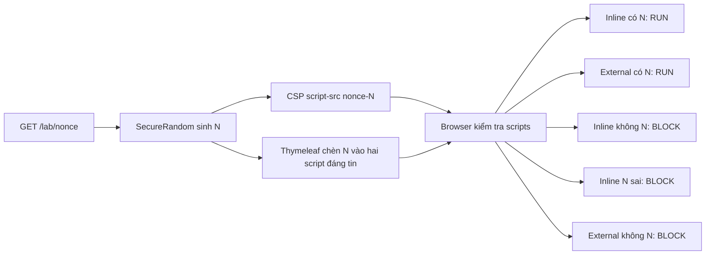

# Kiểm tra nonce thay đổi giữa các phản hồi

Một chính sách Content Security Policy (CSP) có thể cho phép thực thi **một số script inline được máy chủ chấp thuận** bằng nonce. Thay vì bật `'unsafe-inline'`, máy chủ sinh một giá trị ngẫu nhiên khó đoán, đặt nó trong response header `Content-Security-Policy` và gắn cùng giá trị vào các thẻ `<script nonce="...">` được tin cậy. Trình duyệt kiểm tra nonce của script với chính sách trước khi thực thi.

Yêu cầu dễ làm sai nhất không phải chỉ là “nonce có tồn tại”, mà là **nonce phải thay đổi giữa các phản hồi tài liệu độc lập**. Trong cùng **một response**, CSP header và mọi script được phép phải dùng **cùng nonce của response đó**; nhưng khi server tạo một response tài liệu mới, nonce phải **được sinh lại**, không reuse nonce cố định của ứng dụng, session hay bản build.

Bài nằm trong chương **Kiểm thử trình duyệt** của module **SPRING_SECURITY_HTTP_PROTECTION**. Module hướng tới phòng vệ HTTP và trình duyệt trong Spring Security — CSRF, CORS, security headers, CSP, HSTS, HTTP firewall, session — cho cả Servlet và Reactive, với kiểm thử các hành vi browser và chẩn đoán xung đột khi triển khai. Lab chính dùng Java 17+, Spring Boot 3.x, Spring Security Servlet 6.x, Thymeleaf, MockMvc và Playwright; phần cuối đối chiếu Spring WebFlux.

**Mục tiêu sau bài học:**

- Giải thích nonce CSP, `script-src 'nonce-...'` và ranh giới giữa **per-response** với **per-script**.
- Tạo nonce có entropy đủ lớn từ `SecureRandom` và tránh giá trị dự đoán được hoặc tái sử dụng.
- Đồng bộ **CSP response header**, dữ liệu server-side template và thuộc tính `nonce` trên các script hợp lệ.
- Chứng minh qua hai HTTP GET độc lập rằng nonce **khác nhau**, nhưng tất cả script hợp lệ **trong từng response** đều dùng đúng nonce.
- Chứng minh browser cho chạy script có nonce hợp lệ và từ chối script không nonce hoặc nonce sai.
- Xử lý reload, cache, back-forward cache (bfcache), proxy, SSR, CDN, error pages, scripts tải động, nonce trong SPA, CSRF và log.
- Viết test server-side và browser-level có đối chứng, không suy tính an toàn chỉ từ việc một header trông hợp lệ.

## 1. CSP nonce là gì?

Nonce (*number used once*) trong CSP là một giá trị ngẫu nhiên được dùng để **ủy quyền thực thi script cụ thể trong một tài liệu**. Browser chỉ cho script inline chạy nếu nonce trên script khớp với một nonce source expression hợp lệ trong CSP áp dụng cho tài liệu ấy.

Một **response tài liệu** minh họa:

```http
HTTP/1.1 200 OK
Content-Type: text/html; charset=UTF-8
Cache-Control: no-store
Content-Security-Policy: default-src 'none'; script-src 'nonce-Dq8UuVC5isLQxsPcb8uKNw=='; object-src 'none'; base-uri 'none'
```

Trong chính body HTML response đó:

```html
<script nonce="Dq8UuVC5isLQxsPcb8uKNw==">
  document.querySelector("#status").textContent = "ĐÃ chạy";
</script>

<script>
  document.querySelector("#status").textContent = "KHÔNG được chạy";
</script>
```

Giá trị Base64 ở trên **chỉ là ví dụ minh họa**, không dùng cố định trong ứng dụng. Source expression trong header phải có dấu nháy đơn và tiền tố `nonce-`:

```text
'nonce-<gia-tri-Base64>'
```

Thuộc tính HTML `nonce` chỉ chứa **giá trị Base64**, không chứa `'nonce-` hay dấu nháy đơn của CSP:

```html
<script nonce="<gia-tri-Base64>"> ... </script>
```

**Không nhầm với:** nonce OIDC (liên kết/kiểm tra phản hồi định danh), CSRF token (xác minh unsafe HTTP requests), session ID (định danh phiên), cache-busting query string, hay Content Security Policy hash. Chúng khác chức năng và vòng đời.

## 2. Quy tắc cốt lõi: mới cho mỗi response, chung trong cùng response

Giả sử browser gọi endpoint `/lab/nonce` ba lần và cả ba lần đều nhận **HTTP 200 với document mới**:

| Response | CSP source expression | Nonce trên script A | Nonce trên script B | Kết quả mong muốn |
| --- | --- | --- | --- | --- |
| GET lần 1 | `'nonce-N1'` | `N1` | `N1` | Cả hai hợp lệ |
| GET lần 2 | `'nonce-N2'` | `N2` | `N2` | Cả hai hợp lệ |
| GET lần 3 | `'nonce-N3'` | `N3` | `N3` | Cả hai hợp lệ |

Các giá trị trong bảng là **ký hiệu**, không phải nonce thực để copy. Quan hệ bắt buộc:

```text
Trong response 1:
  headerNonce == scriptA.nonce == scriptB.nonce == N1

Trong response 2:
  headerNonce == scriptA.nonce == scriptB.nonce == N2

Giữa các response độc lập:
  N1 != N2   (với xác suất rất cao nhờ entropy)
```

**Không phải**:

```text
request 1: header nonce A, script thứ nhất nonce B, script thứ hai nonce C
```

Cách này gây lỗi ngay cả khi cả ba giá trị đều ngẫu nhiên và “trông đủ mạnh”. Trình duyệt không biết script nào “hợp lệ theo ý định” nếu nonce trên thẻ không khớp policy.

### Nonce mới mỗi **HTTP response tài liệu**, không phải mỗi sự kiện trên UI

Khi người dùng click nút trong cùng document, hoặc SPA cập nhật vùng UI mà **không tải một HTML document mới**, không cần sinh lại nonce CSP chỉ vì có một tương tác. Chính sách CSP đã được gắn với **document hiện hữu**. Nếu script hợp lệ trong document tạo thêm script elements, cách ủy quyền phụ thuộc nonce/script loader/`strict-dynamic` và browser, **không đơn giản là đi hỏi server một nonce mới sau mỗi click**.

### “Mỗi request” là cách nói tắt có điều kiện

Về nguyên tắc an toàn, nonce cần mới cho **mỗi response tài liệu được server render**. Không phải mọi request tạo một document mới:

- GET JSON `/api/profile` không cần tự phát nonce CSP dành cho HTML script.
- Request resource `.js` có thể dùng các cơ chế CSP khác, còn **CSP document** quyết định script có được tải/thực thi.
- `304 Not Modified` dùng lại representation đã cache, nên **không thể so một body HTML mới** như response `200`.
- Back-forward cache có thể khôi phục **chính document cũ**, không có response mới; nonce cũ trong document được khôi phục là điều bình thường.

Khi viết test “nonce phải thay đổi giữa các phản hồi”, hãy bảo đảm thật sự nhận **hai response HTML độc lập, không bị reuse cache**.

## 3. Vì sao nonce cố định là một lỗi bảo mật?

Một nonce cố định trong toàn ứng dụng:

```java
// KHÔNG LÀM:
private static final String CSP_NONCE = "fixed-app-value";
```

hay giá trị phụ thuộc một tham số dự đoán được:

```java
// KHÔNG LÀM:
String nonce = Long.toString(System.currentTimeMillis());
```

không đạt yêu cầu khó đoán/không tái sử dụng. Nếu một giá trị nonce được lặp đi lặp lại và attacker có thể biết nó từ một response, họ có thể tìm cách lợi dụng vị trí HTML injection để thêm script với nonce đã biết trong một response khác cũng dùng nonce đó.

Cũng không nên tạo nonce bằng:

- `Math.random()` hoặc `java.util.Random` cho mục đích mật mã;
- tăng bộ đếm `1`, `2`, `3`;
- hash của user ID, IP, email, `JSESSIONID` hoặc một timestamp;
- hằng số trong `application.properties`/environment variable;
- UUID/prefix có tính dự đoán hoặc một chuỗi ngẫu nhiên sinh **một lần lúc startup** rồi dùng lại;
- nonce nhận nguyên từ query parameter, cookie hoặc HTTP header do client gửi.

Một cơ chế đúng cần sử dụng **CSPRNG**, ví dụ `java.security.SecureRandom`, và **sinh lại ở ranh giới response**. Không cần dựa vào session hoặc user identity để sinh nonce.

### Xác suất trùng và cách viết assertion

Với 128 bit random đều, xác suất hai nonce độc lập trùng nhau khoảng \(2^{-128}\). Test có thể dùng `assertNotEquals(n1, n2)` vì khả năng trùng là cực thấp, nhưng cần hiểu đây là **kiểm thử chất lượng vận hành**, không phải chứng minh toán học nonce sẽ không bao giờ trùng. Nếu cả nghìn response có cùng nonce, đó là lỗi nghiêm trọng; nếu hai response tình cờ trùng theo phân phối xác suất rất nhỏ, một assertion đơn lẻ không thay được đánh giá entropy và CSPRNG.

## 4. Entropy, mã hóa Base64 và độ dài

Một lựa chọn thực tế là **16 byte (128 bit)** sinh từ `SecureRandom`, rồi Base64 hóa. Header CSP cần source expression theo chuẩn `nonce-<base64>`; dùng `Base64.getEncoder()` cho bảng chữ Base64 thông thường.

```java
import java.security.SecureRandom;
import java.util.Base64;

public final class CspNonceFactory {

    private final SecureRandom secureRandom = new SecureRandom();

    public String freshNonce() {
        byte[] bytes = new byte[16]; // 128 bit
        secureRandom.nextBytes(bytes);
        return Base64.getEncoder().encodeToString(bytes);
    }
}
```

**Giải thích:**

1. Tạo **một instance `SecureRandom`** có thể được dùng an toàn trong service cho nhiều request; mỗi lần gọi `nextBytes` sinh 16 byte mới.
2. Base64 chỉ **mã hóa biểu diễn**, không tự tạo entropy. Entropy đến từ bytes sinh bằng CSPRNG.
3. `Base64` chuẩn có thể có ký tự `+`, `/`, `=`; chúng hợp lệ trong giá trị nonce Base64. Việc quote/escape HTML vẫn phải do template engine làm đúng.
4. Không cần biến nonce thành URL hay query parameter. Nonce là dữ liệu của **CSP header và các thẻ script trong cùng HTML response**.
5. Không sử dụng giá trị nonce đã sinh cho một response để làm nonce cho response tiếp theo hoặc toàn bộ session.

Trong code production cần cân nhắc logging, caching, HTML escaping, error handling và số lượng instance theo thiết kế hạ tầng. Bộ sinh trong lab đủ minh họa nguyên tắc, chưa phải thư viện policy quản trị CSP đầy đủ.

Đoạn `CspNonceFactory` trong mục này minh họa thuật toán sinh nonce. Khi dựng **một dự án chạy được**, hãy triển khai **một class duy nhất** theo phiên bản có `@Component` ở mục 9, không tạo hai class trùng tên.

## 5. Một nonce không phải là “bí mật đăng nhập”

Nonce CSP được gửi trong **HTML response cho browser**; trình duyệt cần nhìn thấy nó để cho phép script thực thi. Nó **không phải password, CSRF token hay bearer token** và không dùng để xác thực request của người dùng với backend.

Tuy nhiên nonce vẫn phải **khó đoán trước response tương lai**. Nếu mã HTML không tin cậy có thể tùy ý đưa thẻ `<script nonce="nonce-hop-le">` vào document, tính bảo vệ của CSP suy giảm. Vì vậy:

- **Không cấp nonce cho HTML/script do người dùng hoặc nguồn không tin cậy cung cấp.**
- Không lấy nonce từ input client để gắn vào CSP.
- Không chèn nội dung không tin cậy vào vị trí DOM/attribute mà attacker có thể lợi dụng để gắn nonce hợp lệ.
- Không log toàn bộ response HTML hoặc CSP nonce vào telemetry công khai.
- Không dùng nonce thay cho output encoding/sanitization/Trusted Types hoặc kiểm soát JavaScript dependencies.

Một số browser che giá trị nonce khi đọc qua `getAttribute("nonce")` để giảm lộ qua CSS attribute selectors; thuộc tính DOM `.nonce` có quy tắc truy cập riêng. **Không dùng `element.getAttribute("nonce")` từ JavaScript làm phép so khớp duy nhất** giữa header và HTML. Đối chiếu raw HTTP response body trong kiểm thử server và hành vi script trong browser.

## 6. Sơ đồ luồng từ HTTP request đến browser execution

```mermaid
sequenceDiagram
    participant B as Browser
    participant F as Spring Security Filters
    participant M as MVC Interceptor/Controller
    participant T as Thymeleaf Template
    B->>F: GET /lab/nonce
    F->>M: Request được cho phép
    M->>M: SecureRandom sinh nonce N1
    M->>T: Truyền cspNonce=N1
    T-->>M: HTML script hợp lệ có nonce=N1
    M-->>F: HTTP response CSP script-src nonce-N1
    F-->>B: Header + HTML đồng bộ
    B->>B: Cho script nonce N1 chạy; chặn script thiếu/sai nonce
    B->>F: GET /lab/nonce lần nữa
    F->>M: Request mới
    M->>M: SecureRandom sinh nonce N2
    M-->>B: Response mới CSP/HTML nonce=N2
    Note over B: Kiểm tra N1 != N2, hai trang đều hoạt động
```

Đường đi thực có thể có Spring MVC render, filter, compression, caching proxy và browser storage. Tiêu chí cuối không đổi: **CSP header và HTML thuộc cùng response phải nhất quán, và hai response độc lập phải có nonce mới**.

### Không để mỗi lớp tự sinh một nonce

Anti-pattern phổ biến:

```text
SecurityFilterChain hoặc Filter tự sinh nonce N1 cho CSP header.
Controller tự sinh nonce N2 cho Model.
Thymeleaf fragment tự sinh nonce N3 cho thẻ script.

Kết quả: N1 != N2 != N3 → browser chặn script hợp lệ.
```

Thiết kế tốt hơn là **sinh đúng một lần trong request scope**, lưu ở request attribute, rồi các lớp khác **chỉ đọc lại**, không tự tạo.

## 7. Thiết kế lab: một document, hai script hợp lệ, ba script bị từ chối

Chúng ta xây một endpoint HTML `/lab/nonce` trên Spring Boot:

| Thành phần | URL/vị trí | Mục đích |
| --- | --- | --- |
| HTML document | `http://localhost:8080/lab/nonce` | Trả CSP header và template dùng chung nonce |
| Inline script hợp lệ | Một `<script nonce="N">` trong HTML | Cập nhật marker `#inline-ok` |
| External script hợp lệ | `/lab/assets/allowed.js` với `<script nonce="N" src="...">` | Cập nhật marker `#external-ok` |
| Inline script **thiếu nonce** | Một `<script>` khác | Không được chạy |
| Inline script **nonce sai** | `<script nonce="not-the-issued-nonce">` | Không được chạy |
| External script **thiếu nonce** | `/lab/assets/blocked.js` | Không được chạy dù same-origin |
| Client observer | Trong inline script hợp lệ | Đo `securitypolicyviolation` event và disposition |
| Browser automation | Playwright | Tạo hai navigation thực và kiểm tra script behavior |
| Server contract | MockMvc | Đo CSP header và raw HTML của hai responses |

**Vì sao có external script same-origin bị chặn?** Để chứng minh CSP `script-src 'nonce-N'` **không đồng nghĩa** với `script-src 'self'`. Khi chính sách chỉ cho nonce hợp lệ, một file cùng origin **không tự được phép** nếu thẻ tải nó không có nonce phù hợp (và không có source expression khác cho phép).

### Mô hình kịch bản



Lab chỉ dùng các marker HTML giả, không yêu cầu cookie, tài khoản hoặc token người thật. Không thực hiện XSS khai thác trên trang ngoài quyền sở hữu.

## 8. Chuẩn bị Spring Boot và security headers

Dependency chính:

```text
spring-boot-starter-web
spring-boot-starter-security
spring-boot-starter-thymeleaf
spring-boot-starter-test       (test scope)
spring-security-test          (test scope)
```

Trong `application.properties`:

```properties
server.port=8080
```

Tạo một `SecurityFilterChain` duy nhất cho lab:

```java
import org.springframework.context.annotation.Bean;
import org.springframework.context.annotation.Configuration;
import org.springframework.security.config.annotation.web.builders.HttpSecurity;
import org.springframework.security.web.SecurityFilterChain;

@Configuration
public class NonceLabSecurity {

    @Bean
    SecurityFilterChain nonceLabFilterChain(HttpSecurity http)
            throws Exception {
        http
            .authorizeHttpRequests(auth -> auth
                .requestMatchers(
                    "/lab/nonce",
                    "/lab/assets/**")
                .permitAll()
                .anyRequest().denyAll());

        // Spring Security giữ những default headers khác
        // và CSRF cho unsafe requests; ta chỉ minh họa GET.
        // CSP per-response sẽ do MVC interceptor thiết lập.
        return http.build();
    }
}
```

**Tại sao không đặt một nonce cố định trong DSL?**

```java
// KHÔNG PHÙ HỢP CHO NONCE MỚI MỖI RESPONSE:
// .headers(headers -> headers.contentSecurityPolicy(csp ->
//     csp.policyDirectives("script-src 'nonce-mot-gia-tri-co-dinh'")))
```

Một cấu hình security bean thường được tạo **một lần khi application start**. Nếu nonce được tính tại thời điểm tạo bean và cố định vào policy string, mọi response sẽ dùng lại cùng nonce. Do đó lab minh họa phát CSP **tại thời điểm xử lý request**, không lấy một chuỗi static làm nguồn nonce.

**CSP không tự được Spring Security bật theo `script-src` theo mặc định trong mọi cấu hình.** Các default headers thông dụng của Spring Security có chức năng khác; khi ứng dụng cần CSP phải chủ động thiết kế policy và kiểm tra response thực.

### Không tắt CSRF hay CORS để làm phép đo nonce

Lab chỉ có GET tài liệu và GET assets nên không yêu cầu vô hiệu hóa CSRF. Nếu thêm POST vào sản phẩm, CSRF vẫn được áp dụng đúng theo security matcher. CORS chỉ liên quan những tương tác cross-origin có quy tắc tương ứng; **CSP nonce là quyền thực thi script trong document**, không phải cơ chế cấp quyền gọi API.

## 9. Bộ sinh nonce an toàn, tái sử dụng instance nhưng không tái sử dụng giá trị

Đặt class riêng `CspNonceFactory.java`:

```java
import java.security.SecureRandom;
import java.util.Base64;
import org.springframework.stereotype.Component;

@Component
public final class CspNonceFactory {

    private final SecureRandom secureRandom = new SecureRandom();

    public String freshNonce() {
        byte[] random = new byte[16];
        secureRandom.nextBytes(random);
        return Base64.getEncoder().encodeToString(random);
    }
}
```

Trong ví dụ, class có `@Component` để Spring quản lý một instance của factory. `SecureRandom` được giữ lại giữa các request, nhưng **mỗi lần gọi `freshNonce()` sinh ra 16 bytes mới**. Sự khác biệt giữa **tái sử dụng CSPRNG instance** (bình thường) và **tái sử dụng nonce value** (sai) rất quan trọng.

### Độ dài nào là đủ?

16 bytes = 128 bits entropy nếu ngẫu nhiên đều; nhiều triển khai chọn 16–32 bytes. Dùng 32 bytes cũng hợp lệ, nhưng **tăng độ dài của một timestamp hoặc `Math.random()` không biến nó thành CSPRNG**. Quan trọng là entropy thực, sự độc lập giữa responses và việc không lộ nonce tương lai trước khi response được phát.

### Không cần nonce trên mọi response trong hệ thống

Factory chỉ được gọi khi server phát một **HTML document được bảo vệ bằng nonce CSP**. API JSON hoặc ảnh không nhất thiết có thuộc tính `nonce` trong body. Nếu nhiều module/SSR route cần nonce, dùng một cơ chế request-scoped nhất quán trên toàn bộ các document tương ứng; không phát hai nonce khác nhau do các filter/controller tự chạy.

## 10. MVC `HandlerInterceptor`: sinh một nonce và gắn nó vào response

Đặt `CspNonceInterceptor.java`:

```java
import jakarta.servlet.http.HttpServletRequest;
import jakarta.servlet.http.HttpServletResponse;
import org.springframework.stereotype.Component;
import org.springframework.web.servlet.HandlerInterceptor;

@Component
public class CspNonceInterceptor implements HandlerInterceptor {

    public static final String ATTRIBUTE = "cspNonce";
    private final CspNonceFactory factory;

    public CspNonceInterceptor(CspNonceFactory factory) {
        this.factory = factory;
    }

    @Override
    public boolean preHandle(
            HttpServletRequest request,
            HttpServletResponse response,
            Object handler) {

        // Trong cùng request chỉ sinh một lần.
        String nonce = (String) request.getAttribute(ATTRIBUTE);
        if (nonce == null) {
            nonce = factory.freshNonce();
            request.setAttribute(ATTRIBUTE, nonce);
        }

        String policy =
            "default-src 'none'; " +
            "script-src 'nonce-" + nonce + "'; " +
            "style-src 'self'; " +
            "img-src 'self'; " +
            "connect-src 'self'; " +
            "object-src 'none'; " +
            "base-uri 'none'; " +
            "form-action 'self'; " +
            "frame-ancestors 'none'";

        response.setHeader("Content-Security-Policy", policy);
        response.setHeader("Cache-Control", "no-store");

        return true;
    }
}
```

**Tại sao dùng `request.setAttribute`?** Vì request attribute là dữ liệu gắn với **một HTTP request**, thuận tiện để MVC controller, Thymeleaf template và các thành phần render đọc **cùng một nonce**. Nó không được lưu vào `HttpSession`, cookie, static field hoặc shared mutable bean.

### Chặn lỗi “header nonce N1, HTML nonce N2”

Interceptor lấy nonce một lần, lưu vào request, rồi set CSP header từ đúng biến đó. Controller/template ở mục 12 chỉ đọc request attribute này. Nếu một fragment Thymeleaf cần script nonce, nó cũng phải nhận/chia sẻ cùng request attribute; không được gọi `factory.freshNonce()` một lần nữa cho fragment.

### Vì sao interceptor chỉ áp dụng cho một route lab?

Trong sản phẩm thật, CSP phải được thiết kế cho tất cả document cần bảo vệ, kể cả login, error pages, forwards, fragments và routes SSR khác. Lab giới hạn `/lab/nonce` để dễ đối chứng. **Không** coi việc thêm một interceptor cho một URL là đủ để bảo vệ toàn bộ ứng dụng.

### Security filters và việc ghi response headers

Spring Security headers writer có thể thêm các headers mặc định trong filter chain; interceptor cũng set CSP trước khi render view. Ở cấu hình lab **không có CSP writer tĩnh khác** nên không có tranh chấp. Nếu gateway/filter khác viết thêm CSP, browser có thể áp dụng **nhiều enforced policies cùng lúc**, dẫn tới script hợp lệ vẫn bị chặn. Phải xem CSP cuối browser thực nhận.

## 11. Đăng ký interceptor trong Spring MVC

Tạo `NonceLabMvcConfiguration.java`:

```java
import org.springframework.context.annotation.Configuration;
import org.springframework.web.servlet.config.annotation.InterceptorRegistry;
import org.springframework.web.servlet.config.annotation.WebMvcConfigurer;

@Configuration
public class NonceLabMvcConfiguration implements WebMvcConfigurer {

    private final CspNonceInterceptor nonceInterceptor;

    public NonceLabMvcConfiguration(
            CspNonceInterceptor nonceInterceptor) {
        this.nonceInterceptor = nonceInterceptor;
    }

    @Override
    public void addInterceptors(InterceptorRegistry registry) {
        registry.addInterceptor(nonceInterceptor)
            .addPathPatterns("/lab/nonce");
    }
}
```

`@Component` cho cả `CspNonceFactory` và `CspNonceInterceptor` tạo quan hệ constructor injection thông thường, **không cần tự tạo thêm bean factory trong configuration này**. Nonce factory là **singleton service sinh các giá trị khác nhau**; không phải singleton nonce. MVC interceptor chạy trước khi controller/view render, nên header và model cùng dùng request attribute.

### Lỗi thứ tự khởi tạo có thể xảy ra?

Không cần inject nonce vào `SecurityFilterChain` ở cấu hình này. Nếu thiết kế khác tạo nonce từ `Filter`, nó phải đảm bảo nonce đã tồn tại trước khi cả CSP header và SSR template sử dụng, không bị tạo lại trên forward/error dispatch. Với nhiều `SecurityFilterChain`, route có thể match chain không đúng và phát CSP tĩnh trái với MVC nonce; kiểm tra matcher/order.

### `Cache-Control: no-store` có đủ để test nonce mới?

`no-store` giúp giảm việc tái sử dụng response đã lưu, nhưng browser có các cơ chế navigation/bfcache, service worker hoặc proxy thay đổi thực tế. Test phải xác minh **mỗi lần thật sự nhận response HTML mới**; không dựa vào một lệnh thay đổi UI hoặc chỉ nhìn DOM đã được khôi phục.

## 12. Controller và Thymeleaf template: header/HTML lấy cùng request attribute

Tạo `NonceLabController.java`:

```java
import jakarta.servlet.http.HttpServletRequest;
import org.springframework.stereotype.Controller;
import org.springframework.ui.Model;
import org.springframework.web.bind.annotation.GetMapping;

@Controller
public class NonceLabController {

    @GetMapping("/lab/nonce")
    String page(HttpServletRequest request, Model model) {
        String nonce = (String)
            request.getAttribute(CspNonceInterceptor.ATTRIBUTE);

        if (nonce == null) {
            throw new IllegalStateException(
                "CSP nonce interceptor chưa chạy cho /lab/nonce");
        }

        model.addAttribute("cspNonce", nonce);
        return "nonce-lab";
    }
}
```

Controller **không sinh nonce**. Nếu interceptor bị bỏ khỏi MVC mapping, controller phát hiện thiếu nonce và thất bại có chủ đích thay vì âm thầm trả HTML không đồng bộ với CSP header.

Tạo file `src/main/resources/templates/nonce-lab.html`:

```html
<!doctype html>
<html lang="vi" xmlns:th="http://www.thymeleaf.org">
<head>
  <meta charset="utf-8">
  <title>Nonce CSP per response lab</title>
</head>
<body>
  <h1>Kiểm tra nonce CSP thay đổi giữa các response</h1>

  <p>Inline script có nonce:
    <output id="inline-ok">CHƯA chạy</output>
  </p>
  <p>External script có nonce:
    <output id="external-ok">CHƯA chạy</output>
  </p>
  <p>Inline script không nonce:
    <output id="inline-missing">CHƯA chạy</output>
  </p>
  <p>Inline script nonce sai:
    <output id="inline-wrong">CHƯA chạy</output>
  </p>
  <p>External script không nonce:
    <output id="external-missing">CHƯA chạy</output>
  </p>
  <p>Vi phạm CSP:
    <output id="violations">Chưa ghi nhận</output>
  </p>
  <button id="safe-button">Thử listener từ script hợp lệ</button>

  <!-- N1: inline script được máy chủ cho phép. -->
  <script th:attr="nonce=${cspNonce}">
    "use strict";
    document.querySelector("#inline-ok").textContent = "ĐÃ chạy";
    document.addEventListener("securitypolicyviolation", event => {
      // Không in documentURI/blockedURI; chúng có thể nhạy cảm.
      const target = document.querySelector("#violations");
      target.textContent =
        "directive=" + event.effectiveDirective +
        "; disposition=" + event.disposition;
    });
  </script>

  <!-- N2: external script cũng dùng CHÍNH nonce của response. -->
  <script th:attr="nonce=${cspNonce}"
          src="/lab/assets/allowed.js"></script>

  <!-- Không có nonce: bắt buộc bị chặn bởi policy của lab. -->
  <script>
    document.querySelector("#inline-missing").textContent = "ĐÃ chạy";
  </script>

  <!-- Có thuộc tính nonce nhưng sai giá trị: vẫn bị chặn. -->
  <script nonce="intentionally-wrong">
    document.querySelector("#inline-wrong").textContent = "ĐÃ chạy";
  </script>

  <!-- Self-hosted JS nhưng thiếu nonce, vì policy chỉ cho nonce. -->
  <script src="/lab/assets/blocked.js"></script>
</body>
</html>
```

**Nhớ dùng `th:attr="nonce=${cspNonce}"`:** Thymeleaf đưa nonce do controller truyền vào **HTML output của cùng HTTP response**. Khi xem file template trên đĩa, bạn chỉ thấy expression `${cspNonce}`; khi xem **Network → Response** của document hoặc MockMvc response body, bạn phải thấy nonce thực dưới dạng `nonce="..."`.

### Không dùng `th:utext` để chèn HTML không tin cậy

Nonce chỉ ủy quyền cho script có attribute khớp. Nó **không làm HTML đầu vào của người dùng trở thành đáng tin**. Đừng đặt nonce vào HTML từ cơ sở dữ liệu/markdown không tin cậy bằng `th:utext`. Với văn bản từ người dùng, ưu tiên `th:text` và encoding theo ngữ cảnh; khi bắt buộc hỗ trợ HTML có giới hạn, cần sanitizer phù hợp.

## 13. Hai external JS: một được cấp nonce, một không

Tạo `src/main/resources/static/lab/assets/allowed.js`:

```javascript
"use strict";

document.querySelector("#external-ok").textContent = "ĐÃ chạy";
document.querySelector("#safe-button").addEventListener("click", () => {
  document.querySelector("#external-ok").textContent =
    "ĐÃ click bằng script hợp lệ";
});
```

Tạo `src/main/resources/static/lab/assets/blocked.js`:

```javascript
"use strict";

document.querySelector("#external-missing").textContent = "ĐÃ chạy";
```

Cả hai files nằm trên **cùng origin** và có thể trả HTTP `200` khi mở trực tiếp. Nhưng trong document `/lab/nonce`, **chỉ `allowed.js` được tải bằng thẻ script có nonce khớp**; `blocked.js` bị policy `script-src 'nonce-...'` chặn vì thẻ của nó thiếu nonce. Đây là một test âm mạnh hơn chỉ so inline script.

Một browser có thể ngăn GET `blocked.js` trước network, hoặc DevTools biểu diễn là `blocked:csp`. **Không đồng nhất entry Network với HTTP status thực từ server**. Điều quyết định là script **không được thực thi**, trong khi `allowed.js` chạy được.

### Vì sao không dùng `script-src 'self'` trong lab?

Nếu thêm `'self'` vào policy:

```http
Content-Security-Policy: script-src 'self' 'nonce-<N>'
```

thì `blocked.js` **có thể được phép chạy do `'self'`**, dù thẻ thiếu nonce. Điều đó không tự sai trong mọi hệ thống — nguồn self có thể là một phần của policy — nhưng **không phù hợp bài test “external script thiếu nonce phải bị chặn”**. Vì vậy lab dùng source nonce, không dùng `'self'` trong `script-src`. Trong sản phẩm thật, hãy thiết kế policy theo mức tin cậy của mỗi bundle và threat model.

## 14. Kỳ vọng DevTools khi mở trang lần thứ nhất

Mở:

```text
http://localhost:8080/lab/nonce
```

Trong **DevTools → Network**, chọn document `/lab/nonce`, kiểm tra response headers có ví dụ:

```http
Content-Security-Policy: default-src 'none'; script-src 'nonce-<BASE64_N1>'; style-src 'self'; img-src 'self'; connect-src 'self'; object-src 'none'; base-uri 'none'; form-action 'self'; frame-ancestors 'none'
Cache-Control: no-store
```

Trong **Response body** (không phải original template source), các thẻ hợp lệ chứa nonce **`N1` cùng giá trị**.

Trên UI:

| Trường UI | Kết quả |
| --- | --- |
| `#inline-ok` | **ĐÃ chạy** |
| `#external-ok` | **ĐÃ chạy** |
| `#inline-missing` | **CHƯA chạy** |
| `#inline-wrong` | **CHƯA chạy** |
| `#external-missing` | **CHƯA chạy** |
| Nút `#safe-button` | Đổi marker khi click |
| `#violations` | Thường thấy directive/disposition khi browser phát event |

Trong Console, browser có thể báo “Refused to execute inline script” hoặc “Refused to load the script” vì CSP. **Đừng assert nguyên văn thông báo**: nội dung thay đổi theo browser/version. Nếu CSP event vắng mặt nhưng markers đúng, cần xem timing/cấu hình observer, không kết luận ngay policy không hoạt động.

### Nếu script có nonce hợp lệ bị chặn

Kiểm tra lần lượt:

1. Response HTML có thực sự chứa `nonce="N1"` thay vì `th:attr` chưa render?
2. Header CSP có `'nonce-N1'` khớp **chính xác** không?
3. Có CSP header **khác** từ Spring Security, gateway, CDN hoặc error page chặn tiếp không?
4. Có `script-src-elem`/`strict-dynamic`/source expressions khác tác động không?
5. Script file có MIME đúng và không lỗi syntax/network không?
6. Page có nằm trong iframe `sandbox` thiếu `allow-scripts` không?
7. Browser có đang dùng **HTML cũ/nonce cũ từ cache** với CSP mới không?

Không chữa bằng `'unsafe-inline'` trước khi giải quyết đồng bộ nonce header/HTML.

## 15. Thử nghiệm bắt buộc: hai GET độc lập phải có hai nonce khác nhau

Đây là phép đo cốt lõi. Mở `http://localhost:8080/lab/nonce`, rồi **reload thực sự** để browser lấy HTML response thứ hai. Trong Network → Document, bật Preserve log nếu cần; xác minh có **hai HTTP 200 responses** của `/lab/nonce`, không phải một lượt khôi phục trang từ bfcache hoặc cache.

```text
Response #1:
  CSP: script-src 'nonce-N1'
  <script nonce="N1"> ... </script>
  <script nonce="N1" src="/lab/assets/allowed.js"></script>

Response #2:
  CSP: script-src 'nonce-N2'
  <script nonce="N2"> ... </script>
  <script nonce="N2" src="/lab/assets/allowed.js"></script>
```

`N1`, `N2` là ký hiệu, không phải nonce thực để dùng trong app. Các assertions mong muốn:

1. Nonce trong header của response #1 khớp **cả hai script hợp lệ trong HTML #1**.
2. Nonce trong header của response #2 khớp **cả hai script hợp lệ trong HTML #2**.
3. `N1 != N2` trên hai response độc lập.
4. Cả hai lần browser đều **chạy script có nonce hợp lệ**, chặn script thiếu/sai nonce.
5. Document được phát với `Cache-Control: no-store`, CSP enforce và không có CSP khác từ proxy làm lệch kết quả.

| Điều kiện | Response #1 | Response #2 |
| --- | --- | --- |
| HTTP document mới | `200` | `200` |
| CSP chứa nonce | `N1` | `N2` |
| Inline script có nonce | `N1` | `N2` |
| External script có nonce | `N1` | `N2` |
| Script hợp lệ | Chạy | Chạy |
| Script không nonce/nonce sai | Bị chặn | Bị chặn |
| Quan hệ giữa nonce | \(\displaystyle N_1 \ne N_2\) | Kiểm tra giữa hai response |

Một test chỉ assert `nonce != null` **không đủ** vì nonce cố định cũng khác null. Chỉ assert `N1 != N2` **cũng không đủ** nếu HTML/headers mismatch khiến browser chặn script hợp lệ.

## 16. Reload, navigation mới, SPA update, `304` và bfcache

| Thao tác | Có HTML response mới? | Nonce mong đợi |
| --- | --- | --- |
| Mở URL qua navigation GET mới, nhận `200` | Có | Nonce mới |
| Reload document và nhận `200` mới | Có | Nonce mới |
| Hai tab gửi hai GET độc lập | Có | Hai nonce khác nhau |
| Click nút cập nhật DOM trong trang | Không | Dùng nonce hiện có của document |
| SPA đổi route client-side không reload | Không | CSP/nonce của document hiện tại vẫn áp dụng |
| Back-forward cache khôi phục document | **Không nhất thiết** | Nonce cũ có thể được giữ lại hợp lệ |
| `304 Not Modified` | Không có HTML body mới đầy đủ | Cached representation được reuse, phải bảo đảm tính nhất quán |
| Service worker trả cached HTML | Có thể reuse representation | Cần đánh giá lại nonce freshness/caching |
| Redirect rồi đến document cuối mới | Có document cuối riêng | Đo CSP nonce của final HTML |

**Bfcache không phải lỗi nonce rotation.** Browser có thể giữ nguyên document/DOM và khôi phục nó khi Back/Forward; nonce cũ thuộc **document cũ**, không phải nonce dùng lại trên response mới. Browser có thể phát `pageshow` với `event.persisted=true`:

```javascript
window.addEventListener("pageshow", event => {
  if (event.persisted) {
    console.log("Document có thể được khôi phục từ bfcache");
  }
});
```

Đây chỉ là đoạn minh họa: trong trang nonce-only, mã này cần nằm trong script có nonce hợp lệ hoặc external script được CSP cấp phép.

`304 Not Modified` cũng không tương đương một HTML response `200` mới. Nếu browser giữ HTML cũ nhưng CSP header mới có nonce khác, script có thể bị chặn do mismatch. Trong lab, đặt `no-store` và assert response navigation thực sự là `200`. Không kiểm tra nonce chỉ bằng đọc DOM sau một lượt Back/Forward.

## 17. Cache/CDN có thể làm header và body lệch nonce

Kịch bản cache sai:

```text
GET 1 tại backend:
  Header CSP nonce N1
  HTML nonce N1
CDN cache HTML N1

GET 2:
  Gateway phát header CSP nonce N2
  CDN trả HTML N1
Browser nhận header N2 + HTML N1
  -> script hợp lệ bị CSP chặn.
```

Kịch bản khác: CDN cache **cả header và HTML N1**, rồi phát lại cho nhiều lần navigation. Script vẫn chạy, nhưng nonce bị **reused giữa các responses logic**, khiến test chỉ dựa vào DOM “script chạy” **không phát hiện lỗi**.

**Biện pháp giảm rủi ro:**

- Với HTML SSR có nonce động, ưu tiên `Cache-Control: no-store` hoặc chiến lược cache được thiết kế riêng.
- Tạo CSP header và HTML nonce **trong cùng đơn vị response**; tránh hai tầng tự sinh nonce.
- Nếu edge rewrite nonce, phải đồng bộ **tất cả** thuộc tính nonce trong HTML với header, không thay chuỗi tùy tiện trên markup không tin cậy.
- Không dùng HTML ETag/Last-Modified cố định theo version build khi representation thay đổi vì nonce.
- Kiểm tra cache hit/miss, 200/304, compressed response, reverse proxy và error pages.
- Không log raw CSP nonce, session ID hoặc toàn bộ HTML nhạy cảm trong hệ thống telemetry.

Trong production, caching HTML có nonce đòi cân nhắc cả **tính nhất quán header/body và khả năng nonce được đoán/tái sử dụng**. Phép thử `/lab/nonce` dùng `no-store` để tạo một baseline dễ kiểm chứng trước khi kiểm tra hạ tầng phức tạp.

## 18. Nhiều `SecurityFilterChain`, CSP headers và thứ tự xử lý

Một ứng dụng có thể có nhiều chain:

```text
/api/**    -> SecurityFilterChain cho JSON
/admin/**  -> SecurityFilterChain cho trang quản trị
/lab/**    -> SecurityFilterChain cho lab
/**        -> fallback SecurityFilterChain
```

Nếu matcher/order sai, `/lab/nonce` có thể nhận CSP tĩnh do một chain khác:

```http
Content-Security-Policy: script-src 'self'
```

trong khi interceptor sinh:

```http
Content-Security-Policy: script-src 'nonce-N'
```

Có thể có ba kết quả: header bị **ghi đè**, có **hai enforced policies** cùng áp dụng, hoặc một tầng như gateway thêm deny sau Spring Boot. **CSP policies không phải phép cộng quyền**; browser có thể áp dụng đồng thời, yêu cầu script thỏa **tất cả**. Một policy cho nonce đúng không mở khóa policy khác từ chối.

Với nonce động, chọn **một ownership model** sinh nonce theo request rồi cấp nó cho header writer và SSR template. Trong ví dụ, MVC interceptor là owner CSP duy nhất cho `/lab/nonce`, Spring Security vẫn bảo vệ HTTP theo default security headers. Không đặt một giá trị nonce static khi cấu hình bean singleton.

### Header thực nhận quan trọng hơn cấu hình trên giấy

Khi MockMvc đúng nhưng browser khác, kiểm tra response cuối qua HTTPS proxy, ingress, CDN, custom filters và cache. Một CSP header “thừa” có `script-src 'none'` có thể chặn toàn bộ script kể cả khi header khác allow nonce hợp lệ. Không thêm `'unsafe-inline'` để sửa tình huống này.

## 19. Host allow-list, `script-src-elem` và `strict-dynamic`

Lab cố ý dùng:

```http
Content-Security-Policy: script-src 'nonce-N'
```

Đối với script elements:

| Thẻ script | Kết quả kỳ vọng |
| --- | --- |
| `<script nonce="N">...</script>` | Chạy |
| `<script nonce="N" src="/allowed.js"></script>` | Chạy |
| `<script>...</script>` | Chặn |
| `<script nonce="wrong">...</script>` | Chặn |
| `<script src="/blocked.js"></script>` | Chặn nếu không có source khác |

Nếu đổi policy thành:

```http
Content-Security-Policy: script-src 'nonce-N' 'self'
```

thì file cùng origin có thể được phép **nhờ `'self'`** dù thiếu nonce. Không tự coi đó là lỗi bảo mật cho mọi sản phẩm, nhưng không thể dùng policy này làm đối chứng nonce-only.

Nếu còn `script-src-elem`, browser có thể áp dụng directive đó **riêng cho `<script>` elements**, thay đổi fallback từ `script-src`. `script-src-attr` điều khiển inline event handlers như `onclick`. Đọc **toàn bộ policy** trước khi khẳng định script không nonce chắc chắn phải bị chặn.

`'strict-dynamic'` có thể làm một trusted nonce/hash bootstrap cho phép script được nó tải động trong CSP3. Đây là cơ chế trust propagation, **không tự chứng minh dynamic loader an toàn**: loader lấy URL từ input attacker kiểm soát vẫn có thể gây hại. Bài lab chính không dùng `'strict-dynamic'` để kiểm chứng nonce matching trực tiếp.

## 20. Nonce không cấp quyền cho inline event handler bất kỳ

Nonce CSP được áp dụng cho các **script elements**, không phải giấy phép có thể gắn vào bất kỳ HTML tag:

```html
<!-- Không làm onclick chạy được chỉ nhờ nonce trên button. -->
<button nonce="N" onclick="doSomething()">Click</button>
```

Thay bằng listener được đăng ký trong script hợp lệ:

```html
<button id="action">Click an toàn hơn</button>
<script nonce="N">
  document.querySelector("#action").addEventListener(
    "click", () => console.log("Được CSP cho phép")
  );
</script>
```

Trong ứng dụng thật, `N` phải do template engine đưa vào từ nonce per-response, không hard-code. `script-src-attr` có quy tắc riêng cho `onclick` và inline attributes. Đừng thêm `'unsafe-inline'` chỉ để giữ hàng loạt inline handlers; chuyển chúng vào JS được CSP tin cậy. CSP script nonce cũng **không tự cấp quyền cho inline CSS** (`style-src`) hoặc iframe navigation (`frame-src`).

## 21. Phân biệt CSP nonce, hash, SRI, CSRF token và OIDC nonce

| Cơ chế | Mục đích | Vòng đời/nguồn |
| --- | --- | --- |
| **CSP nonce** | Cho phép script elements của một document | Random mới theo **response document** |
| **CSP hash** | Cho phép nội dung inline có hash trùng bytes | Có thể ổn định với script bất biến |
| **Subresource Integrity (SRI)** | Xác minh resource có bytes đúng integrity | Gắn với version/nội dung asset |
| **CSRF token** | Xác minh unsafe HTTP requests | Theo repository/session/request handler |
| **OIDC nonce** | Xác minh ID token trong authentication flow | Theo một authentication transaction |
| **Session ID** | Định danh phiên ở server | Theo session lifecycle và rotation |

Ví dụ CSP hash:

```http
Content-Security-Policy: script-src 'sha256-<HASH_BASE64_DUNG>'
```

Chuỗi trên **chỉ là placeholder**; phải tính SHA-256 Base64 trên **đúng nội dung inline**. Whitespace hoặc newline khác làm hash khác. Với SSR bootstrap thay đổi mỗi response, nonce thường thuận tiện hơn hash tĩnh.

**Không dùng CSRF token làm CSP nonce:**

```java
// SAI: expected CSRF token có thể được lưu theo session.
String cspNonce = csrfToken.getToken();
```

Trong Spring Security Servlet, `HttpSessionCsrfTokenRepository` có thể lưu raw token qua nhiều responses; `XorCsrfTokenRequestAttributeHandler` còn có biểu diễn masked token trong view. Cả hai **không tuân theo vòng đời nonce per-response**. CSP nonce không được browser gửi như hidden form `_csrf` và cũng không có tác dụng xác minh POST. Tương tự, đừng reuse OIDC nonce, bearer token hoặc `JSESSIONID`.

Một script có nonce hợp lệ nhưng SRI hash sai hoặc MIME/JS lỗi vẫn có thể **không chạy**; phải kiểm tra từng lớp trước khi quy nguyên nhân cho CSP.

## 22. Chỉ cấp nonce cho script đáng tin

Nonce không tự làm mã độc trở thành an toàn. Phản ví dụ:

```html
<!-- Không cấp nonce hiện tại cho script do user chèn. -->
<script nonce="NONCE_HOP_LE">
  console.log("Đây là mã đầu vào chưa được tin cậy");
</script>
```

Nếu một vị trí injection được server cấp nonce hợp lệ, browser có thể cho thực thi script. Vì vậy:

1. Chỉ cấp nonce cho script elements do trusted templates/components tạo ra.
2. Escape HTML/JS theo ngữ cảnh; dùng `th:text` thay cho `th:utext` với text không tin cậy.
3. Sanitize HTML đầu vào nếu sản phẩm bắt buộc hỗ trợ rich text.
4. Audit các DOM sinks như `innerHTML` và trusted dynamic loaders.
5. Không cho client chỉ định nonce, không dùng nonce như mật khẩu đăng nhập.
6. Duy trì output encoding, authorization, CSRF và session protection độc lập.

Browser có thể **ẩn giá trị nonce khi đọc `getAttribute("nonce")`** trong một số tình huống, nhưng `.nonce` DOM property có thể truy cập theo quy tắc browser. Không coi nonce là bí mật tuyệt đối sau khi document hợp lệ được nhận; điều quan trọng là **không đoán được nonce của response tương lai**.

## 23. Chẩn đoán script không chạy hoặc nonce không đổi

| Hiện tượng | Khả năng | Bằng chứng cần xem |
| --- | --- | --- |
| Header nonce `N1`, HTML nonce `N2` | Hai tầng sinh nonce riêng | So CSP và HTML **cùng response** |
| Nonce lặp lại qua các HTML 200 mới | Constant/session/static reuse | So hai navigation responses |
| Self external có nonce nhưng không chạy | MIME/404/SRI/JS error | GET asset, `Content-Type`, Console |
| Script thiếu nonce nhưng vẫn chạy | `'self'`/`script-src-elem`/policy rộng | Toàn bộ CSP enforce headers |
| Script nonce đúng vẫn bị CSP chặn | Policy thứ hai/proxy, attr mismatch | CSP thực nhận và HTML response |
| Chỉ lỗi production | CDN cache hoặc edge rewrite | Cache hit/miss, headers sau proxy |
| Back rồi thấy nonce cũ | Document khôi phục từ bfcache | Có HTTP response mới hay không? |
| `304` rồi lỗi CSP | Cached body + header lệch | Cache validators, `no-store` |
| Click button rồi nonce không đổi | Không có response document mới | Bình thường trong cùng document |
| `onclick` bị chặn | `script-src-attr` | Dùng `addEventListener` |
| iframe script không chạy | `sandbox` thiếu `allow-scripts` | Iframe attrs + child CSP |
| POST trả `403` | CSRF/authorization | Không kết luận do CSP nonce |
| `fetch` báo CORS lỗi | ACAO/preflight/credentials | CORS headers, không sửa bằng nonce |
| HTTPS page không tải HTTP script | Mixed content/HSTS/TLS | URL cuối và network error |

**Quy trình:** xác định document cuối → đọc mọi enforce CSP → so header nonce và HTML nonce trong cùng response → kiểm tra execution/network/MIME/SRI → đo response HTML mới và cache → so script allowed/blocked trên UI. Không thêm `'unsafe-inline'` hoặc wildcard chỉ vì nhìn thấy một `TypeError` hoặc vi phạm CSP.

## 24. Violation event và CSP reports không chứng minh nonce rotation

Observer trong lab được cài từ script có nonce hợp lệ. Khi browser chặn script thiếu nonce, sự kiện `securitypolicyviolation` có thể cung cấp `effectiveDirective`, `disposition` và metadata khác. Các trình duyệt thường ghi thông báo CSP trong Console; chuỗi thông báo khác nhau theo phiên bản.

Nếu thêm reporting endpoint:

```http
Content-Security-Policy: script-src 'nonce-N'; report-uri /csp-reports
```

browser **có thể** gửi báo cáo dạng legacy:

```json
{
  "csp-report": {
    "effective-directive": "script-src-elem",
    "blocked-uri": "inline",
    "disposition": "enforce"
  }
}
```

Lab chính không khai báo reporting endpoint để tập trung vào **nonce rotation và script execution**. Khi mở rộng, endpoint report cần coi payload là dữ liệu không tin cậy, giới hạn body/rate, tránh lưu URL nhạy cảm và có thể miễn CSRF **chỉ cho report sink** nếu browser tự gửi report không có token. Không tắt CSRF toàn ứng dụng vì báo cáo.

**Không assert số reports bằng số script bị chặn.** Reports có thể bị drop, batch, dedupe hoặc chặn bởi browser privacy policy. Số báo cáo bằng 0 không chứng minh nonce mới, cũng không chứng minh CSP không hoạt động.

## 25. Browser DevTools, MockMvc và Playwright chứng minh các điều khác nhau

| Nguồn bằng chứng | Chứng minh tốt nhất | Giới hạn |
| --- | --- | --- |
| Network → Document | HTTP status, CSP, cache headers của response | Script đã chạy hay chưa |
| Raw HTML body | Nonce trên từng `<script>` | Browser enforcement |
| Console | Browser báo lỗi CSP/network/MIME | Nonce có entropy mạnh hoặc rotation |
| `securitypolicyviolation` | Loại vi phạm/disposition | Reporting luôn tới server |
| Playwright DOM markers | Script được phép chạy, script trái policy không chạy | Chất lượng nguồn CSPRNG |
| MockMvc | Response-level nonce rotation, header ↔ HTML consistency | Browser/CDN/bfcache thật |
| Test qua reverse proxy HTTPS | CSP cuối, cache, behavior browser sau deploy | Không thay unit tests |

Phép nghiệm thu nên kết hợp **MockMvc so hai HTML responses** với **Playwright đo script execution**. Chỉ khi cả hai đạt mới có cơ sở nói “nonce thay đổi giữa phản hồi và những script đúng nonce được browser cho phép”.

## 26. MockMvc: tách nonce trong CSP header và so hai responses

Với `spring-boot-starter-test` và `spring-security-test`, tạo `NonceCspMvcTest.java` trong **dự án lab riêng**:

```java
import java.util.Base64;
import java.util.regex.Matcher;
import java.util.regex.Pattern;
import org.junit.jupiter.api.Test;
import org.springframework.beans.factory.annotation.Autowired;
import org.springframework.boot.test.autoconfigure.web.servlet.AutoConfigureMockMvc;
import org.springframework.boot.test.context.SpringBootTest;
import org.springframework.test.web.servlet.MockMvc;
import org.springframework.test.web.servlet.MvcResult;

import static org.junit.jupiter.api.Assertions.*;
import static org.springframework.test.web.servlet.request.MockMvcRequestBuilders.get;
import static org.springframework.test.web.servlet.result.MockMvcResultMatchers.*;

@SpringBootTest
@AutoConfigureMockMvc
class NonceCspMvcTest {

    @Autowired
    MockMvc mvc;

    // Đọc source expression từ đúng response, không tự sinh nonce.
    private static final Pattern HEADER_NONCE =
        Pattern.compile("script-src 'nonce-([A-Za-z0-9+/=]+)'");

    private String extractNonce(MvcResult result) {
        String csp = result.getResponse()
            .getHeader("Content-Security-Policy");
        assertNotNull(csp, "Thiếu CSP response header");

        Matcher matcher = HEADER_NONCE.matcher(csp);
        assertTrue(matcher.find(), "Không thấy source nonce");
        return matcher.group(1);
    }

    private MvcResult renderDocument() throws Exception {
        return mvc.perform(get("/lab/nonce"))
            .andExpect(status().isOk())
            .andExpect(header().exists("Content-Security-Policy"))
            .andExpect(header().exists("Cache-Control"))
            .andExpect(content().contentTypeCompatibleWith("text/html"))
            .andReturn();
    }

    @Test
    void twoIndependentHtmlResponsesMustUseDifferentNonces()
            throws Exception {
        MvcResult first = renderDocument();
        MvcResult second = renderDocument();

        String n1 = extractNonce(first);
        String n2 = extractNonce(second);

        // CSPRNG 128 bit: xác suất va chạm cực nhỏ.
        assertNotEquals(n1, n2,
            "Hai HTTP 200 responses không được reuse nonce");

        assertEquals(16,
            Base64.getDecoder().decode(n1).length);
        assertEquals(16,
            Base64.getDecoder().decode(n2).length);
    }

    @Test
    void responseHeaderAndTrustedScriptsMustShareOneNonce()
            throws Exception {
        MvcResult response = renderDocument();
        String nonce = extractNonce(response);
        String html = response.getResponse()
            .getContentAsString();

        // Có đúng 2 thẻ tin cậy được template cấp nonce này.
        String marker = "nonce=\"" + nonce + "\"";
        long occurrences = Pattern.compile(
                Pattern.quote(marker))
            .matcher(html)
            .results()
            .count();

        assertEquals(2L, occurrences);
        assertTrue(html.contains("src=\"/lab/assets/allowed.js\""));

        // Vẫn tồn tại một script nonce sai để kiểm tra âm.
        assertTrue(html.contains(
            "nonce=\"intentionally-wrong\""));
    }

    @Test
    void generatedResponseMustNotBePubliclyCacheable()
            throws Exception {
        MvcResult response = renderDocument();
        String cacheControl = response.getResponse()
            .getHeader("Cache-Control");
        assertNotNull(cacheControl);
        assertTrue(cacheControl.contains("no-store"));
    }
}
```

**Giải thích:**

- `extractNonce()` đọc nonce **từ response CSP**, không dùng factory để tạo một nonce thứ ba khi kiểm tra.
- Hai `mvc.perform(get(...))` tạo hai lượt xử lý độc lập, xác minh `N1 != N2`.
- Bài kiểm tra thứ hai đếm **hai thẻ trusted** cùng nonce; một script có nonce sai cố ý không được tính.
- Kiểm tra Base64 decode ra 16 bytes nhằm phát hiện một số lỗi tạo giá trị, nhưng **không thay đánh giá CSPRNG/entropy**.
- `Cache-Control` giúp giảm nguy cơ reuse body/header qua cache.

`MockMvc` không chạy JavaScript và **không áp dụng CSP như browser**. Một test header/HTML đúng chưa chứng minh script được thực thi; cần test Playwright ở mục tiếp theo.

### Lỗi assertion thường gặp

Không dùng:

```java
// SAI: lấy nonce bằng cách gọi factory thêm một lần trong test.
String expected = factory.freshNonce();
assertTrue(responseBody.contains(expected));
```

Nonce `expected` này thuộc một **lần sinh khác**, không liên quan đến response đang kiểm tra. Tương tự, không kiểm tra `responseBody.contains("nonce=")` rồi coi như đồng bộ vì nonce có thể sai giá trị.

## 27. MockMvc: kiểm tra script thiếu nonce và hợp lệ trên response HTML

Thêm test để xác minh **template output** giữ đúng các trường hợp âm:

```java
@Test
void responseContainsTrustedAndUntrustedScriptVariants()
        throws Exception {
    MvcResult response = renderDocument();
    String nonce = extractNonce(response);
    String html = response.getResponse().getContentAsString();

    // Trusted inline script và trusted external script.
    assertTrue(html.contains("nonce=\"" + nonce + "\""));
    assertTrue(html.contains("/lab/assets/allowed.js"));

    // Các đối chứng âm vẫn tồn tại trong HTML render:
    assertTrue(html.contains("id=\"inline-missing\""));
    assertTrue(html.contains("nonce=\"intentionally-wrong\""));
    assertTrue(html.contains(
        "<script src=\"/lab/assets/blocked.js\"></script>"));
}
```

Phương thức này phải được đặt **trong class test ở mục 26**, nơi các helper `renderDocument()` và `extractNonce()` đã tồn tại. Nó kiểm tra output HTML có cấu trúc cần để thử CSP, **không khẳng định** browser đã chặn. Nếu template engine thay đổi cách format attributes, assertions string có thể cần được thay bằng HTML parser test phù hợp.

### Lưu ý việc test đồng thời

`SecureRandom` factory có thể phục vụ nhiều requests đồng thời. Mỗi request phải có request attribute riêng và nonce mới. Tránh đặt:

```java
// KHÔNG đặt nonce hiện tại vào biến field dùng chung của interceptor:
private String currentNonce;
```

Vì các request khác thread có thể ghi đè `currentNonce` trước khi template render, dẫn đến **nonce race**: header từ request A nhưng HTML của request A lấy nonce request B. `request.setAttribute` trong lab tránh lỗi này.

## 28. Playwright: chứng minh nonce thay đổi qua hai navigation thực

Trong **dự án test riêng** có Node.js:

```bash
npm install --save-dev @playwright/test
npx playwright install chromium
```

Tạo `tests/csp-nonce-rotation.spec.ts`:

```typescript
import { test, expect, Page } from "@playwright/test";

const URL = "http://localhost:8080/lab/nonce";

type DocumentProof = {
  nonce: string;
  html: string;
  csp: string;
};

async function inspectDocument(
  page: Page, reload: boolean
): Promise<DocumentProof> {
  const response = reload
    ? await page.reload({ waitUntil: "load" })
    : await page.goto(URL, { waitUntil: "load" });

  expect(response).not.toBeNull();
  expect(response!.status()).toBe(200);

  const csp = response!.headers()["content-security-policy"];
  expect(csp).toBeDefined();
  const match = csp.match(
    /script-src 'nonce-([A-Za-z0-9+/=]+)'/
  );
  expect(match).not.toBeNull();

  const nonce = match![1];
  const html = await response!.text();
  return { nonce, html, csp };
}

test("nonce mới trên mỗi HTTP document response",
  async ({ page }) => {
    const first = await inspectDocument(page, false);
    const second = await inspectDocument(page, true);

    expect(first.nonce).not.toBe(second.nonce);
    expect(first.html).toContain(`nonce="${first.nonce}"`);
    expect(second.html).toContain(`nonce="${second.nonce}"`);

    const count = (html: string, token: string) =>
      html.split(`nonce="${token}"`).length - 1;

    expect(count(first.html, first.nonce)).toBe(2);
    expect(count(second.html, second.nonce)).toBe(2);

    // Một script khác mang nonce cố ý sai.
    expect(first.html).toContain(
      'nonce="intentionally-wrong"');
    expect(second.html).toContain(
      'nonce="intentionally-wrong"');
  }
);
```

**Đặc điểm quan trọng:** `response.text()` ở đây là response body lấy từ **Playwright automation**, không phải `document.querySelector("script").getAttribute("nonce")` của JavaScript trong page. Cách này tránh khác biệt nonce hiding trong DOM và cho phép so chính xác CSP header với raw HTML mà browser nhận.

### Có thể test reload bị chuyển thành 304?

Test cố ý `expect(response.status()).toBe(200)`; nếu trả `304`, bài kiểm tra không còn là “hai full HTML responses độc lập”, nên thất bại đúng mục đích. Hãy kiểm tra cache, CDN hoặc service worker, không đơn giản bỏ assertion `200` để test xanh.

### Nonce khác nhau không đủ để kết luận CSP có hiệu lực

Test ở trên chỉ chứng minh rotation và header↔body consistency **ở tầng HTTP**. Bạn cần thêm browser test script execution ở mục 29.

## 29. Playwright: đối chứng dương/âm của script execution

Thêm các test dưới đây vào **cùng file** `csp-nonce-rotation.spec.ts`:

```typescript
test("script có nonce chạy, script thiếu/sai nonce bị chặn",
  async ({ page }) => {
    await page.goto(URL);

    await expect(page.locator("#inline-ok"))
      .toHaveText("ĐÃ chạy");
    await expect(page.locator("#external-ok"))
      .toHaveText("ĐÃ chạy");

    await expect(page.locator("#inline-missing"))
      .toHaveText("CHƯA chạy");
    await expect(page.locator("#inline-wrong"))
      .toHaveText("CHƯA chạy");
    await expect(page.locator("#external-missing"))
      .toHaveText("CHƯA chạy");

    await page.locator("#safe-button").click();
    await expect(page.locator("#external-ok"))
      .toHaveText("ĐÃ click bằng script hợp lệ");
  }
);

test("sau reload, script hợp lệ vẫn chạy với nonce mới",
  async ({ page }) => {
    const before = await inspectDocument(page, false);

    await expect(page.locator("#inline-ok"))
      .toHaveText("ĐÃ chạy");
    await expect(page.locator("#external-ok"))
      .toHaveText("ĐÃ chạy");

    const after = await inspectDocument(page, true);
    expect(after.nonce).not.toBe(before.nonce);

    await expect(page.locator("#inline-ok"))
      .toHaveText("ĐÃ chạy");
    await expect(page.locator("#external-ok"))
      .toHaveText("ĐÃ chạy");
    await expect(page.locator("#inline-missing"))
      .toHaveText("CHƯA chạy");
  }
);
```

**PASS:** nonce khác nhau giữa hai response, nhưng **cả hai trang đều hoạt động** vì script hợp lệ mang nonce mới của đúng response; script thiếu/sai nonce **không hoạt động**. Đây là phép kiểm tra mạnh hơn chỉ so strings hoặc chỉ kiểm tra UI.

### Không so raw nonce từ CSS selector

Browser có cơ chế nonce hiding nên các lệnh như:

```javascript
document.querySelector("script").getAttribute("nonce")
```

có thể không trả giá trị theo cách một test mong muốn. Nếu cần đọc DOM nonce từ script được tin cậy, `.nonce` là thuộc tính được hỗ trợ; nhưng bài kiểm tra header/HTML **nên lấy từ raw response** để tránh phụ thuộc vào hidden attribute behavior.

## 30. Playwright: tùy chọn theo dõi violation mà không làm test flaky

Với browser hỗ trợ `securitypolicyviolation`, observer có nonce hợp lệ trong lab sẽ ghi `effectiveDirective` và `disposition` vào `#violations`. Ta có thể thêm test **bổ sung**:

```typescript
test("browser báo CSP violation cho script không nonce",
  async ({ page }) => {
    const consoleMessages: string[] = [];
    page.on("console", message => {
      // Chỉ thu thập loại cảnh báo, không log URL/token.
      if (message.type() === "error") {
        consoleMessages.push("console-error");
      }
    });

    await page.goto(URL);
    await expect(page.locator("#inline-missing"))
      .toHaveText("CHƯA chạy");
    await expect(page.locator("#inline-ok"))
      .toHaveText("ĐÃ chạy");

    // Không bắt exact message hay exact count của browser.
    expect(consoleMessages).toBeDefined();
  }
);
```

Đây là test có giá trị quan sát bổ sung; **không** thay thế assertion marker dương/âm. Một số browser ghi violation message khác nhau, observer event có thể bị ảnh hưởng bởi timing, extension hoặc reporting settings. Không buộc `#violations` có số sự kiện chính xác vì event/report không phải giao thức đếm giao dịch.

### Chạy test tuần tự trên backend lab

```bash
npx playwright test tests/csp-nonce-rotation.spec.ts --workers=1
```

Có thể mở rộng sang Chromium/Firefox/WebKit khi môi trường hỗ trợ. Với CSP3, nonce và script element behavior được chuẩn hóa, nhưng Console, network caching/bfcache và một số behavior bảo vệ quyền riêng tư có thể khác. Test nên xác minh **policy/HTTP/body + execution markers**, không phụ thuộc vào chuỗi lỗi Console.

## 31. Kiểm thử sau reverse proxy và trong môi trường nhiều node

MockMvc có thể chứng minh nonce logic trong JVM đúng, nhưng production thường có gateway/load balancer/CDN:

```text
Browser
  -> HTTPS reverse proxy / CDN
      -> Spring Boot node A hoặc node B
          -> CSP response + HTML
```

**Những lỗi triển khai đặc thù:**

| Tình huống | Rủi ro | Kiểm tra |
| --- | --- | --- |
| Node A và B đều dùng cùng nonce constant trong config | Nonce reuse xuyên node | Tạo nhiều GET, đối chiếu nonce |
| App sinh nonce N1, gateway rewrite CSP N2 | Header/body mismatch | HTTP response cuối tới browser |
| CDN cache HTML/headers của một user | Nonce được reuse trên những responses sau | Cache hit/miss + hai navigation |
| Proxy thêm CSP `script-src 'none'` | Script đúng nonce vẫn bị chặn | Liệt kê mọi enforce CSP headers |
| Error/login page do gateway trả | Route dự kiến không được render | Final document response CSP |
| HTTP → HTTPS redirect | Scheme/resource origin đổi | Theo redirect chain và mixed content |
| HTML bị compression/minification | Script bytes/attributes có thể bị biến đổi | Compare final HTML, nonce attr |
| React/SPA hydration chèn script mới | Script mới thiếu nonce hoặc loader sai | CSP violation + frontend initialization |
| Concurrent requests trên một node | Nonce từ shared mutable field bị ghi đè | Test parallel request, inspect header/HTML pair |

### Chiến lược test qua proxy

1. Gửi hai **GET HTML navigation** qua hostname HTTPS staging đúng như người dùng.
2. Kiểm tra cả hai trả document thực `200` và header `Cache-Control`/cache metadata như dự kiến.
3. Lấy nonce trong response CSP và raw HTML của **từng response**, so đúng cặp.
4. Xác minh nonce khác nhau giữa hai responses, kể cả khi load balancer chuyển node.
5. Cho Playwright chạy script hợp lệ/bị chặn qua chính URL staging.
6. Xem gateway không phát một CSP policy thứ hai mâu thuẫn.
7. Không lưu raw nonce, session ID hoặc HTML user data trong log/ticket.

**Chỉ chạy trên staging hoặc hệ thống thuộc quyền kiểm soát**. Không thăm dò CSP qua hệ thống ngoài quyền sở hữu. Khi chạy trên production có lưu lượng thật, tránh test làm thay đổi dữ liệu hoặc truy vấn người dùng nhạy cảm.

### Có cần đồng bộ state nonce giữa các node không?

**Không.** Nếu mỗi response được render độc lập và CSP header/HTML cùng lấy nonce của response đó, node nào sinh nonce cũng được, miễn có CSPRNG tốt và không reuse value. Không cần lưu nonce vào Redis/session hay đồng bộ một nonce cluster-wide; điều này còn có thể làm tăng nguy cơ reuse. Vấn đề cần giải là **nhất quán trong response**, không phải giống nhau giữa các node.

## 32. WebFlux/Reactive: áp dụng request-scope nonce trên `ServerWebExchange`

Quy tắc CSP nonce thuộc **browser** nên không đổi khi backend dùng Spring Security WebFlux. Tuy nhiên cách lưu request data và cấu hình stack khác:

| Spring Security Servlet | Reactive/WebFlux |
| --- | --- |
| `HttpSecurity` | `ServerHttpSecurity` |
| `SecurityFilterChain` | `SecurityWebFilterChain` |
| `HttpServletRequest#setAttribute` | `ServerWebExchange#getAttributes().put(...)` |
| `HandlerInterceptor` | `WebFilter`/reactive handler integration phù hợp |
| MVC `Model` + Thymeleaf Servlet view | WebFlux reactive model/template hoặc HTML handler |
| `MockMvc` | `WebTestClient` |
| `HttpSessionCsrfTokenRepository` | `WebSessionServerCsrfTokenRepository` |
| `CsrfFilter` | `CsrfWebFilter` |

**Mô hình WebFlux minh họa** — chỉ dùng trong một dự án Reactive riêng, không đăng ký cùng các Servlet classes:

```java
import org.springframework.context.annotation.Bean;
import org.springframework.context.annotation.Configuration;
import org.springframework.http.server.reactive.ServerHttpResponse;
import org.springframework.security.config.web.server.ServerHttpSecurity;
import org.springframework.security.web.server.SecurityWebFilterChain;
import org.springframework.web.server.WebFilter;

@Configuration
public class ReactiveNonceLabSecurity {

    @Bean
    SecurityWebFilterChain reactiveSecurity(ServerHttpSecurity http) {
        return http
            .authorizeExchange(auth -> auth
                .pathMatchers("/lab/nonce", "/lab/assets/**")
                .permitAll()
                .anyExchange().denyAll())
            .build();
    }

    @Bean
    WebFilter nonceWebFilter(CspNonceFactory factory) {
        return (exchange, chain) -> {
            String path = exchange.getRequest()
                .getPath()
                .pathWithinApplication()
                .value();

            if (!"/lab/nonce".equals(path)) {
                return chain.filter(exchange);
            }

            // ServerWebExchange gắn với một request.
            String nonce = factory.freshNonce();
            exchange.getAttributes().put("cspNonce", nonce);

            ServerHttpResponse response = exchange.getResponse();
            response.getHeaders().set(
                "Content-Security-Policy",
                "default-src 'none'; " +
                "script-src 'nonce-" + nonce + "'; " +
                "object-src 'none'; base-uri 'none'; " +
                "frame-ancestors 'none'");
            response.getHeaders().set(
                "Cache-Control", "no-store");

            return chain.filter(exchange);
        };
    }
}
```

`CspNonceFactory` ở đây là **class tương đương từ mục 9 được component scan trong dự án WebFlux**. Bộ lọc sinh nonce một lần cho HTML route được chọn và lưu trong `ServerWebExchange`. Không đặt nonce vào field của singleton `WebFilter`.

Controller HTML đơn giản cho Reactive:

```java
import org.springframework.http.MediaType;
import org.springframework.http.ResponseEntity;
import org.springframework.web.bind.annotation.GetMapping;
import org.springframework.web.bind.annotation.RestController;
import org.springframework.web.server.ServerWebExchange;
import reactor.core.publisher.Mono;

@RestController
public class ReactiveNonceLabController {

    @GetMapping(
        value = "/lab/nonce",
        produces = MediaType.TEXT_HTML_VALUE)
    Mono<ResponseEntity<String>> html(ServerWebExchange exchange) {
        String nonce = exchange.getRequiredAttribute("cspNonce");

        String body = """
            <!doctype html>
            <html lang="vi">
            <head><meta charset="utf-8"></head>
            <body>
              <p id="status">CHƯA chạy</p>
              <script nonce="%s">
                document.querySelector("#status").textContent =
                  "ĐÃ chạy";
              </script>
              <script>
                document.querySelector("#status").textContent =
                  "KHÔNG được chạy";
              </script>
            </body>
            </html>
            """.formatted(nonce);

        return Mono.just(ResponseEntity.ok()
            .contentType(MediaType.TEXT_HTML)
            .body(body));
    }
}
```

**Đây là mẫu lab tối giản** chỉ có dữ liệu được sinh bởi server (Base64 từ CSPRNG). Trong SSR thực, không nối chuỗi HTML chứa input người dùng chưa được escape; dùng reactive template engine/encoding phù hợp. Khi phát error page hoặc redirect, các chain/filter/handlers có thể khác; cần kiểm tra CSP ở **document cuối**.

### Vì sao không lưu nonce trong `WebSession`?

`WebSession` thường tồn tại qua nhiều requests. Nếu dùng session attribute làm nonce, nhiều HTML responses sẽ dùng lại cùng value, vi phạm rotation. `ServerWebExchange` tương ứng **một request**, thích hợp để giữ nonce chung cho header và view trong response đó. Không dùng một global static field hoặc ThreadLocal không được quản lý trong reactive execution vì nhiều requests có thể interleave.

### Test Reactive

`WebTestClient` có thể gọi GET `/lab/nonce` hai lần, lấy `Content-Security-Policy` từ `EntityExchangeResult` và HTML body, xác minh nonce mới và đồng bộ. Sau đó **vẫn cần Playwright** để kiểm tra browser chạy/chặn script. Không lấy việc `WebTestClient` nhận status `200` làm bằng chứng CSP được thực thi.

## 33. Quan hệ với HSTS, CSRF, CORS, session và HTTP firewall

| Cơ chế | Đảm nhiệm | Có thay CSP nonce không? |
| --- | --- | --- |
| **CSP nonce** | Cho phép script được chỉ định trong HTML document | Là trọng tâm bài |
| **Output encoding/sanitizer** | Ngăn dữ liệu thành HTML/script không tin cậy | Không; CSP là defense-in-depth |
| **CSRF token** | Xác minh unsafe request | Không; vòng đời và nơi sử dụng khác |
| **CORS** | Quyền cross-origin đối với API và module loading | Không; không tạo nonce hợp lệ |
| **HSTS/HTTPS** | Nâng cấp/chỉ dùng HTTPS cho host được bảo vệ | Không; không kiểm tra script nonce |
| **Session cookie** | Duy trì danh tính/trạng thái phiên | Không; nonce không nên dùng session ID |
| **HTTP firewall** | Từ chối request URL/header bất thường ở backend | Không; browser thực thi CSP từ response |
| **`frame-ancestors`/XFO** | Ngăn clickjacking/framing trái phép | Không; script-src khác framing policy |
| **SRI/MIME `nosniff`** | Kiểm tra resource bytes/content type | Không; là các điều kiện bổ sung |

Một script độc hại chạy được trong **origin ứng dụng** có thể sử dụng browser để gửi requests kèm session cookie hoặc truy cập DOM/token được dùng hợp lệ. Bởi vậy CSP nonce có ích để giảm một số đường thực thi script không mong muốn, nhưng vẫn cần **ngăn XSS từ đầu**, authorization phía server, CSRF protection và session security.

### CORS không biến CSP nonce thành quyền gọi API

Một script có nonce hợp lệ có thể gọi `fetch`; request đó **vẫn chịu** CSP `connect-src`, CORS nếu cross-origin, cookie policy và kiểm tra authorization/CSRF phía server. Nonce không được gửi tự động trong headers POST và không thay cookie authentication.

### HSTS/HTTPS khi deploy

Nếu trang HTTPS tải script từ HTTP, browser có thể chặn mixed content hoặc nâng cấp theo HSTS trước khi CSP script policy xử lý request cuối. Khi script không chạy, đừng kết luận nonce sai chỉ từ lỗi network. Kiểm tra final URL/scheme, CSP, MIME/SRI và Console.

## 34. Kế hoạch vận hành và phát hiện hồi quy

Với một dự án đang dùng inline scripts:

1. **Kiểm kê** script elements, inline event handlers, SSR bootstrap, dynamic loaders và CSP headers từ app/proxy.
2. **Đề xuất policy** không dùng `'unsafe-inline'` đại trà; cân nhắc external JS, nonce hoặc hash.
3. **Tạo nonce per response** bằng CSPRNG, truyền trong request scope tới SSR template và CSP header.
4. **Giữ test âm**: script thiếu nonce, nonce sai, external thiếu nonce (nếu policy nonce-only) đều không chạy.
5. **Kiểm tra cache/edge**: HTML body không bị reuse với header nonce khác hoặc nonce cố định.
6. **Thử qua nhiều nodes và HTTPS proxy**, cùng các redirect/error pages quan trọng.
7. **Dùng report-only để rollout** nếu nhiều trang cũ có vi phạm; report-only chỉ đo, không chặn theo chính policy đó.
8. **Enforce theo route** khi test dương/âm và hành trình nghiệp vụ đã đạt.
9. **Giữ regression suite**: rotation, consistency, execution, nonces không log, CSP/no-store headers.

Một policy có script nonce nhưng không rotation, hoặc rotation nhưng CSP/HTML mismatch, đều là kết quả **chưa đạt**. Việc có một response header `Content-Security-Policy` không đủ để chứng minh sản phẩm được bảo vệ đúng.

## 35. Bài tập thực hành với tiêu chí PASS rõ ràng

### Bài A — Hai GET phải tạo hai nonce khác nhau

Mở `/lab/nonce` rồi reload tạo HTTP 200 HTML mới. Lấy hai CSP source expressions, so `N1` và `N2`.

**PASS:** `N1 != N2`, cả hai là Base64 từ 16 random bytes, và bạn có bằng chứng **hai HTTP 200 documents độc lập** trong Network. Không lấy việc quay Back từ bfcache làm một GET mới.

### Bài B — Hai trusted scripts phải khớp header trong từng response

Đọc raw HTML body của một response, tìm nonce trên inline script và external script hợp lệ.

**PASS:** cả hai khớp **cùng nonce** trong `Content-Security-Policy` của response ấy, không phải một nonce mới sinh trong test. Nonce của response sau được kiểm tra độc lập.

### Bài C — Script không nonce bị chặn

Mở trang và quan sát markers `#inline-missing`, `#inline-wrong`, `#external-missing`.

**PASS:** các markers vẫn `CHƯA chạy`; `#inline-ok` và `#external-ok` đã `ĐÃ chạy`. Không dùng Console là bằng chứng duy nhất.

### Bài D — Sai nonce nhưng nhìn vẫn có vẻ hợp lệ

Trong bản sao lab, sửa script hợp lệ thành `nonce="abc123"` cố định, giữ header per-response.

**PASS:** script đó bị chặn, script khác có nonce khớp vẫn chạy. Giải thích CSP browser so **giá trị chính xác**, không chỉ kiểm tra có attribute `nonce`.

### Bài E — Nonce cố định theo application startup

Trong bản sao lab, thay factory bằng `static final String NONCE = ...` rồi gọi GET hai lần.

**PASS:** test rotation **phải thất bại** dù cả hai responses có thể render. Khôi phục `SecureRandom` sau bài thử; không commit anti-pattern.

### Bài F — Sinh nonce hai lần trong cùng request

Ở bản sao riêng, cho interceptor sinh N1 và controller/template sinh N2.

**PASS:** test header/HTML consistency thất bại; browser chặn script N2. Sửa bằng **request attribute làm nguồn duy nhất**, không đổi CSP thành `'unsafe-inline'`.

### Bài G — Đổi `'self'` và theo dõi script thiếu nonce

Thêm `'self'` vào `script-src` trên bản sao lab rồi reload.

**PASS:** giải thích vì sao external `blocked.js` same-origin có thể bắt đầu chạy dù thiếu nonce, trong khi inline không nonce vẫn có thể bị chặn. Xóa `'self'` để quay lại đối chứng nonce-only.

### Bài H — Kiểm tra bfcache và `304`

Đi đến một trang khác rồi Back, quan sát nếu browser khôi phục document cũ; sau đó tạo một GET HTML mới độc lập.

**PASS:** không nhầm **document khôi phục** với **response mới**. Nếu nhận `304`, hiểu cần kiểm tra cache validator/representation thay vì ép assertion nonce mới trên một body không được trả.

### Bài I — CDN/proxy tạo mismatch

Trong môi trường staging do bạn sở hữu, giả lập gateway đổi CSP nonce nhưng giữ HTML body cũ hoặc thêm CSP thứ hai `script-src 'none'`.

**PASS:** xác định chính xác trường hợp **header/body mismatch** hoặc **multiple enforce policies**. Không mở policy bằng wildcard; sửa đúng tầng nguồn.

### Bài J — Race condition khi nhiều requests đồng thời

Viết integration test gửi nhiều GET song song tới `/lab/nonce` trên cùng node, thu cặp header/HTML của từng response.

**PASS:** mỗi cặp khớp, nonce giữa các responses gần như chắc chắn khác nhau; không có field `currentNonce` dùng chung trong interceptor. Không thay request attribute bằng static global field.

### Bài K — Nonce không thay CSRF token

Thêm một form POST vào một trang lab khác có CSRF bật; gửi nonce CSP dưới tên `_csrf` nhưng không gửi CSRF token đúng.

**PASS:** `CsrfFilter` từ chối unsafe request; script nonce hợp lệ không tạo quyền cập nhật backend. Làm thử chỉ với dữ liệu giả, không tắt CSRF.

### Bài L — Chuyển sang WebFlux

Dùng WebFlux `WebFilter`/`ServerWebExchange` để sinh nonce mỗi request và đồng bộ response HTML.

**PASS:** `WebTestClient` thấy hai nonce khác nhau, đúng trong từng response; Playwright vẫn chứng minh browser chạy/chặn script theo CSP giống Servlet.

### Bài M — Báo cáo không lộ nonce hay session

Viết biên bản đo cho ít nhất ba lần GET: status, cache, nonce **đã đổi/không đổi**, header↔body **khớp/không khớp**, script allowed/blocked.

**PASS:** không sao chép raw nonce/session ID, không xuất HAR chưa ẩn thông tin nhạy cảm; người khác vẫn có thể tái hiện phép đo bằng bài test.

## 36. Câu hỏi tự kiểm tra

1. CSP nonce dùng để làm gì và khác CSRF token ở điểm nào?
2. Vì sao nonce được sinh theo **HTML response** thay vì theo session?
3. Tại sao hai trusted scripts trong **một response** có thể dùng chung nonce?
4. Tại sao hai HTML responses độc lập không nên dùng chung nonce?
5. CSPRNG nghĩa là gì và vì sao `SecureRandom` phù hợp hơn `Random`?
6. 16 byte random có bao nhiêu bit entropy và Base64 có làm tăng entropy không?
7. `script-src 'nonce-N'` trong CSP và `nonce="N"` trong HTML phải giống nhau ở phần nào?
8. Điều gì xảy ra nếu header nonce N1 nhưng script nonce N2?
9. Một script có nonce sai nhưng cũng có `src` cùng origin có thể chạy khi policy có `'self'` không?
10. Vì sao `script-src-elem` có thể làm hành vi khác với chỉ `script-src`?
11. Vì sao `onclick` không được cấp quyền đơn giản bằng nonce trên `<button>`?
12. `strict-dynamic` có thể cho script loader đáng tin tải JS theo cách nào, và nguy cơ là gì?
13. Vì sao CSP nonce không phải password hoặc authorization token?
14. Vì sao không dùng `JSESSIONID` hoặc OIDC nonce làm CSP nonce?
15. `XorCsrfTokenRequestAttributeHandler` có sinh CSP nonce hay không?
16. Khi một SPA đổi route không reload document, nonce có bắt buộc đổi không?
17. Khi browser khôi phục trang từ bfcache, nonce cũ có tự chứng minh lỗi rotation không?
18. `304 Not Modified` có trả HTML body mới để so nonce không?
19. Vì sao CDN cache cả CSP header và HTML có thể khiến script chạy mà vẫn sai security requirement?
20. Vì sao CDN thay CSP header nhưng cache HTML cũ khiến script bị chặn?
21. Nếu browser có hai enforced CSP policies, một policy cho nonce đúng có đủ cho script chạy không?
22. Khi header/HTML khớp mà script không chạy, còn cần kiểm tra SRI/MIME/sandbox/CORS không?
23. Tại sao CSP violation report count không phải thước đo nonce rotation?
24. MockMvc chứng minh được những điều gì và những điều gì vẫn cần Playwright?
25. Vì sao `getAttribute("nonce")` không phải cách duy nhất đáng tin để kiểm tra nonce?
26. WebFlux phải lưu nonce ở đâu thay vì dùng `HttpServletRequest`?
27. Tại sao một field `currentNonce` trong singleton interceptor có nguy cơ race?
28. Khi reverse proxy thêm CSP mới, phép đo nào giúp tìm ra tầng gây mismatch?
29. Tại sao `Cache-Control: no-store` hữu ích nhưng chưa đủ thay kiểm chứng HTTP 200 mới?
30. Một kết luận PASS đầy đủ cần những điều kiện nào về rotation, consistency và execution?

## 37. Checklist nghiệm thu nonce per-response

| Hạng mục | Điều kiện đạt |
| --- | --- |
| Môi trường | Chỉ dùng lab/staging do mình kiểm soát, không chứa tài khoản thật |
| HTML response | Có HTTP `200` mới mỗi lần cần so nonce |
| CSP header | Có source expression `'nonce-<Base64>'` đúng cú pháp |
| Header/HTML | CSP nonce khớp mọi script được tin cậy trong **cùng response** |
| Rotation | Hai response HTML độc lập có hai nonce khác nhau |
| Entropy | CSPRNG như `SecureRandom`, tối thiểu 128 bit random theo thiết kế lab |
| Reuse | Không dùng nonce từ static field, config, session, user ID, timestamp |
| Request scope | Một nonce sinh một lần rồi chia sẻ qua request attribute/exchange |
| Concurrency | Không có shared mutable `currentNonce` giữa requests |
| Inline trusted script | Thực sự chạy trong browser |
| External trusted script | Có nonce khớp và thực sự chạy |
| Inline missing nonce | Bị chặn trong enforce policy |
| Inline wrong nonce | Bị chặn |
| External missing nonce | Bị chặn nếu policy nonce-only |
| Policy completeness | Không có `script-src-elem`/`'self'` khác làm sai đối chứng |
| Multiple CSP | Không có enforce policy mâu thuẫn từ proxy/filter |
| No unsafe workaround | Không thêm `'unsafe-inline'`/`'unsafe-eval'` tùy tiện |
| Cache | HTML nonce động không bị cache/reuse trái thiết kế |
| bfcache | Không đòi nonce mới khi không có response mới |
| 304 | Không dùng 304 như một HTML 200 render mới |
| SSR/Thymeleaf | Nonce được escape/render đúng vào attribute, không cấp cho untrusted HTML |
| Security defaults | CSRF/auth/other security headers không bị tắt chỉ vì CSP nonce |
| MockMvc | Test nonce mới qua hai responses, header/HTML khớp, no-store |
| Playwright | Test script allowed/blocked và rotation sau reload `200` |
| WebFlux | Nếu dùng Reactive, nonce gắn `ServerWebExchange` và test với `WebTestClient` |
| Redirect/error | Có kiểm tra CSP của final document/page |
| HTTPS/proxy | CSP/HTML cuối browser thực nhận khớp, không lệch do CDN |
| CSP event/report | Dùng làm telemetry bổ sung, không assert chính xác count |
| An toàn thông tin | Không log nonce/session/token thô hoặc HAR nhạy cảm |
| Rollout | Có test dương/âm trước và sau mỗi thay đổi frontend/CDN |

**Ghi nhớ:** **nonce CSP phải thay đổi giữa các *HTML responses độc lập*, nhưng phải đồng nhất giữa CSP header và các script được phép *trong cùng response*.** CSPRNG bảo đảm khó đoán, request attribute/exchange giúp tránh mismatch, và browser test chứng minh kết quả thực thi. Khi đánh giá, hãy đi qua **HTTP 200 mới → CSP nonce → HTML nonce cùng response → so với response kế → script allowed/blocked → cache/proxy**. Một nonce có mặt nhưng lặp lại hoặc không khớp không đạt yêu cầu.

## 38. Tài liệu tham khảo và phạm vi

- [MDN — CSP `script-src`](https://developer.mozilla.org/en-US/docs/Web/HTTP/Reference/Headers/Content-Security-Policy/script-src): nonce, hash, `'strict-dynamic'` và restrictions với inline script.
- [MDN — CSP nonce](https://developer.mozilla.org/en-US/docs/Web/HTML/Reference/Global_attributes/nonce): thuộc tính nonce HTML, giá trị per-response, nonce hiding.
- [MDN — Content-Security-Policy](https://developer.mozilla.org/en-US/docs/Web/HTTP/Reference/Headers/Content-Security-Policy): directives, nhiều policies và header enforcement.
- [MDN — Cache-Control](https://developer.mozilla.org/en-US/docs/Web/HTTP/Reference/Headers/Cache-Control): ý nghĩa `no-store`, cache response.
- [web.dev — Back/forward cache](https://web.dev/articles/bfcache): khôi phục document không đồng nghĩa phát HTML response mới.
- [OWASP — Content Security Policy Cheat Sheet](https://cheatsheetseries.owasp.org/cheatsheets/Content_Security_Policy_Cheat_Sheet.html): nonce-based CSP, hash, unsafe patterns và defense-in-depth.
- [Spring Security — Servlet HTTP Response Headers](https://docs.spring.io/spring-security/reference/servlet/exploits/headers.html): cấu hình security headers trong Servlet.
- [Spring Security — WebFlux HTTP Response Headers](https://docs.spring.io/spring-security/reference/reactive/exploits/headers.html): response security headers ở Reactive stack.
- [Spring Framework — HandlerInterceptor](https://docs.spring.io/spring-framework/reference/web/webmvc/mvc-servlet/handlermapping-interceptor.html): vị trí interceptor trong Spring MVC request handling.
- [Spring Framework — WebFilter](https://docs.spring.io/spring-framework/reference/web/webflux/filters.html): cơ chế lọc request/response ở WebFlux.
- [W3C — Content Security Policy Level 3](https://www.w3.org/TR/CSP3/): source expression, matching và directive fallback.

**Phạm vi:** Các đoạn Java/Thymeleaf/TypeScript trong bài là **mẫu lab có thể triển khai trong một dự án Spring Boot phù hợp**, không phải policy production có thể copy nguyên. Bảo mật thực tế cần kiểm tra phiên bản Spring Security/Spring Framework/Thymeleaf, browser hỗ trợ, CSP từ proxy/CDN, chính sách cache, độ tin cậy của HTML và toàn bộ ứng dụng. STEP 4 là bước ghi bài Markdown và xác minh file; kiểm thử build và kiểm định học thuật chuyên sâu thuộc các bước được điều phối sau.
