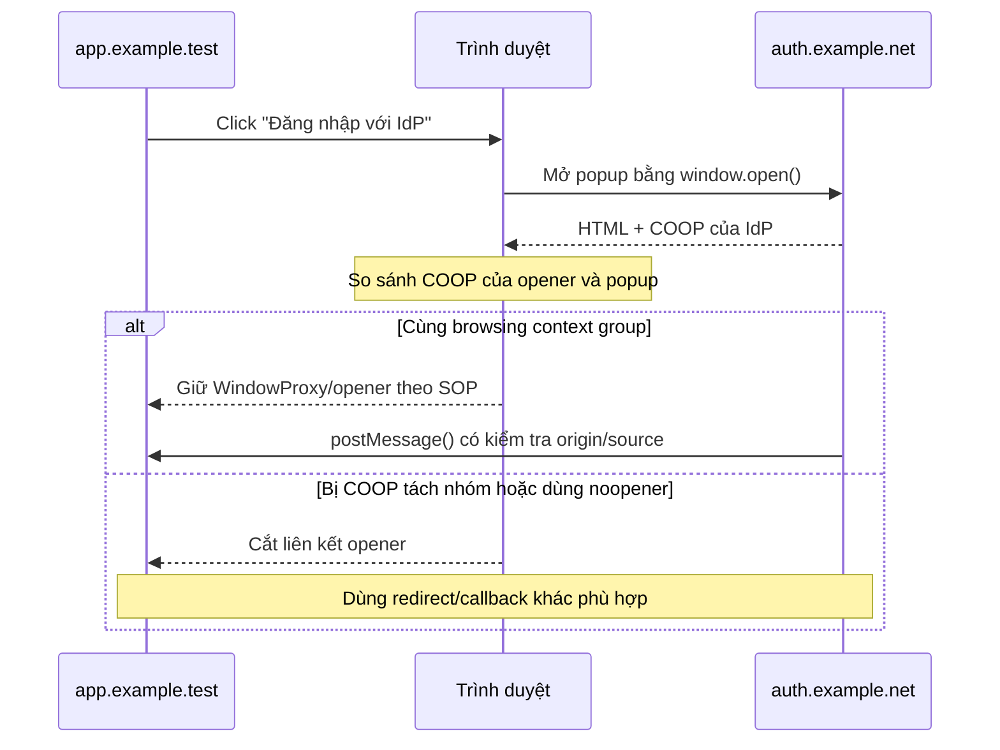
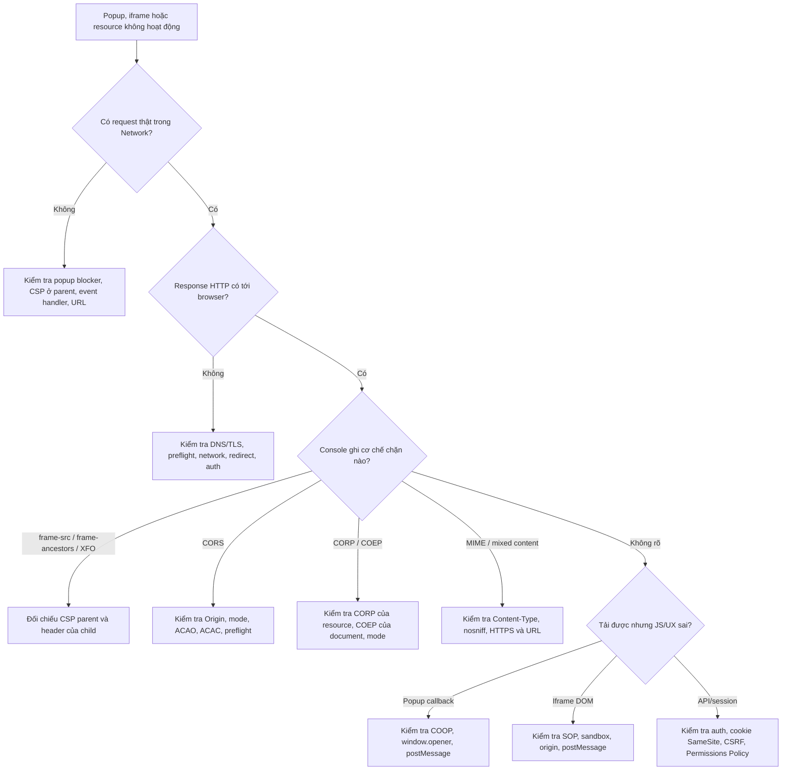

# Kiểm tra popup, tài nguyên nhúng và cô lập cross-origin

## 1. Bối cảnh: một trang web có nhiều ranh giới bảo mật

Ứng dụng Spring Security không hoạt động đơn lẻ trong trình duyệt. Một trang quản trị có thể mở cửa sổ đăng nhập của Identity Provider, nhúng một báo cáo từ đối tác bằng `iframe`, lấy hình từ CDN, gọi API ở subdomain khác và tải JavaScript từ hệ thống ngoài. Mỗi luồng chịu những quy tắc bảo mật khác nhau.

Giả sử hệ thống kiểm thử có các địa chỉ:

| Thành phần | Origin mẫu | Vai trò |
| --- | --- | --- |
| Ứng dụng chính | `https://app.example.test` | Trang được bảo vệ bởi Spring Security |
| Tài nguyên nội bộ | `https://cdn.example.test` | Khác origin, cùng site với ứng dụng |
| Nhà cung cấp đăng nhập | `https://auth.example.net` | Popup OAuth/OIDC, khác origin và site |
| Widget đối tác | `https://widget.example.org` | Nội dung nhúng từ bên thứ ba |

Các tên miền ở đây là địa chỉ **minh họa cho môi trường test**, cần DNS và HTTPS riêng nếu chạy thực tế. Ngay cả hai URL khác nhau ở cổng hoặc subdomain cũng đã có thể **khác origin**. Origin được xác định bởi bộ ba **scheme + host + port**; “same-site” thường dựa trên scheme và registered domain. Bởi vậy `app.example.test` và `cdn.example.test` có thể cùng site nhưng vẫn khác origin.

Khi kiểm thử, phải phân biệt bốn câu hỏi:

1. **Tài liệu/tài nguyên có được tải hay không?** Phụ thuộc CSP, CORP/COEP, X-Frame-Options, MIME, mixed content và các chính sách liên quan.
2. **Có được hiển thị hoặc nhúng trong trang khác hay không?** Phụ thuộc cả chính sách ở **trang cha** và **trang được nhúng**.
3. **JavaScript có đọc được nội dung hoặc điều khiển tài liệu khác không?** Bị chi phối bởi Same-Origin Policy (SOP), CORS, sandbox, opener relationship.
4. **Trang có đạt trạng thái cross-origin isolated không?** Phụ thuộc COOP, COEP, secure context và Permissions Policy; dùng `window.crossOriginIsolated` để xác minh.

**Mục tiêu học tập:** thiết lập một ma trận thử nghiệm bằng trình duyệt thực cho popup, `iframe`, script/image/API cross-origin; đọc dấu hiệu ở DevTools; xây test Playwright ổn định; cấu hình Spring Security Servlet hoặc Reactive theo phạm vi cần thiết; chẩn đoán khi header có mặt mà hành vi vẫn sai.

## 2. Bảng điều khiển: mỗi cơ chế bảo vệ việc gì?

| Cơ chế | Vị trí áp dụng | Câu hỏi nó trả lời | Sai lầm phổ biến |
| --- | --- | --- | --- |
| **SOP** | Trình duyệt đối với script giữa các origin | Script ở origin A có được đọc DOM/data của B? | Tưởng iframe hiển thị được nghĩa là đọc được DOM. |
| **CORS** | Response của API/resource + chế độ request | JavaScript ở origin A có thể đọc response từ B không? | Dùng `Access-Control-Allow-Origin` để “mở” iframe bị X-Frame-Options chặn. |
| **CSP `frame-src`** | Header tài liệu **cha** | Trang này được tải iframe từ những nguồn nào? | Nhầm với `frame-ancestors`. |
| **CSP `frame-ancestors`** | Header tài liệu **con** | Những trang cha nào được phép nhúng tài liệu này? | Đặt trong `<meta>`, nơi directive này không có hiệu lực. |
| **`X-Frame-Options`** | Header tài liệu **con** | Có cho phép trang được hiển thị trong frame không? | Dùng `ALLOW-FROM` đã lỗi thời. |
| **`iframe sandbox`** | Thuộc tính trên iframe của trang cha | Frame con bị giới hạn script, form, popup, top-navigation, origin ra sao? | Kết hợp `allow-scripts` và `allow-same-origin` cho nội dung không tin cậy cùng origin. |
| **CORP** | Header của **resource** | Resource này có cho phép nạp qua request `no-cors` từ origin/site khác không? | Nghĩ CORP cấp quyền đọc dữ liệu như CORS. |
| **COEP** | Header của tài liệu **nhúng tài nguyên** | Tài liệu có buộc tài nguyên cross-origin phải opt-in không? | Bật `require-corp` rồi ngạc nhiên vì ảnh CDN/iframe đối tác bị chặn. |
| **COOP** | Header của **tài liệu top-level** | Popup/trang mới có chia sẻ browsing context group và liên kết opener không? | Bật `same-origin` toàn site rồi làm hỏng callback popup OAuth. |
| **Permissions-Policy** | Header/thuộc tính `allow` | Frame hoặc tài liệu được dùng API nhạy cảm nào (camera, microphone, v.v.)? | Tưởng CORS cho phép một iframe dùng camera. |

Các cơ chế **không thay thế nhau**. Ví dụ `CORS` có thể cho phép `fetch` đọc JSON từ API, nhưng không cho phép script của trang A đọc DOM của iframe B. Ngược lại, hình ảnh từ origin ngoài có thể hiển thị dù `fetch` tới cùng URL bị CORS chặn.

## 3. Kiểm tra popup: mở được, giữ opener và trao đổi thông điệp

### 3.1. Luồng popup có những trạng thái nào?

Popup là một trang top-level được mở bằng `window.open()` hoặc liên kết `target="_blank"`. Trình duyệt có thể mở nó thành tab mới. Người kiểm thử cần quan sát **ba thuộc tính độc lập**: popup có xuất hiện, quan hệ `window.opener` có tồn tại và script của các bên có được trao đổi dữ liệu hay không.



Với popup được mở từ một **hành động thật của người dùng** (click), trình duyệt thường cho phép mở. Gọi `window.open()` tự động khi tải trang có thể bị popup blocker chặn. Vì vậy, test Playwright nên bấm nút thật rồi chờ sự kiện `popup`, tránh tạo popup bằng `page.evaluate` ngoài user activation khi muốn kiểm tra UX.

### 3.2. COOP thay đổi quan hệ opener

Thí dụ các giá trị response:

```http
Cross-Origin-Opener-Policy: unsafe-none
Cross-Origin-Opener-Policy: same-origin
Cross-Origin-Opener-Policy: same-origin-allow-popups
```

| COOP trên trang ứng dụng | Popup cross-origin có COOP mặc định `unsafe-none` | Hệ quả kiểm thử |
| --- | --- | --- |
| `unsafe-none` (mặc định nếu không gửi COOP) | Thường giữ liên kết opener, theo các điều kiện trình duyệt | Có thể dùng `postMessage` nếu kiểm tra origin và source; vẫn bị SOP cấm đọc DOM chéo origin. |
| `same-origin` | Popup được đưa sang browsing context group khác | Liên kết với opener bị cắt; trong popup thường quan sát `window.opener === null`. |
| `same-origin-allow-popups` | Có thể giữ liên kết với popup dùng `unsafe-none` | Phù hợp một số tích hợp đăng nhập/thanh toán nhưng **không** đáp ứng điều kiện COOP cho `crossOriginIsolated === true`. |

Kết quả COOP còn phụ thuộc **chính sách của chính popup**, cách mở và việc điều hướng tiếp theo. Không suy luận trạng thái chỉ từ một header phía opener; hãy kiểm tra hai tài liệu trên trình duyệt thực. Header `COOP: same-origin` không có nghĩa SOP cho phép đọc DOM cross-origin, và `same-origin-allow-popups` không có nghĩa mọi popup đều giữ opener.

Đối với liên kết không cần giao tiếp với tab nguồn, chủ động cắt liên kết bằng `rel="noopener"`:

```html
<a href="https://widget.example.org/docs"
   target="_blank" rel="noopener noreferrer">
  Mở tài liệu đối tác
</a>
```

Khi dùng `window.open(url, "_blank", "noopener")`, trình duyệt cũng có thể không cung cấp handle trả về; test cần đo hành vi từ popup, không giả định handle ở opener luôn tồn tại.

### 3.3. Trao đổi qua postMessage phải kiểm chứng danh tính

Nếu tích hợp OAuth popup cần trao đổi kết quả qua `postMessage`, chỉ mở kênh với bên thứ ba đã tin cậy. Ví dụ kiểm tra phía ứng dụng:

```javascript
const expectedOrigin = "https://auth.example.net";
const popup = window.open(
  expectedOrigin + "/authorize",
  "login-popup",
  "popup,width=540,height=720"
);

window.addEventListener("message", (event) => {
  if (event.origin !== expectedOrigin) return;
  if (event.source !== popup) return;

  const message = event.data;
  if (!message || message.type !== "OAUTH_CALLBACK") return;
  if (typeof message.code !== "string") return;
  if (typeof message.state !== "string") return;

  // Kiểm tra state/nonce và thực hiện OAuth Code + PKCE
  // theo thiết kế backend; không tin dữ liệu message là "đã login".
});
```

Đây là minh họa ranh giới dữ liệu, **không phải triển khai OAuth hoàn chỉnh**. Trong hệ thống thực, authorization response thường được nhận trên redirect URI đã đăng ký và thuộc ứng dụng; origin của callback quyết định `event.origin` thực tế. Nếu callback chạy ở origin ứng dụng, phải điều chỉnh nguồn được tin cậy cho đúng luồng. Không gửi code/token tới `targetOrigin="*"`, không chấp nhận mọi event có cùng `type` và không dựa hoàn toàn vào `postMessage` để xác thực người dùng. Hệ thống vẫn cần kiểm tra `state`, PKCE, nonce (khi phù hợp) và exchange phía server.

Nếu COOP cắt opener, đừng “sửa” bằng cách nới toàn site một cách tùy tiện. Có thể dùng full-page redirect, route callback riêng hoặc chính sách COOP khác **chỉ ở trang cần popup**, rồi kiểm thử lại nhu cầu cô lập của những trang khác.

## 4. Kiểm tra iframe: hai phía cùng quyết định

### 4.1. Trang cha cho phép tải, trang con cho phép được nhúng

Trang ứng dụng muốn nhúng widget:

```html
<iframe
  id="partner-report"
  src="https://widget.example.org/report"
  title="Báo cáo đối tác"
  loading="lazy">
</iframe>
```

Phản hồi HTML của **trang cha** cần chính sách cho phép đích ở `frame-src`:

```http
Content-Security-Policy: default-src 'self'; frame-src 'self' https://widget.example.org
```

Phản hồi HTML của **trang con** cần cho phép trang cha qua `frame-ancestors` nếu chọn triển khai CSP giới hạn nhúng:

```http
Content-Security-Policy: frame-ancestors https://app.example.test
```

Nếu trang con có `X-Frame-Options: DENY`, việc trang cha cho phép `frame-src` không làm nó nhúng được. Trong các trình duyệt hiện đại, CSP `frame-ancestors` ở chế độ enforce có thể được ưu tiên so với `X-Frame-Options` theo đặc tả, nhưng tránh cấu hình mâu thuẫn và kiểm tra trình duyệt mục tiêu. `X-Frame-Options` thường do Spring Security bật mặc định với giá trị `DENY`.

**Phân biệt:**

- `frame-src` là **danh sách nơi trang cha được mở frame**; khi không có, trình duyệt có thể fallback qua `child-src` rồi `default-src`.
- `frame-ancestors` là **danh sách các trang cha được nhúng tài liệu này**; áp dụng cho mọi cấp cha trong cây frame, không fallback từ `default-src` và không được đặt qua `<meta http-equiv>`.
- `X-Frame-Options` có giá trị chính là `DENY` hoặc `SAMEORIGIN`; giá trị `ALLOW-FROM` đã lỗi thời.

Ngay cả khi frame hiển thị bình thường, SOP vẫn ngăn script ở `app.example.test` truy cập:

```javascript
const frame = document.querySelector("#partner-report");
try {
  console.log(frame.contentWindow.document.body.innerText);
} catch (error) {
  // Dự kiến SecurityError khi tài liệu con khác origin
  console.log(error.name);
}
```

Việc trình duyệt phát request và nhận **HTTP 200** cho frame chỉ cho biết server đã phản hồi. Nó không bảo đảm trình duyệt đã thực sự **render** nội dung: CSP, X-Frame-Options hoặc COEP vẫn có thể ngăn sử dụng response.

### 4.2. Sandbox giới hạn khả năng trong iframe

Đối với nội dung tương tác của bên thứ ba, có thể giới hạn chức năng:

```html
<iframe
  src="https://widget.example.org/report"
  title="Báo cáo đối tác"
  sandbox="allow-scripts allow-forms"
  referrerpolicy="strict-origin-when-cross-origin">
</iframe>
```

Không có `allow-same-origin`, tài liệu sandbox thường bị gán **opaque origin** cho mục đích áp dụng SOP. Nếu cho cả `allow-scripts` và `allow-same-origin` với nội dung **cùng origin** mà bạn không tin cậy, script có thể loại bỏ attribute sandbox và tải lại, làm suy yếu ranh giới; nên tách origin thật sự cho widget không tin cậy.

Các token như `allow-popups`, `allow-popups-to-escape-sandbox` hoặc `allow-top-navigation-by-user-activation` cần được xem xét độc lập theo luồng thực tế. Việc một widget mở được popup không có nghĩa popup được phép điều hướng top-level hoặc dùng API bị `Permissions-Policy` hạn chế.

Khi trao đổi với iframe, sử dụng `postMessage` với `targetOrigin` cụ thể, kiểm tra cả `event.origin` lẫn `event.source` và validate cấu trúc dữ liệu. Việc dùng `sandbox` không cho phép đọc DOM chéo origin; `allow-same-origin` chỉ thay đổi cách sandbox xử lý origin chứ không biến hai hostname khác nhau thành cùng origin.

### 4.3. Một iframe login có thể bị chặn vì cookie

Một frame có thể render được nhưng phiên đăng nhập bên trong không hoạt động do cookie third-party, `SameSite` hoặc chính sách chặn cookie của trình duyệt. Trường hợp này khác với lỗi CORS và `frame-ancestors`. Với cookie cross-site phải gửi trong third-party context, `SameSite=None; Secure` là điều kiện cần theo nhiều trình duyệt nhưng vẫn **không bảo đảm** cookie được cấp quyền nếu chính sách chống tracking chặn third-party cookies.

Khi test, ghi lại `Set-Cookie`, `Cookie` request, cảnh báo cookie ở DevTools và chính sách browser profile. Không tắt `SameSite` hay CSRF để “làm hết lỗi iframe” khi chưa phân biệt nguyên nhân.

## 5. Kiểm tra tài nguyên nhúng: request, đọc response và quyền sử dụng

### 5.1. Một URL có thể thành công với img nhưng thất bại với fetch

Ví dụ:

```html
<!-- Hình ảnh có thể hiển thị qua request no-cors -->

```

```javascript
// JS fetch cross-origin tuân thủ CORS trước khi đọc nội dung
const response = await fetch("https://cdn.example.test/data.json");
const data = await response.json();
```

Nếu CDN không gửi CORS phù hợp, một ảnh thông thường có thể hiển thị nhưng `fetch` bị browser từ chối truy cập dữ liệu. Khi vẽ ảnh cross-origin lên canvas và muốn đọc pixel, thường cần tải ảnh với `crossorigin="anonymous"` và CORS response hợp lệ để tránh canvas bị taint.

| Loại tài nguyên | Cách nạp thường gặp | Kiểm tra quan trọng |
| --- | --- | --- |
| `fetch`/XHR đến API | `mode: cors` mặc định khi cross-origin | `Origin`, `Access-Control-Allow-Origin`, credential mode, preflight, `Vary: Origin`. |
| Hình ảnh HTML thông thường | Có thể nạp `no-cors` và hiển thị | CSP `img-src`, CORP/COEP, HTTP MIME, mixed content; không suy ra JavaScript được đọc pixel. |
| Script cổ điển | Có thể nạp theo cơ chế legacy `no-cors` | CSP `script-src`, MIME với `nosniff`, CORP/COEP, SRI khi thích hợp; nguy cơ chạy script từ nguồn ngoài. |
| ES module | Dùng CORS | `Access-Control-Allow-Origin`, MIME chuẩn, CSP và module imports. |
| Font web | Thường dùng CORS | `Access-Control-Allow-Origin`, CSP `font-src`, lỗi trong Network/Console. |
| `iframe` | Navigation với chính sách frame đặc thù | CSP cha `frame-src`, child `frame-ancestors`/XFO, COEP và cookie third-party. |
| Fetch có `credentials: 'include'` | CORS credentialed | Origin cụ thể, `Access-Control-Allow-Credentials: true`, chính sách cookie/CSRF. |

Ví dụ response của API cho phép origin ứng dụng và gửi credential:

```http
Access-Control-Allow-Origin: https://app.example.test
Access-Control-Allow-Credentials: true
Vary: Origin
```

Không dùng `Access-Control-Allow-Origin: *` cho response cần browser chấp nhận credentialed CORS. Cũng không phản chiếu mọi header `Origin` từ request như một danh sách tin cậy không giới hạn. CORS là chính sách cho **trình duyệt đọc response**, không phải cơ chế authentication/authorization của API. Server vẫn phải kiểm tra quyền; với auth cookie cần duy trì biện pháp CSRF phù hợp.

### 5.2. CORP: chủ resource quyết định phạm vi nạp no-cors

Ví dụ response ở CDN:

```http
Cross-Origin-Resource-Policy: same-origin
Cross-Origin-Resource-Policy: same-site
Cross-Origin-Resource-Policy: cross-origin
```

Chỉ đặt **một** giá trị thực tế cho response; ba dòng trên là các lựa chọn:

- `same-origin`: chỉ cho tải tài nguyên qua `no-cors` ở cùng origin.
- `same-site`: cho phép từ cùng site, nhưng origin khác vẫn thuộc ranh giới khác.
- `cross-origin`: cho phép các origin khác nạp tài nguyên trong bối cảnh CORP điều khiển.

CORP **không cấp quyền đọc response qua JavaScript** như CORS. Nó giới hạn sử dụng nội dung của các request `no-cors`. Khi một trang bật `COEP: require-corp`, một tài nguyên cross-origin dùng `no-cors` thường phải khai báo CORP thích hợp; nếu chuyển request sang `cors`, resource server phải đáp ứng CORS hợp lệ.

### 5.3. COEP: trang nhúng đòi resource phải opt-in

Ví dụ trên **tài liệu chính**:

```http
Cross-Origin-Embedder-Policy: require-corp
```

Chính sách này yêu cầu tài nguyên cross-origin phải cho phép được nhúng qua CORP hoặc CORS phù hợp. Nếu đổi từ không có COEP sang `require-corp`, một trang có thể đột nhiên mất ảnh, font, script, widget hoặc worker dù server CDN vẫn trả 200.

Hai cấu hình thường dùng:

| Header COEP | Cách xử lý resource cross-origin | Điểm cần kiểm thử |
| --- | --- | --- |
| `require-corp` | Resource `no-cors` cần CORP thích hợp; resource `cors` cần CORS hợp lệ. | Tài nguyên bên thứ ba không có CORP/CORS có thể bị chặn. |
| `credentialless` | Cho phép một số request cross-origin `no-cors` không cần CORP, nhưng gửi chúng **không kèm credentials**. Với `cors` vẫn phải thỏa CORS. | Tài nguyên cần cookie có thể thay đổi kết quả; hỗ trợ trình duyệt khác nhau. |

Không nhầm `COEP: credentialless` với attribute `<iframe credentialless>`. Cơ chế iframe credentialless tạo môi trường lưu trữ tạm độc lập cho frame và chỉ có trên một số trình duyệt. Trong cả hai trường hợp, cần thử xem dữ liệu/cookie được gửi, frame có render và chức năng thực tế có hoạt động hay không.

**Iframe có yêu cầu chặt hơn ảnh thông thường:** chính sách COEP có thể áp dụng đệ quy đến tài liệu con; chỉ thêm CORP cho một response không đủ giải quyết tất cả nhúng iframe. Nếu bên thứ ba không kiểm soát được các header cần thiết, có thể phải dùng route không yêu cầu cross-origin isolation hoặc phương án tích hợp khác.

### 5.4. Lớp bảo vệ khác cũng gây lỗi tải tài nguyên

Không gộp mọi thông báo “blocked” thành “CORS error”. Các nguyên nhân khác gồm:

- CSP `script-src`, `img-src`, `font-src`, `connect-src` hoặc `frame-src` không cho phép URL đích.
- `X-Content-Type-Options: nosniff` kết hợp response MIME sai, đặc biệt với script/style.
- Mixed content: tài liệu HTTPS cố lấy resource HTTP trong bối cảnh không được trình duyệt cho phép.
- Chính sách cookie/sandbox/Permissions-Policy làm một resource có tải vẫn không sử dụng được.
- Authentication (401/403), redirect tới trang login HTML thay cho JS/font hoặc CSP ở trang redirect.
- Service worker, cache hoặc CDN thay đổi header giữa các môi trường, dẫn đến kiểm thử không nhất quán.

## 6. Kiểm tra cross-origin isolation thực sự

### 6.1. Bộ điều kiện nền

Đối với trang cần `SharedArrayBuffer`, high-resolution timer hoặc mô hình cách ly chống một số XS-Leaks, cấu hình điển hình trên response HTML top-level là:

```http
Cross-Origin-Opener-Policy: same-origin
Cross-Origin-Embedder-Policy: require-corp
```

Hoặc dùng `Cross-Origin-Embedder-Policy: credentialless` khi được hỗ trợ và phù hợp. Tài liệu phải chạy trong **secure context** (thường HTTPS), `Permissions-Policy: cross-origin-isolated` không được cấm tính năng, và các frame/tài nguyên phụ phải đáp ứng các ràng buộc liên quan.

Đo trạng thái trong Console hoặc Playwright:

```javascript
({
  secureContext: window.isSecureContext,
  crossOriginIsolated: window.crossOriginIsolated,
  sharedArrayBufferAvailable: typeof SharedArrayBuffer !== "undefined",
})
```

Kỳ vọng đối với trang **cố ý cô lập**: `secureContext === true` và `crossOriginIsolated === true` trên trình duyệt hỗ trợ. Đừng chỉ khẳng định “đã cô lập” vì DevTools hiển thị hai header; cần kiểm tra đặc tính runtime và phụ thuộc của trang.

Đối với trang callback OAuth dùng popup, `COOP: same-origin-allow-popups` có thể phù hợp hơn để giữ opener nhưng **không cho `crossOriginIsolated === true`** theo bộ điều kiện nêu trên. Đây là ràng buộc kiến trúc thực tế: các route có nhu cầu khác nhau nên được đánh giá và cấu hình tách biệt.

### 6.2. Ma trận kiểm tra cô lập với nhiều loại tài nguyên

| Trang chủ (document response) | Tài nguyên được tải | Hành vi mong đợi |
| --- | --- | --- |
| Không đặt COEP | Ảnh cross-origin `no-cors`, không CORP | Thường hiển thị nếu CSP và chính sách khác cho phép; không vì thế mà trang được cross-origin isolated. |
| `COEP: require-corp` | Ảnh cross-origin `no-cors` không CORP | Có thể bị chặn ở trình duyệt dù Network ghi response 200. |
| `COEP: require-corp` | Ảnh cross-origin có `CORP: cross-origin` | Có thể nạp nếu CSP/MIME và các điều kiện khác cho phép. |
| `COEP: require-corp` | Script module/font dùng CORS hợp lệ | Có thể nạp nếu CSP/MIME và điều kiện khác cho phép. |
| `COEP: credentialless` | Resource `no-cors` cross-origin có phụ thuộc cookie | Request có thể bỏ cookie khiến resource trả nội dung khác hoặc 401. |
| `COOP: same-origin` + COEP thích hợp | Popup cross-origin dùng `unsafe-none` | Liên kết opener bị cắt. |
| `COOP: same-origin-allow-popups` | Popup cross-origin dùng `unsafe-none` | Có thể giữ liên kết opener, nhưng trang không đạt điều kiện cross-origin isolation. |
| COOP + COEP đúng nhưng `Permissions-Policy` cấm | Trang top-level | `window.crossOriginIsolated` có thể vẫn là `false`. |

Không suy ra bảo mật chỉ từ việc `SharedArrayBuffer` khởi tạo được trong một trình duyệt: điều kiện hỗ trợ thay đổi theo phiên bản và môi trường. `window.crossOriginIsolated` cùng header của **response tài liệu thực** là tín hiệu trực tiếp hơn.

## 7. Cấu hình với Spring Security Servlet

Spring Security cung cấp header writers cho CSP, X-Frame-Options, COOP, COEP và CORP. Những header này thuộc **response**; `http.cors(...)` điều phối chính sách CORS cho request/response cross-origin và không thay thế các security headers.

Giả sử chỉ nhóm trang `/isolated/**` cần cô lập để dùng SharedArrayBuffer, còn trang đăng nhập và tích hợp popup cần chính sách khác. Có thể dùng các `SecurityFilterChain` có phạm vi request rõ ràng:

```java
import org.springframework.context.annotation.Bean;
import org.springframework.context.annotation.Configuration;
import org.springframework.core.annotation.Order;
import org.springframework.security.config.Customizer;
import org.springframework.security.config.annotation.web.builders.HttpSecurity;
import org.springframework.security.web.SecurityFilterChain;
import org.springframework.security.web.header.writers.CrossOriginOpenerPolicyHeaderWriter;
import org.springframework.security.web.header.writers.CrossOriginEmbedderPolicyHeaderWriter;

@Configuration
public class BrowserProtectionConfig {

    @Bean
    @Order(1)
    SecurityFilterChain isolatedRoutes(HttpSecurity http) throws Exception {
        http
            .securityMatcher("/isolated/**")
            .authorizeHttpRequests(auth -> auth.anyRequest().authenticated())
            .headers(headers -> headers
                .crossOriginOpenerPolicy(coop -> coop.policy(
                    CrossOriginOpenerPolicyHeaderWriter
                        .CrossOriginOpenerPolicy.SAME_ORIGIN))
                .crossOriginEmbedderPolicy(coep -> coep.policy(
                    CrossOriginEmbedderPolicyHeaderWriter
                        .CrossOriginEmbedderPolicy.REQUIRE_CORP))
                .contentSecurityPolicy(csp -> csp.policyDirectives(
                    "default-src 'self'; script-src 'self'; " +
                    "frame-src 'none'; frame-ancestors 'none'")))
            .formLogin(Customizer.withDefaults());

        return http.build();
    }

    @Bean
    @Order(2)
    SecurityFilterChain applicationRoutes(HttpSecurity http) throws Exception {
        http
            .authorizeHttpRequests(auth -> auth
                .requestMatchers("/login", "/error").permitAll()
                .anyRequest().authenticated())
            .formLogin(Customizer.withDefaults());

        return http.build();
    }
}
```

Đây là ví dụ **lựa chọn chính sách theo route**, với `@Order(1)` và `securityMatcher` để chuỗi đặc thù được xét trước. CSP có `frame-src 'none'` chỉ phù hợp cho trang không cần iframe. Dự án thực tế phải bổ sung `style-src`, `img-src`, `font-src`, `connect-src`... theo tài nguyên hợp lệ; chính sách `default-src 'self'` có thể chặn CSS, script, font hoặc ảnh đang dùng nếu không được đánh giá.

Khi cần trang nhúng của đối tác, **chính sách của tài liệu trả về từ Spring Security** cũng phải phù hợp với `frame-ancestors` và X-Frame-Options của nó. Spring Security mặc định gửi `X-Frame-Options: DENY`, vì vậy chỉ thêm `CSP: frame-ancestors https://partner.example.org` rồi kỳ vọng nhúng thành công là chưa đủ. Cần xây chính sách đồng bộ theo route và kiểm thử browser mục tiêu trước khi điều chỉnh/bỏ header chống clickjacking.

Nếu cần cho popup OAuth giữ opener ở một route riêng, có thể cấu hình:

```java
headers.crossOriginOpenerPolicy(coop -> coop.policy(
    CrossOriginOpenerPolicyHeaderWriter
        .CrossOriginOpenerPolicy.SAME_ORIGIN_ALLOW_POPUPS));
```

Đoạn trên là minh họa **tùy chọn trong customizer `headers`** của `HttpSecurity`, không áp dụng nối tiếp vào route đang đặt `SAME_ORIGIN`. Phải chọn một chính sách COOP cho từng response cuối cùng, tránh hai header mâu thuẫn từ Spring Security và reverse proxy.

Để phát CORP, ứng dụng nên chọn policy dựa trên vai trò tài nguyên. Ví dụ endpoint chỉ cấp avatar nội bộ có thể dùng `Cross-Origin-Resource-Policy: same-origin`, còn tài nguyên tĩnh công khai muốn nhúng ở trang cô lập khác origin có thể cần `cross-origin`. Không bật `cross-origin` đại trà cho dữ liệu cá nhân; CORP không kiểm tra quyền người dùng.

## 8. Tương ứng ở Spring Security Reactive

WebFlux sử dụng `ServerHttpSecurity` và các header writer của namespace `org.springframework.security.web.server.header`. Cùng ý tưởng cấu hình có thể biểu diễn qua:

```java
import org.springframework.security.config.web.server.ServerHttpSecurity;
import org.springframework.security.web.server.header.CrossOriginOpenerPolicyServerHttpHeadersWriter;
import org.springframework.security.web.server.header.CrossOriginEmbedderPolicyServerHttpHeadersWriter;

// Bên trong cấu hình SecurityWebFilterChain cho route phù hợp:
http.headers(headers -> headers
    .crossOriginOpenerPolicy(coop -> coop.policy(
        CrossOriginOpenerPolicyServerHttpHeadersWriter
            .CrossOriginOpenerPolicy.SAME_ORIGIN))
    .crossOriginEmbedderPolicy(coep -> coep.policy(
        CrossOriginEmbedderPolicyServerHttpHeadersWriter
            .CrossOriginEmbedderPolicy.REQUIRE_CORP)));
```

Đây là **đoạn cấu hình mẫu** để chèn vào bean `SecurityWebFilterChain`, không phải một class hoàn chỉnh. Nếu yêu cầu route-specific trong WebFlux, kết hợp `ServerWebExchangeMatcher` cho `SecurityWebFilterChain` tương ứng. Trường hợp app cung cấp cả HTML top-level và JSON/ảnh trên nhiều route cần xét header phát cho **đúng loại response**; trả COOP trên API không thay thế COOP trên HTML được điều hướng.

Khi proxy/CDN thêm hoặc sửa header, kiểm tra **response browser nhận thực tế** thay vì chỉ kiểm tra code Java. Header gửi hai lần, giá trị không đồng nhất giữa cache hit/miss hoặc redirect là nguồn lỗi phổ biến.

## 9. Thực hành chẩn đoán trên trình duyệt

### 9.1. Chuẩn bị môi trường test

Sử dụng tối thiểu hai origin HTTPS do nhóm kiểm soát và một origin mô phỏng third-party:

- `https://app.example.test`: trả các trang `/popup-compatible`, `/isolated/popup-test`, `/isolated/status`, `/embed-demo`.
- `https://auth.example.net`: popup thử nghiệm có COOP `unsafe-none` hoặc không đặt COOP.
- `https://widget.example.org` và `https://cdn.example.test`: kiểm soát CSP `frame-ancestors`, XFO, CORP, CORS theo từng fixture.

Thay hostname minh họa bằng các origin thật trong môi trường test, cấu hình TLS hợp lệ và đăng nhập bằng tài khoản thử nghiệm. Nếu dùng `localhost`, chú ý khác biệt giữa same-origin/cross-origin dựa trên port và các trường hợp localhost được browser coi là potentially trustworthy; nên tái hiện HTTPS thật để kiểm tra tác động cookie/SameSite và deployment.

### 9.2. Quy trình DevTools đáng tin cậy

1. Mở DevTools → **Network**, bật *Preserve log* và *Disable cache* khi muốn cô lập lỗi cache; chọn request **Document** để xem COOP/COEP/CSP của đúng HTML.
2. Kiểm tra **Response Headers** và **Request Headers** của mỗi resource. Ghi origin nguồn, `Sec-Fetch-Site`, `Sec-Fetch-Mode`, `Origin`, credential/cookie khi browser gửi chúng.
3. Mở **Console**, lọc thông báo CSP, CORP, COEP, CORS, X-Frame-Options, Mixed Content. Thông báo cho biết **cơ chế chặn**, còn HTTP status không nhất thiết nói được việc browser có render/sử dụng resource.
4. Dùng tab **Security** xác minh HTTPS/secure context và tab **Application** kiểm tra cookie, third-party cookie warnings, service worker, storage nếu liên quan.
5. Thực hiện hành vi người dùng: mở popup bằng click; nhúng iframe; tải resource; gọi `fetch`; đọc `window.crossOriginIsolated`, `window.opener`; kiểm tra API chức năng sau khi tải.
6. So sánh các trình duyệt mục tiêu bằng profile sạch, có/không có extension và chính sách cookie phù hợp; ghi lại version và chế độ browser.

Đối với CSP, có thể bật `Content-Security-Policy-Report-Only` để quan sát vi phạm trước khi enforce. Report-only hữu ích để đánh giá tác động nhưng **không chứng minh** browser đã chặn; cần test chế độ enforce sau khi xác nhận allowlist.

### 9.3. Đọc đúng lỗi

| Triệu chứng | Phân biệt bằng chứng | Hướng điều tra |
| --- | --- | --- |
| Popup không xuất hiện | Không có request/page mới, `window.open()` trả null | Popup blocker, thao tác không đi kèm user activation, `noopener`, lỗi JS. |
| Popup mở nhưng không gửi callback về opener | Popup vẫn tải, `window.opener` null hoặc handle bị coi closed | Đối chiếu COOP của hai tài liệu, `rel=noopener`, redirect và luồng `postMessage`. |
| Iframe trắng dù Network trả 200 | Console ghi `frame-ancestors` hoặc X-Frame-Options | Kiểm tra response child và `frame-src` của parent, cả các frame tổ tiên. |
| Iframe hiển thị nhưng đọc DOM lỗi `SecurityError` | Child origin khác parent | SOP hoạt động đúng; dùng `postMessage` có kiểm tra nguồn nếu cần trao đổi. |
| `fetch` thất bại nhưng nhập URL trên tab mới xem được | Browser Console báo CORS/preflight | Kiểm tra `Origin`, ACAO/ACAC, OPTIONS, credential mode; không nhầm với auth. |
| Ảnh/CDN bị chặn sau khi bật COEP | Console báo COEP/CORP, request vẫn có thể 200 | Thêm CORP phù hợp từ server resource hoặc dùng CORS mode, đánh giá phụ thuộc bên thứ ba. |
| Chỉ riêng font hoặc module bị chặn | Request đi CORS mode hoặc MIME lỗi | Kiểm tra CORS, CSP, MIME, `nosniff`. |
| `crossOriginIsolated === false` dù đã cấu hình COOP | COEP thiếu/sai, không secure context hoặc Permissions Policy cấm | Kiểm tra document response thật, runtime và dependency. |
| Bật COEP làm iframe đăng nhập không hoạt động | COEP áp dụng đệ quy, cookie third-party bị bỏ/chặn | Kiểm tra support, policies của IdP, đổi flow tích hợp theo thiết kế. |
| Test local pass nhưng production fail | TLS termination, CDN/cache/proxy sửa header, domain khác | Capture response cuối cùng trên browser ở môi trường tương ứng. |

## 10. Viết kiểm thử Playwright ở cấp trình duyệt

`MockMvc` hoặc `WebTestClient` hữu ích để xác nhận **Spring Security phát header**, nhưng không mô phỏng đầy đủ SOP, popup group, CORS/CORP/COEP hay policy cookie trong một trình duyệt. Vì thế, các thuộc tính cross-origin nên có test trong Chromium và các engine/browser mục tiêu.

Đoạn sau dùng `@playwright/test` và những route fixture giả định ở phần 9. Khi chuyển vào repository, cần dựng server HTTPS thật, dữ liệu test và script khởi động tương ứng; đây là mẫu kiểm thử có thể điều chỉnh, không phải test đã được chạy trong bài này.

### 10.1. Test popup giữ hoặc mất opener

```typescript
import { test, expect } from "@playwright/test";

const APP = "https://app.example.test";
const AUTH = "https://auth.example.net";

test("popup OAuth tương thích vẫn giữ opener", async ({ page }) => {
  // /popup-compatible: COOP same-origin-allow-popups.
  // Popup auth: COOP unsafe-none (hoặc không có COOP).
  await page.goto(APP + "/popup-compatible");

  const popupPromise = page.waitForEvent("popup");
  await page.getByRole("button", { name: "Mở đăng nhập" }).click();
  const popup = await popupPromise;
  await popup.waitForLoadState("domcontentloaded");

  expect(new URL(popup.url()).origin).toBe(AUTH);
  const hasOpener = await popup.evaluate(() => window.opener !== null);
  expect(hasOpener).toBe(true);
});

test("COOP same-origin cắt liên kết popup cross-origin", async ({ page }) => {
  // /isolated/popup-test: COOP same-origin; popup auth: unsafe-none.
  await page.goto(APP + "/isolated/popup-test");

  const popupPromise = page.waitForEvent("popup");
  await page.getByRole("button", { name: "Mở cửa sổ ngoài" }).click();
  const popup = await popupPromise;
  await popup.waitForLoadState("domcontentloaded");

  expect(new URL(popup.url()).origin).toBe(AUTH);
  expect(await popup.evaluate(() => window.opener === null)).toBe(true);
});
```

Không dùng `popup.opener()` của Playwright làm bằng chứng duy nhất rằng JavaScript trong cửa sổ mới còn `window.opener`; Playwright có thể cung cấp metadata về nguồn tạo page ngay cả khi quan hệ JavaScript bị COOP cắt. Kiểm tra bằng `popup.evaluate(() => window.opener ...)` và hành vi callback thực.

Nếu popup tự redirect sang origin khác, cần đợi **đúng trang đích** và kiểm tra thêm nguồn callback. Tránh khẳng định tính năng luôn hoạt động chỉ vì sự kiện `popup` xảy ra.

### 10.2. Test header và trạng thái crossOriginIsolated

```typescript
import { test, expect } from "@playwright/test";

const APP = "https://app.example.test";

test("trang cô lập có header và runtime phù hợp", async ({ page }) => {
  const response = await page.goto(APP + "/isolated/status");
  expect(response).not.toBeNull();

  const headers = response!.headers();
  expect(headers["cross-origin-opener-policy"]).toBe("same-origin");
  expect(headers["cross-origin-embedder-policy"]).toBe("require-corp");

  const state = await page.evaluate(() => ({
    secureContext: window.isSecureContext,
    isolated: window.crossOriginIsolated,
  }));
  expect(state).toEqual({ secureContext: true, isolated: true });
});
```

Kỳ vọng này chỉ đúng khi fixture có đủ điều kiện HTTPS, Permissions Policy, response thực tế và trình duyệt hỗ trợ. Nếu ứng dụng đặt COEP `credentialless`, đổi giá trị kỳ vọng và kiểm tra hệ quả đối với request `no-cors`.

### 10.3. Test iframe tải được nhưng không thể bị đọc chéo origin

```typescript
import { test, expect } from "@playwright/test";

const APP = "https://app.example.test";

test("frame đối tác được hiển thị nhưng SOP ngăn đọc DOM", async ({ page }) => {
  // /embed-demo có frame-src cho widget; widget cho phép frame-ancestors.
  await page.goto(APP + "/embed-demo");

  const widget = page.frameLocator("#partner-report");
  await expect(widget.getByText("Báo cáo đối tác")).toBeVisible();

  const denied = await page.locator("#partner-report").evaluate((element) => {
    const frame = element as HTMLIFrameElement;
    try {
      void frame.contentWindow!.document.body;
      return false;
    } catch (error) {
      return error instanceof DOMException && error.name === "SecurityError";
    }
  });

  expect(denied).toBe(true);
});
```

Điều kiện fixture ở đây là iframe tải thành công nhưng **khác origin**. Nếu frame bị chính sách embedding chặn, test phải có kịch bản riêng cho failure đó; không dùng lỗi đọc DOM làm bằng chứng rằng iframe đã tải.

### 10.4. Test resource bị chặn dù server trả thành công

Ví dụ trang `/isolated/corp-test` có ảnh `` trỏ đến CDN trả HTTP 200 nhưng **không có CORP**, trong khi top-level document bật `COEP: require-corp` và CSP `img-src` cho phép URL:

```typescript
import { test, expect } from "@playwright/test";

const APP = "https://app.example.test";

test("COEP chặn ảnh no-cors thiếu CORP", async ({ page }) => {
  const diagnostics: string[] = [];
  page.on("console", (message) => {
    if (message.type() === "error") diagnostics.push(message.text());
  });
  page.on("requestfailed", (request) => {
    diagnostics.push("failed: " + request.url());
  });

  await page.goto(APP + "/isolated/corp-test");

  const image = page.locator("#blocked-image");
  await expect.poll(async () =>
    image.evaluate((element) => (element as HTMLImageElement).complete)
  ).toBe(true);

  expect(await image.evaluate(
    (element) => (element as HTMLImageElement).naturalWidth
  )).toBe(0);

  // Khi debug, lưu diagnostics vào báo cáo test nếu thất bại.
});
```

Không assert nguyên văn console error vì thông báo và cách phát sự kiện có thể khác giữa các engine/version. Kiểm tra **hành vi cuối** (ảnh không tải được) và dùng log để chẩn đoán. Kịch bản đối chứng nên thêm CORP thích hợp vào ảnh và chứng minh `naturalWidth > 0` với chính CSP/COEP đang dùng.

### 10.5. Nguyên tắc tránh test sai kết luận

- Phép thử **header unit/integration** xác nhận server cấu hình đúng nhưng chưa khẳng định browser thực thi.
- Phép thử **HTTP status 200** xác nhận server trả response, chưa khẳng định response được dùng trong DOM.
- Phép thử **iframe visible** chưa khẳng định script parent được đọc DOM iframe.
- Phép thử **popup event** chưa khẳng định `window.opener` hoặc callback vẫn còn.
- Phép thử **network request có cookie** chưa khẳng định browser sẽ chấp nhận `Set-Cookie` trong third-party context.
- Phép thử **`crossOriginIsolated`** phải chạy trên document thật trong browser có bảo đảm các header và policy đã được áp dụng.

## 11. Kịch bản kiểm thử cần có khi phát hành

| ID | Kịch bản | Bước thực hiện | Kết quả cần xác minh |
| --- | --- | --- | --- |
| B01 | Popup mở sau click | Click nút mở IdP qua `window.open` | Có page/popup và URL đúng origin. |
| B02 | Popup từ mã tự chạy | Thử mở không có user activation | Kiểm tra xử lý fallback nếu browser chặn; không dựa vào hành vi ổn định trên mọi engine. |
| B03 | COOP strict | Trang `same-origin` mở popup cross-origin | Hai trang bị tách liên kết opener theo chính sách tương ứng. |
| B04 | COOP tương thích | `same-origin-allow-popups` mở popup `unsafe-none` | Callback/truyền message vẫn hoạt động nếu integration dựa vào opener. |
| B05 | Popup không tin cậy | Mở `target=_blank` với `rel=noopener` | Popup không có quyền quay về điều khiển opener. |
| B06 | Frame parent chặn | `frame-src` không cho phép URL frame | Browser từ chối nạp/hiển thị frame; console báo policy tương ứng. |
| B07 | Frame child chặn | Child có `frame-ancestors 'none'` hoặc XFO DENY | Browser chặn embedding dù parent có `frame-src`. |
| B08 | Frame được nạp | Hai phía cho phép nhúng | Frame hiển thị được, nhưng đọc DOM cross-origin vẫn thất bại. |
| B09 | Frame sandbox | Thử script, form, popup, điều hướng top-level | Chỉ hành vi được sandbox cho phép mới hoạt động. |
| B10 | Frame login | Kiểm tra cookie trong third-party context | Phân biệt chặn cookie, auth, XFO, CSP và COEP. |
| B11 | CORS fetch | Gọi API có/không ACAO, preflight, credentials | JS chỉ đọc response khi CORS hợp lệ; server vẫn thực thi authorization. |
| B12 | CORP | Nạp ảnh `no-cors` cross-origin với `same-origin` hoặc `cross-origin` | Khác biệt tải và quyền sử dụng trong browser. |
| B13 | COEP require-corp | Bật COEP rồi nạp tài nguyên bên ngoài | Resource thiếu opt-in bị chặn; resource opt-in phù hợp tải được. |
| B14 | COEP credentialless | Nạp resource cần cookie | Quan sát cookie bị bỏ ở request `no-cors` và tác động chức năng. |
| B15 | Cross-origin isolation | COOP + COEP + secure context + Permissions Policy | `window.crossOriginIsolated` đúng giá trị kỳ vọng. |
| B16 | Production proxy/CDN | Kiểm tra response thực sau TLS termination và cache | Header nhất quán, không bị trùng, sai scope hoặc biến mất. |

Đặc biệt cần thực hiện các kịch bản **âm tính**. Một test chỉ chứng minh popup/iframe được phép tải không bảo đảm ứng dụng chống clickjacking, XS-Leaks hoặc rò rỉ thông tin qua postMessage.

## 12. Quy trình tìm nguyên nhân khi một trang bị chặn



Các đường đi này là gợi ý chẩn đoán, không phải mô hình thay thế hoàn toàn quá trình điều tra. Một request có thể bị **nhiều** chính sách tác động đồng thời; sau khi sửa nguyên nhân thứ nhất, cơ chế thứ hai mới lộ rõ. Vì vậy cần ghi lại header, origin và hành vi cho từng kịch bản trước khi nới lỏng security policy.

## 13. Nguyên tắc áp dụng trong hệ thống thật

1. **Mô tả ranh giới trước khi bật header:** origin nào là first-party, subdomain nào chia sẻ site, đối tác nào được phép nhúng hoặc mở popup?
2. **Tách nhu cầu của các trang:** trang dùng SharedArrayBuffer cần COOP/COEP chặt; trang OAuth popup có thể cần giữ opener; trang API và CDN cần CORS/CORP theo loại tài nguyên.
3. **Giữ mặc định phòng clickjacking:** nếu muốn cho phép embedding, chỉ nới phạm vi trên endpoint cần thiết và đồng bộ `frame-ancestors`/XFO sau khi đánh giá.
4. **Không dùng CORS làm authorization:** Spring Security vẫn phải kiểm tra danh tính, quyền truy cập, CSRF khi credential tự gửi; CORS là hàng rào về quyền đọc của browser.
5. **Đo hành vi thực:** test popup callback, iframe DOM access, CORS fetch, resource render và `crossOriginIsolated` trong trình duyệt thật, ngoài unit test header.
6. **Đánh giá hệ sinh thái:** CDN, payment, OAuth IdP, analytics, fonts và third-party widgets có thể không cung cấp CORP/COEP hoặc có ràng buộc cookie riêng.
7. **Không mở rộng allowlist chỉ để hết lỗi:** nếu một resource bị chặn do chính sách hợp lý, cân nhắc proxy tài nguyên một cách có kiểm soát, thay đổi tích hợp hoặc tách trang.

Điều quan trọng nhất khi kiểm tra popup, tài nguyên nhúng và cô lập cross-origin là ghi nhận **cả cấu hình header lẫn kết quả browser**. Header đúng cú pháp chưa chắc cho kết quả chức năng mong muốn; ngược lại, một iframe được nhìn thấy không chứng minh ứng dụng đã bảo vệ đúng ranh giới nguồn gốc.

### Tài liệu tham khảo

- [Spring Security — Servlet Security HTTP Response Headers](https://docs.spring.io/spring-security/reference/servlet/exploits/headers.html): cấu hình CSP, X-Frame-Options và các header bảo vệ.
- [Spring Security — Reactive Security HTTP Response Headers](https://docs.spring.io/spring-security/reference/reactive/exploits/headers.html): cấu hình tương ứng cho WebFlux.
- [Spring Security — HeadersConfigurer API](https://docs.spring.io/spring-security/reference/api/java/org/springframework/security/config/annotation/web/configurers/HeadersConfigurer.html): API Java DSL cho COOP, COEP, CORP và CSP.
- [MDN — Cross-Origin-Opener-Policy](https://developer.mozilla.org/en-US/docs/Web/HTTP/Reference/Headers/Cross-Origin-Opener-Policy): quan hệ popup/opener và browsing context group.
- [MDN — Cross-Origin-Embedder-Policy](https://developer.mozilla.org/en-US/docs/Web/HTTP/Reference/Headers/Cross-Origin-Embedder-Policy): `require-corp`, `credentialless` và các điều kiện tải resource.
- [MDN — Cross-Origin-Resource-Policy](https://developer.mozilla.org/en-US/docs/Web/HTTP/Reference/Headers/Cross-Origin-Resource-Policy): phạm vi nạp `no-cors`.
- [MDN — Window.crossOriginIsolated](https://developer.mozilla.org/en-US/docs/Web/API/Window/crossOriginIsolated): kiểm chứng trạng thái cô lập ở runtime.
- [MDN — CSP frame-src](https://developer.mozilla.org/en-US/docs/Web/HTTP/Reference/Headers/Content-Security-Policy/frame-src) và [CSP frame-ancestors](https://developer.mozilla.org/en-US/docs/Web/HTTP/Reference/Headers/Content-Security-Policy/frame-ancestors): phân biệt chính sách parent/child khi nhúng frame.
- [MDN — CORS](https://developer.mozilla.org/en-US/docs/Web/HTTP/Guides/CORS): quyền đọc response cross-origin.
- [Playwright — Page API](https://playwright.dev/docs/api/class-page): sự kiện popup, console, request và công cụ test trong trình duyệt.
