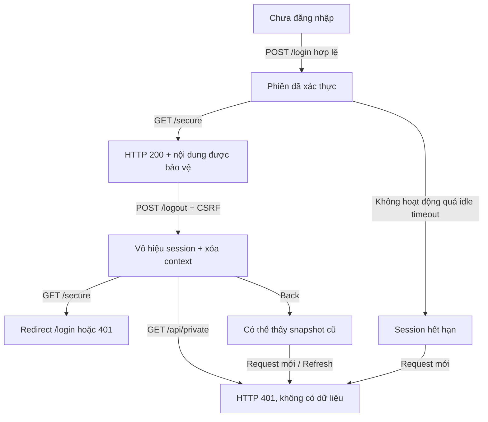
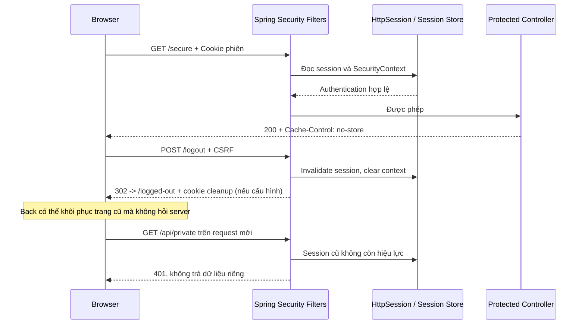
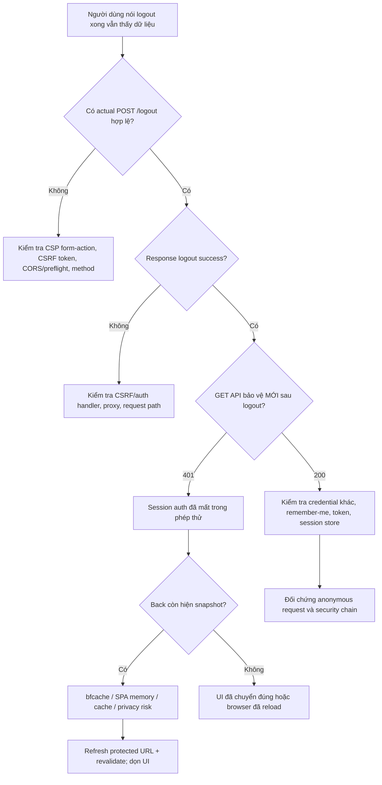

# Kiểm tra đăng xuất, Back, Refresh và phiên hết hạn

Người dùng bấm **Đăng xuất**, ứng dụng chuyển sang trang xác nhận, nhưng sau khi bấm **Back**, một màn hình từng hiển thị dữ liệu riêng tư có thể xuất hiện lại. Điều đó có nghĩa phiên đăng nhập vẫn còn hiệu lực? **Không nhất thiết.** Browser có thể khôi phục tài liệu cũ từ lịch sử hoặc **back-forward cache (bfcache)** mà chưa gửi request đến server. Ngược lại, nếu **Refresh** trên tài liệu được bảo vệ vẫn trả dữ liệu sau khi logout, đó là dấu hiệu cần điều tra nghiêm túc về session, cookie, remember-me, cache hoặc cấu hình security chain.

Bài này dạy cách kiểm thử **đăng xuất, Back, Refresh và phiên hết hạn** bằng cách tách bốn lớp bằng chứng: **trạng thái phiên ở máy chủ**, **HTTP request/response**, **hành vi navigation/cache của trình duyệt** và **kết quả truy cập thực tế**. Mục tiêu là chứng minh **một request mới không còn được phép đọc dữ liệu hay thay đổi trạng thái sau logout/expiry**, đồng thời nhận diện và xử lý nguy cơ giao diện cũ vẫn được khôi phục từ lịch sử.

Đây là bài trong chương **Kiểm thử trình duyệt**, thuộc module **SPRING_SECURITY_HTTP_PROTECTION** — phòng vệ HTTP và browser trong Spring Security với CSRF, CORS, security headers, CSP, HSTS, HTTP firewall, session trên Servlet/Reactive; người học cấu hình, kiểm thử và chẩn đoán những xung đột trong môi trường thực. Lab chính dùng **Spring Boot 3.x, Spring Security Servlet 6.x, Java 17+, Thymeleaf, MockMvc và Playwright**; phần sau đối chiếu **Spring WebFlux**.

**Sau bài học, bạn có thể:**

1. Phân biệt **logout**, **browser Back**, **Refresh**, **idle session timeout** và **explicit session invalidation**.
2. Kiểm tra `POST /logout` có CSRF token, `LogoutFilter`, các logout handlers và logout success response.
3. Chứng minh session đã mất quyền truy cập trên **request mới**, thay vì dựa vào thông báo “Đã đăng xuất”.
4. Nhận biết khác biệt giữa HTTP cache, bfcache, service worker cache và state SPA còn trong bộ nhớ.
5. Kiểm thử Back/Refresh sau logout với các kết luận **PASS**, **FAIL** và **INCONCLUSIVE** phù hợp.
6. Kiểm thử session hết hạn do **idle timeout thực** và so với **mô phỏng invalidation** trong lab.
7. Xử lý nhiều tab, stale CSRF token, remember-me, SSO, JWT, session cookie và proxy/cache.
8. Viết test MockMvc/Playwright và chọn bằng chứng Response–Console–Behavior có thể tái lập, không lộ token.

## 1. Bốn thao tác, bốn câu hỏi bảo mật khác nhau

| Thao tác | Điều xảy ra ở browser | Câu hỏi cần kiểm tra |
| --- | --- | --- |
| **Logout** | Gửi yêu cầu kết thúc phiên, thường POST rồi redirect | Server đã vô hiệu session/security context và credential liên quan chưa? |
| **Back** | Quay đến history entry trước đó; có thể khôi phục document trong bộ nhớ | Nội dung cũ có bị lộ lại? **Request mới** còn được xác thực không? |
| **Refresh** | Tải lại URL đang xem; thường tạo navigation request | Server có từ chối truy cập protected resource khi phiên đã mất hiệu lực không? |
| **Phiên hết hạn** | Session idle quá thời hạn hoặc bị server invalidation | Request tiếp theo có bị coi là unauthenticated và yêu cầu đăng nhập lại không? |

**Điểm cốt lõi:** Logout là **sự kiện phía server**; Back là **cơ chế lịch sử/browser**; Refresh là **navigation/request mới**; session expiry là **quy tắc thời gian hoặc vòng đời session ở backend**. Không gộp tất cả thành một assertion “trang bảo mật không hiện”.

### Ví dụ một kết luận sai

> “Back hiển thị trang tài khoản, vậy logout không hoạt động.”

Trang đó có thể là snapshot cũ không có request mới. Nếu một `fetch('/api/private')` sau Back trả `401`, và Refresh `/secure` chuyển về login, **session server đã mất quyền truy cập** dù UI lịch sử còn ảnh cũ. Tuy nhiên với ứng dụng chứa dữ liệu nhạy cảm, việc **ảnh cũ được hiển thị** vẫn có thể là vấn đề riêng về rò rỉ trên thiết bị dùng chung.

### Ví dụ một kết luận cũng sai

> “Trang logout đã chuyển tới `/logged-out`, vậy session đã bị xóa.”

Một custom controller có thể chỉ redirect mà **không gọi `SecurityContextLogoutHandler`**. Trang xác nhận xuất hiện, nhưng API bảo vệ vẫn trả `200`. Cần chứng minh **request mới bị từ chối**, không chỉ nhìn redirect.

## 2. Hợp đồng an toàn cần kiểm chứng

Với ứng dụng web dùng server-side session authentication, mô hình kỳ vọng:



**Điều kiện PASS tối thiểu:**

- **Trước logout:** đăng nhập hợp lệ, `/secure` trả `200` và `/api/private` có dữ liệu **giả** dành cho người dùng lab.
- **Sau logout:** gửi đúng **POST** `/logout` kèm CSRF token trong session; server thực hiện cleanup; một request mới tới `/api/private` trả `401` và **không có dữ liệu**, còn GET `/secure` yêu cầu đăng nhập lại.
- **Sau Back:** dù browser có thể khôi phục UI cũ, gọi API có bảo vệ phải thất bại; Refresh một protected URL phải đi qua kiểm tra xác thực mới.
- **Sau session expiry:** API và protected document tiếp tục từ chối request, không tự xác thực lại nếu không có cơ chế reauthentication được thiết kế.
- **Đối chứng:** nếu đăng nhập lại thành công, các protected endpoints hoạt động; test không được xanh chỉ vì tất cả routes đều lỗi.

**Lưu ý:** `401` hay `302` phụ thuộc **kiểu endpoint** và authentication entry point. Với HTML form login, Spring Security thường redirect tới `/login`; với API, ứng dụng có thể cấu hình trả `401`. Không đặt expectation “mọi protected endpoint luôn trả 401” khi security chain thực tế chọn form-login redirect.

## 3. Ranh giới browser – server – session store



Trong lab, **`JSESSIONID` là mã nhận diện phiên**, không phải bản thân quyền truy cập. Browser có thể giữ hoặc gửi lại một cookie mang ID cũ; nếu session server đã invalidated, cookie đó **không hồi sinh quyền**. Ngược lại, chỉ xóa cookie trên client nhưng server-side session vẫn tồn tại có thể khiến một credential khác còn khả năng truy cập: tùy threat model, cần chấm dứt đúng state ở server.

### Điều không thể kết luận từ một phía

| Bằng chứng | Chứng minh được | Chưa tự chứng minh |
| --- | --- | --- |
| Response redirect `/logged-out` | Logout handler/success navigation được gọi hoặc custom route redirect | Session bị vô hiệu hoàn toàn |
| `Set-Cookie` xóa `JSESSIONID` | Server yêu cầu browser xóa cookie theo attributes | Mọi session store/token khác đã bị thu hồi |
| Back hiển thị nội dung cũ | Browser giữ lại snapshot/page state | API vẫn còn xác thực |
| GET `/api/private` trả `401` | Request cụ thể không có quyền đọc API | Browser chưa giữ ảnh cũ trên màn hình |
| Refresh `/secure` chuyển về `/login` | Navigation mới phải xác thực lại | Không có dữ liệu cũ ở memory/cached DOM |
| `Console` không có lỗi | Không thấy browser warning rõ ràng | Session còn hiệu lực hay đã hết hạn |

Vì vậy phải kiểm tra **Response + hành vi backend + hành vi browser**, không chỉ nhìn URL hiện tại.

## 4. Session và SecurityContext của Spring Security Servlet

Trong mô hình **stateful form login** thông dụng:

- Khi authentication thành công, Spring Security có thể lưu `SecurityContext` chứa `Authentication` vào `SecurityContextRepository` liên kết `HttpSession` tùy cấu hình.
- Servlet container giữ session object; browser thường gửi `JSESSIONID` trong `Cookie` để server tìm đúng session.
- Khi request mới đến, Spring Security kiểm tra ngữ cảnh xác thực và authorization theo security chain.
- Khi logout đúng, handlers liên quan sẽ xóa authentication/security context khỏi nơi lưu và thường invalidate `HttpSession`.
- Khi session hết hạn vì idle, session store không còn trạng thái xác thực tương ứng; request mới được đối xử như chưa đăng nhập (trừ khi **cơ chế xác thực khác** khôi phục quyền).

**Không nhầm:** `HttpSession` có thể tồn tại khi chưa authenticated (ví dụ để lưu CSRF token hoặc saved request). “Có session cookie” **không đồng nghĩa** người dùng đã đăng nhập. Ngược lại, ở hệ thống stateless bearer token, authentication có thể **không phụ thuộc HttpSession**.

### Session fixation, session ID rotation

Spring Security có các cơ chế session fixation protection trong quá trình login. Session ID có thể thay đổi khi đăng nhập, và cookie được cập nhật. Không viết test so literal session ID trước/sau login như thể giữ nguyên ID mới là đúng. Chỉ kiểm tra **authorization** và vòng đời xác thực, không lưu raw `JSESSIONID` vào report.

### Session expiration là quyết định phía server

Browser có thể vẫn có cookie session sau expiry, nhưng server-side session không còn. Nếu API tiếp tục trả dữ liệu khi timeout đã vượt quá mà không có request duy trì session hoặc cơ chế reauthentication, cần kiểm tra session store, token độc lập, load balancer, remember-me, session timeout thực tế và test setup.

## 5. `LogoutFilter` và mặc định của Spring Security

Khi Spring Security Servlet bật hỗ trợ logout thông thường:

1. Với **CSRF enabled**, `GET /logout` thường hiển thị **trang xác nhận logout** — không phải thực hiện logout ngay.
2. `POST /logout` kèm CSRF token hợp lệ là đường thực hiện logout mặc định.
3. Các `LogoutHandler` dọn authentication/security context, invalidate `HttpSession` và cleanup các cơ chế tích hợp tương ứng (ví dụ CSRF token/remember-me nếu cấu hình).
4. `LogoutSuccessHandler` quyết định response cuối: thường redirect tới login với tham số logout hoặc URL tùy chỉnh.

Tùy cấu hình và phiên bản, danh sách handlers cụ thể có thể khác. **Không tự viết `@PostMapping("/logout")` chỉ để trả redirect** mà quên gọi logout handlers; mặc định `LogoutFilter` xử lý trước authorization nên thường không cần controller logout riêng.

### Vì sao nên dùng POST?

Logout thay đổi trạng thái xác thực. Nếu chỉ cần **GET** qua ảnh/link/iframe từ site ngoài là logout được, ứng dụng có nguy cơ bị ép logout ngoài ý muốn (*logout CSRF*). Với Spring Security và CSRF enabled, dùng **POST `/logout` có CSRF token** là cách mặc định phù hợp cho stateful form login.

```html
<form method="post" action="/logout">
  <input type="hidden"
         name="_csrf"
         value="TOKEN_DO_SERVER_CUNG_CAP">
  <button type="submit">Đăng xuất</button>
</form>
```

Mẫu trên chỉ minh họa. Trong ứng dụng thật, tên field và token phải do `CsrfTokenRequestHandler`/template engine cung cấp theo **cùng session**; không hard-code token. Một yêu cầu POST thiếu token đúng phải bị từ chối **mà không làm mất session hiện hữu**, trừ khi security/session logic ứng dụng có quy định khác.

## 6. Tại sao Back có thể thấy trang cũ sau logout?

Browser history có thể giữ nhiều dạng state:

| Cơ chế | Nội dung được giữ | Khi người dùng bấm Back |
| --- | --- | --- |
| **HTTP cache** | Response resource/body theo chính sách cache | Browser có thể reuse response hoặc revalidate |
| **bfcache** | Document sống được đóng băng cùng DOM/JS state | Có thể **khôi phục trực tiếp**, không gửi GET mới |
| **Session history** | URL, scroll/form state, entry điều hướng | Quay lại URL; có thể tạo navigation mới |
| **SPA memory/state** | Dữ liệu trong store/DOM client | Back qua route client-side có thể vẫn hiển thị dữ liệu |
| **Service worker cache** | Response do service worker quản lý | Có thể phục vụ HTML/data cache khác HTTP cache |

Vì thế, sau logout có hai câu hỏi tách biệt:

- **Authorization:** một request HTTP mới tới protected backend có còn được cấp dữ liệu không?
- **Presentation/privacy:** browser có thể tạm hiển thị snapshot chứa dữ liệu nhạy cảm trong history/DOM/cache không?

Trả lời “không” cho Authorization **không tự trả lời** câu hỏi Presentation. Ở ứng dụng ngân hàng, y tế hoặc kiosk dùng chung, lộ snapshot cũ có thể là rủi ro UX/privacy cần thiết kế riêng, dù server-side logout hoàn toàn đúng.

### `Cache-Control: no-store` không luôn loại trừ bfcache

`no-store` là chỉ thị cho **HTTP cache**, không nên được xem là bảo đảm tuyệt đối browser không thể giữ document trong **bfcache**. Từ các thay đổi trên Chromium/Chrome, một số trang có `Cache-Control: no-store` có thể vẫn đủ điều kiện bfcache khi browser đánh giá an toàn, với các biện pháp bảo vệ riêng. Browser/version khác nhau có hành vi khác.

**Hệ quả kiểm thử:** đừng viết assertion cứng rằng **Back tuyệt đối không thể thấy DOM cũ** chỉ nhờ header `no-store`. Thay vào đó, đánh giá riêng **request mới không được xác thực** và **nội dung lịch sử có còn hiển thị ngoài mức chấp nhận được**.

## 7. `Cache-Control`, bfcache và sự kiện `pageshow`

Với nội dung nhạy cảm, nên trả các cache headers thích hợp:

```http
Cache-Control: no-store
```

Spring Security Servlet thông dụng đã có **cache-control default response headers** khi ứng dụng chưa ghi cache headers khác. Tuy nhiên ứng dụng, controller, reverse proxy hoặc CDN có thể ghi đè; **bắt buộc xem Response Headers cuối browser nhận**. Đừng mặc định chỉ vì có Spring Security dependency mà mọi protected response chắc chắn `no-store`.

Để chẩn đoán bfcache trong browser:

```javascript
window.addEventListener("pageshow", event => {
  if (event.persisted) {
    console.log("Document vừa được khôi phục từ bfcache");
  }
});
```

`event.persisted === true` có thể xác nhận một lượt **khôi phục từ bfcache** trong các browser hỗ trợ. Nhưng việc nó bằng `false` **không chứng minh đã có request mới**; hãy đối chiếu Network. Ví dụ code này phải nằm trong script được **CSP cho phép** (external same-origin hoặc nonce/hash phù hợp), không chèn inline tùy tiện rồi mở `'unsafe-inline'`.

### `pageshow` có thể dùng để kiểm tra lại quyền, nhưng không phải bảo vệ tuyệt đối

Một ứng dụng có thể **revalidate** qua API khi trang quay về từ bfcache:

```javascript
window.addEventListener("pageshow", async event => {
  if (!event.persisted) return;

  try {
    const response = await fetch("/api/private", {
      cache: "no-store",
      credentials: "same-origin"
    });
    if (response.status === 401) {
      location.replace("/login");
    }
  } catch {
    // Network offline: hiển thị trạng thái chưa xác minh,
    // không tiếp tục hoạt động nhạy cảm như đã xác thực.
    document.documentElement.dataset.authStatus = "unknown";
  }
});
```

**Hạn chế:** DOM cũ có thể xuất hiện **trước khi listener chạy**, hoặc network kiểm tra chậm/offline. Đây là biện pháp giảm stale UI chứ **không bảo đảm không có “flash” nội dung bí mật**. Với dữ liệu cực nhạy cảm, phải thêm thiết kế giảm thông tin lưu trong DOM, dọn state ở logout, kiểm soát cache/storage và chính sách privacy phù hợp.

## 8. Refresh sau logout: phép thử authorization quan trọng nhất

**Refresh** một URL bảo vệ thường khiến browser tạo navigation đến cùng URL. Với ứng dụng form-login stateful:

```text
Trước logout:
  GET /secure                  -> 200 + nội dung thử nghiệm
  GET /api/private             -> 200 + JSON giả

POST /logout + CSRF hợp lệ     -> 302 Location: /logged-out

Sau logout:
  GET /api/private             -> 401 Unauthorized
  GET /secure                  -> 302 Location: /login
  GET /login                   -> 200 trang đăng nhập
```

Đây là **hợp đồng ví dụ của lab**, không phải mặc định mọi Spring Security application có API 401: cần cấu hình entry point cho API. Thực tế backend có thể trả `403` nếu authentication đã tồn tại nhưng thiếu quyền, hoặc redirect nếu entry point là form login. Một test tốt phải biết **security chain, authentication entry point và role** trước khi chọn status mong đợi.

### Kiểm tra đúng protected URL, không chỉ refresh trang logout

Nếu đang ở `/logged-out` rồi bấm Refresh, browser chỉ tải lại **trang công khai**. Nó **không kiểm tra quyền truy cập `/secure`**. Hãy nhập lại `/secure` hoặc dùng Refresh khi browser Back đã trở về history entry của `/secure`. Đồng thời gọi `/api/private` bằng browser request thật để tránh kết luận sai từ UI/HTML cache.

### Trường hợp phát hiện FAIL

Nếu một GET **mới** sau logout đến `/api/private` trả `200` với dữ liệu người dùng, và request không mang credential xác thực mới nào, cần xem lại logout configuration, session store, remember-me, proxy auth, header propagation hoặc cache. Không sửa bằng cách chỉ redirect giao diện sang login, vì API vẫn có thể bị truy cập.

## 9. Phiên hết hạn: idle timeout khác logout chủ động

**Idle timeout** thường được hiểu là server-side session bị hết hiệu lực sau một thời gian **không có hoạt động làm gia hạn session**. Logout là thao tác **chủ động** invalidating session, còn idle timeout xảy ra theo cơ chế quản lý session/container/store.

Ví dụ cấu hình lab:

```properties
# 1 phút để kiểm thử thủ công; cấu hình production cần dài hơn
# theo threat model, UX và tính chất ứng dụng.
server.servlet.session.timeout=1m
```

**Không giả định timeout chính xác đến mili giây.** Servlet container, session store, Spring Session hoặc hạ tầng phân tán có thể làm tròn độ phân giải, gia hạn thời điểm truy cập cuối hoặc dọn session sau đó. Test phải ghi **giá trị timeout effective thực**, không chỉ tham số mong muốn trong file properties.

### Điều gì tính là hoạt động?

Tùy session framework/container, một request mang session ID và truy cập vào session có thể làm cập nhật thời điểm truy cập gần nhất. Vì vậy các hoạt động sau có thể **vô tình ngăn phiên hết hạn**:

- SPA tự gọi `/api/private`, `/api/me`, analytics hoặc refresh endpoint theo chu kỳ;
- Browser test polling `waitForResponse` bằng API liên tục;
- Auto-refresh của dashboard hoặc WebSocket heartbeat liên kết session;
- Tab thứ hai cùng browser context vẫn gửi requests;
- Frontend tải resource định kỳ có truy cập session;
- Load balancer/session middleware định nghĩa thời điểm cập nhật khác mong đợi.

**Một test idle timeout không được liên tục gọi protected API trong thời gian chờ**, rồi kết luận server không hết hạn khi request vẫn đang gia hạn session.

### Các mốc thời gian cần ghi

```text
t0: đăng nhập, GET /secure -> 200
t1: ngừng tất cả request có thể chạm session
t2: đã vượt idle timeout effective + khoảng đệm phù hợp
t3: gửi GET /api/private mới -> 401
t4: GET /secure mới -> redirect login
```

Nếu thấy cookie session vẫn tồn tại ở `t3`, đó chưa phải FAIL. Cookie ở browser có thể sống lâu hơn session server. Trọng tâm là **server không chấp nhận authentication từ session đã hết hạn**.

## 10. Hai loại test timeout: chờ thật và mô phỏng invalidation

Cần phân biệt hai phép đo:

| Test | Cách tạo trạng thái | Chứng minh được | Không chứng minh được |
| --- | --- | --- | --- |
| **Idle timeout thực** | Không gửi request trong khoảng vượt thời hạn effective | Session tự hết hạn theo cấu hình/tầng lưu trữ và không cho truy cập | Không tự kiểm tra mọi cơ chế logout |
| **Mô phỏng session invalidation** | Lab-only POST gọi `HttpSession.invalidate()` | Ứng dụng xử lý phiên đã bị vô hiệu ngay trên request sau | Không chứng minh thời gian idle timeout được cấu hình chính xác |

Test mô phỏng invalidation giúp CI không phải đợi nhiều phút và dễ debug. **Nhưng nó không thay test idle thật** ở môi trường thích hợp: server có thể xử lý `invalidate()` đúng mà vẫn để idle timeout quá dài/sai vì configuration hoặc polling.

### Test idle timeout phải tránh “giải pháp” nguy hiểm

Không đổi production session timeout thành 5 giây để chạy suite, không terminate session người dùng thật và không gọi APIs nhạy cảm để “thử hết hạn”. Dùng **profile lab**, database/session store giả hoặc staging riêng; mọi endpoint mô phỏng expiry phải có CSRF/authorization và không được deploy công khai.

## 11. `invalidSessionUrl`, `401` API và nguy cơ nhầm expired với anonymous

Spring Security Servlet có cấu hình:

```java
http.sessionManagement(session -> session
    .invalidSessionUrl("/session-invalid"));
```

Nó giúp chuyển hướng khi cơ chế session management **phát hiện session ID không hợp lệ**, chẳng hạn sau expiry trong cấu hình phù hợp. Nhưng `invalidSessionUrl` **không phải công tắc tự làm hết hạn session**, cũng không bảo đảm mọi anonymous request đều đi qua URL này.

**Bẫy thường gặp:** browser còn cookie `JSESSIONID` cũ sau logout, gửi lại cookie vào request mới, và ứng dụng có thể coi đó là “invalid session” rồi redirect tới thông báo timeout dù người dùng **vừa chủ động logout**. Nếu dùng invalid session handling, cần đánh giá việc xóa cookie và phân biệt luồng logout/expired hợp lý.

### HTML redirect khác JSON API

Trang HTML có thể cần UX như redirect `/login?reason=expired`; API cần response **`401` + mã lỗi ổn định** để client quyết định hiển thị login UI. Một redirect tới HTML login trên API đôi khi cho client `fetch` kết quả `200 text/html`, dẫn đến JSON parse error thay vì tín hiệu authentication rõ ràng.

Ví dụ contract API:

```http
HTTP/1.1 401 Unauthorized
Cache-Control: no-store
Content-Type: application/json

{"code":"UNAUTHENTICATED"}
```

Mẫu này **tùy chỉnh**: Spring Security không tự trả JSON body đó cho mọi ứng dụng. Trong lab sau, API entry point trả `401` (không cần JSON body). Khi sản xuất API, có thể bổ sung `AuthenticationEntryPoint` riêng với response type và định dạng lỗi nhất quán.

### Phân biệt session invalid với session missing

Một request **không có cookie** có thể bị xem là anonymous; một request có cookie chứa **ID đã hết hạn** là invalid ID; một request có session nhưng authentication rỗng cũng là unauthenticated. Các tình huống có thể có response tương tự nhưng **đường xử lý khác**. Chọn evidence từ actual request cookie **có/không** (không ghi giá trị), server session diagnostics an toàn và authentication result.

## 12. Remember-me, OAuth2, SSO và JWT có thể làm ca logout khó đo

Không phải mọi ứng dụng chỉ có `HttpSession`:

| Kiến trúc | Logout session có thể làm gì? | Điều cần kiểm tra thêm |
| --- | --- | --- |
| **Form login + HttpSession** | Invalidate session, clear SecurityContext | API/HTML không còn truy cập sau logout |
| **Remember-me cookie** | Spring Security có logout handlers tích hợp theo cơ chế được cấu hình | Remember-me credential còn tự đăng nhập lại hay không |
| **OAuth2 Login / OIDC** | Chấm dứt local application session | IdP session có còn và có SSO login lại không; RP-initiated logout nếu yêu cầu |
| **SAML2 SSO** | Clear local session | Single logout với IdP/other SPs nếu được hỗ trợ/cấu hình |
| **Stateless JWT bearer** | Xóa browser copy token không tự làm JWT đã phát mất hiệu lực | Token còn valid tới `exp` hay đã có revoke/short TTL/binding |
| **Opaque access token** | Xóa local token là phía client | Introspection/revocation ở authorization server và resource server |
| **Refresh token** | Hết phiên UI chưa đủ | Refresh token còn có thể cấp access token mới không |

Nếu logout xong mà GET protected API vẫn `200`, đó **có thể không phải session invalidation thất bại**, mà do browser/client còn **một cách xác thực khác** (remember-me, SSO, bearer token, upstream proxy SSO). Phải ghi các credential types có thể tham gia, không chỉ xem `JSESSIONID`.

### Đăng xuất khỏi ứng dụng không luôn đăng xuất khỏi IdP

Người dùng trở lại `/login`, nhấn đăng nhập bằng IdP rồi được đưa vào ngay vì **SSO session ở IdP còn hợp lệ**. Điều đó không tự chứng minh local logout sai. Cần xác định kỳ vọng của sản phẩm: **local logout** hay **single logout** theo giao thức cụ thể, rồi kiểm thử đúng contract.

### Bearer token khác Cookie session

Với resource server xác thực JWT chỉ dựa trên chữ ký/expiry, `HttpSession.invalidate()` **không vô hiệu hóa JWT đã phát**. Nếu client tiếp tục gửi `Authorization: Bearer ...`, resource server vẫn có thể chấp nhận. Bài lab này **chọn stateful form login** để mọi kết luận về logout/session có nghĩa rõ ràng; không áp dụng test session này nguyên xi cho JWT.

## 13. Cookie cleanup: yêu cầu xóa cookie chưa bằng chứng quyền đã bị thu hồi

Trong lab có thể cấu hình:

```java
.logout(logout -> logout
    .invalidateHttpSession(true)
    .clearAuthentication(true)
    .deleteCookies("JSESSIONID")
    .logoutSuccessUrl("/logged-out"))
```

`deleteCookies("JSESSIONID")` khiến server cố gắng gửi một cookie hết hạn để browser xóa credential session. Việc xóa có thể phụ thuộc **`Path`, `Domain`, `Secure`, reverse proxy, Servlet container** và chính xác cookie đã được set trước đó. Không nên mặc định xóa sẽ thành công trên mọi topology.

### Ba điều phải tách biệt

1. **Session state** ở server đã invalidated chưa?
2. **Cookie jar** ở browser đã xóa cookie có scope đúng chưa?
3. **Request mới** có còn được authenticated bởi session, remember-me, token hay SSO không?

Một response `Set-Cookie` yêu cầu xóa không tự chứng minh 1 và 3. Ngược lại, cookie có thể vẫn tồn tại nhưng server đã invalidate session hoàn toàn. **Khả năng đọc dữ liệu trong một request mới** là bằng chứng quan trọng nhất của authorization.

### `Clear-Site-Data` không phải giải pháp mặc định cho mọi app

Một số ứng dụng cân nhắc header:

```http
Clear-Site-Data: "cache", "storage"
```

hoặc thêm `"cookies"` khi có đánh giá tác động. Chỉ thị này có phạm vi và mức browser support riêng, có thể xóa dữ liệu từ nhiều phần của site/browsing context, ảnh hưởng các ứng dụng chia sẻ domain, và **không thay server-side logout**. Trước khi dùng, phải xem mục tiêu, môi trường HTTPS, privacy/offline requirements và ảnh hưởng đến nhiều subdomain. Lab cơ sở không dùng `Clear-Site-Data` để tránh phụ thuộc browser-specific behavior.

## 14. Nhiều tab: tab còn hiển thị không đồng nghĩa phiên còn hiệu lực

Người dùng mở hai tab cùng origin:

```text
Tab A: /secure
Tab B: /secure
Tab A: POST /logout -> /logged-out
Tab B: vẫn có DOM và dữ liệu cũ trên màn hình
Tab B: GET /api/private mới -> 401
Tab B: Refresh /secure -> /login
```

Đây là hành vi có thể **đúng về server authorization**. Browser không tự xóa DOM trong tab B khi tab A invalidates session. Ứng dụng SPA hoặc dashboard cần cơ chế đồng bộ **trạng thái UI** để hạn chế stale screen.

### `BroadcastChannel` để gửi tín hiệu giao diện, không phải quyền xác thực

Ví dụ dùng một script **được CSP cho phép** trên trang đã đăng xuất để phát tín hiệu:

```javascript
const channel = new BroadcastChannel("lab-auth-events");
channel.postMessage({ type: "LOCAL_LOGOUT_NOTICE" });
channel.close();
```

Ở tab bảo vệ:

```javascript
const channel = new BroadcastChannel("lab-auth-events");
channel.addEventListener("message", async event => {
  if (event.data?.type !== "LOCAL_LOGOUT_NOTICE") return;
  // Xóa dữ liệu nhạy cảm đang nằm trong UI client ngay.
  document.querySelector("#private-panel")?.replaceChildren();
  location.replace("/logged-out");
});
```

**Cảnh báo:** Message từ cùng origin là **gợi ý đồng bộ UI**, không phải bằng chứng logout đã xảy ra ở server. Một script cùng origin có thể gửi message giả; frontend có thể chuyển đến trang logout dù chưa mất session. Bất kể có BroadcastChannel hay không, mọi API phải **tự kiểm tra authentication/authorization phía server**. Khi trình duyệt không hỗ trợ/đóng channel, app vẫn phải an toàn.

### Vấn đề timing với in-flight requests

Tab B có thể đã gửi một POST hợp lệ **trước khi Tab A logout**. Request ấy có thể hoàn tất sau khi redirect logout xuất hiện do xử lý đồng thời. Session invalidation không nhất thiết thu hồi một transaction đã vượt qua authorization check. Với nghiệp vụ nhạy cảm, cần policy về **in-flight operations, idempotency, transaction boundaries và token revocation**; không hứa mọi tác vụ đang chạy sẽ tự bị hủy ngay lập tức sau logout.

## 15. SPA, service worker và dữ liệu trong memory/storage

Với Single Page Application, **Back** đôi khi chỉ đổi client-side route, không gửi HTML document GET. Sau logout, frontend store (Redux/Pinia/React context), `sessionStorage`, `localStorage` hoặc service worker cache có thể còn dữ liệu cũ.

**Phân chia trách nhiệm:**

- **Server:** từ chối mọi protected request không còn authenticated; làm sạch session và credentials theo thiết kế.
- **Frontend:** xóa UI state chứa dữ liệu riêng sau logout, không render từ persistent cache nếu chưa xác minh quyền; thực hiện revalidation khi tab được focus/khôi phục.
- **Browser:** điều khiển history, bfcache, HTTP cache và cookie policy; app không thể giả định mọi hành vi giống nhau giữa browser.

Nếu app lưu access token trong `localStorage`, xóa token tại logout không bảo đảm token đã được thu hồi ở server, và lưu token trong web storage còn có rủi ro XSS riêng. **Đừng đề xuất chuyển session cookie sang `localStorage` chỉ để khắc phục Back.**

### Service worker là một tầng cần kiểm tra

Một service worker cấu hình cache-first cho `/secure` có thể phục vụ HTML/JSON cũ ngay cả khi backend đã invalidated session. Với protected data, cần chiến lược caching/partitioning rõ ràng; tránh cache riêng tư bằng cache-first mặc định hoặc chia cache giữa các danh tính. Kiểm tra:

```text
DevTools → Application/Storage → Service Workers / Cache Storage
Network → Size / Service Worker / from cache
```

Không xóa service worker của một site sản xuất đang phục vụ người dùng chỉ để làm test xanh; dùng browser context/staging dành riêng. **Kết quả từ server API có no-store và auth check phải được đo tách khỏi HTML snapshot**.

## 16. Thiết kế lab: một phiên form-login, hai protected endpoints, một công tắc mô phỏng expiry

Để có test không phụ thuộc dữ liệu người dùng thật, ta tạo một ứng dụng Spring Boot **riêng chỉ phục vụ lab**:

| Thành phần | URL | Cách sử dụng |
| --- | --- | --- |
| Trang đăng nhập mặc định | `GET /login` | Spring Security tạo form đăng nhập |
| Xử lý login | `POST /login` | Spring Security xác thực, CSRF enabled |
| Trang bảo vệ | `GET /secure` | Authenticated → HTML `200`; anonymous → redirect `/login` |
| API bảo vệ | `GET /api/private` | Authenticated → JSON `200`; anonymous → **`401`** (tùy chỉnh lab) |
| Form logout | Trong `/secure` | `POST /logout` kèm CSRF token |
| Logout success | `GET /logged-out` | Trang công khai sau logout |
| Mô phỏng expiry | `POST /lab/expire-session` | **Chỉ profile `lab`**: invalidate session; không phải idle timeout thực |

**Baseline bảo mật:** cùng một browser context, trước logout GET `/secure` và `/api/private` phải thành công; sau logout hoặc simulated expiry, **request mới** đến các endpoint này phải bị từ chối. Dùng dữ liệu giả như `user=learner`, `status=authenticated`; không truy cập dữ liệu cá nhân hay cơ sở dữ liệu thật.

```text
browser-session-lab/
  src/main/java/example/lab/
    SessionSecurityConfiguration.java
    SecureLabController.java
    ExpireSessionLabController.java
  src/main/resources/
    application.properties
    templates/secure.html
    templates/logged-out.html
  src/test/java/example/lab/
    SessionLifecycleMvcTest.java
  browser-tests/
    session-lifecycle.spec.ts
```

**Quan trọng:** cây thư mục này là một **dự án ví dụ để người học tự triển khai**. Phạm vi ghi của bài STEP 4 chỉ là Markdown đang được giao, không tạo các file lab trong workspace của module.

## 17. Dependencies và cấu hình thời gian sống phiên cho lab

Với Java 17+, Spring Boot 3.x và Spring Security Servlet 6.x, dependencies:

```text
spring-boot-starter-web
spring-boot-starter-security
spring-boot-starter-thymeleaf

# Test scope:
spring-boot-starter-test
spring-security-test
```

Ví dụ `application.properties` của **lab-only app**:

```properties
server.port=8080

# Idle session timeout ngắn để thử thủ công:
server.servlet.session.timeout=1m

# Tên profile "lab" sẽ được kích hoạt từ môi trường chạy/test.
# KHÔNG bật một profile có endpoint invalidate session ở production.
```

Kích hoạt profile `lab` **chỉ trong môi trường cách ly**, chẳng hạn bằng tham số khởi động của bản lab:

```bash
java -jar session-lab.jar --spring.profiles.active=lab
```

Lệnh trên chỉ minh họa nếu người học đã build artifact tương ứng; không phải yêu cầu STEP 4 worker chạy build hoặc Java. Khi chạy container/session store ngoài JVM, phải xác minh **effective timeout** và quy tắc làm mới last-access-time theo công nghệ đó; property của Servlet container có thể không phải nguồn duy nhất.

### Mốc thời gian 1 phút có chính xác không?

Không nên assert request bị từ chối ngay đúng giây thứ 60. Nhiều container/session backends có độ phân giải hoặc chính sách cập nhật access time khác nhau. Chọn thời điểm quan sát sau timeout với khoảng đệm hợp lý, **và không gửi request làm gia hạn session trong lúc chờ**.

### Không dùng tài khoản người thật

Phần cấu hình tiếp theo tạo một user **lab-only** có password hard-code để dễ tái hiện bài. Chỉ dùng trên loopback/staging tách biệt, không copy user, password hoặc `permitAll` của môi trường test vào production. Trong production, credential phải quản lý qua hệ thống xác thực và secrets manager phù hợp.

## 18. Cấu hình Spring Security Servlet: form login, CSRF và logout

Tạo `SessionSecurityConfiguration.java`:

```java
import org.springframework.context.annotation.Bean;
import org.springframework.context.annotation.Configuration;
import org.springframework.http.HttpStatus;
import org.springframework.security.config.annotation.web.builders.HttpSecurity;
import org.springframework.security.core.userdetails.User;
import org.springframework.security.core.userdetails.UserDetails;
import org.springframework.security.core.userdetails.UserDetailsService;
import org.springframework.security.crypto.bcrypt.BCryptPasswordEncoder;
import org.springframework.security.crypto.password.PasswordEncoder;
import org.springframework.security.provisioning.InMemoryUserDetailsManager;
import org.springframework.security.web.SecurityFilterChain;
import org.springframework.security.web.authentication.HttpStatusEntryPoint;

@Configuration
public class SessionSecurityConfiguration {

    @Bean
    PasswordEncoder passwordEncoder() {
        return new BCryptPasswordEncoder();
    }

    @Bean
    UserDetailsService labUsers(PasswordEncoder passwordEncoder) {
        // User và password chỉ dành cho lab trên máy được kiểm soát.
        UserDetails learner = User.withUsername("learner")
            .password(passwordEncoder.encode("LabDemo#2026"))
            .roles("USER")
            .build();
        return new InMemoryUserDetailsManager(learner);
    }

    @Bean
    SecurityFilterChain browserSessionChain(HttpSecurity http)
            throws Exception {

        return http
            .authorizeHttpRequests(auth -> auth
                .requestMatchers(
                    "/login", "/logged-out", "/error").permitAll()
                .requestMatchers(
                    "/secure",
                    "/api/private",
                    "/lab/expire-session").authenticated()
                .anyRequest().denyAll())

            // Sinh form đăng nhập mặc định của Spring Security.
            .formLogin(form -> form
                .defaultSuccessUrl("/secure", true)
                .permitAll())

            // Giữ CSRF mặc định: POST /logout phải có token.
            // Không gọi csrf.disable().

            .logout(logout -> logout
                .logoutUrl("/logout")
                .logoutSuccessUrl("/logged-out")
                .invalidateHttpSession(true)
                .clearAuthentication(true)
                .deleteCookies("JSESSIONID")
                .permitAll())

            .exceptionHandling(ex -> ex
                .defaultAuthenticationEntryPointFor(
                    new HttpStatusEntryPoint(HttpStatus.UNAUTHORIZED),
                    request -> request.getServletPath()
                        .startsWith("/api/")))

            // Lab không cần saved-request redirect để dễ quan sát.
            .requestCache(cache -> cache.disable())
            .build();
    }
}
```

**Giải thích các quyết định có chủ đích:**

1. `formLogin` dùng login form do Spring Security sinh (không cần `@Controller` cho `/login`). Khi đăng nhập thành công, chuyển tới `/secure`.
2. `permitAll()` cho trang login/logout success, **không làm các protected URLs trở thành public**.
3. `logoutUrl("/logout")` dùng `LogoutFilter`; khi CSRF enabled, **POST hợp lệ** thực hiện logout. GET `/logout` có thể là trang xác nhận, không phải cơ chế logout trực tiếp.
4. `invalidateHttpSession(true)` và `clearAuthentication(true)` làm rõ ý định cleanup; các giá trị này thường phù hợp mặc định của logout handler nhưng được ghi ra để người học thấy hợp đồng.
5. `deleteCookies("JSESSIONID")` gửi cookie cleanup khi phù hợp; phải kiểm tra path/domain thực tế, **không coi đây là bằng chứng duy nhất** session đã mất hiệu lực.
6. API dưới `/api/**` dùng entry point trả `401` cho request chưa authenticated; protected HTML dùng form-login entry point redirect `/login`.
7. `requestCache.disable()` giúp tránh việc anonymous navigation tới `/secure` tạo saved-request state không cần thiết trong lab, **không phải khuyến nghị tắt RequestCache cho mọi production app**.
8. Không bật `rememberMe`, OAuth2, SSO hoặc bearer token trong lab, nhằm giữ mô hình **chỉ một cách xác thực**.

**Chú ý SecurityFilterChain thực tế:** nếu ứng dụng có thêm chains cho `/api/**`, `/admin/**` hay một `/**` matcher ưu tiên cao hơn, request có thể đi qua chain khác cấu hình trên. Khi kiểm thử, xác minh matching/order của đúng chain thay vì nhìn một bean cấu hình trên giấy.

## 19. Controller: trang bảo vệ, JSON API và trang sau logout

Tạo `SecureLabController.java`:

```java
import java.util.Map;
import org.springframework.http.CacheControl;
import org.springframework.http.ResponseEntity;
import org.springframework.security.core.Authentication;
import org.springframework.stereotype.Controller;
import org.springframework.ui.Model;
import org.springframework.web.bind.annotation.GetMapping;
import org.springframework.web.bind.annotation.ResponseBody;
import jakarta.servlet.http.HttpServletResponse;

@Controller
public class SecureLabController {

    @GetMapping("/secure")
    String secure(Authentication authentication,
                  Model model,
                  HttpServletResponse response) {
        response.setHeader("Cache-Control", "no-store");
        model.addAttribute("userName", authentication.getName());
        return "secure";
    }

    @GetMapping("/api/private")
    @ResponseBody
    ResponseEntity<Map<String, Object>> privateApi(
            Authentication authentication) {

        return ResponseEntity.ok()
            .cacheControl(CacheControl.noStore())
            .body(Map.of(
                "authenticated", true,
                "user", authentication.getName(),
                "kind", "LAB_ONLY"));
    }

    @GetMapping("/logged-out")
    String loggedOut(HttpServletResponse response) {
        response.setHeader("Cache-Control", "no-store");
        return "logged-out";
    }
}
```

Protected controller chỉ chạy sau khi Spring Security xác nhận request authenticated. Sau logout, việc gọi `/secure` có thể bị redirect **trước khi vào controller**, và `/api/private` nhận `401` từ API authentication entry point.

**Trong một server thật**, không trả tên người dùng/sensitive data chỉ để debug session. Lab dùng principal giả `learner`. Để chứng minh authorization bị thu hồi, bạn có thể đọc **status hoặc một marker giả**, không cần lưu response body có thông tin cá nhân.

### No-store trên HTML và API

`response.setHeader("Cache-Control", "no-store")` và `CacheControl.noStore()` yêu cầu không lưu HTTP response; Spring Security còn có cache headers mặc định khi không bị controller/proxy override. Cần xác nhận response **cuối** nhận ở browser vẫn giữ giá trị phù hợp, đặc biệt qua CDN/reverse proxy. Header cache không **bảo đảm** xóa bfcache hoặc SPA memory.

## 20. Thymeleaf view: logout POST có token, không dùng link GET

Tạo `src/main/resources/templates/secure.html`:

```html
<!doctype html>
<html lang="vi" xmlns:th="http://www.thymeleaf.org">
<head>
  <meta charset="utf-8">
  <title>Protected Session Lab</title>
</head>
<body>
  <main id="private-panel">
    <h1 data-testid="secure-screen">Trang yêu cầu đăng nhập</h1>
    <p>Xin chào <strong th:text="${userName}">learner</strong></p>

    <form method="post" action="/logout">
      <input type="hidden"
             th:name="${_csrf.parameterName}"
             th:value="${_csrf.token}">
      <button type="submit" data-testid="logout-button">
        Đăng xuất
      </button>
    </form>

    <!-- CHỈ dùng khi profile lab đang bật. -->
    <form method="post" action="/lab/expire-session">
      <input type="hidden"
             th:name="${_csrf.parameterName}"
             th:value="${_csrf.token}">
      <button type="submit" data-testid="expire-button">
        Mô phỏng hết hạn phiên (lab)
      </button>
    </form>
  </main>
</body>
</html>
```

Với Spring Security Servlet và Thymeleaf, `_csrf` thường được công bố theo request; `th:name`/`th:value` giúp form lấy tên tham số và token tương ứng. Trên Spring Security 6.x, token đưa vào view có thể được xử lý/masked bởi `XorCsrfTokenRequestAttributeHandler`; **không hard-code giá trị token** hoặc coi masked token là expected raw token ở repository.

**Không dùng `th:action` đồng thời với hidden `_csrf` theo cách khiến framework tự thêm một hidden CSRF field thứ hai** mà không kiểm tra output HTML thực; mẫu dùng `action` thường và hidden token chủ động cho dễ quan sát.

Tạo `src/main/resources/templates/logged-out.html`:

```html
<!doctype html>
<html lang="vi">
<head>
  <meta charset="utf-8">
  <title>Logged out</title>
</head>
<body>
  <h1 data-testid="logged-out">Đã đăng xuất khỏi phiên lab</h1>
  <p>
    Trang này là thông báo. Phải kiểm tra request mới để chứng minh
    quyền truy cập server đã bị thu hồi.
  </p>
  <a href="/login">Đăng nhập lại</a>
</body>
</html>
```

Trong một ứng dụng có **CSP `script-src` chặt**, nếu sau này thêm JavaScript dọn UI hoặc `pageshow` handler, phải dùng external script hợp lệ/nonce/hash; không thêm inline JavaScript rồi vô hiệu CSP chỉ vì Back gặp vấn đề.

## 21. Endpoint giả lập session expiry chỉ trong profile `lab`

Tạo `ExpireSessionLabController.java`:

```java
import jakarta.servlet.http.HttpServletRequest;
import jakarta.servlet.http.HttpSession;
import org.springframework.context.annotation.Profile;
import org.springframework.http.CacheControl;
import org.springframework.http.ResponseEntity;
import org.springframework.web.bind.annotation.PostMapping;
import org.springframework.web.bind.annotation.RestController;

@Profile("lab")
@RestController
public class ExpireSessionLabController {

    @PostMapping("/lab/expire-session")
    ResponseEntity<Void> invalidateCurrentSession(
            HttpServletRequest request) {

        HttpSession session = request.getSession(false);
        if (session != null) {
            session.invalidate();
        }

        return ResponseEntity.noContent()
            .cacheControl(CacheControl.noStore())
            .build();
    }
}
```

**Vì sao route này nguy hiểm nếu deploy nhầm?** Nó chủ động làm mất session người đang dùng khi được gọi. Hãy để `@Profile("lab")` chỉ bật ở môi trường cách ly, bảo vệ bằng authentication và **CSRF** như trong `SecurityFilterChain`, không expose trên Internet, không cho người dùng khác tự gọi và không dùng để thử session người thật.

### Phạm vi kết luận của phép thử

`session.invalidate()` mô phỏng **trạng thái session không còn tồn tại**. Nó **không chứng minh timer idle timeout hoạt động đúng**, cũng **không chạy toàn bộ logout handlers** (ví dụ remember-me cleanup) như `/logout`. Sau thao tác này browser có thể vẫn có cookie ID cũ; một request mới phải không còn được authenticated bằng session đã invalidated.

### Về HTML form và HTTP 204

`POST /lab/expire-session` trả `204 No Content`. Khi form submit làm navigation nhận 204, browser có thể **vẫn ở trang cũ** mà không tải document mới. Điều này là đối tượng quan sát có ích: **UI vẫn hiển thị** nhưng server đã invalidated session. Test phải thực hiện **GET mới tới `/api/private`** và Refresh `/secure`, không kết luận mô phỏng expiry thất bại chỉ vì UI chưa tự biến mất.

## 22. Thử nghiệm thủ công A: login thành công và thiết lập baseline

1. Mở browser profile/context mới, vào `http://localhost:8080/login`.
2. Dùng **user lab** `learner` và password lab trong `SessionSecurityConfiguration` để đăng nhập.
3. Xác minh redirect đến `http://localhost:8080/secure`, hiển thị marker `data-testid="secure-screen"`.
4. Mở cùng browser context, gọi `GET /api/private`; response dự kiến `200` và JSON có `"authenticated": true`.
5. DevTools → Network: xem response Document `/secure` và `/api/private`, ghi `Cache-Control` có `no-store` theo lab.
6. DevTools → Application/Storage: xác minh browser có cookie session phù hợp; trong actual GET được xác thực, kiểm tra **Cookie có được gửi không**, không copy giá trị.

| Bằng chứng | Điều mong đợi |
| --- | --- |
| Response login | `302` về `/secure`, không giữ literal cookie/token trong report |
| Response `/secure` | `200` HTML đã được bảo vệ |
| Response `/api/private` | `200` JSON giả, authenticated |
| Console | Không có browser policy error liên quan; không bắt buộc |
| Behavior | Người dùng thấy trang bảo vệ và API có dữ liệu lab |

**Nếu baseline thất bại, chưa thử logout.** Một app đang 403 tất cả routes sẽ khiến các test “sau logout không truy cập được” luôn xanh giả. Kiểm tra `SecurityFilterChain`, login parameters, password encoder, session cookie và context path trước.

### Không dùng chế độ browser mất cookie để làm baseline

Nếu browser chặn cookie toàn cục hoặc đang chạy trong một iframe cross-site, form login có thể không duy trì phiên. Bài lab cơ sở dùng top-level same-origin navigation để cô lập vấn đề logout. Sau khi baseline ổn, mới mở rộng sang SameSite/third-party cookie tests.

## 23. Thử nghiệm thủ công B: logout qua POST và xác nhận quyền đã mất

Từ trang `/secure`, bấm **Đăng xuất**:

1. Trong Network, tìm **actual `POST /logout`**, không nhầm với `GET /logout` confirmation.
2. Xác nhận form đã có hidden `_csrf` theo phương án template, nhưng **không ghi token value**.
3. Quan sát response logout, thường `302` tới `/logged-out`; nếu có cookie cleanup, ghi thuộc tính `Path`/`Domain` (không giá trị).
4. Mở `/logged-out` và kiểm tra marker `data-testid="logged-out"`.
5. Từ **chính browser context** đó, gọi `GET /api/private` mới → **`401`**.
6. Gõ URL `/secure` vào address bar → bị redirect tới `/login`.
7. Đăng nhập lại bằng user lab → `/secure` và `/api/private` lại hoạt động.

**Tách hai tiêu chí:**

| Tiêu chí | Bằng chứng |
| --- | --- |
| Logout request hợp lệ đã được xử lý | `POST /logout` + CSRF, response logout success |
| **Session authentication không còn được chấp nhận** | GET `/api/private` mới `401`; GET `/secure` mới chuyển login |

Một user-visible toast “Đăng xuất thành công” chỉ đáp ứng tiêu chí UI, **không thay** tiêu chí server authorization. Nếu logout trả `302` nhưng API vẫn `200`, kiểm tra remember-me/SSO/token hoặc custom logout handler chưa clear context.

### Thử logout thiếu CSRF có chủ đích

Trong lab được phép, gửi `POST /logout` **không có token** từ một form riêng/MockMvc. Với CSRF enabled, request phải bị từ chối, session hiện tại **không bị logout**. Sau đó GET `/api/private` trong context ấy vẫn `200`. Đây là đối chứng giúp phát hiện cấu hình vô tình tắt CSRF trên logout.

## 24. Thử nghiệm thủ công C: Back sau logout

Sau khi đã login `/secure` rồi logout tới `/logged-out`, bấm **Back**:

| Quan sát | Kết luận có thể rút ra |
| --- | --- |
| Browser hiển thị `/login` vì đã tạo request tới `/secure` và bị redirect | Request mới đã qua kiểm tra auth; phù hợp kỳ vọng |
| Browser hiển thị snapshot `/secure` không có GET mới | Có thể là bfcache/history; chưa chứng minh session còn hiệu lực |
| Snapshot cũ xuất hiện, `GET /api/private` mới trả `401` | Logout server-side hoạt động, nhưng stale UI/privacy cần đánh giá riêng |
| Snapshot cũ xuất hiện, API mới trả `200` với dữ liệu | Cần điều tra authentication/credential khác hoặc logout failure |
| Browser không thể truy cập Back entry | Browser/history behavior; vẫn cần test API/Refresh |

Trong DevTools, bật Preserve log và kiểm tra liệu Back có tạo **GET `/secure`** không. Nếu không có GET, đừng tìm status `/secure` của thao tác Back rồi tự gán `200` hoặc `302`.

### Phép thử quan trọng sau Back

Dù màn hình đang hiện gì, từ chính context đó:

```javascript
const response = await fetch("/api/private", {
  cache: "no-store",
  credentials: "same-origin"
});
console.log(response.status); // kỳ vọng 401 sau logout
```

Đây là **đoạn DevTools Console minh họa trong lab**, không dùng trên hệ thống ngoài quyền sở hữu. Vì là same-origin, response status có thể đọc được; với API trả 401 theo lab, `fetch` resolve thành `Response` status 401 (không tự throw chỉ vì status 401).

### Vấn đề bảo mật riêng: stale pixels trên thiết bị dùng chung

Server có thể từ chối mọi API mới nhưng người đứng sau vẫn đọc được dữ liệu còn trên màn hình snapshot. Đối với ứng dụng nhạy cảm, cần đặt acceptance criteria riêng về **không để lộ nội dung cũ khi quay Back**, hoặc che/clear stale UI đủ sớm. `no-store` và `pageshow` revalidation là các lớp giảm rủi ro nhưng không bảo đảm tránh mọi frame hiển thị chớp nhoáng; cần kiểm thử trên browser mục tiêu, kể cả device share/kiosk.

## 25. Thử nghiệm thủ công D: Refresh sau Back

Nếu Back hiện `/secure` cũ, bấm **Refresh**. Nếu Back đã chuyển tới `/login`, nhập trực tiếp URL `/secure` để tạo navigation bảo vệ mới.

```text
Browser history: /secure (có thể stale)
        |
        +-- Refresh => GET /secure (mới)
                           |
                           +-- anonymous => 302 /login
```

**Kỳ vọng:** request HTML mới **không** được trả `200` với nội dung private sau logout. Nó phải qua authentication entry point (trong lab redirect login). Kiểm tra final URL, redirect hops và response mới, không chỉ nhìn HTTP status cuối `200` của chính `/login` rồi gọi đó là protected page `200`.

### False positive nếu chỉ xem status cuối

Một `page.goto("/secure")` có thể tự follow `302` đến `/login`, rồi `response.status()` cuối là **`200`** của **trang login**. Khi viết test, kiểm tra `page.url()` hoặc HTTP redirect chain/request URL, **không** kết luận “secure page được phép” chỉ vì cuối cùng browser nhận `200`.

### Trường hợp browser Refresh trang `/logged-out`

Đó là request công khai và có thể trả `200` mà không mâu thuẫn với logout. Để kiểm tra session, phải gọi protected endpoint **mới**, không chỉ Refresh một trang đã public.

## 26. Thử nghiệm thủ công E: session hết hạn do idle timeout thật

Trong một **profile lab riêng**, bật `server.servlet.session.timeout=1m`:

1. Login và mở `/secure` → `200`, `/api/private` → `200`.
2. Đóng hoặc tạm ngừng **mọi tab/công cụ polling** cùng session; không tự gọi `/api/private`, không refresh, không có SSE/heartbeat làm gia hạn session.
3. Chờ **vượt effective idle timeout** và một khoảng đệm hợp lý cho session store/container. Ghi thời gian thực dựa vào clock của test, không suy bằng UI.
4. Gọi `GET /api/private` **một lần** → `401` theo hợp đồng lab.
5. Gọi `GET /secure` mới → redirect login.
6. Nếu browser Back vẫn thấy snapshot `/secure`, phân biệt bfcache khỏi server authentication như mục 24.

| Bằng chứng | Kỳ vọng |
| --- | --- |
| Baseline | Protected endpoint đã từng trả `200` khi session còn hiệu lực |
| Không hoạt động | Không có request làm gia hạn session trong quãng đợi |
| Actual request sau timeout | GET `/api/private` mới được gửi |
| Response | `401`, không có data |
| Behavior | `/secure` yêu cầu login lại |

**Nếu API vẫn `200`:** đừng kết luận ngay timeout bị vô hiệu. Kiểm tra có request ngầm từ tab khác, sticky sessions/session store, timeout effective, remember-me/SSO hoặc HTTP client tự đưa credential khác không. Chỉ khi cô lập các yếu tố ấy mới xác định lỗi session expiration.

## 27. Thử nghiệm thủ công F: mô phỏng phiên đã bị invalidate

Khi profile `lab` đang bật:

1. Login vào `/secure`.
2. Click **“Mô phỏng hết hạn phiên (lab)”**, tạo `POST /lab/expire-session` có CSRF token.
3. Response dự kiến **`204 No Content`**; không có body mới, browser có thể vẫn hiện HTML `/secure`.
4. Gọi `/api/private` trên **request mới** → `401`.
5. Tải lại `/secure` → login.

**Kết luận chính xác:** ứng dụng từ chối truy cập sau khi `HttpSession` đã bị invalidated. Đây là **kiểm tra xử lý session không còn hợp lệ**, không phải bằng chứng timeout 1 phút thực sự xảy ra. Không viết báo cáo “idle timeout PASS” chỉ dựa vào endpoint giả lập.

### Kiểm tra cặp positive–negative

Thử lại trong context mới: login → API `200`; invalidate → API `401`; login lại → API `200`. Nếu không có phần “API đã hoạt động trước đó”, test chỉ chứng minh endpoint có thể trả `401`, chưa chứng minh session lifecycle.

## 28. DevTools: chọn đúng bằng chứng Response, Console và Behavior

**Trước khi bắt đầu:**

1. Mở DevTools → Network **All** và bật **Preserve log** để theo dõi form login, logout POST và redirects.
2. Khi cần test **response mới**, bật Disable cache hoặc dùng browser context sạch; kiểm tra actual network entry chứ không chỉ URL address bar.
3. Dùng tab Application/Storage để xem cookie **attributes và trạng thái lưu**, không trích xuất giá trị `JSESSIONID`.
4. Với Back, ghi `pageshow.persisted` nếu có, kiểm tra **có GET `/secure` mới không**, xem service worker/HTTP cache nếu liên quan.
5. Sau mỗi thao tác, gửi một GET API bảo vệ mới và ghi **`401` hay `200`**.
6. Nếu có browser Console warning, phân loại CORS/CSP/mixed content/cookie/JS error; không coi nó là kết luận về session.

### Ma trận bằng chứng cho từng tình huống

| Case | Response bắt buộc | Console có cần? | Behavior bắt buộc |
| --- | --- | --- | --- |
| Login thành công | `POST /login` redirect, `/secure` `200` | Không | API `200` và trang private hiện |
| POST logout hợp lệ | `POST /logout` success response | Không | API mới `401`, `/secure` redirect |
| Logout thiếu CSRF | `POST /logout` bị từ chối | Không | Session **vẫn authenticated** |
| Back sau logout | Có/không GET `/secure`; nếu có, xem final redirect | `pageshow` hoặc Console chỉ hỗ trợ | API mới `401`; đánh giá snapshot privacy |
| Refresh sau logout | GET `/secure` mới, redirect login | Không | Protected HTML không được trả lại |
| Idle timeout thật | GET API mới sau thời gian idle | Không | API `401`; không có tác nhân gia hạn session |
| Simulated expiry | `POST /lab/expire-session` `204` | Không | API mới `401` |
| Nhiều tab | Logout ở tab A, GET API ở tab B | Cross-tab notice tùy thiết kế | Tab B không được tiếp tục truy cập API |

**Không bắt buộc Console phải có cảnh báo.** Logout/session expiry thường được quyết định bởi Spring Security ở backend; browser có thể nhận redirect/401 bình thường mà **không có CSP/CORS violation** nào.

### Không đọc nhầm response cuối sau redirect

Với `GET /secure` khi chưa auth:

```text
GET /secure -> 302 Location: /login
GET /login  -> 200 text/html
```

Nếu Network filter chỉ hiện Document cuối `200`, dễ kết luận sai rằng `/secure` được phép. Bật Preserve log, xem request URL từng hop và final URL.

## 29. MockMvc: kiểm tra form login, logout có CSRF và invalidation

MockMvc phù hợp **server-side contract** và không cần browser thật để chứng minh phiên đã bị invalidated. Trong cùng **dự án lab** có các classes ở mục 18–21, tạo `SessionLifecycleMvcTest.java`:

```java
import org.junit.jupiter.api.Test;
import org.springframework.beans.factory.annotation.Autowired;
import org.springframework.boot.test.autoconfigure.web.servlet.AutoConfigureMockMvc;
import org.springframework.boot.test.context.SpringBootTest;
import org.springframework.mock.web.MockHttpSession;
import org.springframework.test.web.servlet.MockMvc;
import org.springframework.test.web.servlet.MvcResult;
import org.springframework.test.context.ActiveProfiles;

import static org.junit.jupiter.api.Assertions.*;
import static org.springframework.security.test.web.servlet.request.SecurityMockMvcRequestPostProcessors.csrf;
import static org.springframework.test.web.servlet.request.MockMvcRequestBuilders.*;
import static org.springframework.test.web.servlet.result.MockMvcResultMatchers.*;

@SpringBootTest
@AutoConfigureMockMvc
@ActiveProfiles("lab")
class SessionLifecycleMvcTest {

    @Autowired
    MockMvc mvc;

    private MockHttpSession loginSession() throws Exception {
        MvcResult login = mvc.perform(post("/login")
                .with(csrf())
                .param("username", "learner")
                .param("password", "LabDemo#2026"))
            .andExpect(status().is3xxRedirection())
            .andExpect(redirectedUrl("/secure"))
            .andReturn();

        MockHttpSession session = (MockHttpSession)
            login.getRequest().getSession(false);
        assertNotNull(session);
        return session;
    }

    @Test
    void loginGivesAccessToProtectedHtmlAndApi()
            throws Exception {
        MockHttpSession session = loginSession();

        mvc.perform(get("/secure").session(session))
            .andExpect(status().isOk())
            .andExpect(content().string(
                org.hamcrest.Matchers.containsString(
                    "data-testid=\"secure-screen\"")));

        mvc.perform(get("/api/private").session(session))
            .andExpect(status().isOk())
            .andExpect(jsonPath("$.authenticated").value(true));
    }

    @Test
    void logoutInvalidatesSessionAndRemovesAccess()
            throws Exception {
        MockHttpSession session = loginSession();

        mvc.perform(get("/api/private").session(session))
            .andExpect(status().isOk());

        mvc.perform(post("/logout")
                .session(session)
                .with(csrf()))
            .andExpect(status().is3xxRedirection())
            .andExpect(redirectedUrl("/logged-out"));

        assertTrue(session.isInvalid(),
            "Logout phải invalidate session cũ");

        // Yêu cầu mới không dùng session cũ đã invalidated.
        mvc.perform(get("/api/private"))
            .andExpect(status().isUnauthorized());

        mvc.perform(get("/secure"))
            .andExpect(status().is3xxRedirection())
            .andExpect(redirectedUrl("/login"));
    }

    @Test
    void logoutWithoutCsrfMustNotLogOutCurrentUser()
            throws Exception {
        MockHttpSession session = loginSession();

        mvc.perform(post("/logout").session(session))
            .andExpect(status().isForbidden());

        assertFalse(session.isInvalid());
        mvc.perform(get("/api/private").session(session))
            .andExpect(status().isOk());
    }
}
```

**Các điểm kỹ thuật quan trọng:**

- `post("/login").with(csrf())` tạo login form request hợp lệ cho test server; `with(csrf())` không phải bằng chứng browser thật đã gửi token.
- `MockHttpSession` lấy **từ login request** đại diện cho phiên đã được Spring Security xác thực; không dùng `.with(user(...))` để giả một user riêng trên mỗi request rồi kết luận session login/logout persisted.
- `session.isInvalid()` kiểm tra rằng session cũ bị invalidate; không gắn lại một `MockHttpSession` đã invalidated vào request tiếp theo, vì test double có thể ném lỗi. Thay vào đó, một anonymous request mới phải bị API từ chối.
- Test logout thiếu CSRF là **đối chứng âm**: POST bị chặn nhưng phiên vẫn authenticated.
- Redirect của `/secure` là **hành vi form-login**, trong khi API được cấu hình trả `401`.

**Giới hạn MockMvc:** nó không thực thi bfcache, history Back, browser cookie deletion, SameSite hoặc JS/DOM. Logout server-side đạt trên MockMvc chưa bảo đảm UI của các tab không hiển thị snapshot cũ.

### Nếu test trả 302 khác dự kiến?

Trong một ứng dụng có saved-request behavior, redirect sau login/logout có thể khác. Lab đã cố định `.defaultSuccessUrl("/secure", true)` và tắt RequestCache để dễ đo; đừng sao chép exact redirects của lab làm acceptance criteria cho mọi sản phẩm.

## 30. MockMvc: GET logout không phải logout, và header `no-store`

Thêm phương thức vào **cùng class** `SessionLifecycleMvcTest`:

```java
@Test
void getLogoutConfirmationDoesNotInvalidateSession()
        throws Exception {
    MockHttpSession session = loginSession();

    mvc.perform(get("/logout").session(session))
        .andExpect(status().isOk());

    assertFalse(session.isInvalid());
    mvc.perform(get("/api/private").session(session))
        .andExpect(status().isOk());
}

@Test
void privateResponsesAskHttpCachesNotToStore()
        throws Exception {
    MockHttpSession session = loginSession();

    MvcResult page = mvc.perform(get("/secure")
            .session(session))
        .andExpect(status().isOk())
        .andReturn();

    MvcResult api = mvc.perform(get("/api/private")
            .session(session))
        .andExpect(status().isOk())
        .andReturn();

    String pageCache = page.getResponse()
        .getHeader("Cache-Control");
    String apiCache = api.getResponse()
        .getHeader("Cache-Control");

    assertNotNull(pageCache);
    assertNotNull(apiCache);
    assertTrue(pageCache.contains("no-store"));
    assertTrue(apiCache.contains("no-store"));
}
```

**GET `/logout`** với CSRF enabled trong cấu hình mặc định thường hiển thị trang xác nhận, **không thực hiện logout**. Test giúp phát hiện nếu một custom filter/controller không chủ ý biến logout thành GET. Khi sản phẩm có UI logout riêng, test đúng contract đã chọn; đừng mặc định mọi app cần `/logout` GET trả 200.

**`no-store`** là bằng chứng HTTP caching policy được phát, không phải bằng chứng bfcache không bao giờ xảy ra. Với Chrome hiện đại và các browser khác, vẫn phải kiểm tra behavior Back trên browser thật.

## 31. Playwright: helper đăng nhập và kiểm tra API bằng browser context

Chuẩn bị trong **dự án test độc lập**:

```bash
npm install --save-dev @playwright/test
npx playwright install chromium
```

Giả sử Spring Boot lab đang chạy ở `http://localhost:8080`, tạo `browser-tests/session-lifecycle.spec.ts`:

```typescript
import { test, expect, Page } from "@playwright/test";

const BASE = "http://localhost:8080";

async function signIn(page: Page): Promise<void> {
  await page.goto(`${BASE}/login`);
  await page.locator('input[name="username"]').fill("learner");
  await page.locator('input[name="password"]')
    .fill("LabDemo#2026");

  await Promise.all([
    page.waitForURL(url => url.pathname === "/secure"),
    page.locator('button[type="submit"]').click()
  ]);

  await expect(page.getByTestId("secure-screen"))
    .toBeVisible();
}

async function apiStatus(page: Page): Promise<number> {
  // Đây là fetch THẬT bên trong browser document,
  // không phải APIRequestContext với cookie behavior khác.
  return page.evaluate(async () => {
    const response = await fetch("/api/private", {
      credentials: "same-origin",
      cache: "no-store"
    });
    return response.status;
  });
}

async function logout(page: Page): Promise<number> {
  const logoutResponse = page.waitForResponse(response =>
    response.url() === `${BASE}/logout` &&
    response.request().method() === "POST");

  await page.getByTestId("logout-button").click();
  const response = await logoutResponse;
  await page.waitForURL(url => url.pathname === "/logged-out");
  return response.status();
}
```

**Vì sao dùng `page.evaluate(fetch)`?** Vì nó mô phỏng một API request được khởi tạo bởi **JavaScript thật trong trang**, sử dụng browser cookie jar và credentials mode. Nếu dùng `page.request.get(...)`, bạn đang dùng APIRequestContext có cơ chế riêng; nó có thể chia sẻ cookies nhưng **không mô phỏng mọi restriction của browser navigation/CORS/SameSite**. Trong lab, cùng origin, `fetch` phù hợp để xác định browser còn được API chấp nhận không.

### Có cần biết giá trị cookie không?

Không. Test kiểm tra response API và browser behavior; không in `document.cookie` hay Request Cookie. Cookie session còn nguyên giá trị hoặc đã bị xóa không phải tiêu chí duy nhất. Những giá trị này không nên nằm trong ảnh, log hay ticket.

## 32. Playwright: login → logout → API 401 và protected URL bị redirect

Thêm test vào **cùng file** `session-lifecycle.spec.ts`:

```typescript
test("POST logout kết thúc quyền truy cập của phiên",
  async ({ page }) => {
    await signIn(page);

    expect(await apiStatus(page)).toBe(200);

    const logoutStatus = await logout(page);
    expect(logoutStatus).toBe(302);
    await expect(page.getByTestId("logged-out"))
      .toBeVisible();

    // Đây là request MỚI từ browser sau logout.
    expect(await apiStatus(page)).toBe(401);

    // Kiểm tra protected document, không chỉ refresh /logged-out.
    await page.goto(`${BASE}/secure`);
    await expect(page).toHaveURL(
      url => url.pathname === "/login");
    await expect(page.getByTestId("secure-screen"))
      .toHaveCount(0);
  }
);
```

**Đo được:** API `200` trước logout, `POST /logout` nhận redirect, API mới `401` và GET protected HTML bị chuyển login. Không cần kiểm tra raw session cookie. Nếu `page.goto("/secure")` tự follow redirect rồi trả response `200`, test vẫn đúng vì assert **final pathname `/login`**.

### Không hard-code `logoutStatus=302` ở mọi hệ thống

Lab dùng redirect logout success nên `302` phù hợp. Với API logout handler trả `204`, Spring Security có thể dùng `HttpStatusReturningLogoutSuccessHandler` theo cấu hình ứng dụng. Khi áp dụng thực, assert **contract đã chủ ý**, không đổi cấu hình production chỉ để giống lab.

## 33. Playwright: Back sau logout không được hồi sinh API session

Trình tự: login → `/secure` → logout → `/logged-out` → Back. Kết quả UI sau Back có thể khác giữa browsers.

```typescript
test("Back có thể hiện snapshot, nhưng API mới phải bị từ chối",
  async ({ page }) => {
    await signIn(page);
    expect(await apiStatus(page)).toBe(200);

    await logout(page);
    expect(await apiStatus(page)).toBe(401);

    // Back có thể tạo GET /secure rồi redirect /login,
    // hoặc restore trang /secure từ bfcache mà không có response.
    await page.goBack();

    const snapshotVisible = await page.getByTestId(
      "secure-screen").isVisible().catch(() => false);

    // Không assert snapshotVisible phải là true hay false.
    // Chỉ ghi category trong report, không log dữ liệu private.
    const browserState = snapshotVisible
      ? "HISTORY_SNAPSHOT_VISIBLE"
      : "NO_SECURE_SNAPSHOT";
    expect(browserState).toBeDefined();

    expect(await apiStatus(page)).toBe(401);

    // Navigation mới tới trang yêu cầu xác thực.
    await page.goto(`${BASE}/secure`);
    await expect(page).toHaveURL(
      url => url.pathname === "/login");
  }
);
```

**Giải thích:** không assert tuyệt đối “Back không bao giờ thấy nội dung cũ” vì đó phụ thuộc bfcache/history/browser. Nếu sản phẩm có yêu cầu privacy khắt khe, thêm một test riêng đánh giá **snapshot visibility/flash** và cơ chế dọn DOM. Test ở trên chủ yếu đo **không còn server authorization**.

### Nếu `page.goBack()` không có entry phù hợp

Một số navigation hoặc redirect chains có thể đưa Back tới route khác. Test phải kiểm tra lịch sử đã được tạo đúng từ login → secure → logout, và không xem việc Back không quay lại trang cũ là bằng chứng security mạnh. **Request API mới** và **protected navigation mới** vẫn là phép kiểm tra quan trọng.

### Không nhầm quyền automation và quyền user

Playwright có thể kiểm tra DOM snapshot hoặc đọc một network response từ automation, nhưng điều đó không đồng nghĩa API server còn chấp nhận credential. Tách rõ **trang cũ đang được hiển thị** với **request protected mới đang thành công**.

## 34. Playwright: Refresh và simulated expiry

Thêm test mô phỏng expiry, yêu cầu backend chạy `lab` profile:

```typescript
test("invalidation mô phỏng khiến API 401 và Refresh trở về login",
  async ({ page }) => {
    await signIn(page);
    expect(await apiStatus(page)).toBe(200);

    const expired = page.waitForResponse(response =>
      response.url() === `${BASE}/lab/expire-session` &&
      response.request().method() === "POST");

    await page.getByTestId("expire-button").click();
    const invalidationResponse = await expired;
    expect(invalidationResponse.status()).toBe(204);

    // 204 có thể để browser giữ HTML cũ trên màn hình.
    // Đây không phải bằng chứng session còn hiệu lực.
    expect(await apiStatus(page)).toBe(401);

    // Tạo protected document GET mới.
    await page.goto(`${BASE}/secure`);
    await expect(page).toHaveURL(
      url => url.pathname === "/login");
  }
);
```

**PASS:** session invalidated rồi API từ chối và protected navigation mới trở lại login. **Không** gọi ca này là kiểm thử idle timeout thực — nó không chờ đủ khoảng timeout, chỉ mô phỏng trạng thái không còn session.

### Vì sao `204` không bắt buộc biến mất giao diện?

Một form submission nhận `204 No Content` có thể để document cũ còn hiển thị. Nếu chỉ nhìn màn hình `/secure` không đổi rồi kết luận “expiry failed”, đó là **false negative**. Hãy kiểm tra GET API và Refresh mới.

## 35. Playwright: nhiều tab dùng chung browser context

Trong cùng browser context, hai pages thường chia sẻ cookie jar. Điều này phù hợp để thử logout ở tab A tác động lên quyền truy cập ở tab B.

```typescript
test("logout tab A vô hiệu session của tab B",
  async ({ context, page }) => {
    const tabA = page;
    await signIn(tabA);

    const tabB = await context.newPage();
    await tabB.goto(`${BASE}/secure`);
    await expect(tabB.getByTestId("secure-screen"))
      .toBeVisible();
    expect(await apiStatus(tabB)).toBe(200);

    await logout(tabA);

    // Tab B có thể còn DOM trước đó,
    // nhưng request mới phải mất quyền.
    expect(await apiStatus(tabB)).toBe(401);

    await tabB.reload();
    await expect(tabB).toHaveURL(
      url => url.pathname === "/login");

    await tabB.close();
  }
);
```

**Không dùng hai browser contexts độc lập để kiểm tra cùng một session**, vì cookie jars có thể khác nhau. Nếu muốn so hai người dùng độc lập, lúc đó mới dùng contexts tách biệt.

**Một vấn đề cần thêm test riêng:** `BroadcastChannel` hoặc SPA event listener có dọn stale DOM trên tab B kịp thời không? Test trên chứng minh **server authentication**, không chứng minh đã che dữ liệu trước khi người dùng nhìn thấy.

## 36. Idle timeout thật trong browser: test riêng có kiểm soát thời gian

Đây là phép thử tích hợp chậm hơn và **không nên thay bằng simulated invalidation**:

```typescript
test("idle timeout thật: không có request gia hạn session",
  async ({ page }) => {
    // Chỉ chạy ở lab với effective timeout 1 phút đã xác minh.
    test.setTimeout(120_000);
    await signIn(page);
    expect(await apiStatus(page)).toBe(200);

    // Không polling /api/private và không mở tab khác có heartbeat.
    await page.waitForTimeout(75_000);

    // Request protected ĐẦU TIÊN sau thời gian idle:
    const statusAfterIdle = await apiStatus(page);
    expect(statusAfterIdle).toBe(401);

    await page.goto(`${BASE}/secure`);
    await expect(page).toHaveURL(
      url => url.pathname === "/login");
  }
);
```

**Phạm vi test:** chỉ chạy khi xác nhận session effective timeout thực sự là 1 phút và server/store có độ phân giải phù hợp. `75_000` là **ví dụ lab**, không phải thời gian bảo đảm với mọi container. Nếu có polling frontend, session store distributed, network delay hoặc timeout effective khác, test có thể false fail. Đối với môi trường production/staging chia sẻ, chạy suite này ở một instance cách ly.

### Tại sao có `waitForTimeout` dù Playwright thường khuyến nghị auto-wait?

Vì đây là một test **cố ý chứng minh thời gian idle trôi qua**. Với các tương tác UI bình thường, nên dùng assertions/wait-for-event thay vì ngủ cố định. Nhưng trong phép đo TTL thực, cần khoảng chờ có kiểm soát, không gửi request làm gia hạn session; ghi thời gian thực và cấu hình môi trường.

### Chú ý Console không báo “session expired”

Browser có thể không phát lỗi an ninh nào khi cookie session hết hạn ở server. API đơn giản trả 401, HTML redirect login. Không bắt buộc phải xuất hiện một Console error để đánh dấu timeout PASS.

## 37. Spring Security Reactive/WebFlux: cần chú ý handler invalidating WebSession

Các phép đo **Back, Refresh, bfcache, cookie, HSTS, CSP** thuộc browser nên tương tự trên Servlet và Reactive. Nhưng Spring Security API và quản lý session thay đổi:

| Servlet | Reactive/WebFlux |
| --- | --- |
| `HttpSecurity` | `ServerHttpSecurity` |
| `SecurityFilterChain` | `SecurityWebFilterChain` |
| `LogoutFilter` | `LogoutWebFilter` |
| `SecurityContextLogoutHandler` | `SecurityContextServerLogoutHandler` |
| `HttpSession` | `WebSession` |
| `HttpSession.invalidate()` | `WebSession.invalidate()` trả `Mono<Void>` |
| `HttpServletRequest` | `ServerWebExchange` |
| `CsrfFilter` | `CsrfWebFilter` |
| `MockMvc` | `WebTestClient` |

**Khác biệt cần nhớ:** trong WebFlux, logout mặc định có thể clear `ServerCsrfTokenRepository` và `ServerSecurityContextRepository` nhưng **không phải mọi cấu hình tự invalidates toàn bộ `WebSession`**. Khi yêu cầu chấm dứt WebSession, cấu hình `WebSessionServerLogoutHandler` theo hướng dẫn Spring Security Reactive thay vì bê nguyên code Servlet.

### Ví dụ một chain WebFlux có explicit session invalidation

Trong một **dự án Spring Boot WebFlux riêng**, dùng `spring-boot-starter-webflux`, không trộn Servlet MVC controllers vào dự án lab Reactive:

```java
import org.springframework.context.annotation.Bean;
import org.springframework.context.annotation.Configuration;
import org.springframework.security.config.Customizer;
import org.springframework.security.config.web.server.ServerHttpSecurity;
import org.springframework.security.web.server.SecurityWebFilterChain;
import org.springframework.security.web.server.authentication.logout.*;

@Configuration
public class ReactiveSessionSecurity {

    @Bean
    SecurityWebFilterChain reactiveSessionChain(
            ServerHttpSecurity http) {

        DelegatingServerLogoutHandler logoutHandler =
            new DelegatingServerLogoutHandler(
                new SecurityContextServerLogoutHandler(),
                new WebSessionServerLogoutHandler());

        return http
            .authorizeExchange(auth -> auth
                .pathMatchers("/login", "/logged-out").permitAll()
                .pathMatchers("/secure", "/api/private")
                    .authenticated()
                .anyExchange().denyAll())
            .formLogin(Customizer.withDefaults())
            .logout(logout -> logout.logoutHandler(logoutHandler))
            .build();
    }
}
```

Đây là **đoạn minh họa logout handler**, chưa phải một ứng dụng WebFlux chạy độc lập: cần bổ sung `ReactiveUserDetailsService`, protected handlers/views, logout-success path, CSRF token được gửi từ form và cấu hình response contract phù hợp. Với các token repositories khác nhau, cần xác minh cơ chế cleanup CSRF/remember-me riêng; **không tự cho rằng chỉ invalidating session sẽ thu hồi mọi loại token**.

### Một endpoint protected Reactive đơn giản

```java
import java.util.Map;
import org.springframework.http.CacheControl;
import org.springframework.http.ResponseEntity;
import org.springframework.web.bind.annotation.GetMapping;
import org.springframework.web.bind.annotation.RestController;
import reactor.core.publisher.Mono;
import java.security.Principal;

@RestController
public class ReactivePrivateController {

    @GetMapping("/api/private")
    Mono<ResponseEntity<Map<String, String>>> privateApi(
            Principal principal) {
        return Mono.just(ResponseEntity.ok()
            .cacheControl(CacheControl.noStore())
            .body(Map.of(
                "authenticated", "true",
                "user", principal.getName())));
    }
}
```

Trong code trên, `Principal` có thể được cung cấp sau authentication; endpoint phải được bảo vệ bởi chain trước khi controller chạy. JSON không chứa dữ liệu thật.

### WebTestClient và browser phải đo hai tầng khác nhau

`WebTestClient` xác minh HTTP contract/reactive handler, nhưng không mô phỏng Back/bfcache/cookie policy đầy đủ. Ví dụ:

```java
import org.junit.jupiter.api.Test;
import org.springframework.beans.factory.annotation.Autowired;
import org.springframework.boot.test.autoconfigure.web.reactive.AutoConfigureWebTestClient;
import org.springframework.boot.test.context.SpringBootTest;
import org.springframework.test.web.reactive.server.WebTestClient;

import static org.springframework.security.test.web.reactive.server.SecurityMockServerConfigurers.mockUser;

@SpringBootTest
@AutoConfigureWebTestClient
class ReactivePrivateRouteTest {

    @Autowired
    WebTestClient client;

    @Test
    void protectedRouteRequiresAuthentication() {
        client.mutateWith(mockUser("learner"))
            .get().uri("/api/private")
            .exchange()
            .expectStatus().isOk()
            .expectHeader()
            .valueMatches("Cache-Control", ".*no-store.*");
    }
}
```

**Quan trọng:** `mockUser("learner")` cung cấp security context **giả cho request test**; nó **không chứng minh WebSession login/logout persisted**. Muốn nghiệm thu logout Reactive, cần thêm test login thực → POST logout với CSRF → request mới không còn authenticated, và Playwright kiểm tra Back/Refresh/multiple tabs trên browser.

## 38. Login/logout và CSRF token cũ sau Back hoặc session expiry

Trong stateful Spring Security Servlet, token CSRF có thể được lưu theo session và được thay đổi/loại bỏ khi authentication/login/logout theo các handlers được cấu hình. Trang cũ từ bfcache/HTML history có thể giữ hidden `_csrf` **của phiên trước**.

Ví dụ:

```text
Trang form trước logout:
  <input type=hidden name=_csrf value=OLD_TOKEN>

POST /logout => invalidate session, clear CSRF state

Back => form cũ có thể xuất hiện
POST form cũ => token không còn hợp lệ trong ngữ cảnh mới
```

**Kỳ vọng thường gặp:** POST từ form cũ có thể nhận `403` CSRF vì session/token trước không còn hợp lệ, hoặc đi vào login/authorization flow khác tùy request. Không “sửa nhanh” bằng cách **bỏ CSRF cho mọi POST**; frontend nên tải document/token mới sau khi đăng nhập lại.

### Sau logout/expiry: refresh CSRF token theo lifecycle ứng dụng

Với SPA, khi xác thực lại thành công, client có thể cần **bootstrap CSRF token mới** từ endpoint/template được Spring Security hỗ trợ. Token mới phải gắn với strategy hiện hành (session repository, `CookieCsrfTokenRepository`, raw/masked token handling). Không sao chép masked token cũ từ history/localStorage để dùng mãi.

### Cẩn thận phân biệt lỗi 401 và 403

Nếu request POST sau expiry có **cả** authentication thiếu và CSRF thiếu, tùy filter order/matcher, server có thể trả `403` từ CSRF trước khi đạt authentication entry point. Đừng đặt test “mọi POST sau timeout bắt buộc 401” mà không xem policy/CSRF. Để kiểm tra authentication loss rõ ràng, lab dùng **GET `/api/private`**; để kiểm tra unsafe request, có test CSRF độc lập.

### Logout không thu hồi requests đã gửi trước đó

Một POST hợp lệ đã được browser gửi và kiểm tra auth **trước khi** server xử lý logout có thể hoàn tất sau logout về mặt thời gian. Đây là concurrency/race condition, không phải bằng chứng session vẫn authenticated trên **request mới**. Với nghiệp vụ quan trọng, cần áp dụng transaction limits, idempotency và kiểm tra quyền ở thời điểm thực thi phù hợp.

## 39. Cookie và proxy: phân biệt cookie còn tồn tại với session còn hiệu lực

Sau logout, Network có thể thấy một trong các hiện tượng:

| Hiện tượng | Ý nghĩa | Bước kiểm chứng |
| --- | --- | --- |
| `Set-Cookie: JSESSIONID=...; Max-Age=0` | Server yêu cầu xóa cookie | Browser có xóa đúng Path/Domain không? |
| Browser còn hiển thị cookie session cũ | Cookie chưa bị xóa đúng hoặc cookie jar chưa cập nhật | GET protected API mới có được xác thực không? |
| Browser không còn cookie | Client cleanup có vẻ thành công | Session server đã bị invalidated và API có chặn không? |
| Cookie đã xóa nhưng API vẫn 200 | Có credential/remember-me/SSO/token khác hoặc cache | Xác định actual authentication mechanism |
| Cookie vẫn gửi nhưng API 401 | Session id cũ không còn được server chấp nhận | Phù hợp với invalidation, cần cleanup UX/cookie |
| Logout redirect thành công nhưng API khác origin 200 | Khác domain/session realm/security chain hoặc proxy cache | So origin, token, Gateway, routes |

### Cấu hình cookie theo production topology

Tên cookie có thể **không phải `JSESSIONID`** nếu dùng Spring Session hoặc cấu hình cookie custom. `Path=/app` khác `Path=/`; `Domain=example.test` khác host-only cookie. Một response xóa cookie với Path sai có thể để cookie cũ tồn tại. Với reverse proxy, kiểm tra scheme/host/X-Forwarded headers và actual cookie attributes từ browser, **không ghi raw cookie value**.

### SameSite ảnh hưởng request gửi cookie, không phải logout handler

`SameSite=Lax/Strict/None; Secure` quyết định cookie có được gửi trong ngữ cảnh top-level/cross-site tương ứng, nhưng **không tự invalidates server session**. Test logout cơ sở dùng same-origin top-level form POST; sau khi xác minh chính xác, có thể thử embedded/cross-site UI với threat model riêng. Không thay SameSite thành `None` trên diện rộng chỉ để một iframe đăng nhập hoạt động.

## 40. Security headers, CSP, CORS và HSTS trong hành trình logout

Một lỗi logout trên SPA đôi khi thực ra nằm ở **browser policy**, không phải session store:

| Lớp | Tình huống | Cách tách nguyên nhân |
| --- | --- | --- |
| CSP `script-src` | Script xử lý logout không được thực thi | Xác nhận script hợp lệ chạy; dùng form POST làm đối chứng |
| CSP `form-action` | Form POST `/logout` bị document CSP chặn | Kiểm tra Console và có actual POST không |
| CORS preflight | `fetch('/api/logout')` khác origin không gửi actual POST | Phân biệt OPTIONS với POST; không gọi “LogoutFilter lỗi” |
| CSRF | Actual POST `/logout` trả 403 | Kiểm tra token strategy, session và CSRF matching |
| HSTS/HTTPS | Browser chuyển scheme/host, cookie Secure không gửi trên HTTP | Đọc final URL và browser network chain |
| SameSite | Cookie thiếu trên cross-site logout request | Kiểm tra actual Request Cookie, không chỉ `Set-Cookie` |
| XFO / `frame-ancestors` | Login/logout page không thể iframe | Browser từ chối framing; không tự xóa authentication |
| Cache-Control | Protected HTML từ history/cache | So document snapshot với request API mới |
| HTTP firewall | POST path/header bất thường bị reject | Xem actual request target và filter chain |

**Ví dụ CSP form-action:**

```http
Content-Security-Policy: default-src 'self'; form-action 'none'
```

Trang có policy này không cho submit form dù form là `/logout`. Browser có thể **chặn trước network**, Console báo vi phạm `form-action`. Không có actual POST tới `LogoutFilter`; việc logout chưa diễn ra. **Không gọi đó là logout server-side thất bại**. Cách sửa là cấu hình `form-action` theo đúng tập form destinations mà ứng dụng tin cậy (thường `'self'`), không tắt toàn bộ CSP.

### CORS không thay bảo vệ CSRF của logout

Một request form top-level POST tới `/logout` không đi qua cơ chế CORS JS fetch theo cùng cách. CORS quyết định nhiều tình huống **script đọc cross-origin response**, không phải công tắc ngăn mọi POST. Với cookie session, **CSRF token** vẫn cần để tránh forged logout/state changes.

## 41. Authentication timeout trên SPA: nên có UX nào?

Khi API nhận `401`, SPA nên:

1. Dừng hiển thị/lặp thao tác cần xác thực trên dữ liệu không còn được server cấp quyền.
2. Xóa hoặc che state UI nhạy cảm theo chính sách ứng dụng.
3. Hướng người dùng đăng nhập lại; tránh loop redirect vô hạn.
4. Nếu có form nhập liệu chưa gửi, thông báo rõ ràng về khả năng mất dữ liệu, không tự gửi lại POST khi chưa xác thực.
5. Lấy lại CSRF token/context khi tái đăng nhập; không tái sử dụng hidden token/session từ history.
6. Xử lý multi-tab bằng thông báo UI (BroadcastChannel hoặc storage event) **như hint**, luôn dựa vào server authorization cho quyết định thực.

### Không tự động retry unsafe POST sau expiry

Một `403` có thể đến từ CSRF validation; một request trước đó có thể đã **thực hiện side effect** nhưng response bị mất mạng. Tự động retry POST/PUT/DELETE mà không kiểm tra idempotency/transaction state có nguy cơ thực hiện trùng. Dùng idempotency key hoặc cơ chế reconcile của nghiệp vụ khi cần, đừng coi logout/expiry là lý do để replay mọi request tự động.

### Session idle countdown từ frontend chỉ là trải nghiệm

Đồng hồ “còn 30 giây” phía client có thể lệch server clock, bị tab throttling, reconnect hoặc request từ tab khác gia hạn session. **Server là nguồn quyết định hết hạn**, countdown là UX hint. Khi nhấn “Gia hạn”, phải có một endpoint server-side đúng policy để thực sự kéo dài session, không chỉ reset JavaScript timer.

## 42. Cây chẩn đoán: Logout, Back, Refresh hay session expiry thất bại ở đâu?



### Các nguyên nhân dễ bị nhầm với logout failure

| Triệu chứng | Chưa thể kết luận | Bước điều tra đúng |
| --- | --- | --- |
| Back hiện `/secure` sau logout | Session vẫn authenticated | Có GET mới không? API mới 401 hay 200? |
| `/logged-out` hiện nhưng API vẫn 200 | Logout thành công | Xem remember-me, bearer token, SSO, custom handler |
| POST `/logout` trả 403 | Session đã mất | Kiểm tra CSRF; session có thể vẫn active |
| GET `/logout` hiển thị form xác nhận | Logout đã thực hiện | Cần POST logout có token |
| `JSESSIONID` vẫn tồn tại sau logout | Chắc chắn còn authentication | Session server có thể đã invalidated |
| API trả 200 sau vài phút idle | Timeout chắc chắn sai | Kiểm tra polling, effective TTL, token khác |
| Trang sau Back là login | Browser không hề giữ dữ liệu | Có thể cache/snapshot đã bị loại; không chứng minh mọi browser |
| Refresh `/logged-out` trả 200 | Auth vẫn active | Đây là route public; test `/secure` hoặc `/api/private` |
| Form từ bfcache POST trả 403 | Logout đã thất bại | CSRF token/session cũ có thể không còn |
| `page.goto('/secure')` trả response `200` | `/secure` được phép | Có thể response `200` của final `/login` sau redirect |
| Logout click không tạo POST | Spring Security không nhận logout | CSP `form-action`, disabled button, JS, wrong method |
| Tab B còn dữ liệu | Tab A logout không ảnh hưởng | Tab B có thể giữ DOM; đo API mới trong cùng cookie jar |
| Cookie xóa nhưng refresh vẫn authenticated | Session không invalidated | Credential khác hoặc upstream auth |
| 401 sau CSRF POST | CSRF filter lỗi | Method/policy khác, session đã expire trước request |

### Nếu response status mâu thuẫn với UI

Ưu tiên **actual request URL/method**, xác định server/backend nào trả response, xem redirect chain/cache, sau đó test protected API readback. Một reverse proxy có thể cache `GET /secure` hoặc trả trang login/error với status `200`; cần xác định **resource thật** và cơ chế auth trước khi chỉnh `SecurityFilterChain`.

## 43. Bộ tình huống thực hành và kết quả mong đợi

### Bài A — Logout đúng phương thức và CSRF

Trong lab đã login, gửi `POST /logout` có token rồi kiểm tra response và API.

**PASS:** POST logout success, request mới `/api/private` trả `401`, GET `/secure` chuyển login. **Đối chứng:** `POST /logout` thiếu token bị từ chối mà người dùng vẫn còn quyền truy cập API trong session cũ.

### Bài B — GET `/logout` không được thay thế POST

Mở `GET /logout` khi CSRF enabled và quan sát confirm page của cấu hình mặc định.

**PASS:** GET không invalidate session. Khi submit POST hợp lệ, phiên mới bị chấm dứt. Nếu app có logout UI tùy biến, ghi rõ contract thật thay vì bắt buộc trang confirm giống lab.

### Bài C — Back hiển thị dữ liệu nhưng backend từ chối

Login, xem `/secure`, logout, bấm Back.

**PASS authorization:** API request mới trả `401` dù snapshot cũ có thể hiển thị; Refresh protected URL dẫn tới login. **Privacy review:** ghi snapshot có xuất hiện không, trong bao lâu, có cần che UI theo yêu cầu sản phẩm không.

### Bài D — Refresh nhầm trang công khai

Sau logout, Refresh `/logged-out` rồi xem status.

**Kết quả mong đợi:** `200` không liên quan việc session còn auth vì đó là trang public. Thực hiện GET `/secure` và `/api/private` mới để kết luận.

### Bài E — Hai tab cùng phiên

Login tab A, mở `/secure` tab B; logout tab A; tab B gọi API/Refresh.

**PASS:** API mới tab B bị từ chối, Refresh chuyển login. **UI requirement:** nếu sản phẩm cần dọn DOM sớm, thêm test BroadcastChannel/client state riêng.

### Bài F — Expiry mô phỏng không phải idle timeout

Login, gọi `POST /lab/expire-session` có CSRF trong profile lab, response `204`.

**PASS:** API mới `401`, protected navigation redirect login. **Không** tuyên bố timeout 1 phút hoạt động chỉ từ endpoint invalidation.

### Bài G — Idle timeout thật

Login, xác nhận API `200`, ngừng mọi request liên quan session quá thời gian TTL effective rồi gọi API.

**PASS:** API `401` sau idle, có bằng chứng không polling. Nếu thất bại, điều tra background requests, Spring Session/container timeout, lastAccessedTime và credential khác.

### Bài H — CSRF token từ history sau logout

Trên bản sao lab, giữ một form protected với hidden CSRF token trong history; logout rồi Back và submit form cũ.

**Kết quả mong đợi:** form có thể vẫn hiển thị nhưng unsafe request không được sử dụng token/session cũ để bypass CSRF/authorization. Ghi actual HTTP status và state backend; tránh assert mọi trường hợp phải `401` vì CSRF có thể trả `403` trước.

### Bài I — Cookie `deleteCookies` sai Path

Trong một môi trường test có context path khác `/`, đặt session cookie với `Path` cụ thể; cấu hình logout cookie deletion không đúng scope.

**PASS phân tích:** chỉ rõ browser còn cookie cũ do path/domain, nhưng kiểm tra API **không còn auth** nếu session đã invalidated. Sửa cookie deletion đúng scope, không coi Set-Cookie hiện diện là xong.

### Bài J — Remember-me tự xác thực lại

Trong lab riêng có nhớ đăng nhập theo cấu hình được kiểm soát, login với remember-me rồi logout.

**PASS:** kiểm tra cleanup remember-me credential theo logout handlers; request mới không được tự authenticated ngoài ý định. Không áp dụng bài này cho user thật.

### Bài K — Local logout với OIDC SSO

Trong staging dùng IdP thử nghiệm, logout local rồi thử đăng nhập lại qua IdP.

**PASS phân tích:** local session mất hiệu lực; nếu IdP session còn tồn tại, ghi đó là **SSO reauthentication**, không gọi local logout thất bại. Kiểm thử RP-initiated logout riêng nếu sản phẩm yêu cầu.

### Bài L — JWT đã phát vẫn còn hiệu lực

Trong resource server JWT lab, sau client xóa token, thử request với **test token** chưa hết hạn theo threat model.

**PASS phân tích:** hiểu rằng xóa client token/HttpSession không tự revoke JWT đã phát; nếu yêu cầu thu hồi tức thì, thiết kế revocation/short TTL/introspection phù hợp. Không dùng token thật.

### Bài M — CSP chặn form logout trước network

Trên bản sao lab có CSP `form-action 'none'`, submit form `/logout`.

**PASS:** browser không gửi POST logout (nếu policy chặn); Console thường báo `form-action`, session vẫn auth vì chưa logout. Sửa form-action cho phép destination hợp lệ thay vì tắt CSRF.

### Bài N — Cache-Control và bfcache không đồng nhất

Kiểm tra `/secure` có `Cache-Control: no-store` rồi logout/Back trên ít nhất hai browsers.

**PASS phân tích:** không khẳng định `no-store` bảo đảm bfcache không bao giờ phục hồi; ghi snapshot visibility, actual network request và API authorization riêng.

### Bài O — Báo cáo hai trường hợp PASS khác nhau

Viết hai biên bản: (1) Logout server PASS nhưng privacy Back cần cải thiện; (2) Idle timeout PASS nhưng UX còn hiển thị stale page.

**PASS:** có Response/Console/Behavior, đối chứng, giới hạn áp dụng; không chụp nguyên cookie/token/user data. Không ép mọi mục phải có Console error.

## 44. Mẫu báo cáo kiểm thử và tiêu chí quyết định

| Trường | Ví dụ an toàn |
| --- | --- |
| Test ID | `SESSION-LOGOUT-REFRESH-01` |
| Browser | Chromium + version thực khi chạy |
| Spring Security | Servlet 6.x, Spring Boot 3.x, stateful form login |
| Baseline | GET `/api/private` trả 200 sau login |
| Logout action | POST `/logout` có token, redirect success |
| Response evidence | `302 /logged-out`; GET API mới `401`; GET secure redirect login |
| Console evidence | Không có lỗi browser policy bắt buộc |
| Behavior evidence | Không còn nội dung private ở API; snapshot Back ghi riêng |
| Cookie evidence | Có/không session cookie; không ghi value |
| Result | PASS trong tình huống lab |
| Limitations | Không gồm SSO, remember-me, JWT hoặc production CDN |

Mẫu text:

```text
TEST_ID: SESSION-LOGOUT-REFRESH-01
SCOPE: Stateful Servlet form-login, browser lab profile
PRECONDITION: Signed in, GET /api/private -> 200
ACTION: POST /logout with server-issued CSRF token
RESPONSE: Redirect to /logged-out; no sensitive response body
POST_LOGOUT_API: GET /api/private -> 401
POST_LOGOUT_HTML: GET /secure -> redirect /login
BACK_HISTORY: Browser-specific, may display stale snapshot
CONSOLE: No security-policy error required for logout
BEHAVIOR: No NEW authenticated access to protected endpoints
VERDICT: PASS for server-side logout contract
PRIVACY_NOTE: Review Back snapshot separately if sensitive
LIMITATIONS: Not evidence of IdP/JWT revocation
SECRET_HANDLING: No raw cookies, CSRF tokens or credentials
```

**Đây là mẫu kỳ vọng, không phải kết quả chạy test thực trong STEP 4.** Khi vận hành, cần ghi browser/version, timestamp và bằng chứng quan sát được; không tự gắn PASS nếu chưa chạy.

### Khi nào FAIL?

- Sau logout, protected API **request mới** vẫn trả nội dung private khi không có credential hợp lệ khác theo contract.
- POST logout **không có CSRF** nhưng vẫn kết thúc session trong stateful policy vốn yêu cầu token.
- Idle timeout thực đã vượt effective TTL, không có polling/re-auth, nhưng protected API vẫn `200`.
- Refresh protected URL sau logout thực sự trả nội dung private từ server hoặc cache không được phép.

### Khi nào INCONCLUSIVE?

- Không biết POST logout có được gửi hay bị CSP/chặn browser trước network.
- Không biết actual API response thuộc request mới hay cached document.
- Test idle timeout không kiểm soát được tab khác/heartbeat hoặc effective TTL.
- Không biết API được xác thực lại bằng remember-me, SSO, JWT hay proxy.
- Không có positive control trước logout, nên protected API vốn chưa từng trả `200`.

### Khi nào cần mở defect privacy riêng dù server PASS?

Khi Back/bfcache/SPA state cho người khác xem lại dữ liệu cá nhân sau logout trên thiết bị dùng chung. Defect cần nêu **snapshot visibility, thời điểm/chiều dài phơi lộ, browser, dữ liệu loại nào và mitigations hiện có**; không tự đánh đồng nó với lỗi server session invalidation.

## 45. Câu hỏi tự kiểm tra

1. Tại sao trang `/logged-out` xuất hiện chưa chứng minh session đã được vô hiệu?
2. Vì sao trong Spring Security Servlet với CSRF enabled nên dùng POST `/logout` thay vì GET?
3. `GET /logout` có thể có mục đích gì khi CSRF được bật?
4. `LogoutFilter` và `SecurityContextLogoutHandler` đóng vai trò gì trong logout?
5. `CsrfLogoutHandler` có quan hệ như thế nào với token cũ?
6. Vì sao xóa `JSESSIONID` ở browser không thay cho server invalidating session?
7. Nếu cookie cũ vẫn được gửi sau logout nhưng API trả `401`, có thể suy ra điều gì?
8. Vì sao `Cache-Control: no-store` không đảm bảo tất cả browsers từ chối bfcache?
9. Browser Back có thể hiển thị trang cũ mà **không phát GET mới** trong tình huống nào?
10. Vì sao phải tách **server authorization** khỏi **privacy của snapshot cũ**?
11. Khi Back hiện trang bảo vệ nhưng API mới trả 401, test nên kết luận những gì?
12. Nếu Refresh `/logged-out` trả 200, điều đó nói gì về session?
13. Tại sao `page.goto("/secure")` có thể nhận final HTTP 200 dù `/secure` thực tế trả redirect?
14. Sự khác biệt giữa Refresh một protected URL và SPA route update không có network là gì?
15. `pageshow.persisted` cung cấp tín hiệu gì và có giới hạn nào?
16. Idle timeout thực khác `HttpSession.invalidate()` trong lab ở điểm nào?
17. Vì sao polling `/api/private` trong lúc chờ có thể làm test session expiry thất bại?
18. Tại sao cần biết **effective session timeout** thay vì chỉ đọc một property trong code?
19. Cookie `Max-Age` và server-side idle timeout có luôn hết hạn cùng lúc không?
20. `invalidSessionUrl` có tự đặt timeout cho session không?
21. Vì sao `invalidSessionUrl` có thể báo “expired” sai sau logout nếu cookie cũ chưa được xóa?
22. API `401` và HTML redirect login khác nhau ở tầng authentication entry point thế nào?
23. Nếu một POST sau expiry trả `403`, có nhất thiết server đã xác thực user rồi từ chối quyền không?
24. Vì sao CSRF token từ trang Back có thể không còn hợp lệ sau logout/login lại?
25. `XorCsrfTokenRequestAttributeHandler` có liên quan gì tới giá trị token form trong Spring Security 6.x?
26. Tab B còn DOM `/secure` sau Tab A logout có chứng minh session vẫn active không?
27. `BroadcastChannel` có thay server-side authentication decision được không?
28. Tại sao một request đã vượt qua authorization trước logout vẫn có thể hoàn tất sau logout?
29. Một JWT bearer token đã phát có bị vô hiệu ngay khi gọi `HttpSession.invalidate()` không?
30. Local logout và OIDC RP-initiated/SAML single logout khác nhau như thế nào?
31. Remember-me có thể khiến request sau logout authenticated lại trong trường hợp nào?
32. Vì sao không nên bật `Clear-Site-Data: "cookies"` đại trà mà chưa đánh giá scope?
33. `X-Frame-Options`/CSP `frame-ancestors` có trực tiếp quyết định session còn hiệu lực không?
34. `form-action 'none'` có thể gây nhầm lẫn gì khi thử POST logout?
35. CORS preflight fail và CSRF POST 403 khác nhau ở request nào đã tới server?
36. `MockMvc` kiểm thử được phần nào của logout và không mô phỏng được browser behavior nào?
37. Vì sao `.with(user("learner"))` trên mỗi MockMvc request không chứng minh login/logout persisted session?
38. `WebTestClient.mutateWith(mockUser())` có chứng minh WebSession đã bị invalidated qua logout không?
39. Vì sao WebFlux có thể cần `WebSessionServerLogoutHandler` khi muốn invalidate toàn bộ WebSession?
40. Một test logout có baseline API 200, sau đó API 401, rồi login lại API 200 mạnh hơn chỉ assert API 401 ở điểm nào?
41. Nếu cookie bị xóa nhưng API vẫn 200, cần kiểm tra những credential mechanisms nào?
42. Nếu browser không gửi logout POST vì CSP `form-action`, bạn nên quy lỗi cho tầng nào?
43. Khi logout thiếu CSRF trả 403, vì sao còn cần kiểm tra session vẫn authenticated?
44. Mục đích của `@Profile("lab")` trên endpoint mô phỏng expiry là gì?
45. Khi nào test nên trả INCONCLUSIVE thay vì PASS/FAIL?

## 46. Checklist nghiệm thu Logout – Back – Refresh – Expiry

| Hạng mục | Điều kiện PASS |
| --- | --- |
| Phạm vi lab | Không dùng tài khoản/dữ liệu production hoặc endpoints không được phép |
| State model | Nêu rõ đang dùng HttpSession, WebSession, JWT hay SSO |
| Positive control | Login hợp lệ → protected HTML/API thực sự hoạt động |
| Logout method | Actual logout sử dụng method đúng contract, thường POST |
| CSRF logout | POST logout có token hợp lệ được xử lý; thiếu token bị từ chối |
| Logout handler | Không có custom redirect bỏ qua SecurityContext cleanup |
| Session invalidation | Phiên cũ server-side không còn được chấp nhận |
| Cookie cleanup | Kiểm tra tên, Path, Domain, Secure của cookie; không chỉ nhìn Set-Cookie |
| API sau logout | **Request mới** trả 401/denial đúng contract, không có dữ liệu private |
| HTML sau logout | Protected URL mới redirect login/401 đúng entry point |
| Logout success UI | Trang `/logged-out` public không bị nhầm với protected access |
| Back navigation | Phân biệt history/bfcache restore với HTTP GET mới |
| Back authorization | Dù có snapshot, API request mới không còn authenticated |
| Back privacy | Đánh giá mức độ lộ ảnh cũ với dữ liệu nhạy cảm trên browser mục tiêu |
| Refresh | Refresh **protected URL**, không chỉ trang logout public |
| Redirects | Không nhầm final `/login` 200 với `/secure` 200 |
| HTTP cache | Protected HTML/API có cache headers phù hợp, như no-store |
| bfcache | Không tuyên bố no-store bảo đảm loại trừ mọi bfcache |
| Service worker | Không phục vụ private data cache-first ngoài policy |
| SPA memory | Dữ liệu riêng được dọn/che theo yêu cầu khi logout/401 |
| Multi-tab | Logout ở tab A làm API mới ở tab B mất quyền |
| Cross-tab hints | BroadcastChannel/storage events chỉ hỗ trợ UI, không thay server auth |
| Idle timeout | Test thật không polling session; effective TTL được xác nhận |
| Simulated expiry | Phân biệt `invalidate()` với idle expiry thật |
| Session store | Kiểm tra timeout, last-access-time và node/cluster khi cần |
| Expired cookie | Cookie còn tồn tại không được coi là session authenticated |
| `invalidSessionUrl` | Không tạo redirect loop/false timeout sau logout |
| Remember-me | Logout cleanup credential theo cơ chế thực tế |
| OAuth2/SSO | Local logout vs IdP logout được phân biệt trong scope |
| JWT/Opaque tokens | Revocation/expiry là kiểm thử riêng, không suy từ HttpSession |
| CSRF sau expiry | Token cũ không được replay thành quyền thao tác |
| CSP/CORS | Phân biệt request chưa tới LogoutFilter với logout xử lý lỗi |
| HTTPS/HSTS | Không thay đổi TLS/session cookie protection để làm test xanh |
| Spring Security chains | Matcher/order/entry point đã được xác minh |
| MockMvc | Test login thật, POST logout, session invalid, thiếu CSRF và response no-store |
| Playwright | Test browser logout, Back, Refresh, expiry và nhiều tabs |
| WebFlux | Dùng Reactive handlers, WebTestClient và browser contract đúng phiên bản |
| Status specificity | API 401 vs HTML 302 đúng security entry point |
| Network evidence | Actual request method, status, redirect chain, Request Cookie presence |
| Console evidence | Không bắt buộc security warning cho logout/session expiry |
| Behavior evidence | Protected data không được cấp qua **request mới** |
| Negative-control safety | Không cho test tạo side effect trên dữ liệu người dùng thật |
| Handoff | Báo cáo có PASS/FAIL/INCONCLUSIVE và phạm vi giới hạn |
| Secret handling | Không log raw cookie, CSRF token, password, JWT, full HAR |

**Ghi nhớ:** **logout đúng phải làm request mới mất quyền ở server; Back có thể khôi phục snapshot không có request; Refresh cần bắt protected URL qua kiểm tra xác thực mới; session expiry phải được đo đúng theo idle-timeout thực hoặc ghi rõ chỉ mô phỏng invalidation.** Luôn có đối chứng đã đăng nhập và các phép đo sau logout: **Response (POST/GET/status/redirect) → Browser history/bfcache → Protected API mới → Refresh → state còn/không còn**. Nếu server từ chối nhưng browser còn hiện dữ liệu cũ, xử lý đó như **rủi ro presentation/privacy riêng**, không bỏ qua hoặc gộp sai với authentication.

## 47. Tài liệu tham khảo và phạm vi

- [Spring Security — Handling Logouts (Servlet)](https://docs.spring.io/spring-security/reference/servlet/authentication/logout.html): `LogoutFilter`, POST logout, CSRF, logout handlers, redirect và cleanup.
- [Spring Security — Authentication Persistence and Session Management](https://docs.spring.io/spring-security/reference/servlet/authentication/session-management.html): `HttpSession`, `SecurityContextRepository`, invalid session handling, session fixation và timeout.
- [Spring Security — Servlet CSRF](https://docs.spring.io/spring-security/reference/servlet/exploits/csrf.html): logout CSRF token, form token representation, các lưu ý sau authentication.
- [Spring Security — Servlet Security Response Headers](https://docs.spring.io/spring-security/reference/servlet/exploits/headers.html): cache-control/security headers và phạm vi mặc định.
- [Spring Security — Testing Logout with MockMvc](https://docs.spring.io/spring-security/reference/servlet/test/mockmvc/authentication.html): security test helpers, form login/logout.
- [Spring Security — Reactive Logout](https://docs.spring.io/spring-security/reference/reactive/authentication/logout.html): `LogoutWebFilter`, `SecurityContextServerLogoutHandler`, `WebSessionServerLogoutHandler`.
- [Spring Security — WebFlux CSRF](https://docs.spring.io/spring-security/reference/reactive/exploits/csrf.html): CSRF bảo vệ request login/logout trên Reactive stack.
- [Spring Security — Reactive WebFlux Security](https://docs.spring.io/spring-security/reference/reactive/configuration/webflux.html): `ServerHttpSecurity`, `SecurityWebFilterChain`.
- [Chrome for Developers — bfcache and Cache-Control: no-store](https://developer.chrome.com/docs/web-platform/bfcache-ccns): những thay đổi khiến `no-store` không đồng nghĩa mọi trường hợp không được bfcache.
- [web.dev — Back-forward cache](https://web.dev/articles/bfcache): document restore, browser event, khác biệt với HTTP caching.
- [MDN — Cache-Control](https://developer.mozilla.org/en-US/docs/Web/HTTP/Reference/Headers/Cache-Control): `no-store`/`no-cache` và HTTP caching.
- [MDN — Window pageshow event](https://developer.mozilla.org/en-US/docs/Web/API/Window/pageshow_event): `PageTransitionEvent.persisted`.
- [MDN — Set-Cookie](https://developer.mozilla.org/en-US/docs/Web/HTTP/Reference/Headers/Set-Cookie): Path, Domain, SameSite, Secure và cookie deletion.
- [MDN — Clear-Site-Data](https://developer.mozilla.org/en-US/docs/Web/HTTP/Reference/Headers/Clear-Site-Data): phạm vi và giới hạn browser support.
- [Playwright — Navigations](https://playwright.dev/docs/navigations): điều hướng, redirects, wait-for-URL.
- [Playwright — Network](https://playwright.dev/docs/network): quan sát request/response và browser activity.
- [OWASP — Session Management Cheat Sheet](https://cheatsheetseries.owasp.org/cheatsheets/Session_Management_Cheat_Sheet.html): session lifecycle, expiration, logout và caching nhạy cảm.
- [OWASP — Cross-Site Request Forgery Prevention Cheat Sheet](https://cheatsheetseries.owasp.org/cheatsheets/Cross-Site_Request_Forgery_Prevention_Cheat_Sheet.html): bảo vệ unsafe requests.

**Phạm vi:** các đoạn Java, Thymeleaf và Playwright là **lab mẫu** cho việc kiểm thử kỹ thuật; không phải cấu hình production có thể sao chép nguyên. Cần đối chiếu chính xác Spring Security/Spring Boot/Servlet container/browser versions, authentication architecture, cookie scope, session-store topology và proxy/CDN trước khi triển khai. Bài này thuộc **STEP 4 — viết và xác minh Markdown local**; việc chạy build, kiểm thử tích hợp và Content QA chuyên sâu sẽ do các bước được điều phối tiếp theo thực hiện.
