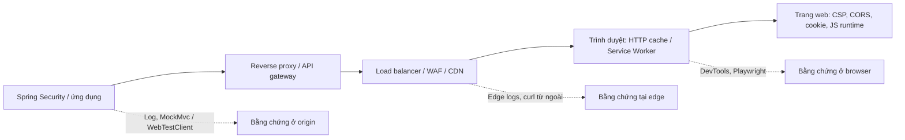

# Kiểm tra proxy, CDN cùng header mà trình duyệt thực sự nhận

## 1. Vì sao cấu hình Spring Security đúng vẫn có thể bảo vệ sai ở trình duyệt?

Trong hệ thống production, phản hồi HTTP thường không đi trực tiếp từ ứng dụng Spring Security đến trình duyệt. Nó có thể đi qua API gateway, reverse proxy, WAF, load balancer, CDN và các lớp cache. Mỗi lớp có thể **thêm, bỏ, ghi đè, chuẩn hóa hoặc lưu cache header**. Do đó, một phép thử `MockMvc` cho thấy `Content-Security-Policy` (CSP) đúng trên máy chủ chưa đủ để chứng minh chính sách mà người dùng cuối nhận được cũng đúng.

Ví dụ, trang `https://app.example.test/account` được ứng dụng trả về:

```http
HTTP/1.1 200 OK
Content-Security-Policy: default-src 'self'; script-src 'self'
Strict-Transport-Security: max-age=31536000
Cache-Control: no-store
X-Content-Type-Options: nosniff
```

Tại biên hệ thống, CDN có thể đưa vào cache sai một trang dành riêng cho người dùng, proxy có thể thay `Content-Security-Policy` bằng chính sách khác, hoặc trình duyệt chỉ nhận phản hồi redirect không có HSTS do cấu hình phát header ở sai chặng. Khi đó, **chứng cứ cuối cùng nằm ở response thực tế được trình duyệt xử lý** và ở hành vi mà chính sách đó tạo ra.

Trong module `SPRING_SECURITY_HTTP_PROTECTION`, chủ đề này kết nối trực tiếp với CSRF, CORS, HSTS, CSP, security headers, HTTP firewall, cookie/session và kiểm thử Servlet lẫn Reactive. Mục tiêu không chỉ là đọc một dòng header, mà là chứng minh toàn bộ chuỗi phản hồi vẫn bảo vệ đúng với các request, tài khoản, origin, trạng thái cache và đường đi mạng cần hỗ trợ.

### Mục tiêu học tập

Sau bài này, người học có thể:

1. Vẽ đường đi một response từ Spring Security qua proxy/CDN đến trình duyệt, xác định nơi header có thể thay đổi.
2. So sánh **header ở ứng dụng**, **header tại edge** và **header mà trình duyệt dùng**, bao gồm redirect, cache và Service Worker.
3. Chẩn đoán việc mất hoặc nhân đôi CSP, HSTS, CORS, `Set-Cookie`, `Cache-Control` và các header cô lập cross-origin.
4. Xây kiểm thử bằng DevTools, `curl`, `MockMvc`/`WebTestClient` và Playwright cho những trường hợp khác nhau.
5. Kiểm tra ranh giới tin cậy của forwarded headers khi reverse proxy kết thúc TLS, cũng như nguy cơ CDN lưu cache nội dung chứa thông tin riêng tư.

## 2. Các chặng ảnh hưởng đến một HTTP response



Sơ đồ mang tính khái quát: thứ tự giữa WAF, gateway, load balancer và CDN khác nhau theo hạ tầng. Có thể có nhiều proxy hoặc hai lớp CDN. Điều quan trọng là xác định **nơi kết thúc TLS**, **nơi lưu cache**, **nơi thêm header** và **nơi xác thực request**.

| Chặng | Có thể thay đổi điều gì? | Nguồn bằng chứng phù hợp |
| --- | --- | --- |
| Spring Security Servlet/Reactive | Header mặc định và cấu hình, CORS, CSRF, session/cookie, redirect khi login/logout | `MockMvc`, `WebTestClient`, application logs, kiểm tra response trực tiếp |
| Reverse proxy | Thay `Host`, scheme qua `Forwarded`/`X-Forwarded-*`, thêm/xóa header, đổi redirect `Location`, xử lý lỗi | Proxy configuration/logs; yêu cầu đến cổng backend từ mạng tin cậy |
| CDN/WAF | Cache response, biến thể theo header/cookie, chèn security header, tạo response 403/429/503, 301/302 | Edge response, `Age`, `Via`, header chẩn đoán cache và CDN logs |
| Browser network stack | Làm theo redirect, CORS, mixed content, HSTS, cookie policy, 304/cache | DevTools Network/Security/Application, Playwright request/response |
| Service Worker hoặc runtime trang | Trả response từ cache hoặc tự tạo response, xử lý `fetch`, đổi UI dù server đã từ chối | DevTools Application → Service Workers, runtime logs, browser test |

**Ba khái niệm cần phân biệt:**

- **Header cấu hình:** giá trị mong muốn trong source code, property hoặc chính sách CDN.
- **Header truyền trên đường mạng:** giá trị sau khi đi qua các tầng trung gian, có thể có ở nhiều response khác nhau trong chuỗi redirect.
- **Chính sách hiệu lực ở trình duyệt:** kết quả browser thực thi sau quy tắc hợp nhất nhiều header, cache, cookie và hạn chế của từng API.

Không phải mọi header đều “ghi đè dòng cuối cùng”. Ví dụ nhiều chính sách CSP ở chế độ enforce có thể **đồng thời áp dụng**, khiến nội dung bị hạn chế hơn; còn nhiều header `Access-Control-Allow-Origin` với giá trị khác nhau thường làm CORS thất bại. Vì vậy, khi thấy duplicate header, không nên kết luận tất cả đều được xử lý theo một quy tắc.

## 3. Xây ma trận kiểm thử trước khi đo

Hãy ghi nhận ít nhất các chiều sau cho **một endpoint quan trọng**:

| Chiều | Biến thể nên có | Vì sao quan trọng? |
| --- | --- | --- |
| Môi trường | Local, staging qua edge, production qua edge | Bản phát hành origin có thể giống nhau nhưng quy tắc proxy/CDN khác nhau. |
| Kiểu request | `GET` HTML, `POST` form/API, `OPTIONS` preflight, `HEAD` nếu dùng | Routing/cache và security chain có thể phụ thuộc method. |
| Danh tính | Anonymous, đã xác thực A, đã xác thực B | Phát hiện lộ cache giữa các phiên và redirect khác nhau. |
| Loại response | 200, 204, 301/302, 304, 401, 403, 404, 5xx | Proxy có thể tự tạo trang lỗi không đi qua security filter chain. |
| Nguồn gọi | Cùng origin, origin frontend hợp lệ, origin không được phép | CORS, CSRF, cookie và policy thay đổi theo origin. |
| Cache | Lần đầu, cache hit, cache miss, revalidation, sau khi purge | Header ở cache hit có thể khác response mới từ origin. |
| Trình duyệt | Chromium và các engine thực sự cần hỗ trợ | Hỗ trợ cookie, CSP, COEP và cách hiển thị header có khác biệt. |
| Hạ tầng | POP/region, CDN bật/tắt nếu có đường test an toàn | Giúp phân biệt lỗi edge với lỗi ứng dụng. |

Với mỗi trường hợp, lưu **URL đầy đủ, method, status, thời điểm, request ID, host, đường đi redirect, response headers và kết quả browser**. Tránh ghi nguyên token, cookie phiên, CSRF token, dữ liệu cá nhân vào log, HAR hay báo cáo test. Khi chia sẻ HAR, phải lọc các giá trị nhạy cảm trước.

Một bản ghi kiểm thử có ích nên trả lời rõ: “Tôi đang đo **response nào**?” Ví dụ, request `GET /account` có thể trả `302 /login` rồi `200 /login`. Nếu chỉ xem header của trang login cuối cùng, rất dễ bỏ qua header trên 302 hoặc cookie/redirect bị proxy sửa.

## 4. Đọc response mà trình duyệt thực sự nhận

### 4.1. DevTools: đọc đúng request và trạng thái cache

Quy trình thực hành trên trình duyệt mục tiêu:

1. Mở DevTools → **Network**; bật **Preserve log** để giữ chuỗi redirect. Bật **Disable cache** khi cần thử response trực tiếp, sau đó **tắt lại** để kiểm tra cache hit và revalidation.
2. Tải lại trang bằng URL production/staging **qua đúng domain và TLS termination** sẽ dùng thật. Chọn request có **Type = document** để đọc CSP, HSTS, COOP, COEP của HTML.
3. Mở **Headers → Response Headers** để đọc header đã tới browser; đối chiếu **Status Code**, **Request URL**, **Request Headers**, **Remote Address** khi browser có cung cấp.
4. Xem tất cả các request 301/302/307/308, không chỉ trang HTML cuối; ghi `Location`, `Set-Cookie` và header theo từng hop.
5. Xem dấu hiệu **from memory cache**, **from disk cache**, **ServiceWorker** hoặc **304**. Một response hiển thị trên màn hình có thể không đến từ origin trong lần tải hiện tại.
6. Kiểm tra **Console** để xác minh browser có chặn script, style, frame, CORS hay cookie; và **Application → Cookies / Service Workers** để biết cookie nào thực sự được nhận.
7. Lặp lại với tài khoản và trạng thái cache khác. Khi kết luận một header còn thiếu, xác nhận đã chọn **đúng response** trước.

Lưu ý về `304 Not Modified`: browser có thể kết hợp metadata của 304 với **response 200 đã lưu trước đó** theo HTTP caching. Không nên chỉ nhìn 304 hiện tại rồi suy luận toàn bộ header của tài nguyên đã dùng. Kiểm tra response 200 ban đầu, giá trị trong cache và hành vi sau revalidation; thử tải bằng profile mới hoặc sau khi xóa cache.

Khi trang có Service Worker, script có thể cung cấp response từ cache hoặc logic riêng. Cần thử cả trạng thái Service Worker đang kiểm soát trang và khi bỏ qua Service Worker trong DevTools, nếu nghiệp vụ cho phép. **Disable cache** ở tab Network không thay thế hoàn toàn việc kiểm tra Cache Storage của Service Worker.

### 4.2. HTTP client là bằng chứng bổ trợ, không thay browser

Từ máy có thể truy cập endpoint, ví dụ:

```bash
# Xem response headers và giữ tất cả redirect
curl --silent --show-error --location \
  --dump-header headers.txt \
  --output /dev/null \
  https://app.example.test/account

# Kiểm tra một request OPTIONS preflight với origin rõ ràng
curl --silent --show-error --include \
  --request OPTIONS https://api.example.test/api/profile \
  --header "Origin: https://app.example.test" \
  --header "Access-Control-Request-Method: GET"
```

Đây là lệnh minh họa trên shell POSIX; điều chỉnh cách viết đường dẫn và xuống dòng nếu dùng PowerShell. Không đưa cookie/session/token production vào một lệnh được lưu trong lịch sử shell; dùng tài khoản thử và cách lưu bí mật phù hợp.

Khi dùng `curl`, cần chú ý:

- `curl -I` gửi **HEAD**, có thể đi qua route hoặc quy tắc CDN khác với `GET`; nên so sánh GET khi debug trang HTML.
- `curl --location` theo redirect và ghi response theo từng chặng, nhưng không mô phỏng đầy đủ cookie jar, Service Worker, CORS hay CSP của browser.
- CORS là chính sách được **trình duyệt** thực thi; một HTTP client có thể đọc response dù frontend JavaScript bị CORS từ chối.
- Kết quả có thể thay đổi theo `User-Agent`, `Accept-Encoding`, `Origin`, `Cookie`, `Sec-Fetch-*`, geo/POP và trạng thái cache.
- Đường kiểm tra trực tiếp origin, nếu được cho phép trong môi trường nội bộ, có thể dùng để khoanh vùng lỗi; nó **không phải** bằng chứng cho header nhận được trên production domain qua CDN.

### 4.3. So sánh ba lớp theo một mẫu cố định

Ví dụ bảng chẩn đoán cho `GET /account`:

| Header | Origin (kiểm thử integration) | Edge (HTTP client qua CDN) | Browser (request document) | Nhận định |
| --- | --- | --- | --- | --- |
| `Content-Security-Policy` | Có `script-src 'self'` | Có hai chính sách | Hai chính sách cùng enforce | Script có thể bị chặn thêm; kiểm tra CDN inject. |
| `Strict-Transport-Security` | Có trên HTTPS | Thiếu khi 302 đầu tiên | Browser nhận trên 200 cuối | Kiểm tra tất cả phản hồi HTTPS và chính sách redirect. |
| `Cache-Control` | `private, no-store` | Thay thành `public, max-age=600` | 200 từ edge cache | Nguy cơ cache dữ liệu theo tài khoản, phải xử lý ngay. |
| `Set-Cookie` | Đúng `Secure; HttpOnly` | Có nhưng `Path` đã đổi | Browser từ chối/lưu sai scope | Kiểm tra rewrite cookie và tab Application. |
| `Access-Control-Allow-Origin` | Trả đúng origin được phép | Cache giữ giá trị của origin khác | Browser chặn CORS | Kiểm tra cache key, `Vary: Origin` và logic edge. |

Bảng này là **tình huống minh họa**, không phản ánh hệ thống thực nào. Đọc nó theo chiều từ trái sang phải giúp xác định chặng đầu tiên phát sinh khác biệt.

## 5. HSTS và HTTPS: chẩn đoán lỗi ở TLS termination

### 5.1. Trình duyệt chỉ chấp nhận HSTS từ HTTPS tin cậy

Ví dụ header:

```http
Strict-Transport-Security: max-age=31536000; includeSubDomains
```

HSTS thông báo trình duyệt chỉ kết nối bằng HTTPS với host đã nhận chính sách trong thời hạn quy định. Chỉ thị `includeSubDomains` ảnh hưởng các subdomain; chỉ bật sau khi xác minh mọi subdomain liên quan có HTTPS phù hợp. `preload` là cam kết rộng và dài hạn, cần quy trình đánh giá riêng trước khi đăng ký danh sách preload của browser.

Một trang chỉ gửi HSTS trên HTTP không tạo được bảo đảm HSTS. Khi browser đã nhớ chính sách HSTS, yêu cầu HTTP có thể được nâng cấp nội bộ thành HTTPS, đôi khi DevTools thể hiện chuyển hướng nội bộ; đó không nhất thiết là `301` do máy chủ tạo. Kiểm tra trên profile mới nếu cần phân biệt chính sách đã lưu và header của response vừa nhận.

### 5.2. Reverse proxy kết thúc TLS, Spring thấy HTTP

Một mô hình phổ biến:

```text
Browser --HTTPS--> CDN/load balancer --HTTP nội bộ--> Spring Boot
```

Nếu ứng dụng nhìn request là `http` và chưa xử lý forwarded headers từ proxy tin cậy, nó có thể:

- Không thêm HSTS khi Spring Security chỉ ghi header cho **secure request**.
- Tạo redirect `Location: http://...` thay vì HTTPS, gây vòng lặp redirect hoặc mixed content.
- Đặt scheme sai trong URL tuyệt đối, liên quan callback OAuth/OIDC, cookie hoặc redirect sau login.
- Ghi nhận `request.isSecure() == false` dù trình duyệt đã dùng HTTPS.

Spring Boot có thể cấu hình xử lý forwarded headers, tùy hạ tầng và servlet/reactive stack:

```properties
# Ví dụ khi ứng dụng đứng sau reverse proxy tin cậy có chuẩn hóa header:
server.forward-headers-strategy=framework
```

Ở Servlet, Spring có cơ chế `ForwardedHeaderFilter`; ở WebFlux có `ForwardedHeaderTransformer`. Tùy container, `server.forward-headers-strategy=native` cũng là một lựa chọn khi nền tảng hỗ trợ. **Không tự động tin** giá trị `Forwarded` hoặc `X-Forwarded-Proto` từ Internet. Proxy ở biên cần loại bỏ giá trị do client gửi, sau đó đặt đúng scheme/host/port thực tế; origin chỉ chấp nhận đường vào từ proxy được tin cậy.

Nếu có chuỗi CDN → proxy → Spring qua nhiều hop, `X-Forwarded-Proto` phải phản ánh scheme **của request bên ngoài** và nằm trong chuỗi tin cậy đã kiểm soát. Việc proxy cuối cùng ghi `X-Forwarded-Proto: http` chỉ vì kết nối từ CDN tới proxy là HTTP có thể làm sai kết quả.

**Phép thử:** gọi trang qua domain HTTPS, kiểm tra `Strict-Transport-Security` trên response browser; kiểm tra redirect `Location`; ở môi trường test, đối chiếu nhận thức secure của backend và forwarded headers sau proxy. Không sửa bằng cách tự gắn `Strict-Transport-Security` lên mọi HTTP response.

## 6. CSP, X-Frame-Options và các header phòng vệ: ai ghi giá trị cuối?

### 6.1. Header mặc định và header cần tự cấu hình

Spring Security thường cung cấp các header mặc định phù hợp cho Servlet/Reactive, như `X-Content-Type-Options: nosniff`, `X-Frame-Options: DENY`, `Cache-Control` và HSTS trên HTTPS. **CSP không phải chính sách mặc định được tự suy ra cho mọi ứng dụng**: nhóm phát triển phải định nghĩa và kiểm thử nguồn script/style/frame hợp lệ.

Ví dụ một tài liệu HTML có:

```http
Content-Security-Policy: default-src 'self'; script-src 'self'; object-src 'none'; base-uri 'self'
X-Content-Type-Options: nosniff
X-Frame-Options: DENY
Referrer-Policy: strict-origin-when-cross-origin
```

Các header trên chỉ là ví dụ. Nếu trang dùng inline script, CDN riêng, OAuth popup, iframe hoặc font cross-origin thì CSP cần được thiết kế theo tài nguyên thực; không nên mở `unsafe-inline` hoặc `*` hàng loạt chỉ để bỏ lỗi Console.

### 6.2. CSP bị thêm hai lần không đồng nghĩa bản sau thay bản trước

Giả sử ứng dụng gửi:

```http
Content-Security-Policy: default-src 'self'; script-src 'self' https://cdn.example.test
```

CDN lại chèn:

```http
Content-Security-Policy: default-src 'none'; script-src 'self'
```

Browser có thể thực thi **cả hai chính sách**. Script từ `cdn.example.test` được ứng dụng cho phép vẫn bị chính sách CDN từ chối. Điều tra cần kiểm tra danh sách header và giá trị thực, không chỉ một dòng đơn lẻ trong một công cụ hiển thị.

Tương tự, CSP `frame-ancestors` trên **trang được nhúng** và `X-Frame-Options` có thể quyết định khả năng render iframe; trong khi `frame-src` trên **trang nhúng** quyết định được tải iframe từ đâu. Nếu edge chèn `X-Frame-Options: DENY` cho một endpoint cần được nhúng, có thể phá vỡ tích hợp dù ứng dụng đã thiết kế `frame-ancestors` phù hợp.

Header `Content-Security-Policy-Report-Only` dùng để quan sát vi phạm mà chưa enforce, hữu ích khi triển khai chính sách mới qua CDN. Không xem việc chỉ có header report-only là bằng chứng ứng dụng đã chặn nguồn nguy hiểm.

### 6.3. COOP, COEP và CORP cũng có thể hỏng tại edge

Một tài liệu cần cross-origin isolation thường phải có bộ điều kiện phù hợp như:

```http
Cross-Origin-Opener-Policy: same-origin
Cross-Origin-Embedder-Policy: require-corp
```

Trong browser, đo:

```javascript
({
  secureContext: window.isSecureContext,
  crossOriginIsolated: window.crossOriginIsolated
})
```

Nếu CDN chỉ chèn COOP mà không có COEP, trang thường không đạt `crossOriginIsolated === true`. Nếu chèn `COEP: require-corp` bất ngờ, ảnh, font, script hoặc iframe bên thứ ba có thể bị chặn vì thiếu CORS/CORP phù hợp. Nếu chèn `COOP: same-origin` lên route đăng nhập qua popup, liên kết `window.opener` có thể bị cắt. Chính sách nên theo **loại response và route**, được kiểm tra trong browser thực.

## 7. CORS và CDN cache: header có thể hợp lệ cho origin A nhưng sai cho origin B

### 7.1. Origin được cho phép phải khớp với request

Giả sử SPA ở `https://app.example.test` gọi API tại `https://api.example.test`. Hai trang khác origin, dù có thể cùng site. Response API có thể trả:

```http
Access-Control-Allow-Origin: https://app.example.test
Access-Control-Allow-Credentials: true
Vary: Origin
```

Đối với credentialed cross-origin `fetch`, trình duyệt yêu cầu `Access-Control-Allow-Origin` là **origin cụ thể**, không phải `*`; `Access-Control-Allow-Credentials: true` và cấu hình credential/request cookie phải phù hợp. Các yêu cầu preflight còn cần kiểm tra method, header được phép và cách cache `OPTIONS`.

CORS không xác thực người dùng và không thay thế CSRF. Nếu browser tự động gửi cookie phiên, ứng dụng vẫn cần kiểm tra CSRF cho thao tác thay đổi trạng thái theo mô hình đã chọn.

### 7.2. CDN cache nhầm biến thể CORS

Một sự cố thường gặp:

1. Request từ `https://app.example.test` tới `/api/catalog` được server phản hồi với `Access-Control-Allow-Origin: https://app.example.test`.
2. CDN cache response chỉ theo URL mà không phân biệt `Origin`.
3. Request từ một origin khác nhận lại cùng header; trình duyệt origin thứ hai thấy header không khớp và chặn JavaScript đọc response.

Nếu server quyết định ACAO theo `Origin`, response cần `Vary: Origin` theo ngữ nghĩa HTTP và cấu hình CDN cần **thực sự giữ đúng biến thể trong cache key hoặc bypass cache**. Không giả định mọi CDN đều tự động tuân thủ `Vary: Origin`. Chú ý biến thể preflight theo `Access-Control-Request-Method` và `Access-Control-Request-Headers` khi hệ thống/cache cần phân biệt chúng.

Không sửa bằng cách phản chiếu mọi `Origin` không kiểm soát rồi gắn `Access-Control-Allow-Credentials: true`. Phải duy trì danh sách origin đáng tin cậy và chính sách quyền truy cập ở server.

### 7.3. Spring Security Servlet: tích hợp CORS trước authorization

Ví dụ bean minh họa cho API được gọi từ một frontend được phép:

```java
import java.util.List;
import org.springframework.context.annotation.Bean;
import org.springframework.context.annotation.Configuration;
import org.springframework.security.config.Customizer;
import org.springframework.security.config.annotation.web.builders.HttpSecurity;
import org.springframework.security.web.SecurityFilterChain;
import org.springframework.web.cors.CorsConfiguration;
import org.springframework.web.cors.CorsConfigurationSource;
import org.springframework.web.cors.UrlBasedCorsConfigurationSource;

@Configuration
class ApiCorsSecurityConfig {
    @Bean
    CorsConfigurationSource corsConfigurationSource() {
        CorsConfiguration config = new CorsConfiguration();
        config.setAllowedOrigins(List.of("https://app.example.test"));
        config.setAllowedMethods(List.of("GET", "POST", "OPTIONS"));
        config.setAllowedHeaders(List.of("Content-Type", "X-CSRF-TOKEN"));
        config.setAllowCredentials(true);
        config.setMaxAge(600L);

        UrlBasedCorsConfigurationSource source =
            new UrlBasedCorsConfigurationSource();
        source.registerCorsConfiguration("/api/**", config);
        return source;
    }

    @Bean
    SecurityFilterChain apiChain(HttpSecurity http) throws Exception {
        http
            .cors(Customizer.withDefaults())
            .authorizeHttpRequests(auth -> auth
                .requestMatchers("/api/public/**").permitAll()
                .anyRequest().authenticated());
        return http.build();
    }
}
```

Đây là mẫu cho ứng dụng Servlet; endpoint business, form login, CSRF repository và cách xác thực phải được cấu hình theo dự án. `http.cors(...)` phối hợp xử lý preflight để request `OPTIONS` hợp lệ không bị authentication filter từ chối trước khi CORS được xử lý. Không tắt CSRF chỉ vì muốn `POST` cross-origin hoạt động.

Với Spring Security WebFlux, dùng cấu hình CORS tương ứng trong `ServerHttpSecurity.cors(...)` và `CorsConfigurationSource`/WebFlux layer thích hợp; chính sách ở edge vẫn cần kiểm tra như Servlet. Nếu hệ thống có gateway CORS riêng, thống nhất tầng chịu trách nhiệm thay vì để cả gateway và ứng dụng sinh ACAO mâu thuẫn.

## 8. Cookie, session và CSRF khi response đi qua proxy

### 8.1. Set-Cookie là header đặc biệt

Một phản hồi đăng nhập có thể gửi nhiều header `Set-Cookie` riêng biệt:

```http
Set-Cookie: JSESSIONID=abc; Path=/; Secure; HttpOnly; SameSite=Lax
Set-Cookie: APP_THEME=dark; Path=/; Secure; SameSite=Lax
```

Không tự gom nhiều `Set-Cookie` vào một dòng phân tách bằng dấu phẩy. Cookie có thể chứa thuộc tính ngày hết hạn có dấu phẩy, và HTTP xử lý `Set-Cookie` như một trường đặc biệt. Đọc từng header trong Network và kiểm tra kết quả cookie jar ở Application.

Proxy có thể rewrite `Domain` hoặc `Path`, xóa `Secure`, chèn cookie load-balancer, hoặc thay redirect. Các cấu hình này tác động đến việc browser có gửi cookie sau login/logout và liệu cookie có đi tới đúng origin hay không. Khi kết thúc TLS tại edge, backend hiểu sai scheme cũng có thể ảnh hưởng việc tạo URL/cookie.

Browser có thể **từ chối Set-Cookie** dù Network thể hiện server đã gửi nó: cookie có `SameSite=None` mà thiếu `Secure`, domain không hợp lệ, bối cảnh third-party bị chặn, hoặc chính sách bảo mật khác của trình duyệt. `Set-Cookie` cũng không phải header mà frontend JavaScript được tự do đọc qua `fetch`: nó thuộc nhóm forbidden response-header name.

### 8.2. Những điều cần kiểm sau login và logout

| Luồng | Response cần quan sát | Hành vi browser cần kiểm |
| --- | --- | --- |
| `GET /login` | CSP, cache, HSTS, cookie CSRF nếu có | Form nhận token hợp lệ; HTML không bị cache sai. |
| `POST /login` | 302/303, `Location`, `Set-Cookie`, HSTS qua HTTPS | Session ID sau login hợp lệ; cookie có thuộc tính phù hợp. |
| `GET /account` | `Cache-Control`, `Vary`, CSP, các security headers | Người A không thấy HTML của người B qua cache/back navigation. |
| `POST /logout` | Redirect/status, cookie hết hạn, `Clear-Site-Data` nếu cấu hình | Session cũ không xác thực lại được; cookie và data client được dọn theo chính sách. |
| `POST /api/update` từ frontend hợp lệ | Preflight (nếu có), CORS, CSRF, status | Yêu cầu hợp lệ hoạt động; thiếu CSRF bị từ chối khi cơ chế CSRF yêu cầu. |

Đặc biệt, sau logout người dùng có thể vẫn thấy trang cũ qua history/DOM hoặc HTTP cache, dù session server đã bị vô hiệu hóa. **Không đánh giá logout chỉ qua việc cookie biến mất hay UI chuyển trang**: phải gửi lại credential cũ vào endpoint bảo vệ trong môi trường test và xác nhận bị từ chối.

### 8.3. Cache authenticated content: rủi ro phải xử lý trước

Một response HTML hoặc API có dữ liệu riêng của người dùng thường cần ngăn shared cache lưu và phát lại, ví dụ:

```http
Cache-Control: private, no-store
```

`no-store` yêu cầu cache không lưu response; `private` chỉ dành cho private cache và không cho shared cache lưu. Tuy nhiên, nếu CDN có quy tắc “cache everything” bỏ qua header origin hoặc dùng cache key sai, người dùng khác có thể nhận nội dung riêng tư. Đây là lỗi nghiêm trọng dù tất cả CSP/HSTS đều có mặt.

Phép thử thực tế cần:

1. Đăng nhập user A, tải trang private và nhận diện giá trị giả lập không nhạy cảm dành riêng cho A.
2. Đăng nhập user B trên browser context khác, tải cùng URL qua cùng edge.
3. So sánh nội dung/status/header; không chấp nhận lộ dữ liệu A cho B hoặc anonymous.
4. Lặp lại với cache hit, cache miss và 304 nếu endpoint sử dụng caching có điều kiện.
5. Đối chiếu cấu hình cache key và quy tắc bypass dựa trên `Cookie`/Authorization, cùng header thực nhận được. Không coi sự hiện diện của `Vary: Cookie` là phương án an toàn duy nhất cho dữ liệu riêng tư.

Đối với tài nguyên tĩnh phiên bản hóa không chứa dữ liệu cá nhân, chính sách `public, max-age=...` hoặc `immutable` có thể phù hợp. Không áp dụng chính sách no-store cho mọi ảnh/font/JS một cách máy móc vì làm mất hiệu quả CDN mà không cải thiện các dữ liệu riêng tư tương ứng.

## 9. Các response không đi qua ứng dụng cũng cần header

Một số response do edge sinh ra trước khi request đến Spring Security:

- Redirect HTTP → HTTPS (301/308), redirect canonical host.
- 403 từ WAF hoặc rate limiting; 404/5xx từ proxy khi origin down.
- Response cache hit của CDN, stale content khi origin lỗi.
- Redirect tới Identity Provider, hoặc error page do gateway viết.
- 304/revalidation ở edge, asset được trả từ cache tĩnh.

Với từng response, xác định header nào **cần** xuất hiện theo vai trò của nó. Ví dụ HSTS chỉ có tác dụng khi nhận qua HTTPS; CSP cho document HTML do edge tự sinh có thể cần để bảo vệ trang lỗi; CORS phải phù hợp khi API preflight/response được edge trả; cache header phải tránh lưu thông tin nhạy cảm. Không có một danh sách header giống hệt nhau áp dụng cho mọi loại resource và mọi status.

Trường hợp CDN sửa `Content-Type` hoặc thêm `X-Content-Type-Options: nosniff` có thể khiến script/style bị browser chặn nếu MIME type sai. Khi nhìn thấy lỗi resource tải thất bại, hãy kiểm tra MIME trên **response browser nhận được**, không chỉ server object metadata.

Với `Content-Security-Policy` dùng nonce theo request, không được lưu cache hoặc trộn nhầm **HTML có nonce** với header CSP từ request khác. Nonce trong HTML và CSP phải khớp trên cùng response. Nếu HTML được cache cho nhiều lượt tải, cần thiết kế cache policy và cơ chế nonce phù hợp; một nonce bị tái sử dụng lâu dài làm suy yếu mục tiêu chống injection.

## 10. Quy trình so sánh origin → proxy/CDN → browser

### Bước 1: Chọn một điểm đo đơn giản, một điểm đo có xác thực

Nên có:

- Trang HTML công khai có header xác định để đo CSP/HSTS/XFO.
- API công khai nhỏ để đo CORS theo `Origin` và preflight.
- Trang/API yêu cầu session để đo `Set-Cookie`, `Cache-Control`, CSRF và nguy cơ shared cache.

Tránh đưa token thật hoặc thông tin cá nhân vào trang chẩn đoán. Trong môi trường test, có thể thêm request ID không nhạy cảm để đối chiếu log.

### Bước 2: Lấy baseline tại ứng dụng

Chạy kiểm thử Servlet `MockMvc` hoặc Reactive `WebTestClient` xác nhận header do Spring Security sinh ra, theo cấu hình cụ thể. Ví dụ Servlet với một endpoint công khai:

```java
import static org.springframework.test.web.servlet.request.MockMvcRequestBuilders.get;
import static org.springframework.test.web.servlet.result.MockMvcResultMatchers.header;
import static org.springframework.test.web.servlet.result.MockMvcResultMatchers.status;

import org.junit.jupiter.api.Test;

// Trong lớp test đã tích hợp MockMvc với Spring Security,
// endpoint /public/header-check trả 200:
@Test
void servletResponseHasSecurityHeaders() throws Exception {
    mvc.perform(get("/public/header-check").secure(true))
        .andExpect(status().isOk())
        .andExpect(header().string("X-Content-Type-Options", "nosniff"))
        .andExpect(header().exists("X-Frame-Options"))
        .andExpect(header().exists("Strict-Transport-Security"));
}
```

Test giả định cấu hình security headers theo chính sách đang dùng và `mvc` được khởi tạo. `secure(true)` mô phỏng request được coi là HTTPS; phải xác nhận HTTPS **thực** tại edge bằng một phép thử khác. Nếu ứng dụng chủ động tắt một header vì có chính sách thay thế, hãy kiểm tra giá trị được mong đợi thay vì ép một mặc định không áp dụng.

Với WebFlux, ví dụ tương đương:

```java
// Trong lớp test có WebTestClient client đã gắn Spring Security:
client.get()
    .uri("/public/header-check")
    .exchange()
    .expectStatus().isOk()
    .expectHeader().valueEquals("X-Content-Type-Options", "nosniff");
```

WebFlux test xác minh response của ứng dụng Reactive, không thay thế phép thử qua proxy/CDN.

### Bước 3: Gọi qua edge và tìm khác biệt đầu tiên

Dùng HTTP client từ mạng kiểm thử qua **domain mà người dùng truy cập**, giữ redirect và ghi header. Nếu có đường direct origin được cho phép, so sánh sau khi đi đúng cơ chế Host/TLS tương ứng. Cần lưu ý một origin trực tiếp có thể không có cùng xử lý forwarded headers và một số redirect sẽ khác; đó là đặc trưng cần giải thích, không mặc định coi mọi khác biệt đều là lỗi.

Ở CDN, kiểm tra các yếu tố biến đổi:

| Vấn đề | Cần đối chiếu |
| --- | --- |
| Header bị mất | Rule remove/override headers, cache object cũ, response do CDN tự tạo |
| Header bị trùng | Ứng dụng và edge cùng ghi CSP/CORS/HSTS; cách browser diễn giải từng loại |
| Header đổi theo cache | Cache key, TTL, `Vary`, bypass auth/cookie, purge/invalidation |
| Redirect khác origin | Host rewrite, `X-Forwarded-Proto`, canonical domain, OAuth callback |
| 200 và 304 khác metadata | ETag/Last-Modified, cached 200 ban đầu, cập nhật header sau revalidation |
| Nhiều POP trả khác nhau | Triển khai rule chưa đồng bộ, rollout, regional configuration |
| Lỗi chỉ ở user B | Session, cookie scope, CDN vary, WAF rule, authorization |

### Bước 4: Xác minh bằng browser và một hành vi thật

Ví dụ: nếu CSP chứa `frame-ancestors 'none'`, thử nhúng trang từ một origin khác và mong browser từ chối. Nếu CORS chỉ cho `https://app.example.test`, thử fetch từ origin đó và từ một origin khác; không chỉ đọc `Access-Control-Allow-Origin`. Nếu HSTS có mặt, thử một profile mới và kiểm tra response HTTPS thực tế. Nếu `Clear-Site-Data` được phát trên logout, xác nhận trạng thái browser sau logout thay vì chỉ assert header.

Đây là điểm phân biệt **header được gửi** và **chính sách được thực thi**.

## 11. Kiểm thử tự động bằng Playwright

Playwright chạy trong trình duyệt thực, phù hợp để kiểm tra response ở edge và hành vi SOP/CORS/CSP/cookie. Những đoạn dưới đây là ví dụ TypeScript dùng `@playwright/test`, giả định có môi trường HTTPS, endpoint và tài khoản test tương ứng. Các đường dẫn, CSP và cookie phải được điều chỉnh theo chính sách dự án; không coi chúng là test đã chạy.

### 11.1. Kiểm tra header của document cuối

```typescript
import { test, expect } from "@playwright/test";

const APP = "https://app.example.test";

test("document public nhận đúng security headers tại edge", async ({ page }) => {
  const response = await page.goto(APP + "/public/header-check", {
    waitUntil: "domcontentloaded",
  });
  expect(response).not.toBeNull();
  expect(response!.status()).toBe(200);

  const headers = response!.headers();
  expect(headers["x-content-type-options"]).toBe("nosniff");
  expect(headers["strict-transport-security"]).toMatch(/max-age=\d+/);
  expect(headers["content-security-policy"]).toContain("default-src");
  expect(headers["cache-control"]).toBeDefined();

  // Trên trang thật, kiểm tra CSP không vô tình chặn nội dung hợp lệ.
  await expect(page.locator("main")).toBeVisible();
});
```

`response.headers()` là ảnh chụp response của request trang đã chọn, còn `page.goto()` thường trả response của navigation cuối sau redirect. Nếu muốn kiểm tra HSTS hoặc cookie trên **redirect đầu**, cần ghi toàn bộ chuỗi request/response chứ không chỉ response cuối.

### 11.2. Thu toàn bộ response của chuỗi redirect

```typescript
import { test, expect } from "@playwright/test";

test("ghi nhận redirect và headers ở từng hop", async ({ page }) => {
  const observed: Array<{
    url: string;
    status: number;
    location?: string;
    hsts?: string;
    cacheControl?: string;
  }> = [];

  page.on("response", async (response) => {
    if (!response.url().startsWith("https://app.example.test/")) return;
    const h = response.headers();
    observed.push({
      url: response.url(),
      status: response.status(),
      location: h["location"],
      hsts: h["strict-transport-security"],
      cacheControl: h["cache-control"],
    });
  });

  await page.goto("https://app.example.test/account");
  expect(observed.length).toBeGreaterThan(0);
  // Ghi observed vào attachment/test report nếu test lỗi.
});
```

Mẫu trên chỉ thu response của host ứng dụng, không bao gồm response từ IdP hoặc subdomain khác. Nếu cần toàn chuỗi, mở rộng bộ lọc URL một cách có kiểm soát và loại bỏ dữ liệu nhạy cảm khỏi báo cáo.

Để kiểm tra chính xác redirect chain của một navigation cụ thể, có thể đi ngược từ `response.request().redirectedFrom()` trên request đã hoàn tất. Trong test quan trọng, nên xác định **response bắt buộc có header** và assert từng hop thay vì chỉ kiểm tra số lượng response.

### 11.3. Test CORS bằng trình duyệt, không chỉ HTTP client

```typescript
import { test, expect } from "@playwright/test";

test("origin frontend hợp lệ đọc được API cross-origin", async ({ page }) => {
  await page.goto("https://app.example.test/public/cors-test");

  const result = await page.evaluate(async () => {
    const response = await fetch("https://api.example.test/api/public/ping");
    return {
      status: response.status,
      text: await response.text(),
    };
  });

  expect(result.status).toBe(200);
  expect(result.text).toContain("pong");
});

test("origin không được phép không đọc được API", async ({ page }) => {
  await page.goto("https://untrusted.example.net/cors-test");

  const blocked = await page.evaluate(async () => {
    try {
      await fetch("https://api.example.test/api/public/ping");
      return false;
    } catch {
      return true;
    }
  });
  expect(blocked).toBe(true);
});
```

Fixture cần bảo đảm origin giả lập không được allowlist, endpoint có kết quả xác định và không có network failure độc lập. Test negative này xác nhận JavaScript **không đọc được** response; nếu cần biết nguyên nhân là CORS, kiểm tra Console/Network và thử một request cùng URL từ HTTP client để loại trừ lỗi kết nối.

Với API dùng cookie phiên, bổ sung test `credentials: "include"` và kiểm tra CSRF, `SameSite`, `Secure`, ACAO/ACAC, quyền truy cập theo tài khoản. Đừng dùng API công khai làm bằng chứng cho cơ chế credentialed CORS.

### 11.4. Kiểm tra cache private giữa hai browser context

```typescript
import { test, expect } from "@playwright/test";

test("hai phiên không nhận dữ liệu đã cache của nhau", async ({ browser }) => {
  // storageState được tạo riêng cho user A và B bằng fixture đăng nhập thật.
  const contextA = await browser.newContext({
    storageState: "auth-user-a.json",
  });
  const contextB = await browser.newContext({
    storageState: "auth-user-b.json",
  });
  try {
    const pageA = await contextA.newPage();
    const pageB = await contextB.newPage();
    const responseA = await pageA.goto(
      "https://app.example.test/account/cache-check"
    );
    const responseB = await pageB.goto(
      "https://app.example.test/account/cache-check"
    );

    expect(responseA?.status()).toBe(200);
    expect(responseB?.status()).toBe(200);
    expect(responseA?.headers()["cache-control"]).toMatch(/no-store/);
    expect(responseB?.headers()["cache-control"]).toMatch(/no-store/);

    await expect(pageA.getByTestId("account-marker")).toHaveText("user-a");
    await expect(pageB.getByTestId("account-marker")).toHaveText("user-b");
  } finally {
    await contextA.close();
    await contextB.close();
  }
});
```

Trước khi sử dụng, phải tạo `auth-user-a.json` và `auth-user-b.json` bằng quy trình test bảo mật; file storage state có thể chứa cookie và token, **không đưa vào source control**. Fixture endpoint nên trả marker giả lập khác nhau, không chứa dữ liệu cá nhân. Kiểm tra cả anonymous và cache hit/miss để chứng minh CDN không phát nội dung giữa các danh tính.

### 11.5. Chụp lỗi chính sách và kiểm tra cookie đã được lưu

```typescript
import { test, expect } from "@playwright/test";

test("đăng nhập qua edge lưu cookie có Secure/HttpOnly", async ({
  page,
  context,
}) => {
  const consoleErrors: string[] = [];
  page.on("console", (message) => {
    if (message.type() === "error") {
      consoleErrors.push(message.text());
    }
  });

  await page.goto("https://app.example.test/login");
  // Tại đây thực hiện login của tài khoản test bằng fixture phù hợp.

  const cookies = await context.cookies("https://app.example.test");
  const session = cookies.find((cookie) => cookie.name === "JSESSIONID");
  // Assert sau khi fixture đã xác thực thành công:
  expect(session).toBeDefined();
  expect(session!.secure).toBe(true);
  expect(session!.httpOnly).toBe(true);

  // Đính kèm consoleErrors vào report khi có lỗi chức năng;
  // không phụ thuộc vào nguyên văn thông điệp của một browser.
});
```

Đoạn test trên **chỉ đầy đủ sau khi thêm thao tác login** vào vị trí chú thích. Nó phù hợp cho mô hình Servlet session với cookie `JSESSIONID`; nếu dự án dùng tên cookie khác hoặc token stateless, phải thay kỳ vọng. `context.cookies()` cho biết cookie browser đang giữ, khác với việc chỉ đọc `Set-Cookie` do server phát.

Không nên assert nguyên văn toàn bộ Console message vì nội dung có thể khác theo engine/version; dùng kết quả hành vi làm điều kiện chính, rồi dùng Console/Network để giải thích lỗi.

## 12. Tình huống chẩn đoán có giá trị thực tế

### Tình huống A: CSP chạy đúng trên local nhưng lỗi trên production

**Quan sát:** `MockMvc` thấy `script-src 'self' https://cdn.example.test` nhưng browser production chặn JavaScript của CDN.

**Điều tra:** mở response document trên Network, kiểm tra mọi trường `Content-Security-Policy`. CDN có thể bổ sung chính sách `script-src 'self'` làm trình duyệt thực thi cả hai. So sánh cache hit/miss, trang HTML qua redirect và CSP header tại từng hop; nếu dùng nonce, kiểm tra nonce của HTML và header có cùng response hay không.

**Xử lý:** giao quyền quản lý CSP rõ ràng cho ứng dụng hoặc edge, thống nhất chính sách theo route và kiểm thử với report-only trước khi enforce. Không thêm `unsafe-inline` theo phản xạ.

### Tình huống B: HSTS mất khi chuyển qua load balancer

**Quan sát:** ở local HTTPS, HSTS xuất hiện; production HTTPS không có trên document.

**Điều tra:** Spring Security có thể đang nhận request HTTP nội bộ và không nhận scheme HTTPS qua forwarded headers tin cậy. Kiểm tra proxy chain, dấu hiệu redirect sang HTTP, header cuối cùng và chính sách edge; kiểm tra HSTS trên các response HTTPS thay vì request HTTP.

**Xử lý:** sửa đường tin cậy cho scheme/host ở TLS termination, cấu hình `server.forward-headers-strategy` phù hợp, kiểm thử lại với domain thật. Không tin `X-Forwarded-Proto` do client tự gửi.

### Tình huống C: CORS chỉ lỗi khi đổi môi trường hoặc POP

**Quan sát:** từ origin frontend A fetch thành công, từ frontend B thất bại; hoặc cùng origin nhưng một POP trả ACAO khác.

**Điều tra:** server thay ACAO theo `Origin` nhưng CDN cache theo URL. Kiểm tra `Vary: Origin`, cache key, response trên cache hit, và preflight OPTIONS. Nếu response có hai ACAO do gateway và ứng dụng cùng thêm, browser cũng có thể từ chối.

**Xử lý:** thống nhất tầng phát CORS, giữ allowlist, tách biến thể cache hoặc bypass cache. Test lại trên browser và các POP mục tiêu.

### Tình huống D: Logout thành công nhưng trang cũ của người khác xuất hiện

**Quan sát:** user B nhận HTML chứa marker của user A sau khi A vừa truy cập, dù session của A đã logout.

**Điều tra:** ưu tiên kiểm tra shared cache CDN cho HTML/API private và cache key; không chỉ xem `JSESSIONID`. Kiểm tra `Cache-Control: private, no-store` tại origin và browser; xác minh edge có quy tắc “cache everything”, stale response hoặc bỏ qua `Cookie`.

**Xử lý:** dừng cache shared cho dữ liệu cá nhân, sửa cache rules và invalidation, kiểm tra lại với hai phiên và anonymous. Đây là lỗi rò rỉ dữ liệu cần ưu tiên cao.

### Tình huống E: 200 OK nhưng trình duyệt vẫn không chạy được resource

**Quan sát:** Network báo 200 cho script/image/font nhưng Console báo bị chặn.

**Điều tra:** 200 chỉ chứng minh HTTP server trả resource. Browser có thể từ chối do CSP, CORS, CORP/COEP, MIME `nosniff`, mixed content hoặc cookie. Đọc response của **resource** và CSP/COEP của **document**; không chỉ nhìn header của API.

**Xử lý:** sửa đúng policy và loại tài nguyên. Không tắt CORS, CSP hay COEP trên toàn site nếu chỉ một nguồn cần cấu hình phù hợp.

## 13. Checklist trước khi đưa chính sách qua CDN vào production

| Nhóm | Câu hỏi xác nhận | Bằng chứng |
| --- | --- | --- |
| HTTPS/HSTS | Browser dùng HTTPS, redirect đúng scheme, HSTS có mặt trên response HTTPS cần thiết? | DevTools Security/Network, kiểm tra cả redirect |
| CSP/clickjacking | Document cuối có đúng CSP và XFO/`frame-ancestors`, không nhân đôi mâu thuẫn? | Response headers, thử inline/script/frame bị chặn |
| CORS | Preflight, ACAO, ACAC, `Vary` và cache key đúng theo origin? | API test theo ít nhất hai origin + browser fetch |
| Cookie/session | Cookie được lưu đúng `Secure`, `HttpOnly`, `SameSite`, Path/Domain; session cũ bị từ chối sau logout? | DevTools Application, request replay an toàn trong test |
| Cache | HTML/API private không lọt vào shared cache; asset tĩnh vẫn cache phù hợp? | Hai user/browser contexts, cache hit/miss, edge logs |
| COOP/COEP/CORP | Trang cần cô lập đạt `crossOriginIsolated`; popup/iframe cần thiết còn hoạt động? | Browser runtime và test hành vi |
| Lỗi ở edge | Trang 403/404/5xx do WAF/CDN có header đúng vai trò và không lộ thông tin? | Kiểm tra response do edge tự sinh |
| Nhiều đường đi | Cache hit/miss, POP/region, staging/production, browser engines đã được đo? | Ma trận kết quả có request ID và thời điểm |
| Vận hành | Ai quản lý từng header, thay đổi ở ứng dụng hay edge, cách rollback và theo dõi vi phạm? | Chính sách triển khai và kiểm tra sau phát hành |

Khi kiểm thử phát hiện lỗi, ưu tiên kiểm tra **response browser dùng trong luồng có vấn đề**, sau đó truy ngược qua edge/proxy đến Spring Security. Đừng suy luận từ cấu hình tĩnh rằng chính sách đã có hiệu lực. Với bảo vệ HTTP, nguồn sự thật là **quyền truy cập và hành vi tại trình duyệt**, được xác nhận bằng test ở các tầng có thể đối chiếu.

### Tài liệu tham khảo

- [Spring Security — Servlet Security HTTP Response Headers](https://docs.spring.io/spring-security/reference/servlet/exploits/headers.html): header mặc định, HSTS, CSP và các chính sách ở Servlet.
- [Spring Security — Reactive Security HTTP Response Headers](https://docs.spring.io/spring-security/reference/reactive/exploits/headers.html): chính sách tương ứng trên WebFlux.
- [Spring Security — Servlet CORS](https://docs.spring.io/spring-security/reference/servlet/integrations/cors.html): cấu hình CORS trước Spring Security và tích hợp với `CorsConfigurationSource`.
- [Spring Boot — How-to Configure a Proxy Server](https://docs.spring.io/spring-boot/how-to/webserver.html#howto.webserver.use-behind-a-proxy-server): forwarded headers và cách nhận diện scheme/host sau proxy.
- [MDN — HTTP caching](https://developer.mozilla.org/en-US/docs/Web/HTTP/Guides/Caching): `Cache-Control`, revalidation, shared/private cache.
- [MDN — Strict-Transport-Security](https://developer.mozilla.org/en-US/docs/Web/HTTP/Reference/Headers/Strict-Transport-Security): phạm vi và cách trình duyệt xử lý HSTS.
- [MDN — Content-Security-Policy](https://developer.mozilla.org/en-US/docs/Web/HTTP/Reference/Headers/Content-Security-Policy): nhiều chính sách, report-only và hạn chế tài nguyên.
- [MDN — Cross-Origin Resource Sharing](https://developer.mozilla.org/en-US/docs/Web/HTTP/Guides/CORS): preflight, credentialed requests, ACAO/ACAC.
- [MDN — Set-Cookie](https://developer.mozilla.org/en-US/docs/Web/HTTP/Reference/Headers/Set-Cookie): cách browser lưu/từ chối cookie, thuộc tính scope và bảo mật.
- [Playwright — Network](https://playwright.dev/docs/network): quan sát request/response, sự kiện mạng và test trong trình duyệt.
