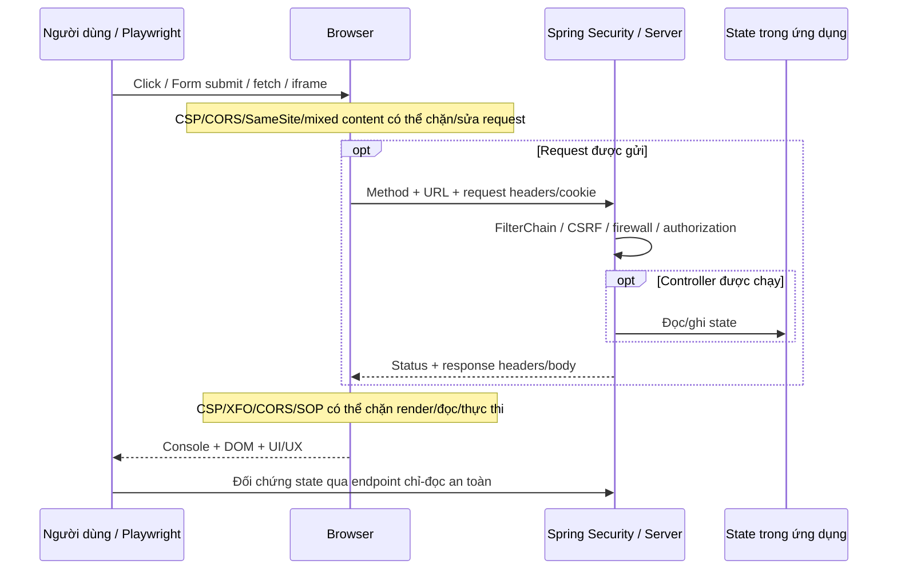
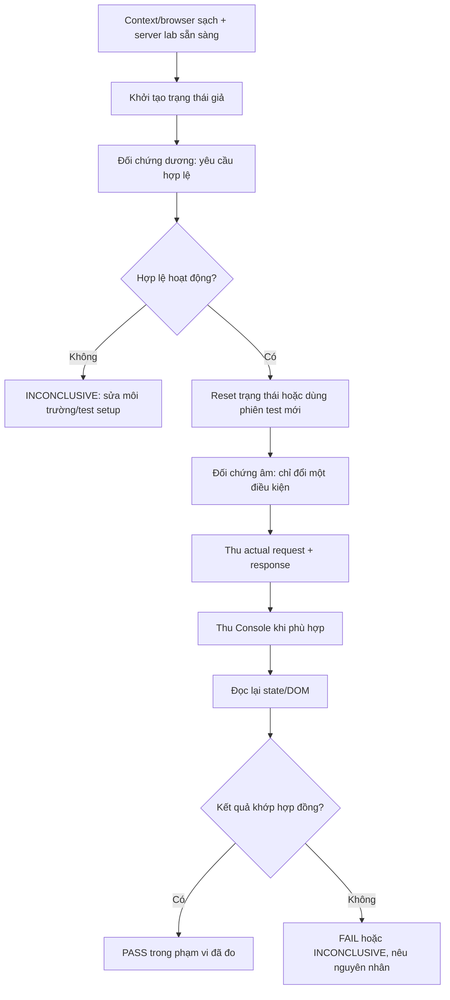
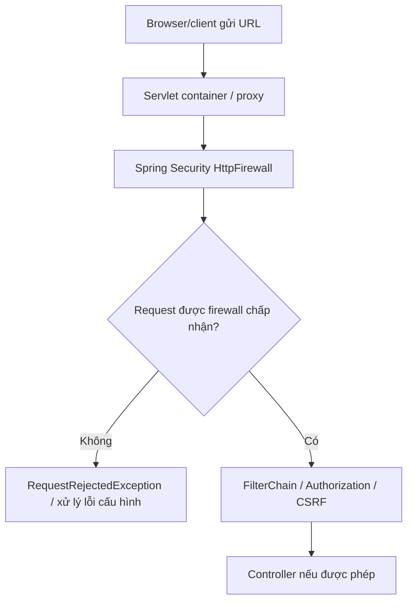

# Chọn bằng chứng gồm phản hồi, console và kết quả hành vi

Trong kiểm thử bảo mật trình duyệt, một dòng **`403 Forbidden`** không tự chứng minh CSRF đã chặn một cuộc tấn công; một dòng Console báo vi phạm **Content Security Policy (CSP)** không tự chứng minh script đã bị chặn; và một nút bấm không đổi giao diện cũng không chắc chứng minh phía máy chủ đã từ chối thay đổi dữ liệu. Mỗi dấu hiệu mô tả **một tầng khác nhau** của luồng HTTP–browser–ứng dụng.

Bài này hướng dẫn chọn, thu thập và đối chiếu **ba nhóm bằng chứng**: **phản hồi HTTP (Response)**, **Console/vi phạm chính sách của browser (Console)** và **kết quả hành vi quan sát được (Behavior)**. Mục tiêu không phải chụp càng nhiều ảnh càng tốt, mà là đủ căn cứ để trả lời: *cơ chế bảo vệ nào được thực thi, request nào thực sự xảy ra, browser quyết định điều gì, và thao tác được phép/bị cấm có tạo side effect ở backend không?*

Đây là bài thuộc chương **Kiểm thử trình duyệt**, module **SPRING_SECURITY_HTTP_PROTECTION**: áp dụng phòng vệ HTTP và trình duyệt với Spring Security — CSRF, CORS, security headers, CSP, HSTS, HTTP firewall, session/cookies — cho **Servlet và Reactive**, thử các tình huống tấn công web trong lab, phát hiện xung đột bảo mật khi triển khai.

Các ví dụ sử dụng **Spring Boot 3.x, Spring Security Servlet 6.x, Java 17+, MockMvc, Playwright** và các origin loopback được kiểm soát. Phần Reactive sử dụng `ServerHttpSecurity` và `WebTestClient`. Không thử vào tài khoản, website hoặc hệ thống không được phép; toàn bộ state lab là dữ liệu giả, không có thanh toán, thông tin cá nhân hoặc tác động thực.

**Sau bài học, người học có thể:**

1. Chọn đúng bằng chứng cho một giả thuyết bảo mật thay vì chỉ xem HTTP status hoặc một ảnh Console.
2. Phân biệt **request được gửi**, **server có phản hồi**, **browser cho phép đọc/render/thực thi**, và **state ở server thực sự thay đổi**.
3. Kiểm tra cặp đối chứng **đường hợp lệ đi qua** và **đường vi phạm bị chặn**, xác minh không có side effect.
4. Đọc đúng preflight/actual request, redirects, `Set-Cookie`/Request Cookies, CSP, XFO, HSTS và lỗi network.
5. Thu thập DevTools/Playwright/MockMvc/WebTestClient evidence có nguồn gốc và timestamp, không tiết lộ cookie, token hoặc dữ liệu người dùng.
6. Viết kết luận **PASS / FAIL / INCONCLUSIVE** có thể tái lập và quy rõ tầng lỗi.

## 1. Tại sao một bằng chứng duy nhất thường gây kết luận sai?

Hãy xem bốn ví dụ:

| Dấu hiệu nhìn thấy | Kết luận dễ vội vàng | Vì sao chưa đủ |
| --- | --- | --- |
| POST tới `/api/change` trả `403` | CSRF phòng vệ đúng | Có thể do thiếu quyền, sai route, HTTP firewall, CORS preflight hoặc server validation |
| CSP Console báo `Refused to execute inline script` | Chắc chắn chặn mã có hại | Có thể chính sách **Report-Only** chỉ cảnh báo, script vẫn chạy |
| `<iframe>` request trả `200` | Frame đã render | `X-Frame-Options` hoặc `frame-ancestors` có thể chặn hiển thị **sau khi nhận response** |
| Người dùng thấy lỗi đăng nhập sau redirect | Cookie bị SameSite chặn | Có thể cookie đã gửi nhưng session hết hạn, state OIDC không khớp hoặc proxy đổi `Path`/`Domain` |

Các dấu hiệu đều **có ích**, nhưng thiếu ngữ cảnh tầng còn lại. Chỉ sau khi chứng minh được đường đi thực của request và trạng thái sau thao tác, ta mới có cơ sở phân biệt cơ chế phòng vệ đã hoạt động với lỗi ứng dụng tình cờ tạo cùng kết quả.

### Tư duy cần thay đổi

Không hỏi đơn lẻ:

> “Có trả 403 không?”

Mà hỏi:

> “POST đã được gửi chưa? Ai trả 403? Browser có cho JavaScript đọc response không? Controller có bị gọi không? State có đổi không? Một POST hợp lệ với CSRF token có thành công không?”

Một **test âm không có test dương** dễ xanh giả: nếu endpoint luôn `403` vì ứng dụng lỗi hoặc security chain sai, tất cả “attack tests” đều bị chặn, nhưng ứng dụng cũng không thực hiện được nghiệp vụ hợp lệ.

## 2. Tam giác bằng chứng Response — Console — Behavior

<svg xmlns="http://www.w3.org/2000/svg" viewBox="0 0 820 330" role="img" aria-label="Ba nhóm bằng chứng Response Console Behavior tạo thành phép kiểm tra chéo">
  <rect x="3" y="3" width="814" height="324" rx="18" fill="#f8fafc" stroke="#cbd5e1"/>
  <path d="M 410 58 L 180 262 L 640 262 Z" fill="#dbeafe" stroke="#2563eb" stroke-width="3"/>
  <circle cx="410" cy="70" r="55" fill="#1d4ed8"/>
  <circle cx="180" cy="260" r="55" fill="#0f766e"/>
  <circle cx="640" cy="260" r="55" fill="#a16207"/>
  <text x="410" y="62" text-anchor="middle" font-size="17" fill="#ffffff" font-weight="bold">Response</text>
  <text x="410" y="82" text-anchor="middle" font-size="12" fill="#ffffff">HTTP / Headers</text>
  <text x="180" y="254" text-anchor="middle" font-size="17" fill="#ffffff" font-weight="bold">Console</text>
  <text x="180" y="274" text-anchor="middle" font-size="12" fill="#ffffff">Browser policy</text>
  <text x="640" y="254" text-anchor="middle" font-size="17" fill="#ffffff" font-weight="bold">Behavior</text>
  <text x="640" y="274" text-anchor="middle" font-size="12" fill="#ffffff">DOM / Server state</text>
  <text x="410" y="182" text-anchor="middle" font-size="17" fill="#1e3a8a" font-weight="bold">Đối chứng + kết luận</text>
  <text x="410" y="205" text-anchor="middle" font-size="13" fill="#334155">Điều gì được gửi, bị chặn và thực sự thay đổi?</text>
</svg>

**Response** trả lời: server/browser đã trao đổi gì trên đường mạng? Gồm URL/method/status, redirect chain, HTTP request/response headers, CSP/XFO/CORS, cookies *hiện diện hay vắng mặt*, cache/TLS. Trong DevTools, có thể có request **không nhận HTTP response** do browser chặn trước network.

**Console** trả lời: browser đã phát hiện điều gì? Ví dụ CSP violation, `Refused to frame`, CORS error, mixed-content warning, JS exception, MIME/SRI error, cookie blocked reason. Không phải tất cả sự kiện đều được Console ghi; format không ổn định theo browser.

**Behavior** trả lời: phần mềm có **làm hoặc không làm** đúng điều kiểm thử không? Ví dụ script hợp lệ cập nhật DOM, script bị cấm không chạy; frame được phép hiển thị nhưng frame bị cấm không hiển thị; POST giả mạo **không đổi state**, POST hợp lệ đổi state; cookie/session được duy trì trong ngữ cảnh phù hợp.

| Nhóm | Bằng chứng trực tiếp thường dùng | Chưa tự chứng minh |
| --- | --- | --- |
| Response | `HTTP 403`, `Content-Security-Policy`, `X-Frame-Options`, `Access-Control-Allow-Origin`, Request Cookies | Controller có side effect hay browser đã render |
| Console | CSP violation, CORS error, `SecurityError`, `TypeError`, cookie warning | Response thực có gì và state server đã thay đổi chưa |
| Behavior | DOM marker, API state readback, authorization result, script executed flag | Nguyên nhân chặn thuộc đúng security layer |

**Không phải lúc nào cũng cần cả ba thành công**. Một request bị `frame-src 'none'` chặn **trước network** không có child HTTP response; một CSRF request gửi từ form HTML có thể không tạo Console error. Hãy chọn những bằng chứng **có khả năng tồn tại đối với cơ chế đang kiểm tra**, rồi ghi rõ giới hạn.

## 3. Bắt đầu từ giả thuyết và tiêu chí chấp nhận, không bắt đầu từ DevTools

Với mỗi phép thử, trước khi bấm nút, xác định:

1. **Giả thuyết:** cơ chế nào phải cho phép hay từ chối hành động nào?
2. **Tài nguyên:** URL, origin, method, loại browser navigation/fetch, security chain/endpoint.
3. **Điều kiện ban đầu:** session, cookie, CSRF token, CSP header, browser context, dữ liệu giả.
4. **Đối chứng dương:** một hành động hợp lệ **phải** thành công.
5. **Đối chứng âm:** một hành động sai chính sách **phải** bị từ chối.
6. **Bằng chứng cần thu:** response/console/behavior nào có thể quan sát trực tiếp.
7. **Điều kiện PASS:** kết quả mong đợi cho cả positive và negative case; state server không bị thay đổi bởi ca âm.
8. **Điều kiện INCONCLUSIVE:** request chưa tới backend, trang chưa tải, browser chưa đủ telemetry hoặc lỗi môi trường.

Ví dụ giả thuyết:

> “Với CSRF bật trên Spring Security Servlet, POST sửa ghi chú không có token bị từ chối, **và** ghi chú trong session vẫn giữ nguyên; POST cùng session với token hợp lệ phải thành công.”

Bằng chứng mong muốn:

| Ca | Response | Console | Behavior |
| --- | --- | --- | --- |
| POST thiếu CSRF | Actual POST `403` | Có thể **không có** CSP/CORS error | Ghi chú không đổi |
| POST hợp lệ | Actual POST `200` | Không có browser policy block liên quan | Ghi chú đổi sang giá trị giả mới |

Chỉ dùng status `403` cho ca âm mà không thực hiện ca dương sẽ không đủ.

## 4. Xác định đúng bốn điểm quan sát trong chuỗi browser–server



Thứ tự trong diagram chỉ khái quát: một số browser policies được xét trước network, một số sau response. **Cần biết request thực có tới backend chưa**, backend có trả response gì, browser có cho script/iframe sử dụng nó không, và state có đổi không.

### “Không có HTTP response” không đồng nghĩa “server trả 403”

Khi browser chặn request trước khi gửi (ví dụ CSP `frame-src 'none'` hoặc một CORS preflight không thành công ngăn actual POST), không có actual HTTP response từ endpoint đích. DevTools có thể hiển thị `blocked:csp`, `(failed)` hoặc status trống. **Không biến những trạng thái UI ấy thành status HTTP**.

### “Network 200” không đồng nghĩa “JavaScript được đọc body”

Với `fetch` cross-origin, server có thể nhận request và trả HTTP `200`, nhưng browser không cho script đọc body vì CORS. Tương tự, iframe nhận HTML `200` có thể bị XFO/CSP `frame-ancestors` cấm render; script external nhận `200` có thể bị MIME/SRI hoặc CSP ngăn thực thi.

## 5. Một kết luận bảo mật phải có đường chứng minh

Ví dụ claim yếu:

> “CSRF đã an toàn vì request trả 403.”

Claim có thể kiểm chứng:

> “Trên Chromium version X, POST `/lab/change` không kèm CSRF token gửi tới đúng security chain, trả `403`; server-side readback sau đó xác nhận marker không thay đổi; POST cùng session có token hợp lệ trả `200` và marker đổi. Vì vậy trong kịch bản đã đo, `CsrfFilter` ngăn thao tác thiếu token mà không chặn thao tác hợp lệ.”

Tránh kết luận rộng hơn bằng chứng: một ca POST không token ở lab **không chứng minh mọi CSRF vector trong hệ thống đều được bảo vệ**; một CSP nonce đúng ở một route **không chứng minh mọi XSS trên site đã bị chặn**.

### Độ tin cậy nên ghi thế nào?

| Mức kết luận | Điều kiện |
| --- | --- |
| **PASS** | Bằng chứng đúng đường request/policy, đối chứng dương và âm đạt, state thực phù hợp |
| **FAIL** | Hành động trái chính sách vẫn chạy hoặc side effect xảy ra, hay hành động hợp lệ bị chặn do chính cấu hình đang test |
| **INCONCLUSIVE** | Browser request không diễn ra, test environment lỗi, không đọc được state, proxy khác policy hoặc thiếu bằng chứng phân biệt nguyên nhân |
| **NOT APPLICABLE** | Nhóm bằng chứng đó không tồn tại hợp lý trong ca thử (ví dụ Console CSP cho POST server-side bình thường) |

**INCONCLUSIVE không phải FAIL, càng không phải PASS.** Một test không thể tạo request âm không được phép tuyên bố cơ chế phòng vệ đã chặn nó thành công.

## 6. Bằng chứng phản hồi: đọc đúng HTTP request, response và redirect chain

Trong DevTools → **Network**, chọn **Document/Fetch/XHR/All** theo loại thao tác. Ghi đủ:

| Trường cần ghi | Lý do |
| --- | --- |
| **Actual URL + HTTP method** | `OPTIONS` không phải actual `POST`; GET iframe khác GET top-level |
| **Initiator / top-level origin** | Xác định request từ script/form/iframe/redirect nào |
| **Request headers cần thiết** | `Origin`, `Sec-Fetch-Site`, `Sec-Fetch-Mode`, `Sec-Fetch-Dest`, Content-Type; có/không Cookie |
| **Response status** | `200`, `204`, `302`, `400`, `401`, `403` là đầu mối, không phải kết luận |
| **Response headers** | CSP, XFO, CORS, HSTS, `Set-Cookie`, cache controls |
| **Redirect history** | Endpoint ban đầu có thể trả `302`, document cuối là trang login/error khác policy |
| **Resource type** | Document, script, image, iframe, preflight, fetch khác ngữ nghĩa |
| **Body/metadata không nhạy cảm** | Đối chiếu expected state hoặc mã lỗi ứng dụng khi cần |

**Đừng đọc riêng một header `Set-Cookie` rồi khẳng định browser đã gửi cookie.** `Set-Cookie` là **yêu cầu đặt cookie từ response**; cookie có thể bị browser từ chối hoặc được lưu nhưng không được gửi trên request tiếp theo vì `Domain`, `Path`, `Secure`, `SameSite`, expiry hay chính sách third-party storage.

### Tách ba câu hỏi về cookie

1. **Response có `Set-Cookie`?** Server muốn trình duyệt lưu cookie nào, với thuộc tính gì?
2. **Cookie jar đã lưu?** DevTools Application/Storage có ghi cookie và blocked reason không?
3. **Actual request có `Cookie`?** Chính request đang xét có gửi cookie session tương ứng không?

Chỉ bước 3 mới chứng minh browser đã gửi cookie **trong request cụ thể**. Nếu server không tìm thấy session dù Request Cookie có mặt, kiểm tra session store/expiry/restart/LB, không đổ lỗi cho SameSite ngay.

### Đọc đúng `401`, `403`, `400`

- `401 Unauthorized` thường liên quan authentication challenge / thiếu credential, nhưng nhiều ứng dụng có custom error mapping.
- `403 Forbidden` có thể do CSRF `AccessDeniedException`, authorization, policy ứng dụng hoặc custom handler; **status không nói nguyên nhân duy nhất**.
- `400 Bad Request` có thể do malformed request, `StrictHttpFirewall` hoặc controller validation; **không mặc định** mọi firewall violation trả 400, vì entry point/exception handling có thể được cấu hình khác.

Để quy kết một lỗi CSRF, cần xác minh security chain, có/không expected/actual token, server-side test hoặc an toàn event/metric liên quan. Không dựa vào `403` là đủ.

## 7. Header bảo mật: bằng chứng server công bố, không bảo đảm browser đã thực thi

| Header / directive | Điều chứng minh ở tầng response | Điều cần thêm để chứng minh phòng vệ |
| --- | --- | --- |
| `Content-Security-Policy: script-src ...` | Document nhận policy enforce | Script trái policy thực **không chạy**, script hợp lệ **có chạy** |
| `Content-Security-Policy-Report-Only` | Browser được yêu cầu báo vi phạm | Script **có thể vẫn chạy**; không tuyên bố enforce |
| `X-Frame-Options: DENY` | Response yêu cầu không cho frame | Browser không render child trong iframe |
| CSP `frame-ancestors 'none'` | Child hạn chế ancestors | Browser từ chối render child, kể cả HTTP 200 |
| CSP `frame-src 'none'` trên parent | Parent không muốn tải iframe | Browser có thể **không gửi GET child** |
| `Strict-Transport-Security` | HTTPS response công bố HSTS policy | Browser sau đó dùng HTTPS theo policy và môi trường |
| `Access-Control-Allow-Origin` | Server công bố origin được đọc response | Browser có cho script đọc không? Preflight, credentials có phù hợp? |
| `Cache-Control: no-store` | Server yêu cầu không lưu response | Thực tế cache/proxy/bfcache có tuân theo không? |
| `Set-Cookie: ... SameSite=Lax` | Server yêu cầu cookie với SameSite | Cookie có được lưu và gửi trong context thử không? |
| `Referrer-Policy` | Response định nghĩa cách gửi referrer | Actual `Referer` trên request đích và loại navigation |

### Một request có thể có nhiều policy

Nhiều CSP enforce headers có thể được áp dụng **đồng thời**, dẫn tới tập được phép **hẹp hơn** mỗi policy đơn lẻ. Nếu backend phát CSP cho nonce nhưng gateway bổ sung `script-src 'none'`, MockMvc của backend có thể PASS, trong khi browser thực không chạy script.

**Nguồn sự thật cuối:** response mà browser nhận qua proxy/gateway/CDN, không chỉ bean `SecurityFilterChain` hoặc header được MockMvc giả lập.

## 8. Console: dấu vết quyết định của browser nhưng không phải nhật ký kiểm toán tuyệt đối

Các thông báo thường gặp:

```text
Refused to execute inline script because it violates CSP ...
Refused to frame ... because an ancestor violates frame-ancestors ...
Access to fetch at ... from origin ... has been blocked by CORS policy ...
Mixed Content: ... requested an insecure resource ...
Refused to execute script because its MIME type is not executable ...
```

Đây là **câu mô tả minh họa**, không phải chuỗi ổn định để copy thành assertion. Browser/version có thể đổi câu chữ, gắn URL, source line, CSP effective directive hoặc stack trace khác nhau.

### Phân loại Console event đúng tầng

| Console dấu hiệu | Có thể phản ánh | Không nên suy ra |
| --- | --- | --- |
| CSP `Refused to execute` | Enforce CSP chặn script | Script là payload tấn công thật, tất cả script đều bị chặn |
| CSP `[Report Only]` | Chỉ báo hành vi vi phạm policy thử nghiệm | Script đã bị chặn |
| `Refused to frame` | XFO hoặc `frame-ancestors` chặn render | Server đã không xử lý request |
| CORS error | Browser từ chối script đọc response hoặc preflight fails | Backend chắc chắn không bị side effect |
| JS `TypeError: Failed to fetch` | Fetch promise bị reject, có nhiều lý do | Server trả đúng status 500 hoặc 403 |
| `SecurityError` khi đọc iframe DOM | SOP/sandbox hạn chế truy cập DOM | Frame chắc chắn chưa render |
| Cookie warning | Cookie bị reject/block/partition theo policy | Toàn bộ session/auth đã mất |
| Mixed content / CSP upgrade | URL/scheme hoặc browser policy cản tài nguyên | Spring Security đã phát `403` |

Một browser có thể **không ghi thông báo** cho một lỗi server-side như CSRF `403` xảy ra trên form POST top-level bình thường. Khi đó cột Console trong báo cáo là **“không áp dụng/không có tín hiệu trực tiếp”**, không phải “CSP hoạt động”.

### Console text có thể chứa dữ liệu nhạy cảm

Violation messages, `blocked-uri`, stack traces hoặc fetch URL có thể kèm query parameter, access token hay thông tin định danh. Không copy nguyên Console/HAR vào ticket công khai. Khi cần gửi báo cáo, chỉ giữ **loại lỗi, effective directive, disposition, origin/route đã được làm sạch** và mô tả cách tái hiện.

## 9. CSP enforce, Report-Only và sự kiện `securitypolicyviolation`

Hai response headers:

```http
Content-Security-Policy: script-src 'self'
```

```http
Content-Security-Policy-Report-Only: script-src 'self'; report-uri /csp-reports
```

có ý nghĩa khác nhau. Header enforce **chặn** những script trái policy. Header report-only **không tự chặn**, chỉ đề nghị browser đánh dấu/báo vi phạm. Nếu cả hai cùng được gửi thì policy enforce vẫn có thể chặn, bất kể report-only.

Một browser hỗ trợ `securitypolicyviolation` có thể phát event:

```javascript
document.addEventListener("securitypolicyviolation", event => {
  // Ghi metadata an toàn, không ghi blockedURI/documentURI hoặc source.
  const summary = {
    directive: event.effectiveDirective,
    disposition: event.disposition
  };
  console.log("CSP violation category:", summary);
});
```

Observer này phải được đặt trong script **đã được CSP cho phép** và cài listener đủ sớm; nếu chính observer bị policy chặn, không có event trong script dù browser vẫn chặn các script khác.

**Không dựa vào số lượng CSP violation reports để đo security outcome:** browser có thể batch, drop, rate-limit, privacy-block hoặc không gửi mạng. Vi phạm có thể có trong Console nhưng không có POST report; report-only có thể báo vi phạm dù script vẫn chạy. Đối chiếu **DOM/behavior** để xác nhận enforce.

## 10. Behavior: phép đo nghiệp vụ có thể quan sát độc lập với giao diện

Behavior có hai tầng:

1. **Browser-side:** thẻ có render, script có cập nhật DOM, navigation có diễn ra, lỗi có hiển thị đúng?
2. **Server-side:** request có làm thay đổi session/order/note record hay gửi hành động ra ngoài không?

Với các hành động có side effect, tầng 2 là quan trọng. Một frontend có thể hiển thị “Lỗi 403” nhưng backend đã xử lý POST rồi response bị CORS chặn, hoặc API có retry gây ghi trùng. Vì vậy hãy tạo **endpoint read-only để kiểm tra trạng thái đã thay đổi hay chưa** trong lab, hoặc dùng metrics/audit có cấu trúc trên hệ thống được phép.

### Chọn chỉ báo hành vi phù hợp

| Phép thử | Đối chứng dương | Đối chứng âm |
| --- | --- | --- |
| CSRF | POST có token hợp lệ cập nhật state giả | POST thiếu/sai token không đổi state |
| CSP `script-src` | Script trusted cập nhật DOM | Script inline trái policy không cập nhật DOM |
| CSP nonce | Script có nonce hợp lệ chạy | Script nonce sai/thiếu không chạy |
| iframe | Allowed origin render child content | Denied origin không render child content |
| CORS | Allow-listed frontend đọc response giả | Disallowed origin không đọc response, dù request có thể tới server |
| HSTS | Browser sau lần học policy chuyển sang HTTPS | Không có HTTP request plaintext cho host đã được cover, khi môi trường hỗ trợ |
| SameSite | Same-site request mang session cookie | Cross-site request phù hợp policy không mang cookie; quan sát request thực |
| HTTP firewall | URL hợp lệ được xử lý bởi route | URL bị firewall từ chối không tới controller |
| Session | Session hợp lệ đọc được marker | Session hết hạn/không cookie không có marker |

**Đối chứng dương và âm phải dùng cùng điều kiện có thể so sánh**: cùng backend route/security chain, môi trường, user/session tương ứng; chỉ thay biến đang thử (CSRF token, source origin, CSP policy, iframe ancestor). Nếu thay nhiều yếu tố cùng lúc, kết quả khó quy nguyên nhân.

## 11. Thiết kế baseline và kiểm thử vi phạm có kiểm soát

Một trình tự tái hiện tốt:



Ví dụ, khi thử `SameSite=Lax`, trước tiên chứng minh cookie **đã lưu và gửi trong same-site request**, rồi tạo cross-site request; nếu cookie vốn chưa được lưu, việc request sau không mang cookie **không chứng minh SameSite đã ngăn nó**.

Khi thử CSP, trước tiên cần một script trusted **thực sự chạy**. Nếu toàn bộ JavaScript đều hỏng vì server không phục vụ asset hoặc MIME sai, test “script trái CSP không chạy” trở nên vô nghĩa.

## 12. Lab tổng hợp: một ứng dụng thử nghiệm cho cả ba nhóm bằng chứng

Để mọi phép đo có thể tái lập, dùng một Spring Boot Servlet application chạy trên:

```text
http://localhost:8080
```

Các endpoint trong **dự án lab riêng**:

| Endpoint | Method | Mục đích | Security expectation |
| --- | --- | --- | --- |
| `/lab/start` | GET | Tạo `HttpSession` và marker giả | `200`; có session trong browser |
| `/lab/state` | GET | Đọc marker, **không tạo session mới** | `200`; đo side effect |
| `/lab/form` | GET | Render form có hidden CSRF token | `200`; template có `_csrf` |
| `/lab/form-no-csrf` | GET | Form cùng action nhưng cố ý thiếu token trong lab | Dùng làm đối chứng âm |
| `/lab/change` | POST | Thay note giả trong session | Token hợp lệ cho đi tiếp; thiếu token `403` |
| `/lab/csp` | GET | Trang có external script hợp lệ và inline script không được phép | External chạy, inline bị CSP chặn |
| `/lab/assets/probe.js` | GET | JavaScript hợp lệ cùng origin | Được `script-src 'self'` cho phép |
| `/lab/frame` | GET | HTML child cố tình cấm nhúng | Response `200` khi trực tiếp; iframe không render |
| `/lab/frame-parent` | GET | HTML parent cùng origin chủ động tạo iframe | Child bị chính sách **của child** chặn |

Lab chỉ có một chuỗi note giả như `initial` hoặc `valid-updated`. Không dùng cookie/token người thật, không tạo tác vụ tốn tiền và không ghi dữ liệu ngoài máy.

**Cấu trúc file ví dụ** (chỉ là hướng dẫn để người học tự tạo lab; STEP 4 worker chỉ ghi bài Markdown hiện tại):

```text
src/main/java/example/evidence/
  EvidenceSecurityConfig.java
  EvidenceLabController.java

src/main/resources/templates/
  evidence-form.html
  evidence-csp.html

src/main/resources/static/lab/assets/
  probe.js

src/test/java/example/evidence/
  EvidenceMvcTest.java

browser-tests/
  evidence.spec.ts
```

### Vì sao không dùng endpoint production?

Với CSRF và session, ta cần một request **thực sự có thể thay đổi state** khi token hợp lệ để làm đối chứng. Chọn dữ liệu giả giúp kiểm tra phản hồi/behavior mà không có nguy cơ ghi đè tài khoản, đơn hàng hoặc trạng thái hệ thống thật. Các test an ninh phải được quyền sở hữu/ủy quyền rõ ràng.

## 13. Spring Security Servlet: cấu hình chỉ rõ phạm vi phép thử

Giả sử dependencies:

```text
spring-boot-starter-web
spring-boot-starter-security
spring-boot-starter-thymeleaf
spring-boot-starter-test       (test scope)
spring-security-test          (test scope)
```

Tạo `EvidenceSecurityConfig.java`:

```java
import org.springframework.context.annotation.Bean;
import org.springframework.context.annotation.Configuration;
import org.springframework.security.config.annotation.web.builders.HttpSecurity;
import org.springframework.security.web.SecurityFilterChain;

@Configuration
public class EvidenceSecurityConfig {

    @Bean
    SecurityFilterChain evidenceChain(HttpSecurity http)
            throws Exception {

        http
            .authorizeHttpRequests(auth -> auth
                .requestMatchers("/lab/**").permitAll()
                .anyRequest().denyAll())

            // Không tắt CSRF: POST /lab/change phải có token.
            .csrf(csrf -> {})

            .headers(headers -> headers
                .frameOptions(frame -> frame.deny())
                .contentSecurityPolicy(csp -> csp
                    .policyDirectives(
                        "default-src 'none'; " +
                        "script-src 'self'; " +
                        "frame-src 'self'; " +
                        "object-src 'none'; " +
                        "base-uri 'none'; " +
                        "form-action 'self'; " +
                        "frame-ancestors 'none'")));

        return http.build();
    }
}
```

**Giải thích:**

- `permitAll()` giúp GET lab và POST hợp lệ không đòi login, nhưng **không bỏ qua `CsrfFilter`**. CSRF vẫn kiểm tra unsafe requests.
- CSP `script-src 'self'` cho script file same-origin chạy; inline script không nonce/hash **bị chặn**.
- XFO `DENY` và CSP `frame-ancestors 'none'` của response child **cấm render iframe**. `frame-src 'self'` ở parent document cho phép tạo GET iframe cùng origin để chứng minh child policy là tầng chặn, không phải parent tự chặn trước network.
- `object-src 'none'`, `base-uri 'none'` giảm các surface khác; form action cùng origin được cho phép.
- Các Spring Security default headers khác vẫn hoạt động theo cấu hình/phiên bản; CSP ở đây được **chủ động thêm**, không phải mặc định mọi app có policy này.

`csrf -> {}` trong DSL nghĩa là giữ cấu hình mặc định; bạn cũng có thể **bỏ hẳn** lời gọi `.csrf(...)` để dùng default behavior trên Servlet. **Không** gọi `.csrf(csrf -> csrf.disable())` cho lab vì như vậy test thiếu token `403` không còn có ý nghĩa.

### Cảnh báo về nội dung trong code lab

Các route `/lab/**` công khai chỉ phù hợp dữ liệu giả. Một hệ thống thật phải có authentication/authorization và CORS allow-list theo quyền cần thiết; tuyệt đối không áp dụng `permitAll()` cho endpoints nghiệp vụ chỉ để test tiện. Lab cũng không sinh endpoint tấn công hay ghi thông tin người dùng.

## 14. Controller: đo side effect bằng trạng thái trong session

Tạo `EvidenceLabController.java`:

```java
import jakarta.servlet.http.HttpServletRequest;
import jakarta.servlet.http.HttpSession;
import java.util.Map;
import org.springframework.http.CacheControl;
import org.springframework.http.MediaType;
import org.springframework.http.ResponseEntity;
import org.springframework.http.HttpStatus;
import org.springframework.stereotype.Controller;
import org.springframework.ui.Model;
import org.springframework.web.bind.annotation.GetMapping;
import org.springframework.web.bind.annotation.PostMapping;
import org.springframework.web.bind.annotation.RequestParam;
import org.springframework.web.bind.annotation.ResponseBody;
import org.springframework.web.server.ResponseStatusException;

@Controller
public class EvidenceLabController {

    private static final String NOTE_KEY = "EVIDENCE_LAB_NOTE";

    @GetMapping("/lab/start")
    @ResponseBody
    ResponseEntity<Map<String, Object>> start(
            HttpServletRequest request) {

        HttpSession session = request.getSession(true);
        session.setAttribute(NOTE_KEY, "initial");

        return ResponseEntity.ok()
            .cacheControl(CacheControl.noStore())
            .body(Map.of(
                "initialized", true,
                "note", "initial"));
    }

    @GetMapping("/lab/state")
    @ResponseBody
    ResponseEntity<Map<String, Object>> state(
            HttpServletRequest request) {

        // Quan trọng: không tạo session mới khi chỉ đo state.
        HttpSession session = request.getSession(false);
        Object note = session == null
            ? null : session.getAttribute(NOTE_KEY);

        return ResponseEntity.ok()
            .cacheControl(CacheControl.noStore())
            .body(Map.of(
                "hasLabState", note != null,
                "note", note == null ? "NO_STATE" : note.toString()));
    }

    @GetMapping("/lab/form")
    String form() {
        return "evidence-form";
    }

    @GetMapping("/lab/form-no-csrf")
    String formNoCsrf() {
        return "evidence-form-no-csrf";
    }

    @PostMapping("/lab/change")
    @ResponseBody
    ResponseEntity<Map<String, Object>> change(
            HttpServletRequest request,
            @RequestParam("note") String note) {

        HttpSession session = request.getSession(false);
        if (session == null ||
                session.getAttribute(NOTE_KEY) == null) {
            throw new ResponseStatusException(
                HttpStatus.UNAUTHORIZED, "Chưa khởi tạo lab");
        }

        if (note.length() > 80) {
            throw new ResponseStatusException(
                HttpStatus.BAD_REQUEST, "Note quá dài");
        }

        session.setAttribute(NOTE_KEY, note);
        return ResponseEntity.ok()
            .cacheControl(CacheControl.noStore())
            .body(Map.of("updated", true, "note", note));
    }

    @GetMapping("/lab/csp")
    String cspPage() {
        return "evidence-csp";
    }

    @GetMapping("/lab/frame-parent")
    String frameParent() {
        return "evidence-frame-parent";
    }

    @GetMapping(
        value = "/lab/frame",
        produces = MediaType.TEXT_HTML_VALUE)
    @ResponseBody
    String frame() {
        return """
            <!doctype html><html lang="vi">
            <head><meta charset="utf-8"></head>
            <body><h2 data-testid="frame-child">
              Tài liệu chỉ để mở trực tiếp, không nhúng
            </h2></body></html>
            """;
    }
}
```

### Vì sao dùng `getSession(false)` cho readback?

Khi kiểm tra tình huống **browser không gửi cookie session** do `SameSite` hoặc session hết hạn, dùng `getSession()` mặc định có thể **tạo session mới** và làm méo bằng chứng. `getSession(false)` giúp trả `NO_STATE` nếu không có session lab đã tồn tại; không tạo marker giả.

### Vẫn cần đo response ở đúng request

GET `/lab/state` là **endpoint chỉ-đọc**. Khi POST bị từ chối, đo state sau đó chứng minh **không có thay đổi**. Nhưng đừng xem request GET này là bằng chứng cookie đã được gửi trên **POST trước đó**; cookie presence phải quan sát ở đúng actual POST trong Network.

## 15. Form cùng origin: tạo đối chứng POST CSRF hợp lệ

Tạo template `src/main/resources/templates/evidence-form.html`:

```html
<!doctype html>
<html lang="vi" xmlns:th="http://www.thymeleaf.org">
<head>
  <meta charset="utf-8">
  <title>Evidence Lab — CSRF</title>
</head>
<body>
  <h1>POST form hợp lệ với Spring Security CSRF</h1>

  <form method="post" action="/lab/change">
    <label for="note">Ghi chú thử nghiệm</label>
    <input id="note" name="note"
           value="valid-updated" maxlength="80" required>

    <input type="hidden"
           th:name="${_csrf.parameterName}"
           th:value="${_csrf.token}">
    <button type="submit">Gửi POST hợp lệ</button>
  </form>
</body>
</html>
```

Trong cấu hình Servlet CSRF thông dụng, Spring Security công bố `_csrf` cho request/view. `th:name` và `th:value` lấy tên tham số và token theo `CsrfTokenRequestHandler`. Với handler XOR mặc định của Spring Security 6.x, token hiển thị trong view có thể là **masked token**, còn expected token server lưu theo `CsrfTokenRepository`.

**Lưu ý:** ví dụ dùng HTML `action` thông thường và hidden CSRF field chủ động, tránh vô tình thêm **hai trường cùng tên** khi template engine tự chèn CSRF ở một cách sử dụng `th:action` khác. Với ứng dụng có context path khác `/`, dùng URL generation phù hợp.

### Test hợp lệ cần làm gì?

1. Truy cập `/lab/start` trong browser context sạch để có marker session.
2. Mở `/lab/form` trong **cùng browser context**, đảm bảo form được render với hidden `_csrf`.
3. Submit form. Actual POST mang session cookie (nếu browser phù hợp) và CSRF field.
4. Response dự kiến `200`; GET `/lab/state` trả `note=valid-updated`.

Đây là **baseline dương**: route có khả năng thực sự thay đổi state khi yêu cầu hợp lệ. Nếu baseline này thất bại, không được kết luận ca âm CSRF `403` chứng minh bảo vệ hoạt động đúng.

### Đối chứng âm phải so một biến

Thử POST **cùng session** nhưng **không gửi CSRF token**:

```http
POST /lab/change HTTP/1.1
Host: localhost:8080
Content-Type: application/x-www-form-urlencoded
Cookie: JSESSIONID=<REDACTED>

note=forged
```

Đây là request minh họa; **không dùng cookie/token thật trong tài liệu hoặc log**. Expected response thường `403` từ Spring Security trước controller, và GET `/lab/state` **không** đổi thành `forged`.

### Form đối chứng âm tự tạo actual POST không CSRF

Tạo `src/main/resources/templates/evidence-form-no-csrf.html` trong dự án lab:

```html
<!doctype html>
<html lang="vi">
<head><meta charset="utf-8"><title>Negative CSRF lab</title></head>
<body>
  <form method="post" action="/lab/change">
    <input name="note" value="forged" maxlength="80">
    <!-- Cố ý không có hidden _csrf trong lab. -->
    <button type="submit">Gửi POST thiếu token</button>
  </form>
</body>
</html>
```

Mở route `/lab/form-no-csrf` **trong cùng browser context sau `/lab/start`**, bấm submit và quan sát **actual POST**. Nếu `403`, GET `/lab/state` trong context đó phải trả note `initial` (khi chưa thực hiện POST hợp lệ trước đó). Đối chứng này không phụ thuộc vào việc browser automation tự tạo một API request có cookie jar khác browser. Tuyệt đối không dùng route giả thiếu token trên ứng dụng production.

## 16. CSP lab: response được tải chưa nói script đã thực thi

Tạo template `src/main/resources/templates/evidence-csp.html`:

```html
<!doctype html>
<html lang="vi">
<head>
  <meta charset="utf-8">
  <title>Evidence Lab — CSP</title>
</head>
<body>
  <h1>Script được phép và không được phép</h1>
  <p>External same-origin: <output id="safe">CHƯA chạy</output></p>
  <p>Inline script: <output id="unsafe">CHƯA chạy</output></p>

  <script src="/lab/assets/probe.js"></script>

  <!-- Không có nonce/hash; bị script-src 'self' chặn. -->
  <script>
    document.querySelector("#unsafe").textContent = "ĐÃ chạy";
  </script>
</body>
</html>
```

Tạo `src/main/resources/static/lab/assets/probe.js`:

```javascript
"use strict";
document.querySelector("#safe").textContent = "ĐÃ chạy";
```

Response Document `/lab/csp` có:

```http
Content-Security-Policy: default-src 'none'; script-src 'self'; frame-src 'self'; object-src 'none'; base-uri 'none'; form-action 'self'; frame-ancestors 'none'
```

**Phản hồi:** browser nhận HTML `200` và external `probe.js` từ same-origin có thể được tải `200`.

**Console:** có thể xuất hiện CSP violation của inline script, vì policy enforce không có nonce/hash hoặc `'unsafe-inline'`.

**Hành vi:** `#safe` thành `ĐÃ chạy` còn `#unsafe` giữ `CHƯA chạy`. Cặp marker này chứng minh browser cho script hợp lệ chạy nhưng từ chối script inline trái policy.

Nếu `#safe` cũng không chạy, chưa được tuyên bố CSP thành công: có thể `probe.js` 404/MIME sai, JavaScript bị tắt, thêm policy thứ hai hoặc template route lỗi. Nếu `#unsafe` chạy, cần kiểm tra response có **Report-Only** hay policy khác nới inline, không chỉ nhìn Console warning.

## 17. iframe lab: HTTP 200, Console “Refused to frame”, behavior không render

Response `/lab/frame` được security chain gắn:

```http
X-Frame-Options: DENY
Content-Security-Policy: default-src 'none'; script-src 'self'; frame-src 'self'; object-src 'none'; base-uri 'none'; form-action 'self'; frame-ancestors 'none'
```

Khi **mở trực tiếp** `http://localhost:8080/lab/frame` trong tab, tài liệu có thể hiển thị vì không có framing ancestor. Khi một document cùng origin tạo:

```html
<iframe title="Denied frame"
        src="/lab/frame"></iframe>
```

**Response:** GET child có thể trả `200` và body HTML bình thường.

**Console:** browser có thể ghi `Refused to frame...` do `X-Frame-Options: DENY`/`frame-ancestors 'none'`.

**Behavior:** phần tử `<iframe>` ở parent DOM **vẫn tồn tại**, nhưng tài liệu bên trong **không render** marker `data-testid="frame-child"`.

`frame-src 'self'` trong CSP của **parent** cho phép request iframe same-origin được khởi tạo; policy **của child** ngăn render. Nếu parent có `frame-src 'none'`, GET child có thể **không gửi**; phải kết luận tầng chặn là parent, không phải child.

### Một điểm kỹ thuật cần nhớ

`iframe.onload` không đủ để xác nhận child render thành công; browser có thể phát `load` ngay cả khi framing bị chặn vì lý do an ninh. Tương tự, một `HTTP 200` không chứng minh child đã hiển thị, và một `SecurityError` khi parent đọc DOM child cross-origin có thể chỉ phản ánh SOP chứ không phải framing failure.

Tạo template `src/main/resources/templates/evidence-frame-parent.html` để browser thực hiện navigation iframe mà không cần automation tự chèn script:

```html
<!doctype html>
<html lang="vi">
<head><meta charset="utf-8"><title>Frame evidence lab</title></head>
<body>
  <h1>Parent cùng origin</h1>
  <iframe id="blocked-frame" title="Frame bị từ chối"
          src="/lab/frame" width="540" height="180"></iframe>
</body>
</html>
```

Mở `/lab/frame-parent`; parent có `frame-src 'self'` cho phép **yêu cầu GET**, child vẫn có `frame-ancestors 'none'`/XFO `DENY` và không được render. Đây là ca đối chứng rõ ràng giữa **HTTP 200** và **browser framing decision**.

## 18. CORS lab: có response HTTP nhưng JavaScript không đọc được

**CORS là một phép thử điển hình cần cả Response và Behavior**. Một trang tại:

```text
http://127.0.0.1:8081
```

gọi `http://localhost:8080/lab/state` là **cross-origin**. Lab Spring Security ở mục 13 không bật CORS allow-list và không công bố `Access-Control-Allow-Origin` cho origin 8081.

```javascript
async function tryReadCrossOrigin() {
  try {
    const response = await fetch(
      "http://localhost:8080/lab/state",
      { mode: "cors", credentials: "omit" }
    );
    return await response.json();
  } catch (error) {
    // Không in URL nhạy cảm hoặc stack đầy đủ.
    return { readable: false, kind: "CORS_OR_NETWORK" };
  }
}
```

Trong trường hợp GET này không cần preflight:

- **Network:** browser có thể gửi actual `GET`, server trả `200` và JSON giả.
- **Console:** browser có thể ghi lỗi CORS vì response thiếu ACAO phù hợp.
- **Behavior:** JavaScript origin 8081 **không đọc được body**; promise `fetch` thường bị reject với lỗi như `TypeError`.

**Không kết luận “request chưa tới server” chỉ từ `TypeError: Failed to fetch`.** Đặc biệt với một request có side effect, browser có thể đã gửi request và server có thể đã xử lý **trước khi CORS từ chối việc JavaScript đọc response**.

### Preflight làm thay đổi đường chứng minh

Một cross-origin request có method/header không nằm trong nhóm CORS-safelisted có thể cần preflight:

```http
OPTIONS /lab/change HTTP/1.1
Origin: http://127.0.0.1:8081
Access-Control-Request-Method: POST
Access-Control-Request-Headers: content-type,x-csrf-token
```

Nếu preflight không được CORS cho phép, browser thường **không gửi actual POST**. Vì vậy cần kiểm tra có **`OPTIONS` và `POST` tách biệt** hay không; một `OPTIONS` trả `403` không phải `CsrfFilter` chặn actual POST theo mặc định.

| Tình huống | Response evidence | Console evidence | Behavior evidence |
| --- | --- | --- | --- |
| Simple cross-origin GET thiếu ACAO | GET có thể `200` | CORS error | JS không đọc JSON |
| Preflight OPTIONS thất bại | OPTIONS có response lỗi/không đáp ứng CORS | Preflight/CORS warning | **Actual POST không được gửi** |
| Preflight pass, actual POST thiếu CSRF | OPTIONS được chấp nhận, POST `403` | CORS có thể đọc hoặc chặn body lỗi tùy headers | State server **không đổi** |
| Actual POST hợp lệ, response CORS thiếu ACAO | POST có thể `200` | Browser báo CORS | **State có thể đã đổi**, dù JS không đọc response |

**Lưu ý:** CORS không phải cơ chế chống CSRF thay thế. Form POST cross-origin hoặc simple request vẫn có thể tới backend; Spring Security phải kiểm tra CSRF token/authorization cho unsafe request phụ thuộc cookie.

### `Origin` và preflight không phải dữ liệu bảo đảm xuất hiện

Browser có thể không gửi `Origin` cho mọi navigation/GET, còn `Sec-Fetch-Site` và các Fetch Metadata headers không phải đều được mọi client hỗ trợ. Ghi những headers **thực có**, không tự điền giá trị kỳ vọng để báo cáo trông đầy đủ.

## 19. SameSite/cookies: khi Response, Console và Behavior cho kết quả khác nhau

Cookie session có `SameSite=Lax`, `Strict`, hoặc `None; Secure` chịu chính sách của browser theo **site-for-cookies**, top-level navigation, method và loại resource. `SameSite` khác `Same-Origin Policy` và không dùng port làm ranh giới site theo cách origin dùng port.

Ví dụ hai cặp:

```text
Trang nguồn http://localhost:8081
      -> API http://localhost:8080
  Cross-origin nhưng thường same-site (khác port).

Trang nguồn http://127.0.0.1:8081
      -> API http://localhost:8080
  Cross-origin và thường cross-site (khác hostname).
```

| Câu hỏi | Bằng chứng tốt nhất |
| --- | --- |
| Server đặt cookie gì? | Actual `Set-Cookie` response, chỉ ghi attributes |
| Browser chấp nhận cookie chưa? | Storage/Application + blocked reason |
| Browser gửi cookie ở iframe/fetch/form cụ thể? | **Request Cookies của actual request đó** |
| Server còn session? | Endpoint chỉ-đọc dùng `getSession(false)` |
| Người dùng còn xác thực? | Endpoint auth/authorization thích hợp, không chỉ `JSESSIONID` |

**Ví dụ lỗi chẩn đoán:** iframe không hiện nội dung, Console có `Refused to frame` và Network có `200` kèm cookie. Đây là framing policy, không phải SameSite. Nếu iframe **render trang login** nhưng Network iframe GET không có session cookie, cần kiểm tra SameSite/third-party cookie policy hoặc session scope — không sửa XFO trước.

### `SameSite=None; Secure` phải được kiểm tra với HTTPS phù hợp

Một số browser xử lý localhost/loopback đặc biệt và third-party cookies có thể bị chặn hoặc partition dù đã đặt `None; Secure`. Không suy kết quả production từ một bài test HTTP localhost. Với HTTPS test có hostname và chứng chỉ tin cậy, so các dạng **same-origin**, **same-site khác origin** và **cross-site iframe/fetch**, ghi browser/version/policy.

### Vì sao Console không phải bằng chứng chính của SameSite?

Cookie bị chặn có thể hiển thị cảnh báo trong Network/Issues/Application thay vì Console thường, hoặc không có cảnh báo dễ thấy. **Request Cookie presence + server session result** đáng tin hơn một dòng warning chung. Không đọc/lưu giá trị cookie, chỉ ghi `present=true/false`.

## 20. HSTS: browser có thể nâng cấp sang HTTPS trước khi có HTTP response

HTTP Strict Transport Security (HSTS) được công bố trên response HTTPS hợp lệ:

```http
Strict-Transport-Security: max-age=31536000; includeSubDomains
```

Sau khi browser đã học chính sách HSTS cho hostname (hoặc host có sẵn trong preload list), một navigation tới `http://...` có thể được **chuyển nội bộ sang HTTPS** trước khi tạo HTTP network request. DevTools có thể hiển thị internal redirect/upgrade; **đó không nhất thiết là HTTP 301/302 do server gửi**.

| Bằng chứng | Nó nói gì |
| --- | --- |
| HTTPS response chứa `Strict-Transport-Security` | Server công bố HSTS policy |
| Network navigation cuối dùng HTTPS | Browser/redirect đã chuyển sang HTTPS; cần xem nguồn chuyển |
| Không thấy plaintext HTTP request | Phù hợp với HSTS/upgrade, nhưng phải có baseline |
| Console mixed-content/HSTS warning | Một browser policy có thể đã can thiệp |
| Trang/asset HTTPS thực sự hoạt động | Behavior thành công sau upgrade |

### Tránh quy hết cho HSTS

Một site có thể được chuyển HTTPS bởi:

- HSTS cache hoặc preload list;
- HTTP response redirect từ server;
- chính sách HTTPS-First/HTTPS-Only của browser;
- CSP `upgrade-insecure-requests`;
- một URL đã được ứng dụng tạo trực tiếp là HTTPS.

Nếu chỉ thấy final URL là `https://`, chưa thể nói HSTS đã hoạt động. Cần biết **nguồn nâng cấp** và trạng thái HSTS của browser context.

**Không xóa HSTS của một domain production hoặc dùng chứng chỉ không tin cậy để “test nhanh”.** Chỉ thử HSTS trên hostname HTTPS lab do bạn kiểm soát, với chứng chỉ hợp lệ, context/cấu hình đã xác định. HSTS có thời hạn lưu và `includeSubDomains` có thể ảnh hưởng rộng; luôn kiểm soát phạm vi.

## 21. HTTP firewall: khi request bị chặn trước controller

`StrictHttpFirewall` trong Spring Security Servlet giúp từ chối một số request có URL, phương thức hoặc ký tự bất thường tùy cấu hình. Một request có thể không bao giờ tới controller:



**Response:** có thể là `400` hoặc một phản hồi khác theo Servlet container, `RequestRejectedHandler`, Spring Security version và proxy; không mặc định mọi firewall reject phải trả đúng một status.

**Console:** với browser navigation thông thường có thể không có lỗi bảo mật chuyên biệt. URL bất thường có thể bị browser encode/chặn **trước khi gửi**, dẫn đến không tạo được request như test muốn.

**Behavior:** chứng minh **controller không được gọi** cho request bị firewall từ chối, trong khi một URL hợp lệ tương đương vẫn tới controller. Có thể dùng test server-side (`MockMvc` với Spring Security filter chain) và metrics/spy ở route giả trong môi trường lab.

### Vì sao cần giữ raw URL và processed URL khác nhau?

Proxy, Servlet container, browser có thể normalize/percent-decode path trước khi `StrictHttpFirewall` xử lý. Nếu chỉ chụp URL gõ vào address bar mà không xem actual request target, bạn có thể kết luận firewall chặn một dạng URL **mà thực ra chưa từng tới firewall**. Với những trường hợp HTTP malformed mà browser không tạo được, dùng test client chuyên dụng trên lab và ghi **raw request target + xử lý proxy**, không dùng Playwright như bằng chứng duy nhất.

## 22. Login/logout, session rotation và `403` sau xác thực

Một SPA đăng nhập thành công nhưng POST tiếp theo nhận `403` có thể do CSRF token cũ, session ID rotation, cookie không được gửi, authorization hoặc CORS. **Không quy nguyên nhân chỉ từ status**.

| Tầng | Bằng chứng |
| --- | --- |
| Session | Request Cookie present? Server thấy session nào (không log ID)? |
| CSRF | Request có expected token strategy đúng không? Token cũ sau login/logout? |
| Authorization | SecurityContext/authentication/permission hợp lệ chưa? |
| HTTP | Actual POST status, redirect/error handler, headers |
| Browser | Console CSP/CORS/cookie issues có liên quan? |
| Behavior | API hợp lệ có cập nhật state; request lỗi không thay đổi state? |

Spring Security Servlet có cơ chế **session fixation protection** và các CSRF strategies theo login/logout; token có thể bị thay đổi/hủy sau những sự kiện này. Frontend cần **lấy lại CSRF token theo quy trình ứng dụng**, không tự retry POST nhạy cảm nhiều lần khi chỉ nhìn thấy `403`.

### Không cho phép logout GET chỉ vì “dễ test”

Logout là thao tác thay đổi trạng thái; nếu ứng dụng dùng session cookie và CSRF, cần kiểm tra method và token đúng thiết kế. Không đổi logout thành GET hoặc bỏ CSRF vì một browser test từ site ngoài không chạy được.

## 23. Ma trận chọn bằng chứng theo cơ chế phòng vệ

| Phòng vệ / tình huống | Response cần xem | Console cần xem | Behavior nhất thiết phải xác minh |
| --- | --- | --- | --- |
| CSRF Servlet POST | Actual POST `403`/`200`; có token đúng context | Thường không bắt buộc | State không đổi khi thiếu token, đổi khi token hợp lệ |
| CSP script enforce | CSP document, script GET nếu có | Violation với directive/disposition | Script trusted chạy, script trái policy không chạy |
| CSP report-only | Header `Content-Security-Policy-Report-Only` | Cảnh báo report-only | Script trái policy **có thể vẫn chạy** |
| CSP nonce | Header nonce ↔ HTML mỗi response | Violation khi nonce sai | Nonced script chạy, wrong/missing nonce không chạy |
| iframe XFO/CSP | Child `200` + XFO/`frame-ancestors` | `Refused to frame` nếu có | Child không render, allowed control render |
| Parent `frame-src 'none'` | Có thể **không có child GET** | Parent CSP violation | Child không tải; không quy cho child header |
| CORS simple GET | GET response/ACAO | CORS error | JS không đọc body nếu CORS fail |
| CORS preflight fail | OPTIONS headers/status, **không có actual POST** | Preflight warning | Không có side effect từ POST chưa gửi |
| Cross-site simple POST | Actual POST/CSRF | CORS có thể chỉ chặn đọc | **State server** quan trọng hơn UI |
| HSTS | HTTPS STS + navigation chain | Mixed content/upgrade khi có | HTTPS thực sự được sử dụng sau policy |
| SameSite cookie | Set-Cookie + **Request Cookie** | Cookie issue khi có | Session marker theo context |
| Firewall request reject | Proxy/container/Spring response | Không bắt buộc | Controller không được gọi |
| Cache-Control | Response cache headers, 200/304 | Không bắt buộc | Dữ liệu/nonce không bị reuse sai |
| XFO/SOP DOM | Frame headers, origin | `SecurityError` nếu parent cố đọc | Frame có thể render nhưng parent không đọc DOM |

### Thứ tự ưu tiên khi thiếu một nguồn bằng chứng

Nếu Console không có event nhưng Response/Behavior rõ, bạn vẫn có thể kết luận **trong phạm vi đo được** và ghi “Console: không có tín hiệu cần thiết”. Nếu request bị browser chặn trước network, ghi “Response từ endpoint đích: không có vì request chưa gửi” thay vì dựng một response giả. Nếu không đo được server side effect, ca POST có rủi ro **INCONCLUSIVE**; không đánh dấu PASS chỉ vì frontend hiện thông báo lỗi.

## 24. DevTools: quy trình thu bằng chứng có thể tái hiện

Trên Chrome/Edge/Firefox, tên tab và tính năng có thể thay đổi theo phiên bản, nhưng thứ tự thực hiện:

1. Dùng **browser profile/context test sạch**, vô hiệu extension không cần thiết, ghi browser/version và chế độ third-party cookies.
2. Mở DevTools **trước** hành động; Network → **All**, bật **Preserve log** nếu hành động gây navigation/redirect, bật Disable cache khi muốn response mới.
3. Chụp **điều kiện ban đầu**: route, session marker qua endpoint read-only, origin, scheme, cookie attributes (không sao chép giá trị).
4. Thực hiện **một thao tác duy nhất**: click/submit/fetch/iframe, tránh thao tác khác chen vào giữa.
5. Tìm **actual request** theo URL/method/resource type. Với CORS, tách OPTIONS preflight khỏi GET/POST; với redirect, xem các hops và final document.
6. Ghi Response: status, CSP/CORS/XFO/HSTS, security headers, Request Cookie **presence** và blocked reasons; không in `Set-Cookie`/`Cookie` raw values.
7. Mở Console/Issues để phân loại lỗi browser policy; đọc effective directive hoặc loại lỗi, **không dùng nguyên chuỗi error làm assertion CI**.
8. Kiểm tra **behavior**: DOM marker/frame rendered, `fetch` readable, session note readback, controller invocation nếu có, hoặc side effect an toàn.
9. Lặp lại **đối chứng** hợp lệ và ca vi phạm trên context mới, chỉ đổi một biến.
10. Ghi kết luận PASS/FAIL/INCONCLUSIVE và bằng chứng hỗ trợ, giới hạn áp dụng.

### Network chỉ hiển thị log từ thời điểm được mở

Nếu Console hoặc Network được bật **sau** khi navigation đã kết thúc, một phần request/violation có thể mất. Đừng dùng log trống để khẳng định browser không gửi request. Bật công cụ trước khi tái hiện và kiểm tra cả initiator, service worker, cache.

### `Preserve log` không vô hiệu tất cả caching

`Preserve log` giữ lại các entry qua navigation, **không đảm bảo** mỗi lần tải là HTTP response mới. Tắt cache ở DevTools hoặc dùng browser context độc lập, kiểm tra status/size/from cache và, với nonce, xác minh **hai HTTP 200 HTML responses**.

### Khi screenshot và HAR có rủi ro

Ảnh Network có thể hiện `Cookie`, `Authorization`, CSRF token hoặc query strings; HAR thường chứa request/response bodies, credentials, URL. Chỉ chia sẻ **bản đã được làm sạch**, hoặc báo cáo text trích xuất các fields cần thiết. Trong lab dùng dữ liệu giả để giảm rủi ro ngay từ đầu.

## 25. Trang nguồn cross-origin nhỏ để thực hành CORS

Một request CORS cần được khởi tạo từ **origin khác thật**, không chỉ tự đặt `Origin` bằng HTTP client. Tạo một static server Node.js **thuộc lab**, bind ở loopback port 8081:

```text
evidence-source-lab/
  source-server.mjs
```

Tạo `source-server.mjs`:

```javascript
import http from "node:http";

const html = `<!doctype html>
<html lang="vi">
<head><meta charset="utf-8"><title>CORS evidence source</title></head>
<body>
  <h1>Cross-origin source: 127.0.0.1:8081</h1>
  <button id="probe">Gọi GET cross-origin</button>
  <output id="result">Chưa gọi</output>
  <script>
    document.querySelector("#probe").addEventListener(
      "click", async () => {
        try {
          const response = await fetch(
            "http://localhost:8080/lab/state",
            { mode: "cors", credentials: "omit", cache: "no-store" }
          );
          const data = await response.json();
          document.querySelector("#result").textContent =
            data.hasLabState ? "Đọc được" : "Không có marker";
        } catch {
          document.querySelector("#result").textContent =
            "Không đọc được response";
        }
      }
    );
  </script>
</body>
</html>`;

http.createServer((request, response) => {
  if (request.method === "GET" &&
      request.url === "/source.html") {
    response.writeHead(200, {
      "Content-Type": "text/html; charset=utf-8",
      "Cache-Control": "no-store",
      "X-Content-Type-Options": "nosniff"
    });
    response.end(html);
    return;
  }

  response.writeHead(404, {
    "Content-Type": "text/plain; charset=utf-8"
  });
  response.end("Not found");
}).listen(8081, "127.0.0.1", () => {
  process.stdout.write("Evidence source on loopback:8081\n");
});
```

Chạy:

```bash
node source-server.mjs
```

Sau đó truy cập:

```text
http://127.0.0.1:8081/source.html
```

Click nút, xem **Network → actual GET** tới `http://localhost:8080/lab/state`: server có thể trả `200` và JSON nhưng JavaScript hiển thị **“Không đọc được response”**, Console báo CORS vì lab chưa cấp ACAO. Đó là ví dụ **Response 200 + Console CORS error + Behavior unreadable**.

**Không mở CORS bằng `Access-Control-Allow-Origin: *` chỉ để làm test âm xanh.** Nếu muốn thêm ca dương cross-origin, tạo một allow-list chính xác cho origin test và đo lại `fetch` đọc thành công; tuyệt đối không áp dụng broad CORS cho API có dữ liệu nhạy cảm.

### Khi `localhost:8081` không truy cập được

Node server đang bind `127.0.0.1` IPv4; một số môi trường phân giải `localhost` về `::1` trước. Trong ví dụ URL nguồn đã là `127.0.0.1`, nên thông thường không gặp vấn đề. Không đổi listener thành `0.0.0.0`/mở port ra Internet chỉ để khắc phục lỗi loopback.

## 26. Trước khi tự động hóa: phân loại loại bằng chứng nào có thể thu

Playwright có event cho:

- **`request`**: browser bắt đầu một request mà công cụ nhìn thấy;
- **`response`**: nhận một HTTP response (không tự chứng minh body đọc được bởi script);
- **`requestfinished`**: request hoàn tất ở tầng network;
- **`requestfailed`**: request thất bại theo network/browser (có thể là CORS/blocked/canceled tùy trường hợp);
- **`console`**: message từ trang/browser;
- **`pageerror`**: uncaught JavaScript exception trong trang;
- **DOM/frame assertions**: marker hoặc child element có xuất hiện/render đúng hay không.

**Không có một event duy nhất thay thế cả ba nhóm bằng chứng.** Ví dụ `requestfinished` không chứng minh script chạy, `pageerror` không luôn bắt CSP violation, `response` HTTP `200` không chứng minh CORS pass, còn `getByTestId()` không chứng minh state server không đổi.

### Automation có quyền cao hơn script trang

Playwright `frameLocator` có thể xem một iframe **cross-origin được render** dù JavaScript ở parent không được đọc DOM đó do SOP. Playwright `response.body()` có thể đọc HTTP response từ browser automation dù JavaScript `fetch` ở trang bị CORS chặn. Khi báo cáo phải phân biệt **công cụ thấy gì** và **script trang được phép làm gì**.

### API request context khác browser navigation

`page.request`/`context.request` là HTTP API do automation cung cấp; không thay được click link, form submission hoặc `fetch` thực hiện **trong trang** khi kiểm tra SameSite/CORS/Fetch Metadata. Những phép thử cần **site-for-cookies** phải dùng browsing context thật và quan sát actual request.

## 27. Playwright recorder: lưu metadata của Response và Console theo ca test

Trong một **dự án test riêng** có Node.js:

```bash
npm install --save-dev @playwright/test
npx playwright install chromium
```

Ví dụ helper `browser-tests/evidence.spec.ts`:

```typescript
import { test, expect, Page } from "@playwright/test";

const APP = "http://localhost:8080";

type EvidenceRow =
  | { kind: "response"; method: string; path: string; status: number }
  | { kind: "request-failed"; method: string; path: string }
  | { kind: "console"; category: string };

function pathOnly(rawUrl: string): string {
  try {
    const url = new URL(rawUrl);
    // Chỉ giữ path trong lab; không copy query/token.
    return url.pathname;
  } catch {
    return "(unavailable)";
  }
}

function attachEvidence(page: Page): EvidenceRow[] {
  const rows: EvidenceRow[] = [];

  page.on("response", response => {
    const request = response.request();
    if (!request.url().startsWith(`${APP}/lab/`)) return;
    rows.push({
      kind: "response",
      method: request.method(),
      path: pathOnly(request.url()),
      status: response.status()
    });
  });

  page.on("requestfailed", request => {
    if (!request.url().startsWith(`${APP}/lab/`)) return;
    rows.push({
      kind: "request-failed",
      method: request.method(),
      path: pathOnly(request.url())
    });
  });

  page.on("console", message => {
    const value = message.text().toLowerCase();
    // Chỉ phân loại: không ghi raw message vì có thể chứa URL.
    let category = "other";
    if (value.includes("content security policy") ||
        value.includes("content-security-policy")) {
      category = "csp";
    } else if (value.includes("cors")) {
      category = "cors";
    } else if (value.includes("frame")) {
      category = "framing";
    }
    if (category !== "other") {
      rows.push({ kind: "console", category });
    }
  });

  return rows;
}
```

**Chỉ lưu metadata được phép**, không dùng `console.log(request.headers())`, không ghi `Cookie`, `Set-Cookie`, `Authorization`, `_csrf`, CSP nonce, URL query hoặc full HTML từ production. Với ứng dụng thật có PII nằm trong path, cũng cần **chuẩn hóa path thành route template** thay vì giữ path có user ID.

### Vì sao helper không tự khẳng định PASS?

Nó **ghi dấu vết**, không có đủ ngữ nghĩa để quyết định điều gì đúng. `response:200` có thể thuộc `/lab/csp` nhưng script inline không chạy; `console:csp` có thể là policy report-only. **PASS chỉ được đánh giá từ một kịch bản cụ thể cùng assertions behavior và baseline.**

### Đừng biến Console events thành một điều kiện cứng mặc định

Console messages không có định dạng ổn định và có thể vắng mặt theo browser/environment. Trường `category` là best effort; ca CSP phải có assertion behavior `#safe`/`#unsafe`. Nếu muốn assert `securitypolicyviolation`, cài observer được phép chạy đủ sớm và ghi loại directive/disposition, không dựa vào nguyên câu thông báo.

## 28. Playwright: CSRF phải kiểm tra side effect của cả POST hợp lệ và không hợp lệ

Thêm vào file `browser-tests/evidence.spec.ts` sau helper ở mục 27:

```typescript
test("CSRF: form hợp lệ đổi session note",
  async ({ page }) => {
    const rows = attachEvidence(page);

    const start = await page.goto(`${APP}/lab/start`);
    expect(start?.status()).toBe(200);

    await page.goto(`${APP}/lab/form`);

    const [posted] = await Promise.all([
      page.waitForResponse(response =>
        response.url() === `${APP}/lab/change` &&
        response.request().method() === "POST"),
      page.getByRole("button", {
        name: "Gửi POST hợp lệ"
      }).click()
    ]);

    expect(posted.status()).toBe(200);

    const state = await page.goto(`${APP}/lab/state`);
    expect(state?.status()).toBe(200);
    const data = await state!.json();
    expect(data.hasLabState).toBe(true);
    expect(data.note).toBe("valid-updated");

    expect(rows.some(row =>
      row.kind === "response" &&
      row.path === "/lab/change" &&
      row.status === 200)).toBe(true);
  }
);

test("CSRF: thiếu token bị từ chối và note không đổi",
  async ({ page }) => {
    const rows = attachEvidence(page);
    await page.goto(`${APP}/lab/start`);
    await page.goto(`${APP}/lab/form-no-csrf`);

    const [posted] = await Promise.all([
      page.waitForResponse(response =>
        response.url() === `${APP}/lab/change` &&
        response.request().method() === "POST"),
      page.getByRole("button", {
        name: "Gửi POST thiếu token"
      }).click()
    ]);

    expect(posted.status()).toBe(403);

    // Response 403 là một bằng chứng, state readback là bằng chứng
    // độc lập rằng nghiệp vụ không bị thực hiện.
    const state = await page.goto(`${APP}/lab/state`);
    const data = await state!.json();
    expect(data.hasLabState).toBe(true);
    expect(data.note).toBe("initial");

    expect(rows.some(row =>
      row.kind === "response" &&
      row.path === "/lab/change" &&
      row.status === 403)).toBe(true);
  }
);
```

**Mỗi test dùng Playwright browser context cô lập theo fixture mặc định**, tránh ca POST hợp lệ của test trước làm note thay đổi ở ca âm. Nếu sử dụng chung browser context để tối ưu tốc độ, phải reset session note và kiểm tra baseline rõ ràng.

### Ba nhóm bằng chứng ở test CSRF

| Nhóm | Dương | Âm |
| --- | --- | --- |
| Response | POST `200` | POST `403` |
| Console | Không cần thông báo browser policy | Không cần thông báo browser policy |
| Behavior | GET state trả `valid-updated` | GET state vẫn trả `initial` |

**Không chỉ assert `403`**; một controller throw `403` sau khi đã ghi state có thể làm test giả PASS nếu thiếu readback. Nếu một actual POST chưa được gửi vì preflight/CSP, test cũng **không được gọi đó là CSRF đã chặn**.

## 29. Playwright: CSP phải có script được phép chạy và script bị chặn

Tiếp tục trong file test:

```typescript
test("CSP enforce: trusted script chạy, inline script bị chặn",
  async ({ page }) => {
    const rows = attachEvidence(page);
    const document = await page.goto(`${APP}/lab/csp`);

    expect(document?.status()).toBe(200);
    const csp = document!.headers()[
      "content-security-policy"
    ];
    expect(csp).toContain("script-src 'self'");

    await expect(page.locator("#safe"))
      .toHaveText("ĐÃ chạy");
    await expect(page.locator("#unsafe"))
      .toHaveText("CHƯA chạy");

    const scriptResponse = rows.find(row =>
      row.kind === "response" &&
      row.path === "/lab/assets/probe.js");

    expect(scriptResponse).toMatchObject({
      kind: "response", status: 200
    });

    // Console CSP violation là bằng chứng hỗ trợ,
    // không buộc một câu lỗi hoặc số lượng cố định.
  }
);
```

**Sự khác nhau:** Response chứng minh page nhận policy và external file có thể được tải. DOM markers chứng minh script được phép **đã chạy** còn inline trái policy **không chạy**. Console violation chỉ là tín hiệu thêm. Nếu document chỉ có `Content-Security-Policy-Report-Only` mà không có enforce policy khác, inline script có thể chạy; test phải kiểm tra tên header.

### Tại sao không kiểm tra `pageerror` thay cho CSP Console?

Script bị CSP chặn có thể không tạo uncaught JavaScript exception. `page.on("pageerror")` chủ yếu nhận lỗi script thực thi; CSP violation thường là Console/error security event. Hãy kiểm tra header và behavior trước, không lấy số `pageerror` bằng 0 làm bằng chứng CSP đúng.

## 30. Playwright: iframe có response 200 nhưng không render

Đối chứng dương: tài liệu `/lab/frame` **mở trực tiếp được**. Đối chứng âm: tài liệu **không hiển thị khi bị nhúng** bởi `/lab/frame-parent` vì XFO/CSP.

```typescript
test("XFO/CSP: HTML đọc trực tiếp được nhưng không thể iframe",
  async ({ page }) => {
    const direct = await page.goto(`${APP}/lab/frame`);
    expect(direct?.status()).toBe(200);
    await expect(page.getByTestId("frame-child"))
      .toBeVisible();

    const rows = attachEvidence(page);
    const childResponseReady = page.waitForResponse(
      response => response.url() === `${APP}/lab/frame`);

    await page.goto(`${APP}/lab/frame-parent`);
    const child = await childResponseReady;
    expect(child.status()).toBe(200);

    const headers = child.headers();
    expect(headers["x-frame-options"]).toBe("DENY");
    expect(headers["content-security-policy"])
      .toContain("frame-ancestors 'none'");

    // Iframe element vẫn hiện trong parent DOM.
    await expect(page.locator("#blocked-frame"))
      .toHaveCount(1);

    // Nhưng tài liệu child không render được bên trong.
    await expect(page.frameLocator("#blocked-frame")
      .getByTestId("frame-child"))
      .toHaveCount(0);

    expect(rows.some(row =>
      row.kind === "response" &&
      row.path === "/lab/frame" &&
      row.status === 200)).toBe(true);
  }
);
```

**Kết luận chính xác:** chính sách framing **của child** ngăn render trong kịch bản đã test; response `200` không mâu thuẫn với kết quả ấy. Với browser có Console violation, bạn có thêm bằng chứng về nguyên nhân. Khi một parent khác có `frame-src 'none'`, child GET có thể không xảy ra; trường hợp đó **phải gán nguyên nhân cho parent CSP**, không cho XFO child.

### Vì sao `frameLocator` dùng được với cross-origin?

Playwright automation có quyền kiểm tra DOM của một iframe **đã được render** kể cả cross-origin, nhưng JavaScript trong parent vẫn chịu SOP. Trong test này iframe bị chặn render nên không có child marker. Không coi khả năng automation quan sát frame là quyền đọc DOM mà trang cha bình thường sở hữu.

## 31. Playwright: CORS response tồn tại nhưng browser script không đọc được

Đảm bảo Node source server ở mục 25 đang chạy và Spring Boot không có CORS allow-list cho origin này:

```typescript
test("CORS: GET 200 nhưng script cross-origin không đọc body",
  async ({ page }) => {
    const rows = attachEvidence(page);
    await page.goto(
      "http://127.0.0.1:8081/source.html");

    const actualGetReady = page.waitForResponse(
      response =>
        response.url() === `${APP}/lab/state` &&
        response.request().method() === "GET"
    );

    await page.locator("#probe").click();
    const response = await actualGetReady;
    expect(response.status()).toBe(200);

    // Đây là behavior của JavaScript nguồn,
    // không phải quyền của Playwright response.body().
    await expect(page.locator("#result"))
      .toHaveText("Không đọc được response");

    expect(rows.some(row =>
      row.kind === "response" &&
      row.path === "/lab/state" &&
      row.status === 200)).toBe(true);
  }
);
```

Đây là một **cross-origin simple GET** không cần preflight trong mô hình đã cho. Browser có thể gửi actual GET và nhận `200`, nhưng trang source không đọc JSON do thiếu ACAO. Cần xem Console để hỗ trợ kết luận CORS, tuy nhiên test chính không assert nguyên văn message.

### Bẫy kiểm thử từ automation

Nếu code test gọi `await response.json()` trên đối tượng Playwright `Response`, nó **có thể đọc body bằng quyền automation**, dù `fetch` từ JavaScript trang đã bị CORS từ chối. Vì vậy **không** dùng Playwright `Response.json()` để chứng minh script phía trang vượt CORS. Hãy assert **UI marker do script nguồn cập nhật** như ví dụ.

### Khi nào test CORS cần chỉnh?

Nếu ứng dụng đã có global CORS config từ MVC, gateway hoặc Spring Security, response có thể có ACAO và script đọc được — test âm không còn cùng điều kiện. Khi đó cần dùng một origin **thực sự không được allow-list** trong môi trường do mình kiểm soát; không đổi expected result chỉ để test PASS.

## 32. MockMvc: đo hợp đồng HTTP và state không đổi sau CSRF rejection

MockMvc đặc biệt tốt để **quy nguyên nhân ở tầng server**, bởi bạn có thể kiểm tra SecurityFilterChain với đúng session và CSRF token mà không phụ thuộc vào browser cookie policy hoặc giao diện trang.

Ví dụ `EvidenceMvcTest.java` (thêm `spring-security-test` vào test dependencies):

```java
import org.junit.jupiter.api.Test;
import org.springframework.beans.factory.annotation.Autowired;
import org.springframework.boot.test.autoconfigure.web.servlet.AutoConfigureMockMvc;
import org.springframework.boot.test.context.SpringBootTest;
import org.springframework.mock.web.MockHttpSession;
import org.springframework.test.web.servlet.MockMvc;
import org.springframework.test.web.servlet.MvcResult;

import static org.springframework.security.test.web.servlet.request.SecurityMockMvcRequestPostProcessors.csrf;
import static org.springframework.test.web.servlet.request.MockMvcRequestBuilders.*;
import static org.springframework.test.web.servlet.result.MockMvcResultMatchers.*;

@SpringBootTest
@AutoConfigureMockMvc
class EvidenceMvcTest {

    @Autowired
    MockMvc mvc;

    MockHttpSession startedSession() throws Exception {
        MvcResult started = mvc.perform(get("/lab/start"))
            .andExpect(status().isOk())
            .andExpect(jsonPath("$.note").value("initial"))
            .andReturn();

        return (MockHttpSession)
            started.getRequest().getSession(false);
    }

    @Test
    void csrfMissingBlocksBeforeStateMutation() throws Exception {
        MockHttpSession session = startedSession();

        mvc.perform(post("/lab/change")
                .session(session)
                .param("note", "forged"))
            .andExpect(status().isForbidden());

        mvc.perform(get("/lab/state").session(session))
            .andExpect(status().isOk())
            .andExpect(jsonPath("$.hasLabState").value(true))
            .andExpect(jsonPath("$.note").value("initial"));
    }

    @Test
    void csrfValidAllowsSameStateMutation() throws Exception {
        MockHttpSession session = startedSession();

        mvc.perform(post("/lab/change")
                .session(session)
                .with(csrf())
                .param("note", "valid-updated"))
            .andExpect(status().isOk())
            .andExpect(jsonPath("$.updated").value(true));

        mvc.perform(get("/lab/state").session(session))
            .andExpect(status().isOk())
            .andExpect(jsonPath("$.note").value("valid-updated"));
    }
}
```

**Ý nghĩa:** hai tests dùng cùng một route thay đổi trạng thái nhưng khác **CSRF token**, và xác minh response lẫn state ở server. `SecurityMockMvcRequestPostProcessors.csrf()` chuẩn bị request CSRF hợp lệ cho MockMvc, giảm rủi ro viết test sai masked/raw token trong Spring Security 6.x.

### MockMvc không thể thay Playwright trong ca SameSite/CORS

`.session(session)` gắn `MockHttpSession` trực tiếp theo ý test, **không mô phỏng browser có gửi `JSESSIONID` qua cross-site form POST hay không**. MockMvc cũng không thực thi SOP/CORS như script của browser. Vì vậy một test MockMvc `POST 200` **không** chứng minh một SPA frontend cross-origin đọc response hoặc cookie đi qua cookie policy.

### Test `403` vẫn có thể mơ hồ nếu không đủ setup

Nếu endpoint bị authorization deny từ một chain khác, test thiếu token có thể cũng trả `403`. Phải có **đối chứng dương** `.with(csrf())` thành công và state thay đổi để tăng độ tin cậy rằng chính token là biến quyết định. Trong ứng dụng có nhiều chains, thêm assertions/diagnostics về chain được chọn hoặc unit tests cho filter/handler khi cần.

## 33. MockMvc: xác nhận CSP/XFO headers nhưng không tuyên bố browser đã render

Thêm tests vào **cùng class** ở mục 32:

```java
import static org.hamcrest.Matchers.containsString;

@Test
void cspDocumentHasEnforcedScriptPolicy() throws Exception {
    mvc.perform(get("/lab/csp"))
        .andExpect(status().isOk())
        .andExpect(header().string(
            "Content-Security-Policy",
            containsString("script-src 'self'")))
        .andExpect(content().string(
            containsString("id=\"unsafe\"")));
}

@Test
void deniedFrameHasXfoAndAncestorsRestriction()
        throws Exception {
    mvc.perform(get("/lab/frame"))
        .andExpect(status().isOk())
        .andExpect(header().string(
            "X-Frame-Options", "DENY"))
        .andExpect(header().string(
            "Content-Security-Policy",
            containsString("frame-ancestors 'none'")));
}
```

Đây là **các phương thức bổ sung trong class Java đã có imports/MockMvc field**, không phải một file độc lập. Chúng xác nhận **contract HTTP** của Spring Security:

- Trang `/lab/csp` có policy script enforce do server công bố.
- `/lab/frame` có hai lớp chống nhúng.

Nhưng chúng **không tự chứng minh** browser đã chặn inline script, iframe không render hoặc một proxy không thêm CSP khác. Đó là nhiệm vụ của Playwright/DevTools trong các mục 29–30.

### Không ghi danh sách `Set-Cookie` vào kết quả test

Server tests có thể cần assert cookie **attributes** nhưng không lưu cookie/session value trong test output. Nếu một assertion in toàn bộ response headers khi thất bại, hãy scrub trước khi chia sẻ log. Với dữ liệu người dùng thật, không đính kèm HTML body/tokens chưa làm sạch.

## 34. WebFlux/Reactive: cùng mô hình bằng chứng, đổi API phía server

Với Spring Security Reactive, các quy tắc trình duyệt **không đổi**: CSP script, CORS, SameSite, HSTS và iframe vẫn do browser thực thi. Nhưng stack Java thay đổi:

| Servlet | Reactive/WebFlux |
| --- | --- |
| `HttpSecurity` | `ServerHttpSecurity` |
| `SecurityFilterChain` | `SecurityWebFilterChain` |
| `CsrfFilter` | `CsrfWebFilter` |
| `HttpServletRequest` | `ServerWebExchange` |
| `HttpSession` | `WebSession` |
| `HttpSessionCsrfTokenRepository` | `WebSessionServerCsrfTokenRepository` |
| `MockMvc` | `WebTestClient` |
| Servlet filter/controller error handling | Reactive filter/handler error handling |

Một cấu hình **Reactive lab minh họa** cho CSP:

```java
import org.springframework.context.annotation.Bean;
import org.springframework.context.annotation.Configuration;
import org.springframework.security.config.web.server.ServerHttpSecurity;
import org.springframework.security.web.server.SecurityWebFilterChain;

@Configuration
class ReactiveEvidenceSecurity {

    @Bean
    SecurityWebFilterChain evidenceWebFlux(
            ServerHttpSecurity http) {
        return http
            .authorizeExchange(auth -> auth
                .pathMatchers("/lab/**").permitAll()
                .anyExchange().denyAll())
            .headers(headers -> headers
                .contentSecurityPolicy(csp -> csp
                    .policyDirectives(
                        "default-src 'none'; " +
                        "script-src 'self'; " +
                        "frame-ancestors 'none'")))
            .build();
    }
}
```

Đây **chỉ là chain CSP minh họa**, không phải phiên bản WebFlux hoàn chỉnh của lab Servlet có session note/Thymeleaf. Với Reactive, muốn tạo POST có CSRF và state cần dùng cơ chế `WebSession`, `ServerCsrfTokenRequestHandler`, reactive handlers và các cấu hình phù hợp. Không copy `HttpServletRequest` hoặc `MockMvc` sang WebFlux.

Trong **dự án WebFlux riêng** chỉ chứa `spring-boot-starter-webflux` và Spring Security Reactive, thêm route mẫu để test có endpoint thực:

```java
import org.springframework.http.MediaType;
import org.springframework.web.bind.annotation.GetMapping;
import org.springframework.web.bind.annotation.RestController;
import reactor.core.publisher.Mono;

@RestController
class ReactiveEvidenceController {

    @GetMapping(value = "/lab/csp",
                produces = MediaType.TEXT_HTML_VALUE)
    Mono<String> csp() {
        return Mono.just("""
            <!doctype html><html lang="vi">
            <head><meta charset="utf-8"></head>
            <body><p>Reactive CSP evidence</p></body>
            </html>
            """);
    }
}
```

Nếu một ứng dụng có cả starter Servlet và WebFlux, Spring Boot có thể chọn Servlet stack; phải xác minh ứng dụng lab đang chạy **Reactive** trước khi dùng test WebFlux.

### `WebTestClient` đo response, browser đo policy

Ví dụ test server:

```java
import org.junit.jupiter.api.Test;
import org.springframework.beans.factory.annotation.Autowired;
import org.springframework.boot.test.autoconfigure.web.reactive.AutoConfigureWebTestClient;
import org.springframework.boot.test.context.SpringBootTest;
import org.springframework.test.web.reactive.server.WebTestClient;

@SpringBootTest
@AutoConfigureWebTestClient
class ReactiveEvidenceHeaderTest {

    @Autowired
    WebTestClient webTestClient;

    @Test
    void cspHeaderPresentWhenEndpointExists() {
        webTestClient.get()
            .uri("/lab/csp")
            .exchange()
            .expectStatus().isOk()
            .expectHeader().valueMatches(
                "Content-Security-Policy", ".*script-src 'self'.*");
    }
}
```

Test này dùng route Reactive mẫu và security configuration ở trên, với điều kiện cả hai được component-scan và Spring Boot chạy theo **WebFlux stack**. Để thử end-to-end, vẫn cần Playwright xác minh **script thực sự chạy/bị chặn trong browser**, không suy từ `WebTestClient.expectHeader`.

### WebFlux session và state readback

Trong WebFlux, `exchange.getSession()` có thể trả `WebSession` object theo cơ chế Reactive ngay cả khi session chưa được start. Không suy “có đối tượng WebSession” là browser đã gửi cookie session cũ. Nếu muốn đo marker, cần phân biệt session **đã start/tồn tại**, identifier/cookie presence (không log raw) và state thực tế trong session store. Thiết kế probe tránh tự tạo state mới chỉ để đo.

## 35. False positive và false negative trong kiểm thử HTTP/browser

**False positive:** test báo cơ chế bảo vệ đã hoạt động, nhưng thực tế không chứng minh đúng điều đó.

**False negative:** test báo lỗi bảo vệ, nhưng thực tế sai ở setup, browser compatibility hoặc một tầng khác.

| Tình huống | Loại rủi ro | Cách sửa phép thử |
| --- | --- | --- |
| POST luôn trả 403 do authorization, test gọi là CSRF PASS | False positive | Thêm POST token hợp lệ + state readback |
| CSP script không chạy vì file 404, test gọi CSP PASS | False positive | Thêm script hợp lệ chạy thực tế |
| iframe trắng do parent `frame-src 'none'`, test gọi child XFO PASS | False positive | Kiểm tra có actual GET child và Response Headers |
| Cookie không được lưu, test gọi SameSite chặn đúng | False positive | Xác minh cookie jar và same-site positive control |
| CORS fetch reject, test kết luận server chưa ghi dữ liệu | False positive | Xem actual request và state server |
| Playwright đọc JSON response, test cho rằng page JS vượt CORS | False positive | Dùng JS/DOM marker phía trang |
| Report-only báo CSP violation, test bảo script bị chặn | False positive | Kiểm tra tên header và DOM execution |
| HSTS browser auto-upgrade, test nghĩ có HTTP 301 từ server | False positive | Phân biệt internal upgrade/redirect chain |
| Browser cache HTML cũ, test tưởng app phát CSP header sai | False negative | So HTTP 200 response mới, cache headers |
| Extension chặn script, test cho là CSP từ server | False positive | Profile sạch, kiểm tra effective policy |
| `iframe.onload` fire dù bị chặn, test cho framing PASS | False positive | Kiểm tra child DOM/frame render |
| `SecurityError` parent đọc DOM cross-origin, test gọi iframe blocked | False positive | Tách SOP với framing |
| Firewall request bị browser normalize trước khi gửi | Inconclusive | Raw HTTP test trên lab + server filter metrics |
| Console không có CSP report, test bảo CSP thất bại | False negative | Response policy + browser behavior + Console nếu có |

### Quy tắc ra quyết định khi bằng chứng mâu thuẫn

Khi Response/Console/Behavior không cùng hướng:

1. Kiểm tra chúng có thuộc **cùng một request/document/navigation** không.
2. Kiểm tra có **redirect**, service worker, cache, preflight hoặc retry xen vào không.
3. Kiểm tra browser automation có quyền vượt SOP/CORS mà script trang không có không.
4. Kiểm tra “behavior không xảy ra” có do một lỗi không liên quan (404/MIME/JS exception) không.
5. Nếu chưa phân biệt được, ghi **INCONCLUSIVE** và nêu phép đo bổ sung cần làm; không sửa cấu hình bảo mật một cách đoán mò.

## 36. Viết biên bản bằng chứng ngắn gọn nhưng kiểm chứng được

Một báo cáo bảo mật tốt thường gồm:

| Trường | Nội dung cần ghi |
| --- | --- |
| **Test ID / tên tình huống** | Ví dụ `CSRF-NEGATIVE-POST-01` |
| **Giả thuyết** | POST thiếu token bị CSRF chặn, state giữ nguyên |
| **Môi trường** | Browser/version, Spring Security/Spring Boot version, local/staging, proxy |
| **Nguồn và đích** | Origin nguồn, route đích, method, kiểu request, không ghi secrets |
| **Thiết lập ban đầu** | Session marker có thật, CSRF enabled, state `initial` |
| **Đối chứng dương** | POST đúng token trả 200 và state đổi |
| **Request/Response** | Actual POST 403, headers cần thiết, request có/không cookie/token |
| **Console** | “Không áp dụng” hoặc loại violation, không copy raw URL/token |
| **Behavior** | GET state vẫn `initial` sau POST âm |
| **Verdict** | PASS/FAIL/INCONCLUSIVE + phạm vi kết luận |
| **Limitations** | Chỉ browser X / chỉ Servlet / chưa test qua proxy / chưa đo multi-node |

### Mẫu biên bản có thể sao chép

```text
TEST_ID: CSRF-NEGATIVE-POST-01
SCOPE: Spring Security Servlet lab, endpoint /lab/change
HYPOTHESIS: POST without CSRF token is rejected without mutation
BROWSER: Chromium (ghi phiên bản cụ thể khi chạy)
SOURCE_ORIGIN: http://localhost:8080
TARGET: POST /lab/change
BASELINE_STATE: note=initial, session-present=true
POSITIVE_CONTROL: POST with valid token -> 200; note changed
NEGATIVE_REQUEST: POST without token -> actual request observed
RESPONSE: 403 Forbidden; security chain confirmed by test setup
CONSOLE: Not required for server-side CSRF decision
BEHAVIOR: note remains initial after negative POST
RESULT: PASS within this controlled scenario
LIMITS: No reverse proxy or reactive stack in this run
SENSITIVE_DATA: No raw cookies, tokens or Authorization captured
```

**Đây là ví dụ kết quả kỳ vọng**, không phải tuyên bố lab đã được chạy trong STEP 4. Khi thực sự chạy, phải ghi browser/version và timestamps đo được, không copy phần “PASS” nếu chưa có bằng chứng.

### Không lưu raw HAR/console logs một cách vô hạn

HAR có thể chứa `Authorization`, session cookies, CSRF tokens, request bodies, user IDs, response dữ liệu cá nhân. Nếu bắt buộc dùng HAR trong internal bug report, cần scrub và kiểm tra thủ công những trường nhạy cảm trước khi chia sẻ. Mọi log/test artifacts phải có phạm vi truy cập, retention và quyền sở hữu rõ ràng.

### Correlation ID chỉ dùng cho mục đích đối chiếu

Để gắn một HTTP request với server metric/log, có thể dùng một **request correlation ID không bí mật** do server tạo hoặc giao thức nội bộ cung cấp. Nó **không phải session ID**, không cho phép truy cập dữ liệu và không được biến thành token xác thực. Nếu một trace ID có khả năng chứa thông tin cá nhân, cũng phải làm sạch trước khi chia sẻ.

## 37. Bài tập thực hành có PASS criteria

### Bài A — Vì sao POST 403 không đủ kết luận CSRF?

Chạy hai form `/lab/form` và `/lab/form-no-csrf` trên cùng môi trường Spring Security, mỗi ca bắt đầu từ session marker `initial`.

**PASS:** ghi actual POST status, có/không hidden `_csrf` (không ghi giá trị), GET state sau POST và một đối chứng dương. Kết luận không dựa một mình vào `403`.

### Bài B — Một lỗi CSRF không sinh Console violation

Gửi POST thiếu token từ form top-level. Mở Console và Network.

**PASS:** xác minh POST đã gửi và server trả `403`, state không đổi. Nếu Console không có CSP/CORS violation, ghi “N/A” cho chứng cứ Console. Không diễn giải sự im lặng là “browser không gửi request”.

### Bài C — CSP báo vi phạm nhưng script trusted vẫn chạy

Mở `/lab/csp` và xem CSP header, GET `/lab/assets/probe.js`, UI `#safe` và `#unsafe`.

**PASS:** external trusted script chạy, inline trái policy không chạy; Console có thể báo CSP violation. Phân biệt HTTP 200 của resource với quyền thực thi.

### Bài D — Report-Only không nhất thiết chặn

Trong một bản sao lab được kiểm soát, thay **enforce CSP** bằng **`Content-Security-Policy-Report-Only`** với cùng `script-src`.

**PASS:** phân biệt warning `disposition=report` với behavior inline script **có thể chạy**; không gọi “blocked” chỉ vì Console có vi phạm.

### Bài E — Iframe bị chặn dù child HTTP 200

Mở `/lab/frame` trực tiếp rồi mở `/lab/frame-parent`.

**PASS:** direct document hiển thị; trong iframe child có thể nhận `200` và XFO/CSP deny nhưng **không render**. Ghi riêng trạng thái DOM iframe element vẫn tồn tại.

### Bài F — Parent chặn trước network

Trong một bản sao parent test, thêm CSP `frame-src 'none'` và so Network trước/sau.

**PASS:** nếu GET child không được gửi, xác định nguyên nhân ở **parent CSP**; không quy kết child `frame-ancestors` khi chưa có response child.

### Bài G — Cross-origin GET 200 nhưng script không đọc được

Chạy static Node source 8081 rồi click nút CORS GET.

**PASS:** Network có actual GET `/lab/state` và response `200` nếu server xử lý; script nguồn báo không đọc được, Console có thể ghi CORS. Giải thích vì sao `response.json()` của Playwright không phản ánh quyền script nguồn.

### Bài H — Preflight không phải actual POST

Trong một test backend có CORS policy kiểm soát rõ, thử cross-origin POST với `Content-Type: application/json` và custom header yêu cầu preflight.

**PASS:** ghi OPTIONS và actual POST riêng; khi preflight fail, không tuyên bố CSRF của actual POST đã từ chối request chưa từng được gửi.

### Bài I — SameSite: cookie được lưu nhưng không được gửi

Với hostname HTTPS test do mình sở hữu, tạo cookie Lax/Strict đúng scope, kiểm tra same-site positive request và cross-site iframe/fetch test.

**PASS:** phân biệt `Set-Cookie`, cookie jar và actual Request Cookie; xác minh session marker server-side. Không log raw cookie hoặc kết luận từ một warning duy nhất.

### Bài J — HSTS và internal upgrade

Trong HTTPS lab có chứng chỉ hợp lệ, dùng một host được server phát HSTS, sau đó thử navigation HTTP trong context đã học policy.

**PASS:** xác định bằng chứng browser nâng cấp HTTPS từ HSTS hay server redirect/HTTPS-first, và không nhầm internal upgrade với HTTP 301/302 server.

### Bài K — StrictHttpFirewall và controller invocation

Trên lab Servlet được phép, kiểm thử một URL hợp lệ và một URL mà firewall cấu hình từ chối; dùng server metrics hoặc test double để đo controller có được chạy hay không.

**PASS:** request bị từ chối không tới controller, route hợp lệ có thể tới; status được ghi theo cấu hình thực, không mặc định “luôn 400”.

### Bài L — Session sau login/logout

Trên app lab có authentication giả, đo POST sau login/logout khi CSRF token có thể thay đổi.

**PASS:** tách request cookie/session, expected/actual CSRF token, security chain và trạng thái sau POST; không tự đổi SameSite khi cookie đã được gửi đúng.

### Bài M — Một chứng cứ bị thiếu

Chạy một ca có Console CSP warning nhưng không thu được HTTP report do browser privacy policy.

**PASS:** xác định report delivery là best effort; dùng CSP header và DOM outcome để đánh giá, không gọi FAIL chỉ vì report endpoint chưa nhận POST.

### Bài N — Kiểm thử đa browser có tính nhất quán

Lặp lại CSRF/CSP/iframe/CORS trên Chromium, Firefox và WebKit trong môi trường hỗ trợ; ghi version và chính sách browser.

**PASS:** không assert nguyên văn Console error; giữ các assertions response/behavior thích hợp và giải thích sai khác third-party cookie/console.

### Bài O — Báo cáo tái lập không rò rỉ

Viết một report theo mẫu mục 36 cho hai ca PASS và một ca INCONCLUSIVE, trong đó chỉ có source origin, route template, method, status, loại policy, marker giả.

**PASS:** report có giả thuyết/đối chứng/bằng chứng/kết luận/giới hạn, và **không** chứa cookie/CSRF token/access token/HAR raw.

## 38. Câu hỏi tự kiểm tra

1. Vì sao `403 Forbidden` chưa đủ chứng minh CSRF hoạt động?
2. Vì sao một test âm luôn nhận `403` có thể là false positive?
3. Ba nhóm Response, Console, Behavior trả lời những câu hỏi nào?
4. Khi nào cột Console có thể ghi “Không áp dụng” hợp lệ?
5. Khi nào một request có thể bị browser chặn mà không có HTTP response từ server đích?
6. `Set-Cookie` khác Request Cookie ở bước nào?
7. Làm sao chứng minh browser đã lưu cookie nhưng không gửi trên actual request?
8. `401`, `403`, `400` có đủ để xác định duy nhất Spring Security filter gây lỗi không?
9. Vì sao phải xem redirect chain và final Document response?
10. `Content-Security-Policy-Report-Only` có chặn inline script không?
11. Vì sao script resource HTTP 200 có thể không chạy?
12. CSP `frame-ancestors` và `frame-src` kiểm soát hai hướng nào?
13. Vì sao iframe element còn trong parent DOM không chứng minh child render?
14. Vì sao `iframe.onload` không đủ làm bằng chứng framing thành công?
15. Vì sao `SecurityError` khi parent đọc iframe DOM có thể chỉ là SOP?
16. CORS có thể từ chối JavaScript đọc response `200` không?
17. Tại sao CORS fail không chứng minh unsafe POST chưa tạo side effect?
18. Preflight OPTIONS khác actual POST ở đâu?
19. `credentials:"include"` có ép browser gửi cookie bị SameSite chặn không?
20. Vì sao `Sec-Fetch-Site` hoặc `Origin` không xuất hiện trên mọi request?
21. HSTS internal upgrade khác HTTP 301/302 server-side redirect như thế nào?
22. Vì sao chỉ thấy HTTPS URL cuối chưa chứng minh HSTS là nguyên nhân?
23. HTTP firewall từ chối URL bất thường có luôn trả 400 không?
24. Vì sao test raw malformed URL bằng browser có thể không giống request tới firewall?
25. `MockMvc` có thể mô phỏng CORS/SOP/third-party cookies của browser không?
26. Vì sao Playwright đọc response body không chứng minh script của trang đã vượt CORS?
27. `WebTestClient` dùng cho Reactive nhưng kiểm thử browser vẫn cần gì?
28. Khi nào test nên kết luận INCONCLUSIVE thay vì PASS/FAIL?
29. Tại sao không dùng CSP network report count như yêu cầu CI bắt buộc?
30. Một bug report bảo mật nên giữ những metadata nào và phải loại bỏ gì?
31. Tại sao cần browser profile sạch khi kiểm thử CSP/cookies?
32. Nếu app trả header khác với browser thực nhận qua CDN, đâu là nguồn bằng chứng cuối?
33. Vì sao GET state bằng `getSession(false)` tốt hơn tạo session mới khi đo SameSite?
34. Một POST hợp lệ sau login thất bại có thể liên quan CSRF token rotation ở điểm nào?
35. Để kết luận “CSP script-src bảo vệ đúng”, cần cả đối chứng dương và âm như thế nào?

## 39. Checklist nghiệm thu Response–Console–Behavior

| Hạng mục | Điều kiện PASS |
| --- | --- |
| Authorization của test | Chỉ thử hệ thống lab/staging được phép, dữ liệu giả |
| Giả thuyết | Có phát biểu chính sách bảo vệ cụ thể |
| Tình huống | Ghi source origin, target route, method, navigation/fetch type |
| Baseline | Session/state và các điều kiện ban đầu được xác minh |
| Positive control | Hành vi hợp lệ thực sự thành công |
| Negative control | Hành vi sai chính sách bị từ chối theo đúng cơ chế |
| HTTP actual request | Phân biệt preflight/actual request, GET/POST, iframe/navigation |
| HTTP status | Đọc status từ response thật, không từ `(blocked)` |
| Response headers | CSP/XFO/CORS/HSTS/cookie/cache theo cơ chế đang kiểm tra |
| Redirect chain | Xem từng hop và final document |
| Request Cookies | Chỉ ghi presence/absence, không giá trị |
| Cookie storage | Đã tách Set-Cookie/cookie jar/Request Cookie |
| Console | Ghi loại lỗi/directive/disposition có ích, không copy URL nhạy cảm |
| Console absence | Không biến “im lặng” thành kết luận PASS |
| CSP enforce | Script allowed chạy, script trái policy không chạy |
| CSP report-only | Không kết luận script bị chặn chỉ từ report |
| Frame | Có kết luận child được render hay không, không chỉ HTTP 200 |
| CORS | Đo quyền đọc **của script trang**, không dùng quyền automation |
| CSRF | Thiếu token bị từ chối **và** không tạo side effect |
| HSTS | Phân biệt internal upgrade/redirect và kiểm tra HTTPS thật |
| Session | State readback không tạo session mới tùy tiện |
| Firewall | Chứng minh request đến/không đến controller theo setup |
| Network failure | Không gán HTTP status khi request chưa gửi hoặc không có response |
| Cache | Không lẫn cache/service worker/bfcache với response mới |
| Security chain | Xác minh đúng matcher/order/filter khi quy nguyên nhân |
| Proxy/CDN | Browser cuối nhận đúng headers, không có CSP/redirect không mong đợi |
| Browser/version | Ghi môi trường và privacy/extension policy khi có ảnh hưởng |
| Automation | Response/Console/DOM/state được đo độc lập |
| Verdict | PASS / FAIL / INCONCLUSIVE dựa trên bằng chứng, có giới hạn |
| Báo cáo | Có thể tái hiện, không lộ secret/PII/raw HAR |

**Ghi nhớ:** **Response nói máy chủ/trình duyệt đã trao đổi gì; Console nói browser cảnh báo hay từ chối điều gì; Behavior chứng minh thao tác thực tế đã xảy ra hoặc bị ngăn.** Không một nguồn đơn lẻ đủ cho mọi kịch bản. Chọn bằng chứng theo threat model, luôn có đối chứng hợp lệ và vi phạm, đối chiếu actual request với trạng thái server hoặc DOM, rồi mới đưa ra kết luận PASS/FAIL/INCONCLUSIVE.

## 40. Tài liệu tham khảo và phạm vi

- [Spring Security — Servlet CSRF](https://docs.spring.io/spring-security/reference/servlet/exploits/csrf.html): request token, `CsrfFilter`, MockMvc và các trường hợp CSRF.
- [Spring Security — Servlet HTTP Response Headers](https://docs.spring.io/spring-security/reference/servlet/exploits/headers.html): CSP, XFO, HSTS và header phòng vệ trong Servlet stack.
- [Spring Security — Reactive HTTP Response Headers](https://docs.spring.io/spring-security/reference/reactive/exploits/headers.html): tương ứng security headers trong WebFlux.
- [Spring Security — Servlet CORS](https://docs.spring.io/spring-security/reference/servlet/integrations/cors.html): xử lý CORS với filter chain, preflight.
- [Spring Security — HTTP Firewall](https://docs.spring.io/spring-security/reference/servlet/exploits/firewall.html): `StrictHttpFirewall` và request validation.
- [MDN — Cross-Origin Resource Sharing](https://developer.mozilla.org/en-US/docs/Web/HTTP/Guides/CORS): CORS response, preflight và điều kiện script đọc dữ liệu.
- [MDN — Content-Security-Policy](https://developer.mozilla.org/en-US/docs/Web/HTTP/Reference/Headers/Content-Security-Policy): enforce policies, directives, reporting.
- [MDN — CSP `frame-ancestors`](https://developer.mozilla.org/en-US/docs/Web/HTTP/Reference/Headers/Content-Security-Policy/frame-ancestors): bảo vệ trang con trước nhúng trái phép.
- [MDN — `X-Frame-Options`](https://developer.mozilla.org/en-US/docs/Web/HTTP/Reference/Headers/X-Frame-Options): `DENY`, `SAMEORIGIN` và giới hạn của XFO.
- [MDN — HTTP cookies / SameSite](https://developer.mozilla.org/en-US/docs/Web/HTTP/Reference/Headers/Set-Cookie): cookie scope, `SameSite`, `Secure`, `HttpOnly`.
- [MDN — Strict-Transport-Security](https://developer.mozilla.org/en-US/docs/Web/HTTP/Reference/Headers/Strict-Transport-Security): HSTS và HTTPS.
- [MDN — SecurityPolicyViolationEvent](https://developer.mozilla.org/en-US/docs/Web/API/SecurityPolicyViolationEvent): CSP violation/disposition metadata.
- [Playwright — Network](https://playwright.dev/docs/network): request/response events và network assertions.
- [Playwright — Frames](https://playwright.dev/docs/frames): browser automation với frame locator.
- [OWASP — CSRF Prevention Cheat Sheet](https://cheatsheetseries.owasp.org/cheatsheets/Cross-Site_Request_Forgery_Prevention_Cheat_Sheet.html): defense-in-depth cho unsafe requests.
- [OWASP — Content Security Policy Cheat Sheet](https://cheatsheetseries.owasp.org/cheatsheets/Content_Security_Policy_Cheat_Sheet.html): policy design và anti-patterns.

**Phạm vi:** các ví dụ Servlet/Reactive, Java, HTML, JavaScript và Playwright là **lab học tập**, không phải cấu hình production sẵn dùng. Khi triển khai thực, cần kiểm tra Spring Security/Spring Boot/browser đúng phiên bản, filter chain thực tế, redirect/proxy/cache và chính sách dữ liệu. Hoàn thành STEP 4 ở đây chỉ có nghĩa bài Markdown đã được ghi và đọc lại về mặt kỹ thuật; **không đồng nghĩa đã chạy build, kiểm thử tích hợp hoặc hoàn tất Content QA chuyên sâu của các bước sau**.
