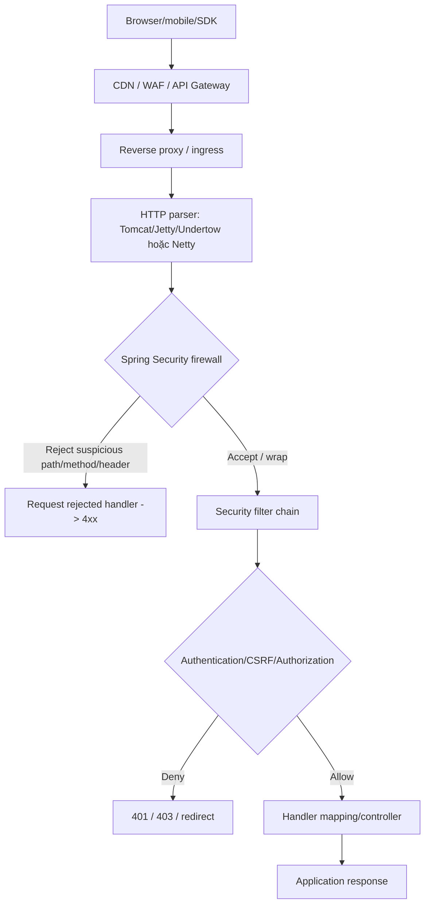
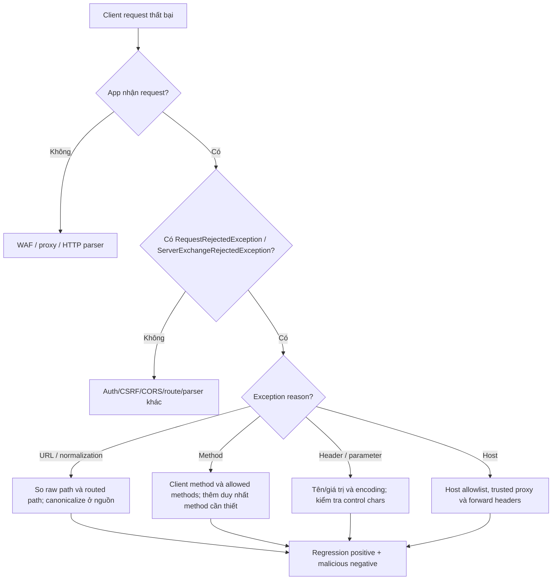
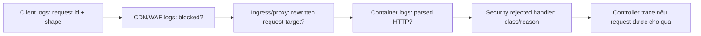
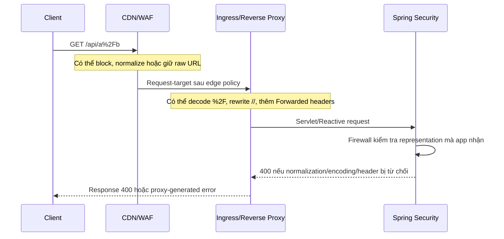
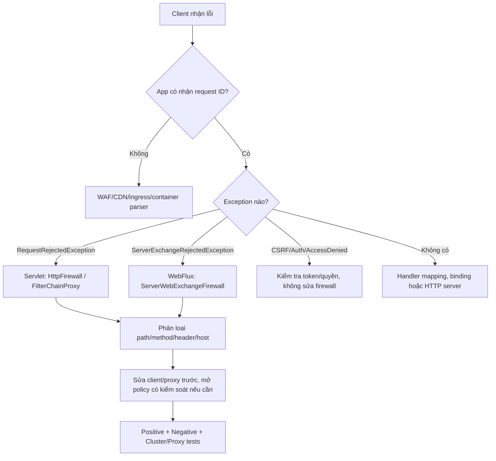

# Firewall từ chối đường dẫn hoặc header hợp lệ của client

> **Chương:** Chẩn đoán lỗi  
> **Module:** `SPRING_SECURITY_HTTP_PROTECTION` — áp dụng các lớp phòng vệ HTTP và trình duyệt trong Spring Security, gồm CSRF, CORS, security headers, CSP, HSTS, HTTP firewall và session; kiểm thử các tình huống Servlet/Reactive và chẩn đoán xung đột bảo mật khi triển khai.  
> **Nhiệm vụ học tập:** Xác định nguyên nhân request có vẻ hợp lệ đối với client/nghiệp vụ nhưng bị firewall từ chối; phân biệt **Servlet `StrictHttpFirewall`** và **Reactive `StrictServerWebExchangeFirewall`**; tái hiện an toàn, thu thập bằng chứng, sửa phía client/proxy khi có thể, chỉ nới chính sách theo giới hạn hẹp và có kiểm thử hồi quy.

Một người dùng có URL `/orders/AB%2F2026`, một SPA gửi header `User-Agent` từ thiết bị đặc biệt, hoặc reverse proxy chuyển đường dẫn thành `/api//v1/orders`. Backend có controller phù hợp nhưng trả `400` trước khi vào controller. Nhìn từ client, URL có thể là “đường dẫn hợp lệ”; nhìn từ firewall, chuỗi ấy lại có thể chứa **cách biểu diễn không chuẩn hóa, ký tự mã hóa nguy hiểm hoặc header không hợp lệ theo ranh giới bảo mật**.

**Điểm mấu chốt:** *“Client cố ý gửi” không đồng nghĩa “an toàn để Spring Security chấp nhận”*. Khi nhiều thành phần decode/normalize theo cách khác nhau, attacker có thể lợi dụng sự khác biệt để đi vòng `requestMatchers`, HTTP firewall, path mapping hoặc reverse proxy. Vì vậy giải pháp mặc định là **tìm nguồn làm biến dạng request và sửa biểu diễn ở biên**, không phải tắt firewall.

## 1. Mục tiêu và phạm vi chẩn đoán

Sau bài này, người học có thể:

1. Nhận biết signature của `RequestRejectedException` và `ServerExchangeRejectedException`, phân biệt với `401`, `403`, `404`, `405`, lỗi CSRF/CORS, lỗi request parser của container và WAF/gateway.
2. Hiểu đường đi request trước controller: client → CDN/WAF → reverse proxy → servlet container/Netty → security firewall → filter chain → authorization → handler/controller.
3. Giải thích các trường hợp URL bị từ chối: path traversal, ký tự `;`, `%2F`, `%5C`, `%25`, `%00`, `//`, CR/LF, encoded dot và normalization không nhất quán.
4. Nhận biết HTTP method ngoài allowlist; header/parameter name/value chứa ký tự điều khiển, ký tự Unicode không được định nghĩa hoặc sai encoding; phân biệt lỗi header ở proxy, HTTP parser và firewall.
5. Tái hiện bằng `MockHttpServletRequest`/`StrictHttpFirewall`, `MockMvc`, `StrictServerWebExchangeFirewall`/`MockServerWebExchange`, `WebTestClient` và HTTP integration qua đúng reverse proxy.
6. Tùy chỉnh **có chọn lọc** `setAllowSemicolon`, `setAllowedHttpMethods`, `setAllowedHeaderValues`/`setAllowedHeaderNames` khi đã thẩm định và có test âm tính.
7. Không đưa raw URL nhạy cảm, `Cookie`, `Authorization`, PII hay header injection payload vào logs; ghi reason code/metrics và giữ HTTP response 4xx ổn định.

**Lưu ý phiên bản:** `StrictHttpFirewall` và `HttpFirewall` thuộc Spring Security Servlet. `StrictServerWebExchangeFirewall`, `ServerWebExchangeFirewall` và `ServerExchangeRejectedException` áp dụng cho WebFlux từ Spring Security **6.4 trở lên**. Với bản 6.3 hoặc thấp hơn, không mặc nhiên sao chép Reactive firewall APIs hiện đại; kiểm tra BOM và Javadoc của phiên bản đang triển khai.

## 2. Firewall nằm ở đâu trong đường xử lý request?



**Servlet:** `FilterChainProxy` dùng `HttpFirewall` để kiểm tra và wrap `HttpServletRequest` trước khi chọn/mở security filters. `StrictHttpFirewall` thường được dùng mặc định. Khi từ chối, phát `RequestRejectedException`, được `RequestRejectedHandler` xử lý (cấu hình mặc định hiện đại thường là `HttpStatusRequestRejectedHandler` với `400`).

**Reactive:** `WebFilterChainProxy` dùng `ServerWebExchangeFirewall` để kiểm tra `ServerWebExchange` trước khi chạy `SecurityWebFilterChain`. `StrictServerWebExchangeFirewall` ném `ServerExchangeRejectedException`; `ServerExchangeRejectedHandler` (mặc định `HttpStatusExchangeRejectedHandler`) trả **400** trong triển khai hiện đại.

**Các lớp trước Spring có thể từ chối trước:**

- CDN/WAF chặn URL trông như SQLi/traversal hoặc header không thuộc chính sách.
- Ingress/proxy normalize `//`, decode `%2F` hoặc sửa `Host`/`X-Forwarded-*`.
- Tomcat/Jetty/Netty HTTP parser từ chối request line/header malformed.
- API gateway không hỗ trợ HTTP verb mới hoặc giới hạn header size.

Do đó **chỉ nhìn status `400` không kết luận Spring Security firewall là thủ phạm**.

### 2.1. Bảng chẩn đoán theo triệu chứng

| Kết quả quan sát | Có thể xảy ra ở đâu? | Bằng chứng cần tìm |
| --- | --- | --- |
| `400` cùng `RequestRejectedException` trong ứng dụng Servlet | `StrictHttpFirewall` / `FilterChainProxy` | Log exception class, reason code, request ID, raw path đã redaction. |
| `400` cùng `ServerExchangeRejectedException` WebFlux | `StrictServerWebExchangeFirewall` | Handler/metric reactive rejection, path/method/headers đã lọc. |
| `400` nhưng app **không có request trace** | CDN/WAF, proxy, container parser, network | Edge logs, gateway request ID, HTTP parser error, status từ từng hop. |
| `401` | Authentication chưa có/hết hạn/không hợp lệ | `AuthenticationEntryPoint` hoặc `ServerAuthenticationEntryPoint`. |
| `403` | CSRF failure, thiếu quyền, CORS policy, other access denied | `AccessDeniedHandler`/`CsrfFilter` và policy tương ứng. |
| `404` | Không có mapping hoặc policy cố ý trả 404 | Kiểm tra handler mapping, firewall rejected handler status nếu đã customize. |
| `405` | Mapping/controller không hỗ trợ method | HTTP method restriction ở MVC/WebFlux, **khác** allowlist của firewall. |
| `431` / `400` header quá lớn | Proxy/container/header size limit | Gateway/container config và header byte count. |

Không nên viết một exception handler `@ControllerAdvice` rồi hy vọng sẽ bắt hết các rejection: firewall có thể reject **trước DispatcherServlet/handler mapping**. Trong Servlet dùng `RequestRejectedHandler`; WebFlux dùng `ServerExchangeRejectedHandler` đúng tầng.

### 2.2. Ví dụ HTTP request được client cho là hợp lệ

```http
GET /api/invoices/AB%2F2026 HTTP/1.1
Host: app.example.test
Accept: application/json
User-Agent: ExampleMobileClient/1.0
```

Client xem `AB/2026` là mã invoice **chứa slash**, encode thành `AB%2F2026` trong một path segment. Nhưng nếu Spring Security, proxy và handler mapping không đồng ý về việc decode `%2F`, cùng request có thể được hiểu là **một segment** hoặc **hai segments**, thay đổi quy tắc authorization.

**Cách sửa thường tốt hơn:** đưa mã invoice qua **query parameter đã encode**, dùng opaque ID an toàn cho path hoặc thiết kế mã canonical chỉ chứa ký tự URL path không mơ hồ. Đừng mở `setAllowUrlEncodedSlash(true)` cho toàn ứng dụng chỉ vì một format ID.

## 3. Vì sao URL “hợp lệ theo RFC” vẫn bị StrictHttpFirewall từ chối?

HTTP URL syntax có thể cho phép nhiều cách biểu diễn; **bảo mật lại cần một cách diễn giải duy nhất giữa các lớp**. Những biểu diễn khác nhau của một URL có thể gây **path traversal, authorization bypass, parser differential hoặc request smuggling-like ambiguity** nếu các hops decode/normalize không nhất quán.

`StrictHttpFirewall` bác bỏ URL không normalized và một số ký tự/chuỗi nguy hiểm theo chính sách mặc định. Một số trường hợp có setter tùy chỉnh, nhưng **không có flag an toàn để tắt hoàn toàn kiểm tra normalization** trong Strict firewall. Spring Security đặc biệt cảnh báo rằng chuyển sang `DefaultHttpFirewall`/normalize trước firewall có thể mong manh và làm yếu bảo đảm bảo mật.

### 3.1. Các biểu diễn URL cần phân biệt

| Ví dụ request-target | Vì sao đáng nghi/khó chấp nhận | Phương án sửa ưu tiên |
| --- | --- | --- |
| `/api//orders` | Dấu slash trùng, hai lớp có thể normalize khác nhau. | Client/proxy tạo đường dẫn `/api/orders` duy nhất. |
| `/a/../admin` | Dot-segment traversal, có thể lệch route/authorization. | Canonicalize tại client/trusted edge và reject nếu bất thường; không nhận raw traversal. |
| `/a/%2e%2e/admin` | Encoded dot có thể biến thành traversal sau decode. | Không nới encoded period cho route nhạy cảm; đổi path format. |
| `/download/a%2Fb` | Encoded slash thay đổi số path segments. | Chuyển ID sang query/opaque path-safe reference. |
| `/path%5cadmin` | Encoded backslash; một số stack xem như separator. | Không dùng backslash trong path; reject. |
| `/app;v=2/page` | Semicolon/path parameters, matrix variables/`jsessionid`. | Ưu tiên query/headers; chỉ bật semicolon nếu thực sự cần. |
| `/x%252Fy` | Encoded percent, có thể gây **double decoding**. | Chuẩn hóa encoding ở nguồn, hạn chế decode một lần rõ ràng. |
| `/foo%00bar` | Null byte có thể làm hỏng parser/native layer. | Reject, không cho phép NUL. |
| `/api%0d%0aX-Test:1` | CR/LF có thể tạo ambiguity/injection. | Reject, không nới CR/LF. |
| Path chứa ký tự Unicode literal chưa encode trong request URI | Phụ thuộc client/proxy/container; Strict yêu cầu URI ASCII printable ở tầng này. | Encode UTF-8 percent một lần theo URI standard, tránh double encode. |

**Không thực hiện “decode cho tới khi không còn %”**. Double decoding lặp lại có thể biến một chuỗi đang bị chặn thành path traversal hoặc separator. Các lớp cần có thỏa thuận rõ ràng: **canonicalization diễn ra ở đâu, một lần hay không, theo charset nào, và policy kiểm tra bản encoded lẫn decoded như thế nào**.

### 3.2. Đường dẫn, query string, path parameters và contextPath không đồng nhất

Servlet có những giá trị:

```text
requestURI = /store/api/orders/AB%2F2026    (không bao gồm query string)
contextPath = /store
servletPath = /api/orders/AB/2026            (có thể được container decode)
pathInfo    = (tùy mapping)
queryString = page=1
```

Đây chỉ là ví dụ **sự khác biệt có thể xảy ra**; giá trị chính xác phụ thuộc servlet mapping/container. `getRequestURI()` không chứa dấu `?` hoặc query string; `servletPath` và `pathInfo` có thể đã decoded. Spring Security dựa trên paths trong phạm vi application để match rules; khi request bị rewrite ở proxy, không thể suy toàn bộ từ `request.getRequestURL()`.

Nếu access rule match `/admin/**` nhưng proxy/container và Spring Security hiểu encoded path khác nhau, có nguy cơ route thực vào `/admin` dù security matcher đánh giá path khác. **Giữ `FilterChainProxy`/`WebFilterChainProxy` và defense-in-depth method security**, không bỏ firewall để “làm URL chạy”.

## 4. Phân biệt URL reject, header reject và HTTP method reject



**HTTP method allowlist mặc định** của `StrictHttpFirewall`/`StrictServerWebExchangeFirewall` trong tài liệu Spring Security gồm `DELETE`, `GET`, `HEAD`, `OPTIONS`, `PATCH`, `POST`, `PUT`. Nếu client gửi `PROPFIND`, `MKCOL` hoặc HTTP method custom, firewall có thể reject trước controller. **Không** gọi `setUnsafeAllowAnyHttpMethod(true)` như phương án đầu tiên — nó bỏ toàn bộ kiểm tra method, mở rủi ro verb tampering/XST.

**Header và parameter validation** thường kiểm tra ký tự ISO control hoặc Unicode undefined. `User-Agent`/`Referer` từ một thiết bị hoặc SDK có thể qua proxy/container thành chuỗi mà Spring coi không hợp lệ; không phải cứ header có chữ Unicode là tự động bị chặn trong mọi phiên bản/browser. Hãy xác minh **bytes và cách decode**, loại ký tự bị từ chối và request thực trên dây.

**Host validation** có thể do app tự cấu hình `setAllowedHostnames(...)` hoặc gateway/host policy khác. Nếu Host bị reject, xác minh trusted host, forwarded headers và virtual host; không nới `allowedHostnames` thành `true` khi triển khai đa tenant.

### 4.1. RequestRejectedException khác BadCredentialsException

| Ngoại lệ / handler | Điều gì được kiểm tra? | Có đi đến authentication? |
| --- | --- | --- |
| `RequestRejectedException` (Servlet) | Firewall request-target/method/headers/host. | Có thể **chưa đến authentication filters**. |
| `ServerExchangeRejectedException` (Reactive) | Reactive firewall. | Có thể **chưa đến authentication web filters**. |
| `AuthenticationException` | Credentials/session/token identity. | Có. |
| `AccessDeniedException` | Quyền hoặc CSRF khi access denied. | Thường đã qua firewall. |
| Handler method type/conversion error | Request mapping/argument validation. | Sau firewall/route. |

Không đưa firewall rejection qua `AuthenticationEntryPoint` thành `401 Unauthorized`: đó là lỗi request representation chứ không nhất thiết là người dùng chưa đăng nhập. Và không trả lại raw exception message cho client vì có thể phản chiếu dữ liệu URL/header không tin cậy.

## 5. Quy trình điều tra có thể lặp lại trong production

Một báo cáo hỗ trợ khách hàng như “Android SDK gọi `/api/items/a%2Fb` bị 400 nhưng Postman chạy” **chưa đủ**. Cần một *minimum reproducible request* không chứa credential:

| Thông tin | Cần thu | Không thu |
| --- | --- | --- |
| Route | Template như `GET /api/items/{id}`; mã reason/encoding class. | URL đầy đủ có token, user ID hay PII. |
| Client | Browser/SDK version, OS, HTTP/1.1 hay HTTP/2, path encoder. | Raw session cookie, `Authorization`, api key. |
| Request target | Mẫu path đã thay bằng ID giả, số lần encode, `%2F`/`;`/`//`. | Toàn bộ query có dữ liệu khách hàng. |
| Header | Tên header đáng ngờ, loại ký tự gây vấn đề, số byte, charset. | Header values nguyên văn như Bearer token. |
| Infrastructure | Edge request ID, ingress rule, rewrites, servlet container, Spring Security version. | WAF credentials, reverse proxy secrets. |
| Kết quả | Status và loại exception/layer, controller có chạy không. | Stack traces trả cho client, raw untrusted payload. |

### 5.1. Runbook tám bước

1. **Tạo test request an toàn**: thay ID thật bằng `a%2Fb` hay ký tự giả vô hại, giữ cách encoding, method và host. Với CR/LF/traversal, dùng **chỉ môi trường test được phép**, không thử trên hệ thống của bên thứ ba.
2. **Xác định hop trả 400**: client → CDN → ingress → container → Spring. So response headers, edge error code và request ID được nối giữa các hệ thống.
3. **Kiểm tra có security exception class không**: `RequestRejectedException` hoặc `ServerExchangeRejectedException`. Nếu không, phân tích parser/container/WAF trước.
4. **So hai request gần giống nhau**: path canonical chạy được và path bị reject; chỉ đổi **một yếu tố** (encoded slash, semicolon, method, header value).
5. **Kiểm tra raw vs decoded vs routed**: proxy có decode/re-encode không? servlet container cho phép encoded slash ở chế độ nào? `ForwardedHeaderFilter` được dùng từ trusted proxy hay chưa?
6. **Chọn phương án giảm rủi ro nhất**: sửa client/SDK tạo canonical URL, thay ID format/query; sửa proxy rewrite; chỉ cuối cùng cân nhắc chỉnh một firewall predicate/flag.
7. **Viết test dương và âm** cho cùng nhóm biểu diễn; sửa xong không được làm `/admin%2F...`/traversal trở thành đường vòng.
8. **Rollout có kiểm soát**: canary, dashboard rejection counts, metric theo reason, rollback plan và phê duyệt security review cho mọi relaxation.

### 5.2. Bảng bằng chứng theo tầng



Nếu exception xảy ra **trước controller**, đặt breakpoint trong controller hoặc sửa `@RequestMapping` sẽ không giải quyết. Nếu Spring Security **không hề nhìn thấy request** vì Tomcat hoặc WAF reject trước đó, custom `StrictHttpFirewall` bean cũng không có tác dụng.

### 5.3. Dùng một request ID xuyên các hop

Nên tạo correlation ID ở trusted edge hoặc tracing infrastructure. Không tin header `X-Request-ID` bất kỳ từ Internet để làm principal hoặc khóa lookup duy nhất; format/length phải có giới hạn. Log dạng:

```text
security.event=firewall_rejection
request.id=2c8d...          # ID do hệ thống tạo; không chứa session secret
stack=servlet
component=StrictHttpFirewall
reason=ENCODED_SLASH        # Phân loại bởi instrumentation được review
method=GET
route.template=/api/items/{id}
http.status=400
```

**Đây là schema log minh họa**, không phải fields Spring Security tự cung cấp. Khi exception message chứa raw path/header, tránh log nguyên văn; nếu cần phân tích pháp chứng, dùng kênh truy cập hạn chế và retention ngắn, vẫn redaction các giá trị nhạy cảm.

## 6. Ưu tiên sửa request ở nguồn: canonical URL và header

**Trường hợp 1 — ID chứa dấu slash:** Thay vì `GET /api/invoices/AB%2F2026`, chọn một trong các hợp đồng rõ:

```http
# Dùng query parameter có encode một lần:
GET /api/invoices?code=AB%2F2026 HTTP/1.1
Host: app.example.test

# Hoặc giữ định danh path-safe, lưu mã gốc trong server record:
GET /api/invoices/inv_8f2a HTTP/1.1
Host: app.example.test
```

URL path now canonical. `%2F` trong query parameter **không có cùng ý nghĩa separator** như trong path segment, nhưng vẫn cần validate, giới hạn độ dài và tránh injection ở tầng domain/database. URL query có thể bị log; **không đặt secret vào query**.

**Trường hợp 2 — Matrix variables/semicolon:** Một client gửi `/products;color=red/42` chỉ vì legacy convention. Nếu API mới không cần matrix variables, chuyển thành:

```http
GET /products/42?color=red HTTP/1.1
Host: app.example.test
```

Nếu buộc giữ matrix variables, phải đánh giá việc **security matcher và Spring MVC handler mapping có nhìn cùng một đường dẫn và tenant permission** sau khi bật semicolon; không coi nó chỉ là style.

**Trường hợp 3 — Double slash hoặc dot segments:** Sửa `Base URL + relative path` trong SDK:

```text
Base URL:  https://api.example.test/
Path:      /v1/orders
Wrong:     https://api.example.test//v1/orders
Canonical: https://api.example.test/v1/orders
```

**Không** tạo URL bằng việc nối chuỗi tự do rồi decode/re-encode nhiều lần. Dùng URI builder đúng kiểu (Java `UriComponentsBuilder`, `WebClient.UriBuilder`, JS `URL`), kiểm tra path-segment vs path-string và unit test serialized URI.

### 6.1. Java client dùng URI builder với query parameter

```java
import java.net.URI;
import org.springframework.web.util.UriComponentsBuilder;

class InvoiceUris {
    static URI lookup(String code) {
        // Sử dụng placeholder để URI builder encode giá trị tham số.
        // Không đưa code vào path segment.
        return UriComponentsBuilder
            .fromUriString("https://api.example.test/api/invoices")
            .queryParam("code", "{code}")
            .encode()
            .buildAndExpand(code)
            .toUri();
    }
}
```

Với input `AB/2026`, output query sẽ chứa representation an toàn tương ứng; SDK/server cần thỏa thuận charset/độ encode. **Không double encode** giá trị đã percent-encoded từ trước; API consumer nên truyền **giá trị gốc** vào builder.

### 6.2. Unicode: phân biệt path với header

```text
Tên sản phẩm: "Cà phê"
Path slug (nếu thực sự cần): encode UTF-8 theo từng segment.
Header X-Display-Name: giá trị Unicode tùy chuẩn/http stack.
Request body JSON UTF-8: phù hợp hơn cho metadata phức tạp.
```

Đường dẫn dùng percent-encoded UTF-8 đúng một lần; với header text tùy ý, ưu tiên **body JSON** hoặc cơ chế encoding theo đặc tả header (ví dụ header parameter có format riêng), thay vì nhét chuỗi Unicode arbitrary hoặc control chars vào HTTP headers. Không coi header từ một SDK “hợp lệ về nghiệp vụ” là chứng minh nó có biểu diễn hợp lệ ở mọi proxy/container.

## 7. Servlet: giữ StrictHttpFirewall mặc định

Cấu hình Spring Security nên giữ firewall chuẩn, CSRF và authorization:

```java
import org.springframework.context.annotation.Bean;
import org.springframework.context.annotation.Configuration;
import org.springframework.security.config.Customizer;
import org.springframework.security.config.annotation.web.builders.HttpSecurity;
import org.springframework.security.web.SecurityFilterChain;

@Configuration
class DefaultServletProtection {

    @Bean
    SecurityFilterChain securityFilterChain(HttpSecurity http)
            throws Exception {
        return http
            .authorizeHttpRequests(auth -> auth
                .requestMatchers("/public/**").permitAll()
                .requestMatchers("/admin/**").hasRole("ADMIN")
                .anyRequest().authenticated())
            .csrf(Customizer.withDefaults())
            .build();
    }
}
```

Đây là **baseline**. `SecurityFilterChain` không tự quyết định tất cả firewall rules; `FilterChainProxy` sở hữu `HttpFirewall`. Nếu app có nhiều `SecurityFilterChain`, firewall vẫn kiểm tra trước khi chọn chain. `permitAll()` chỉ bỏ yêu cầu authentication cho route, **không** biến URL đáng ngờ thành hợp lệ qua Strict firewall.

### 7.1. Tùy chỉnh có chọn lọc semicolon cho matrix variables

Nếu nghiệp vụ thực sự có **Spring MVC matrix variables** và nhóm security đã đánh giá path matching:

```java
import org.springframework.context.annotation.Bean;
import org.springframework.context.annotation.Configuration;
import org.springframework.security.web.firewall.StrictHttpFirewall;

@Configuration
class MatrixVariableFirewallConfig {

    @Bean
    StrictHttpFirewall strictHttpFirewall() {
        var firewall = new StrictHttpFirewall();
        firewall.setAllowSemicolon(true); // Chỉ khi use case có thật.
        return firewall;
    }
}
```

Spring Security reference tài liệu hóa ví dụ bean `StrictHttpFirewall` tương tự. **Không bật flag chỉ vì request có `;jsessionid` cũ**; URL rewriting truyền session ID trong path vừa ảnh hưởng an toàn vừa có thể lộ ID trong log/referrer. Ưu tiên cookie session có `HttpOnly; Secure; SameSite`.

**Sau khi bật semicolon**, test ít nhất:

- `/products/42;color=red` được controller hợp lệ xử lý.
- `/admin;foo=1/users` **không** rơi qua rule bảo vệ `/admin/**`.
- `/public;foo=1/../admin` hoặc traversal vẫn bị reject.
- Container/proxy và MVC path matcher không tạo hai cách hiểu khác nhau.
- Không có session ID trong URL/log.

### 7.2. Allowed HTTP methods: mở đúng một method có lý do

Nếu một WebDAV endpoint đã được xác thực đúng thực sự cần `PROPFIND`, có thể mở một **method** qua `setAllowedHttpMethods`:

```java
import java.util.List;
import org.springframework.context.annotation.Bean;
import org.springframework.context.annotation.Configuration;
import org.springframework.security.web.firewall.StrictHttpFirewall;

@Configuration
class WebDavMethodFirewallConfig {

    @Bean
    StrictHttpFirewall strictHttpFirewall() {
        var firewall = new StrictHttpFirewall();
        firewall.setAllowedHttpMethods(List.of(
            "GET", "HEAD", "OPTIONS", "POST", "PUT",
            "PATCH", "DELETE", "PROPFIND"));
        return firewall;
    }
}
```

Đây là một **phương án thay thế** bean ở mục 7.1; không khai hai `StrictHttpFirewall` beans rồi hy vọng Spring Security tự kết hợp các policies. **Firewall method allowlist có tác dụng toàn bộ `FilterChainProxy`**, không tự giới hạn riêng route WebDAV. Cần:

1. Rule `HttpSecurity`/method security chặn `PROPFIND` trên routes khác.
2. Kiểm tra CSRF matcher nếu method có tác động trạng thái và CORS preflight khi browser gọi.
3. Không bật `TRACE`/`TRACK` trừ khi có phân tích bảo mật cực kỳ cụ thể; thông thường nên chặn.

**Không sử dụng `setUnsafeAllowAnyHttpMethod(true)`** để sửa nhanh một client dùng method sai: nó bỏ toàn bộ kiểm tra phương thức ở firewall và mở HTTP verb tampering.

### 7.3. Encoded slash: lựa chọn cuối sau khi review toàn đường đi

```java
// Chỉ là trích đoạn cấu hình RỦI RO CAO, không phải khuyến nghị production.
StrictHttpFirewall firewall = new StrictHttpFirewall();
firewall.setAllowUrlEncodedSlash(true);
```

Với `%2F`, container có thể đã reject **trước Spring**, hoặc đã decode thành slash làm đổi matching. Bật `setAllowUrlEncodedSlash(true)` **không bảo đảm** URL client hoạt động và có thể tạo security matcher bypass nếu decode ở nhiều lớp. Tốt hơn là đổi API path contract (`queryParam`/opaque ID) hoặc trusted edge canonicalization đã được kiểm chứng.

**Không đồng thời mở** encoded slash, backslash, percent, semicolon và encoded period để “cho tất cả các URL đi qua”. Mỗi flag có nguy cơ khác nhau, đặc biệt path traversal và double encoding.

## 8. Servlet: header name/value bị từ chối dù client cho là hợp lệ

`StrictHttpFirewall` có thể kiểm tra tên và giá trị header thông qua:

- `setAllowedHeaderNames(Predicate<String>)`.
- `setAllowedHeaderValues(Predicate<String>)`.
- `setAllowedParameterNames(Predicate<String>)`.
- `setAllowedParameterValues(Predicate<String>)`.

Theo tài liệu Spring Security, các mặc định nhằm ngăn ký tự **ISO control** và code point không định nghĩa trong header/parameter names; việc decode header bằng HTTP server có thể gây hiện tượng “giá trị gốc từ client không giống Java `String` mà firewall nhìn thấy”.

### 8.1. Header hợp lệ ở tầng ứng dụng chưa chắc hợp lệ ở HTTP stack

| Triệu chứng | Ví dụ | Nguyên nhân có thể |
| --- | --- | --- |
| User-Agent thiết bị hiếm gặp bị reject | Model name có ký tự Unicode hoặc ký tự qua Latin-1 encoding. | HTTP parser/ISO-8859-1 conversion sinh code point lạ/undefined; firewall predicate không chấp nhận. |
| SDK gửi custom header chứa CR/LF | `X-Client-Note` có newline. | Đây là **header injection**/response splitting risk, phải bỏ control chars. |
| Header name có khoảng trắng/control | `X Bad: abc` hoặc tab/CTL. | Không hợp lệ theo HTTP field-name syntax, có thể bị proxy/container reject sớm. |
| `X-Forwarded-Host` lạ | Proxy gửi value/format không hợp lệ hoặc chưa trust policy. | Gateway và application không đồng nhất trust/hostname. |
| Cookie header chứa ký tự lạ | Client copy dữ liệu Unicode nguyên vào cookie value. | Cookie encoding/HTTP parser/firewall; không nên chứa raw arbitrary data. |
| Authorization Bearer header bị reject | Token được nối có newline hoặc whitespace/control. | Client serialization bug; **không nới firewall cho credential**. |
| Header quá lớn | JWT/cookie chain hoặc nhiều forwarding headers. | `431`/`400` có thể từ proxy/container, chưa tới `StrictHttpFirewall`. |
| Header rỗng | `X-Optional:` không có giá trị. | Không mặc định là lỗi: cần xem policy cụ thể, header name, parse và matcher. |

**Đừng nhìn mỗi log `RequestRejectedException` rồi cho rằng header đó do attacker gửi.** Có trường hợp mobile SDK có bug encoder hoặc proxy làm biến dạng dữ liệu hợp lệ trước Spring. Nhưng **không vì thế cho phép CR/LF/NUL**: nếu đầu vào được xem là an toàn ở tầng ứng dụng nhưng không an toàn ở tầng giao thức, hãy thay biểu diễn.

### 8.2. Một ngoại lệ hẹp cho đúng một header value legacy

Giả sử một SDK không thể nâng cấp ngay, đã điều tra một **giá trị header cụ thể** sau parse chứa code point mà default predicate không chấp nhận. Nếu security review chấp nhận tạm thời:

```java
import org.springframework.context.annotation.Bean;
import org.springframework.context.annotation.Configuration;
import org.springframework.security.web.firewall.StrictHttpFirewall;

@Configuration
class TemporaryLegacyHeaderFirewallConfig {

    // Đây là ví dụ giá trị giả từ hệ thống test, có ký tự chưa định nghĩa.
    // Trong sản phẩm thật, dùng giá trị THẬT được security review và
    // có hạn loại bỏ; tuyệt đối không thêm CR/LF/NUL.
    private static final String LEGACY_VALUE = "ExampleDevice/X\u0378";

    @Bean
    StrictHttpFirewall strictHttpFirewall() {
        var firewall = new StrictHttpFirewall();
        firewall.setAllowedHeaderValues(value ->
            StrictHttpFirewall.ALLOWED_HEADER_VALUES.test(value)
                || LEGACY_VALUE.equals(value));
        return firewall;
    }
}
```

**Ràng buộc quan trọng:** `setAllowedHeaderValues(Predicate<String>)` nhận **chỉ giá trị header**, **không nhận header name**. Ngoại lệ ở trên có hiệu lực với bất kỳ header nào chứa chính chuỗi đó; không thể gọi predicate này như một allowlist ràng buộc riêng `User-Agent` nếu chỉ dùng API một tham số. Nếu cần ràng buộc theo header name, áp thêm validation ở request wrapper/filter/service và xem xét thay kiến trúc, vì có thể đã quá muộn để sửa phần reject ở firewall.

**Không dùng**:

```java
// ANTI-PATTERN, chỉ để nhận diện khi review:
firewall.setAllowedHeaderValues(value -> true);
firewall.setAllowedHeaderNames(name -> true);
firewall.setAllowedParameterNames(name -> true);
```

Những đoạn này tắt phần lớn validation tại tầng firewall, có thể mở đường cho header/control character bugs và response/request splitting tại các lớp khác. Spring docs có minh họa kỹ thuật nhưng **không khuyến nghị bật đại trà** chỉ vì một client gặp lỗi.

### 8.3. Sửa đúng hơn ở client/proxy

Nếu HTTP header mang dữ liệu Unicode tự do, thử:

1. Chuyển metadata sang **JSON body UTF-8**, với validation/size limit; hoặc dùng header được định nghĩa encoding rõ theo spec.
2. Nếu cần device name cho audit, server có thể map **client-generated stable device handle** sang tên được lưu phía server, không dùng raw Unicode User-Agent như khóa tin cậy.
3. Nếu lỗi do proxy ghép header sai, fix cấu hình forwarding/serialization ở **trusted edge**; không tin mọi `X-Forwarded-*` từ Internet.
4. Validate header value **trước khi đưa vào response**, chống newline/CRLF và header splitting; không lặp lại header từ request vào response/error page.

**Không đưa session cookie, `Authorization` hoặc CSRF token vào một chuỗi header debug** để “so sánh bytes”. Khi cần điều tra encoding, dùng header test giả với giá trị không có thông tin nhạy cảm.

### 8.4. Tên header khác chữ hoa/thường

HTTP field names **case-insensitive**; `x-request-id` và `X-Request-Id` thường có cùng ý nghĩa. Nhưng một custom predicate tự viết có thể cố tình case-sensitive và reject nhầm tên hợp lệ. Nếu định nghĩa allowlist:

```java
// Ví dụ kiểm tra trong code nghiệp vụ/gateway:
boolean isAllowedCustomHeader(String name) {
    return name != null
        && name.equalsIgnoreCase("X-Correlation-Id");
}
```

Không dùng ví dụ trên để **thay toàn bộ** `StrictHttpFirewall` header-name allowlist: một ứng dụng HTTP còn cần `Host`, `Accept`, `Content-Type`, `Authorization`, `Cookie` và các standard headers khác. Một allowlist quá hẹp toàn cục có thể tự gây lỗi ngay khi request hợp lệ có header chuẩn.

## 9. Servlet: xử lý rejection thành status an toàn và có khả năng quan sát

`RequestRejectedHandler` xử lý `RequestRejectedException` phát sinh trong `FilterChainProxy`. Mặc định hiện đại có `HttpStatusRequestRejectedHandler` trả **400 Bad Request**; không cần tự thay status trừ khi có hợp đồng API/quan sát rõ ràng.

### 9.1. Chủ động cấu hình handler trả 400 (không nới firewall)

```java
import org.springframework.context.annotation.Bean;
import org.springframework.context.annotation.Configuration;
import org.springframework.security.config.annotation.web.configuration.WebSecurityCustomizer;
import org.springframework.security.web.firewall.HttpStatusRequestRejectedHandler;

@Configuration
class RejectedRequestResponseConfig {

    @Bean
    WebSecurityCustomizer rejectedRequestsCustomizer() {
        return web -> web.requestRejectedHandler(
            new HttpStatusRequestRejectedHandler(400));
    }
}
```

Đây là **config global cho Servlet `WebSecurity`**; không phải `@ControllerAdvice` hoặc `AccessDeniedHandler`. Các phiên bản Spring Security hỗ trợ `WebSecurity.requestRejectedHandler(...)` từ 5.7. Mục đích là giữ response ổn định khi request bị firewall reject, **không biến request thành accepted**.

### 9.2. Handler log metrics không ghi raw URL/header

```java
import jakarta.servlet.http.HttpServletResponse;
import org.slf4j.Logger;
import org.slf4j.LoggerFactory;
import org.springframework.context.annotation.Bean;
import org.springframework.context.annotation.Configuration;
import org.springframework.security.config.annotation.web.configuration.WebSecurityCustomizer;
import org.springframework.security.web.firewall.HttpStatusRequestRejectedHandler;
import org.springframework.security.web.firewall.RequestRejectedHandler;

@Configuration
class SafeFirewallObservabilityConfig {
    private static final Logger LOG =
        LoggerFactory.getLogger(SafeFirewallObservabilityConfig.class);

    @Bean
    WebSecurityCustomizer rejectedRequestsCustomizer() {
        RequestRejectedHandler responder =
            new HttpStatusRequestRejectedHandler(
                HttpServletResponse.SC_BAD_REQUEST);

        RequestRejectedHandler safeHandler = (request, response, ex) -> {
            // Không ghi ex.getMessage(), requestURI, raw headers.
            LOG.warn("firewall_rejected stack=servlet reason=INVALID_REQUEST");
            responder.handle(request, response, ex);
        };
        return web -> web.requestRejectedHandler(safeHandler);
    }
}
```

**Đây là phương án thay thế mục 9.1**, không khai hai beans `WebSecurityCustomizer` cùng chức năng mà giả định thứ tự sẽ quyết định handler mong muốn. Metrics có thể đếm số lần rejection theo **loại đã được phân loại bởi logic đáng tin**; code ở đây dùng reason constant để tránh ghi exception message chứa path/header không tin cậy.

Trong các hệ thống dùng Micrometer/Actuator, có thể dùng `ObservationMarkingRequestRejectedHandler` hoặc instrumentation khác theo phiên bản nếu hỗ trợ; phải kiểm tra nhãn metric không chứa full URI, query, cookie, user ID để tránh lộ PII và high cardinality.

### 9.3. Vì sao không trả raw exception message cho client?

`RequestRejectedException.getMessage()` có thể chứa chuỗi URL hoặc method bị reject; nội dung ấy do client điều khiển. Trả nguyên vào HTML hoặc JSON mà không escape có thể:

- Tạo phản xạ dữ liệu nguy hiểm hoặc XSS trong trang lỗi.
- Lộ cấu trúc firewall/blocklist/route.
- Đưa token/PII từ URL vào logs/APM/response.
- Làm lỗi header injection nếu nội dung được đặt vào response header không kiểm tra.

Giữ response công khai ngắn:

```http
HTTP/1.1 400 Bad Request
Content-Type: application/problem+json
Cache-Control: no-store

{"type":"about:blank","title":"Bad Request","status":400}
```

Header/body này là **một contract ứng dụng có thể triển khai**, không phải mặc định body của `HttpStatusRequestRejectedHandler`. Nếu cần JSON RFC 9457/ProblemDetail, tự cài handler với encoding an toàn, không nhúng full raw URI/headers.

## 10. Sai lầm thường gặp: sửa RequestRejectedException bằng CSRF hoặc CORS

| Thay đổi bị đề xuất | Vì sao không xử lý đúng lỗi firewall? |
| --- | --- |
| `csrf.disable()` | Firewall có thể reject trước `CsrfFilter`. Bỏ CSRF mở lỗ hổng request forgery mà encoded path vẫn bị reject. |
| `cors().disable()` | CORS kiểm soát browser cross-origin response/access, không sửa URL malformed hay control chars. |
| `permitAll("/bad/**")` | Authorization matcher không override `StrictHttpFirewall`; `permitAll` không bypass firewall. |
| `@ControllerAdvice(RequestRejectedException.class)` | Firewall thường reject **trước MVC controller advice**, nên không bắt được. |
| `web.ignoring().requestMatchers("/api/**")` | Bỏ Spring Security filters khỏi request, tăng nguy cơ mất protection; không phải sửa URL. |
| `new DefaultHttpFirewall()` trên toàn app | Nới security normalization, có thể che sai lệch giữa path matchers/gateway. |
| `setUnsafeAllowAnyHttpMethod(true)` | Tắt kiểm tra HTTP method; không giải quyết header/path rejection. |
| `setAllowedHeaderValues(value -> true)` | Bỏ hàng rào ký tự không hợp lệ cho mọi header values. |

**Đừng dùng `FilterRegistrationBean` tắt `springSecurityFilterChain` cho một route** chỉ để request “được vào controller”; việc bỏ qua security chain có thể bỏ cả authentication/authorization, CSRF, security headers và firewall.

## 11. Proxy, ingress và gateway: nơi “request hợp lệ” dễ biến dạng nhất

### 11.1. Đường đi thực qua trusted proxies



Vấn đề không chỉ ở Spring:

- Nếu CDN normalize `//` trước app, test trực tiếp `/api//x` ở localhost **không đại diện** đường đi production.
- Nếu ingress decode `%2F` thành slash, path segments/security matcher của Spring có thể khác biểu diễn client tưởng đã gửi.
- Nếu proxy thêm một `X-Forwarded-Host` nhiều giá trị hoặc header lạ, Spring có thể reject sau khi parse.
- Nếu HTTP/2 gateway chuyển thành HTTP/1.1, các header field-name/values có thể được canonicalize; proxy còn có limits riêng về header length.
- Nếu proxy rewrite `/app` context path, một số request URI/servletPath có thể không normalized như security chain kỳ vọng.

### 11.2. Trust boundary với Forwarded / X-Forwarded-*

`Forwarded` và `X-Forwarded-*` có thể tác động URI external scheme/host/port khi app ở sau TLS termination. **Chỉ tin headers được trusted proxy thiết lập/ghi đè**; gateway nên xóa forwarded headers do client Internet tự gửi trước khi gán chính nó.

`ForwardedHeaderFilter` ở Servlet và xử lý forwarded headers của Reactor Netty/WebFlux là **cấu hình tin cậy về nguồn**, không phải một cách “bypass firewall”. Nếu cấu hình sai, có nguy cơ **host-header poisoning**, sai redirect URL, callback OAuth2 sai và cookie `Secure`/`Domain` không đúng.

### 11.3. Giới hạn normalizing tại proxy

Chuẩn hóa tại trusted edge cần:

1. Chính sách duy nhất về **giữ/không giữ encoded slash**, backslash, semicolon, double slash.
2. Không double-decode hoặc cho proxy và backend hiểu path khác nhau.
3. Bảo vệ **trước và sau khi normalization** với WAF/matcher phù hợp.
4. Đánh giá việc path rewrite ảnh hưởng cache key/CDN, authorization route, multi-tenant routing.
5. E2E tests đi **qua cùng ingress** với production.

Không đưa quy tắc `rewrite ^(.*)//(.*)$ ...` vào proxy chỉ để request pass khi chưa đánh giá mọi đường vòng path traversal. Ưu tiên sửa client sai và reject request mơ hồ nếu an toàn hơn.

## 12. Reactive WebFlux: firewall và exception khác Servlet

Từ Spring Security **6.4+**, WebFlux có `ServerWebExchangeFirewall` (mặc định `StrictServerWebExchangeFirewall`), được `WebFilterChainProxy` sử dụng trước các `SecurityWebFilterChain`. Đây không phải `HttpFirewall` dựa trên `HttpServletRequest`.

| Khía cạnh | Servlet | Reactive WebFlux |
| --- | --- | --- |
| Firewall interface | `HttpFirewall` | `ServerWebExchangeFirewall` |
| Mặc định | `StrictHttpFirewall` | `StrictServerWebExchangeFirewall` |
| Dữ liệu | `HttpServletRequest` | `ServerWebExchange` |
| Entry point | `FilterChainProxy` | `WebFilterChainProxy` |
| Exception | `RequestRejectedException` | `ServerExchangeRejectedException` |
| Handler | `RequestRejectedHandler` | `ServerExchangeRejectedHandler` |
| Handler 400 | `HttpStatusRequestRejectedHandler` | `HttpStatusExchangeRejectedHandler` |
| Method allowlist type | `Collection<String>` | `Collection<HttpMethod>` |
| Kiểm thử trực tiếp | `MockHttpServletRequest` | `MockServerWebExchange` + Reactor |
| API version | Đã có từ các phiên bản Servlet cũ | `StrictServerWebExchangeFirewall` từ 6.4 |

**Không dùng `HttpSecurity` hoặc `RequestRejectedHandler` để tùy chỉnh Reactive security chain**. Một app có `spring-webflux` trên classpath nhưng Spring Boot đang chạy MVC vẫn dùng **Servlet**; kiểm tra actual web application type.

### 12.1. WebFlux giữ mặc định và phân quyền độc lập

```java
import org.springframework.context.annotation.Bean;
import org.springframework.context.annotation.Configuration;
import org.springframework.security.config.Customizer;
import org.springframework.security.config.annotation.web.reactive.EnableWebFluxSecurity;
import org.springframework.security.config.web.server.ServerHttpSecurity;
import org.springframework.security.web.server.SecurityWebFilterChain;

@Configuration
@EnableWebFluxSecurity
class ReactiveSecurityBaseline {

    @Bean
    SecurityWebFilterChain securityWebFilterChain(ServerHttpSecurity http) {
        return http
            .authorizeExchange(auth -> auth
                .pathMatchers("/public/**").permitAll()
                .pathMatchers("/admin/**").hasRole("ADMIN")
                .anyExchange().authenticated())
            .csrf(Customizer.withDefaults())
            .build();
    }
}
```

Firewall tự động được dùng ở `WebFilterChainProxy`. `permitAll("/public/**")` không biến `/public//x` hoặc path traversal thành hợp lệ; `ServerWebExchangeFirewall` kiểm tra **trước** rule authorization.

### 12.2. Chỉ bật semicolon khi WebFlux cần path parameters

Tài liệu chính thức Spring Security Reactive có ví dụ bean:

```java
import org.springframework.context.annotation.Bean;
import org.springframework.context.annotation.Configuration;
import org.springframework.security.web.server.firewall.StrictServerWebExchangeFirewall;

@Configuration
class ReactiveMatrixVariableFirewallConfig {

    @Bean
    StrictServerWebExchangeFirewall serverWebExchangeFirewall() {
        var firewall = new StrictServerWebExchangeFirewall();
        firewall.setAllowSemicolon(true); // Use case đã được review.
        return firewall;
    }
}
```

Lưu ý các phiên bản Reactive firewall **trước 6.4 không có cùng API**, không dùng code trên cho bản cũ. Khi bật semicolon, test security path match, path parameters, query, normalization và authorization cho cả route `/public/**` lẫn `/admin/**`.

### 12.3. Nếu cần một HTTP method ngoài allowlist trong Reactive

```java
import java.util.List;
import org.springframework.context.annotation.Bean;
import org.springframework.context.annotation.Configuration;
import org.springframework.http.HttpMethod;
import org.springframework.security.web.server.firewall.StrictServerWebExchangeFirewall;

@Configuration
class ReactiveDavMethodFirewallConfig {

    @Bean
    StrictServerWebExchangeFirewall serverWebExchangeFirewall() {
        var firewall = new StrictServerWebExchangeFirewall();
        firewall.setAllowedHttpMethods(List.of(
            HttpMethod.GET, HttpMethod.HEAD, HttpMethod.OPTIONS,
            HttpMethod.POST, HttpMethod.PUT, HttpMethod.PATCH,
            HttpMethod.DELETE, HttpMethod.valueOf("PROPFIND")));
        return firewall;
    }
}
```

Đây là **phương án thay thế** config semicolon, không load đồng thời hai bean firewall với cùng mục đích. Khác Servlet, Reactive setter dùng `Collection<HttpMethod>`. Nếu HTTP method custom chỉ hợp lệ tại route WebDAV cụ thể, thêm **authorization + method-specific matcher** và audit, không mặc định cho mọi controller chấp nhận method đó.

### 12.4. Nới header values Reactive phải có mục tiêu cụ thể

```java
import org.springframework.context.annotation.Bean;
import org.springframework.context.annotation.Configuration;
import org.springframework.security.web.server.firewall.StrictServerWebExchangeFirewall;

@Configuration
class ReactiveLegacyHeaderFirewallConfig {
    private static final String LEGACY_VALUE = "ExampleDevice/X\u0378";

    @Bean
    StrictServerWebExchangeFirewall serverWebExchangeFirewall() {
        var firewall = new StrictServerWebExchangeFirewall();
        firewall.setAllowedHeaderValues(value ->
            StrictServerWebExchangeFirewall.ALLOWED_HEADER_VALUES.test(value)
                || LEGACY_VALUE.equals(value));
        return firewall;
    }
}
```

Đây cũng là **một phương án thay thế**, cần xử lý càng sớm càng tốt ở client/gateway. Giống Servlet, predicate giá trị không biết header name; ngoại lệ exact-value tác động mọi header chứa cùng giá trị. Không dùng predicate `value -> true`, không mở CR/LF/NUL, không làm exception dựa trên prefix dễ giả mạo như `value.startsWith("Trusted")`.

**Lưu ý:** giá trị `X\u0378` là mẫu test giả có code point unassigned, không phải identifier của một thiết bị thật. Không copy giá trị Unicode này vào production allowlist; thay bằng dữ liệu đã được điều tra hợp pháp rồi loại bỏ sớm.

## 13. Reactive: ServerExchangeRejectedHandler và response contract

Trong WebFlux hiện đại, `ServerExchangeRejectedHandler` nhận rejection từ `WebFilterChainProxy`. Mặc định `HttpStatusExchangeRejectedHandler` gửi **400 Bad Request**. Nếu sản phẩm muốn thống nhất `400` rõ ràng hoặc `404` để không tiết lộ đường dẫn, expose bean handler:

```java
import org.springframework.context.annotation.Bean;
import org.springframework.context.annotation.Configuration;
import org.springframework.http.HttpStatus;
import org.springframework.security.web.server.firewall.HttpStatusExchangeRejectedHandler;
import org.springframework.security.web.server.firewall.ServerExchangeRejectedHandler;

@Configuration
class ReactiveRejectedResponseConfig {

    @Bean
    ServerExchangeRejectedHandler rejectedHandler() {
        // 400 là mặc định; minh họa thay đổi thành policy tường minh.
        return new HttpStatusExchangeRejectedHandler(HttpStatus.BAD_REQUEST);
    }
}
```

Nếu buộc đổi sang `404` theo hợp đồng gateway, có thể truyền `HttpStatus.NOT_FOUND`. **Đổi status không làm request được phép đi qua**, cũng không nên che toàn bộ lỗi trong observability. Đảm bảo 404 do firewall vẫn được phân biệt nội bộ với 404 do không có route.

### 13.1. Handler custom non-blocking, không phản chiếu URL

```java
import org.springframework.context.annotation.Bean;
import org.springframework.context.annotation.Configuration;
import org.springframework.http.HttpStatus;
import org.springframework.security.web.server.firewall.ServerExchangeRejectedHandler;
import reactor.core.publisher.Mono;

@Configuration
class ReactiveSafeRejectionHandlerConfig {

    @Bean
    ServerExchangeRejectedHandler rejectedHandler() {
        return (exchange, exception) -> {
            // Không ghi exception.getMessage(), raw path/headers.
            exchange.getResponse().setStatusCode(HttpStatus.BAD_REQUEST);
            exchange.getResponse().getHeaders()
                .setCacheControl("no-store");
            return exchange.getResponse().setComplete();
        };
    }
}
```

Ví dụ trả **body rỗng**; phù hợp khi client chỉ cần status. Dùng phương án này **thay thế** mục 13, không load hai bean `ServerExchangeRejectedHandler` cùng lúc. Với metrics/trace, tạo sự kiện không mang giá trị header/URI nhạy cảm. **Không gọi `Mono.block()` trong Netty event loop**, không `subscribe()` thủ công để ghi response.

### 13.2. Khi nào không bắt được exception ở `@RestControllerAdvice` Reactive?

`ServerExchangeRejectedException` có thể xuất hiện **trước handler mapping/WebFlux controller** ở `WebFilterChainProxy`. Một `@RestControllerAdvice` gắn với controllers không phải nơi tin cậy để xử lý rejection đó. Dùng `ServerExchangeRejectedHandler` bean như Spring Security docs; phân biệt với `ErrorWebExceptionHandler` của Spring Boot/Netty và lỗi HTTP parser.

### 13.3. Tại sao Reactive handler không phải CORS filter?

`WebFilterChainProxy` và CORS/preflight nằm ở các tầng khác nhau. Nếu OPTIONS request bị firewall từ chối vì **method không được phép theo custom method allowlist**, cấu hình CORS allow-origin không làm OPTIONS tự được cho qua. Default StrictReactive firewall **đã cho phép OPTIONS**; nếu bạn từng set `setAllowedHttpMethods(List.of(GET, POST))`, cần trả OPTIONS vào allowlist và có CORS policy cụ thể.

Với OPTIONS có header value chứa control chars, request vẫn bị reject dù OPTIONS được phép. Không tắt HTTP firewall chỉ để sửa preflight, và đừng trả `Access-Control-Allow-Origin: *` cùng credentialed request.

## 14. Servlet tests: tách direct firewall test khỏi MockMvc

**Tư duy:** Tự tạo `StrictHttpFirewall` để test **quy tắc firewall**, sau đó dùng `MockMvc` để test **Spring Security filter chain**. Direct firewall test không phụ thuộc controller/CSRF/authentication; rất hữu ích xác định vì sao request bị reject.

### 14.1. JUnit positive/negative cho encoded slash, semicolon và method

```java
import org.junit.jupiter.api.Test;
import org.springframework.mock.web.MockHttpServletRequest;
import org.springframework.security.web.firewall.RequestRejectedException;
import org.springframework.security.web.firewall.StrictHttpFirewall;

import static org.junit.jupiter.api.Assertions.*;

class StrictHttpFirewallRulesTest {

    @Test
    void canonicalPathIsAccepted() {
        var firewall = new StrictHttpFirewall();
        var request = new MockHttpServletRequest(
            "GET", "/api/invoices/inv_8f2a");

        assertNotNull(firewall.getFirewalledRequest(request));
    }

    @Test
    void encodedSlashIsRejectedByDefault() {
        var firewall = new StrictHttpFirewall();
        var request = new MockHttpServletRequest(
            "GET", "/api/invoices/AB%2F2026");

        assertThrows(RequestRejectedException.class,
            () -> firewall.getFirewalledRequest(request));
    }

    @Test
    void semicolonIsRejectedByDefault() {
        var firewall = new StrictHttpFirewall();
        var request = new MockHttpServletRequest(
            "GET", "/products/42;color=red");

        assertThrows(RequestRejectedException.class,
            () -> firewall.getFirewalledRequest(request));
    }

    @Test
    void unknownHttpMethodIsRejectedByDefault() {
        var firewall = new StrictHttpFirewall();
        var request = new MockHttpServletRequest(
            "PROPFIND", "/dav/resources");

        assertThrows(RequestRejectedException.class,
            () -> firewall.getFirewalledRequest(request));
    }
}
```

**Không tạo request bằng `new MockHttpServletRequest()` không khai method** trong test firewall: một số phiên bản test helper để method rỗng, mà empty method vốn không hợp lệ và gây reject ngoài dự kiến. Dùng constructor chỉ định `GET`/`POST`/`PROPFIND` rõ ràng.

### 14.2. Test bật semicolon nhưng vẫn chặn traversal

```java
import org.junit.jupiter.api.Test;
import org.springframework.mock.web.MockHttpServletRequest;
import org.springframework.security.web.firewall.RequestRejectedException;
import org.springframework.security.web.firewall.StrictHttpFirewall;

import static org.junit.jupiter.api.Assertions.*;

class SemicolonFirewallSafetyTest {

    @Test
    void legitimateMatrixVariableIsAllowed() {
        var firewall = new StrictHttpFirewall();
        firewall.setAllowSemicolon(true);
        var request = new MockHttpServletRequest(
            "GET", "/products/42;color=red");

        assertNotNull(firewall.getFirewalledRequest(request));
    }

    @Test
    void traversalRemainsRejectedAfterEnablingSemicolon() {
        var firewall = new StrictHttpFirewall();
        firewall.setAllowSemicolon(true);
        var request = new MockHttpServletRequest(
            "GET", "/products/../admin");

        assertThrows(RequestRejectedException.class,
            () -> firewall.getFirewalledRequest(request));
    }
}
```

Không dùng một positive test `/products;foo` để kết luận mọi matrix-variable access an toàn: còn phải test **authorization matching** và Spring MVC handler mapping/controller trên cùng request đã đi qua `FilterChainProxy`.

### 14.3. Header values có thể được validate theo lúc đọc

Trong `StrictHttpFirewall`, việc validate một số header names/values có thể xảy ra khi downstream **đọc qua `FirewalledRequest`**, không nhất thiết toàn bộ ở lúc tạo wrapper. Vì vậy direct test cần *thực sự truy xuất header*:

```java
import org.junit.jupiter.api.Test;
import org.springframework.mock.web.MockHttpServletRequest;
import org.springframework.security.web.firewall.RequestRejectedException;
import org.springframework.security.web.firewall.StrictHttpFirewall;

import static org.junit.jupiter.api.Assertions.*;

class HeaderFirewallRuleTest {

    @Test
    void controlCharacterInHeaderIsRejectedOnAccess() {
        var firewall = new StrictHttpFirewall();
        var request = new MockHttpServletRequest("GET", "/api/ping");
        request.addHeader("X-Debug-Note", "ok\u0001bad");

        var wrapped = firewall.getFirewalledRequest(request);
        assertThrows(RequestRejectedException.class,
            () -> wrapped.getHeader("X-Debug-Note"));
    }

    @Test
    void normalHeaderPasses() {
        var firewall = new StrictHttpFirewall();
        var request = new MockHttpServletRequest("GET", "/api/ping");
        request.addHeader("X-Client-Version", "android-1.2.3");

        var wrapped = firewall.getFirewalledRequest(request);
        assertEquals("android-1.2.3",
            wrapped.getHeader("X-Client-Version"));
    }
}
```

Trong **HTTP server thực**, proxy/container có thể chặn control char **trước Spring**, nên test wrapper trực tiếp có thể pass trong JUnit nhưng bạn không bao giờ tái hiện được cùng request qua gateway. Đó là hành vi tốt ở biên; không dùng để chứng minh test integration “chưa đúng”.

### 14.4. Servlet MockMvc integration (thực sự đi qua Spring Security)

Tạo controller không cần Authentication:

```java
import org.springframework.web.bind.annotation.GetMapping;
import org.springframework.web.bind.annotation.RestController;

@RestController
class PingServletController {
    @GetMapping("/public/ping")
    String ping() {
        return "pong";
    }
}
```

```java
import org.junit.jupiter.api.Test;
import org.springframework.beans.factory.annotation.Autowired;
import org.springframework.boot.test.autoconfigure.web.servlet.AutoConfigureMockMvc;
import org.springframework.boot.test.context.SpringBootTest;
import org.springframework.http.HttpMethod;
import org.springframework.test.web.servlet.MockMvc;

import static org.springframework.test.web.servlet.request.MockMvcRequestBuilders.get;
import static org.springframework.test.web.servlet.request.MockMvcRequestBuilders.request;
import static org.springframework.test.web.servlet.result.MockMvcResultMatchers.*;

@SpringBootTest
@AutoConfigureMockMvc
class ServletFirewallIntegrationTest {
    @Autowired MockMvc mvc;

    @Test
    void normalRequestReachesController() throws Exception {
        mvc.perform(get("/public/ping"))
            .andExpect(status().isOk())
            .andExpect(content().string("pong"));
    }

    @Test
    void traceIsBlockedBeforeController() throws Exception {
        mvc.perform(request(HttpMethod.TRACE, "/public/ping"))
            .andExpect(status().isBadRequest());
    }
}
```

Test giả định dùng Strict firewall mặc định và rejected handler trả `400`. Nếu test application context đã customize handler trả `404`, cần assert theo policy cụ thể. `@AutoConfigureMockMvc` phải apply Spring Security filters; nếu bạn tự build `MockMvcBuilders.standaloneSetup(...)` mà không add security filter, test **không chứng minh firewall hoạt động**.

## 15. Reactive JUnit + StepVerifier: kiểm tra firewall trực tiếp

Spring Security Reactive firewall **trả `Mono<ServerWebExchange>`** hoặc publisher error, không trả `FirewalledRequest` như Servlet. Sử dụng `MockServerWebExchange`/`MockServerHttpRequest` để kiểm tra exception mà không khởi động server.

### 15.1. Method TRACE bị chặn, GET chuẩn được nhận

```java
import org.junit.jupiter.api.Test;
import org.springframework.http.HttpMethod;
import org.springframework.mock.http.server.reactive.MockServerHttpRequest;
import org.springframework.mock.web.server.MockServerWebExchange;
import org.springframework.security.web.server.firewall.ServerExchangeRejectedException;
import org.springframework.security.web.server.firewall.StrictServerWebExchangeFirewall;
import reactor.test.StepVerifier;

class ReactiveFirewallRulesTest {

    @Test
    void normalGetIsAccepted() {
        var firewall = new StrictServerWebExchangeFirewall();
        var exchange = MockServerWebExchange.from(
            MockServerHttpRequest.get("/public/ping"));

        StepVerifier.create(firewall.getFirewalledExchange(exchange))
            .expectNextCount(1)
            .verifyComplete();
    }

    @Test
    void traceIsRejected() {
        var firewall = new StrictServerWebExchangeFirewall();
        var exchange = MockServerWebExchange.from(
            MockServerHttpRequest.method(
                HttpMethod.TRACE, "/public/ping"));

        StepVerifier.create(firewall.getFirewalledExchange(exchange))
            .expectError(ServerExchangeRejectedException.class)
            .verify();
    }
}
```

`MockServerHttpRequest` ở đây **không phải một request đã đi qua Reactor Netty parser hoặc ingress thật**, nên unit test chỉ xác minh behavior của firewall API. Để kiểm tra URL encoded ở môi trường production, cần HTTP integration đi qua proxy/container.

### 15.2. Test semicolon trên WebFlux

```java
import org.junit.jupiter.api.Test;
import org.springframework.mock.http.server.reactive.MockServerHttpRequest;
import org.springframework.mock.web.server.MockServerWebExchange;
import org.springframework.security.web.server.firewall.ServerExchangeRejectedException;
import org.springframework.security.web.server.firewall.StrictServerWebExchangeFirewall;
import reactor.test.StepVerifier;

class ReactiveMatrixFirewallTest {

    @Test
    void defaultBlocksSemicolon() {
        var firewall = new StrictServerWebExchangeFirewall();
        var exchange = MockServerWebExchange.from(
            MockServerHttpRequest.get("/products/42;color=red"));

        StepVerifier.create(firewall.getFirewalledExchange(exchange))
            .expectError(ServerExchangeRejectedException.class)
            .verify();
    }

    @Test
    void explicitlyConfiguredSemicolonIsAccepted() {
        var firewall = new StrictServerWebExchangeFirewall();
        firewall.setAllowSemicolon(true);
        var exchange = MockServerWebExchange.from(
            MockServerHttpRequest.get("/products/42;color=red"));

        StepVerifier.create(firewall.getFirewalledExchange(exchange))
            .expectNextCount(1)
            .verifyComplete();
    }
}
```

**Không dùng test này làm bằng chứng rằng MVC/WebFlux controller xử lý matrix variables đúng quyền.** Nó chỉ chứng minh firewall nhận/reject; cần thêm security matcher và handler tests, đặc biệt routes bảo vệ `/admin/**`.

### 15.3. Reactive header value test có thể cần trigger access

Ở các implementations kiểm tra headers một cách lazy hoặc qua decorated exchange, tạo `MockServerWebExchange` chưa đủ để kết luận header đã được validate. Với một SDK header có ký tự lạ, hãy:

1. Gọi `getFirewalledExchange(...)` trong `StepVerifier`.
2. Thực sự đọc header từ **exchange đã được firewall wrap** bên trong reactive chain.
3. So kết quả với predicate `StrictServerWebExchangeFirewall.ALLOWED_HEADER_VALUES`.
4. Với HTTP integration, kiểm tra liệu Netty/gateway từ chối trước khi WebFlux nhận header.

Ví dụ kiểm tra predicate **không phụ thuộc HTTP parser**:

```java
import org.junit.jupiter.api.Test;
import org.springframework.security.web.server.firewall.StrictServerWebExchangeFirewall;

import static org.junit.jupiter.api.Assertions.*;

class ReactiveHeaderPredicateTest {

    @Test
    void controlCharIsDisallowedByDefaultPredicate() {
        assertFalse(StrictServerWebExchangeFirewall.ALLOWED_HEADER_VALUES
            .test("ok\u0001bad"));
    }

    @Test
    void ordinaryUserAgentIsAllowed() {
        assertTrue(StrictServerWebExchangeFirewall.ALLOWED_HEADER_VALUES
            .test("ExampleMobile/2.0"));
    }
}
```

Unit test predicate này là **một phần của kiểm thử validation**, không chứng minh mọi WebFlux request đều truy cập/kiểm tra tất cả headers trên đường đi thực. Dùng test HTTP qua application/gateway để xác nhận behavior khi một header **thực sự có mặt trong request**.

## 16. WebTestClient integration: firewall, CSRF và handler mapping không phải một

Tạo controller public:

```java
import org.springframework.web.bind.annotation.GetMapping;
import org.springframework.web.bind.annotation.RestController;

@RestController
class PingReactiveController {
    @GetMapping("/public/ping")
    String ping() {
        return "pong";
    }
}
```

Với `ReactiveSecurityBaseline` của mục 12, ứng dụng Spring Boot WebFlux và `@AutoConfigureWebTestClient`:

```java
import org.junit.jupiter.api.Test;
import org.springframework.beans.factory.annotation.Autowired;
import org.springframework.boot.test.autoconfigure.web.reactive.AutoConfigureWebTestClient;
import org.springframework.boot.test.context.SpringBootTest;
import org.springframework.test.web.reactive.server.WebTestClient;

@SpringBootTest
@AutoConfigureWebTestClient
class ReactiveFirewallIntegrationTest {
    @Autowired WebTestClient client;

    @Test
    void acceptedRequestReachesHandler() {
        client.get().uri("/public/ping")
            .exchange()
            .expectStatus().isOk()
            .expectBody(String.class).isEqualTo("pong");
    }

    @Test
    void encodedSlashGetsRejectedByFirewall() {
        client.get().uri("/public/ping%2Fadmin")
            .exchange()
            .expectStatus().isBadRequest();
    }
}
```

**Test encoded path có thể cần điều chỉnh harness:** `WebTestClient.uri(String)`/URI builders đôi khi encode lại chuỗi `%2F` hoặc xử lý URI khác với raw client; nếu bị **double-encode thành `%252F`**, kết quả `400` vẫn có thể đến từ **quy tắc khác**. Để xác minh chính xác lý do, ghi code-point class/status và dùng HTTP request-target integration đi qua Netty + proxy với biểu diễn byte đã kiểm soát.

Với browser requests, một số đường dẫn có `../` còn bị **browser canonicalize trước khi gửi**. Đừng dùng trình duyệt làm công cụ duy nhất tái hiện raw traversal; HTTP fixture có kiểm soát thích hợp hơn, và **chỉ chạy trên hệ thống được phép**.

### 16.1. Test không đưa route nhạy cảm vào whitelist vì path lạ

Giả sử `/admin/reports` yêu cầu `ROLE_ADMIN`. Sau khi bật semicolon hoặc sửa proxy path, cần test:

```text
GET /public/ping                         -> 200
GET /admin/reports (anonymous)           -> 401/redirect login
GET /admin/reports (user ROLE_USER)      -> 403
GET /admin;v=1/reports                   -> KHÔNG cấp quyền
GET /public/../admin/reports             -> 400 hoặc bị canonicalize/reject trước security
GET /admin%2Fregister                    -> KHÔNG bypass rule /admin/**
GET /api//admin                          -> KHÔNG bypass route policies
```

**Không có một status duy nhất cho tất cả paths**, vì container/gateway có thể normalize/reject khác nhau. Assertion quan trọng nhất: **không route vào tài nguyên nhạy cảm dưới principal thiếu quyền**; giữ loại rejection theo policy.

## 17. Kiểm thử đầu-cuối qua HTTP server và reverse proxy

Unit test không thể chứng minh chính xác data path giữa **browser/SDK → WAF → ingress → container → firewall**. Tạo môi trường staging/test có cấu hình proxy và TLS tương tự production, cùng route ping/dummy ID.

### 17.1. So sánh đường đi trực tiếp và đường đi qua proxy

```text
Case A: HTTP client -> local embedded server
  GET /api/invoices?code=AB%2F2026
  Expect: request được parse, đi tiếp tới auth/route.

Case B: HTTP client -> ingress -> embedded server
  GET /api/invoices?code=AB%2F2026
  Expect: không bị rewrite thành path /api/invoices/AB/2026.

Case C: HTTP client -> ingress -> embedded server
  GET /api/invoices/AB%2F2026
  Expect: blocked hoặc policy explicit, không vượt authorization.

Case D: HTTP client -> ingress -> embedded server
  GET /api//invoices
  Expect: bị reject hoặc canonicalization theo policy đã định,
          không có khác biệt bảo mật giữa proxy và backend.
```

Nếu case A pass nhưng B fail, **đừng mặc định sửa Spring Security firewall**; so config ingress, rewrite behavior, raw/normalized path và Host/forwarded headers trước.

### 17.2. Dùng curl để tái hiện request path trong test

Trong môi trường test do bạn quản lý:

```bash
# Test URL thông thường:
curl -i 'https://test.example.test/public/ping'

# Giữ path representation khi gửi; KHÔNG dùng endpoint thật có secret:
curl -i --path-as-is 'https://test.example.test/public/a%2Fb'

# Phân biệt query parameter chứa slash với encoded slash trong path:
curl -i --path-as-is 'https://test.example.test/api/invoices?code=AB%2F2026'
```

**Lưu ý:** curl không mô phỏng đầy đủ browser SameSite/cookie/CSRF/CORS; `--path-as-is` giúp giữ một số path semantics nhưng còn phụ thuộc phiên bản curl, HTTP/2 gateway, proxy và server. Với HTTP parser lỗi, upstream có thể trả 400 trước khi `StrictHttpFirewall` được gọi.

### 17.3. Log trong proxy có thể chứa secret

`$request_uri`, `:path` (HTTP/2) và forwarded URI headers có thể chứa query parameters/identifiers; không bật full request logging toàn traffic chỉ để debug. Nếu buộc thu raw path để phân tích, dùng **synthetic requests**, sampling giới hạn, access control và xóa dữ liệu sau sự cố.

**Không sao chép header `Authorization` hoặc `Cookie` vào ticket**, ngay cả khi họ chỉ nhờ xem “có control char không”. Tạo một `X-Test-Value` giả chứa cùng class ký tự để tái hiện.

## 18. Các thử nghiệm bảo mật âm tính sau khi nới firewall

Mỗi thay đổi policy phải đi cùng **ít nhất hai nhóm test**:

- **Positive:** URL/header/method thực sự có lý do nghiệp vụ **được chấp nhận** và controller xử lý đúng quyền.
- **Negative:** URL/header/method mơ hồ hoặc độc hại **vẫn bị chặn** (hoặc ít nhất không bypass authorization), bất kể encoding và proxy rewrites.

| Relaxation được đề xuất | Positive cần pass | Negative bắt buộc |
| --- | --- | --- |
| `setAllowSemicolon(true)` | Matrix variable thật trong route đã phê duyệt. | Semicolon ở `/admin` không làm route thành public; traversal reject. |
| `setAllowedHttpMethods(... PROPFIND)` | `PROPFIND` trên WebDAV route sau authentication. | TRACE vẫn reject; PROPFIND route khác không vượt authorization. |
| `setAllowedHeaderValues(...)` | Chính xác giá trị legacy cần hỗ trợ. | CR/LF/NUL/ISO controls khác vẫn reject; response không phản chiếu value. |
| `setAllowedHeaderNames(...)` | Header chuẩn và custom đã được phép. | Header names có whitespace/control vẫn reject. |
| `setAllowUrlEncodedSlash(true)` | Một encoded path rõ business meaning (nếu không thể redesign). | `/admin%2F..`, double-encode, traversal không bypass. |
| `setAllowBackSlash(true)` | Chỉ khi có use case đặc biệt được review. | `\\admin`/`%5C` không được coi là path separator bypass. |
| `setAllowUrlEncodedPercent(true)` | Legacy data cần `%25` sau review. | Double decoding không thể tạo traversal hay bypass. |
| Allowed hostname custom | Host đúng qua trusted proxy. | Host attacker-controlled, invalid forwarded host bị reject. |

**Không đổi tất cả settings cùng lúc rồi test chỉ một happy path.** Điều này che lấp quy tắc nào thực sự gây lỗi và làm tăng bề mặt tấn công mà không có bằng chứng.

## 19. Bốn tình huống chẩn đoán thực hành có lời giải

### Case A — Mobile SDK gửi mã hồ sơ chứa slash

**Triệu chứng:** iOS client gọi `GET /api/cases/AB%2F2026`, nhận 400 ở production. Test developer chạy `GET /api/cases/AB2026` thì 200. Server controller có `@GetMapping("/api/cases/{id}")`.

**Giả thuyết phân loại:**

1. `StrictHttpFirewall` chặn encoded slash theo mặc định.
2. Servlet container đã reject/different decode behavior trước Spring.
3. Ingress rewrite `%2F` thành `/`, làm request thành hai segments.
4. Gateway/WAF tự chặn `%2F` như URL suspicious.

**Điều tra đúng thứ tự:**

- Từ edge request ID, xác minh app có nhận request không. Nếu có `RequestRejectedException` và reason encoded slash, nêu nguồn rõ.
- Tạo request test `/api/cases/AB%2F2026` (ID giả) trực tiếp và qua ingress, không dùng real user case ID.
- So route matching trong servlet với client `/api/cases?code=AB%2F2026`.
- Chạy test `user ROLE_USER` không đọc case của tenant khác dù mã được truyền qua query.

**Giải pháp thường nên chọn:** thay API contract dùng `/api/cases?code=AB%2F2026` hoặc opaque case ID path-safe. **Không chọn `setAllowUrlEncodedSlash(true)`** nếu có đường đi mới an toàn hơn. Sau sửa, assert `/admin%2F...`/traversal vẫn không bypass.

### Case B — Client gửi matrix variables có `;`

**Triệu chứng:** Web app cũ dùng `/catalog/books;color=red/42`, sau nâng Spring Security mọi request đều 400; phía Spring MVC team nói route “hợp lệ”.

**Nguyên nhân khả dĩ:** `StrictHttpFirewall`/`StrictServerWebExchangeFirewall` mặc định không cho semicolon trong path; điều này bảo vệ khỏi ambiguity của path parameters và historical authorization bypass.

**Hai phương án:**

| Phương án | Đánh đổi |
| --- | --- |
| Đổi client sang `/catalog/books/42?color=red` | Ưu tiên: đơn giản, không cần nới firewall, cân nhắc versioned API migration. |
| Bật `setAllowSemicolon(true)` | Chỉ khi không thể đổi client; phải test path matching, `@MatrixVariable` (nếu dùng), security rules và proxy. |

**Đừng** chỉ viết `web.ignoring().requestMatchers("/catalog/**")` để fix, vì bỏ firewall/security checks không phải cách mở matrix variables có kiểm soát.

### Case C — User-Agent của một mẫu thiết bị gây 400

**Triệu chứng:** Request từ máy đặc biệt có `User-Agent` chứa Unicode hiếm, server không vào controller; đổi sang `User-Agent: TestClient/1.0` thì pass.

**Bản điều tra cần chứng minh:**

1. Gateway/container có reject raw header trước Spring không?
2. Nếu Spring reject, predicate nào và **điểm code point** nào không phù hợp sau khi header được parse?
3. Giá trị có thể chứa UTF-8 được giải mã sai theo ISO-8859-1 thành code point undefined không?
4. Có thể sửa SDK để gửi **ASCII product token**, chuyển thông tin Unicode sang JSON body không?
5. Nếu legacy cannot upgrade, predicate exact-value tạm thời có hết hạn/owner/security review không?

**Giải pháp ưu tiên:** fix client header encoding hoặc canonicalize tại trusted ingress với chứng cứ, không disable tất cả `setAllowedHeaderValues`. Trong Java, tuyệt đối không log nguyên `Authorization` khi thu header set để điều tra.

### Case D — OAuth2 callback/proxy rewrite làm lệch path

**Triệu chứng:** OIDC callback từ IdP quay về `/app/login/oauth2/code/demo` nhưng một hop thêm `//` hoặc đổi context prefix; app trả 400/404. Team sửa `requestMatchers("/login/**").permitAll()` vẫn không giúp.

**Phân biệt:**

- Nếu `400` và `RequestRejectedException`: canonicalization/firewall/proxy.
- Nếu `404`: callback route/Servlet context mapping/proxy rewrite hoặc custom rejected handler trả 404.
- Nếu redirect loop: session cookie `Secure`/`SameSite`/`Path`, forwarded scheme, state/session store.
- Nếu `403`: CSRF/filter mismatch hoặc OAuth2 protocol validations.

**Hướng xử lý:** chuẩn hóa external/public base URL và proxy forwarded headers từ trusted edge, không bỏ `state`/PKCE/nonce, không tắt CSRF toàn ứng dụng, không nới firewall cho mọi URL callback. Test callback bằng account test, assert đúng `state`/redirect URI và xác thực thành công.

## 20. Ma trận hồi quy 42 ca cho Servlet, Reactive và proxy

| ID | Input / tình huống | Kết quả mong đợi |
| --- | --- | --- |
| F01 | `GET /public/ping` path chuẩn | Được firewall cho qua, route trả 200 nếu controller tồn tại. |
| F02 | `GET /api//orders` | Bị reject/normalize theo policy đã chọn; không bypass auth. |
| F03 | `GET /api/a/../admin` | Bị chặn trước protected route hoặc canonicalize tại edge theo policy đã duyệt. |
| F04 | `GET /api/a/%2e%2e/admin` | Không bypass `/admin/**` do encoded traversal. |
| F05 | `GET /api/docs/AB%2F2026` | Strict firewall mặc định reject encoded slash. |
| F06 | `GET /api/docs?code=AB%2F2026` | Không bị reject chỉ vì slash trong query value; validate domain input. |
| F07 | `GET /api/a%5cb` | Strict firewall reject encoded backslash mặc định. |
| F08 | `GET /api/a%25b` | Không double decode; default encoded-percent rule được kiểm tra. |
| F09 | `GET /api/foo%00bar` | Null character bị từ chối. |
| F10 | `GET /api/foo%0d%0abar` | Không chấp nhận CR/LF encoded trong path. |
| F11 | `GET /products/42;color=red` với default Strict | Reject semicolon trong path. |
| F12 | `GET /products/42;color=red` với explicit semicolon | Accept nếu route hợp lệ và security controls nhất quán. |
| F13 | `GET /admin;v=1/users` sau allow semicolon | Không vượt rule `/admin/**`. |
| F14 | `GET /public;v=1/../admin` sau allow semicolon | Không bypass authorization/path normalization. |
| F15 | `GET /api/đơn-hàng` raw Unicode path | Encoding của client/container được kiểm tra; không tin request chưa encode. |
| F16 | `GET /api/%C4%91%C6%A1n-h%C3%A0ng` | Kiểm tra URI builder/decoding, không double encode. |
| F17 | Method `GET`/`POST`/`PUT`/`PATCH`/`DELETE`/`HEAD`/`OPTIONS` | Trong default allowed-method set của firewall. |
| F18 | Method `TRACE` | Strict firewall mặc định reject. |
| F19 | Method `PROPFIND` mặc định | Reject nếu chưa được allowlist. |
| F20 | `PROPFIND` sau allowlist đúng | Được firewall cho qua nhưng vẫn cần route authentication/authorization. |
| F21 | HTTP verb sai chữ hoa thường/empty method | Không được tự mở mọi methods để fix. |
| F22 | Header `X-Client-Version: android-1.2` | Hợp lệ khi name/value đúng syntax, không bị custom predicate chặn. |
| F23 | Header value có ISO control `U+0001` | Reject khi firewall truy xuất/validate giá trị. |
| F24 | Header value có CR/LF | Không được phản chiếu/cho qua; proxy/container có thể reject sớm. |
| F25 | Header name chứa control/whitespace sai syntax | Reject ở parser hoặc firewall. |
| F26 | Header User-Agent Unicode legacy sau parse thành undefined character | Test đúng rejection reason; chỉ relax exact-value nếu đã review. |
| F27 | Header `Authorization` có newline | Reject, không log token, không nới firewall. |
| F28 | Cookie/header dài quá server limit | Nhận diện gateway/container 431/400, không nhầm Spring firewall. |
| F29 | Header name khác hoa/thường | Không gây false reject vì custom case-sensitive allowlist. |
| F30 | Custom `setAllowedHeaderValues(value -> true)` (negative code review) | Không được merge; test/validation guard ngăn blanket bypass. |
| F31 | Valid `Host: app.example.test` | Cho qua host policy và proxy config. |
| F32 | Untrusted `Host: attacker.example` | Reject theo allowlist đã khai, không redirect/token leak. |
| F33 | Attacker-controlled `X-Forwarded-Host` | Trusted proxy không tin client trực tiếp; callback URL không bị poisoning. |
| F34 | Valid request qua local server nhưng fail qua ingress | Truy đến proxy rewrite/WAF/parser trước khi sửa firewall. |
| F35 | Request bị WAF reject trước app | App không có rejection event; edge có evidence. |
| F36 | `RequestRejectedException` Servlet | `RequestRejectedHandler`/`HttpStatusRequestRejectedHandler` trả policy status, thường 400. |
| F37 | `ServerExchangeRejectedException` Reactive | `ServerExchangeRejectedHandler`/`HttpStatusExchangeRejectedHandler` trả policy status, thường 400. |
| F38 | `@ControllerAdvice` chỉ gắn Controller | Không dùng để giả định bắt mọi firewall rejection. |
| F39 | `permitAll("/public/**")` | Không bypass URL/method/header validation ở firewall. |
| F40 | CORS preflight OPTIONS có method allowlist bị custom thiếu OPTIONS | Sửa allowlist, không tắt firewall; CORS policy vẫn đúng. |
| F41 | Nới semicolon/legacy header, test `/admin/**` và CSRF/role | Không mất authentication/authorization/CSRF protections. |
| F42 | Log/metrics khi rejection có query/credential | Không lộ raw URL, Cookie, Authorization, token hoặc PII. |

**Không gộp tất cả 42 cases trong một config:** các case “default reject” và “explicitly allow” phải chạy **hai application contexts/test profiles** khác nhau. Các test về request đã bị parser/WAF reject phải chạy qua gateway thật (không chỉ MockMvc).

### 20.1. Các cặp positive/negative quan trọng

- **Slash:** `/api/docs?code=AB%2F2026` pass theo API contract; `/api/docs/AB%2F2026` vẫn reject trong Strict firewall.
- **Semicolon:** `/catalog/42;color=red` pass khi được allow; `/admin;v=1/users` không bypass authorization.
- **Method:** `PROPFIND` WebDAV route pass sau allowlist; `TRACE` và `PROPFIND` trên route không có quyền vẫn fail.
- **Header:** User-Agent đã sửa encoding pass; value chứa control/newline tiếp tục reject.
- **Host:** trusted host đúng pass; attacker `Host`/forwarded-host giả không thể thay redirect URL.
- **Lifecycle:** test trước/sau proxy và phiên bản Spring Security/Servlet container để phát hiện parsing drift khi nâng cấp.

## 21. Chẩn đoán nhanh theo thông báo và kết quả HTTP

| Triệu chứng | Nguyên nhân có khả năng | Cách sửa ưu tiên |
| --- | --- | --- |
| “URL was not normalized” | `//`, dot segments, path rewrite, encoded traversal. | Chuẩn hóa URL ở client/trusted proxy; không tắt kiểm tra normalization. |
| “URL contained a potentially malicious String” | Encoded slash/percent/backslash/semicolon/NUL/CRLF hoặc blocklist khác. | Xác định chuỗi, sửa API representation, test rủi ro bypass. |
| “HTTP method ... was not included” | Custom method hoặc `TRACE`/empty method. | Cho method hợp lệ cụ thể nếu cần; không `unsafeAllowAny`. |
| “The header name ... is not allowed” | Header name có control/invalid code point hoặc custom predicate hẹp sai. | Sửa SDK/proxy/header name, giữ chuẩn HTTP. |
| “The header value ... is not allowed” | Unicode/ISO control/undefined charset, legacy User-Agent. | Điều tra parse, sửa encoding ở nguồn; ngoại lệ value hẹp nếu bất khả kháng. |
| “Parameter name ... not allowed” | Query parameter name chứa CTL/undefined hoặc custom policy. | Encode/validate, dùng keys chuẩn; không allow-all. |
| Host “untrusted” | Host allowlist/trusted proxies không khớp. | Kiểm tra public hostname/gateway; không trust client forwarded values. |
| 400 nhưng không thấy class exception trong app | WAF/container/proxy trả lỗi trước Spring. | Tra edge/container logs/correlation ID; không sửa Spring vô ích. |
| 400 chỉ xảy ra qua gateway | Rewrite/normalization/HTTP2→1.1 translation. | So raw/forwarded request semantics tại mỗi hop. |
| 403 và `CsrfException` | CSRF token/header sai hoặc không có session. | Sửa CSRF integration; không phải firewall rejection. |
| 401 và `AuthenticationEntryPoint` | Credential/session missing/expired. | Kiểm tra auth, không nới firewall. |
| 404 khi path lạ | Mapping không tồn tại hoặc rejected handler custom 404. | Kiểm tra exception/handler config. |
| 405 với method lạ | Controller mapping không hỗ trợ; firewall có thể đã cho qua. | Kiểm tra HTTP method mapping, không giả định firewall chặn. |
| Test `MockMvc` pass nhưng browser fail | Browser/proxy canonicalization, CSRF/CORS/cookie policy, khác test security chain. | E2E/HTTP integration qua proxy thực. |
| Sau nới `setAllowSemicolon(true)` admin route truy cập sai | Security path matcher khác controller/servletPath. | Rollback, review mapping và method security. |

### 21.1. Cây quyết định bốn nhánh



**Thứ tự điều tra ít tốn công nhất:** xác minh hop → class exception → một yếu tố request gây reject → fix canonicalization ở nguồn → regression security → deploy canary. Không bắt đầu bằng cách tắt CSRF, CORS, authentication, firewall hoặc bật debug full headers ở production.

## 22. Bài thực hành từng bước có tiêu chí nghiệm thu

Chuẩn bị một demo Spring Boot **Servlet** và một demo **Reactive WebFlux 6.4+**, cùng một gateway/proxy test đã được phép kiểm thử. Mỗi app có:

```text
GET /public/ping            -> response "pong"
GET /api/invoices?code=...  -> nghiệp vụ tra mã giả
GET /api/invoices/{id}      -> ID path-safe
GET /admin/reports          -> chỉ ROLE_ADMIN
POST /account/update        -> authenticated + CSRF token
```

Định nghĩa account test và cơ chế Authentication/CSRF trong test fixture. Không dùng user production hay đường dẫn thật chứa PII, token, mã đơn hàng cá nhân.

### Lab 1 — Nhận diện firewall rejection ở Servlet

1. Chạy `StrictHttpFirewallRulesTest` ở mục 14.
2. Gửi `GET /public/ping`, `GET /api/a%2Fb`, `GET /api//b`, `PROPFIND /dav` bằng `MockHttpServletRequest` có method rõ ràng.
3. Ghi nhận result dưới dạng `ACCEPTED` hoặc `REQUEST_REJECTED`, không log raw query.
4. So với `MockMvc` full filter chain khi firewall trả `400`.
5. Gắn một `RequestRejectedHandler` cố định status và log reason code có redaction.

**Nghiệm thu:** test phân biệt được rejection trước controller với `401`/`403`/`404` sau firewall. Không dùng `@ControllerAdvice` làm cách bắt duy nhất.

### Lab 2 — Sửa encoded slash ở client

1. Xác nhận API code `AB/2026` hiện được gửi thành path `/api/invoices/AB%2F2026`.
2. Test trực tiếp Strict firewall cho encoded path.
3. Đổi client dùng query value qua `UriComponentsBuilder` hoặc opaque ID.
4. Gửi request qua HTTP gateway test, xác minh không có double encode.
5. Thử `/admin%2F...` và `/api/../admin`; không được có bypass.

**Nghiệm thu:** request nghiệp vụ hợp lệ hoạt động **mà không cần bật `setAllowUrlEncodedSlash(true)`**.

### Lab 3 — Matrix variable có semicolon

1. Giữ Strict default, xác minh `/catalog/books;color=red/42` bị reject.
2. Thay API contract sang query parameter và kiểm tra rằng tests pass.
3. Nếu cần giữ legacy, chạy profile riêng `setAllowSemicolon(true)`.
4. Test Spring MVC/WebFlux path matching và `/admin;foo=1/users` với user không đủ quyền.
5. Rollback flag nếu phát hiện matcher/proxy xử lý path mâu thuẫn.

**Nghiệm thu:** mở semicolon chỉ sau review và có positive+negative tests, không tự bỏ Security filter chain.

### Lab 4 — Header User-Agent lỗi encoding

1. Tạo header giả `X-Test-Device` hoặc User-Agent trong unit test, không dùng thông tin người dùng thật.
2. Đo chuỗi mà container cung cấp cho Spring: codepoint class, control/undefined, encoding source.
3. Sửa SDK dùng ASCII product token hoặc chuyển dữ liệu hiển thị sang JSON body.
4. Nếu chưa thể sửa SDK, chạy một exact-value allowlist có giới hạn và owner.
5. Test vẫn reject `U+0001`, CR/LF và tên header invalid; không dùng `value -> true`.

**Nghiệm thu:** client hợp lệ pass mà **chỉ một ngoại lệ đã thẩm định** thay đổi behavior; các test injection đều fail closed.

### Lab 5 — Reactive WebFlux 6.4+

1. Chạy `ReactiveFirewallRulesTest`/`ReactiveMatrixFirewallTest` bằng StepVerifier.
2. Cấu hình `StrictServerWebExchangeFirewall` giữ mặc định.
3. Bật `setAllowSemicolon(true)` trong một profile test riêng nếu cần.
4. Expose `ServerExchangeRejectedHandler` trả 400 và không lộ raw exception.
5. Kiểm tra `WebTestClient` qua chain và HTTP server Netty test qua proxy; không gọi `Mono.block()`.

**Nghiệm thu:** lớp lỗi Reactive là `ServerExchangeRejectedException`, không bị đánh đồng với Servlet `RequestRejectedException`.

### Lab 6 — OPTIONS, CORS và firewall

1. Cấu hình custom firewall cho phép `GET`/`POST` nhưng **cố ý thiếu OPTIONS** trong test-only profile.
2. Browser gửi credentialed cross-origin preflight cho header `X-CSRF-TOKEN`/JSON.
3. Xác định method OPTIONS bị chặn ở **firewall** trước CORS.
4. Bổ sung `OPTIONS` vào allowed methods và cấu hình CORS allowlist cụ thể.
5. Sau đó thử POST không có CSRF token: **vẫn 403**, không được vô tình tắt CSRF.

**Nghiệm thu:** preflight thông qua policy nhưng authorization/CSRF trên request chính vẫn có hiệu lực.

### Lab 7 — Reverse proxy sửa path bất ngờ

1. Dùng một request-target test chứa `%2F`/`//` qua local server và ingress.
2. Nối request ID/trace của client, gateway, container và Spring.
3. Xác định hop đầu tiên đổi encoded bytes/path segments hoặc tự trả 400.
4. Sửa rule rewrite/URI builder với security review; không double decode.
5. Test Host/`X-Forwarded-Host` giả không thay redirect URLs/OIDC callback.

**Nghiệm thu:** cùng một semantic request có cách diễn giải đã định ở mọi hop, không có authorization bypass do proxy decoding khác firewall.

### Lab 8 — Observability, rollout và rollback

1. Instrument `RequestRejectedHandler`/`ServerExchangeRejectedHandler` theo reason codes an toàn.
2. Tạo dashboard theo application, stack, method, error category, edge route group (không high-cardinality full URI).
3. Run tests 42 cases trên baseline và proposed config; thu kết quả chênh lệch.
4. Deploy canary cho subset traffic/client IDs phù hợp policy (không tạo firewall per-user dựa vào header giả).
5. Đặt rollback trigger: tăng 5xx/400 bất thường, xuất hiện unexpected acceptance trên `/admin/**`, rejections/attack patterns hoặc header injection.

**Nghiệm thu:** có tài liệu quyết định security, owner, thời hạn loại bỏ ngoại lệ, test âm tính và rollback plan thực thi được.

### Câu hỏi tự đánh giá

1. Vì sao encoded slash `%2F` hợp lệ trong URI grammar vẫn có thể bị `StrictHttpFirewall` reject?
2. Vì sao `StrictHttpFirewall` không có một flag an toàn để cho phép mọi URL chưa normalized?
3. `RequestRejectedException` và `AccessDeniedException` khác nhau ở tầng nào?
4. Nếu app log không có request ID nhưng client nhận 400, cần kiểm tra tầng nào trước?
5. Vì sao `permitAll("/public/**")` không làm `/public//ping` tự pass?
6. Giữa `setAllowSemicolon(true)` và đổi matrix variable thành query parameter, lựa chọn nào thường có rủi ro thấp hơn?
7. Vì sao mở `setAllowedHttpMethods(... PROPFIND)` không có nghĩa ứng dụng phải cho phép PROPFIND trên mọi resource?
8. Vì sao `setUnsafeAllowAnyHttpMethod(true)` là anti-pattern?
9. Tại sao `setAllowedHeaderValues(Predicate)` không thể cho phép ngoại lệ riêng một header name mà không có kiểm tra bổ sung?
10. Vì sao một header Unicode khác ASCII không nhất thiết là header malicious, nhưng control chars/NUL vẫn phải chặn?
11. Cách phân biệt failure do HTTP container parser với failure do Spring Security firewall là gì?
12. `MockMvc` và `WebTestClient` chứng minh được điều gì, và điều gì chỉ kiểm chứng được qua proxy/Netty/Servlet server thật?
13. Vì sao `@ControllerAdvice` không phải giải pháp tổng quát cho `RequestRejectedException`?
14. Trong Reactive, `ServerExchangeRejectedHandler` khác `RequestRejectedHandler` như thế nào?
15. Vì sao không nên trả `exception.getMessage()` nguyên văn trong error JSON?
16. Vì sao việc cho phép encoded slash có thể dẫn đến authorization bypass khi proxy/container/Spring decode khác nhau?
17. Làm thế nào để chứng minh việc sửa lỗi header legacy không vô tình cho CR/LF bypass?
18. Vì sao một request OPTIONS bị reject không nên được “sửa” bằng `csrf.disable()`?

## 23. Checklist trước khi thay đổi firewall production

| Điều kiện | Bằng chứng bắt buộc |
| --- | --- |
| Xác định **chính xác hop** reject | Edge/container/Spring logs correlation và status từ hop đầu tiên. |
| Có class exception đúng stack | `RequestRejectedException` hoặc `ServerExchangeRejectedException`, nếu Spring là nguồn reject. |
| Có reproducible request không chứa secret | Test URL/header/method giả, chỉ một khác biệt so với accepted control. |
| Phân biệt path vs query/body encoding | Client URI builder code/test và hợp đồng API. |
| Đã thử sửa client/SDK trước | Kết quả positive test sau canonicalization không cần nới firewall. |
| Đã xét proxy/container normalization | Traces ở ingress, redirect/forwarded trusted-host config. |
| Nếu mở semicolon/encoded slash, đã review authorization? | Test `/admin/**`, traversal, encoded/double-encoded path. |
| Nếu mở HTTP method, vẫn chặn TRACE? | Allowed-methods list minh bạch và method security tests. |
| Nếu mở header value, exception có hẹp và có hạn không? | Exact value, owner, security signoff, negative CTL/CRLF tests. |
| Không bỏ firewall, CSRF, CORS, headers | Test endpoint protected và policy security chain. |
| Handler rejection không phản chiếu untrusted payload | Generic 400/404 body, no raw exception/URI/header leaks. |
| Test Servlet và Reactive đúng phiên bản | Javadoc Spring Security/Boot BOM, no wrong imports. |
| Test integration qua proxy thực | 1+ positive và negative per changed policy, so local vs edge. |
| Có monitoring/canary/rollback | Dashboard rejection counts và feature rollout procedure. |
| Không ghi credential vào logs | Redaction ở WAF/proxy, app, APM, CI/test reports. |

**Nếu thiếu bằng chứng ở bất kỳ hàng nhạy cảm nào, dừng rollout và giữ Strict mặc định.** Đây là yêu cầu phòng vệ HTTP/chẩn đoán xung đột, không phải lý do hạ hàng rào validation để tăng tỉ lệ request `2xx` bằng mọi giá.

## 24. Tóm tắt

- **Firewall từ chối request “hợp lệ theo nghiệp vụ” có thể là hành vi bảo vệ đúng**, nhất là khi path encoding, proxy rewrite hoặc header control characters tạo ambiguity.
- **Servlet `StrictHttpFirewall`** và **Reactive `StrictServerWebExchangeFirewall`** có API, exception, handler và tests khác nhau. Reactive firewall đầy đủ trong Spring Security 6.4+.
- **`400` không chứng minh Spring Security reject**. Cần xác định WAF/ingress/container vs firewall/filter/handler, nối request IDs và kiểm tra exception class.
- **Sửa ở client/SDK/trusted proxy trước**: URI builder, query parameters cho ID chứa slash, chuẩn hóa UTF-8, header ASCII/JSON body. Không double decode.
- **Chỉ nới một quy tắc có lý do**: semicolon/matrix variables, HTTP method cụ thể, exact-value legacy header. Mỗi thay đổi cần tests bảo vệ `/admin/**`, path traversal, CR/LF, method tampering và CSRF.
- **Không thay firewall bằng allow-all, `web.ignoring`, `DefaultHttpFirewall` đại trà, `csrf.disable()` hay `setUnsafeAllowAnyHttpMethod(true)`** chỉ vì một client báo 400.
- **RequestRejectedHandler/ServerExchangeRejectedHandler** là nơi xử lý firewall rejection, không dựa vào `@ControllerAdvice`; response công khai tối thiểu, logs/metrics đã redaction.
- **Kiểm thử phân tầng:** direct JUnit/StepVerifier → MockMvc/WebTestClient → HTTP integration với container/Netty và proxy → security regression & canary. Đặc biệt, test encoded paths phải xác nhận representation đã gửi thực.

## 25. Tài liệu tham khảo chính thức

- [Spring Security — Servlet HttpFirewall (tài liệu hiện hành)](https://docs.spring.io/spring-security/reference/servlet/exploits/firewall.html)
- [Spring Security — Reactive ServerWebExchangeFirewall (tài liệu hiện hành)](https://docs.spring.io/spring-security/reference/reactive/exploits/firewall.html)
- [Spring Security API — StrictHttpFirewall](https://docs.spring.io/spring-security/reference/api/java/org/springframework/security/web/firewall/StrictHttpFirewall.html)
- [Spring Security API — HttpFirewall](https://docs.spring.io/spring-security/reference/api/java/org/springframework/security/web/firewall/HttpFirewall.html)
- [Spring Security API — RequestRejectedException](https://docs.spring.io/spring-security/reference/api/java/org/springframework/security/web/firewall/RequestRejectedException.html)
- [Spring Security API — RequestRejectedHandler](https://docs.spring.io/spring-security/reference/api/java/org/springframework/security/web/firewall/RequestRejectedHandler.html)
- [Spring Security API — HttpStatusRequestRejectedHandler](https://docs.spring.io/spring-security/reference/api/java/org/springframework/security/web/firewall/HttpStatusRequestRejectedHandler.html)
- [Spring Security API — WebSecurity.requestRejectedHandler](https://docs.spring.io/spring-security/reference/api/java/org/springframework/security/config/annotation/web/builders/WebSecurity.html)
- [Spring Security API — FilterChainProxy](https://docs.spring.io/spring-security/reference/api/java/org/springframework/security/web/FilterChainProxy.html)
- [Spring Security API — StrictServerWebExchangeFirewall](https://docs.spring.io/spring-security/reference/api/java/org/springframework/security/web/server/firewall/StrictServerWebExchangeFirewall.html)
- [Spring Security API — ServerWebExchangeFirewall](https://docs.spring.io/spring-security/reference/api/java/org/springframework/security/web/server/firewall/ServerWebExchangeFirewall.html)
- [Spring Security API — ServerExchangeRejectedException](https://docs.spring.io/spring-security/reference/api/java/org/springframework/security/web/server/firewall/ServerExchangeRejectedException.html)
- [Spring Security API — ServerExchangeRejectedHandler](https://docs.spring.io/spring-security/reference/api/java/org/springframework/security/web/server/firewall/ServerExchangeRejectedHandler.html)
- [Spring Security API — HttpStatusExchangeRejectedHandler](https://docs.spring.io/spring-security/reference/api/java/org/springframework/security/web/server/firewall/HttpStatusExchangeRejectedHandler.html)
- [Spring Security API — WebFilterChainProxy](https://docs.spring.io/spring-security/reference/api/java/org/springframework/security/web/server/WebFilterChainProxy.html)
- [Spring Security — Servlet Authorization Architecture](https://docs.spring.io/spring-security/reference/servlet/authorization/authorize-http-requests.html)
- [Spring Security — Reactive Authorization](https://docs.spring.io/spring-security/reference/reactive/authorization/authorize-http-requests.html)
- [Spring Security — Servlet CSRF](https://docs.spring.io/spring-security/reference/servlet/exploits/csrf.html)
- [Spring Security — Reactive CSRF](https://docs.spring.io/spring-security/reference/reactive/exploits/csrf.html)
- [Spring Framework — UriComponentsBuilder](https://docs.spring.io/spring-framework/docs/current/javadoc-api/org/springframework/web/util/UriComponentsBuilder.html)
- [Spring Framework — ForwardedHeaderFilter](https://docs.spring.io/spring-framework/docs/current/javadoc-api/org/springframework/web/filter/ForwardedHeaderFilter.html)
- [Spring Boot — Web Server and Forwarded Headers](https://docs.spring.io/spring-boot/reference/how-to/webserver.html)
- [RFC 3986 — Uniform Resource Identifier (URI): Generic Syntax](https://www.rfc-editor.org/rfc/rfc3986)
- [RFC 9110 — HTTP Semantics](https://www.rfc-editor.org/rfc/rfc9110)
- [RFC 9112 — HTTP/1.1](https://www.rfc-editor.org/rfc/rfc9112)
- [OWASP — Input Validation Cheat Sheet](https://cheatsheetseries.owasp.org/cheatsheets/Input_Validation_Cheat_Sheet.html)
- [OWASP — HTTP Headers Cheat Sheet](https://cheatsheetseries.owasp.org/cheatsheets/HTTP_Headers_Cheat_Sheet.html)
- [OWASP — URL Validation Cheat Sheet](https://cheatsheetseries.owasp.org/cheatsheets/SSRF_Prevention_Cheat_Sheet.html)
- [OWASP — Cross-Site Request Forgery Prevention Cheat Sheet](https://cheatsheetseries.owasp.org/cheatsheets/Cross-Site_Request_Forgery_Prevention_Cheat_Sheet.html)
