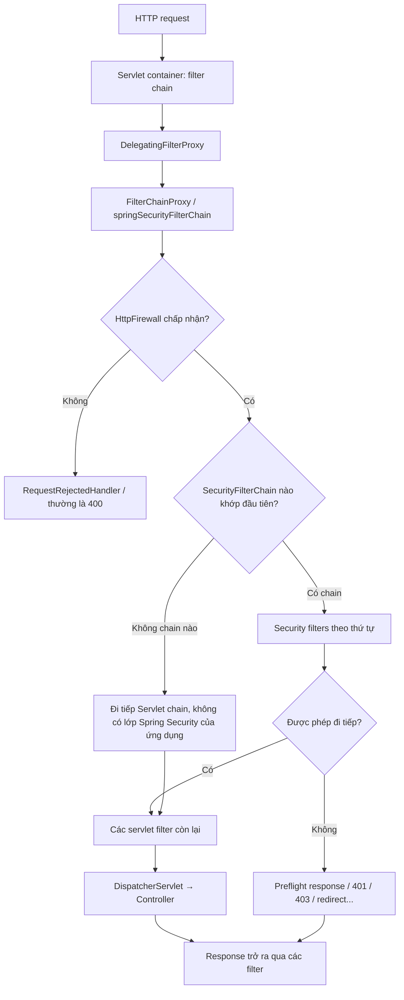
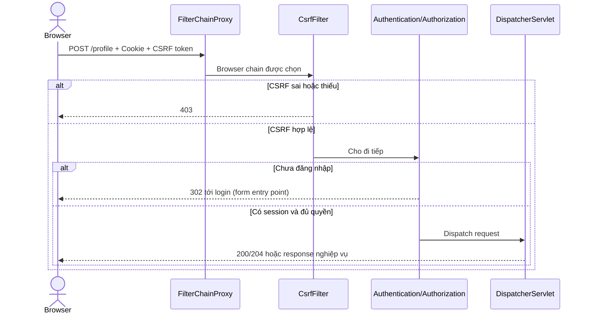
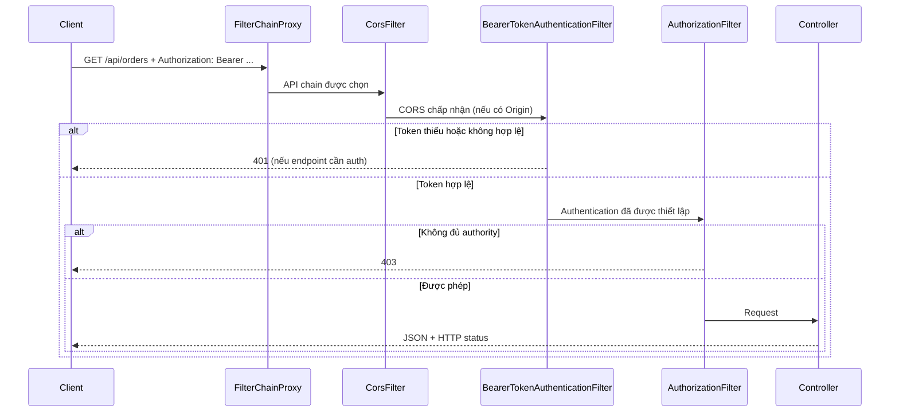

# SecurityFilterChain và đường đi của yêu cầu Servlet

> **Chương:** Kiến trúc áp dụng  
> **Phạm vi:** Spring Security HTTP Protection trên nền Servlet. Bài học giải thích cách Spring Security tiếp nhận, phân luồng, xác thực, phân quyền và bảo vệ một HTTP request; từ đó xác định vị trí của CSRF, CORS, security headers, CSP, HSTS, HTTP firewall và session. Những khác biệt quan trọng với Reactive được nêu rõ để tránh áp dụng nhầm API.

## 1. Kết quả cần đạt

Sau bài học, người học có thể:

1. Vẽ và giải thích đường đi của một HTTP request từ Servlet container đến `DispatcherServlet`, qua `DelegatingFilterProxy`, `FilterChainProxy` và các security filter.
2. Phân biệt **Servlet Filter**, **`SecurityFilterChain`**, **quy tắc authorization** và **controller interceptor**; giải thích vì sao cùng một request có thể đi qua nhiều loại filter nhưng chỉ chọn một `SecurityFilterChain`.
3. Cấu hình nhiều `SecurityFilterChain` cho API và ứng dụng web, dự đoán chain được chọn khi các `RequestMatcher` chồng lấn.
4. Chỉ ra filter hoặc thành phần xử lý các tác vụ CORS, CSRF, security headers, authentication, authorization, session và HTTP firewall.
5. Giải thích kết quả `200/204`, `302`, `400`, `401` và `403` dựa trên luồng xử lý, thay vì suy đoán chỉ từ mã trạng thái.
6. Viết kiểm thử xác nhận các kịch bản HTTP protection và dùng log filter chain để chẩn đoán sự cố.

## 2. Ba lớp cần phân biệt

Một ứng dụng Spring MVC chạy trên Servlet stack có ba khái niệm dễ bị nhầm lẫn.

| Thành phần | Được tạo/đăng ký ở đâu? | Trách nhiệm |
|---|---|---|
| **Servlet `Filter`** | Servlet container (Tomcat, Jetty, Undertow...) quản lý chuỗi filter. | Bao quanh request/response; có thể dừng request, chuyển tiếp hoặc gọi `FilterChain.doFilter(...)`. |
| **`DelegatingFilterProxy`** | Đăng ký với Servlet container; ủy quyền cho một Spring bean. | Nối vòng đời Servlet container với Spring application context; thường tìm bean tên `springSecurityFilterChain`. |
| **`FilterChainProxy`** | Spring Security cung cấp dưới tên `springSecurityFilterChain`. | Áp dụng HTTP firewall, chọn **một** `SecurityFilterChain` đầu tiên phù hợp request và gọi các security filter của chain đó. |
| **`SecurityFilterChain`** | Spring bean cấu hình bằng `HttpSecurity.build()`. | Chứa điều kiện khớp request và danh sách security filter cho nhóm request. Bản thân nó không phải servlet filter đăng ký trực tiếp với container. |
| **Quy tắc `authorizeHttpRequests`** | Cấu hình bên trong một `SecurityFilterChain`. | Xác định tài nguyên được `permitAll`, cần `authenticated` hoặc cần authority/role. Không có chức năng chọn chain. |
| **Spring MVC `HandlerInterceptor`** | Spring MVC gọi sau khi request đã đi đến `DispatcherServlet`. | Xử lý quanh handler MVC; không thay thế được lớp bảo vệ HTTP trước MVC. |

Luồng tổng quan (sơ đồ giản lược, thứ tự filter thực tế tùy cấu hình và phiên bản):



**Nguyên tắc quan trọng:** `FilterChainProxy` duyệt các `SecurityFilterChain` theo thứ tự ưu tiên và chọn **chain đầu tiên** có `matches(request) = true`. Nó không ghép filter của hai chain khớp cùng một request. Bên trong chain được chọn, các filter được gọi theo thứ tự đã cấu hình; mỗi filter có thể gọi tiếp hoặc kết thúc request sớm.

## 3. Một request đi qua Spring Security như thế nào?

Giả sử trình duyệt gửi:

```http
POST /profile HTTP/1.1
Host: app.example.com
Cookie: JSESSIONID=...
Content-Type: application/x-www-form-urlencoded

displayName=Lan&_csrf=...
```

### Chặng 1 — Servlet container và `DelegatingFilterProxy`

Servlet container nhận request, xây dựng chuỗi Servlet filter theo đăng ký và dispatcher type, rồi gọi từng filter. Trong ứng dụng Spring Boot dùng Spring Security, tích hợp framework thường đăng ký một `DelegatingFilterProxy` trỏ đến Spring bean `springSecurityFilterChain`. Bean đích là `FilterChainProxy`.

Điểm này giải thích hai hiện tượng thực tế:

- Các Servlet filter khác (logging, tracing, compression...) có thể chạy **trước hoặc sau** proxy tùy thứ tự đăng ký.
- Một custom filter vừa được đăng ký tự động như Servlet `Filter` bean, vừa được thêm bằng `http.addFilterBefore/After(...)` có nguy cơ chạy **hai lần**. Cần chủ động kiểm soát việc đăng ký nếu muốn nó chỉ chạy bên trong Spring Security.

### Chặng 2 — HTTP firewall kiểm tra request

`FilterChainProxy` sử dụng `HttpFirewall` để tạo request/response đã được kiểm tra. Cấu hình mặc định thường dùng `StrictHttpFirewall`: nó chặn nhiều dạng URL bất thường hoặc nguy hiểm, chẳng hạn đường dẫn không chuẩn hóa, một số ký tự mã hóa, ký tự điều khiển hay dấu chấm phẩy trong đường dẫn tùy trường hợp.

Khi request bị từ chối tại đây, nó có thể **chưa đến CSRF, authentication, authorization hoặc controller**. Ngoại lệ `RequestRejectedException` được xử lý bởi `RequestRejectedHandler` (mặc định thường tạo HTTP 400 trong cấu hình hiện đại; cấu hình ứng dụng có thể thay đổi kết quả). Trình duyệt thấy 400 không có nghĩa là controller đã nhận request.

### Chặng 3 — Chọn `SecurityFilterChain`

Mỗi chain có một matcher ở **cấp chain**. Ví dụ, chain API có `securityMatcher("/api/**")`, chain web dự phòng áp dụng cho mọi đường dẫn khác. `FilterChainProxy` chỉ lấy chain khớp đầu tiên.

Sự khác biệt đặc biệt quan trọng:

- `http.securityMatcher("/api/**")` quyết định **request có bước vào chain API hay không**.
- `authorizeHttpRequests(a -> a.requestMatchers("/api/public/**").permitAll())` chỉ quyết định **ủy quyền bên trong chain đã được chọn**.
- `permitAll()` **không bỏ qua** firewall, CORS, CSRF, các security header filter hoặc những security filter còn lại trong chain.
- Nếu **không có chain nào khớp**, Spring Security không bảo vệ request đó qua `FilterChainProxy`. Một chain dự phòng là cách giảm sai sót này.

### Chặng 4 — Các security filter xử lý theo thứ tự

Một chuỗi điển hình có thể gồm:

```text
SecurityContextHolderFilter
  → HeaderWriterFilter
  → CorsFilter (nếu bật và có cấu hình)
  → CsrfFilter (nếu bật)
  → LogoutFilter
  → Các authentication filter phù hợp cơ chế đăng nhập
  → RequestCacheAwareFilter / SecurityContextHolderAwareRequestFilter
  → AnonymousAuthenticationFilter
  → ExceptionTranslationFilter
  → AuthorizationFilter
  → Servlet FilterChain còn lại
  → DispatcherServlet / Controller
```

Đây là **sơ đồ khái niệm**, không phải danh sách bất biến. Filter có mặt và thứ tự chính xác phụ thuộc phiên bản, các tính năng được bật và filter do ứng dụng thêm. Chẳng hạn, `UsernamePasswordAuthenticationFilter` xuất hiện khi bật form login; `BearerTokenAuthenticationFilter` thường xuất hiện với OAuth2 Resource Server; `SessionManagementFilter` không mặc nhiên xuất hiện trong mọi chain của Spring Security 6 trở lên.

Một filter gọi `chain.doFilter(request, response)` để tiếp tục. Nếu nó kết luận request phải dừng (preflight CORS, CSRF sai, logout hoàn tất, authentication thất bại...), controller sẽ không được gọi. Code sau lời gọi `doFilter(...)` hoặc trong `finally` thường chạy khi stack trả về.

### Chặng 5 — Tạo/khôi phục danh tính và quyết định truy cập

`SecurityContextHolderFilter` làm cho `SecurityContext` có thể được nạp từ `SecurityContextRepository` khi request sử dụng. Authentication filter tương ứng kiểm tra credentials: form login, HTTP Basic, Bearer token... Nếu xác thực thành công, `Authentication` được đặt vào `SecurityContextHolder`; cơ chế có hỗ trợ session sẽ lưu context theo chính sách của nó.

Ở các cấu hình hiện đại, `SecurityContextHolderFilter` **không tự động lưu context thay mọi authentication filter**; đường đi xác thực/lưu trữ cần tuân theo cơ chế `SecurityContextRepository` đang dùng. Không nên giả định cứ gọi `SecurityContextHolder.setContext(...)` là tự động tồn tại qua request kế tiếp.

Nếu chưa có người dùng đăng nhập, `AnonymousAuthenticationFilter` có thể tạo anonymous authentication. `AuthorizationFilter` đánh giá quy tắc với request và authentication hiện tại. Anonymous authentication không đáp ứng yêu cầu `authenticated()`.

`ExceptionTranslationFilter` chuyển các `AuthenticationException` và `AccessDeniedException` phát sinh ở phần chain phía sau nó thành hành vi HTTP thích hợp. Thông thường:

- Không đủ authentication → kích hoạt `AuthenticationEntryPoint` (API Bearer thường 401; web form login thường redirect 302).
- Đã xác thực nhưng thiếu quyền → `AccessDeniedHandler` (thường 403).
- Với **CSRF bị từ chối**, `CsrfFilter` có thể trực tiếp dùng `AccessDeniedHandler` của nó để trả 403; không nên gán mọi 403 cho `AuthorizationFilter`.

### Chặng 6 — MVC xử lý và response quay ngược

Nếu không filter nào kết thúc request, nó đến phần tiếp theo của Servlet filter chain rồi `DispatcherServlet`, được ánh xạ tới controller. Response trả ra qua các filter theo thứ tự stack ngược lại. `HeaderWriterFilter` bổ sung các header theo chính sách đã cấu hình (tùy thời điểm commit response).

Cuối lượt xử lý, ngữ cảnh bảo mật gắn với request/thread phải được làm sạch để tránh rò thông tin danh tính giữa các request xử lý lại trên thread dùng chung. Với async dispatch hoặc ERROR/FORWARD dispatch, cần xem quy tắc dispatcher type và hành vi của từng filter; đừng mặc định mọi lần dispatch đều có cùng một chuỗi.

## 4. Chọn nhiều chain: ưu tiên là một phần của chính sách bảo mật

Một ứng dụng có thể vừa phục vụ browser MVC bằng session/cookie, vừa có REST API nhận Bearer token. Hai kiểu traffic có threat model khác nhau nên thường cần hai chain.

```java
@Configuration
@EnableWebSecurity
public class SecurityConfig {

    @Bean
    @Order(1)
    SecurityFilterChain apiSecurity(HttpSecurity http) throws Exception {
        http
            .securityMatcher("/api/**")
            .cors(Customizer.withDefaults())
            .csrf(AbstractHttpConfigurer::disable)
            .sessionManagement(session -> session
                .sessionCreationPolicy(SessionCreationPolicy.STATELESS))
            .authorizeHttpRequests(auth -> auth
                .requestMatchers(HttpMethod.GET, "/api/catalog/**").permitAll()
                .anyRequest().authenticated())
            .oauth2ResourceServer(oauth2 -> oauth2
                .jwt(Customizer.withDefaults()));
        return http.build();
    }

    @Bean
    @Order(2)
    SecurityFilterChain browserSecurity(HttpSecurity http) throws Exception {
        http
            .authorizeHttpRequests(auth -> auth
                .requestMatchers("/login", "/assets/**").permitAll()
                .anyRequest().authenticated())
            .csrf(Customizer.withDefaults())
            .formLogin(Customizer.withDefaults())
            .headers(headers -> headers
                .contentSecurityPolicy(csp -> csp
                    .policyDirectives(
                        "default-src 'self'; object-src 'none'; " +
                        "base-uri 'self'; frame-ancestors 'none'")));
        return http.build();
    }

    @Bean
    CorsConfigurationSource corsConfigurationSource() {
        CorsConfiguration cors = new CorsConfiguration();
        cors.setAllowedOrigins(List.of("https://client.example.com"));
        cors.setAllowedMethods(List.of("GET", "POST", "PUT", "PATCH", "DELETE"));
        cors.setAllowedHeaders(List.of(
            "Authorization", "Content-Type", "X-CSRF-TOKEN"));
        cors.setMaxAge(1800L);

        UrlBasedCorsConfigurationSource source =
            new UrlBasedCorsConfigurationSource();
        source.registerCorsConfiguration("/api/**", cors);
        return source;
    }
}
```

Các import chính cần có (IDE có thể hỗ trợ tự động import):

```java
import java.util.List;
import org.springframework.context.annotation.Bean;
import org.springframework.context.annotation.Configuration;
import org.springframework.core.annotation.Order;
import org.springframework.http.HttpMethod;
import org.springframework.security.config.Customizer;
import org.springframework.security.config.annotation.web.builders.HttpSecurity;
import org.springframework.security.config.annotation.web.configuration.EnableWebSecurity;
import org.springframework.security.config.annotation.web.configurers.AbstractHttpConfigurer;
import org.springframework.security.config.http.SessionCreationPolicy;
import org.springframework.security.web.SecurityFilterChain;
import org.springframework.web.cors.CorsConfiguration;
import org.springframework.web.cors.CorsConfigurationSource;
import org.springframework.web.cors.UrlBasedCorsConfigurationSource;
```

**Điều kiện áp dụng ví dụ:** API thực sự dùng Bearer token trong header `Authorization`, không dựa vào session cookie hoặc cơ chế credential được trình duyệt tự đính kèm. Ứng dụng phải có dependency Spring Security OAuth2 Resource Server và cấu hình `JwtDecoder` phù hợp (ví dụ theo issuer). Việc tắt CSRF ở chain API **chỉ hợp lý khi đã xác minh threat model đó**; REST/JSON không tự động đồng nghĩa không cần CSRF. Chain browser giữ CSRF mặc định. CSP minh họa phải được điều chỉnh theo script/style/font/iframe thực tế và thử ở chế độ report-only trước khi áp chặt trên hệ thống đang chạy.

Bảng đối chiếu matcher:

| Request | Chain được chọn | Lý do |
|---|---|---|
| `GET /api/catalog/items` | API | Khớp `/api/**`; `GET /api/catalog/**` được `permitAll`. |
| `POST /api/orders` | API | Khớp `/api/**`; cần authentication Bearer. |
| `GET /assets/site.css` | Browser | Không khớp API; browser chain dự phòng, `permitAll` cho assets. |
| `POST /profile` | Browser | Không khớp API; được kiểm tra CSRF và authentication. |
| `GET /admin` | Browser | Chain dự phòng yêu cầu xác thực; nếu cần quyền quản trị, thêm quy tắc authority/role. |

**Đọc bảng theo hai bước:** (1) chọn chain; (2) xét quy tắc trong chain đó. Ví dụ `GET /api/catalog/items` dù `permitAll` vẫn chịu HTTP firewall, CORS và các header/security filter có trong API chain. Nếu client gửi Bearer token **không hợp lệ** vào một endpoint công khai, authentication filter có thể vẫn trả 401 trước khi authorization đi tới `permitAll`.

### 4.1. Các lỗi matcher thường gặp

**Lỗi 1 — Đặt catch-all ở `@Order(1)`.** Nếu chain đầu tiên khớp mọi request, `/api/**` cũng vào chain đó, khiến chain API phía sau không bao giờ được chọn. Ưu tiên chain chuyên biệt trước chain tổng quát.

**Lỗi 2 — Chỉ có chain cho `/api/**`.** Những request ngoài `/api/**` không đi qua Spring Security nếu không tồn tại chain khớp khác. Hãy xác định rõ nhu cầu của mọi vùng URL và dùng fallback phù hợp.

**Lỗi 3 — Coi `requestMatchers(...).permitAll()` là `web.ignoring()`.** `web.ignoring()` loại request khỏi Spring Security filter chain, làm mất các lớp xử lý bảo mật của chain (chẳng hạn security headers). Với tài nguyên tĩnh thông thường, ưu tiên `permitAll()`.

**Lỗi 4 — Dùng tên controller để suy luận matcher.** Matcher đánh giá request HTTP (đường dẫn, phương thức, ngữ cảnh Servlet... theo loại matcher), không dựa vào tên method Java. Cần xét servlet path/context path, kiểu matcher và routing thực tế.

**Lỗi 5 — Bỏ qua dispatch khác `REQUEST`.** Forward hoặc error rendering có thể có hành vi authorization khác đường đi request gốc. Khi phát sinh `403` ở error page hoặc async flow, kiểm tra dispatcher types và cấu hình security tương ứng.

## 5. Lớp phòng vệ đặt ở đâu trong chain?

| Lớp phòng vệ | Thành phần điển hình | Tình huống hoạt động và điểm cần nhớ |
|---|---|---|
| **HTTP firewall** | `HttpFirewall` / `StrictHttpFirewall` quanh `FilterChainProxy` | Từ chối dạng request bất thường trước khi chọn chain/filter. Không phải MVC validation và không thay thế validation dữ liệu đầu vào. |
| **CORS** | `CorsFilter` từ `http.cors(...)` và `CorsConfigurationSource` | Phải xử lý preflight trước kiểm tra authentication vì preflight thường không có session cookie. CORS là chính sách trình duyệt, không phải cơ chế xác thực. |
| **CSRF** | `CsrfFilter` và `CsrfTokenRepository` | Kiểm tra token cho phương thức không an toàn theo cấu hình; thường cần khi authentication dựa trên cookie/session. |
| **Security headers** | `HeaderWriterFilter` | Ghi header giảm rủi ro ở phía trình duyệt. Chính sách thực tế tùy cấu hình và HTTPS. |
| **CSP** | Cấu hình header `Content-Security-Policy` | Giới hạn nguồn nội dung thực thi/tải vào trang. Không có CSP đầy đủ mặc định cho mọi ứng dụng; cần định nghĩa cụ thể. |
| **HSTS** | Header `Strict-Transport-Security` | Báo trình duyệt tiếp tục dùng HTTPS. Chỉ có ý nghĩa khi browser nhận trên kết nối HTTPS; cần cấu hình reverse proxy đúng. |
| **Authentication** | Form login, Basic, Bearer, OAuth2... | Thiết lập danh tính/credentials và context. Filter cụ thể phụ thuộc cơ chế bật trong chain. |
| **Authorization** | `AuthorizationFilter` / `AuthorizationManager` | Quyết định có cho request đi đến tài nguyên hay không. |
| **Session** | `SecurityContextRepository`, authentication/session strategies, `HttpSession` | Xác định context có được lưu qua request không, có tạo session và session fixation protection không. |
| **Exception handling** | `ExceptionTranslationFilter`, entry point, access denied handler | Biến lỗi truy cập từ downstream thành response phù hợp; không phải mọi lỗi 403 đều đi qua thành phần này. |

### 5.1. CSRF: vì sao POST bị 403 trước khi controller chạy?

CSRF khai thác việc trình duyệt tự gửi credential (chẳng hạn session cookie) đến một origin. Kẻ tấn công có thể khiến browser gửi request thay đổi trạng thái, dù không đọc được response. CSRF token buộc request thay đổi trạng thái mang thêm giá trị mà bên thứ ba không tùy ý cung cấp được.

Trong chain browser, `CsrfFilter` kiểm tra các request không thuộc nhóm method an toàn (thông thường `POST`, `PUT`, `PATCH`, `DELETE`). Với form Spring MVC render từ server, có thể gửi token bằng hidden input:

```html
<form action="/profile" method="post">
  <input type="text" name="displayName">
  <input type="hidden" name="_csrf" value="TOKEN_DO_SERVER_CUNG_CAP">
  <button type="submit">Lưu</button>
</form>
```

Đoạn HTML chỉ mô tả hình dạng field. Trong ứng dụng thực, **không hard-code token**; template/view lấy token mà Spring Security cấp cho request, đồng thời dùng đúng tên parameter hoặc header đã cấu hình. Với SPA, cần xét token lấy từ cookie/header, deferred token, cơ chế chống BREACH và cách làm mới token sau login/logout. Chỉ đặt cookie chứa CSRF token mà không gửi token theo cơ chế server kiểm tra sẽ không giải quyết được vấn đề.

Quy trình phân tích `POST /profile → 403`:

1. Xác định request đã vào browser chain hay chưa.
2. Kiểm tra `CsrfFilter` đang bật và request có token hợp lệ chưa.
3. Nếu qua CSRF, kiểm tra authentication và quy tắc authorization.
4. Nếu dùng fetch/AJAX từ origin khác, kiểm tra CORS riêng; CORS thành công không có nghĩa CSRF đã thành công.

**Phân biệt:** CORS kiểm soát quyền JavaScript ở origin khác truy cập response và điều kiện gửi cross-origin request; CSRF ngăn hành động trái phép dựa vào credential tự đính kèm. Chúng giải quyết hai vấn đề khác nhau.

### 5.2. CORS: preflight có thể dừng tại `CorsFilter`

Trước khi browser gửi một số cross-origin request, nó gửi preflight:

```http
OPTIONS /api/orders HTTP/1.1
Origin: https://client.example.com
Access-Control-Request-Method: POST
Access-Control-Request-Headers: authorization,content-type
```

`CorsFilter` kiểm tra origin/method/headers được phép và có thể trả ngay preflight response với `Access-Control-Allow-Origin`, `Access-Control-Allow-Methods`, `Access-Control-Allow-Headers`... mà không chạy authentication hoặc controller. Với request thực tế, response vẫn cần chính sách CORS thích hợp; request được nhận diện bằng token Bearer nếu endpoint yêu cầu.

Một số điểm cần kiểm chứng khi cấu hình:

- Chỉ cho phép origin tin cậy cần thiết; cấu hình CORS là **allowlist origin**, không phải thay cho `authenticated()`.
- Nếu bật `allowCredentials(true)`, không dùng literal wildcard `*` cho allowed origins trong response credentialed; dùng danh sách origin cụ thể hoặc pattern được kiểm soát.
- Browser `Origin` có thể khác host của backend; kiểm tra cả protocol, domain và port.
- Nếu preflight bị trả `401`, thường là do xử lý CORS chưa xảy ra trước authentication, chưa cấu hình CORS cho chain phù hợp hoặc có filter khác chặn từ trước.
- CORS trong Spring MVC và trong Spring Security có thể phối hợp, nhưng không nên vô tình tạo các cấu hình mâu thuẫn; với nhiều `CorsConfigurationSource` cần xác định rõ source được chain sử dụng.

### 5.3. Security headers, CSP và HSTS

Một số header phổ biến do Spring Security hỗ trợ:

| Header | Mục đích | Chú ý |
|---|---|---|
| `X-Content-Type-Options: nosniff` | Giảm MIME sniffing. | Thường nằm trong bộ security headers mặc định. |
| `X-Frame-Options` | Giảm nguy cơ clickjacking do iframe. | Có thể dùng chính sách `frame-ancestors` của CSP cho browser hiện đại. |
| `Cache-Control` và liên quan | Hạn chế cache nội dung nhạy cảm. | Kiểm tra yêu cầu cache tài nguyên công khai của ứng dụng. |
| `Content-Security-Policy` | Hạn chế nguồn script/style/frame/... | **Không tự có policy hoàn chỉnh mặc định**; phải cấu hình. |
| `Strict-Transport-Security` | Ghi nhớ chỉ truy cập HTTPS. | Chỉ được trình duyệt tin cậy khi trả qua HTTPS; triển khai sau khi xác minh HTTPS toàn site/subdomain. |

Ví dụ response từ một trang đã cấu hình:

```http
HTTP/1.1 200 OK
X-Content-Type-Options: nosniff
Content-Security-Policy: default-src 'self'; object-src 'none'; base-uri 'self'; frame-ancestors 'none'
Strict-Transport-Security: max-age=31536000; includeSubDomains
```

Response này chỉ minh họa; HSTS, CSP và giá trị directive thực tế tùy cấu hình. HSTS không tự nâng cấp một HTTP response đầu tiên thành HTTPS và không bảo vệ kết nối chưa được xác thực. Khi TLS kết thúc ở reverse proxy, ứng dụng cần hiểu đúng scheme HTTPS từ proxy tin cậy; chấp nhận bừa các header `Forwarded`/`X-Forwarded-*` từ Internet có thể tạo lỗ hổng. Nếu browser tải tài nguyên từ CDN hoặc cần inline script, policy CSP phải điều chỉnh có kiểm soát (ưu tiên nonce/hash thích hợp thay vì nới `unsafe-inline` tràn lan).

### 5.4. HTTP firewall: không sửa policy để “chữa” mọi 400

Khi một route chứa ký tự đặc biệt hoặc URL đã encode bị từ chối, kiểm tra request thực tế và log `RequestRejectedException`. Trình tự xử lý hợp lý:

1. Xác định request có bị servlet container, reverse proxy hay `StrictHttpFirewall` từ chối.
2. Làm rõ URL hợp lệ được client yêu cầu và lý do phải chấp nhận ký tự bất thường.
3. Ưu tiên sửa cách encode/routing của client hoặc API contract.
4. Chỉ tùy biến `StrictHttpFirewall` khi có nhu cầu được chứng minh, giới hạn hẹp và kiểm thử các dạng path bypass, traversal, path parameter, double encoding.

Mở rộng `allowUrlEncodedSlash` hoặc cho phép semicolon không phải thao tác “bật cho chạy” an toàn mặc định; matcher, proxy và container có thể giải mã/chuẩn hóa URL theo cách khác nhau.

### 5.5. Session, cookie và context sống qua request

Với browser form login, sau khi xác thực thành công, context có thể được lưu vào `HttpSession` theo `SecurityContextRepository`; cookie phiên giúp request sau gắn lại với session. Các điểm cần xem cùng lúc:

- `SessionCreationPolicy.STATELESS` yêu cầu Spring Security không tạo/không dùng `HttpSession` để lấy `SecurityContext` trong chain được cấu hình; **không tự động ngăn mọi thành phần khác của ứng dụng tạo cookie/session**.
- Session fixation protection có thể đổi session ID sau khi đăng nhập; logout cần hủy/clear session và authentication theo cấu hình.
- Cookie session cần thuộc tính `Secure` trên HTTPS, `HttpOnly` và `SameSite` phù hợp. `SameSite` hỗ trợ giảm rủi ro CSRF nhưng không thay thế CSRF token trong mọi bối cảnh.
- Khi browser xác thực bằng session cookie, các request thay đổi trạng thái vẫn cần thiết kế CSRF; khi API chỉ nhận Bearer token trong header do client gắn thủ công và không dựa vào credential trình duyệt tự gửi, CSRF thường có thể tắt cho chain API đó.

**Chi tiết phiên bản:** Các bài viết cũ thường mô tả `SecurityContextPersistenceFilter` và `FilterSecurityInterceptor` như thành phần mặc định; cấu hình mới thiên về `SecurityContextHolderFilter` và `AuthorizationFilter`. Không copy danh sách filter từ phiên bản khác rồi kết luận ứng dụng thiếu thành phần.

## 6. Hai đường đi điển hình: browser session và API Bearer

### 6.1. Browser: `POST /profile`



Một form login mặc định còn có request `POST /login` để authentication filter xử lý trước khi MVC controller; CSRF của login form vẫn cần hợp lệ. Nếu user đăng nhập thành công nhưng thiếu quyền truy cập một trang, response thường là 403. Nếu chưa xác thực, ứng dụng web thường redirect đến trang login (302) thay vì trả 401 JSON.

### 6.2. API: `GET /api/orders` với Bearer token



Sơ đồ gộp một số nhánh: nếu **không có** Bearer token, filter xác thực có thể cho request đi tiếp; `AuthorizationFilter` sau đó từ chối endpoint cần đăng nhập và entry point trả 401. Nếu token **có nhưng không hợp lệ**, Bearer filter có thể dừng ngay. CORS preflight hợp lệ có thể kết thúc tại `CorsFilter`, trước cả Bearer filter.

Không dùng response status đơn độc để kết luận request bị chặn ở đâu; cùng một 403 có thể xuất phát từ CSRF, thiếu quyền, firewall tùy biến hoặc logic ứng dụng.

## 7. Viết custom filter: chọn vị trí và tránh đăng ký hai lần

Khi cần đo thời gian qua security chain để quan sát (không dùng nội dung request nhạy cảm), có thể viết một `OncePerRequestFilter` riêng:

```java
final class SecurityTimingFilter extends OncePerRequestFilter {
    private static final Logger log =
        LoggerFactory.getLogger(SecurityTimingFilter.class);

    @Override
    protected void doFilterInternal(
            HttpServletRequest request,
            HttpServletResponse response,
            FilterChain chain) throws ServletException, IOException {
        long start = System.nanoTime();
        try {
            chain.doFilter(request, response);
        } finally {
            long elapsedMicros =
                (System.nanoTime() - start) / 1_000L;
            log.debug("Security path={} elapsed={}us",
                request.getRequestURI(), elapsedMicros);
        }
    }
}
```

Thêm bên trong một chain bằng:

```java
http.addFilterBefore(
    new SecurityTimingFilter(), AuthorizationFilter.class);
```

Các import của đoạn filter là `jakarta.servlet.FilterChain`, `jakarta.servlet.ServletException`, `jakarta.servlet.http.HttpServletRequest/Response`, `java.io.IOException`, `org.slf4j.Logger/LoggerFactory` và `org.springframework.web.filter.OncePerRequestFilter`; vị trí thêm filter cần import `org.springframework.security.web.access.intercept.AuthorizationFilter`.

Đây chỉ là ví dụ **đo thời gian**, không phải mẫu để tự xây authentication hoặc CSRF. Lưu ý:

- `addFilterBefore(..., AuthorizationFilter.class)` gắn vị trí tương đối với một filter Spring Security đã có thứ tự được định nghĩa; điều đó không đồng nghĩa filter quan sát được mọi request bị chặn ở các filter **trước đó** như CSRF hoặc CORS.
- Đừng đánh dấu class này `@Component` nếu đã tự tạo instance để thêm vào security chain, trừ khi chủ động vô hiệu hóa registration tại Servlet container; nếu không có thể bị chạy hai lần.
- `OncePerRequestFilter` có quy tắc riêng cho async/error dispatch. Không giả định “một lần trên mọi luồng” nếu ứng dụng dùng async.
- Tránh log Bearer token, cookie, CSRF token hoặc request body chứa dữ liệu nhạy cảm.

## 8. Kiểm thử đường đi với MockMvc

Sử dụng `spring-security-test` cùng Spring MVC Test. Ví dụ giả định ứng dụng có endpoint `POST /profile` trả `204 No Content` sau khi cập nhật hợp lệ, và `GET /api/catalog/items` trả `200 OK`. Cần chỉnh assertion theo controller thực tế; kiểm thử ví dụ sử dụng cấu hình security ở mục 4 và một `JwtDecoder` được cấu hình cho ứng dụng.

```java
@SpringBootTest
@AutoConfigureMockMvc
class SecurityFlowTest {

    @Autowired MockMvc mvc;

    @Test
    void browserPostWithoutCsrfStopsBeforeController() throws Exception {
        mvc.perform(post("/profile")
                .with(user("lan").roles("USER")))
            .andExpect(status().isForbidden());
    }

    @Test
    void browserPostWithCsrfCanReachController() throws Exception {
        mvc.perform(post("/profile")
                .with(user("lan").roles("USER"))
                .with(csrf()))
            .andExpect(status().isNoContent());
    }

    @Test
    void publicApiGetIsAccessibleWithoutBearer() throws Exception {
        mvc.perform(get("/api/catalog/items"))
            .andExpect(status().isOk())
            .andExpect(header().string("X-Content-Type-Options", "nosniff"));
    }

    @Test
    void protectedApiRejectsAnonymousRequest() throws Exception {
        mvc.perform(get("/api/orders"))
            .andExpect(status().isUnauthorized());
    }

    @Test
    void corsPreflightIsHandledBeforeAuthentication() throws Exception {
        mvc.perform(options("/api/orders")
                .header("Origin", "https://client.example.com")
                .header("Access-Control-Request-Method", "POST")
                .header("Access-Control-Request-Headers", "authorization"))
            .andExpect(status().isOk())
            .andExpect(header().string(
                "Access-Control-Allow-Origin",
                "https://client.example.com"));
    }
}
```

Các static import chính của test:

```java
import static org.springframework.security.test.web.servlet.request.SecurityMockMvcRequestPostProcessors.*;
import static org.springframework.test.web.servlet.request.MockMvcRequestBuilders.*;
import static org.springframework.test.web.servlet.result.MockMvcResultMatchers.*;
```

và `@SpringBootTest`, `@AutoConfigureMockMvc`, `@Autowired`, `@Test`, `MockMvc` theo framework. Các test trên minh họa **hành vi mong đợi** khi route và bean cần thiết đã được triển khai; không phải khẳng định mọi dự án đều có `/profile` và `/api/orders`.

### 8.1. Ma trận kiểm thử tối thiểu

| Kịch bản | Điều kiện đầu vào | Kỳ vọng | Cần quan sát |
|---|---|---|---|
| Form thay đổi dữ liệu thiếu CSRF | POST browser, đã xác thực, thiếu token | 403 | `CsrfFilter` chặn trước MVC. |
| Form hợp lệ | POST browser, đã xác thực, CSRF hợp lệ | Status nghiệp vụ (vd. 204) | MVC được gọi; dữ liệu thay đổi hợp lệ. |
| Anonymous đến tài nguyên web cần auth | GET web private | Thường 302 | Form `AuthenticationEntryPoint` redirect login. |
| Anonymous đến API private | GET API không Bearer | Thường 401 | API chain và Bearer entry point. |
| Bearer token sai | Header Bearer không hợp lệ | Thường 401 | Authentication thất bại; không cho phép nhờ `permitAll` nếu token bị xử lý lỗi. |
| Đã auth nhưng thiếu quyền | GET API private với token hợp lệ thiếu authority | 403 | Authorization, không phải CSRF. |
| Preflight origin/method cho phép | OPTIONS + Origin + preflight headers | Thường 200 | Có `Access-Control-Allow-Origin`; không đòi session. |
| Preflight origin không cho phép | OPTIONS + Origin lạ | Bị từ chối | Chính sách CORS không được nới ngoài ý muốn. |
| CSP trên trang web | GET trang có response HTML | Header CSP theo policy | Browser còn hoạt động đúng với asset hợp lệ. |
| HSTS | HTTPS thật từ góc nhìn ứng dụng/proxy | HSTS khi cấu hình phù hợp | Không suy luận HSTS từ request HTTP thuần. |
| URL bất thường | URL mã hóa/không chuẩn bị firewall cấm | Bị từ chối trước controller | `RequestRejectedException`/request rejection handler. |
| Static resource | GET `/assets/**` | Tài nguyên công khai, vẫn qua web chain | Security headers còn được áp dụng. |

**Giới hạn kiểm thử:** MockMvc mô phỏng Servlet request nhưng không tái hiện đầy đủ TLS, DNS, trình duyệt, reverse proxy hay mọi thao tác encode URL của container. Để xác minh HSTS/CSP/CORS thật, kết hợp integration test qua HTTP(S) với kiểm tra Network tab của trình duyệt. Kiểm thử preflight và cookie attributes nên chạy trong môi trường gần cấu hình triển khai.

## 9. Chẩn đoán theo dấu hiệu thay vì tắt bảo vệ

Bật log theo phạm vi đủ hẹp ở môi trường phát triển:

```properties
logging.level.org.springframework.security.web.FilterChainProxy=TRACE
logging.level.org.springframework.security=DEBUG
```

Trace của `FilterChainProxy` giúp xác định request được bảo vệ và các filter lần lượt được gọi; tên log và mức chi tiết có thể khác theo phiên bản. Không nên bật lâu dài mức TRACE cho toàn bộ security trên production: log có thể nhiều và tạo nhiễu, cần kiểm soát dữ liệu nhạy cảm.

| Triệu chứng | Giả thuyết nên kiểm trước | Cách xác minh/sửa |
|---|---|---|
| API trả 302 trang login thay vì 401 | API request bị chain browser bắt | Kiểm tra `@Order`, `securityMatcher` và thứ tự chain; tạo test riêng cho `/api/**`. |
| API trả 401 khi gửi OPTIONS | Preflight bị authentication filter chặn | Kiểm tra CORS có hoạt động trong chain đúng và có cấu hình cho origin/method/header. |
| POST browser trả 403 dù đăng nhập | Thiếu/không hợp lệ CSRF token; cũng có thể thiếu quyền | Xem `CsrfFilter`, token được render/gửi, rồi kiểm tra `AuthorizationFilter`. |
| Request có token hợp lệ nhưng vẫn 403 | Bearer token thiếu authority | So sánh claims/authorities với quy tắc authorization và endpoint cụ thể. |
| Tài nguyên tĩnh mất security headers | Tài nguyên bị `web.ignoring()` hoặc đi ngoài chain | Dùng `permitAll()` trong chain phù hợp; kiểm tra response headers. |
| 400 trước MVC với URL đặc biệt | Container, proxy hoặc HTTP firewall từ chối | Xem log request rejection, canonicalization, encoding và routing. |
| HTTPS qua proxy nhưng thiếu HSTS | Backend nhận diện request là HTTP | Kiểm tra cấu hình proxy/TLS/forwarded headers tin cậy và response cuối. |
| Session vẫn phát sinh ở API stateless | Thành phần khác tạo session, hoặc request đi nhầm chain | Kiểm tra cookie, chain được chọn, request cache và code ứng dụng. |
| Custom filter chạy hai lần | Vừa đăng ký làm Servlet Filter vừa thêm vào SecurityFilterChain | Loại bỏ một đăng ký hoặc cấu hình `FilterRegistrationBean` disabled. |
| Error page bị 403 | Dispatcher type/authorization áp vào `ERROR` hoặc `FORWARD` | Phân tích luồng dispatch và chính sách cho error endpoint đúng nhu cầu. |

Để tìm nguyên nhân nhanh, luôn trả lời lần lượt: **(1)** request có vượt firewall không; **(2)** chain nào được chọn; **(3)** filter nào kết thúc request; **(4)** authorization có được chạy không; **(5)** controller có được gọi không. Đặc biệt, log có dòng “Securing request” **không** tự chứng minh controller đã chạy.

## 10. Bài tập áp dụng

**Bài tập A — dự đoán đường đi.** Với cấu hình mục 4, hãy xác định chain, filter quan trọng và response dự kiến cho:

1. `POST /profile` có session hợp lệ nhưng thiếu token CSRF.
2. `GET /api/orders` không có header Authorization.
3. `OPTIONS /api/orders` với origin `https://client.example.com` và preflight method POST.
4. `GET /api/catalog/items` gửi Bearer token hỏng.
5. `GET /assets/site.css` khi chưa đăng nhập.

Gợi ý tự kiểm: các trường hợp lần lượt hướng đến **CSRF 403**, **API authentication 401**, **CORS preflight được xử lý sớm**, **authentication filter có thể 401 dù route public**, và **browser chain `permitAll` vẫn áp các header bảo vệ**. Response thực tế cần được test với version/config đang chạy.

**Bài tập B — sửa lỗi chain.** Đổi `@Order(1)` của browser chain thành `@Order(0)`, chạy lại test API và giải thích vì sao `/api/orders` có thể bị chuyển đến form login. Sửa lại bằng thứ tự chain chuyên biệt trước fallback.

**Bài tập C — hoàn thiện phòng vệ.** Bổ sung một endpoint browser `POST /settings` có authorization theo role, CSRF, CSP cho trang settings; viết test cho cả thiếu CSRF và thiếu role. Bật logging để ghi nhận filter nơi request dừng, sau đó tắt TRACE.

**Bài tập D — quan sát triển khai.** Đặt ứng dụng sau TLS reverse proxy trong môi trường thử nghiệm. So sánh security headers khi truy cập HTTP và HTTPS, kiểm chứng `Strict-Transport-Security`, cookie `Secure/SameSite`, và xác định trusted proxy nào được phép khai báo scheme.

## 11. Ghi nhớ kiến trúc

- **Servlet container** vận hành chuỗi Servlet Filter; **`DelegatingFilterProxy`** chuyển việc sang **`FilterChainProxy`** của Spring Security.
- **`HttpFirewall`** kiểm tra request trước; **`FilterChainProxy`** chọn đúng **một `SecurityFilterChain` khớp đầu tiên**.
- **`securityMatcher` chọn chain**, còn **`authorizeHttpRequests` quyết định quyền trong chain**. `permitAll` vẫn giữ các filter phòng vệ của chain.
- **CSRF, CORS, headers, session, authentication và authorization** là các lớp riêng nằm tại các điểm khác nhau của luồng request. Một lớp cho phép không có nghĩa mọi lớp đều cho phép.
- **Không cố định danh sách filter theo trí nhớ**: kiểm tra cấu hình, phiên bản, debug log và test request cụ thể. Thiết kế an toàn được xác nhận bằng hành vi HTTP quan sát được, không chỉ bằng việc cấu hình biên dịch thành công.

> **Liên hệ Reactive:** WebFlux không dùng `HttpSecurity`, Servlet `SecurityFilterChain` hay `DelegatingFilterProxy`. Trên Reactive stack, thành phần tương ứng là `SecurityWebFilterChain` và `WebFilterChainProxy`, cấu hình bằng `ServerHttpSecurity`. Ý tưởng chọn chain theo matcher và xếp các lớp phòng vệ vẫn tồn tại, nhưng kiểu filter, quản lý context và API không hoán đổi trực tiếp giữa Servlet và Reactive.
