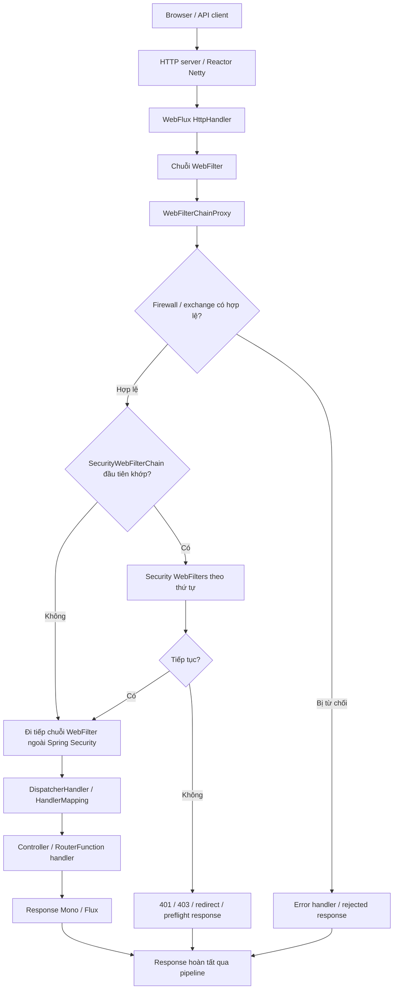
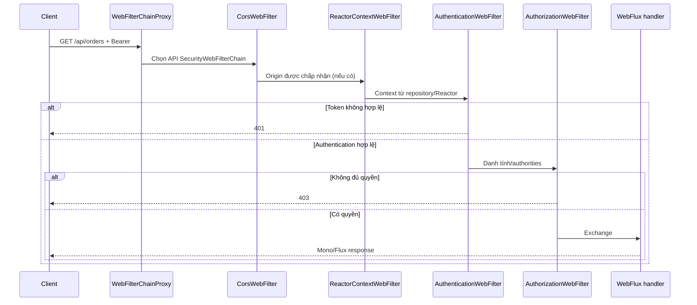
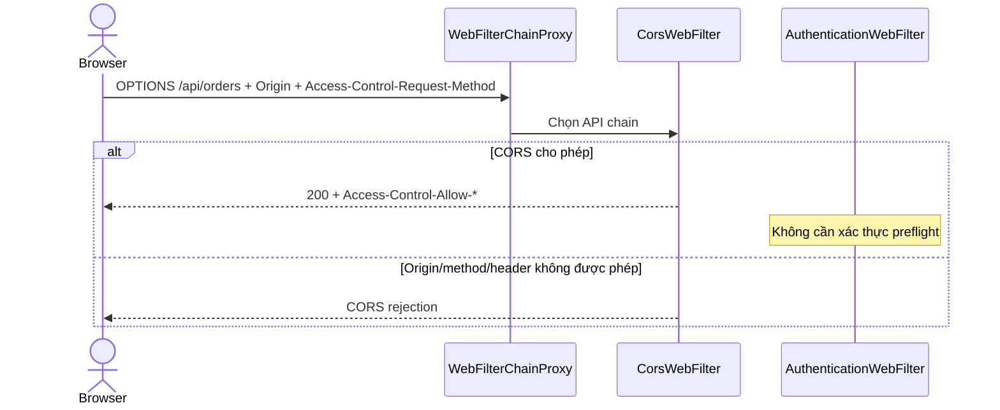
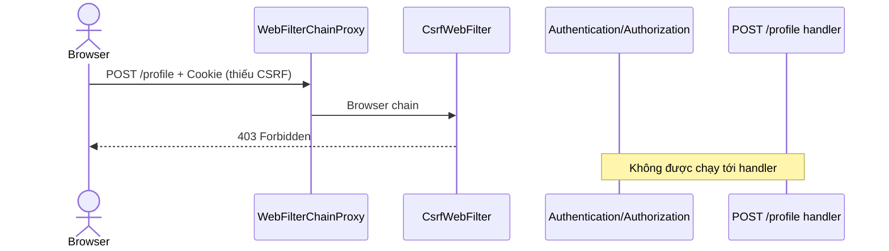

# SecurityWebFilterChain và đường đi của yêu cầu WebFlux

> **Chương:** Kiến trúc áp dụng  
> **Phạm vi module:** SPRING_SECURITY_HTTP_PROTECTION — áp dụng CSRF, CORS, security headers, CSP, HSTS, HTTP firewall và bảo vệ session trên HTTP. Bài này đi sâu vào **Reactive WebFlux**, đồng thời đối chiếu với Servlet để cấu hình và chẩn đoán đúng stack.

## 1. Mục tiêu học tập

Sau bài học, người học có thể:

1. Mô tả đường đi của một request từ HTTP server vào chuỗi `WebFilter`, qua `WebFilterChainProxy` và `SecurityWebFilterChain` đến `DispatcherHandler` hoặc WebFlux functional handler.
2. Phân biệt **`WebFilter`**, **`SecurityWebFilterChain`**, matcher chọn chain và quy tắc `authorizeExchange`.
3. Giải thích vì sao Spring Security WebFlux dùng **Reactor Context** và `ReactiveSecurityContextHolder`, không thể dựa vào `ThreadLocal` để giữ danh tính xuyên suốt luồng reactive.
4. Cấu hình hai chain cho API Bearer token và browser form login bằng `ServerHttpSecurity`, xác định tác dụng của `@Order` và `securityMatcher`.
5. Xác định vị trí các lớp CORS, CSRF, security headers, CSP, HSTS, HTTP firewall, authentication, authorization và session trong vòng đời request.
6. Sử dụng `WebTestClient` và hỗ trợ từ `spring-security-test` để chứng minh request được cho qua hoặc bị chặn trước handler; phân biệt lỗi 302, 400, 401 và 403.

## 2. WebFlux có một chuỗi bảo mật riêng

Spring Security hỗ trợ hai kiến trúc web khác nhau:

| Khía cạnh | Spring MVC / Servlet | Spring WebFlux / Reactive |
|---|---|---|
| API cấu hình HTTP | `HttpSecurity` | `ServerHttpSecurity` |
| Đối tượng chain | `SecurityFilterChain` | `SecurityWebFilterChain` |
| Filter | `jakarta.servlet.Filter` | `org.springframework.web.server.WebFilter` |
| Proxy điều phối | `FilterChainProxy` | `WebFilterChainProxy` |
| Đăng ký tích hợp | `DelegatingFilterProxy` trong Servlet container | WebFlux đăng ký `WebFilter` trong chuỗi xử lý web |
| Request/response | `HttpServletRequest` / `HttpServletResponse` | `ServerWebExchange` chứa `ServerHttpRequest` / `ServerHttpResponse` |
| Security context | `SecurityContextHolder` thường gắn với thread của request | `ReactiveSecurityContextHolder` dựa trên Reactor Context |
| Repository bảo mật | `SecurityContextRepository` | `ServerSecurityContextRepository` |
| Đầu mối MVC/HTTP handler | `DispatcherServlet` | `DispatcherHandler` hoặc WebFlux handler |
| Kiểu trả về của security filter | xử lý trực tiếp, gọi `FilterChain.doFilter` | `Mono<Void>` biểu diễn xử lý bất đồng bộ |

**Điểm cần nhớ:** WebFlux vẫn có thể chạy trên một Servlet container qua adapter, nhưng **Spring Security cho WebFlux vẫn dùng `WebFilter` và `SecurityWebFilterChain`**. Không áp dụng `HttpSecurity` hoặc `DelegatingFilterProxy` của Servlet cho pipeline bảo mật WebFlux.

Trong hệ thống WebFlux điển hình chạy trên Reactor Netty, đường đi khái niệm là:



Sơ đồ giản lược: firewall/rejected handler và vị trí của từng `WebFilter` phụ thuộc phiên bản Spring Security và cấu hình; lỗi cũng có thể đến từ reverse proxy, HTTP server, handler hoặc business logic. Không suy ra filter chặn request chỉ từ mã HTTP.

### 2.1. Các thành phần chính

**`WebFilter`** là giao diện WebFlux nhận `ServerWebExchange` và `WebFilterChain`, trả `Mono<Void>`. Một filter thường trả `chain.filter(exchange)` để cho xử lý đi tiếp; nếu trả một `Mono` hoàn tất response mà không gọi chain, request dừng tại đó.

**`WebFilterChainProxy`** là WebFilter do Spring Security dùng để điều phối nhiều `SecurityWebFilterChain`. Nó xét các chain theo thứ tự và chọn **chain đầu tiên có matcher trả kết quả đúng**. Không ghép các chain cùng khớp thành một.

**`SecurityWebFilterChain`** mô tả điều kiện áp dụng và tập security WebFilter. Các builder `ServerHttpSecurity` tạo chain đó. Trong các phiên bản Spring Security hiện đại, matcher hoạt động với `ServerWebExchange` và có thể trả kết quả reactive (`Mono<Boolean>`).

**`DispatcherHandler`** là bộ điều phối của WebFlux: ánh xạ handler bằng `HandlerMapping` và gọi handler qua adapter. Bảo mật ở tầng `WebFilter` bao quanh request **trước** khi đến controller hoặc functional handler.

**`ServerWebExchange`** gom request, response, thuộc tính, WebSession và các thông tin khác. Nó là đối tượng trao đổi HTTP, **không phải chỗ lưu danh tính có thể thay thế Reactor Context**.

### 2.2. “Chỉ một chain” khác “nhiều filter”

Một request có thể qua nhiều WebFilter tổng quát và nhiều security WebFilter, nhưng tại `WebFilterChainProxy` chỉ một `SecurityWebFilterChain` được chọn.

Ví dụ có ba chain theo thứ tự:

- Chain 1: `/admin/**`.
- Chain 2: `/api/**`.
- Chain 3: fallback khớp mọi đường dẫn.

Request `GET /api/orders` khớp chain 2 và 3, nhưng chỉ chain 2 chạy. Nếu đặt fallback lên đầu, chain 1 và 2 sẽ không được chọn cho những request mà fallback bắt được.

## 3. Cấp chọn chain và cấp phân quyền

Hai đoạn DSL dễ bị nhầm:

```java
// CẤP CHAIN: request nào được đi vào chain này?
.securityMatcher(
    ServerWebExchangeMatchers.pathMatchers("/api/**")
)

// BÊN TRONG CHAIN: sau khi chọn chain, ai được truy cập tài nguyên?
.authorizeExchange(exchanges -> exchanges
    .pathMatchers(HttpMethod.GET, "/api/catalog/**").permitAll()
    .anyExchange().authenticated())
```

- `securityMatcher(...)` quyết định **chain có áp dụng hay không**.
- `authorizeExchange(...)` quyết định **quyền truy cập của request đã vào chain**.
- `permitAll()` nghĩa là authorization cho phép theo quy tắc đó; request vẫn có thể bị chặn bởi CORS, CSRF, authentication filter nhận token hỏng, firewall hoặc các filter khác.
- Nếu **không có chain khớp**, request đi tiếp mà không chịu các lớp Spring Security trong các chain đó; một fallback là cách thường dùng để tránh lỗ hổng URL ngoài dự kiến.
- `@Order` hoặc cách sắp thứ tự tương đương phải phản ánh độ đặc hiệu: chain chuyên biệt đứng trước chain tổng quát.

Ví dụ kiểm tra theo hai bước:

| Request | Chọn chain trước | Rồi mới xét rule |
|---|---|---|
| `GET /api/catalog/items` | API `/api/**` | GET catalog `permitAll()` |
| `POST /api/orders` | API `/api/**` | `authenticated()` |
| `GET /assets/app.css` | Fallback browser | Asset `permitAll()` |
| `POST /profile` | Fallback browser | CSRF + authentication, sau đó handler |
| `GET /admin/reports` | Fallback browser | `hasRole("ADMIN")` nếu cấu hình rule đó |

## 4. Đường đi từng bước của request WebFlux

Giả sử client gửi:

```http
GET /api/orders HTTP/1.1
Host: api.example.com
Authorization: Bearer eyJ...
Origin: https://client.example.com
```

### Bước 1 — HTTP server nhận và tạo exchange

Reactor Netty (hoặc server được WebFlux tích hợp) nhận request, tạo các đối tượng request/response và kích hoạt `HttpHandler` của WebFlux. Các global `WebFilter` và bộ xử lý lỗi nằm trong pipeline.

Với code WebFlux, không được giả định một request luôn gắn cố định với một Java thread: callback có thể chạy trên thread khác sau các bước không đồng bộ. Do đó security context phải đi qua **Reactor Context** gắn với subscription.

### Bước 2 — Security proxy xét request và matcher

`WebFilterChainProxy` kiểm tra exchange theo cơ chế firewall nếu được cấu hình/hỗ trợ trong phiên bản đang chạy, sau đó duyệt danh sách `SecurityWebFilterChain` theo thứ tự.

Trong ví dụ trên, `/api/**` khớp nên API chain được chọn. Nếu URL chứa ký tự hoặc mã hóa bất thường và bị firewall/HTTP server từ chối, request có thể dừng **trước authentication và controller**.

Không sử dụng Servlet `StrictHttpFirewall` như một cơ chế thay thế cho WebFlux. Các phiên bản Spring Security có hỗ trợ firewall reactive thông qua các thành phần `ServerWebExchangeFirewall`/`StrictServerWebExchangeFirewall`; tên API và hành vi cần đối chiếu với phiên bản đang dùng. Reverse proxy và HTTP server cũng có thể từ chối URL độc lập với Spring Security.

### Bước 3 — Các security WebFilter được thực thi có thứ tự

Những thành phần thường gặp trong một chain WebFlux:

| Nhóm/Filter (tên điển hình) | Vai trò |
|---|---|
| `HttpHeaderWriterWebFilter` | Thêm các HTTP security headers theo cấu hình. |
| `CorsWebFilter` | Áp chính sách cross-origin và xử lý preflight trước bước authentication khi cấu hình đúng. |
| `CsrfWebFilter` | Kiểm tra CSRF token cho các phương thức không an toàn theo matcher. |
| `ReactorContextWebFilter` | Nạp `SecurityContext` từ `ServerSecurityContextRepository` vào Reactor Context khi cần. |
| `AuthenticationWebFilter` | Thực hiện cơ chế xác thực cụ thể: form login, Basic, Bearer... tùy filter/manager/converter được thiết lập. |
| `AnonymousAuthenticationWebFilter` | Cung cấp anonymous authentication khi không có người dùng đã xác thực. |
| `SecurityContextServerWebExchangeWebFilter` | Cho phép `ServerWebExchange.getPrincipal()` lấy principal theo security context reactive. |
| `ExceptionTranslationWebFilter` | Chuyển lỗi authentication/authorization từ downstream thành entry point hoặc access denied response. |
| `AuthorizationWebFilter` | Áp dụng authorization lên request trước handler. |

Đây là **danh sách mang tính kiến trúc**, không phải cam kết mọi chain có đủ từng filter hay thứ tự giống hệt. Cấu hình form login, HTTP Basic, OAuth2 Resource Server, logout, headers và phiên bản có thể thêm/bớt filter. Enum `SecurityWebFiltersOrder` và log của phiên bản đang chạy là cơ sở xác định vị trí chính xác.

Điểm WebFlux khác Servlet: một `WebFilter` có thể trả ngay `Mono<Void>` thay vì chờ blocking call. Chỉ khi pipeline được **subscribe** thì những tác vụ trong publisher mới chạy. Một filter có thể hoàn thành response và không gọi phần còn lại của chain.

### Bước 4 — Danh tính được nạp hoặc xác thực

Nếu request mang Bearer token, các thành phần Resource Server dùng `ServerAuthenticationConverter` (chẳng hạn converter cho Bearer header) và `ReactiveAuthenticationManager` để xác thực; token JWT được kiểm tra bằng `ReactiveJwtDecoder` theo cấu hình. Trong WebFlux, Bearer authentication có thể được thực hiện thông qua một `AuthenticationWebFilter` được thiết lập cho cơ chế đó.

Nếu xác thực thành công, Spring Security đặt `Authentication`/`SecurityContext` vào **reactive context** trong phần xử lý phù hợp. Khi dùng repository lưu session, cơ chế đăng nhập cũng có thể ghi context để những request sau đọc lại.

Nếu token **không có**, authentication filter có thể cho request đi tiếp; ở endpoint yêu cầu `authenticated()`, authorization sau đó kích hoạt luồng 401. Nếu token **có nhưng sai**, authentication filter có thể kết thúc ngay với 401, kể cả URL có rule `permitAll()`.

### Bước 5 — Authorization quyết định request có đến handler không

`AuthorizationWebFilter` đánh giá exchange và authentication tương ứng. Kết quả có thể là:

- Cho phép: tiếp tục tới WebFlux handler.
- Chưa được xác thực và tài nguyên cần auth: entry point phản hồi, API thường 401 còn form login thường redirect 302.
- Đã xác thực nhưng thiếu authority: thường 403.

`ExceptionTranslationWebFilter` hỗ trợ biến lỗi từ bước sau nó thành response phù hợp. Tuy nhiên **không phải mọi 403 đều là lỗi `AuthorizationWebFilter`**: `CsrfWebFilter` hoặc CORS policy cũng có thể từ chối request; một filter riêng của ứng dụng hoặc handler cũng có thể phát sinh 403.

### Bước 6 — `DispatcherHandler` xử lý rồi response hoàn tất

Nếu security chain cho đi tiếp, WebFlux `HandlerMapping` xác định controller/handler và `DispatcherHandler` gọi xử lý nghiệp vụ. Handler có thể trả `Mono<T>`, `Flux<T>` hoặc response trực tiếp, được chuyển thành HTTP response bằng các adapter/codec.

Các `WebFilter` đăng ký các toán tử quanh `chain.filter(exchange)` để xử lý phản hồi, lỗi hoặc tín hiệu hoàn tất. Bảo mật không tự biến controller thành đồng bộ; pipeline vẫn phải giữ tính không blocking.



Sơ đồ rút gọn chỉ các bước chính; thứ tự từng filter thực tế và điểm trả response được quyết định bởi cấu hình cụ thể.

## 5. Cấu hình hai chain trong Spring Security WebFlux

Ứng dụng ví dụ phục vụ hai kiểu client:

- API `/api/**` dùng Bearer JWT từ header `Authorization`; backend không dựa vào session cookie để xác thực API.
- Trang web `/profile`, `/admin/**` và tài nguyên tĩnh dùng form login/session với CSRF protection.

Cấu hình minh họa cho Spring Security WebFlux hiện đại (Spring Boot 3 / Spring Security 6 tương thích, cần dependency OAuth2 Resource Server và cấu hình `ReactiveJwtDecoder`):

```java
package example.security;

import java.util.List;

import org.springframework.context.annotation.Bean;
import org.springframework.context.annotation.Configuration;
import org.springframework.core.annotation.Order;
import org.springframework.http.HttpMethod;
import org.springframework.security.config.Customizer;
import org.springframework.security.config.annotation.web.reactive.EnableWebFluxSecurity;
import org.springframework.security.config.web.server.ServerHttpSecurity;
import org.springframework.security.web.server.SecurityWebFilterChain;
import org.springframework.security.web.server.context.NoOpServerSecurityContextRepository;
import org.springframework.security.web.server.util.matcher.ServerWebExchangeMatchers;
import org.springframework.web.cors.CorsConfiguration;
import org.springframework.web.cors.reactive.CorsConfigurationSource;
import org.springframework.web.cors.reactive.UrlBasedCorsConfigurationSource;

@Configuration
@EnableWebFluxSecurity
public class SecurityConfig {

    @Bean
    @Order(1)
    SecurityWebFilterChain apiChain(ServerHttpSecurity http) {
        return http
            .securityMatcher(
                ServerWebExchangeMatchers.pathMatchers("/api/**"))
            .cors(cors -> cors.configurationSource(corsConfigurationSource()))
            .csrf(ServerHttpSecurity.CsrfSpec::disable)
            .securityContextRepository(
                NoOpServerSecurityContextRepository.getInstance())
            .authorizeExchange(exchange -> exchange
                .pathMatchers(HttpMethod.GET, "/api/catalog/**").permitAll()
                .anyExchange().authenticated())
            .oauth2ResourceServer(oauth2 -> oauth2
                .jwt(Customizer.withDefaults()))
            .build();
    }

    @Bean
    @Order(2)
    SecurityWebFilterChain browserChain(ServerHttpSecurity http) {
        return http
            // Không dùng securityMatcher: đây là chain fallback.
            .authorizeExchange(exchange -> exchange
                .pathMatchers("/login", "/assets/**").permitAll()
                .pathMatchers("/admin/**").hasRole("ADMIN")
                .anyExchange().authenticated())
            .csrf(Customizer.withDefaults())
            .formLogin(Customizer.withDefaults())
            .headers(headers -> headers
                .contentSecurityPolicy(csp -> csp.policyDirectives(
                    "default-src 'self'; object-src 'none'; " +
                    "base-uri 'self'; frame-ancestors 'none'")))
            .build();
    }

    @Bean
    CorsConfigurationSource corsConfigurationSource() {
        CorsConfiguration cors = new CorsConfiguration();
        cors.setAllowedOrigins(List.of("https://client.example.com"));
        cors.setAllowedMethods(
            List.of("GET", "POST", "PUT", "PATCH", "DELETE"));
        cors.setAllowedHeaders(List.of("Authorization", "Content-Type"));
        cors.setMaxAge(1800L);

        UrlBasedCorsConfigurationSource source =
            new UrlBasedCorsConfigurationSource();
        source.registerCorsConfiguration("/api/**", cors);
        return source;
    }
}
```

**Đọc kỹ ví dụ trước khi áp dụng:**

1. `@Order(1)` khiến API chain được xét **trước** fallback. Nếu đặt fallback lên trước, API request có thể bị form login redirect thay vì trả Bearer 401.
2. Cấu hình `NoOpServerSecurityContextRepository` giúp chain API không đọc/ghi security context từ WebSession. Điều đó **không cấm mọi thành phần của ứng dụng sử dụng WebSession**; muốn stateless phải kiểm tra cả route, gateway và các thành phần khác.
3. `csrf(...disable)` **chỉ phù hợp với API không dựa vào cookie hoặc credential trình duyệt tự gắn vào request**. Nếu API dùng session cookie, HTTP Basic mà browser tự gửi hoặc cơ chế tương tự để thay đổi trạng thái, phải phân tích lại rủi ro CSRF.
4. `corsConfigurationSource()` lấy từ package **`org.springframework.web.cors.reactive`**; không nhầm với `UrlBasedCorsConfigurationSource` của Servlet.
5. CSP đang rất chặt và chỉ là ví dụ. Ứng dụng dùng CDN, inline scripts, web fonts, SPA hoặc iframe cần policy được thiết kế và kiểm thử theo asset thực tế. Chính sách CSP không tự được Spring Security sinh ra đầy đủ mặc định.
6. Phải cấu hình JWT verification (ví dụ `spring.security.oauth2.resourceserver.jwt.issuer-uri` hoặc `ReactiveJwtDecoder` bean) và luồng tạo/kiểm thử token phù hợp. Một ví dụ `SecurityWebFilterChain` không tự tạo issuer, khóa ký hoặc user database.
7. Form login cần view/route phù hợp nếu ứng dụng không dùng trang đăng nhập tạo sẵn; nên kiểm thử luồng chuyển hướng, CSRF của form và session cookie.

### 5.1. Thử dự đoán chain

| Input | Chain | Kết quả điển hình nếu các handler tồn tại |
|---|---|---|
| `GET /api/catalog/items`, không token | API | Cho phép authorization; handler quyết định response |
| `GET /api/orders`, không token | API | 401 qua Bearer entry point |
| `POST /api/orders`, Bearer hợp lệ | API | Không cần CSRF trong threat model đã nêu; vào handler nếu đủ quyền |
| `POST /profile`, session login, thiếu CSRF | Browser | 403 trước handler |
| `GET /admin/reports`, user thường | Browser | 403 vì thiếu role `ADMIN` |
| `GET /assets/site.css`, anonymous | Browser | `permitAll`, vẫn qua các security WebFilter đã cấu hình |
| `OPTIONS /api/orders`, preflight được phép | API | CORS có thể phản hồi trực tiếp, không đòi Bearer token |

Trạng thái chính xác còn phụ thuộc authentication, endpoint, user principal, browser và error handler.

## 6. Reactor Context: chìa khóa để theo dõi danh tính

### 6.1. Vì sao `ThreadLocal` không đủ?

Trong mô hình Servlet truyền thống, `SecurityContextHolder.getContext()` thường lấy context gắn với thread đang xử lý request. Với WebFlux, operator có thể chuyển scheduler, chạy bất đồng bộ và tiếp tục trên thread khác; một thread cũng có thể phục vụ nhiều request theo thời gian.

Ví dụ **sai** trong reactive handler:

```java
@GetMapping("/api/whoami")
Mono<String> wrong() {
    Authentication auth =
        SecurityContextHolder.getContext().getAuthentication();
    return Mono.just(auth == null ? "anonymous" : auth.getName());
}
```

Kết quả có thể thiếu hoặc sai bối cảnh vì lấy từ `ThreadLocal` đồng bộ, trái với mô hình reactive. Không giải quyết bằng cách tự lưu Authentication vào static/global variable.

Cách **đúng** là lấy từ Reactor Context:

```java
@GetMapping("/api/whoami")
Mono<String> whoami() {
    return ReactiveSecurityContextHolder.getContext()
        .map(SecurityContext::getAuthentication)
        .map(Authentication::getName)
        .defaultIfEmpty("anonymous");
}
```

Các import liên quan:

```java
import reactor.core.publisher.Mono;
import org.springframework.security.core.Authentication;
import org.springframework.security.core.context.SecurityContext;
import org.springframework.security.core.context.ReactiveSecurityContextHolder;
```

Hoặc để WebFlux giải principal:

```java
@GetMapping("/api/principal")
Mono<String> principal(Mono<Principal> principal) {
    return principal.map(Principal::getName)
        .defaultIfEmpty("anonymous");
}
```

Trong MVC/WebFlux code, không nên dựa vào tên user lấy từ request header tùy ý như `X-User` để thay cho principal đã được xác thực.

### 6.2. Ai đưa context vào pipeline?

Có hai đường chính:

1. **Khôi phục:** `ReactorContextWebFilter` kết nối `ServerSecurityContextRepository` với Reactor Context. Browser đăng nhập bằng form thường dùng cơ chế lưu context qua `WebSession` (ví dụ `WebSessionServerSecurityContextRepository`). Các request sau có thể nạp context đã lưu.
2. **Đăng nhập/xác thực trong request:** `AuthenticationWebFilter` dùng `ReactiveAuthenticationManager` để xác thực; khi thành công, kết quả được đưa vào reactive context để những thành phần downstream đọc. Theo thiết lập repository, authentication cũng có thể được lưu.

Reactor Context là **ngữ cảnh gắn với subscriber/subscription**, được truyền qua các publisher có liên quan; không đồng nghĩa với `ServerWebExchange.getAttributes()` hay session. Khi tự tạo một subscription rời bằng `subscribe()`, launch công việc ngoài pipeline hoặc tự đổi thread, code có thể mất cơ chế truyền context mong đợi.

### 6.3. Một custom WebFilter bất đồng bộ đúng kiểu

```java
final class AuditPathWebFilter implements WebFilter {
    private static final Logger log =
        LoggerFactory.getLogger(AuditPathWebFilter.class);

    @Override
    public Mono<Void> filter(ServerWebExchange exchange, WebFilterChain chain) {
        long started = System.nanoTime();

        return chain.filter(exchange)
            .doFinally(signal -> {
                long micros = (System.nanoTime() - started) / 1_000L;
                log.debug("path={} signal={} elapsed={}us",
                    exchange.getRequest().getPath().value(),
                    signal, micros);
            });
    }
}
```

Các import chính: `org.springframework.web.server.WebFilter`, `WebFilterChain`, `ServerWebExchange`, `reactor.core.publisher.Mono` và `org.slf4j.Logger/LoggerFactory`.

Nếu chỉ muốn filter chạy trong một security chain, thêm tại vị trí xác định:

```java
http.addFilterAt(
    new AuditPathWebFilter(),
    SecurityWebFiltersOrder.AUTHORIZATION);
```

`SecurityWebFiltersOrder` thuộc `org.springframework.security.config.web.server.SecurityWebFiltersOrder`. Vị trí `AUTHORIZATION` trong ví dụ chỉ giúp minh họa API; trong dự án thực tế, chọn điểm chèn phù hợp quan sát hoặc policy. Khi có nhiều filter cùng order, không nên giả định thứ tự nội bộ tùy ý.

**Lưu ý thực tế:** Nếu một `WebFilter` được khai báo làm Spring bean toàn cục và cũng được thêm vào một `SecurityWebFilterChain`, nó có thể chạy hai lần. Hãy xác định rõ phạm vi đăng ký. Không dùng custom filter để tự viết lại CSRF, authentication token validation hay URL canonicalization vốn đã có cơ chế chuyên trách. Tránh log Bearer token, cookie và dữ liệu nhạy cảm.

## 7. Các lớp phòng vệ HTTP trong pipeline WebFlux

Các lớp bảo mật giải quyết những vấn đề riêng biệt và nằm ở các vị trí xử lý khác nhau:

| Lớp | Thành phần Reactive điển hình | Nhiệm vụ |
|---|---|---|
| HTTP firewall/URL validation | `ServerWebExchangeFirewall` nếu phiên bản/cấu hình hỗ trợ, cộng server/proxy | Chặn hoặc chuẩn hóa request URL nguy hiểm trước business logic |
| CORS | `CorsWebFilter` | Cho phép/từ chối cross-origin request và phản hồi preflight |
| CSRF | `CsrfWebFilter`, `ServerCsrfTokenRepository` | Bảo vệ request thay đổi trạng thái chống credential được browser tự đính kèm |
| Authentication | `AuthenticationWebFilter` + `ReactiveAuthenticationManager` | Kiểm tra credentials và tạo authentication |
| Security context | `ReactorContextWebFilter`, `ReactiveSecurityContextHolder` | Chia sẻ danh tính qua reactive publisher |
| Authorization | `AuthorizationWebFilter`, `ReactiveAuthorizationManager` | Cho phép hoặc chặn truy cập tài nguyên |
| Security headers | `HttpHeaderWriterWebFilter` | Ghi header bảo mật cho browser/client |
| CSP | Header `Content-Security-Policy` | Hạn chế nguồn được phép tải/thực thi vào trang |
| HSTS | Header `Strict-Transport-Security` | Hướng browser truy cập HTTPS ở các lần sau |
| Session | `WebSession`, `ServerSecurityContextRepository` | Duy trì xác thực theo session khi ứng dụng chọn mô hình này |

### 7.1. CORS trước authentication: vì sao OPTIONS không nên cần token?

Browser khi gửi một số cross-origin request sẽ phát preflight:

```http
OPTIONS /api/orders HTTP/1.1
Origin: https://client.example.com
Access-Control-Request-Method: POST
Access-Control-Request-Headers: authorization,content-type
```

Một preflight hợp lệ thường **không gửi Bearer token hoặc cookie đăng nhập**. Nếu request bị buộc xác thực trước khi CORS được xử lý, browser có thể nhận 401 và không gửi request chính.

Với cấu hình mục 5, `CorsWebFilter` kiểm tra origin, method và headers trước; nếu được chấp nhận, có thể phản hồi trực tiếp bằng các header CORS thích hợp. `POST /api/orders` thật sau đó mới mang Bearer token và đi qua authentication/authorization.

Phân biệt các trường hợp:

- **Preflight OK:** biểu thị chính sách cross-origin cho phép request theo điều kiện được kiểm tra; **không** biểu thị người dùng đã có quyền.
- **Preflight 401:** xem lại CORS filter có trong đúng chain không, thứ tự filter và đường dẫn match.
- **Preflight bị từ chối:** origin/method/header không nằm trong allowlist hoặc cấu hình CORS mâu thuẫn.
- **Client ngoài trình duyệt gọi thành công nhưng browser bị chặn:** CORS là cơ chế bảo vệ browser; Postman/curl không thực thi chính sách origin của trình duyệt.

Nếu sử dụng cookie với cross-origin requests và cấu hình `allowCredentials(true)`, cần chỉ định origin tin cậy cụ thể thay vì phản hồi wildcard `*`. CORS không thay thế CSRF, authorization hay same-origin policy.

### 7.2. CSRF trong WebFlux và deferred token

Với ứng dụng browser dùng form login và cookie phiên, trình duyệt tự gửi credential đến máy chủ. Một trang do bên thứ ba kiểm soát có thể cố tạo request thay đổi trạng thái tới ứng dụng. `CsrfWebFilter` giúp kiểm tra CSRF token cho các request không an toàn theo policy, thường gồm `POST`, `PUT`, `PATCH`, `DELETE`.

Ví dụ mẫu form HTML:

```html
<form method="post" action="/profile">
  <input type="text" name="displayName">
  <input type="hidden" name="_csrf" value="TOKEN_DO_SERVER_RENDER">
  <button type="submit">Lưu</button>
</form>
```

Trong hệ thống thật, value phải được lấy từ token mà Spring Security phát hành; **không hard-code**. Trong WebFlux, token thường được expose dưới dạng publisher (chẳng hạn `Mono<CsrfToken>` trong exchange attribute), vì việc nạp và sinh token có thể được **defer** cho đến khi được subscribe. Template/handler cần lấy hoặc subscribe token đúng cách để render form. Khi dùng SPA, cần thống nhất token repository, header name, chiến lược token làm mới và cơ chế bảo vệ BREACH tương ứng phiên bản.

Các repository WebFlux như `WebSessionServerCsrfTokenRepository` hoặc `CookieServerCsrfTokenRepository` có vai trò lưu/phát token; chọn repository theo threat model. Nếu dùng token trong cookie dễ đọc bởi JavaScript để gửi lại trong header, cần cân nhắc `HttpOnly`, cookie scope, XSS, SameSite và quy trình refresh.

**Kịch bản:** `POST /profile` có session hợp lệ nhưng không mang CSRF token → thường 403 tại lớp CSRF, controller không chạy. `GET /profile` có thể đi qua vì method an toàn không bị yêu cầu CSRF token theo default matcher. Không dùng GET để thực hiện thay đổi trạng thái chỉ để “vượt qua CSRF”.

Việc disable CSRF ở chain API mẫu chỉ an toàn khi API **thật sự không tin credential browser tự gửi**. API JSON hoặc OAuth2 không tự động có nghĩa là miễn nhiễm CSRF; cách client xác thực mới là yếu tố quyết định.

### 7.3. Headers, CSP và HSTS: bảo vệ ở phía trình duyệt

`HttpHeaderWriterWebFilter` tạo các header HTTP theo cấu hình; một số header an toàn đã được Spring Security áp dụng mặc định trong nhiều phiên bản, trong khi **CSP cần policy chủ động**.

| Header | Ví dụ | Ý nghĩa |
|---|---|---|
| `X-Content-Type-Options` | `nosniff` | Giảm MIME sniffing |
| `X-Frame-Options` | `DENY` / `SAMEORIGIN` | Giảm rủi ro trang bị nhúng iframe ngoài ý muốn |
| `Content-Security-Policy` | `default-src 'self'; object-src 'none'` | Giới hạn nguồn nội dung trên browser |
| `Strict-Transport-Security` | `max-age=31536000; includeSubDomains` | Yêu cầu browser dùng HTTPS cho các lần truy cập sau |
| `Cache-Control` | `no-cache, no-store,...` tùy response | Giảm lưu cache nội dung nhạy cảm |

Ví dụ response mang header:

```http
HTTP/1.1 200 OK
Content-Security-Policy: default-src 'self'; object-src 'none'; base-uri 'self'; frame-ancestors 'none'
X-Content-Type-Options: nosniff
Strict-Transport-Security: max-age=31536000; includeSubDomains
```

Đây là ví dụ mô tả, không phải đảm bảo các header này luôn được gửi cho mọi endpoint. CSP `frame-ancestors` có thể được dùng với policy chống nhúng để giảm clickjacking. Trước khi áp chính sách nghiêm ngặt ở production, dùng CSP Report-Only và xem browser console/network để tìm các nguồn hợp lệ bị chặn.

**HSTS chỉ có hiệu lực khi browser nhận header qua HTTPS hợp lệ.** Khi TLS kết thúc ở reverse proxy/load balancer, cần kiểm tra backend nhận diện request là HTTPS đúng cách. Chỉ chấp nhận `Forwarded`/`X-Forwarded-*` từ proxy tin cậy; không để client tùy ý giả mạo scheme. `includeSubDomains` chỉ nên bật khi các subdomain liên quan đều hỗ trợ HTTPS thích hợp.

### 7.4. HTTP firewall và request bị từ chối trước handler

Tấn công dựa vào URL bất thường có thể lợi dụng sự khác biệt trong percent-encoding, dấu phân tách path, canonicalization hoặc path traversal giữa client, reverse proxy, router và security matcher.

Khi Spring Security phiên bản triển khai cung cấp firewall cho WebFlux, nó có thể chặn request không hợp lệ trước khi chain đi sâu vào authentication/authorization; HTTP server và reverse proxy cũng có thể từ chối từ trước. Vì vậy:

1. Xác định lớp phát 400/rejected response: proxy, Netty/server, reactive firewall hay handler.
2. Xem đường dẫn request đã encode trước và sau các thành phần trung gian; tránh đưa dữ liệu bí mật vào log.
3. Sửa API contract, client encoding hoặc routing khi cần; đừng lập tức nới rộng firewall.
4. Nếu cần cho phép một kiểu URL đặc biệt, kiểm thử bypass matcher và đường dẫn đến cùng resource qua các chuỗi URL khác nhau.

Thay đổi URI normalization bừa bãi có thể khiến routing và authorization đánh giá **hai cách biểu diễn khác nhau của cùng tài nguyên**.

### 7.5. Session của WebFlux không phải `HttpSession`

WebFlux dùng `WebSession` và các abstraction reactive; security context có thể được lưu bằng `WebSessionServerSecurityContextRepository` với ứng dụng browser. Browser gửi cookie session qua các request tiếp theo; repository hỗ trợ khôi phục authentication trong reactive context.

Ở API stateless, `NoOpServerSecurityContextRepository` khiến Spring Security không lưu context trong WebSession qua repository đó; một request phải xác thực token độc lập. Không suy luận rằng ứng dụng sẽ không phát sinh session/cookie ở bất kỳ nơi nào khác: WebFlux handler, gateway hoặc một thư viện khác có thể sử dụng WebSession.

Cần kiểm tra thêm:

- Cookie session qua HTTPS nên có `Secure`, `HttpOnly` và `SameSite` thích hợp theo mô hình browser.
- Form login và logout cần chiến lược lưu/xóa context, xử lý session fixation và CSRF token phù hợp.
- Với ứng dụng phân tán, cơ chế session cần cân nhắc lưu trữ chung hoặc thay bằng token đúng threat model; không giữ authentication trong biến static.
- `SameSite` giúp giảm nguy cơ cross-site request nhưng không thay thế CSRF token trong mọi trình duyệt/kịch bản.
- Đường đi API token và browser session phải được kiểm thử độc lập khi có nhiều chain.

## 8. Phân tích ba tình huống điển hình

### Tình huống A — Preflight đến API



Nếu OPTIONS vẫn trả 401, đừng sửa bằng cách bỏ hết authorization. Kiểm tra CORS filter và policy trước.

### Tình huống B — Form POST với session nhưng thiếu CSRF



Trong cấu hình browser, form submit phải cung cấp token CSRF hợp lệ. Nếu token có mà vẫn bị 403, tiếp tục kiểm tra token repository, session, request header/parameter và quyền truy cập.

### Tình huống C — API Bearer hợp lệ nhưng thiếu quyền

Giả sử bổ sung policy:

```java
.pathMatchers(HttpMethod.DELETE, "/api/orders/**")
    .hasAuthority("SCOPE_orders.delete")
```

Request mang JWT hợp lệ nhưng chỉ có `SCOPE_orders.read` sẽ được xác thực thành công rồi bị authorization từ chối, thường 403. Nếu token không được xác minh chữ ký/issuer/audience theo cấu hình, request bị chặn ở bước authentication, thường 401. Trong hệ thống phân quyền theo claims, cần kiểm chứng rõ phép ánh xạ claim → GrantedAuthority.

## 9. Kiểm thử WebFlux bằng WebTestClient

WebFlux dùng `WebTestClient`. Khi muốn kiểm thử filter chain trong application context mà không mở cổng mạng, bind client vào `ApplicationContext` và áp `SecurityMockServerConfigurers.springSecurity()`.

Ví dụ sau giả định controller demo có các endpoint:

- `GET /api/catalog/items` trả 200.
- `GET /api/orders` trả 200 khi được phép.
- `POST /profile` trả 204 khi request hợp lệ.
- `GET /admin/reports` trả 200 khi user có role ADMIN.

Có thể tạo các handler đơn giản trong ứng dụng thử nghiệm để biến các kỳ vọng này thành kiểm thử chạy được. Đoạn test tập trung xác nhận lớp security; các endpoint kể trên phải tồn tại trước khi chạy.

```java
package example.security;

import org.junit.jupiter.api.BeforeEach;
import org.junit.jupiter.api.Test;
import org.springframework.beans.factory.annotation.Autowired;
import org.springframework.boot.test.context.SpringBootTest;
import org.springframework.context.ApplicationContext;
import org.springframework.test.web.reactive.server.WebTestClient;

import static org.springframework.security.test.web.reactive.server.SecurityMockServerConfigurers.*;

@SpringBootTest
class WebFluxSecurityFlowTest {

    @Autowired
    ApplicationContext applicationContext;

    WebTestClient client;

    @BeforeEach
    void setUp() {
        client = WebTestClient.bindToApplicationContext(applicationContext)
            .apply(springSecurity())
            .configureClient()
            .build();
    }

    @Test
    void browserPostWithoutCsrfReturns403() {
        client.mutateWith(mockUser("lan").roles("USER"))
            .post().uri("/profile")
            .exchange()
            .expectStatus().isForbidden();
    }

    @Test
    void browserPostWithCsrfCanReachHandler() {
        client.mutateWith(mockUser("lan").roles("USER"))
            .mutateWith(csrf())
            .post().uri("/profile")
            .exchange()
            .expectStatus().isNoContent();
    }

    @Test
    void anonymousApiIsRejectedWith401() {
        client.get().uri("/api/orders")
            .exchange()
            .expectStatus().isUnauthorized();
    }

    @Test
    void publicApiGetsThroughWithoutJwt() {
        client.get().uri("/api/catalog/items")
            .exchange()
            .expectStatus().isOk();
    }

    @Test
    void mockedJwtAccessesProtectedApi() {
        client.mutateWith(mockJwt())
            .get().uri("/api/orders")
            .exchange()
            .expectStatus().isOk();
    }

    @Test
    void normalUserCannotAccessAdminPage() {
        client.mutateWith(mockUser("lan").roles("USER"))
            .get().uri("/admin/reports")
            .exchange()
            .expectStatus().isForbidden();
    }

    @Test
    void allowedPreflightHasCorsResponse() {
        client.options().uri("/api/orders")
            .header("Origin", "https://client.example.com")
            .header("Access-Control-Request-Method", "POST")
            .header("Access-Control-Request-Headers", "authorization")
            .exchange()
            .expectStatus().isOk()
            .expectHeader()
            .valueEquals("Access-Control-Allow-Origin",
                         "https://client.example.com");
    }
}
```

Các hàm `springSecurity()`, `mockUser()`, `mockJwt()` và `csrf()` đến từ `spring-security-test`; dự án cần dependency test WebFlux và `spring-security-test`.

**Phân biệt mock với kiểm thử tích hợp thật:** `mockJwt()` đưa authentication JWT giả lập vào test, thích hợp kiểm authorization của endpoint. Nó **không kiểm chứng** chữ ký JWT, issuer, audience, thuật toán hoặc hoạt động của `ReactiveJwtDecoder` thực. Muốn test token giả mạo/hết hạn, cần dùng decoder test được điều khiển hoặc chạy integration test với cấu hình xác minh JWT thực tế.

Để giảm phụ thuộc vào handler demo, có thể tạo controller tối thiểu trong test configuration:

```java
@RestController
class DemoEndpoints {

    @GetMapping("/api/catalog/items")
    Mono<ResponseEntity<Void>> catalog() {
        return Mono.just(ResponseEntity.ok().build());
    }

    @GetMapping("/api/orders")
    Mono<ResponseEntity<Void>> orders() {
        return Mono.just(ResponseEntity.ok().build());
    }

    @PostMapping("/profile")
    Mono<ResponseEntity<Void>> updateProfile() {
        return Mono.just(ResponseEntity.noContent().build());
    }

    @GetMapping("/admin/reports")
    Mono<ResponseEntity<Void>> adminReports() {
        return Mono.just(ResponseEntity.ok().build());
    }
}
```

Import: `org.springframework.web.bind.annotation.*`, `org.springframework.http.ResponseEntity`, `reactor.core.publisher.Mono`. Đặt controller trong component scan/test context phù hợp. Các mock test cần cấu hình Resource Server/JWT decoder bean tương thích để security application context khởi tạo thành công.

### 9.1. Ma trận bảo vệ cần có khi triển khai thật

| Kiểm thử | Input | Kỳ vọng / điều cần chứng minh |
|---|---|---|
| Browser anonymous | `GET /profile` | Form entry point phản hồi redirect login theo cấu hình |
| Browser thiếu CSRF | `POST /profile` + session hợp lệ, không token | 403, handler không chạy |
| Browser đủ CSRF | `POST /profile` + token và user hợp lệ | Handler được gọi; response nghiệp vụ đúng |
| User thiếu role | `GET /admin/reports` + role USER | 403 từ authorization |
| API anonymous | `GET /api/orders` | 401 từ API entry point; không 302 sang trang login |
| API invalid JWT | Bearer sai/hết hạn | 401 từ xác thực JWT thực; test decoder hoặc môi trường tích hợp |
| API đủ quyền | JWT hợp lệ theo chính sách | Đến handler, trả response nghiệp vụ |
| API thiếu scope | JWT hợp lệ nhưng không có authority yêu cầu | 403 |
| Preflight hợp lệ | OPTIONS + origin/method/headers hợp lệ | CORS xử lý sớm và trả header allow phù hợp |
| Preflight origin lạ | OPTIONS + origin không nằm trong allowlist | Không có response cho phép cross-origin |
| CSP browser | GET trang HTML | Có CSP được thiết kế, không làm hỏng asset được phép |
| HSTS | HTTPS qua proxy tin cậy | Header xuất hiện theo chính sách trên response HTTPS thực |
| URL bất thường | URL không chuẩn hóa/encode nguy hiểm | Bị từ chối theo policy firewall/server |
| Static resource | `GET /assets/app.css`, anonymous | Có thể tải, vẫn được kiểm tra security headers tương ứng |
| Luồng không blocking | Endpoint WebFlux có I/O reactive | Security context không mất khi pipeline tiếp tục bất đồng bộ |

`WebTestClient` khi bind vào context có lợi cho kiểm thử matcher/filter; **không tự mô phỏng hoàn toàn** browser, TLS, reverse proxy hoặc hành vi decode URL của HTTP server thật. Các mục HSTS, cookie, CSP và firewall nên có thêm kiểm thử HTTP(S) qua môi trường gần production.

## 10. Chẩn đoán khi bị lỗi 302, 400, 401 hoặc 403

Bật log theo phạm vi khi cần trong môi trường phát triển:

```properties
logging.level.org.springframework.security=DEBUG
logging.level.org.springframework.security.web.server=TRACE
```

Tên logger và nội dung log thay đổi theo phiên bản. Hãy dùng cùng log request/trace ID tại API gateway, WebFlux filter, authentication và handler để xác định lớp phát response. Không bật TRACE dài hạn trên production hoặc log nội dung JWT/cookie.

| Hiện tượng | Nghi ngờ ban đầu | Bước xác minh |
|---|---|---|
| API trả 302 trang login | Fallback browser chain đứng trước API chain | Kiểm tra `@Order` và `securityMatcher("/api/**")` |
| `OPTIONS /api/orders` trả 401 | Preflight không được CORS filter xử lý sớm | Kiểm tra `CorsWebFilter`, path, origin, allowed methods và headers |
| Browser `POST /profile` trả 403 sau login | CSRF token thiếu/sai, hoặc thiếu quyền | Xem CSRF repository/handler trước, rồi authorization |
| API có Bearer token nhưng 401 | Token ký sai, hết hạn, issuer/audience không phù hợp | Xem `ReactiveJwtDecoder` và authentication failure, không chỉ rule |
| API có JWT hợp lệ nhưng 403 | Thiếu `GrantedAuthority`/scope | Kiểm tra mapping claim → authority và rule |
| `/assets/**` không có security headers | Resource nằm ngoài security chain hoặc policy không ghi header | Kiểm tra bỏ qua security và response thực tế |
| Backend HTTPS qua proxy không có HSTS | Ứng dụng nhận request scheme HTTP | Kiểm tra TLS termination và trusted forwarded headers |
| 400 với URL đặc biệt | Reverse proxy, HTTP server hoặc reactive firewall từ chối | So request raw, decoded path và log rejected request |
| Session xuất hiện trong API JWT | Route đi nhầm browser chain hoặc component khác dùng WebSession | Kiểm tra chain đã chọn, session repository, set-cookie và gateway |
| Lấy principal bị null sau async call | Dùng `SecurityContextHolder` hoặc subscribe rời | Dùng `ReactiveSecurityContextHolder`/principal trong cùng reactive pipeline |
| Custom filter chạy hai lần | Vừa là global WebFilter bean vừa được add vào chain | Kiểm tra nơi đăng ký và thứ tự `SecurityWebFiltersOrder` |
| Trang ERROR hoặc forward có response lạ | Security và exception handling chạy ở các lớp khác nhau | Theo dõi error handler/WebFlux exchange và response commit |

Khi điều tra, đặt năm câu hỏi theo đúng thứ tự xử lý:

1. Request đã vượt HTTP server, proxy và các kiểm tra firewall chưa?
2. `WebFilterChainProxy` chọn **SecurityWebFilterChain nào**, theo matcher nào?
3. WebFilter nào trả response sớm hoặc phát sinh lỗi?
4. Reactor Context chứa authentication nào và rule authorization nào được đánh giá?
5. `DispatcherHandler`/handler nghiệp vụ có được gọi không?

**Không dùng một mã HTTP để kết luận vị trí lỗi.** Ví dụ, 403 có thể do CSRF thiếu token, user không đủ role hoặc một handler nghiệp vụ chủ động trả Forbidden. Dựa vào dấu vết lọc thực tế và test tách lớp để kết luận.

## 11. Bài tập thực hành có đáp án định hướng

### Bài 1 — Vẽ đường đi

Dựa vào cấu hình mục 5, dự đoán chain, security filter quan trọng và kết quả cho các request:

| Request | Định hướng |
|---|---|
| `GET /api/catalog/items` không token | API chain → authorization `permitAll()` → handler |
| `GET /api/orders` không token | API chain → authentication chưa có → `AuthorizationWebFilter`/entry point → 401 |
| `GET /api/catalog/items` với Bearer sai | Authentication filter có thể chặn 401 dù route `permitAll()` |
| `POST /profile` đã login nhưng thiếu CSRF | Browser chain → `CsrfWebFilter` → 403 |
| `GET /admin/reports` với USER | Browser chain → `AuthorizationWebFilter` → 403 |
| OPTIONS preflight được phép | API chain → CORS xử lý và phản hồi, không yêu cầu Bearer |
| `GET /assets/app.css` anonymous | Browser chain → authorization `permitAll()` → handler tài nguyên, header bảo vệ vẫn có thể áp dụng |

### Bài 2 — Bắt lỗi thứ tự chain

Đổi `@Order(2)` của browser chain thành `@Order(0)`. Chạy lại `anonymousApiIsRejectedWith401()` và ghi nhận hiện tượng API có thể nhận redirect tới form login. Giải thích vì sao matcher fallback đã chọn trước chain API, rồi khôi phục thứ tự chính xác.

### Bài 3 — Quan sát Reactor Context

Tạo endpoint reactive kết hợp hai publisher không blocking, đọc tên authentication qua `ReactiveSecurityContextHolder.getContext()` và đối chiếu với việc đọc từ `SecurityContextHolder.getContext()`. Tạo test dùng `mockJwt()`, xác minh danh tính đúng trong publisher được subscribe. Sau đó kiểm tra cách code sử dụng `subscribe()` riêng gây khó kiểm soát context và lỗi.

### Bài 4 — Kiểm thử chính sách CSP/HSTS

Chạy WebFlux sau HTTPS reverse proxy trong môi trường thử nghiệm. Gửi request tới browser route, quan sát `Content-Security-Policy` và `Strict-Transport-Security` trong Network tab; thử chặn một script ngoài allowlist; kiểm tra header HSTS chỉ được browser tin cậy qua HTTPS. So sánh kết quả khi proxy truyền và không truyền scheme hợp lệ tới backend.

### Bài 5 — Giữ API stateless nhưng browser có session

Viết test xác nhận request API JWT hợp lệ không dựa vào cookie của trình duyệt và request browser đăng nhập sử dụng session phù hợp. Đối chiếu `Set-Cookie`, kiểm tra CSRF cho browser POST và xác nhận `NoOpServerSecurityContextRepository` không phải lời hứa rằng toàn ứng dụng không bao giờ tạo WebSession.

## 12. Ghi nhớ

- **`WebFilterChainProxy` chọn một `SecurityWebFilterChain` đầu tiên khớp**; mỗi chain chứa các security WebFilter theo thứ tự.
- **`securityMatcher` chọn chain, `authorizeExchange` áp quyền bên trong chain**. Đừng nhầm `permitAll()` với bỏ qua toàn bộ bảo mật.
- **WebFlux lưu danh tính trong Reactor Context**; dùng `ReactiveSecurityContextHolder` hoặc principal reactive trong handler.
- **CORS phải xử lý preflight trước authentication**, trong khi **CSRF vẫn cần cho browser dùng credential tự gửi**. API JSON không mặc nhiên miễn CSRF.
- **Headers/CSP/HSTS, firewall, authentication, session, authorization** bảo vệ các lớp khác nhau; test HTTP thực để biết response được tạo ở lớp nào.
- Khi cần đối chiếu với Servlet, nhớ cặp tương ứng: `ServerHttpSecurity ↔ HttpSecurity`, `SecurityWebFilterChain ↔ SecurityFilterChain`, `WebFilter ↔ Filter`, `WebFilterChainProxy ↔ FilterChainProxy`. API và security context giữa hai stack không dùng thay trực tiếp cho nhau.
