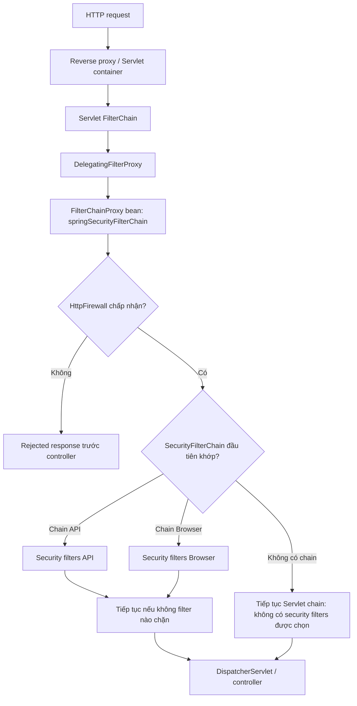
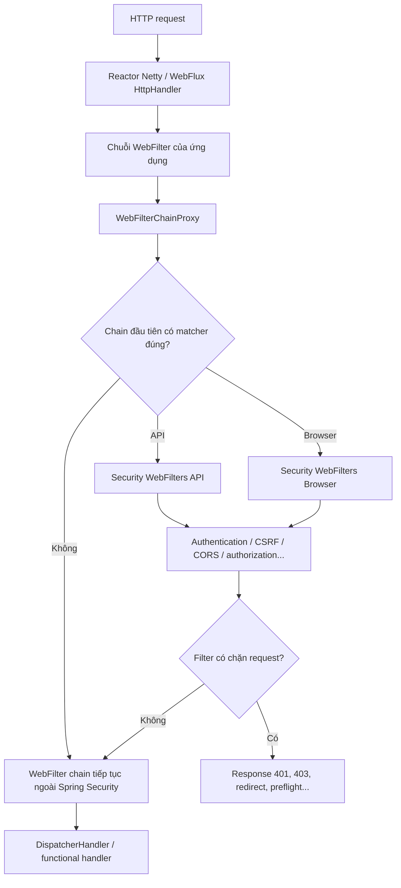
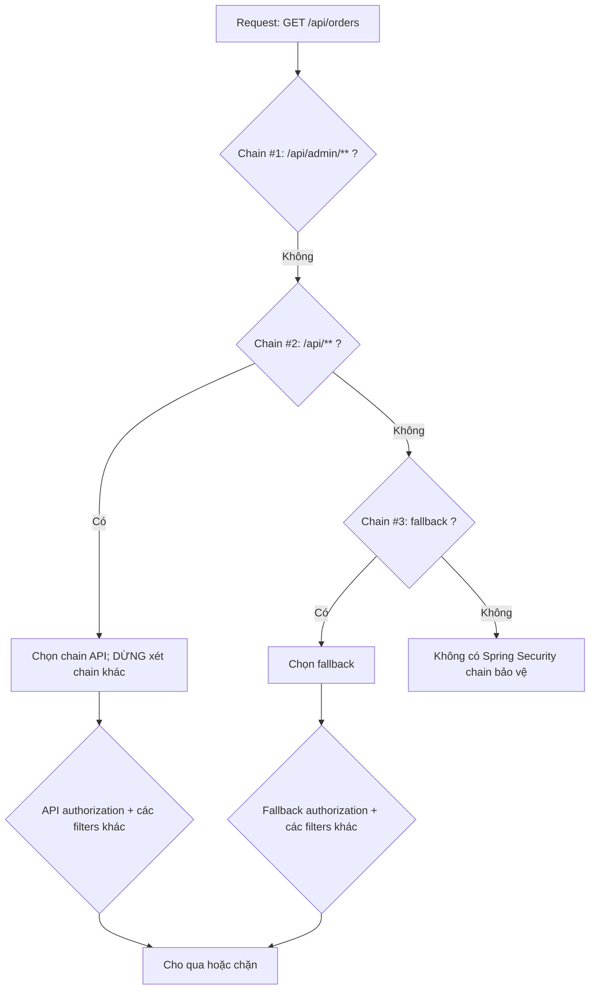
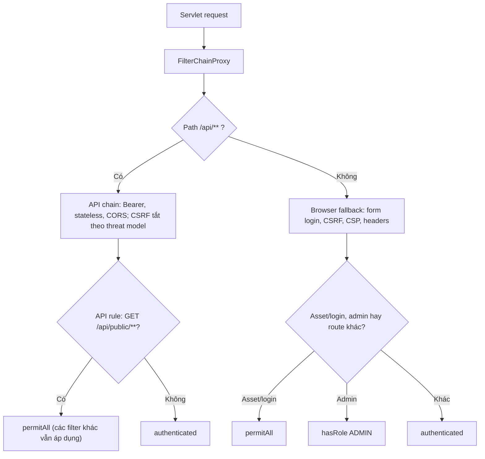

# FilterChainProxy, WebFilterChainProxy và phạm vi bảo vệ

> **Chương:** Kiến trúc áp dụng  
> **Module:** `SPRING_SECURITY_HTTP_PROTECTION` — áp dụng phòng vệ HTTP và trình duyệt bằng Spring Security: CSRF, CORS, security headers, CSP, HSTS, HTTP firewall, session, kiểm thử tấn công web và chẩn đoán triển khai.  
> **Trọng tâm bài:** Xác định chính xác **request nào được Spring Security bảo vệ, bởi chain nào và ở lớp nào** trên Servlet lẫn Reactive WebFlux. Bài không coi việc có annotation `@EnableWebSecurity` hoặc `@EnableWebFluxSecurity` là bằng chứng mọi URL đều được bảo vệ.

## 1. Mục tiêu học tập

Sau khi hoàn thành bài, người học có thể:

1. Phân biệt vai trò của `FilterChainProxy`, `WebFilterChainProxy` và các `SecurityFilterChain`/`SecurityWebFilterChain` nằm bên trong.
2. Truy ngược một request từ cổng HTTP, Servlet/WebFlux filter, matcher chọn security chain, filter bảo mật, authorization đến handler.
3. Giải thích khác nhau giữa **khớp chain**, **`permitAll()`**, **`denyAll()`**, **`authenticated()`** và **bỏ qua security chain**.
4. Dự đoán kết quả khi nhiều chain cùng khớp, khi chain không khớp, khi route mới được thêm hoặc khi request có method/URL khác mong đợi.
5. Thiết kế phạm vi bảo vệ cho browser session và API Bearer token, giữ được CSRF/CORS/security headers/CSP/HSTS cùng các chính sách authentication phù hợp.
6. Viết kiểm thử MockMvc/WebTestClient chứng minh cả **đường đi được phép** và **đường đi phải bị từ chối**, đồng thời nhận biết giới hạn bảo vệ do proxy, gateway, URL encoding và dispatcher tạo ra.

## 2. Bảo vệ một URL có nhiều vòng kiểm tra

Câu hỏi “`GET /admin` có được Spring Security bảo vệ không?” cần được tách thành năm câu hỏi:

1. Request có đến đúng ứng dụng và đúng chuỗi filter/web filter không?
2. Proxy bảo mật đã nhận request chưa; request có qua được HTTP firewall không?
3. Có `SecurityFilterChain` hoặc `SecurityWebFilterChain` **khớp request** không? Nếu nhiều chain khớp, chain nào ở vị trí đầu tiên?
4. Những security filter nào **có mặt trong chain được chọn**? CORS, CSRF, headers, authentication, session hay cơ chế khác có được bật không?
5. Quy tắc authorization cho request đó là `permitAll`, `authenticated`, `hasRole`, `denyAll` hay một `AuthorizationManager` tùy biến?

Có thể diễn tả phạm vi như chuỗi điều kiện:

```text
Request đi tới ứng dụng
  → Đi vào integration filter của Spring Security
    → Vượt qua HTTP firewall (nếu áp dụng)
      → Chọn chain đầu tiên phù hợp
        → Chạy các filter của chain đó
          → Kiểm tra authentication/CSRF/CORS/authorization...
            → Handler của ứng dụng
```

**Một request được `permitAll()` vẫn có thể được bảo vệ bởi nhiều lớp khác**. Ngược lại, một request hoàn toàn nằm ngoài proxy hoặc không khớp bất kỳ security chain nào sẽ không nhận các biện pháp phòng vệ từ các chain ấy, dù controller có gắn annotation nào đó. Method security nếu được bật có thể áp dụng cho một method được gọi sau này, nhưng không tự bổ sung lớp bảo vệ HTTP đã bị bỏ qua.

### 2.1. “Phạm vi” gồm những chiều nào?

| Chiều | Ví dụ | Sai lầm thường gặp |
|---|---|---|
| **Điểm vào ứng dụng** | Reverse proxy → Servlet container / Reactor Netty | Tưởng Spring Security đã kiểm request bị chặn ở gateway hoặc request đi qua một cổng quản trị khác |
| **Phạm vi đăng ký filter** | URL pattern, dispatcher type trên Servlet; chuỗi `WebFilter` trên WebFlux | Đăng ký proxy bảo mật cho một số mapping nhưng nghĩ proxy bắt mọi request |
| **Phạm vi matcher của chain** | `/api/**`, `/admin/**`, method GET/POST | Chỉ có chain `/api/**`, để lộ URL mới `/internal/**` |
| **Phạm vi của từng tính năng** | CSRF chỉ áp cho unsafe methods theo matcher; CORS chỉ origin/method phù hợp | Cho rằng `permitAll()` sẽ tự loại bỏ CSRF/CORS |
| **Phạm vi của authorization** | role, scope, HTTP method, endpoint | Cấu hình một rule `/admin/**` trong chain chỉ khớp `/api/**` |
| **Phạm vi bảo vệ phía browser** | CSP, HSTS, cookie `SameSite`, TLS | Nghĩ mọi response đều có CSP/HSTS dù response không qua header filter hoặc không trên HTTPS |

Để thẩm định chính sách, cần xác định rõ cả **đường dẫn**, **HTTP method**, **client sử dụng loại credential nào**, **stack Servlet hay WebFlux**, và **đường đi qua hạ tầng**.

## 3. Kiến trúc Servlet: `FilterChainProxy` nằm ở đâu?

Trong Spring MVC dùng Servlet stack, Servlet container quản lý các `jakarta.servlet.Filter` và servlet đích. Spring Security thường nối vào chuỗi này thông qua `DelegatingFilterProxy`, ủy quyền cho bean Spring có tên `springSecurityFilterChain` — đối tượng `FilterChainProxy`.



### 3.1. Những thành phần có trách nhiệm khác nhau

| Thành phần | Vai trò chính | Không nên hiểu thành |
|---|---|---|
| Servlet container | Nhận request, chọn Servlet filter và servlet; quản lý dispatcher type | Không tự tạo rule Spring Security cho mọi URL |
| `DelegatingFilterProxy` | Nối container với bean bảo mật trong Spring context | Không chứa danh sách rule authorization nghiệp vụ |
| `FilterChainProxy` | Quản lý firewall và chọn một security chain đầu tiên khớp | Không chạy tất cả chain khớp hoặc tự gộp cấu hình |
| `SecurityFilterChain` | Cặp điều kiện khớp request và danh sách security filter | Không phải một Servlet filter để đăng ký riêng với container |
| `HttpSecurity` | DSL/builder tạo security chain | Không phải nơi trực tiếp xử lý request runtime |
| `AuthorizationFilter` | Áp `AuthorizationManager` lên request đã đi tới phần authorization | Không thay thế CSRF, authentication hay firewall |
| `DispatcherServlet` | Định tuyến controller/handler Spring MVC | Không chịu trách nhiệm lọc HTTP security trước MVC |

Với nhiều `SecurityFilterChain`, `FilterChainProxy` duyệt theo thứ tự và **chỉ chạy các filter của chain đầu tiên có `matches(request)` đúng**. Nếu không có chain phù hợp, Spring Security sẽ không áp các security filter của ứng dụng cho request đó qua proxy, dù proxy có thể đã thực hiện xử lý HTTP firewall trước bước chọn.

### 3.2. HTTP firewall khác authorization

`HttpFirewall`, thường là `StrictHttpFirewall` trong cấu hình Servlet mặc định, kiểm tra những hình dạng request nguy hiểm hoặc không chuẩn hóa. Việc từ chối có thể xảy ra **trước** khi request được so với matcher và trước controller. Điều đó giúp giảm khác biệt khi các tầng xử lý URL chứa mã hóa phức tạp, dấu phân cách hoặc dữ liệu không hợp lệ.

Nếu gặp 400 cho một URL bất thường, không vội kết luận controller đã xác thực sai. Request có thể bị reverse proxy, Servlet container hoặc Spring Security firewall chặn. Đồng thời, không nên nới firewall chỉ để khắc phục một API path bị thiết kế khó encode; cần xác định rõ cách các tầng canonicalize URL và tác động lên matcher.

### 3.3. Đăng ký proxy: một ranh giới thường bị bỏ quên

Spring Boot tích hợp Spring Security thường đăng ký `DelegatingFilterProxy` tự động. Trong ứng dụng cấu hình Servlet thủ công, developer phải bảo đảm proxy thực sự nằm trong Servlet filter chain cần thiết.

Cần xem xét:

- **URL mapping** của Servlet filter và ứng dụng; path nằm ngoài mapping sẽ không qua proxy.
- **Dispatcher type**: `REQUEST`, `ASYNC`, `ERROR`, `FORWARD`, `INCLUDE` được xử lý theo đăng ký và loại filter. Đừng mặc định tất cả dispatch đều có chính sách y hệt request đầu.
- **Thứ tự với custom Servlet filters**: filter của hệ thống đứng trước proxy có thể đọc/ghi response hoặc kết thúc request trước khi Spring Security tham gia.
- **Nhiều `DispatcherServlet` hoặc servlet riêng**: matcher Spring MVC có thể phụ thuộc servlet path; không lấy URL path thuần làm bằng chứng mọi servlet đều cùng policy.
- **Custom filter đăng ký kép**: một Spring bean loại `Filter` bị Servlet container đăng ký tự động và cũng được `http.addFilterBefore/After(...)` có thể chạy hai lần.

```text
Một custom Filter là Spring bean toàn cục
           + được add vào SecurityFilterChain
           = có thể có hai lần đăng ký / hai lần thực thi
```

Khi cần custom filter chỉ trong security chain, kiểm soát hoặc tắt đăng ký Servlet tự động của filter đó, dùng `FilterRegistrationBean` với `setEnabled(false)` nếu phù hợp.

## 4. Kiến trúc WebFlux: `WebFilterChainProxy` nhận request thế nào?

Spring Security Reactive dùng `org.springframework.web.server.WebFilter` và `SecurityWebFilterChain` được tạo bởi `ServerHttpSecurity`. Proxy điều phối tương ứng là `WebFilterChainProxy`. Nó tham gia vào chuỗi xử lý `WebFilter` của WebFlux, không dùng `DelegatingFilterProxy` của Servlet.



Sơ đồ khái niệm chưa vẽ riêng HTTP firewall. WebFlux server, reverse proxy và (tùy phiên bản/cấu hình) reactive exchange firewall đều có thể kiểm tra request trước handler. Cần xem cấu hình runtime khi xác định lớp nào từ chối URL.

### 4.1. `SecurityWebFilterChain` không phải chuỗi Servlet Filter

| Câu hỏi | Servlet | WebFlux |
|---|---|---|
| Proxy chính | `FilterChainProxy` | `WebFilterChainProxy` |
| Chain được chọn | `SecurityFilterChain` | `SecurityWebFilterChain` |
| DSL tạo chain | `HttpSecurity` | `ServerHttpSecurity` |
| Matcher cấp chain | `RequestMatcher` | `ServerWebExchangeMatcher` |
| DSL authorization | `authorizeHttpRequests` | `authorizeExchange` |
| Request đang xử lý | `HttpServletRequest` | `ServerWebExchange` |
| Filter chạy thế nào | `doFilter(request, response, chain)` | `Mono<Void> filter(exchange, chain)` |
| Context chứa authentication | `SecurityContextHolder` thường có chiến lược dựa trên thread | `ReactiveSecurityContextHolder` dùng Reactor Context |
| Nơi quản lý state | `HttpSession`, `SecurityContextRepository` | `WebSession`, `ServerSecurityContextRepository` |

Một ứng dụng WebFlux vẫn có thể dùng Servlet container qua adapter; khi đó code bảo vệ WebFlux vẫn viết theo API reactive. Không cài song song hai cấu hình chỉ vì thấy Tomcat đang chạy; phải xác định web application type và pipeline thực.

### 4.2. Reactor Context là ranh giới danh tính của WebFlux

Ở reactive pipeline, thread có thể thay đổi giữa các giai đoạn xử lý. `Authentication` phải được truy cập từ Reactor Context khi cần, ví dụ:

```java
@GetMapping("/me")
Mono<String> currentUser() {
    return ReactiveSecurityContextHolder.getContext()
        .map(SecurityContext::getAuthentication)
        .map(Authentication::getName)
        .defaultIfEmpty("anonymous");
}
```

Nếu tự đọc `SecurityContextHolder.getContext()` kiểu Servlet trong WebFlux hoặc tự `subscribe()` vào một publisher rời khỏi request pipeline, kết quả có thể không mang context đúng. Một route đi qua security chain chưa đủ: custom code phải giữ đúng ngữ cảnh reactive thì quyết định truy cập bên trong handler/service mới có cơ sở.

### 4.3. Không phải mọi `WebFilter` đều là security filter

Ứng dụng có thể đăng ký WebFilter toàn cục để log, kiểm tra locale hoặc correlation ID. Những filter đó vẫn chạy theo phạm vi đăng ký và thứ tự của chính chúng; chúng không tự trở thành thành viên của `SecurityWebFilterChain`.

Một custom `WebFilter` vừa được khai báo bean toàn cục vừa được thêm bởi `ServerHttpSecurity.addFilterAt(...)` có thể chạy ở hai nơi. Khi bảo vệ một route, phải phân biệt filter toàn cục với security filter chỉ nằm trong chain đã match.

## 5. Hai quyết định luôn phải thực hiện theo thứ tự

**Quyết định 1 — Chọn chain:** matcher ở cấp proxy/chain quyết định chain nào xử lý request.

**Quyết định 2 — Xét quyền:** quy tắc authorization chỉ được đọc **trong chain đã chọn**.



### 5.1. Những biểu thức dễ nhầm

| Khái niệm | Nghĩa thực tế | Ví dụ |
|---|---|---|
| `securityMatcher("/api/**")` trên Servlet | Toàn bộ chain chỉ áp dụng request có path phù hợp | `/profile` không vào API chain |
| `securityMatcher(ServerWebExchangeMatchers.pathMatchers("/api/**"))` trên WebFlux | Tương đương ở cấp reactive exchange | `/api/users` vào API chain |
| `requestMatchers(...).permitAll()` | Nếu đã vào chain và đến authorization, yêu cầu này được cho phép | `/api/public/**` công khai nhưng vẫn qua các security filter |
| `pathMatchers(...).permitAll()` trên WebFlux | Quy tắc authorization reactive trong chain | Không quyết định chain được chọn |
| `authenticated()` | Yêu cầu người dùng đã xác thực | Không tự yêu cầu authority đặc thù |
| `hasRole("ADMIN")` / `hasAuthority(...)` | Yêu cầu quyền cụ thể, theo cấu hình ánh xạ authorities | Cần test principal/token chứa quyền thích hợp |
| `denyAll()` | Quy tắc authorization từ chối mọi người | Hữu ích cho URL ngoài danh mục; không thay thế filter nghiệp vụ |
| `web.ignoring()` trên Servlet | Bỏ qua Spring Security filter chain cho matcher đã chỉ định | Mất lớp security headers/CSRF/CORS/... do chain đó cung cấp |
| Không `SecurityFilterChain` khớp | Các security filter của chain không được chạy | Có thể để lọt request ngoài `/api/**` |
| Không `SecurityWebFilterChain` khớp | Tương tự trên WebFlux | Có thể để lọt route WebFlux mới |

**Lưu ý đặc biệt:** `permitAll()` là **một quyết định ở lớp authorization**, không có nghĩa request vượt qua mọi kiểm tra khác. Khi token Bearer hiện diện nhưng không hợp lệ, authentication filter có thể từ chối ngay cả một tài nguyên công khai. Khi browser POST thiếu CSRF token, filter CSRF có thể trả 403 dù URL ở rule `permitAll()`.

### 5.2. Quy tắc “first match wins” dễ tạo bóng che

Giả sử theo thứ tự:

```text
@Order(1)  securityMatcher("/**")
@Order(2)  securityMatcher("/api/**")
```

Chain đầu tiên khớp mọi URL, nên chain API ở dưới không được chọn. Một API muốn nhận Bearer 401 có thể bị chuyển sang form login 302 hoặc áp sai CSRF/session policy.

Cách sắp đặt thông thường:

```text
@Order(1)  securityMatcher("/api/admin/**")
@Order(2)  securityMatcher("/api/**")
@Order(3)  fallback: không khai báo securityMatcher
```

Ngoài độ ưu tiên giữa chain, **thứ tự rule bên trong chain** cũng phải đi từ đặc hiệu đến tổng quát. Ví dụ `requestMatchers("/admin/**").hasRole("ADMIN")` phải được đặt trước `anyRequest().authenticated()`. Nếu ngược lại, rule `hasRole` sẽ không được áp dụng cho request đã được rule tổng quát xử lý.

### 5.3. Security rule không thể áp vào URL ngoài chain

Ví dụ **sai về logic**:

```java
http
    .securityMatcher("/api/**")
    .authorizeHttpRequests(auth -> auth
        .requestMatchers("/admin/**").hasRole("ADMIN")
        .anyRequest().authenticated());
```

Request `GET /admin/users` **không vào chain này**, vì cấp chain chỉ nhận `/api/**`. Rule `/admin/**` bên trong không tự mở rộng phạm vi chain. Nếu một fallback cho phép `/admin/users`, chính sách admin bạn tưởng đã thiết lập thực tế không bảo vệ được route.

## 6. Ví dụ Servlet: hai chain, một phạm vi bảo vệ rõ ràng

Giả định ứng dụng Spring Boot/Spring MVC có:

- `/api/**`: API chỉ nhận Bearer JWT trong header, không dùng cookie/session làm credential.
- `/login`, `/profile`, `/admin/**`: giao diện browser dùng form login và session.
- `/assets/**`: tài nguyên tĩnh được truy cập công khai nhưng vẫn cần security headers.
- Những URL khác: cần xác thực bằng fallback browser chain.

```java
package example.security;

import org.springframework.context.annotation.Bean;
import org.springframework.context.annotation.Configuration;
import org.springframework.core.annotation.Order;
import org.springframework.http.HttpMethod;
import org.springframework.security.config.Customizer;
import org.springframework.security.config.annotation.web.builders.HttpSecurity;
import org.springframework.security.config.annotation.web.configuration.EnableWebSecurity;
import org.springframework.security.config.annotation.web.configurers.AbstractHttpConfigurer;
import org.springframework.security.config.http.SessionCreationPolicy;
import org.springframework.security.web.SecurityFilterChain;

@Configuration
@EnableWebSecurity
public class ServletSecurityConfig {

    @Bean
    @Order(1)
    SecurityFilterChain apiChain(HttpSecurity http) throws Exception {
        return http
            .securityMatcher("/api/**")
            .cors(Customizer.withDefaults())
            .csrf(AbstractHttpConfigurer::disable)
            .sessionManagement(session -> session
                .sessionCreationPolicy(SessionCreationPolicy.STATELESS))
            .authorizeHttpRequests(auth -> auth
                .requestMatchers(HttpMethod.GET, "/api/public/**")
                    .permitAll()
                .anyRequest().authenticated())
            .oauth2ResourceServer(oauth2 -> oauth2
                .jwt(Customizer.withDefaults()))
            .build();
    }

    @Bean
    @Order(2)
    SecurityFilterChain browserChain(HttpSecurity http) throws Exception {
        return http
            // Không gọi securityMatcher: chain này làm fallback.
            .authorizeHttpRequests(auth -> auth
                .requestMatchers("/login", "/assets/**").permitAll()
                .requestMatchers("/admin/**").hasRole("ADMIN")
                .anyRequest().authenticated())
            .formLogin(Customizer.withDefaults())
            .csrf(Customizer.withDefaults())
            .headers(headers -> headers
                .contentSecurityPolicy(csp -> csp.policyDirectives(
                    "default-src 'self'; object-src 'none'; " +
                    "base-uri 'self'; frame-ancestors 'none'")))
            .build();
    }
}
```

**Điều kiện để code chạy:** ứng dụng cần các dependency Spring Security Web, OAuth2 Resource Server/JWT và cấu hình JWT decoder hợp lệ (ví dụ `issuer-uri`). Các controller/route thực tế cũng phải tồn tại để yêu cầu thành công. Bản thân ví dụ không cung cấp JWT issuer, form view tùy chỉnh hoặc user store. Nếu token JWT chưa thể xác thực, chạy test integration sẽ thất bại ngay cả khi chain matcher đúng.

**Vì sao CSRF API bị tắt?** Trong giả định này, API được xác thực bằng Bearer token do client chủ động đính kèm, không dựa vào credential được browser tự gửi. Nếu ứng dụng dùng cookie session, Basic auth mà browser tự gửi hoặc cơ chế tương đương để thay đổi trạng thái, cần phân tích và bật CSRF thích hợp. Không dùng nhãn REST/JSON làm lý do tắt CSRF.

**Vì sao `/assets/**` là `permitAll`?** Tài nguyên công khai vẫn đi qua chain browser và nhận security headers do chain cấu hình. Nếu dùng `web.ignoring()` thay thế, tài nguyên có thể bỏ qua các lớp phòng vệ Spring Security ở cấp filter.

### 6.1. Bổ sung CORS rõ phạm vi

Nếu frontend `https://client.example.com` gọi API từ origin khác, định nghĩa allowlist riêng:

```java
@Bean
CorsConfigurationSource corsConfigurationSource() {
    CorsConfiguration cors = new CorsConfiguration();
    cors.setAllowedOrigins(List.of("https://client.example.com"));
    cors.setAllowedMethods(List.of("GET", "POST", "PUT", "DELETE"));
    cors.setAllowedHeaders(List.of("Authorization", "Content-Type"));
    cors.setMaxAge(1800L);

    UrlBasedCorsConfigurationSource source =
        new UrlBasedCorsConfigurationSource();
    source.registerCorsConfiguration("/api/**", cors);
    return source;
}
```

Imports cho đoạn này:

```java
import java.util.List;
import org.springframework.web.cors.CorsConfiguration;
import org.springframework.web.cors.CorsConfigurationSource;
import org.springframework.web.cors.UrlBasedCorsConfigurationSource;
```

Spring Security xử lý CORS sớm để preflight không bị authentication chặn. `OPTIONS /api/orders` từ origin hợp lệ có thể nhận phản hồi trước khi tới controller. CORS là chính sách browser, **không xác thực danh tính**; request thật `POST /api/orders` vẫn cần Bearer token và authorization.

Trong ứng dụng có nhiều `CorsConfigurationSource` hoặc CORS tại MVC/gateway, cần đảm bảo cấu hình thống nhất và source được chain đang chọn sử dụng. Nếu bật credentials, không trả wildcard `Access-Control-Allow-Origin: *` cho request credentialed; chỉ cho phép origin tin cậy và cấu hình phù hợp.

### 6.2. Sơ đồ phạm vi Servlet sau cấu hình



## 7. Ví dụ WebFlux: cùng phạm vi nghiệp vụ, API hoàn toàn khác

WebFlux dùng `ServerHttpSecurity` và `SecurityWebFilterChain`. Bản dưới đây là **cấu hình thay thế cho một ứng dụng WebFlux**, không được chép đồng thời với cấu hình Servlet vào một ứng dụng thông thường.

```java
package example.security;

import org.springframework.context.annotation.Bean;
import org.springframework.context.annotation.Configuration;
import org.springframework.core.annotation.Order;
import org.springframework.http.HttpMethod;
import org.springframework.security.config.Customizer;
import org.springframework.security.config.annotation.web.reactive.EnableWebFluxSecurity;
import org.springframework.security.config.web.server.ServerHttpSecurity;
import org.springframework.security.web.server.SecurityWebFilterChain;
import org.springframework.security.web.server.context.NoOpServerSecurityContextRepository;
import org.springframework.security.web.server.util.matcher.ServerWebExchangeMatchers;

@Configuration
@EnableWebFluxSecurity
public class ReactiveSecurityConfig {

    @Bean
    @Order(1)
    SecurityWebFilterChain apiChain(ServerHttpSecurity http) {
        return http
            .securityMatcher(
                ServerWebExchangeMatchers.pathMatchers("/api/**"))
            .cors(Customizer.withDefaults())
            .csrf(ServerHttpSecurity.CsrfSpec::disable)
            .securityContextRepository(
                NoOpServerSecurityContextRepository.getInstance())
            .authorizeExchange(auth -> auth
                .pathMatchers(HttpMethod.GET, "/api/public/**")
                    .permitAll()
                .anyExchange().authenticated())
            .oauth2ResourceServer(oauth2 -> oauth2
                .jwt(Customizer.withDefaults()))
            .build();
    }

    @Bean
    @Order(2)
    SecurityWebFilterChain browserChain(ServerHttpSecurity http) {
        return http
            // Không đặt securityMatcher: browser fallback.
            .authorizeExchange(auth -> auth
                .pathMatchers("/login", "/assets/**").permitAll()
                .pathMatchers("/admin/**").hasRole("ADMIN")
                .anyExchange().authenticated())
            .formLogin(Customizer.withDefaults())
            .csrf(Customizer.withDefaults())
            .headers(headers -> headers
                .contentSecurityPolicy(csp -> csp.policyDirectives(
                    "default-src 'self'; object-src 'none'; " +
                    "base-uri 'self'; frame-ancestors 'none'")))
            .build();
    }
}
```

Cấu hình reactive CORS bằng các type thuộc package `org.springframework.web.cors.reactive`:

```java
@Bean
CorsConfigurationSource corsConfigurationSource() {
    CorsConfiguration cors = new CorsConfiguration();
    cors.setAllowedOrigins(List.of("https://client.example.com"));
    cors.setAllowedMethods(List.of("GET", "POST", "PUT", "DELETE"));
    cors.setAllowedHeaders(List.of("Authorization", "Content-Type"));

    UrlBasedCorsConfigurationSource source =
        new UrlBasedCorsConfigurationSource();
    source.registerCorsConfiguration("/api/**", cors);
    return source;
}
```

Các imports:

```java
import java.util.List;
import org.springframework.web.cors.CorsConfiguration;
import org.springframework.web.cors.reactive.CorsConfigurationSource;
import org.springframework.web.cors.reactive.UrlBasedCorsConfigurationSource;
```

Ví dụ sử dụng bean source để cấu hình CORS cho API, nhưng với nhiều bean hoặc khi xử lý CORS qua WebFlux/gateway, nên chỉ định source tường minh bằng `cors(cors -> cors.configurationSource(corsConfigurationSource()))` trong chain tương ứng. Quan trọng nhất là kiểm tra preflight đi vào **đúng reactive chain**, policy bao phủ path thực và kết quả được xác minh bằng test.

**Giới hạn stateless:** `NoOpServerSecurityContextRepository` khiến Spring Security không khôi phục/lưu context bằng WebSession ở chain API. Nó **không ngăn** handler, gateway hoặc thư viện khác tạo WebSession/cookie. Kiểm tra response `Set-Cookie` và đường đi request thực tế nếu ứng dụng yêu cầu stateless nghiêm ngặt.

**Điểm tương đồng:** Proxy WebFlux cũng chọn chain đầu tiên khớp; `permitAll` không bỏ qua các security WebFilter; fallback giúp route mới không nằm ngoài Spring Security.

## 8. Ma trận phạm vi bảo vệ bắt buộc nhìn từ HTTP

Khi có cả API lẫn browser, hãy kiểm tra cùng một HTTP route từ nhiều góc nhìn: URL, method, credential, chain, lớp bảo vệ và response.

| Request | Chain mong đợi | Lớp cần được kiểm tra | Kỳ vọng có điều kiện |
|---|---|---|---|
| `GET /api/public/news` không token | API | Firewall, CORS (nếu có Origin), headers, Bearer filter, `permitAll` | Đến handler nếu không filter khác chặn |
| `GET /api/orders` không token | API | Bearer entry point + authorization | Thường 401 |
| `GET /api/orders` với JWT sai | API | Xác minh token trước authorization | Thường 401 |
| `GET /api/orders` JWT hợp lệ | API | Authentication + authorization | Đến handler nếu được phép |
| `POST /api/orders` với JWT hợp lệ | API | Bearer, policy CSRF theo threat model | Không bị đòi CSRF nếu chỉ dùng Bearer header |
| `OPTIONS /api/orders` preflight hợp lệ | API | CORS trước authentication | Thường phản hồi preflight thành công |
| `OPTIONS /api/orders` origin không hợp lệ | API | CORS allowlist | Không trả chính sách cho phép origin lạ |
| `GET /login` chưa đăng nhập | Browser | Browser chain, `permitAll` | Hiển thị/đi tới trang đăng nhập theo cấu hình |
| `POST /login` thiếu CSRF | Browser | CSRF của form login | Thường 403 |
| `POST /profile` có cookie nhưng thiếu CSRF | Browser | CSRF | Thường 403, handler không chạy |
| `GET /admin/reports` với role USER | Browser | `hasRole("ADMIN")` | Thường 403 |
| `GET /assets/app.css` không cookie | Browser | `permitAll` và security headers | Truy cập asset, vẫn nhận header theo policy |
| `GET /new-feature` không cookie | Browser fallback | `authenticated()` | Không vô tình công khai khi tạo route mới |
| `GET /error` hoặc error dispatch | Tùy mapping/dispatcher | Đường đi ERROR, response commit | Không kết luận từ URL gốc; kiểm thử riêng |
| URL bị encode bất thường | Proxy/server/firewall | Canonicalization và matcher | Có thể bị chặn trước chain/handler |

Bảng mô tả **kết quả kỳ vọng của cấu hình minh họa**. Nếu handler không tồn tại, kết quả có thể là 404; nếu security config khác đi, status có thể là 302 hoặc 403. Kiểm thử tốt phải quan sát cả status và thành phần đã xử lý request, không chỉ so một mã HTTP.

## 9. Bao phủ URL và HTTP method: thiết kế không để “khoảng trắng”

### 9.1. Ghi nhận bản đồ tài nguyên trước khi chọn matcher

Một checklist lập phạm vi thường bắt đầu bằng **bản đồ bề mặt HTTP**:

| Nhóm đường dẫn | Client | Credential | Authentication | CSRF | CORS | Headers / CSP |
|---|---|---|---|---|---|---|
| `/api/**` | Mobile/SPA | Bearer header | JWT / OAuth2 Resource Server | Tùy threat model, ví dụ tắt nếu chỉ Bearer | Allowlist origin cần thiết | Headers phù hợp API |
| `/admin/**` | Browser | Session cookie | Form login + role | Bật cho unsafe methods | Thường cùng origin | CSP/HSTS và headers phù hợp |
| `/profile` | Browser | Session cookie | Authenticated | Bật cho POST/PUT/DELETE | Cân nhắc nếu SPA khác origin | CSP/HSTS, cookie attributes |
| `/assets/**` | Browser | Không cần | `permitAll` | Không có state-changing request theo thiết kế | Tùy tài nguyên | Vẫn nhận headers nếu đi qua chain |
| `/actuator/**` | Internal monitor / ops | Phụ thuộc thiết kế | Chỉ mở health cần thiết, endpoint nhạy cảm phải hạn chế | Tùy chức năng | Thường giới hạn | Kiểm tra cổng quản trị và chính sách |
| `/internal/**` | Service-to-service | mTLS/JWT/service credential | Authenticated + service authority | Theo cách xác thực | Thường không cần browser CORS | Chặn từ mạng/gateway và app |
| `/login`, `/logout` | Browser | Session | Form authentication | Bảo vệ login/logout phù hợp | Thường same origin | Headers/cookie/session |

Các hàng không khẳng định mọi ứng dụng có các route này; chúng là mẫu để lập danh mục. Nếu Actuator được đưa lên **management port hoặc application context khác**, chính sách của ứng dụng chính không nhất thiết là nơi bảo vệ cổng đó. Cần kiểm tra cấu hình Spring Boot Actuator, proxy, network exposure và security chain thực của management context.

### 9.2. Những matcher dễ đặt sai

**Method scope.** Nếu dùng `requestMatchers(HttpMethod.GET, "/api/orders/**").permitAll()`, rule không bao gồm POST, PUT hoặc DELETE. Đây có thể là chủ ý; hãy test từng method thay vì chỉ test GET.

**Path scope.** `/api/**` và `/api/v1/**` là hai miền khác nhau. URL `/api-v1/orders` không tự khớp `/api/**`. Chữ hoa, dấu slash cuối, percent-encoding và context/servlet path có thể khiến kết quả khác dự đoán.

**Matcher type.** Trên Servlet, `requestMatchers(String...)` có thể chọn cơ chế matcher tùy hạ tầng MVC/phiên bản; nhiều servlet, MVC path matching và servlet path làm điều kiện khớp trở nên phức tạp. Với tình huống đó, cấu hình matcher tường minh phù hợp hệ thống và test request thật. Trên WebFlux, dùng `ServerWebExchangeMatcher` thay vì bê nguyên Servlet `RequestMatcher`.

**Nested route.** Một controller có `@RequestMapping("/api")` và method `@GetMapping("/orders")` thường thành `/api/orders`, nhưng phải tính cả context path, servlet path, gateway rewrite và versioning. Cần kiểm thử ở đường dẫn **client thật sự gọi tới**.

**Prefix rewrite ở gateway.** Gateway có thể chuyển `/service-a/api/orders` thành `/api/orders` trước khi chuyển tới backend. Chain backend sẽ xét URL nó nhận được, không xét URL công khai trước rewrite. Nếu gateway tự xác thực, backend vẫn cần xác định trust boundary và authorization riêng phù hợp.

### 9.3. Danh mục không thay thế fallback

Mỗi khi thêm endpoint, phải tự trả lời:

1. Endpoint nằm trong security chain nào?
2. Cần anonymous, authenticated hay authority nào?
3. Có thay đổi trạng thái hoặc sử dụng credential browser tự gửi không?
4. CORS/security headers/session policy của chain có đúng client không?
5. Test nào sẽ thất bại nếu ai đó vô tình thay đổi matcher hoặc thứ tự chain?

Một fallback với `anyRequest().authenticated()` giúp giữ route mới trong một chain. Đối với dịch vụ API nội bộ rất chặt, có thể đặt fallback `denyAll()` và chỉ cho phép rõ các route cần thiết. Hai lựa chọn phục vụ nhu cầu khác nhau; nên chọn theo sản phẩm và yêu cầu truy cập, không áp đặt một đáp án cho mọi ứng dụng.

## 10. `permitAll` và `web.ignoring`: hệ quả với bảo vệ trình duyệt

Giả sử CSS cần được tải khi user chưa đăng nhập.

**Phương án bảo vệ tài nguyên công khai (thường phù hợp):**

```java
http.authorizeHttpRequests(auth -> auth
    .requestMatchers("/assets/**").permitAll()
    .anyRequest().authenticated());
```

Request asset vẫn chạy qua chain khớp. Các header được cấu hình, HTTP firewall và những security filter liên quan vẫn có cơ hội xử lý.

**Phương án bỏ qua proxy bảo mật ở Servlet:**

```java
@Bean
WebSecurityCustomizer ignoringCustomizer() {
    return web -> web.ignoring().requestMatchers("/assets/**");
}
```

Trong tình huống này, request `/assets/**` không đi qua các filter của Spring Security chain cho matcher đó; chẳng hạn CSP/HSTS/header writer của Spring Security sẽ không được thêm bởi chain. Điều này chỉ nên thực hiện khi có lý do rõ ràng và hiểu chính sách bảo vệ thay thế. Đoạn code cần import `org.springframework.security.config.annotation.web.configuration.WebSecurityCustomizer`.

**WebFlux cũng cần phân biệt tương tự về mặt hành vi:** một `SecurityWebFilterChain` cho phép anonymous thông qua `permitAll()` vẫn là request có filter bảo mật. Nếu không có chain khớp hoặc chủ động tạo cấu hình loại trừ, request không nhận chính sách của security WebFilters tương ứng. API `WebSecurityCustomizer` là API Servlet, không dùng trực tiếp để khai báo bỏ qua WebFlux.

### 10.1. Khi muốn bỏ qua một tính năng, không bỏ cả chain

Có những yêu cầu thực tế:

- Không kiểm CSRF cho đúng một endpoint webhook có xác thực chữ ký và không dùng credential browser.
- Cho anonymous vào trang login nhưng vẫn đặt security headers.
- Cho CORS trên API nhưng không cho cross-origin vào trang browser.
- Bật CSP khác nhau theo vùng ứng dụng.

Đây là thay đổi **phạm vi của một chính sách/filter** hoặc thiết lập chain chuyên biệt. Việc bypass toàn bộ proxy để “hết lỗi 403” có thể loại cả authentication, authorization, headers và HTTP firewall khỏi đường đi. Hãy sửa đúng lớp gây lỗi và viết negative test cho lớp còn lại.

## 11. Phạm vi của CORS, CSRF, CSP, HSTS và session

### 11.1. CSRF phụ thuộc request và cách trình duyệt gửi credential

CSRF khai thác việc browser gửi credential tự động (thường session cookie) khi nạn nhân bị dẫn tới một hành động thay đổi trạng thái. Với browser chain, `CsrfFilter` (Servlet) hoặc `CsrfWebFilter` (WebFlux) thường đòi token cho phương thức không an toàn.

```http
POST /profile HTTP/1.1
Cookie: JSESSIONID=...
Content-Type: application/x-www-form-urlencoded

displayName=Lan
```

Nếu thiếu CSRF token theo cấu hình, POST có thể bị 403 **ngay cả khi rule authorization là `permitAll`**. Đây là dấu hiệu chain đã áp dụng thêm một lớp bảo vệ; không thể suy ra từ `403` rằng user thiếu role.

Với một API chỉ dựa vào Bearer token do client chủ động đặt vào header, CSRF có thể không cần trên chain API đó. Nếu API còn nhận cookie/browser credential, không được suy luận “stateless JSON = không có CSRF”.

### 11.2. CORS là một lớp ngoài authorization

Preflight thường có dạng:

```http
OPTIONS /api/orders HTTP/1.1
Origin: https://client.example.com
Access-Control-Request-Method: POST
Access-Control-Request-Headers: authorization,content-type
```

Preflight không nên phải đăng nhập để lấy CORS policy; nếu security authentication chạy trước CORS, browser có thể thấy 401 dù endpoint API được cấu hình đúng authorization. Điều cần kiểm tra là:

- Request đã vào API chain hay bị fallback browser bắt?
- CORS filter và `CorsConfigurationSource` đúng stack đã có trong chain chưa?
- Origin, method, request headers có được phép không?
- Gateway có tự xử lý OPTIONS hoặc ghi header CORS mâu thuẫn không?

CORS cho phép trình duyệt thực hiện một request cross-origin theo chính sách, **không** chứng minh request nghiệp vụ có quyền. `Access-Control-Allow-Origin` sai cũng không đồng nghĩa API không thể bị gọi bằng curl.

### 11.3. Security headers chỉ xuất hiện khi response đi qua lớp ghi header

Spring Security có thể ghi `X-Content-Type-Options`, `X-Frame-Options`, cache control và HSTS theo cấu hình; CSP thường cần cấu hình explicit. Nếu một URL bị `web.ignoring` hoặc không khớp security chain, không thể mặc định các header của chain vẫn có trên response.

Một response từ trang browser có thể yêu cầu:

```http
Content-Security-Policy: default-src 'self'; object-src 'none'; base-uri 'self'; frame-ancestors 'none'
X-Content-Type-Options: nosniff
Strict-Transport-Security: max-age=31536000; includeSubDomains
```

**HSTS chỉ được browser chấp nhận trên HTTPS hợp lệ.** Nếu TLS kết thúc tại reverse proxy, ứng dụng cần thấy scheme đúng từ proxy **được tin cậy**, hoặc header được quản lý an toàn tại proxy. Không tin mọi `Forwarded`/`X-Forwarded-*` đến từ client bên ngoài. CSP phải tương thích script/style/CDN/iframe thực tế; triển khai report-only để quan sát trước khi khóa chặt là cách kiểm thử hữu ích.

### 11.4. Session: hai chain có chính sách xác thực khác nhau

Browser form login thường lưu `SecurityContext` qua `HttpSession` (Servlet) hoặc `WebSession` (WebFlux) để user duy trì phiên. API Bearer nên kiểm credentials độc lập trong từng request theo threat model đã đặt.

Trên Servlet, `SessionCreationPolicy.STATELESS` khiến Spring Security không tạo/không dùng `HttpSession` để lấy `SecurityContext` theo chính sách của chain. Trên WebFlux, `NoOpServerSecurityContextRepository` không lưu/đọc context qua repository đó. **Cả hai không đảm bảo** mọi thành phần khác của app/gateway không bao giờ tạo session.

Phải kiểm cả cookie `Secure`, `HttpOnly`, `SameSite`, session fixation protection, logout, CSRF token lifecycle và các request thực tế sau đăng nhập. Một route API đi nhầm browser chain có thể mang session semantics không mong muốn ngay cả khi controller xử lý JSON.

## 12. Những ranh giới ngoài phạm vi Spring Security HTTP chain

Spring Security hỗ trợ bảo vệ ứng dụng, nhưng “request đã ở trong chain” không bảo đảm toàn bộ hệ thống an toàn:

| Ranh giới | Câu hỏi cần đặt |
|---|---|
| **Reverse proxy/load balancer** | Scheme/host/path có bị rewrite? Origin, forwarded headers có được xác thực là của proxy tin cậy? |
| **API gateway** | Gateway có chủ động bypass OPTIONS hoặc một prefix khác không? Backend vẫn kiểm JWT/authorization chứ? |
| **Management port/context** | Actuator và health endpoint thực sự thuộc application context/chain nào? |
| **Servlet dispatch** | `REQUEST`, `ERROR`, `FORWARD` và `ASYNC` có tham gia proxy không; error page có vô tình trả 403? |
| **WebFlux error pipeline** | Exception handler có thể tạo response theo lối khác; header đã được ghi hoặc response đã commit chưa? |
| **WebSocket/SSE** | Handshake HTTP có đi qua chain? Authorization của frame/message sau kết nối có chính sách riêng không? |
| **Background jobs/messaging** | Task chạy ngoài HTTP request không thừa hưởng security context của request mặc định |
| **Method/domain authorization** | HTTP rule có che chắn đúng mọi đường gọi service không; method security được bật và test theo yêu cầu chưa? |

Ví dụ một endpoint WebSocket handshake được cho phép anonymous qua HTTP không có nghĩa nội dung từng message đã được phân quyền. Tương tự, CSRF và CORS dành cho HTTP/browser không tự bảo vệ một message queue hoặc scheduled job.

### 12.1. Kịch bản URL mơ hồ và canonicalization

Một đường dẫn có ký tự encoded đặc biệt có thể được proxy, container và matcher diễn giải khác nhau. Nếu security matcher cho rằng URL thuộc `/public/**` nhưng router sau decode lại đi tới tài nguyên `/admin/**`, có nguy cơ bypass authorization.

Các kiểm thử bắt buộc trong môi trường triển khai phù hợp: path có encode, slash cuối, path parameters, dấu phân cách, reverse proxy rewrite, path traversal đã được canonicalize và phương thức HTTP không thông dụng. Không nên cho phép bừa các URL đáng ngờ trong firewall; xác định canonical URL và kiểm thử routing sau thay đổi.

## 13. Kiểm thử “phạm vi” trên Servlet bằng MockMvc

Các test sau giả định dùng cấu hình Servlet ở mục 6, có controller demo trả:

- `GET /api/public/news` → 200.
- `GET /api/orders` → 200 khi đã xác thực.
- `POST /profile` → 204 sau khi cập nhật.
- `GET /admin/reports` → 200 khi có role ADMIN.

Sử dụng `spring-security-test`, Spring MVC Test và application context có cấu hình security. Mục tiêu test là **chứng minh matcher + filter + authorization**, không xác minh JWT signature.

```java
@SpringBootTest
@AutoConfigureMockMvc
class ServletProtectionScopeTest {

    @Autowired
    MockMvc mvc;

    @Test
    void anonymousCannotReadApiOrders() throws Exception {
        mvc.perform(get("/api/orders"))
            .andExpect(status().isUnauthorized());
    }

    @Test
    void publicApiIsStillInSecurityChain() throws Exception {
        mvc.perform(get("/api/public/news"))
            .andExpect(status().isOk())
            .andExpect(header().string(
                "X-Content-Type-Options", "nosniff"));
    }

    @Test
    void anonymousCannotReadBrowserProfile() throws Exception {
        mvc.perform(get("/profile"))
            .andExpect(status().is3xxRedirection());
    }

    @Test
    void browserPostWithoutCsrfIsRejected() throws Exception {
        mvc.perform(post("/profile")
                .with(user("lan").roles("USER")))
            .andExpect(status().isForbidden());
    }

    @Test
    void browserPostWithCsrfIsPassedToHandler() throws Exception {
        mvc.perform(post("/profile")
                .with(user("lan").roles("USER"))
                .with(csrf()))
            .andExpect(status().isNoContent());
    }

    @Test
    void ordinaryUserCannotEnterAdmin() throws Exception {
        mvc.perform(get("/admin/reports")
                .with(user("lan").roles("USER")))
            .andExpect(status().isForbidden());
    }

    @Test
    void apiPreflightUsesCorsBeforeAuthentication() throws Exception {
        mvc.perform(options("/api/orders")
                .header("Origin", "https://client.example.com")
                .header("Access-Control-Request-Method", "POST")
                .header("Access-Control-Request-Headers", "authorization"))
            .andExpect(status().isOk())
            .andExpect(header().string(
                "Access-Control-Allow-Origin",
                "https://client.example.com"));
    }
}
```

Imports tĩnh thường dùng:

```java
import static org.springframework.security.test.web.servlet.request.SecurityMockMvcRequestPostProcessors.*;
import static org.springframework.test.web.servlet.request.MockMvcRequestBuilders.*;
import static org.springframework.test.web.servlet.result.MockMvcResultMatchers.*;
```

Ngoài ra cần các imports `org.junit.jupiter.api.Test`, `org.springframework.beans.factory.annotation.Autowired`, `org.springframework.boot.test.context.SpringBootTest`, `org.springframework.boot.test.autoconfigure.web.servlet.AutoConfigureMockMvc` và `org.springframework.test.web.servlet.MockMvc`.

**Lưu ý:** cần controller demo thật và cấu hình JWT decoder hợp lệ để application context khởi tạo. Test `with(user(...))` hỗ trợ giả lập authentication của Spring Security và không có nghĩa browser session/login flow đã được kiểm thử hoàn chỉnh. Để kiểm JWT signature/issuer/audience, dùng integration test phù hợp ngoài phần scope.

**Một test hữu ích bổ sung:** cố tình đổi thứ tự `@Order`, đặt fallback trước chain API. `anonymousCannotReadApiOrders()` thường bắt được sai lệch vì request trả redirect trang login (302) thay vì Bearer 401. Đây là kiểm thử phòng ngừa lỗi cấu hình chain hiệu quả.

## 14. Kiểm thử WebFlux bằng WebTestClient

Dùng riêng cho ứng dụng WebFlux có cấu hình mục 7. WebTestClient có thể bind vào application context và áp Spring Security Test:

```java
@SpringBootTest
class ReactiveProtectionScopeTest {

    @Autowired
    ApplicationContext applicationContext;

    WebTestClient client;

    @BeforeEach
    void setUp() {
        client = WebTestClient.bindToApplicationContext(applicationContext)
            .apply(springSecurity())
            .configureClient()
            .build();
    }

    @Test
    void anonymousApiRequestReturns401() {
        client.get().uri("/api/orders")
            .exchange()
            .expectStatus().isUnauthorized();
    }

    @Test
    void publicApiStillReceivesSecurityHeaders() {
        client.get().uri("/api/public/news")
            .exchange()
            .expectStatus().isOk()
            .expectHeader().valueEquals(
                "X-Content-Type-Options", "nosniff");
    }

    @Test
    void browserPostWithoutCsrfReturns403() {
        client.mutateWith(mockUser("lan").roles("USER"))
            .post().uri("/profile")
            .exchange()
            .expectStatus().isForbidden();
    }

    @Test
    void browserPostWithCsrfReachesHandler() {
        client.mutateWith(mockUser("lan").roles("USER"))
            .mutateWith(csrf())
            .post().uri("/profile")
            .exchange()
            .expectStatus().isNoContent();
    }

    @Test
    void ordinaryUserCannotAccessAdmin() {
        client.mutateWith(mockUser("lan").roles("USER"))
            .get().uri("/admin/reports")
            .exchange()
            .expectStatus().isForbidden();
    }

    @Test
    void allowedApiPreflightPasses() {
        client.options().uri("/api/orders")
            .header("Origin", "https://client.example.com")
            .header("Access-Control-Request-Method", "POST")
            .header("Access-Control-Request-Headers", "authorization")
            .exchange()
            .expectStatus().isOk()
            .expectHeader().valueEquals(
                "Access-Control-Allow-Origin",
                "https://client.example.com");
    }
}
```

Imports tiêu biểu:

```java
import org.junit.jupiter.api.BeforeEach;
import org.junit.jupiter.api.Test;
import org.springframework.beans.factory.annotation.Autowired;
import org.springframework.boot.test.context.SpringBootTest;
import org.springframework.context.ApplicationContext;
import org.springframework.test.web.reactive.server.WebTestClient;
import static org.springframework.security.test.web.reactive.server.SecurityMockServerConfigurers.*;
```

Test cũng cần controller/handler trả các status giả định. Để kiểm scope của API với JWT, thêm test `client.mutateWith(mockJwt()).get().uri("/api/orders")` và xác minh handler được gọi. `mockJwt()` **không kiểm chứng chữ ký**; JWT decoder integration cần test riêng.

### 14.1. Test chain không nên chỉ xác nhận status

Hai chain khác nhau có thể cùng trả 403. Muốn biết chain nào xử lý:

1. Kiểm status/response headers đặc trưng khi có chính sách riêng (ví dụ CSP chỉ ở browser).
2. Quan sát log `FilterChainProxy` hoặc `WebFilterChainProxy` và authentication entry point đang dùng.
3. Kiểm negative case: browser anonymous nhận redirect nếu dùng form login; API anonymous nhận 401 nếu là Bearer Resource Server.
4. Kiểm token sai và CSRF thiếu **riêng biệt**.
5. Kiểm path nằm sát ranh giới, như `/api2/orders`, `/api-public/orders`, slash cuối và path rewrite của gateway.

Nếu chỉ assert `isForbidden()`, test có thể thành công do CSRF chặn mà rule admin chưa bao giờ được áp. Trong test thiếu role, dùng phương thức an toàn như GET để tách authorization khỏi CSRF, hoặc cấp token CSRF hợp lệ rồi kiểm role.

### 14.2. Kiểm thử HTTP thật khi quan tâm headers, proxy và firewall

MockMvc/WebTestClient dạng bind-to-context không thay thế hoàn toàn HTTP server hoặc browser:

- **HSTS** cần quan sát qua TLS và scheme được truyền chính xác tại reverse proxy.
- **CSP** cần mở trang trong browser và xem console/report nếu có script, style, iframe bị chặn.
- **CORS** cần preflight từ browser hoặc request mô phỏng đủ `Origin`, method và headers.
- **HTTP firewall và URL encoding** cần thử cả đường đi qua proxy/container thật.
- **Cookie attributes** cần đọc `Set-Cookie` từ đường đi login/session thực và xác minh hành vi của browser.

Test HTTP-level cùng cấu hình staging/proxy giúp phát hiện khác biệt mà unit test matcher không nhìn thấy.

## 15. Chẩn đoán khi một URL bị áp sai chính sách

Bật log tại môi trường phát triển có kiểm soát:

```properties
# Servlet
logging.level.org.springframework.security.web.FilterChainProxy=TRACE

# WebFlux
logging.level.org.springframework.security.web.server=TRACE

# Cấu hình tổng quát khi cần
logging.level.org.springframework.security=DEBUG
```

Tên logger/mức chi tiết có thể thay đổi theo phiên bản; chọn phạm vi hẹp và tắt TRACE sau chẩn đoán. Tránh ghi Bearer token, session cookie, CSRF token hoặc dữ liệu nhạy cảm.

| Triệu chứng | Tầng cần xem trước | Hành động điều tra |
|---|---|---|
| `/api/orders` trả 302 tới login | Chain matcher / `@Order` | Kiểm fallback có đứng trước API chain không |
| `/admin` vào được với user thường | Phạm vi chain và authorization | Kiểm rule `hasRole` có nằm trong chain thực được chọn không |
| `POST /profile` 403 dù đã login | CSRF hoặc authorization | Cấp CSRF token hợp lệ để cô lập lỗi role |
| `GET /assets/app.css` thiếu CSP/HSTS | Có đi qua header filter không? | Kiểm `web.ignoring`, chain matcher, HTTPS, proxy |
| `OPTIONS /api/orders` 401 | CORS filter / API chain | Kiểm preflight vào chain nào; CORS có đứng trước auth không |
| `GET /new-feature` công khai bất ngờ | Không match chain hoặc fallback rule quá rộng | Lập inventory URL, thêm negative test |
| CORS cho origin lạ | Policy CORS ở app/gateway | Kiểm allowlist, credentials và header do nhiều tầng ghi |
| URL encoded được router xử lý khác matcher | Server/proxy/firewall | So raw và decoded path, canonicalization |
| Reactive principal bị rỗng trong handler | Reactor Context / publisher lifecycle | Dùng `ReactiveSecurityContextHolder` và giữ pipeline reactive |
| API JWT có session cookie không mong muốn | Chain hoặc component khác tạo session | Kiểm policy repository, middleware và Set-Cookie |
| Request ERROR bị 403 | Dispatcher/error pipeline | Xem mapping security cho dispatcher type/error handler |
| Header vẫn có dù request không qua Spring Security | Reverse proxy hoặc web server tự thêm | Không dùng riêng một header làm bằng chứng chain được chọn |

### 15.1. Quy trình điều tra theo chứng cứ

**Bước A — Dựng lại request.** Ghi rõ method, URL sau reverse proxy rewrite, `Origin`, `Content-Type`, loại credential và có CSRF token hay không. Che dữ liệu bí mật.

**Bước B — Xác định proxy nào đã nhìn thấy request.** Servlet: `DelegatingFilterProxy → FilterChainProxy`. WebFlux: chuỗi `WebFilter → WebFilterChainProxy`. Nếu request dừng tại gateway, cần sửa ở gateway hoặc HTTP server.

**Bước C — Xác định chain khớp đầu tiên.** Đọc thứ tự bean `SecurityFilterChain`/`SecurityWebFilterChain` và matcher cấp chain, không suy diễn từ rule authorization nằm sâu bên dưới.

**Bước D — Xác định filter dừng.** Kết hợp log filter với mã response: preflight/CORS, CSRF, authentication entry point, authorization denied, firewall hoặc handler.

**Bước E — Kiểm cả một trường hợp thành công và một trường hợp thất bại.** Ví dụ API có JWT hợp lệ vào được, API không JWT nhận 401, browser POST thiếu CSRF nhận 403, browser với CSRF hợp lệ đi tiếp; như vậy có bằng chứng nhiều chiều về phạm vi.

## 16. Bài tập thực hành

### Bài tập 1 — Tìm request ngoài phạm vi

Cho cấu hình chỉ có hai chain:

```text
@Order(1) securityMatcher("/api/**")
@Order(2) securityMatcher("/admin/**")
```

Trong ứng dụng có `GET /public/news`, `GET /admin/users`, `GET /api/orders` và `POST /profile`.

**Yêu cầu:** Chỉ ra request nào **không** được bảo vệ bởi security filters của hai chain; đề xuất fallback để bảo vệ các URL còn lại. Trả lời: `GET /public/news` và `POST /profile` không match hai chain nếu không có chain khác; một fallback có quy tắc truy cập rõ ràng giải quyết khoảng trống này. Nếu `/public/news` cần công khai, dùng `permitAll` trong fallback thay vì bỏ qua proxy toàn phần.

### Bài tập 2 — Phân biệt hai lỗi đều trả 403

Một browser đã đăng nhập với role USER gửi `POST /admin/settings` mà không có CSRF token và nhận 403. Khi thêm CSRF token hợp lệ, request vẫn 403.

**Yêu cầu:** Giải thích hai đường đi có thể xảy ra. Định hướng: lần đầu có thể bị CSRF chặn trước authorization; lần sau vượt CSRF nhưng thiếu role ADMIN. Để chứng minh, dùng request GET đến một admin resource chỉ đọc hoặc POST có CSRF hợp lệ, log và test role.

### Bài tập 3 — Tạo kiểm thử phát hiện lỗi thứ tự chain

Chạy test với API Bearer chain ở `@Order(1)` và browser fallback ở `@Order(2)`. Sau đó đổi fallback thành `@Order(0)`. Kiểm tra `GET /api/orders` không token: mong đợi nó đổi từ 401 API thành redirect form login (nếu cấu hình form login tạo entry point 302). Khôi phục thứ tự, giữ test 401 để phòng ngừa lỗi sau này.

### Bài tập 4 — So sánh `permitAll` và `web.ignoring`

Với `GET /assets/app.css`, lần lượt cấu hình `permitAll()` trong chain và `web.ignoring()` trên Servlet. Quan sát các header do Spring Security tạo và log filter invocation. Giải thích vì sao tài nguyên công khai vẫn cần security headers, và trường hợp nào bỏ qua có thể hợp lý khi một tầng khác đã chịu trách nhiệm bảo vệ.

### Bài tập 5 — Xác minh CORS và CSP sau gateway

Giả sử gateway chuyển `https://app.example.com/service/api/orders` thành `http://backend:8080/api/orders`. Hãy ghi lại path backend nhận, xác định API chain nào được chọn, kiểm tra preflight cùng origin, xác minh HSTS ở response HTTPS cuối và CSP trên trang browser. Không tin ngầm rằng forwarded headers hoặc policy gateway giống policy backend.

## 17. Câu hỏi tự kiểm và ghi nhớ

**Câu hỏi 1:** Có ba chain đều khớp `GET /api/orders`. Bao nhiêu chain được `FilterChainProxy` hoặc `WebFilterChainProxy` dùng?  
**Đáp án:** Chỉ chain **đầu tiên khớp**, theo thứ tự đã cấu hình.

**Câu hỏi 2:** `permitAll()` có loại bỏ kiểm tra CSRF và ghi security headers?  
**Đáp án:** Không. Nó chỉ cho phép ở lớp authorization; filter CSRF/headers vẫn có thể áp dụng nếu nằm trong chain.

**Câu hỏi 3:** Rule `hasRole("ADMIN")` trong chain `securityMatcher("/api/**")` có bảo vệ `GET /admin/users`?  
**Đáp án:** Không; request `/admin/users` không vào chain chỉ khớp `/api/**`.

**Câu hỏi 4:** Vì sao API dùng Bearer token nhận redirect 302 tới form login?  
**Đáp án:** Một nguyên nhân phổ biến là request đi vào browser fallback chain do matcher/thứ tự chain sai; cần kiểm tra log và actual entry point.

**Câu hỏi 5:** Vì sao HSTS không xuất hiện trong một test HTTP thuần dù đã cấu hình?  
**Đáp án:** Header HSTS chịu ràng buộc HTTPS và nhận diện scheme; cần xem kết nối TLS/forwarded headers đáng tin cậy và policy thực.

**Câu hỏi 6:** WebFlux có dùng `SecurityContextHolder` ThreadLocal làm nguồn danh tính tin cậy mặc định cho pipeline reactive không?  
**Đáp án:** Không; nên dùng `ReactiveSecurityContextHolder`/principal reactive cùng Reactor Context.

### Tóm lược kiến trúc cần giữ

- **`FilterChainProxy` (Servlet)** và **`WebFilterChainProxy` (WebFlux)** là điểm điều phối security chains ở hai stack khác nhau.
- **Phạm vi bảo vệ = request vào đúng proxy + matcher chọn đúng chain + filter/policy của chain được áp dụng**. Rule authorization chỉ giải quyết phần cuối.
- **Một request chỉ được chọn một chain đầu tiên khớp**. Đặt chain chuyên biệt trước fallback, và rule cụ thể trước `anyRequest`/`anyExchange`.
- **`permitAll` khác bỏ qua bảo mật**; tài nguyên công khai vẫn nên nhận lớp HTTP protection phù hợp.
- **CSRF, CORS, CSP, HSTS, HTTP firewall và session có phạm vi riêng**. Phải test theo URL, method, credential, scheme, hạ tầng triển khai và stack Servlet/Reactive.
- **Coverage không được suy từ một file cấu hình duy nhất**. Hãy kiểm thử ma trận đường dẫn và cả negative cases để chứng minh các route mới, request khác method và URL sau proxy rewrite không nằm ngoài policy.
