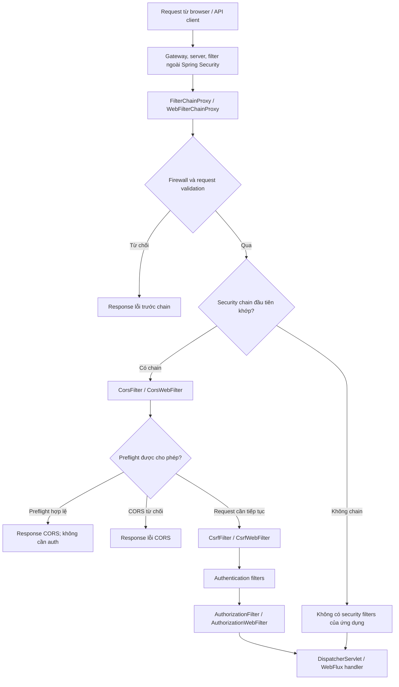
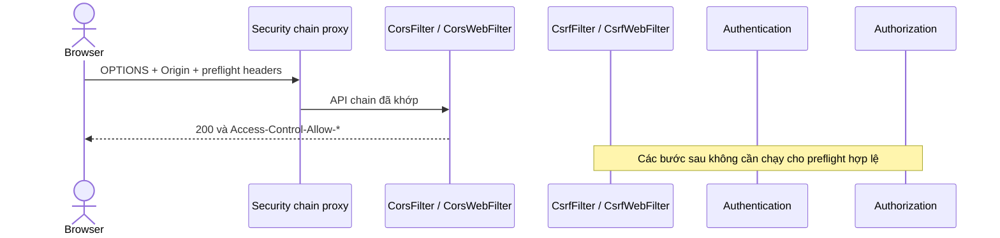
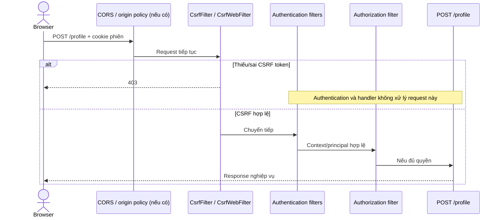

# Thứ tự các lớp CORS, CSRF, xác thực và phân quyền

> **Chương:** Kiến trúc áp dụng  
> **Module:** `SPRING_SECURITY_HTTP_PROTECTION` — phòng vệ HTTP và trình duyệt trong Spring Security, bao gồm CSRF, CORS, security headers, CSP, HSTS, HTTP firewall và session, trên cả Servlet và Reactive WebFlux.  
> **Mục tiêu trực tiếp:** giải thích **lớp nào nhìn thấy request trước, lớp nào có thể kết thúc request và vì sao thay đổi thứ tự dẫn đến lỗi bảo mật hoặc lỗi tích hợp**. Ví dụ sử dụng mô hình browser đăng nhập bằng session cookie và REST API nhận Bearer JWT. Đây là hai mô hình xác thực cần đánh giá rủi ro riêng.

## 1. Kết quả học tập

Hoàn thành bài học, người học có thể:

1. Mô tả thứ tự tương đối **CORS → CSRF → authentication → authorization** trong một HTTP security chain điển hình và giải thích các thành phần đứng trước/chen giữa chúng.
2. Nêu chính xác vì sao **CORS preflight** thường được giải quyết trước khi đòi authentication, trong khi **POST dùng session cookie** vẫn phải có CSRF token dù người dùng đã đăng nhập.
3. Phân biệt lỗi **CORS rejection**, **CSRF 403**, **authentication 401/redirect 302** và **authorization 403** bằng dấu vết xử lý.
4. Đọc thứ tự filter ở cả Spring MVC/Servlet (`FilterChainProxy`) và WebFlux (`WebFilterChainProxy`), không áp dụng nhầm API giữa hai stack.
5. Cấu hình hai security chain riêng cho API Bearer và browser session; kiểm soát matcher, CORS policy, CSRF policy và quyền truy cập.
6. Viết kiểm thử MockMvc và WebTestClient cho preflight, form POST, token hỏng, anonymous, thiếu quyền và public endpoint.
7. Nhận diện các ngoại lệ của quy tắc thứ tự: HTTP firewall, Servlet/WebFilter toàn cục, gateway, logout, security headers, custom filters và cơ chế error response.

## 2. “Thứ tự” là thứ tự của những gì?

Trong ứng dụng web, có **ít nhất ba trật tự** khác nhau:

| Trật tự | Được xác định bởi | Tác dụng |
|---|---|---|
| **Thứ tự filter ngoài Spring Security** | Servlet container hoặc WebFlux `WebFilter` chain, gateway/proxy | Quyết định request có đi tới security proxy, có bị chặn trước proxy hoặc bị xử lý hai lần không |
| **Thứ tự các security chain** | `FilterChainProxy`/`WebFilterChainProxy` cùng matcher, `@Order` | Chọn **một chain đầu tiên khớp** trong tập chain được cấu hình |
| **Thứ tự các filter trong chain đã chọn** | Spring Security filter ordering, tính năng bật/tắt và custom filters | Quyết định CORS, CSRF, authentication, authorization, headers... chạy ở đâu |

Đừng nhầm lẫn: `@Order(1)` trên một bean `SecurityFilterChain` **không đặt `CsrfFilter` trước `CorsFilter`**. Nó chỉ ưu tiên chain đó khi proxy duyệt các chain. Tương tự, thứ tự khai báo `.csrf(...).cors(...).authorizeHttpRequests(...)` trong DSL **không phải thứ tự thực thi filter**; framework đặt các filter theo trật tự định nghĩa.

Một cách nhìn hệ thống:



Sơ đồ chỉ thể hiện **các cổng quyết định chính**. Security header filter, context filter, request cache, logout, session và các filter khác thường nằm xen giữa; một số security filters có thể chạy trước CORS. Nếu không cấu hình CORS trong security chain, request có thể nhận CORS từ một tầng khác hoặc không nhận chính sách CORS nào.

### 2.1. Thứ tự tương đối và thứ tự tuyệt đối

Nói “CORS chạy trước authentication” là **quy tắc cấu hình để xử lý preflight đúng**. Nó không khẳng định CORS là filter đầu tiên của HTTP request:

- Reverse proxy hoặc HTTP server có thể từ chối URL trước mọi Spring filter.
- Servlet `DelegatingFilterProxy`, HTTP firewall hoặc `HttpHeaderWriterWebFilter` có thể xử lý trước những lớp đang xét.
- Một Servlet `Filter` hoặc WebFlux `WebFilter` tùy biến đăng ký ngoài Spring Security có thể chạy trước security proxy.
- Bộ lọc CSRF có thể chặn request trước khi authentication/filter authorization được gọi.
- Logout, OAuth2 redirect hoặc form login filter có thể tự hoàn tất response trước authorization.
- Cấu hình và danh sách filter cụ thể khác nhau theo phiên bản Spring Security.

Bài học vì thế dùng sơ đồ để **dự đoán điểm chặn** và dùng log/test để **xác minh thứ tự thực tế**.

## 3. Chuỗi xử lý Servlet: CORS, CSRF, authentication, authorization

Trong Spring MVC chạy trên Servlet stack, request đi qua `DelegatingFilterProxy` rồi `FilterChainProxy`. Proxy dùng HTTP firewall, chọn chain đầu tiên khớp, sau đó chạy những security filters có trong chain.

Một chuỗi minh họa (chỉ các điểm liên quan):

```text
Servlet container / external filters
  ↓
DelegatingFilterProxy
  ↓
FilterChainProxy
  ├─ HttpFirewall kiểm tra request
  └─ Chọn SecurityFilterChain đầu tiên khớp
      ↓
      SecurityContextHolderFilter, HeaderWriterFilter, ...
      ↓
      CorsFilter                           [CORS]
      ↓
      CsrfFilter                           [CSRF]
      ↓
      LogoutFilter / các authentication filter
      (UsernamePasswordAuthenticationFilter,
       BearerTokenAuthenticationFilter,
       BasicAuthenticationFilter, ...)
                                           [AUTHENTICATION]
      ↓
      RequestCacheAwareFilter / AnonymousAuthenticationFilter / ...
      ↓
      ExceptionTranslationFilter
      ↓
      AuthorizationFilter                 [AUTHORIZATION]
      ↓
      DispatcherServlet / Controller
```

**Đây không phải bản dump đầy đủ của một chain.** Tên filter có mặt phụ thuộc vào form login, HTTP Basic, OAuth2 Resource Server, logout và phiên bản/framework. Một số tài liệu cũ dùng `SecurityContextPersistenceFilter` và `FilterSecurityInterceptor`, trong khi cấu hình Spring Security hiện đại thường dùng `SecurityContextHolderFilter` và `AuthorizationFilter`. Danh sách thực tế có thể xem qua log/debug và security configuration của ứng dụng.

### 3.1. Tại sao CORS đặt trước các cổng đòi credential?

Preflight browser thường gửi `OPTIONS` với `Origin` và `Access-Control-Request-Method`, **không gửi cookie đăng nhập hoặc Bearer token như request chính**. Nếu authentication filter/authorization bắt preflight phải có credential, browser sẽ không thể gửi request thật dù client hợp lệ.

Khi `http.cors(...)` được tích hợp đúng, `CorsFilter` xử lý preflight sớm: kiểm origin, method, request headers; preflight hợp lệ được trả kết quả CORS mà không cần đi tiếp đến phần authentication/authorization.

Nhưng **không phải mọi OPTIONS đều là preflight**. Preflight là OPTIONS mang các header cần thiết như `Origin` và `Access-Control-Request-Method`. OPTIONS thông thường vẫn có thể được xử lý theo authentication/authorization của ứng dụng.

### 3.2. Tại sao CSRF kiểm trước authentication là hợp lý?

Đối với browser dùng session cookie, một POST bất hợp lệ không cần tốn chi phí/đi sâu vào luồng xác thực để quyết định nó thiếu CSRF token. Mặc định, `CsrfFilter` thường yêu cầu token cho phương thức **không an toàn** (không thuộc GET, HEAD, TRACE, OPTIONS) theo matcher.

Hệ quả: `POST /profile` đã có session đăng nhập nhưng **thiếu CSRF token** vẫn bị 403. Nếu request có token đúng nhưng user chưa đăng nhập, nó mới đi tiếp để gặp cơ chế xác thực/ủy quyền và thường bị redirect tới trang login (302) trong form-based web.

Đừng nhầm “authentication phải chạy trước vì cần biết user” với cơ chế mặc định của security filter. CSRF bảo vệ quyền thay đổi trạng thái trước khi controller xử lý request.

### 3.3. Authentication đến trước authorization

Authentication nhận biết client là ai và credentials có hợp lệ không. Ví dụ:

- Form login filter xử lý `POST /login`, kiểm username/password theo cơ chế đã cấu hình và có thể tạo/lưu session.
- Bearer filter kiểm JWT hoặc token tham chiếu; token có thể hợp lệ hoặc bị từ chối ngay.
- Basic authentication filter đọc Authorization header và kiểm credentials.
- Anonymous authentication xử lý trường hợp chưa có user authenticated.

Sau đó authorization đánh giá rule như `authenticated()`, `hasRole("ADMIN")`, `hasAuthority("SCOPE_orders.read")` hoặc `permitAll()`.

**Mệnh đề chính xác:** Nếu credentials có nhưng **không hợp lệ**, một authentication filter có thể trả 401 trước khi request đến `permitAll()`. Nếu không có credentials mà endpoint `permitAll()`, request vẫn có thể vào handler. Không được gộp hai trường hợp thành “public endpoint luôn trả 200”.

### 3.4. `ExceptionTranslationFilter` nằm ở đâu?

`ExceptionTranslationFilter` thường nằm trước `AuthorizationFilter` trong thứ tự gọi của Servlet security chain, để bao quanh phần downstream và chuyển những `AuthenticationException`/`AccessDeniedException` phù hợp thành authentication entry point hoặc access denied response.

Tuy nhiên, nó **không tự bắt mọi lỗi từ những filter đứng trước nó**. Chẳng hạn, lỗi CSRF có thể được `CsrfFilter` xử lý trực tiếp qua `AccessDeniedHandler` của filter đó; authentication filter có thể dùng failure handler/entry point của chính nó.

Vì thế, nhận được HTTP 403 không đủ kết luận `AuthorizationFilter` đã chạy.

## 4. Chuỗi xử lý WebFlux: cùng mục tiêu, filter reactive khác

WebFlux dùng `SecurityWebFilterChain` tạo bởi `ServerHttpSecurity`, và `WebFilterChainProxy` thay cho các thành phần Servlet. Filter là `WebFilter` nhận `ServerWebExchange`, trả `Mono<Void>`.

Từ góc nhìn thứ tự chính sách, các điểm tương ứng là:

```text
HTTP server / WebFlux WebFilters
  ↓
WebFilterChainProxy
  ├─ Exchange firewall / URL validation (nếu áp dụng)
  └─ Chọn SecurityWebFilterChain đầu tiên khớp
      ↓
      HttpHeaderWriterWebFilter / ...
      ↓
      CorsWebFilter                        [CORS]
      ↓
      CsrfWebFilter                        [CSRF]
      ↓
      ReactorContextWebFilter / ...
      ↓
      AuthenticationWebFilter
      (Form, Basic, Bearer theo cấu hình)  [AUTHENTICATION]
      ↓
      AnonymousAuthenticationWebFilter / ...
      ↓
      ExceptionTranslationWebFilter
      ↓
      AuthorizationWebFilter              [AUTHORIZATION]
      ↓
      DispatcherHandler / functional handler
```

Filter order nội bộ WebFlux được framework định nghĩa qua các vị trí `SecurityWebFiltersOrder` như `CORS`, `CSRF`, `AUTHENTICATION` và `AUTHORIZATION`. Danh sách đầy đủ và filter áp vào từng vị trí tùy cấu hình/phiên bản. Đừng áp nguyên danh sách Servlet filter cho WebFlux.

### 4.1. Context reactive không gắn cố định vào thread

Authentication của WebFlux được truyền trong Reactor Context. Khi handler/service cần user hiện tại, dùng `ReactiveSecurityContextHolder` hoặc API principal của WebFlux:

```java
@GetMapping("/whoami")
Mono<String> whoami() {
    return ReactiveSecurityContextHolder.getContext()
        .map(SecurityContext::getAuthentication)
        .map(Authentication::getName)
        .defaultIfEmpty("anonymous");
}
```

Các imports chính là `reactor.core.publisher.Mono`, `org.springframework.security.core.Authentication`, `org.springframework.security.core.context.SecurityContext` và `ReactiveSecurityContextHolder`.

Nếu đọc từ `SecurityContextHolder` theo ThreadLocal của Servlet, hoặc tự `subscribe()` vào pipeline độc lập, user có thể bị mất hoặc không đúng. Thứ tự authentication → authorization trong WebFlux chỉ có ý nghĩa khi ngữ cảnh được đưa tới downstream đúng cách.

### 4.2. Một WebFilter có thể dừng luồng bất đồng bộ

Một filter WebFlux trả `chain.filter(exchange)` để chuyển tiếp; nếu không gọi chain và hoàn tất response, handler phía sau không chạy. `Mono` mô tả việc xử lý sẽ được thực thi khi subscription kích hoạt. Vì vậy log trong giai đoạn tạo publisher có thể khác log khi publisher thực sự chạy.

Với preflight thành công, `CorsWebFilter` có thể hoàn thành response sớm. Với CSRF sai, `CsrfWebFilter` có thể hoàn thành response Forbidden. Với thiếu quyền, `AuthorizationWebFilter` phát ra lỗi authorization để exception handler của security chain xử lý theo cấu hình.

## 5. Năm hành trình HTTP điển hình

Để nhìn đúng thứ tự, phân tích request theo **method, Origin, credential, token CSRF và quyền**; đừng chỉ nhìn URL.

### 5.1. Hành trình A: CORS preflight cho API

Browser muốn gọi `POST /api/orders` với header `Authorization: Bearer ...` từ `https://client.example.com`. Trước request thật, browser có thể gửi:

```http
OPTIONS /api/orders HTTP/1.1
Origin: https://client.example.com
Access-Control-Request-Method: POST
Access-Control-Request-Headers: authorization,content-type
```

Với API chain và CORS policy cho phép origin/method/headers tương ứng:



Các header trả về có thể gồm `Access-Control-Allow-Origin`, `Access-Control-Allow-Methods`, `Access-Control-Allow-Headers` và `Access-Control-Max-Age`. Kết quả 200 chỉ là **cho phép theo CORS**, không xác thực user và không cấp quyền nghiệp vụ.

Nếu một global filter hoặc gateway đòi authentication trước CORS, request có thể bị 401, còn browser hiển thị “CORS error”. Cần kiểm tra chính xác tầng tạo lỗi.

### 5.2. Hành trình B: Request API thật với Bearer JWT

Sau preflight, browser gửi:

```http
POST /api/orders HTTP/1.1
Origin: https://client.example.com
Content-Type: application/json
Authorization: Bearer eyJ...

{"productId":42,"quantity":1}
```

Giả sử API chain dựa **chỉ** vào Bearer token trong header, không dùng cookie/session hoặc credential tự đính kèm:

1. CORS kiểm Origin trên request thực và bổ sung header CORS theo policy.
2. CSRF của **API chain** có thể được tắt sau khi threat model được xác minh; nếu không tắt, POST thường cần token CSRF.
3. Bearer authentication xác minh token; thiếu/sai token bị 401 khi API yêu cầu auth.
4. Authorization kiểm user/scope/authority; token hợp lệ nhưng không đủ quyền thường bị 403.
5. Chỉ request qua các bước mới đến handler tạo đơn hàng.

**Không thể suy ra “POST JSON thì không cần CSRF”.** Nếu API nhận cookie phiên, Basic auth do browser tự gửi hoặc cơ chế tương tự, nó vẫn có thể có rủi ro CSRF.

### 5.3. Hành trình C: Browser POST thiếu CSRF dù đã login

```http
POST /profile HTTP/1.1
Cookie: JSESSIONID=...
Content-Type: application/x-www-form-urlencoded

displayName=Lan
```

Trong browser chain có CSRF mặc định:



Một session cookie hợp lệ **không thay thế CSRF token**. Nếu CSRF đúng nhưng session đã hết hạn, request thường gặp entry point và redirect tới login trong ứng dụng form-based.

### 5.4. Hành trình D: Anonymous gọi URL cần authentication

```http
GET /api/orders HTTP/1.1
Host: api.example.com
```

GET thường không cần CSRF theo policy mặc định. CORS không xử lý đặc biệt nếu không có `Origin`. Authentication filter không tìm thấy credential, authorization `authenticated()` từ chối; API Bearer entry point thường trả **401**.

Nếu request tương tự là `GET /profile` ở browser form-login chain, entry point thường là **302** redirect đến trang đăng nhập. Cả hai đều là “chưa xác thực”, nhưng response khác do chain chọn entry point khác.

### 5.5. Hành trình E: Đã xác thực nhưng thiếu quyền

Một JWT hợp lệ có `SCOPE_orders.read` gọi:

```http
DELETE /api/orders/42 HTTP/1.1
Authorization: Bearer <valid-jwt>
```

Nếu rule yêu cầu `SCOPE_orders.delete`, authentication thành công nhưng authorization từ chối, thường **403**. Với browser, user có role USER gọi `GET /admin/reports` mà cần ADMIN cũng thường 403.

Nhưng nếu DELETE thuộc chain CSRF bật và thiếu token, request có thể bị chặn bởi CSRF **trước** khi authorization so scope. Muốn kiểm thử thiếu quyền, phải loại bỏ nhiễu của CSRF theo cấu hình đúng threat model.

## 6. Bảng so sánh nhanh các lớp quyết định

| Lớp | Câu hỏi trả lời | Dữ kiện chính | Có thể trả gì? |
|---|---|---|---|
| HTTP firewall/server | Dạng request URL/method có hợp lệ và an toàn tối thiểu không? | URL đã encode, ký tự path, phương thức | 400 hoặc rejected response tùy handler |
| CORS | Origin khác có được phép gửi/đọc request theo browser policy không? | `Origin`, preflight method/headers, allowlist | Preflight response, CORS rejection (thường 403) |
| CSRF | Request thay đổi trạng thái có token chống giả mạo hợp lệ không? | HTTP method, request matcher, CSRF token/repository | 403 nếu sai/thiếu theo policy |
| Authentication | Ai đang yêu cầu; credentials có hợp lệ không? | Session, form, Basic, Bearer JWT... | 401, 302, login response, authentication |
| Authorization | Danh tính hiện tại có quyền đối với request không? | Authentication, scopes/roles, path/method | Cho đi tiếp hoặc 403; anonymous có thể kích entry point |
| Handler | Nghiệp vụ có thực hiện hợp lệ không? | Input và business rules | 2xx, 4xx, 5xx theo logic ứng dụng |

**Một mã trạng thái không xác định duy nhất lớp tạo response.** Ví dụ 403 có thể do CSRF hoặc authorization; 401 có thể do token hỏng ở authentication hoặc do anonymous đến tài nguyên protected; 400 có thể bị phát bởi container, firewall hoặc validation.

## 7. Cấu hình Servlet: hai chain để thứ tự có ý nghĩa

Ví dụ minh họa ứng dụng Spring MVC:

- **API:** `/api/**` yêu cầu Bearer JWT cho route riêng tư; `GET /api/public/**` công khai; CORS chỉ cho origin tin cậy; không dựa vào session cookie.
- **Browser:** các URL còn lại dùng form login và session; CSRF bật; `/login` và `/assets/**` công khai; `/admin/**` cần role ADMIN.
- **Cả hai:** để framework đặt filter đúng thứ tự; kiểm tra headers và proxy/TLS khi triển khai.

```java
package example.security;

import java.util.List;

import org.springframework.context.annotation.Bean;
import org.springframework.context.annotation.Configuration;
import org.springframework.core.annotation.Order;
import org.springframework.http.HttpMethod;
import org.springframework.security.config.Customizer;
import org.springframework.security.config.annotation.web.builders.HttpSecurity;
import org.springframework.security.config.annotation.web.configuration.EnableWebSecurity;
import org.springframework.security.config.annotation.web.configurers.AbstractHttpConfigurer;
import org.springframework.security.config.http.SessionCreationPolicy;
import org.springframework.security.web.SecurityFilterChain;
import org.springframework.web.cors.CorsConfiguration;
import org.springframework.web.cors.CorsConfigurationSource;
import org.springframework.web.cors.UrlBasedCorsConfigurationSource;

@Configuration
@EnableWebSecurity
public class ServletHttpProtectionConfig {

    @Bean
    @Order(1)
    SecurityFilterChain apiChain(
            HttpSecurity http,
            CorsConfigurationSource apiCors) throws Exception {
        return http
            .securityMatcher("/api/**")
            .cors(cors -> cors.configurationSource(apiCors))
            // Chỉ tắt khi API thật sự không dùng credential
            // do trình duyệt tự gửi.
            .csrf(AbstractHttpConfigurer::disable)
            .sessionManagement(session -> session
                .sessionCreationPolicy(SessionCreationPolicy.STATELESS))
            .authorizeHttpRequests(auth -> auth
                .requestMatchers(HttpMethod.GET, "/api/public/**")
                    .permitAll()
                .requestMatchers(HttpMethod.DELETE, "/api/orders/**")
                    .hasAuthority("SCOPE_orders.delete")
                .anyRequest().authenticated())
            .oauth2ResourceServer(oauth2 -> oauth2
                .jwt(Customizer.withDefaults()))
            .build();
    }

    @Bean
    @Order(2)
    SecurityFilterChain browserChain(HttpSecurity http)
            throws Exception {
        return http
            // Không securityMatcher: fallback cho URL còn lại.
            .authorizeHttpRequests(auth -> auth
                .requestMatchers("/login", "/assets/**").permitAll()
                .requestMatchers("/admin/**").hasRole("ADMIN")
                .anyRequest().authenticated())
            .csrf(Customizer.withDefaults())
            .formLogin(Customizer.withDefaults())
            .headers(headers -> headers
                .contentSecurityPolicy(csp -> csp
                    .policyDirectives(
                        "default-src 'self'; object-src 'none'; " +
                        "base-uri 'self'; frame-ancestors 'none'")))
            .build();
    }

    @Bean
    CorsConfigurationSource apiCors() {
        CorsConfiguration cors = new CorsConfiguration();
        cors.setAllowedOrigins(List.of("https://client.example.com"));
        cors.setAllowedMethods(List.of(
            "GET", "POST", "PUT", "PATCH", "DELETE"));
        cors.setAllowedHeaders(List.of(
            "Authorization", "Content-Type"));
        cors.setMaxAge(1800L);

        UrlBasedCorsConfigurationSource source =
            new UrlBasedCorsConfigurationSource();
        source.registerCorsConfiguration("/api/**", cors);
        return source;
    }
}
```

### 7.1. Giải thích phần ảnh hưởng đến thứ tự

**Thứ tự chain:** `@Order(1)` chọn API cho `/api/**` trước browser fallback. Nếu fallback ở trước, preflight/API private có thể gặp form login/CSRF không đúng policy, gây 302/403 ngoài dự kiến.

**Thứ tự filter:** Dù DSL khai báo `.cors()`, `.csrf()`, `.authorizeHttpRequests()` ở thứ tự nào, framework vẫn đặt security filters theo trật tự nội bộ. Cần dùng các extension point `addFilterBefore`/`addFilterAfter` đúng lý do khi thêm custom filter; không tự xếp lại filter bảo vệ mặc định nếu không hiểu hệ quả.

**CSRF API:** Tắt chỉ sau khi xác minh API không tin credential browser tự gửi. Browser chain vẫn bật CSRF mặc định nên POST login/profile cần token. Nếu đang xây SPA đăng nhập bằng session cookie, phải thiết kế CORS và CSRF cho request của SPA thay vì sao chép API stateless mẫu.

**Headers:** Spring Security có default security headers theo phiên bản; CSP ở đây được cấu hình riêng cho browser. Khi TLS termination nằm ở proxy, HSTS cần phản ánh HTTPS thực tế và forwarded headers tin cậy.

**Điều kiện ví dụ:** Cần Spring Security, OAuth2 Resource Server/JWT dependencies và cấu hình `JwtDecoder` (ví dụ issuer-uri), cùng user store/handler nghiệp vụ. Ví dụ không tự cung cấp các bean đó và không tự chứng minh production đã an toàn.

### 7.2. Public endpoint vẫn chịu authentication filter

Khi `GET /api/public/news` không mang token: rule `permitAll` cho phép, nếu không filter nào khác chặn.

Khi cùng URL mang `Authorization: Bearer not-a-token`: Bearer authentication filter có thể từ chối request ngay với 401. Public là thuộc tính **authorization**; nó không yêu cầu authentication filter làm ngơ credential bị lỗi.

### 7.3. Vì sao không dùng `web.ignoring` thay `permitAll`?

Nếu Servlet `web.ignoring().requestMatchers("/assets/**")` được dùng, asset có thể bỏ qua security filter chain, mất header writer và các biện pháp HTTP protection trong chain.

Với tài nguyên công khai, `permitAll` trong browser chain thường phù hợp hơn: anonymous được phép, nhưng các filter bảo vệ còn lại vẫn có cơ hội chạy.

## 8. Cấu hình WebFlux tương đương bằng `ServerHttpSecurity`

WebFlux không dùng `HttpSecurity`, Servlet `SecurityFilterChain` hoặc Servlet `CorsConfigurationSource`. Phiên bản tương ứng:

```java
package example.security;

import java.util.List;

import org.springframework.context.annotation.Bean;
import org.springframework.context.annotation.Configuration;
import org.springframework.core.annotation.Order;
import org.springframework.http.HttpMethod;
import org.springframework.security.config.Customizer;
import org.springframework.security.config.annotation.web.reactive.EnableWebFluxSecurity;
import org.springframework.security.config.web.server.ServerHttpSecurity;
import org.springframework.security.web.server.SecurityWebFilterChain;
import org.springframework.security.web.server.context.NoOpServerSecurityContextRepository;
import org.springframework.security.web.server.util.matcher.ServerWebExchangeMatchers;
import org.springframework.web.cors.CorsConfiguration;
import org.springframework.web.cors.reactive.CorsConfigurationSource;
import org.springframework.web.cors.reactive.UrlBasedCorsConfigurationSource;

@Configuration
@EnableWebFluxSecurity
public class ReactiveHttpProtectionConfig {

    @Bean
    @Order(1)
    SecurityWebFilterChain apiChain(
            ServerHttpSecurity http,
            CorsConfigurationSource apiCors) {
        return http
            .securityMatcher(
                ServerWebExchangeMatchers.pathMatchers("/api/**"))
            .cors(cors -> cors.configurationSource(apiCors))
            // Phạm vi API chỉ có Bearer, không dùng browser cookie.
            .csrf(ServerHttpSecurity.CsrfSpec::disable)
            .securityContextRepository(
                NoOpServerSecurityContextRepository.getInstance())
            .authorizeExchange(auth -> auth
                .pathMatchers(HttpMethod.GET, "/api/public/**")
                    .permitAll()
                .pathMatchers(HttpMethod.DELETE, "/api/orders/**")
                    .hasAuthority("SCOPE_orders.delete")
                .anyExchange().authenticated())
            .oauth2ResourceServer(oauth2 -> oauth2
                .jwt(Customizer.withDefaults()))
            .build();
    }

    @Bean
    @Order(2)
    SecurityWebFilterChain browserChain(ServerHttpSecurity http) {
        return http
            .authorizeExchange(auth -> auth
                .pathMatchers("/login", "/assets/**").permitAll()
                .pathMatchers("/admin/**").hasRole("ADMIN")
                .anyExchange().authenticated())
            .csrf(Customizer.withDefaults())
            .formLogin(Customizer.withDefaults())
            .headers(headers -> headers
                .contentSecurityPolicy(csp -> csp.policyDirectives(
                    "default-src 'self'; object-src 'none'; " +
                    "base-uri 'self'; frame-ancestors 'none'")))
            .build();
    }

    @Bean
    CorsConfigurationSource apiCors() {
        CorsConfiguration cors = new CorsConfiguration();
        cors.setAllowedOrigins(List.of("https://client.example.com"));
        cors.setAllowedMethods(List.of(
            "GET", "POST", "PUT", "PATCH", "DELETE"));
        cors.setAllowedHeaders(List.of(
            "Authorization", "Content-Type"));
        cors.setMaxAge(1800L);

        UrlBasedCorsConfigurationSource source =
            new UrlBasedCorsConfigurationSource();
        source.registerCorsConfiguration("/api/**", cors);
        return source;
    }
}
```

Điểm cần kiểm:

- `CorsConfigurationSource`/`UrlBasedCorsConfigurationSource` trong ví dụ WebFlux thuộc package **`org.springframework.web.cors.reactive`**, khác package của Servlet.
- `@Order` ưu tiên **SecurityWebFilterChain**; `SecurityWebFiltersOrder` quy định thứ tự **WebFilter trong chain**.
- `NoOpServerSecurityContextRepository` không đọc/lưu authentication qua repository session của API; nó không tự ngăn mọi thành phần ngoài security tạo WebSession.
- Với browser form login, context có thể được lưu/khôi phục từ `WebSessionServerSecurityContextRepository` và truy cập qua Reactor Context. Không dùng `SecurityContextHolder` ThreadLocal làm nguồn danh tính chính cho code reactive.
- Cần dependency OAuth2 Resource Server và cấu hình `ReactiveJwtDecoder` phù hợp. Test `mockJwt()` kiểm authorization nhưng **không xác minh chữ ký token**.

### 8.1. Khác nhau ở tên filter, giống nhau ở mục tiêu

| Nhiệm vụ | Servlet | WebFlux |
|---|---|---|
| Chọn chain | `FilterChainProxy` + `RequestMatcher` | `WebFilterChainProxy` + `ServerWebExchangeMatcher` |
| CORS | `CorsFilter` | `CorsWebFilter` |
| CSRF | `CsrfFilter` | `CsrfWebFilter` |
| Authentication | `UsernamePasswordAuthenticationFilter`, `BearerTokenAuthenticationFilter`... | `AuthenticationWebFilter` theo cơ chế được bật |
| Context | `SecurityContextHolder` / `SecurityContextRepository` | `ReactiveSecurityContextHolder` / `ServerSecurityContextRepository` |
| Exception translation | `ExceptionTranslationFilter` | `ExceptionTranslationWebFilter` |
| Authorization | `AuthorizationFilter` | `AuthorizationWebFilter` |
| Security headers | `HeaderWriterFilter` | `HttpHeaderWriterWebFilter` |
| HTTP handler | `DispatcherServlet` | `DispatcherHandler` / functional handler |

Không xếp danh sách filter bằng tay dựa trên tên hàng trong bảng. Thứ tự chính xác do Spring Security và cấu hình application quyết định; bảng dùng để tìm **đúng vai trò** khi truy log.

## 9. CORS không thay thế CSRF: phân tích threat model

Một hiểu nhầm phổ biến: “Đã bật CORS, kẻ tấn công từ origin khác không thể gây CSRF”. Đây là kết luận không đúng.

**CORS** chủ yếu kiểm soát khả năng JavaScript của một origin thực hiện/đọc cross-origin request theo chính sách browser. **CSRF** ngăn một origin khác khiến browser thực hiện hành động thay đổi trạng thái với credential mà browser tự đính kèm. Một số request cross-site như submit form đơn giản có thể được gửi **không có preflight**; browser có thể không cho script đọc response, nhưng tác động server-side vẫn có thể xảy ra nếu thiếu bảo vệ CSRF.

Ví dụ:

1. User đăng nhập vào `https://bank.example` và còn cookie phiên.
2. Trang khác tạo form POST tới `https://bank.example/transfer`.
3. Nếu browser gửi cookie theo policy đang áp dụng và server chỉ kiểm “đã login”, thao tác có thể diễn ra dù trang tấn công không đọc được response.
4. CSRF token hợp lệ hoặc biện pháp tương đương được thiết kế đúng mới giúp server phân biệt hành động do giao diện tin cậy phát hành.

Các thuộc tính cookie `SameSite`, `Secure`, `HttpOnly` hỗ trợ giảm một số rủi ro nhưng không mặc nhiên thay thế token CSRF trong mọi tình huống.

### 9.1. Hệ quả của cấu hình CORS credentialed

Với browser cross-origin sử dụng session cookie:

- Phải dùng origin tin cậy cụ thể trong allowlist.
- Nếu browser gửi credentials, cần phản hồi CORS credentialed phù hợp, không trả wildcard `Access-Control-Allow-Origin: *` cho những request đó.
- CSRF token vẫn cần cho unsafe methods theo policy; client cần cơ chế nhận và gửi token an toàn.
- Cookie `SameSite=None` thường đi cùng `Secure` trong browser hiện đại; việc nới SameSite cho cross-site flow làm yêu cầu CSRF càng quan trọng.
- CORS preflight thường không mang credentials nên phải được xử lý trước authentication.

Do đó, chọn thiết kế security chain theo **loại credential**, không theo nhãn “REST”, “SPA”, “JSON” hay “microservice”.

## 10. Cách Spring Security đưa CSRF token tới form và SPA

### 10.1. Form được render từ server

Browser form POST cần thêm token server cấp:

```html
<form action="/profile" method="post">
  <input name="displayName" value="Lan">
  <input type="hidden" name="_csrf" value="TOKEN_TU_SERVER">
  <button type="submit">Lưu</button>
</form>
```

Đây là hình dạng ví dụ, **không hard-code token**. Tên field/header và nguồn lấy token phải đúng `CsrfTokenRepository` hoặc `ServerCsrfTokenRepository` mà hệ thống đang dùng. View template cần render token thực từ request/exchange.

Trong WebFlux, token thường được cung cấp dưới dạng reactive publisher và có thể được nạp/sinh lười (deferred). Nếu view/handler không subscribe hoặc không đưa token vào response đúng cách, request POST tiếp theo có thể bị 403 dù user đã login.

### 10.2. SPA dùng header

Một SPA có thể lấy token từ endpoint/cookie phù hợp và gửi:

```http
POST /profile HTTP/1.1
Content-Type: application/json
X-CSRF-TOKEN: <token-duoc-cap>

{"displayName":"Lan"}
```

Nếu API cho phép request cross-origin có custom header CSRF, preflight có thể chứa `Access-Control-Request-Headers: x-csrf-token,content-type`. CORS phải cho phép header hợp lệ, đồng thời filter CSRF vẫn phải **kiểm giá trị token** của request thật.

Lỗi hay gặp: CORS allowlist chỉ cho phép `Authorization`, `Content-Type` nhưng SPA gửi `X-CSRF-TOKEN`. Browser chặn tại preflight, CSRF filter **chưa hề có cơ hội** kiểm token. Phải phân biệt lỗi “header không được CORS cho phép” với “token CSRF không hợp lệ”.

Khi thiết kế cookie chứa CSRF token cho SPA, xem xét cookie scope, XSS, SameSite, HttpOnly, deferred token, chống BREACH và refresh token sau login/logout theo phiên bản Spring Security đang sử dụng.

## 11. Lựa chọn chain quyết định cả thứ tự CORS/CSRF thực tế

Giả sử có hai chain:

```text
@Order(1)  API:      securityMatcher("/api/**")
@Order(2)  Browser:  fallback
```

Request `OPTIONS /api/orders` vào API chain rồi được CORS xử lý sớm. Nếu đảo thứ tự để fallback đứng đầu:

```text
@Order(0)  Browser:  fallback
@Order(1)  API:      securityMatcher("/api/**")
```

API chain sẽ bị che khuất, và preflight có thể gặp browser policy thay vì API CORS. Browser POST cũng có thể bị kiểm CSRF theo giả định sai so với client API.

Các kiểu lỗi:

| Cấu hình sai | Triệu chứng | Nguyên nhân |
|---|---|---|
| Fallback chain trước API | API 302 tới login | Chain browser được chọn trước Bearer API |
| Chỉ match chain API theo POST, bỏ OPTIONS | Preflight 401/302/403 | OPTIONS không khớp API chain nên rơi vào chain khác |
| CORS cấu hình chỉ ở browser chain | API preflight thất bại | CORS filter/source không thuộc chain API được chọn |
| CSRF bị tắt cho toàn app để sửa API | Browser POST thiếu token vẫn qua | Lớp phòng vệ session-cookie bị vô hiệu hóa sai phạm vi |
| Mặc định `anyRequest().permitAll()` quá sớm | Route private công khai | Rule tổng quát che rule cụ thể trong cùng chain |
| URL công khai bị `web.ignoring` | Response không có security headers của Spring Security | Request bỏ qua toàn bộ security chain cho URL đó |

Giải pháp là **kiểm soát cả hai thứ tự**: (1) chọn chain đúng, (2) để các filter trong chain đúng xử lý theo vị trí framework thiết kế.

## 12. Custom filters: thêm ở đâu để không phá thứ tự?

Spring Security cho phép thêm filter, nhưng không nên coi filter thứ tự là nơi giải quyết mọi nhu cầu.

### 12.1. Servlet custom filter

Ví dụ filter quan sát thời gian, đặt trước authorization:

```java
http.addFilterBefore(
    new RequestAuditFilter(),
    AuthorizationFilter.class);
```

Filter quan sát này **chỉ thấy những request đến được vị trí trước authorization**. Request bị `CorsFilter` hoặc `CsrfFilter` chặn trước đó sẽ không đi tới audit filter này. Nếu cần quan sát toàn bộ request kể cả preflight, đặt logic đo tại một Servlet filter phù hợp nằm trước Spring Security proxy hoặc ở hạ tầng gateway, đồng thời kiểm soát thứ tự đăng ký.

Không tự tạo “CSRF custom filter” sau authorization rồi cho rằng đã bảo vệ request từ đầu: có thể handler hoặc những filter khác đã xử lý ngoài ý muốn.

### 12.2. WebFlux custom filter

`ServerHttpSecurity.addFilterAt(...)` có thể gắn WebFilter vào vị trí do `SecurityWebFiltersOrder` xác định:

```java
http.addFilterAt(
    new RequestAuditWebFilter(),
    SecurityWebFiltersOrder.AUTHORIZATION);
```

Đoạn mã chỉ minh họa API, giả định bạn đã tự viết `RequestAuditWebFilter`; nó không thay thế lớp authorization mặc định. Vị trí `AUTHORIZATION` có thể phù hợp một loại quan sát, nhưng không thu được request đã bị CSRF/CORS chặn. Cần xác định phạm vi quan sát trước khi chọn order.

Nếu một `WebFilter` vừa là Spring bean toàn cục, vừa được thêm vào security chain, nó có thể chạy hai lần. Servlet custom filter cũng gặp vấn đề tương tự khi bị container tự đăng ký và đồng thời được thêm vào `HttpSecurity`. Hãy kiểm tra nơi đăng ký thay vì sửa bằng logic tránh trùng lặp khó kiểm chứng.

## 13. Kiểm thử Servlet bằng MockMvc

Ví dụ kiểm thử cho cấu hình mục 7. Giả định ứng dụng có handler:

- `GET /api/public/news` trả 200.
- `GET /api/orders` trả 200 nếu được phép.
- `POST /profile` trả 204 sau khi dữ liệu hợp lệ.
- `GET /admin/reports` trả 200 nếu user có role ADMIN.

Có thể tạo controller demo trong test application để các kỳ vọng đúng; test dưới đây minh họa security path.

```java
@SpringBootTest
@AutoConfigureMockMvc
class ServletOrderProtectionTest {

    @Autowired
    MockMvc mvc;

    @Test
    void preflightMustPassCorsWithoutBearer() throws Exception {
        mvc.perform(options("/api/orders")
                .header("Origin", "https://client.example.com")
                .header("Access-Control-Request-Method", "POST")
                .header("Access-Control-Request-Headers",
                        "authorization,content-type"))
            .andExpect(status().isOk())
            .andExpect(header().string(
                "Access-Control-Allow-Origin",
                "https://client.example.com"));
    }

    @Test
    void browserPostWithoutCsrfMustFailBeforeController()
            throws Exception {
        mvc.perform(post("/profile")
                .with(user("lan").roles("USER")))
            .andExpect(status().isForbidden());
    }

    @Test
    void browserPostWithCsrfCanReachController()
            throws Exception {
        mvc.perform(post("/profile")
                .with(user("lan").roles("USER"))
                .with(csrf()))
            .andExpect(status().isNoContent());
    }

    @Test
    void anonymousApiRequestGetsBearer401() throws Exception {
        mvc.perform(get("/api/orders"))
            .andExpect(status().isUnauthorized());
    }

    @Test
    void insufficientRoleGets403AfterAuthentication()
            throws Exception {
        mvc.perform(get("/admin/reports")
                .with(user("lan").roles("USER")))
            .andExpect(status().isForbidden());
    }

    @Test
    void publicApiStillGetsSecurityHeaders() throws Exception {
        mvc.perform(get("/api/public/news"))
            .andExpect(status().isOk())
            .andExpect(header().string(
                "X-Content-Type-Options", "nosniff"));
    }
}
```

Imports thường dùng:

```java
import org.junit.jupiter.api.Test;
import org.springframework.beans.factory.annotation.Autowired;
import org.springframework.boot.test.context.SpringBootTest;
import org.springframework.boot.test.autoconfigure.web.servlet.AutoConfigureMockMvc;
import org.springframework.test.web.servlet.MockMvc;

import static org.springframework.security.test.web.servlet.request.SecurityMockMvcRequestPostProcessors.*;
import static org.springframework.test.web.servlet.request.MockMvcRequestBuilders.*;
import static org.springframework.test.web.servlet.result.MockMvcResultMatchers.*;
```

Điều kiện: có dependency `spring-security-test`, MVC Test, cấu hình Resource Server/JWT decoder hợp lệ và các endpoint demo. `with(user(...))` tạo user test trong SecurityContext và không tự kiểm tra mật khẩu/session fixation. Muốn kiểm JWT thật, thêm test tích hợp với decoder/signature.

### 13.1. Test tách riêng CORS và CSRF

Một kiểm thử preflight nên có cả **trường hợp cho phép** và **trường hợp từ chối**:

```java
@Test
void untrustedPreflightMustBeRejected() throws Exception {
    mvc.perform(options("/api/orders")
            .header("Origin", "https://attacker.example")
            .header("Access-Control-Request-Method", "POST")
            .header("Access-Control-Request-Headers", "authorization"))
        .andExpect(status().isForbidden());
}
```

Với cấu hình CORS mẫu, Spring CORS filter thường trả 403 cho preflight không được cho phép; framework/custom handler khác có thể thay đổi HTTP status. Điều bắt buộc là **không phát header cho phép origin lạ**.

Với CSRF, test phải dùng endpoint browser thuộc chain bật CSRF. Test `POST /api/orders` thiếu CSRF không chứng minh CSRF hoạt động nếu API chain đã chủ động tắt CSRF theo threat model.

### 13.2. Test Bearer token thiếu quyền

Với `spring-security-test`, có thể mock authentication JWT để chỉ kiểm rule authorization:

```java
@Test
void deleteRequiresDeleteScope() throws Exception {
    mvc.perform(delete("/api/orders/42")
            .with(jwt().authorities(
                new SimpleGrantedAuthority("SCOPE_orders.read"))))
        .andExpect(status().isForbidden());
}
```

Import thêm `org.springframework.security.core.authority.SimpleGrantedAuthority`. Rule `DELETE /api/orders/**` yêu cầu `SCOPE_orders.delete`. Test này giả lập JWT, **không xác minh chữ ký/issuer/audience**. Một test khác với decoder thật cần chứng minh token không hợp lệ bị chặn ở authentication.

## 14. Kiểm thử WebFlux bằng WebTestClient

WebFlux Test sử dụng `WebTestClient` và `SecurityMockServerConfigurers.springSecurity()`. Ví dụ giả định cùng contract endpoint như mục 13.

```java
@SpringBootTest
class ReactiveOrderProtectionTest {

    @Autowired
    ApplicationContext context;

    WebTestClient client;

    @BeforeEach
    void init() {
        client = WebTestClient.bindToApplicationContext(context)
            .apply(springSecurity())
            .configureClient()
            .build();
    }

    @Test
    void preflightIsHandledBeforeAuthentication() {
        client.options().uri("/api/orders")
            .header("Origin", "https://client.example.com")
            .header("Access-Control-Request-Method", "POST")
            .header("Access-Control-Request-Headers",
                    "authorization,content-type")
            .exchange()
            .expectStatus().isOk()
            .expectHeader().valueEquals(
                "Access-Control-Allow-Origin",
                "https://client.example.com");
    }

    @Test
    void browserPostWithoutCsrfIsForbidden() {
        client.mutateWith(mockUser("lan").roles("USER"))
            .post().uri("/profile")
            .exchange()
            .expectStatus().isForbidden();
    }

    @Test
    void browserPostWithCsrfCanComplete() {
        client.mutateWith(mockUser("lan").roles("USER"))
            .mutateWith(csrf())
            .post().uri("/profile")
            .exchange()
            .expectStatus().isNoContent();
    }

    @Test
    void apiWithoutBearerReturns401() {
        client.get().uri("/api/orders")
            .exchange()
            .expectStatus().isUnauthorized();
    }

    @Test
    void apiWithMockJwtCanReachHandler() {
        client.mutateWith(mockJwt())
            .get().uri("/api/orders")
            .exchange()
            .expectStatus().isOk();
    }

    @Test
    void browserUserCannotReadAdminWithoutRole() {
        client.mutateWith(mockUser("lan").roles("USER"))
            .get().uri("/admin/reports")
            .exchange()
            .expectStatus().isForbidden();
    }
}
```

Các imports tiêu biểu:

```java
import org.junit.jupiter.api.BeforeEach;
import org.junit.jupiter.api.Test;
import org.springframework.beans.factory.annotation.Autowired;
import org.springframework.boot.test.context.SpringBootTest;
import org.springframework.context.ApplicationContext;
import org.springframework.test.web.reactive.server.WebTestClient;

import static org.springframework.security.test.web.reactive.server.SecurityMockServerConfigurers.*;
```

Cần handler demo, dependency WebFlux Test, `spring-security-test` và JWT decoder bean phù hợp để context khởi tạo. `mockJwt()` kiểm quyền trong security chain, không kiểm chữ ký token.

### 14.1. Test một URL thiếu role mà không vướng CSRF

Kiểm thiếu role bằng GET hoặc bằng request unsafe **đã có CSRF hợp lệ**, nếu không 403 có thể do CSRF chứ chưa đến authorization. Đối với `DELETE /api/orders/**` trong API chain tắt CSRF, kiểm scope bằng `mockJwt()` với authorities thiếu `SCOPE_orders.delete`.

### 14.2. Kiểm thử trong trình duyệt và qua proxy

MockMvc/WebTestClient dạng bind-to-context không thay thế hoàn toàn browser hay server thật:

- **CORS:** chạy browser cross-origin và kiểm Network tab, thử preflight và simple form POST.
- **HSTS:** chỉ browser tin header `Strict-Transport-Security` khi nhận qua HTTPS hợp lệ; reverse proxy/TLS scheme có thể đổi kết quả.
- **CSP:** kiểm console và report policy để phát hiện script, style hoặc iframe bị chặn.
- **HTTP firewall:** kiểm request được encode khác nhau khi qua gateway/container.
- **Cookie/session:** kiểm `Set-Cookie`, `SameSite`, `Secure` và logout thực tế.

Nếu trình duyệt hiển thị “CORS error” nhưng backend log cho biết `CsrfFilter` đã trả 403, cần kiểm cả CORS response headers và CSRF token; thông báo browser không phải bằng chứng duy nhất về lớp lỗi.

## 15. Ma trận triệu chứng và vị trí chẩn đoán

| Hiện tượng | Điểm nên kiểm trước | Chứng cứ cần tìm |
|---|---|---|
| OPTIONS preflight trả 401 | CORS có chạy trước authentication không? | Matcher API, CORS source, global filters và gateway |
| OPTIONS preflight trả 302 | Có bị browser fallback chain bắt không? | `@Order` và `securityMatcher` |
| OPTIONS preflight trả 403 | Origin/method/header CORS bị từ chối? | CORS allowlist và response; phân biệt 403 từ lớp khác |
| POST browser trả 403 dù login hợp lệ | CSRF token/repository đúng chưa? | Có token trong request? CSRF filter chặn trước authorization? |
| POST browser token CSRF đúng vẫn 403 | Authorization hoặc handler? | Principal/role và rule được xét |
| API trả 401 dù route `permitAll` | Client gửi Bearer token hỏng | Authentication failure log |
| API Bearer hợp lệ nhưng 403 | Thiếu authority/scope | Claims → authorities và rule method/path |
| GET browser private trả 302 | Anonymous được yêu cầu đăng nhập | Form login entry point |
| Static asset thiếu CSP/HSTS | Asset có nằm ngoài security chain? | `web.ignoring`, headers, HTTPS/proxy |
| API bị yêu cầu CSRF bất ngờ | Request đi nhầm browser chain hoặc API vẫn bật CSRF | Chosen chain và config |
| Custom filter chạy hai lần | Đăng ký ở nhiều scope | Servlet Filter bean + `addFilterBefore` hoặc global WebFilter + `addFilterAt` |
| Header CORS bị lặp/mâu thuẫn | Gateway, MVC/WebFlux và Spring Security cùng cấu hình | Response cuối và origin matching của từng tầng |
| Request URL lạ bị 400 trước controller | Firewall/server/proxy | Log rejection, raw path, canonicalization |
| HSTS không xuất hiện khi TLS ở proxy | Backend nhận request như HTTP | Trusted forwarded headers và TLS termination |
| Reactive user null trong handler | Reactor Context bị mất hoặc đọc ThreadLocal | `ReactiveSecurityContextHolder` trong cùng pipeline |

### 15.1. Cách bật log theo phạm vi

Trong môi trường phát triển:

```properties
# Servlet
logging.level.org.springframework.security.web.FilterChainProxy=TRACE

# WebFlux
logging.level.org.springframework.security.web.server=TRACE

# Chỉ bật rộng khi cần
logging.level.org.springframework.security=DEBUG
```

Tên logger cụ thể phụ thuộc phiên bản và filter; log có thể cho biết những filter được gọi và request được bảo vệ. Không bật mức TRACE dài hạn ở production hoặc ghi credential/token/cookie. Gắn request ID để đối chiếu log HTTP gateway, server và security.

### 15.2. Quy trình điều tra năm câu hỏi

1. **Request thực là gì?** Method, URL backend nhận sau rewrite, Origin/preflight headers, cookies, Authorization, CSRF token (không log giá trị bí mật).
2. **Request vào đúng chain nào?** Đọc matcher cấp chain và thứ tự `@Order`, không chỉ đọc rule authorization.
3. **Lớp nào có thể dừng request đầu tiên?** Proxy/firewall → CORS → CSRF → authentication → authorization là trục chính; có thể có filter khác.
4. **Response được tạo tại đâu?** CORS rejection, CSRF access denied, authentication entry point, authorization denied, gateway hay controller.
5. **Test nào tái hiện và test nào phân biệt nguyên nhân?** Ví dụ preflight không credential, browser POST có/không CSRF, API token thiếu/sai/hợp lệ, user thiếu role.

Một test `expectStatus().isForbidden()` duy nhất không chứng minh authorization đúng: có thể CSRF đã chặn trước. Cần thiết kế test **tách từng lớp**.

## 16. Security headers, CSP, HSTS và firewall trong bức tranh thứ tự

Bốn lớp được nhắc trong module nhưng không nên ép chúng vào sơ đồ “bốn bước” một cách máy móc.

**Security headers:** Servlet `HeaderWriterFilter` và WebFlux `HttpHeaderWriterWebFilter` có thể thêm `X-Content-Type-Options`, cache-control, frame protection, HSTS và policy khác theo cấu hình. Chúng có vị trí riêng, thường trước nhiều filter xác thực/ủy quyền để response lỗi cũng có header phù hợp. Response có thể bị tầng proxy ghi hoặc thay đổi header sau đó.

**CSP:** `Content-Security-Policy` là header do policy browser sử dụng; Spring Security **không tự sinh một CSP đầy đủ cho mọi ứng dụng**. Cần policy đúng asset thực tế, có thể triển khai report-only trước khi enforce.

**HSTS:** `Strict-Transport-Security` hướng browser dùng HTTPS cho lần sau, nhưng chỉ có hiệu lực khi browser nhận qua kết nối HTTPS hợp lệ. Nếu backend qua reverse proxy nhận HTTP mà không nhận diện scheme HTTPS tin cậy, header có thể không xuất hiện như kỳ vọng.

**HTTP firewall:** Servlet `StrictHttpFirewall` và các cơ chế reactive/server/proxy tương ứng kiểm path/method/encoding trước khi route đến handler. HTTP firewall có thể từ chối request **trước CORS**, vì vậy phát biểu “CORS luôn đầu tiên” là sai. Không nới URL parsing chỉ để né 400; cần xác minh canonicalization nhất quán giữa proxy, matcher và router.

**Session:** Browser form login dùng `HttpSession` trên Servlet hoặc `WebSession` trên WebFlux; API stateless với Bearer không nên phụ thuộc cookie authentication. Security context storage, logout, session fixation và CSRF token lifecycle ảnh hưởng request tiếp theo, nhưng không thay đổi nguyên tắc preflight cần được xử lý trước authentication.

## 17. Bài tập tự luyện và đáp án định hướng

### Bài tập A — xác định lớp chặn đầu tiên

Với cấu hình mục 7, dự đoán thứ tự và kết quả:

| Request | Lớp chặn/cho qua có khả năng đầu tiên | Định hướng |
|---|---|---|
| `OPTIONS /api/orders` preflight từ origin cho phép | CORS | Trả preflight response mà không yêu cầu JWT |
| `OPTIONS /api/orders` preflight origin lạ | CORS | Bị từ chối theo allowlist |
| `POST /profile` có session nhưng thiếu CSRF | CSRF | 403 trước handler |
| `POST /profile` CSRF hợp lệ nhưng anonymous | Authentication/authorization entry point | Thường redirect form login |
| `GET /api/orders` không Bearer | Authorization/entry point | Thường 401 |
| `GET /api/public/news` với Bearer token sai | Authentication filter | Có thể 401 trước `permitAll` |
| `DELETE /api/orders/42` Bearer hợp lệ thiếu scope | Authorization | Thường 403 |
| `GET /admin/reports` user thiếu ADMIN | Authorization | Thường 403 |
| URL có ký tự encode nguy hiểm | Server/proxy/firewall | Có thể bị từ chối trước CORS |

### Bài tập B — tìm lỗi từ HTTP status

Bạn thấy trình duyệt hiển thị CORS error khi gọi `POST /profile` bằng cookie. Hãy thử các giả thuyết độc lập:

1. Preflight bị CORS từ chối vì thiếu header `X-CSRF-TOKEN` trong allowlist.
2. Preflight qua, nhưng request thật không có CSRF token nên bị 403.
3. Cookie không được gửi theo `SameSite`/credential mode nên browser bị redirect login.
4. Gateway trả response không có `Access-Control-Allow-Origin` dù backend đã cấu hình.

**Yêu cầu:** Ghi preflight và request thật thành hai entry riêng trong Network tab, so status, response headers, credential presence, và security logs. Đừng giải quyết bằng cách tắt toàn bộ CSRF hoặc cho phép origin wildcard.

### Bài tập C — đảo thứ tự chain

Đổi browser fallback thành `@Order(0)`. Dự đoán hai request:

- `OPTIONS /api/orders` preflight.
- `GET /api/orders` không token.

Chạy test rồi giải thích vì sao API chain không được chọn. Khôi phục cấu hình API chain ưu tiên, giữ test hồi quy cho preflight và API 401.

### Bài tập D — kiểm chứng CSRF độc lập authorization

Viết hai test cho `POST /admin/settings` của user role USER:

- Thiếu CSRF token → có thể 403 ở CSRF.
- Có CSRF token hợp lệ → có thể 403 ở authorization vì thiếu ADMIN.

Dùng log/filter observation để phân biệt. Sau đó thử user ADMIN có CSRF token hợp lệ và xác nhận request đi đến handler. Không kết luận role rule đã được test chỉ vì case đầu trả 403.

### Bài tập E — so sánh Servlet và WebFlux

Lập bảng mapping `CorsFilter ↔ CorsWebFilter`, `CsrfFilter ↔ CsrfWebFilter`, `AuthorizationFilter ↔ AuthorizationWebFilter`. Chuyển một kịch bản browser form POST sang WebFlux và kiểm tra token nạp qua reactive repository cùng Reactor Context. Giải thích tại sao Spring MVC `SecurityContextHolder` không phải cách đọc authentication an toàn mặc định trong code reactive.

## 18. Những nguyên tắc cần nhớ

- **Có ba cấp thứ tự:** filter ngoài security proxy, thứ tự chọn security chain và thứ tự filter **bên trong chain**. `@Order` của chain không thay `SecurityWebFiltersOrder` hay thứ tự filter Servlet.
- **CORS cần xử lý preflight trước authentication**; preflight hợp lệ không tự chứng minh user được quyền truy cập tài nguyên.
- **CSRF bảo vệ browser request thay đổi trạng thái ngay cả khi user đã đăng nhập**. CORS không thay thế CSRF; `permitAll` cũng không bỏ qua CSRF.
- **Authentication xác minh danh tính, authorization quyết định quyền**. Thiếu credentials ở API protected thường 401; browser form login có thể redirect 302; đã xác thực nhưng thiếu quyền thường 403.
- **Phải chọn đúng security chain trước khi xét thứ tự filter**. Chain API có Bearer/CORS/stateless và browser chain có form login/session/CSRF phục vụ những threat model khác nhau.
- **Security headers, CSP, HSTS, session và HTTP firewall có vị trí/phạm vi riêng**; không suy kết quả từ sơ đồ bốn bước giản lược.
- **Thứ tự đúng phải được xác minh qua kiểm thử tách lớp**, đặc biệt preflight, CSRF thiếu/đúng, JWT thiếu/sai/hợp lệ, role không đủ, reverse proxy và HTTPS thực tế.
