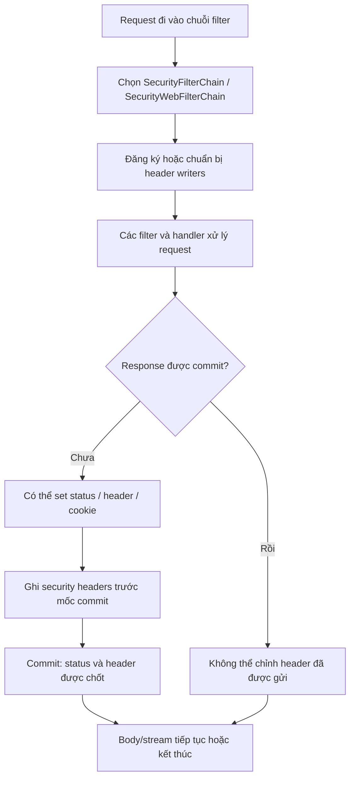
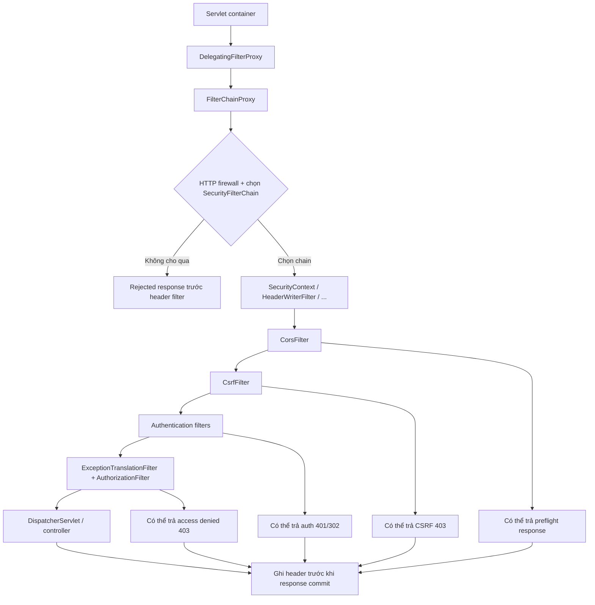
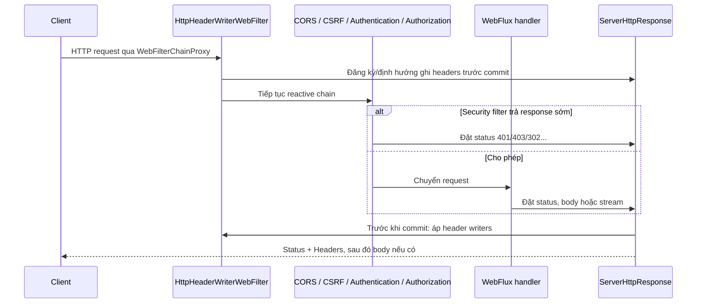
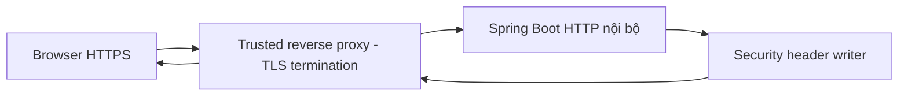
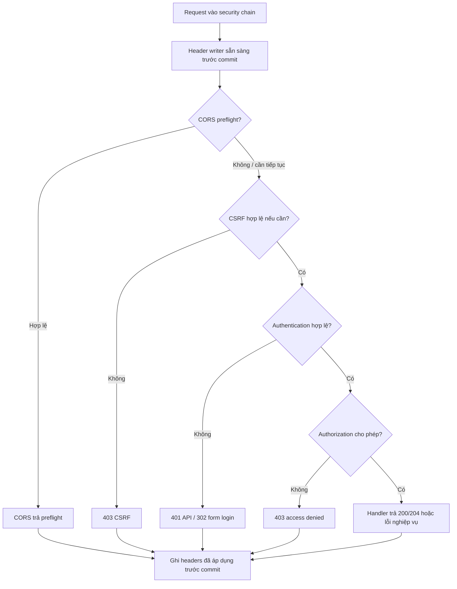

# Lớp ghi header trước khi phản hồi được gửi hoàn tất

> **Chương:** Kiến trúc áp dụng  
> **Module:** `SPRING_SECURITY_HTTP_PROTECTION` — áp dụng các lớp phòng vệ HTTP và trình duyệt trong Spring Security, bao gồm CSRF, CORS, security headers, CSP, HSTS, HTTP firewall và bảo vệ session trên Servlet lẫn Reactive WebFlux.  
> **Trọng tâm:** Cách Spring Security thêm security headers **trong lúc phản hồi vẫn có thể chỉnh sửa**, kể cả response do security filter trả sớm, và cách xác minh các header thật sự đến trình duyệt qua proxy, TLS và error handling.

## 1. Kết quả học tập

Sau bài học, người học có thể:

1. Phân biệt **thiết lập header**, **ghi header xuống HTTP response** và **response đã commit**; xác định lúc nào còn có thể sửa status, header hoặc cookie.
2. Giải thích vai trò của `HeaderWriterFilter` và các `HeaderWriter` trên Servlet; đối chiếu với `HttpHeaderWriterWebFilter` và `ServerHttpHeadersWriter` trên WebFlux.
3. Dự đoán header có xuất hiện trên các response `200`, `204`, `302`, `401`, `403`, CORS preflight và lỗi hay không dựa trên **đường đi qua security chain**, không chỉ mã trạng thái.
4. Cấu hình CSP, HSTS và các security headers phù hợp cho browser và API; phân biệt chúng với header CORS, cookie và CSRF token.
5. Giải thích tác động của `sendError`, `sendRedirect`, `flushBuffer`, streaming response, reverse proxy và header bị ghi đè.
6. Viết kiểm thử MockMvc/WebTestClient cho response bình thường và response bị chặn sớm, đồng thời chỉ rõ phần phải kiểm tra qua HTTPS và trình duyệt thật.
7. Chẩn đoán trường hợp header thiếu, không đúng policy hoặc không được browser thực thi dù code cấu hình đã chạy.

## 2. HTTP response được “commit” nghĩa là gì?

Một HTTP response gồm status, header và body. Khi server **commit response**, status và các header đã được chốt để gửi; ứng dụng không còn được trông đợi có thể sửa chúng cho response đó nữa.

```http
HTTP/1.1 200 OK
Content-Type: text/html; charset=UTF-8
X-Content-Type-Options: nosniff
Content-Security-Policy: default-src 'self'; object-src 'none'
Strict-Transport-Security: max-age=31536000; includeSubDomains

<!doctype html>
<html>...</html>
```

Trong ví dụ này:

- `Content-Type` mô tả body; `X-Content-Type-Options` giúp giảm MIME sniffing.
- `Content-Security-Policy` (CSP) giới hạn các nguồn nội dung trình duyệt được phép tải/thực thi.
- `Strict-Transport-Security` (HSTS) yêu cầu trình duyệt sử dụng HTTPS cho những lần kết nối tiếp theo sau khi nhận header qua HTTPS hợp lệ.
- Header **phải có trước khi response commit** để được truyền đáng tin cậy đến client. Việc gọi `setHeader(...)` sau khi response đã commit không thể sửa HTTP headers đã đi trên mạng.

### 2.1. Các mốc thời gian của một response



Một số thao tác có thể dẫn đến commit, tùy Servlet container, response wrapper hoặc reactive HTTP server: `flushBuffer()`; gửi đủ body làm buffer tràn; `sendError()`; `sendRedirect()`; flush output stream; hoặc pipeline WebFlux bắt đầu viết response. Không nên coi tất cả thao tác này có cùng hành vi trên mọi container/phiên bản.

**Cần phân biệt hai hành động:**

- **Đặt giá trị header** vào response object: ví dụ `response.setHeader("X-Content-Type-Options", "nosniff")`. Giá trị này có thể còn nằm trong buffer, chưa ra mạng.
- **Commit response**: server chốt status/header và bắt đầu truyền response. Sau mốc này, code bổ sung header không thể làm thay đổi header đã được truyền.

### 2.2. Phản hồi “hoàn tất” khác thời điểm “commit”

Response có thể **commit trước khi body hoàn tất**; điều này đặc biệt phổ biến khi stream dữ liệu lớn hoặc gửi `Flux`/SSE trên WebFlux. Cụm “lớp ghi header trước khi phản hồi được gửi hoàn tất” cần hiểu chính xác hơn: **header phải được ghi trước mốc commit**, vốn thường xảy ra **trước cả lúc body hoàn tất**.

```text
Tạo response  ──────► thiết lập headers ──────► COMMIT ──────► ghi body ──────► hoàn tất
                                               ^
                                 Mốc cuối để sửa headers
```

Không đặt logic thêm CSP/HSTS ở callback `onComplete` hoặc trong code chạy sau khi body đã flush; khi đó quá muộn.

## 3. Servlet: `HeaderWriterFilter` làm nhiệm vụ gì?

Trong Spring Security Servlet, `HeaderWriterFilter` là security filter chịu trách nhiệm áp dụng các `HeaderWriter` được cấu hình bởi `HttpSecurity.headers(...)`. Một writer xử lý một hoặc nhiều header theo policy.

Ví dụ về trách nhiệm:

| Thành phần | Vai trò |
|---|---|
| `HttpSecurity.headers(...)` | Cấu hình chính sách header khi xây `SecurityFilterChain`. |
| `HeaderWriterFilter` | Chạy trong security chain, phối hợp ghi header lúc response còn sửa được. |
| `HeaderWriter` | Đặt các header cụ thể, như cache control, nosniff, frame protection, HSTS hoặc CSP. |
| Servlet `HttpServletResponse` | Lưu status/header/body buffer; cung cấp `setHeader`, `addHeader`, `sendError`, `sendRedirect`, `isCommitted`. |
| Servlet container | Quản lý thời điểm commit và truyền bytes của response ra client. |

Spring Security không phụ thuộc vào việc controller phải tự gọi từng header writer. Khi `HeaderWriterFilter` có mặt và request đi đến filter này, nó có thể bảo vệ cả response do controller tạo ra **lẫn** response được filter phía sau kết thúc sớm.

### 3.1. Vị trí tương đối của filter ghi header

Sơ đồ khái niệm:



**Giới hạn sơ đồ:** Các security filters thực tế khác nhau theo phiên bản và tính năng bật/tắt. `HeaderWriterFilter` thường nằm trước các filter CORS/CSRF/authentication/authorization trong filter chain chuẩn, nhưng không phải thành phần đầu tiên của mọi HTTP request. HTTP firewall và custom filters bên ngoài security chain có thể kết thúc request trước khi `HeaderWriterFilter` chạy.

### 3.2. Ghi header ngay lập tức hay ghi khi commit?

Ở Servlet, `HeaderWriterFilter` phối hợp với response wrapper để header có thể được ghi **khi response sắp commit** hoặc ở điểm thích hợp khi xử lý đi ra khỏi filter. Một số phiên bản có tùy chọn ghi header sớm, nhưng không nên phụ thuộc vào cờ nội bộ để sửa lỗi thiết kế.

Mô hình cần nhớ:

```text
HeaderWriterFilter nhận request
   ├─ Chuẩn bị các HeaderWriter/response wrapper
   ├─ Gọi các filter tiếp theo trong chain
   │     ├─ CORS có thể kết thúc bằng preflight
   │     ├─ CSRF có thể kết thúc bằng 403
   │     ├─ Authentication có thể redirect/401
   │     ├─ Authorization có thể từ chối 403
   │     └─ Controller có thể trả 200/204 hoặc lỗi
   └─ Đảm bảo writers được áp dụng trước commit trong đường đi hỗ trợ
```

Nội bộ chính xác cần kiểm chứng theo phiên bản Spring Security đang sử dụng. Hành vi quan sát được quan trọng hơn việc giả định wrapper sẽ luôn ghi header trên mọi response.

### 3.3. Vì sao `sendError()` và `sendRedirect()` đáng chú ý?

Một filter authentication có thể gọi redirect tới trang login hoặc trả lỗi. Nếu lớp ghi header chỉ cố sửa response **sau** một lệnh commit, nó có thể quá muộn. Lớp `HeaderWriterFilter` được thiết kế để tích hợp với thời điểm ghi response nhằm áp dụng header cho những phản hồi như vậy, miễn là request đã đi qua filter và container cho phép.

Tuy nhiên:

- Nếu request bị reverse proxy/Servlet container từ chối **trước** Spring Security, header writer của ứng dụng không có cơ hội chạy.
- Nếu custom filter **đứng trước** `HeaderWriterFilter` tự gửi response, các header do Spring Security quản lý có thể không xuất hiện.
- Nếu response hoặc error dispatch được một thành phần khác xử lý/ghi đè sau đó, header cuối cùng cần được kiểm tra lại.
- Nếu header chỉ được thêm sau khi response đã commit, `isCommitted()` giúp nhận diện nhưng **không** giúp hồi phục response đã gửi.

## 4. WebFlux: `HttpHeaderWriterWebFilter` và `beforeCommit`

Trong Spring Security Reactive WebFlux, thành phần tương ứng là `HttpHeaderWriterWebFilter`. Nó sử dụng các `ServerHttpHeadersWriter` và tương tác với `ServerHttpResponse`.

Điểm trọng tâm WebFlux là API:

```java
ServerHttpResponse response = exchange.getResponse();
response.beforeCommit(() -> {
    // Chạy ngay trước khi HTTP response được commit.
    return Mono.empty();
});
```

`beforeCommit(...)` đăng ký một callback bất đồng bộ, được thực thi trước khi commit response. Callback cần **trả publisher** để hệ thống chờ công việc thích hợp hoàn tất trước commit; không nên tạo subscription rời bằng cách gọi `subscribe()` bên trong callback.

### 4.1. Một sơ đồ cho response WebFlux



Sơ đồ mô tả thời điểm ở mức kiến trúc; cách triển khai thực tế của `HttpHeaderWriterWebFilter` và các writer được quyết định bởi phiên bản Spring Security. Không cần assume mọi writer luôn được thực thi chỉ sau khi handler hoàn tất.

### 4.2. Reactivity thay đổi điểm cần quan sát

Trong WebFlux, một filter trả `Mono<Void>`. `chain.filter(exchange)` mô tả phần xử lý được nối trong reactive pipeline. Cần tránh ba lỗi:

1. **Đăng ký header quá muộn:** chỉ thêm `beforeCommit` bên trong callback chạy khi response đã commit.
2. **Tạo subscription riêng:** gọi `somePublisher.subscribe()` trong filter thay vì trả publisher có thể tách công việc ra khỏi pipeline và Reactor Context.
3. **Blocking trong beforeCommit:** thực hiện I/O chặn thread event loop để tính header sẽ gây nghẽn; nếu cần dữ liệu cho policy, thiết kế lấy trước theo pipeline không blocking và dùng callback đúng cách.

Với streaming `Flux`, những chunk dữ liệu về sau không thể thay đổi header của response đã commit khi chunk đầu tiên được gửi.

### 4.3. Một WebFilter minh họa `beforeCommit`

Ví dụ dưới đây chỉ thêm một header quan sát custom, **không thay thế** security header writer của Spring Security:

```java
import org.springframework.web.server.WebFilter;
import org.springframework.web.server.WebFilterChain;
import org.springframework.web.server.ServerWebExchange;
import reactor.core.publisher.Mono;

final class ResponsePhaseWebFilter implements WebFilter {

    @Override
    public Mono<Void> filter(
            ServerWebExchange exchange,
            WebFilterChain chain) {

        exchange.getResponse().beforeCommit(() -> {
            if (!exchange.getResponse().getHeaders()
                    .containsKey("X-Response-Phase")) {
                exchange.getResponse().getHeaders()
                    .set("X-Response-Phase", "before-commit");
            }
            return Mono.empty();
        });

        return chain.filter(exchange);
    }
}
```

Nếu đăng ký filter này **toàn cục**, nó chỉ ảnh hưởng các request đi qua WebFilter; thứ tự đăng ký quyết định nó có bao quanh Spring Security hay không. Nếu thêm vào `SecurityWebFilterChain`, nó chỉ áp dụng cho chain đó. Không vừa đăng ký global bean vừa add cùng filter vào security chain nếu không kiểm soát nguy cơ chạy hai lần.

**Trong production:** Với các header bảo mật có sẵn như CSP, HSTS, nosniff, frame options, nên dùng DSL chính thức `ServerHttpSecurity.headers(...)`. Đoạn `beforeCommit` là công cụ học thuật để hiểu thời điểm chốt response, không phải lời mời tự cài lại các tính năng bảo mật đã có.

## 5. Header nào được ghi bởi lớp nào?

Không phải mọi header HTTP đều đến từ `HeaderWriterFilter` hoặc `HttpHeaderWriterWebFilter`. Những lớp khác nhau có trách nhiệm khác nhau:

| Header / dữ liệu | Lớp quản lý thường gặp | Ý nghĩa và điểm cần lưu ý |
|---|---|---|
| `X-Content-Type-Options: nosniff` | Security header writer | Giảm rủi ro trình duyệt suy đoán MIME type. |
| `X-Frame-Options` | Security header writer | Hạn chế iframe theo chính sách; kết hợp CSP `frame-ancestors` ở browser hiện đại. |
| `Content-Security-Policy` | CSP header writer khi được cấu hình | Giới hạn nguồn script/style/object/frame; không mặc nhiên có policy phù hợp mọi app. |
| `Content-Security-Policy-Report-Only` | CSP report-only policy tùy cấu hình | Quan sát vi phạm CSP trước khi enforce; không thay header CSP enforce. |
| `Strict-Transport-Security` | HSTS header writer hoặc reverse proxy | Browser chỉ tin header nhận qua HTTPS hợp lệ. |
| `Cache-Control`, `Pragma`, `Expires` | Cache-control headers/policy | Giảm cache nội dung nhạy cảm; cần cân nhắc tài nguyên tĩnh public. |
| `Referrer-Policy` | Security header writer / proxy / ứng dụng | Giới hạn thông tin URL referrer được gửi đi. |
| `Permissions-Policy` | Header policy ứng dụng/proxy | Giới hạn quyền dùng tính năng trình duyệt theo policy phù hợp. |
| `Access-Control-Allow-Origin` | CORS filter/gateway | Được sinh theo request Origin và allowlist; không phải security header writer chung cho mọi response. |
| `Vary: Origin` (và các header preflight) | CORS/filter/cache layer | Giúp cache phân biệt response phụ thuộc Origin/method/headers. |
| `Set-Cookie` | Session/login/CSRF/cookie handling | Thuộc tính `Secure`, `HttpOnly`, `SameSite` tùy thiết kế; phải đặt trước commit. |
| `WWW-Authenticate` | Authentication entry point | Gợi ý/challenge khi trả 401 theo cơ chế Basic/Bearer. |
| `Location` | Redirect handler/controller | Chỉ hướng chuyển hướng 3xx; không phải CSP/HSTS. |

**Điểm cần phân biệt:** Header CORS có thể được ghi trước và dùng để quyết định preflight có dừng không. Header CSP/HSTS là chính sách **phản hồi** dành cho browser, được ghi qua lớp header writer hoặc proxy. CSRF token là dữ liệu bảo vệ **request thay đổi trạng thái** và có thể cần được cung cấp từ server, nhưng không phải một security header response đơn giản áp cho mọi URL.

### 5.1. Một số security headers mặc định và giới hạn

Spring Security cung cấp bộ security headers mặc định tương ứng phiên bản; các giá trị phổ biến có thể gồm nosniff, frame protection, cache-control và HSTS khi HTTPS. Tuy nhiên:

- **CSP cần được thiết kế/cấu hình chủ động**; không giả định policy an toàn đầy đủ đã bật mặc định.
- Header lỗi thời như `X-XSS-Protection` không thay thế CSP và không nên coi là trọng tâm bảo vệ XSS.
- Mặc định ở Spring Security 6, 7 hoặc bản vá cụ thể có thể thay đổi. Hãy đọc header của **response thực tế** thay vì chép nguyên một danh sách từ tài liệu phiên bản khác.
- Security header writer có thể **không ghi đè** một header đã tồn tại hoặc có thể áp quy tắc theo request; không nên giả định mọi response luôn có cùng giá trị.
- Proxy/CDN có thể thêm, sửa, gộp hoặc loại bỏ header sau khi backend đã ghi.

## 6. Ghi CSP trước commit: điều browser thực thi

CSP giúp giới hạn nguồn nội dung mà một document được phép tải và thực thi. Ví dụ:

```http
Content-Security-Policy: default-src 'self'; object-src 'none'; base-uri 'self'; frame-ancestors 'none'
```

Ý nghĩa chính:

- `default-src 'self'` đặt nguồn mặc định cùng origin.
- `object-src 'none'` chặn đối tượng nhúng dạng object/plugin.
- `base-uri 'self'` giới hạn URL base của document.
- `frame-ancestors 'none'` không cho trang bị nhúng bởi frame/iframe khác.

**CSP là policy áp cho document theo cách browser xử lý response.** Gửi CSP trên JSON response có thể không tạo tác dụng bảo vệ các script của trang gọi API như một HTML document CSP. Cần ưu tiên kiểm trang HTML, trang login, trang lỗi và vùng SPA shell.

### 6.1. CSP được gửi ở đúng thời điểm nhưng vẫn có thể phá giao diện

Giả sử ứng dụng có inline script hoặc tải thư viện từ CDN. Policy chặt như trên có thể chặn JavaScript/style hợp lệ. Việc header xuất hiện đúng trước commit chỉ xác minh **lớp truyền policy hoạt động**; nó chưa chứng minh **policy phù hợp**.

Quy trình an toàn:

1. Thống kê các nguồn script, style, image, font, connect, frame cần thiết.
2. Thiết kế các directive rõ ràng như `script-src`, `style-src`, `connect-src`, `img-src`, `frame-ancestors`.
3. Dùng `Content-Security-Policy-Report-Only` để quan sát vi phạm trong staging khi phù hợp.
4. Ưu tiên nonce/hash được sinh đúng cách cho script hợp lệ; tránh nới `unsafe-inline` tràn lan.
5. Test browser console và asset thực tế, rồi mới chuyển sang enforce.

Khi dùng nonce per-request, nonce phải được tạo/đưa vào response **trước commit** và giá trị trong header phải khớp với thuộc tính `nonce` trên script được phép. Không tạo nonce độc lập ở filter và template khiến hai phía lệch nhau.

### 6.2. CSP của response lỗi và redirect

Nếu login page hoặc trang 403 trả HTML, CSP của các document này cũng cần chính sách hợp lý. Một response redirect 302 có thể mang CSP/header bảo mật, nhưng browser thường điều hướng tới response tiếp theo; **policy của document đích** mới quyết định script của document đó.

Đừng kiểm CSP chỉ bằng URL đầu tiên khi browser đã tự follow redirect. Quan sát từng entry trong Network tab: 302, URL đích 200, trang lỗi 4xx và response được gateway tạo.

## 7. HSTS: có header đúng chưa đủ, phải là HTTPS đúng

HSTS gửi:

```http
Strict-Transport-Security: max-age=31536000; includeSubDomains
```

Browser chỉ ghi nhận HSTS từ response nhận qua **kết nối HTTPS hợp lệ**. HSTS không làm cho một HTTP response chưa bảo mật tự trở thành HTTPS trong cùng request đầu tiên.

Điều kiện cần kiểm:

1. Website có HTTPS hợp lệ tại domain mà browser truy cập.
2. Chính sách HSTS được gửi trên response HTTPS cuối cùng (tại backend hoặc reverse proxy).
3. `max-age` phù hợp với chiến lược triển khai; cân nhắc kỹ `includeSubDomains` nếu mọi subdomain chưa sẵn sàng HTTPS.
4. Nếu TLS kết thúc tại reverse proxy, backend nhận diện scheme HTTPS đúng khi dựa vào request security; chỉ tin `Forwarded`/`X-Forwarded-*` từ proxy tin cậy.
5. Nếu proxy quản lý HSTS thay backend, bảo đảm không có policy trùng lặp/mâu thuẫn.

### 7.1. HTTP, HTTPS và reverse proxy



Nếu backend nhìn request là HTTP do thông tin scheme không được xử lý đúng, Spring Security có thể không thêm HSTS theo điều kiện mặc định. Đây là một lý do lỗi “header HSTS mất” dù `headers()` vẫn được bật. Cách xử lý phải dựa vào topology: cấu hình forwarded header từ proxy đáng tin cậy hoặc cấu hình HSTS ở điểm TLS termination.

**Không** cho phép mọi client bên ngoài tự đặt header `X-Forwarded-Proto: https` rồi được backend tin như một kết nối HTTPS; đó là phá ranh giới tin cậy.

### 7.2. HSTS và response trạng thái lỗi

Khi browser đã kết nối HTTPS, response 302, 401 hoặc 403 cũng có thể mang HSTS nếu đường đi qua header writer hoặc proxy. Tuy nhiên, nếu lỗi được tạo ngay tại gateway hoặc do TLS handshake thất bại **trước HTTP**, ứng dụng không thể ghi HSTS cho response đó.

Test HSTS phải dùng HTTPS thật và kiểm **hostname/domain cuối cùng** mà browser thấy, không chỉ fake request flag trong unit test.

## 8. CSRF, CORS, authentication và authorization có ảnh hưởng đến header không?

Có. Các lớp này có thể trả response sớm, vì vậy việc đặt header writer trước chúng trong chain chuẩn có ý nghĩa.



**Sơ đồ biểu diễn đường đi phổ biến**. CORS không có mặt trong mọi chain; HTTP firewall có thể chặn trước; authentication filter có thể xử lý trực tiếp login; và filter header phải thật sự nằm trên đường đi thì security headers mới được ghi.

### 8.1. Ma trận response cần kiểm thử

| Kịch bản | Filter/handler có thể kết thúc request | Headers nên quan sát |
|---|---|---|
| `GET /public` trả 200 | Controller/handler | CSP trên HTML, nosniff, frame policy, HSTS nếu HTTPS và đã cấu hình |
| `GET /api/items` trả 200 JSON | API handler | nosniff và các security headers áp cho API |
| `POST /profile` không có CSRF | CSRF filter → 403 | Các headers từ chain browser nếu header writer đã chạy |
| `GET /profile` anonymous | Authentication entry point → 302 | Header browser và `Location` |
| `GET /api/orders` không Bearer | API entry point → 401 | Header API và có thể `WWW-Authenticate` |
| `GET /admin` đã login nhưng thiếu role | Authorization/access denied → 403 | Header browser nếu có chain |
| OPTIONS preflight được phép | CORS filter | Header CORS phù hợp; một số security headers nếu header writer đã chạy trước |
| OPTIONS preflight bị từ chối | CORS filter | Không có allow-origin cho origin lạ; security headers phụ thuộc đường đi |
| Request có URL bất thường | Proxy/container/firewall có thể chặn | Không thể mặc định có header của Spring Security |
| Response do reverse proxy tạo | Proxy | Chỉ những header mà proxy tự thêm hoặc giữ được từ upstream |
| `204 No Content` | Handler/filter | Không có body vẫn cần kiểm các headers có liên quan |
| `304 Not Modified` | Cache/server | Quy tắc header riêng, có thể phụ thuộc cache/proxy; không suy từ 200 |
| SSE/stream response | WebFlux handler hoặc Servlet async | Header phải được xác lập trước khi stream commit |

**Kết luận kiểm thử:** Không cần áp một bộ header y hệt cho mọi response. Cần chứng minh **những header bắt buộc theo policy của từng loại response** luôn có ở thời điểm client thật nhận, kể cả đường đi lỗi quan trọng.

### 8.2. Khi 403 có security headers nhưng 400 lại không

Giả sử browser `POST /profile` thiếu token CSRF: request được chọn vào browser chain, đi qua header writer rồi `CsrfFilter` trả 403. Headers vẫn có thể được ghi trước commit.

Một URL đáng ngờ khác bị `StrictHttpFirewall` từ chối ngay trong `FilterChainProxy` **trước** khi security chain được chạy. Khi đó `HeaderWriterFilter` không có cơ hội áp headers. Đây không mâu thuẫn với cấu hình `headers(...)`; phạm vi bảo vệ của lớp ghi header bắt đầu sau khi filter được gọi.

Nếu policy cần header trên cả response lỗi do gateway/container tạo ra, phải cấu hình tại lớp tạo response hoặc một lớp chung bao phủ response đó.

## 9. Cấu hình Spring Security Servlet với lớp ghi header

Ví dụ dành cho ứng dụng Spring MVC trên Spring Boot 3 / Spring Security 6 tương thích. Browser dùng form login/session và CSRF; API nhận JWT Bearer. **Đây là cấu hình mẫu**, cần JWT decoder, user store và handler thực tế.

```java
package example.security;

import org.springframework.context.annotation.Bean;
import org.springframework.context.annotation.Configuration;
import org.springframework.core.annotation.Order;
import org.springframework.http.HttpMethod;
import org.springframework.security.config.Customizer;
import org.springframework.security.config.annotation.web.builders.HttpSecurity;
import org.springframework.security.config.annotation.web.configuration.EnableWebSecurity;
import org.springframework.security.config.annotation.web.configurers.AbstractHttpConfigurer;
import org.springframework.security.config.http.SessionCreationPolicy;
import org.springframework.security.web.SecurityFilterChain;

@Configuration
@EnableWebSecurity
public class ServletHeadersConfig {

    @Bean
    @Order(1)
    SecurityFilterChain api(HttpSecurity http) throws Exception {
        return http
            .securityMatcher("/api/**")
            .cors(Customizer.withDefaults())
            // Chỉ tắt CSRF khi API thực sự dùng header Bearer
            // và không dùng browser cookie làm credential.
            .csrf(AbstractHttpConfigurer::disable)
            .sessionManagement(session -> session
                .sessionCreationPolicy(SessionCreationPolicy.STATELESS))
            .authorizeHttpRequests(auth -> auth
                .requestMatchers(HttpMethod.GET, "/api/public/**")
                    .permitAll()
                .anyRequest().authenticated())
            .oauth2ResourceServer(oauth2 -> oauth2
                .jwt(Customizer.withDefaults()))
            // Có thể để bộ security headers mặc định hoạt động.
            .headers(Customizer.withDefaults())
            .build();
    }

    @Bean
    @Order(2)
    SecurityFilterChain browser(HttpSecurity http) throws Exception {
        return http
            // Fallback: bảo vệ URL không thuộc /api/**.
            .authorizeHttpRequests(auth -> auth
                .requestMatchers("/login", "/assets/**").permitAll()
                .requestMatchers("/admin/**").hasRole("ADMIN")
                .anyRequest().authenticated())
            .formLogin(Customizer.withDefaults())
            .csrf(Customizer.withDefaults())
            .headers(headers -> headers
                .contentSecurityPolicy(csp -> csp.policyDirectives(
                    "default-src 'self'; object-src 'none'; " +
                    "base-uri 'self'; frame-ancestors 'none'"))
                .httpStrictTransportSecurity(hsts -> hsts
                    .includeSubDomains(true)
                    .maxAgeInSeconds(31536000)))
            .build();
    }
}
```

**Giải thích:**

- API chain có bộ security headers mặc định và bảo vệ JWT nhưng không dùng CSP riêng của HTML browser chain; nếu API trả HTML, phải xác định policy phù hợp.
- Browser chain là fallback. `/login` và `/assets/**` được `permitAll()` nên vẫn đi qua security filters, bao gồm header writer.
- CSP được cấu hình tường minh; HSTS chỉ có hiệu lực khi browser nhận qua HTTPS.
- Thứ tự gọi `headers(...)` trong DSL không phải thứ tự chạy filter. Spring Security xây chain theo thứ tự filter được quy định.
- Nếu cần CORS ở API, phải cung cấp cấu hình `CorsConfigurationSource` phù hợp path/origin/method/headers (hoặc cấu hình tương thích mà `cors(Customizer.withDefaults())` tìm được).
- Không tắt CSRF browser để “sửa” lỗi response headers; CSRF và header writer là hai lớp độc lập.

### 9.1. Kiểm soát một header custom trên Servlet

Khi cần thêm header ứng dụng, có thể dùng `HeaderWriter` qua DSL:

```java
.headers(headers -> headers
    .addHeaderWriter((request, response) -> {
        // Ví dụ header cố định; không đưa secret vào header.
        response.setHeader(
            "X-Application-Policy", "browser-v1");
    })
    .contentSecurityPolicy(csp -> csp.policyDirectives(
        "default-src 'self'; object-src 'none'; base-uri 'self'")))
```

Đoạn này là **thành phần của cấu hình `HttpSecurity`**, có thể gắn vào browser chain. Đừng dùng nó để tự triển khai CSP/HSTS khi builder Spring Security đã hỗ trợ. Nếu response đã có giá trị header từ gateway, chính sách ghi đè cần được thống nhất; `setHeader` thay giá trị hiện có, `addHeader` có thể tạo nhiều giá trị.

Không dùng header custom để tiết lộ stack trace, user ID nhạy cảm, token, session ID hoặc khóa bí mật.

### 9.2. Vì sao `web.ignoring()` dễ làm mất headers?

Servlet `web.ignoring()` khiến request khớp điều kiện **bỏ qua Spring Security filter chain**. Tài nguyên static có thể được server khác trả, nhưng `HeaderWriterFilter` của Spring Security không chạy cho request đó.

Thường dùng:

```java
http.authorizeHttpRequests(auth -> auth
    .requestMatchers("/assets/**").permitAll()
    .anyRequest().authenticated());
```

thay cho bỏ qua toàn bộ chain. Anonymous vẫn tải asset được, các HTTP security filter vẫn có cơ hội xử lý.

## 10. Cấu hình WebFlux: security headers trong reactive pipeline

WebFlux sử dụng `ServerHttpSecurity`, `SecurityWebFilterChain` và `HttpHeaderWriterWebFilter`. Ví dụ tách browser/API tương đương về ý định bảo vệ; đặt trong **ứng dụng WebFlux riêng**, không copy trộn với cấu hình Servlet.

```java
package example.security;

import org.springframework.context.annotation.Bean;
import org.springframework.context.annotation.Configuration;
import org.springframework.core.annotation.Order;
import org.springframework.http.HttpMethod;
import org.springframework.security.config.Customizer;
import org.springframework.security.config.annotation.web.reactive.EnableWebFluxSecurity;
import org.springframework.security.config.web.server.ServerHttpSecurity;
import org.springframework.security.web.server.SecurityWebFilterChain;
import org.springframework.security.web.server.context.NoOpServerSecurityContextRepository;
import org.springframework.security.web.server.util.matcher.ServerWebExchangeMatchers;

@Configuration
@EnableWebFluxSecurity
public class ReactiveHeadersConfig {

    @Bean
    @Order(1)
    SecurityWebFilterChain api(ServerHttpSecurity http) {
        return http
            .securityMatcher(
                ServerWebExchangeMatchers.pathMatchers("/api/**"))
            .cors(Customizer.withDefaults())
            .csrf(ServerHttpSecurity.CsrfSpec::disable)
            .securityContextRepository(
                NoOpServerSecurityContextRepository.getInstance())
            .authorizeExchange(auth -> auth
                .pathMatchers(HttpMethod.GET, "/api/public/**")
                    .permitAll()
                .anyExchange().authenticated())
            .oauth2ResourceServer(oauth2 -> oauth2
                .jwt(Customizer.withDefaults()))
            .headers(Customizer.withDefaults())
            .build();
    }

    @Bean
    @Order(2)
    SecurityWebFilterChain browser(ServerHttpSecurity http) {
        return http
            .authorizeExchange(auth -> auth
                .pathMatchers("/login", "/assets/**").permitAll()
                .pathMatchers("/admin/**").hasRole("ADMIN")
                .anyExchange().authenticated())
            .formLogin(Customizer.withDefaults())
            .csrf(Customizer.withDefaults())
            .headers(headers -> headers
                .contentSecurityPolicy(csp -> csp.policyDirectives(
                    "default-src 'self'; object-src 'none'; " +
                    "base-uri 'self'; frame-ancestors 'none'")))
            .build();
    }
}
```

Lưu ý WebFlux:

- Spring Security WebFlux tạo header filter cho chain khi cấu hình headers phù hợp; khi response sắp commit, header writers cần hoàn tất theo hợp đồng reactive.
- `ServerWebExchange` chứa `ServerHttpResponse`; `ReactiveSecurityContextHolder` dùng Reactor Context để truyền danh tính, khác `SecurityContextHolder` dựa trên thread của Servlet.
- HSTS và các security headers mặc định cần được xác minh trên HTTPS thật; tùy phiên bản, API cấu hình HSTS trên Reactive khác Servlet, nên không sao chép `httpStrictTransportSecurity(...)` của Servlet sang `ServerHttpSecurity`.
- CORS Reactive sử dụng `org.springframework.web.cors.reactive.CorsConfigurationSource`. Nếu có nhiều cấu hình CORS/gateway, chỉ định source rõ ràng và test preflight.
- `NoOpServerSecurityContextRepository` không tự ngăn mọi WebSession/cookie ngoài security, và việc tắt CSRF API chỉ hợp lý theo threat model Bearer header đã nêu.

### 10.1. Chọn chain đúng thì header policy mới đúng

```text
@Order(1)  /api/**  → JWT + security headers API
@Order(2)  fallback → form login + CSRF + CSP/headers browser
```

Nếu fallback nằm trước API, request `/api/orders` có thể nhận redirect login cùng CSP browser thay vì Bearer 401. Nếu chỉ có API chain mà không có fallback, những URL ngoài `/api/**` có thể không đi qua header writer của Spring Security.

**Header xuất hiện đúng không đồng nghĩa authorization đúng.** Một request có thể nhận nosniff và CSP nhưng vẫn bị route sai quyền; cần test cả header và kết quả authentication/authorization.

## 11. Kiểm thử Servlet với MockMvc

Giả định ứng dụng có endpoint demo:

- `GET /page` trả HTML/200 khi user đã được xác thực.
- `POST /profile` trả 204 khi user đã xác thực và CSRF hợp lệ.
- `GET /api/public/items` trả JSON/200.
- `GET /api/orders` là tài nguyên riêng tư.
- `GET /assets/app.css` được public.

Khi dùng `@SpringBootTest` + `@AutoConfigureMockMvc`, đảm bảo Spring Security Test được tích hợp vào MockMvc (Spring Boot cấu hình thông thường hỗ trợ) và app context có JWT decoder/user store phù hợp.

```java
@SpringBootTest
@AutoConfigureMockMvc
class ServletResponseHeadersTest {

    @Autowired
    MockMvc mvc;

    @Test
    void htmlPageHasConfiguredCsp() throws Exception {
        mvc.perform(get("/page")
                .with(user("lan").roles("USER")))
            .andExpect(status().isOk())
            .andExpect(header().string(
                "Content-Security-Policy",
                "default-src 'self'; object-src 'none'; " +
                "base-uri 'self'; frame-ancestors 'none'"))
            .andExpect(header().string(
                "X-Content-Type-Options", "nosniff"));
    }

    @Test
    void csrfFailureStillHasBrowserSecurityHeaders()
            throws Exception {
        mvc.perform(post("/profile")
                .with(user("lan").roles("USER")))
            .andExpect(status().isForbidden())
            .andExpect(header().exists("Content-Security-Policy"));
    }

    @Test
    void apiAnonymous401StillHasSecurityHeaders()
            throws Exception {
        mvc.perform(get("/api/orders"))
            .andExpect(status().isUnauthorized())
            .andExpect(header().string(
                "X-Content-Type-Options", "nosniff"));
    }

    @Test
    void publicAssetIsStillInBrowserSecurityChain()
            throws Exception {
        mvc.perform(get("/assets/app.css"))
            .andExpect(status().isOk())
            .andExpect(header().exists("Content-Security-Policy"));
    }

    @Test
    void hstsIsWrittenWhenRequestIsSecure()
            throws Exception {
        mvc.perform(get("/page")
                .secure(true)
                .with(user("lan").roles("USER")))
            .andExpect(status().isOk())
            .andExpect(header().exists("Strict-Transport-Security"));
    }

    @Test
    void csrfSuccessCanReachHandler() throws Exception {
        mvc.perform(post("/profile")
                .with(user("lan").roles("USER"))
                .with(csrf()))
            .andExpect(status().isNoContent());
    }
}
```

Các imports tĩnh cần dùng:

```java
import static org.springframework.security.test.web.servlet.request.SecurityMockMvcRequestPostProcessors.*;
import static org.springframework.test.web.servlet.request.MockMvcRequestBuilders.*;
import static org.springframework.test.web.servlet.result.MockMvcResultMatchers.*;
```

Các imports khác: `org.junit.jupiter.api.Test`, `org.springframework.beans.factory.annotation.Autowired`, `org.springframework.boot.test.context.SpringBootTest`, `org.springframework.boot.test.autoconfigure.web.servlet.AutoConfigureMockMvc`, `org.springframework.test.web.servlet.MockMvc`.

**Ý nghĩa kiểm thử HSTS:** `.secure(true)` giả lập request HTTPS **trong MockMvc** để kiểm tính năng có ghi header ở phía app khi request được đánh dấu secure. Nó **không chứng minh** browser sẽ chấp nhận HSTS từ triển khai thật, hay reverse proxy truyền scheme đúng. Phải có integration test qua HTTPS ở mục 13.

**Giới hạn ví dụ:** Các endpoint và status được giả định; nếu không có controller hoặc static asset, cần tạo chúng hoặc sửa assertion để phù hợp dự án. Kỳ vọng CSP trên asset phản ánh cấu hình mẫu; trên ứng dụng thật có thể chủ ý chỉ đặt CSP cho HTML, khi đó test cần theo policy thực thay vì ép mọi asset có CSP.

### 11.1. Kiểm header trên response do CSRF tạo

Một test rất hữu ích kiểm tra:

```text
POST /profile + authenticated user + không có CSRF
           ↓
HeaderWriterFilter đã tham gia browser chain
           ↓
CsrfFilter từ chối
           ↓
HTTP 403 + header bảo vệ browser (theo cấu hình)
```

Nếu test trả 403 nhưng thiếu CSP, kiểm xem request có thật sự vào browser chain chưa, HeaderWriterFilter có ở đó không, hoặc có filter ngoài chain trả 403 trước không. Chỉ test `status().isForbidden()` chưa đủ để biết security headers đã áp dụng.

## 12. Kiểm thử WebFlux với WebTestClient

Với WebFlux, bind `WebTestClient` vào Spring application context và áp `springSecurity()` để chạy security WebFilters.

```java
@SpringBootTest
class ReactiveResponseHeadersTest {

    @Autowired
    ApplicationContext context;

    WebTestClient client;

    @BeforeEach
    void setup() {
        client = WebTestClient.bindToApplicationContext(context)
            .apply(springSecurity())
            .configureClient()
            .build();
    }

    @Test
    void browserPageHasCsp() {
        client.mutateWith(mockUser("lan").roles("USER"))
            .get().uri("/page")
            .exchange()
            .expectStatus().isOk()
            .expectHeader()
            .valueEquals("Content-Security-Policy",
                "default-src 'self'; object-src 'none'; " +
                "base-uri 'self'; frame-ancestors 'none'");
    }

    @Test
    void csrf403IncludesHeaderFromBrowserChain() {
        client.mutateWith(mockUser("lan").roles("USER"))
            .post().uri("/profile")
            .exchange()
            .expectStatus().isForbidden()
            .expectHeader().exists("Content-Security-Policy");
    }

    @Test
    void api401StillReceivesSecurityHeaders() {
        client.get().uri("/api/orders")
            .exchange()
            .expectStatus().isUnauthorized()
            .expectHeader().valueEquals(
                "X-Content-Type-Options", "nosniff");
    }

    @Test
    void publicAssetHasConfiguredBrowserPolicy() {
        client.get().uri("/assets/app.css")
            .exchange()
            .expectStatus().isOk()
            .expectHeader().exists("Content-Security-Policy");
    }
}
```

Imports thường dùng:

```java
import org.junit.jupiter.api.BeforeEach;
import org.junit.jupiter.api.Test;
import org.springframework.beans.factory.annotation.Autowired;
import org.springframework.boot.test.context.SpringBootTest;
import org.springframework.context.ApplicationContext;
import org.springframework.test.web.reactive.server.WebTestClient;
import static org.springframework.security.test.web.reactive.server.SecurityMockServerConfigurers.*;
```

Đây là mẫu kiểm tra hành vi security filter chain. Cần Spring Security Test, WebFlux Test, các controller/handler demo và cấu hình authentication/JWT tương ứng để khởi tạo context. `mockUser()` giả lập authentication, **không kiểm mật khẩu hay lưu session thật**.

### 12.1. Test “trước commit” bằng WebFilter minh họa

Nếu đưa `ResponsePhaseWebFilter` ở mục 4.3 vào pipeline test theo đúng scope, một assertion:

```java
client.get().uri("/api/public/items")
    .exchange()
    .expectStatus().isOk()
    .expectHeader().valueEquals(
        "X-Response-Phase", "before-commit");
```

chứng minh callback đã kịp ghi header trong đường đi đó. Nó không chứng minh mọi response đều chạy qua filter: hãy thêm test 403 và redirect, đồng thời có test đường đi bị server/gateway từ chối để xác định phạm vi.

### 12.2. Kiểm tra hành vi 204 và streaming

Response `204 No Content` không có body vẫn có thể mang security headers. Một test cần assert status `isNoContent()` **và** header phù hợp. Đối với SSE/Flux, kiểm header trước chunk đầu tiên; callback hoàn thành của stream không phải điểm phù hợp để thêm headers. Đừng chờ stream vô hạn kết thúc mới kiểm CSP/HSTS.

## 13. Kiểm thử triển khai thật qua HTTPS và browser

Unit/integration tests trong application context chứng minh phần lớn **logic Spring Security**, nhưng response cuối cùng có thể bị thay đổi khi qua reverse proxy, CDN, TLS termination hoặc browser.

### 13.1. Kiểm tra response cuối bằng HTTP client

Ví dụ lệnh minh họa với một host thử nghiệm đã có DNS/HTTPS:

```bash
# Kiểm tra HEADERS trên trang browser:
curl -I https://app.example.com/page

# Kiểm tra redirect và từng bước; không follow tự động:
curl -i https://app.example.com/profile

# Kiểm tra anonymous API 401:
curl -i https://app.example.com/api/orders

# Kiểm tra preflight:
curl -i -X OPTIONS 'https://app.example.com/api/orders' \
  -H 'Origin: https://client.example.com' \
  -H 'Access-Control-Request-Method: POST' \
  -H 'Access-Control-Request-Headers: authorization,content-type'
```

**Lưu ý:** `curl -I` gửi HEAD thay vì GET; một ứng dụng có thể có policy khác cho HEAD hoặc không hỗ trợ route đó. Khi cần kiểm chính xác GET, dùng `curl -sS -D - -o /dev/null https://app.example.com/page` hoặc kiểm Network tab. Các tên miền ở đây chỉ là ví dụ, không phải endpoint chạy sẵn.

Kiểm thêm response `403` do CSRF và authorization bằng request test thích hợp, đồng thời bảo vệ credential thật trong log/terminal.

### 13.2. Chứng minh CSP được browser thực thi

Trên trang HTML thử nghiệm:

1. Mở DevTools → Network, chọn response **document**.
2. Kiểm tra `Content-Security-Policy` trên chính document (không chỉ trên asset).
3. Dùng Console/Reporting để tìm CSP violation.
4. Kiểm script, style, fonts, iframe, WebSocket/fetch endpoints cần cho ứng dụng.
5. Thử policy report-only khi sửa cấu hình lớn, sau đó xác minh enforce thực.

Nếu header được ghi **sau commit** thì client sẽ không nhận; nếu header được gửi nhưng vi phạm directive, browser vẫn có thể chặn asset. Hai nguyên nhân cần phân biệt.

### 13.3. Chứng minh HSTS trên HTTPS và proxy

Lấy response HTTPS tại **domain công khai**. Kiểm `Strict-Transport-Security` cùng certificate/scheme hợp lệ. Nếu thiếu:

- Backend nhận request là HTTP do proxy chưa khai báo scheme một cách tin cậy?
- Header do proxy thêm nhưng lại bị tầng CDN xóa?
- HSTS chỉ bật trong một security chain khác?
- Truy cập nhầm HTTP, IP, subdomain hoặc management port?
- Response lỗi do proxy tạo trước khi đi tới backend?

Chỉ sau khi kiểm đường đi HTTP thực mới kết luận filter của Spring Security có lỗi.

## 14. Chẩn đoán khi header thiếu hoặc xuất hiện không đúng lúc

| Triệu chứng | Nguyên nhân nên kiểm trước | Cách xác minh |
|---|---|---|
| CSP có trên 200 nhưng thiếu ở 403 CSRF | 403 được tạo trước header writer hoặc response bị thay đổi | Theo dõi chain/CSRF filter, log và headers response thô |
| API 401 không có nosniff | Request không qua đúng API chain/header writer | Kiểm matcher, `@Order` và filter list |
| 404 do gateway không có CSP | Response không tới Spring Security | Kiểm access logs gateway/backend và policy gateway |
| Login 302 thiếu CSP nhưng trang login 200 có | Hai response đi qua các đường khác nhau | Xem response từng bước, redirect filter và chain |
| Trình duyệt thấy “CSP blocked script” | Policy hiện hữu nhưng directive quá chặt | Xem CSP violation và asset, cân nhắc nonce/hash |
| HSTS vắng mặt sau TLS termination | Backend không nhận diện HTTPS hoặc proxy xử lý header | Kiểm trusted forwarded headers và response cuối |
| HSTS có nhưng browser không lưu | Header nhận trên HTTP hoặc HTTPS không hợp lệ | Kiểm URL, certificate và behavior browser |
| Cache-control làm asset chậm | Cache policy mặc định không phù hợp tài nguyên tĩnh | Tách policy tài nguyên public, kiểm CDN/cache headers |
| Preflight thiếu allow-origin | CORS filter/source sai chứ không phải CSP writer | Kiểm `Origin`, method, request headers, chain |
| Header bị ghi hai giá trị | App và gateway cùng thêm header hoặc nhiều writers | Kiểm headers ở backend rồi tại edge; chuẩn hóa owner |
| Header custom không xuất hiện trên SSE | Ghi sau khi streaming đã commit | Đăng ký `beforeCommit` trước khi bắt đầu stream |
| WebFlux bị lỗi event loop/timeout lúc commit | Callback beforeCommit chặn hoặc publisher không hoàn tất | Kiểm reactive publisher, blocking code, log/metrics |
| Header chỉ mất trên URL bypass | `web.ignoring` hoặc không có chain khớp | Dùng `permitAll`/fallback phù hợp và negative tests |
| Header không ghi được sau `sendError` | Response đã commit hoặc container xử lý error khác | Quan sát `isCommitted` và error dispatch |
| Header trên API public nhưng handler không chạy | Authentication token hỏng hoặc firewall chặn trước | Tách test public không token và public token sai |

### 14.1. Quy trình điều tra từng tầng

**Bước 1 — Xác định response thật.** Ghi method, URL sau gateway rewrite, status, response headers **tại edge** và có follow redirect không. Phân biệt GET với HEAD.

**Bước 2 — Xác định tầng đã tạo response.** HTTP server, reverse proxy, `FilterChainProxy`/`WebFilterChainProxy`, CSRF/authentication/authorization filter hay controller?

**Bước 3 — Xác định chain và header filter.** Servlet: `HeaderWriterFilter` có trong `SecurityFilterChain` đã chọn không? WebFlux: `HttpHeaderWriterWebFilter` và `ServerHttpHeadersWriter` có được cấu hình không?

**Bước 4 — Xác định thời điểm commit.** Header được thiết lập trước response commit chưa? Có `sendRedirect`, `sendError`, `flushBuffer` hoặc streaming bắt đầu quá sớm không?

**Bước 5 — Kiểm tra giá trị và hiệu lực.** CSP directive có đúng page không? HSTS có thực sự đến browser qua HTTPS? CORS có thuộc đúng origin? Một gateway khác có ghi đè header không?

**Bước 6 — Tạo test hồi quy.** Bao gồm ít nhất một response thành công và một response bị bảo mật từ chối sớm, cùng kiểm tra trên HTTPS staging.

Không nên chữa lỗi header thiếu bằng cách bỏ `CsrfFilter`, bỏ authorization hoặc cho mọi URL `permitAll`. Hãy sửa đúng vị trí ghi header hay phạm vi chain.

## 15. Những giới hạn bảo vệ cần nêu rõ

### 15.1. Không phải security writer nào cũng tác động mọi response

Các request bị firewall/container/gateway chặn trước khi vào security chain hoặc URL chủ động bỏ qua proxy có thể không nhận headers do Spring Security viết. Các response static được CDN phục vụ cũng có thể không đi vào ứng dụng. Nếu yêu cầu policy trên toàn bộ edge, cấu hình cần bao phủ response do edge tự tạo.

### 15.2. Security headers không thay CSRF hay authorization

CSP, HSTS, nosniff, frame protection làm giảm những rủi ro phía browser/transport. Chúng không xác thực user, không cấp quyền truy cập và không thay thế CSRF token cho request dùng credential browser tự gửi. Tương tự CORS không chứng minh user có quyền tạo giao dịch.

### 15.3. Chỉ có header không chứng minh chính sách an toàn

CSP `default-src *` có thể hợp cú pháp nhưng quá rộng. HSTS `max-age=0` có ý nghĩa tắt chính sách hiện hành. Một header giá trị sai không biến thành an toàn chỉ vì được ghi trước commit.

### 15.4. Response có header chưa chắc trang đã nhận hoặc browser đã dùng

Cache, proxy và redirect có thể làm người quan sát xem nhầm response. Browser áp CSP cho document nhận được, HSTS cho origin qua HTTPS hợp lệ. Test headers ở backend phải được bổ sung bằng test tại edge và browser.

## 16. Bài tập thực hành

### Bài tập A — Dự đoán thời điểm commit

Cho bốn tình huống:

1. Controller gọi `response.setHeader(...)` rồi trả HTML.
2. Controller flush output stream, sau đó mới gọi `setHeader(...)`.
3. Authentication filter redirect 302 đến `/login`.
4. WebFlux handler bắt đầu stream `Flux`, sau chunk đầu mới cố thêm CSP.

**Yêu cầu:** xác định trường hợp nào header còn có cơ hội đến client và trường hợp nào đã quá muộn. Gợi ý: trường hợp 1 thường còn kịp; 2 và 4 thường quá muộn sau commit; trường hợp 3 phụ thuộc header writer nằm trước filter redirect và cách nó xử lý thời điểm commit.

### Bài tập B — Hai response 403 khác nhau

Tạo một POST browser thiếu CSRF token (403) và một GET trang admin bởi user thiếu quyền (403). Kiểm response headers ở cả hai. Nếu một response mất CSP, xác định filter chain nào đã được chọn, lớp nào tạo 403 và header writer có thực sự chạy trước commit không.

### Bài tập C — So sánh `permitAll` với bỏ qua security chain

Trên Servlet, cho `GET /assets/app.css` qua `permitAll()`, kiểm CSP/nosniff. Sau đó thử `web.ignoring()` cho cùng URL trong môi trường thử nghiệm. So sự khác nhau về security headers và giải thích rủi ro của việc bypass chain.

### Bài tập D — CSP report-only và assets thực tế

Bật CSP report-only có `default-src 'self'` và nguồn cụ thể cần cho ứng dụng. Mở trang WebFlux hoặc MVC trong browser, thu violation reports, điều chỉnh policy. Xác nhận khi bật enforce, các script/font cần thiết vẫn hoạt động và nguồn không mong muốn bị chặn.

### Bài tập E — HSTS sau reverse proxy

Cho HTTPS public kết thúc tại proxy, backend chạy HTTP. Xác minh HSTS có trên response public HTTPS khi proxy truyền trusted scheme phù hợp hoặc proxy tự quản lý HSTS. Kiểm cả 200, 302 và 403; xác nhận kết quả qua browser và response raw, không chỉ qua mock request.

### Bài tập F — Streaming WebFlux

Viết một SSE endpoint trả `Flux<ServerSentEvent<String>>`. Đặt header custom bằng `beforeCommit` trong một WebFilter đã được đăng ký đủ sớm. Kiểm header tồn tại ở response ngay khi stream bắt đầu; thử ghi header sau first chunk để thấy vì sao không nên dùng điểm đó cho CSP/HSTS.

## 17. Tóm tắt kiến trúc cần nhớ

- **Servlet `HeaderWriterFilter`** và **WebFlux `HttpHeaderWriterWebFilter`** phối hợp các header writers để áp policy cho response đi qua security chain.
- **Mốc quan trọng là response commit.** Status và header phải được xác định **trước commit**; body có thể tiếp tục sau đó, nhất là streaming.
- **Header writer cần nằm trên đường đi.** Response do CSRF/authentication/authorization chặn sớm vẫn có thể có headers; response bị proxy/container/firewall chặn trước security chain có thể không.
- **CSP, HSTS, nosniff, frame options, cache-control, CORS headers và Set-Cookie thuộc các trách nhiệm khác nhau.** Cần biết lớp nào ghi header nào, khi nào, và liệu browser có áp dụng policy không.
- **HSTS đòi HTTPS hợp lệ và xử lý proxy tin cậy; CSP cần policy phù hợp document/asset.** Có header không đủ để kết luận an toàn.
- **Kiểm thử theo response thật:** 200, 204, 302, 401, 403, CORS preflight, lỗi từ proxy, HTTPS và stream. Luôn xem security chain được chọn, thời điểm commit và header cuối cùng tới client.
