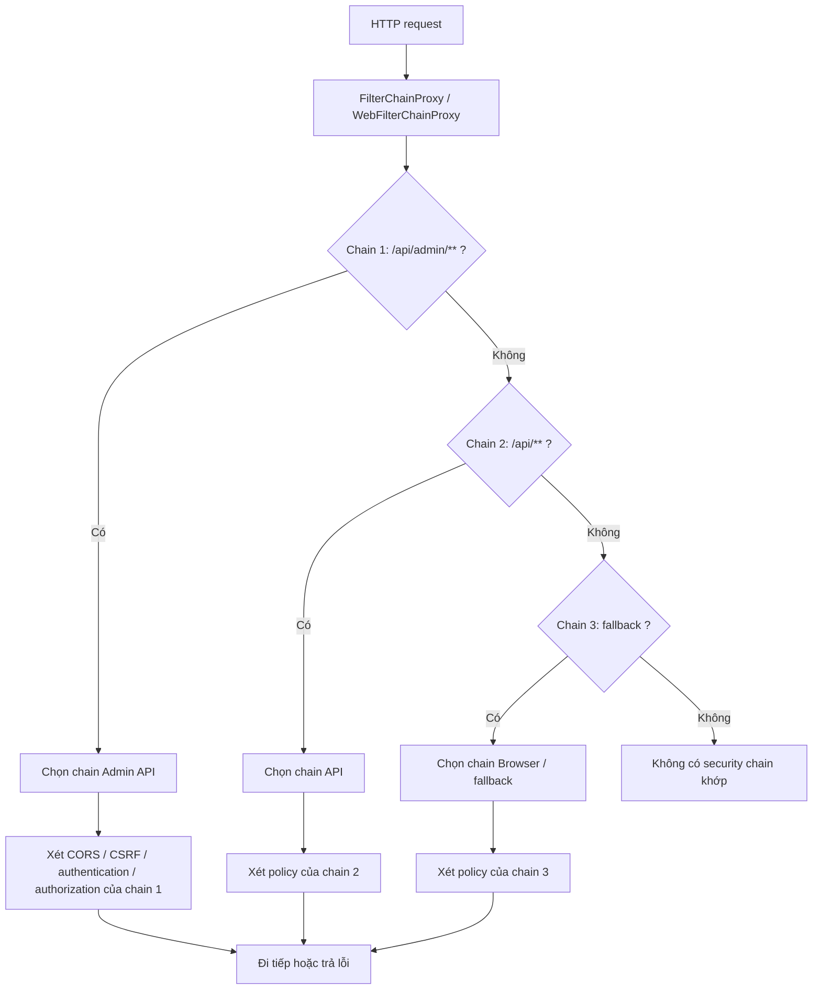

# RequestMatcher và ServerWebExchangeMatcher theo mô hình ứng dụng

> **Chương:** Kiến trúc áp dụng  
> **Module:** `SPRING_SECURITY_HTTP_PROTECTION` — áp dụng CSRF, CORS, security headers, CSP, HSTS, HTTP firewall và bảo vệ session trong Spring Security, trên Servlet lẫn Reactive WebFlux.  
> **Trọng tâm:** Dùng matcher để phân vùng đúng **request nào thuộc security chain nào**, **rule bảo mật nào được áp dụng**, đồng thời tránh khoảng trống bảo vệ khi hệ thống có browser session, API Bearer token, nhiều servlet, WebFlux functional endpoints hoặc reverse proxy.

## 1. Người học cần đạt được gì?

Sau bài học, người học có thể:

1. Giải thích hợp đồng `RequestMatcher` của Servlet và `ServerWebExchangeMatcher` của WebFlux, bao gồm dữ liệu đầu vào và kết quả khớp.
2. Phân biệt **matcher chọn chain** với **matcher của authorization**, **matcher của CSRF**, **matcher xử lý CORS** và **matcher ở handler/router**.
3. Thiết kế chain chuyên biệt và fallback cho mô hình browser đăng nhập bằng cookie, API chỉ nhận Bearer token, dịch vụ nội bộ và WebFlux API.
4. Xác định ảnh hưởng của URL path, HTTP method, context path, servlet path, trailing slash, encoding, gateway rewrite và `OPTIONS` preflight đến kết quả matcher.
5. Biết lúc nào cần `MvcRequestMatcher` / matcher có hiểu Spring MVC, lúc nào dùng matcher path tường minh, và cách tránh sai lệch với router.
6. Cấu hình Spring MVC/Servlet bằng `HttpSecurity`, WebFlux bằng `ServerHttpSecurity` với chính sách CSRF/CORS/headers/session phù hợp từng chain.
7. Viết các kiểm thử dương tính và âm tính cho ranh giới chain, bao gồm request gần giống đường dẫn được phép và request không có token.
8. Chẩn đoán request đi nhầm chain, bị `302` thay vì `401`, bị `403` ngoài ý muốn hoặc lọt ngoài phạm vi Spring Security.

## 2. Matcher trả lời câu hỏi nào?

Một matcher là **điều kiện xác định một HTTP request có thuộc nhóm nào đó hay không**.

| Stack | Giao diện | Dữ liệu đầu vào | Kết quả |
|---|---|---|---|
| **Servlet** | `org.springframework.security.web.util.matcher.RequestMatcher` | `HttpServletRequest` | `boolean matches(HttpServletRequest)` |
| **WebFlux** | `org.springframework.security.web.server.util.matcher.ServerWebExchangeMatcher` | `ServerWebExchange` | `Mono<MatchResult> matches(ServerWebExchange)` |

Một `RequestMatcher` có thể kiểm đường dẫn, HTTP method, servlet path hoặc các thuộc tính khác của request. Một `ServerWebExchangeMatcher` làm công việc tương ứng theo mô hình reactive, trả kết quả bất đồng bộ và có thể cung cấp những biến được trích từ path trong `MatchResult`.

**Matcher không mặc nhiên xác thực hay cấp quyền**. Nó chỉ xác định điều kiện nào đang áp dụng; chính sách đi kèm mới quyết định cho phép, từ chối hoặc áp dụng filter.

Ví dụ hai câu sau hoàn toàn khác:

- “Request này **thuộc chain API** vì path khớp `/api/**`.”
- “Trong chain API, `GET /api/catalog/**` **được authorization cho phép công khai**.”

Một request có thể thuộc chain API nhưng vẫn bị CSRF/CORS/authentication/authorization chặn. Ngược lại, nếu nó **không đi vào bất kỳ security chain nào**, các security filters của chain không có cơ hội bảo vệ nó.

### 2.1. Bốn vị trí thường xuất hiện matcher

| Vị trí | Servlet | WebFlux | Ý nghĩa |
|---|---|---|---|
| **Chọn security chain** | `http.securityMatcher(...)` | `http.securityMatcher(...)` | Xác định có áp dụng **toàn bộ chain** cho request không. |
| **Authorization** | `authorizeHttpRequests(...requestMatchers(...))` | `authorizeExchange(...pathMatchers(...) / matchers(...))` | Kiểm rule truy cập trong chain đã chọn. |
| **CSRF** | `csrf(...requireCsrfProtectionMatcher(...) / ignoringRequestMatchers(...))` | `csrf(...requireCsrfProtectionMatcher(...) / ... tùy API phiên bản)` | Chọn request cần CSRF token; đây là quyết định **riêng** với authorization. |
| **Router/handler** | Spring MVC handler mapping | WebFlux annotated controller / functional router | Chọn handler nghiệp vụ; có thể sử dụng cơ chế match không hoàn toàn giống security matcher. |

CORS cũng có phạm vi riêng dựa trên đường dẫn và chính sách `Origin`, HTTP method, request headers; nó có thể kết thúc preflight **trước** khi authentication/authorization chạy. Không nhầm matcher cấp chain với chính sách CORS.

## 3. Hai cấp chọn request: thứ tự là một phần chính sách bảo mật

Trong Servlet, `FilterChainProxy` duyệt các `SecurityFilterChain` theo thứ tự rồi chọn **chain đầu tiên khớp**. Trong WebFlux, `WebFilterChainProxy` làm tương tự với `SecurityWebFilterChain`.

Sau khi chain được chọn, **chỉ các security filters của chain đó** được chạy. Nếu có nhiều chain cùng khớp, Spring Security không gộp cấu hình của chúng.



Mệnh đề quan trọng: **`@Order` sắp xếp thứ tự các chain; nó không thay thế thứ tự các filter trong một chain.** Thứ tự filter được Spring Security xác định theo framework và những phần mở rộng đã cấu hình.

### 3.1. Ví dụ: chain tổng quát che chain chuyên biệt

```text
@Order(1)  securityMatcher("/**")       → Browser chain
@Order(2)  securityMatcher("/api/**")   → Bearer API chain
```

`GET /api/orders` khớp cả hai; chain Browser ở đầu được chọn. Kết quả có thể là redirect tới trang đăng nhập (302) thay vì API Bearer entry point (401), hoặc `POST /api/orders` bị CSRF của Browser chain chặn.

Thứ tự phù hợp hơn:

```text
@Order(1)  securityMatcher("/api/**")   → Bearer API chain
@Order(2)  fallback (match mọi request) → Browser chain
```

**Đừng chỉ đảo `@Order` để sửa lỗi một URL**, rồi bỏ qua việc kiểm cả các URL gần giống và toàn bộ mặt phẳng HTTP của ứng dụng. Cần có test bao phủ cả chain chuyên biệt và fallback.

### 3.2. Rule authorization cũng có thứ tự

Bên trong một chain, các matcher của `authorizeHttpRequests` / `authorizeExchange` được xét theo cấu hình. Rule cụ thể cần đặt trước rule tổng quát:

```java
.authorizeHttpRequests(auth -> auth
    .requestMatchers("/admin/**").hasRole("ADMIN")
    .requestMatchers("/assets/**").permitAll()
    .anyRequest().authenticated())
```

Nếu `anyRequest().authenticated()` ở phía trước, rule admin ở sau không còn cơ hội quyết định cho những request đã khớp rule tổng quát. Trình tự **chọn chain → chọn rule** cần được kiểm thử riêng.

### 3.3. `permitAll`, `denyAll` và “bỏ qua” là ba việc khác nhau

- `permitAll()`: authorization cho phép nếu request tới rule đó; các filter khác như HTTP firewall, CSRF, CORS và security header writer có thể vẫn chạy.
- `denyAll()`: authorization từ chối request ở rule đó; các bước filter phía trước vẫn có thể chạy.
- Servlet `web.ignoring()` hoặc request không khớp bất kỳ security chain nào: các filter trong Spring Security chain bị bỏ qua, kể cả header writer tương ứng.
- Với WebFlux, nếu không có `SecurityWebFilterChain` nào khớp, request đi tiếp không có các security WebFilter của những chain đó.

**Không dùng `permitAll` như một thủ thuật “tắt Spring Security”; không dùng `web.ignoring` để xử lý lỗi CSRF hoặc CORS.** Khi cần public assets nhưng vẫn muốn security headers, `permitAll` thường là lựa chọn đúng.

## 4. Mô hình ứng dụng quyết định cách phân vùng matcher

Trước khi viết code, lập bản đồ nhóm HTTP resource, client và loại credential:

| Mô hình | Request điển hình | Credential | Phân vùng chain phù hợp | CSRF / CORS / headers |
|---|---|---|---|---|
| **MVC truyền thống** | `/login`, `/profile`, `/admin/**` | Form login + session cookie | Browser chain + fallback | Giữ CSRF cho unsafe methods; CSP/HSTS và cookie attributes; CORS khi thật cần |
| **REST API chỉ Bearer** | `/api/**` | Header Bearer JWT | API chain chuyên biệt đứng trước browser | CORS allowlist cần thiết; CSRF có thể tắt **nếu không tin credential browser tự gửi**; security headers phù hợp |
| **SPA dùng session cookie** | `/api/**` và `/ui/**` | Browser tự gửi cookie | Có thể dùng chain/cấu hình chung hoặc chain riêng có CSRF | CSRF vẫn cần cho unsafe methods; credentialed CORS đúng origin; SameSite/Secure |
| **API nội bộ** | `/internal/**` | mTLS/service JWT tùy hệ thống | Chain riêng hoặc authorization theo prefix | Chặn tại network/gateway và app; hạn chế origins nếu cần; không suy “internal = an toàn” |
| **Webhook** | `POST /webhooks/**` | Chữ ký webhook riêng | Matcher path + method riêng, policy signature validation | CSRF exemption **chỉ đúng vùng** khi không dùng browser credential; xác minh chữ ký/replay |
| **Multi-tenant** | `/tenants/{id}/**` | Authentication + tenant membership | Matcher nhận diện vùng tài nguyên; business authorization kiểm membership | Không tin tenant ID từ URL/header nếu chưa đối chiếu với principal |
| **WebFlux functional API** | `/api/v2/**` | JWT hoặc cookie theo thiết kế | `ServerWebExchangeMatcher` và fallback reactive | Security matcher phải bao trùm cả annotated controller và `RouterFunction` |
| **Management/Actuator** | `/actuator/**` hoặc port riêng | Ops credential/network policy | Xác định **application context/port thực** rồi chọn chain | Không suy chain của app chính bảo vệ management context khác |

**Không có một matcher dùng tốt cho mọi kiến trúc.** Một chain chuyên biệt phù hợp khi có **chính sách filter khác nhau** (ví dụ API Bearer không session cookie, browser cần CSRF). Nếu hai nhóm URL chỉ khác nhau về authority nhưng cùng CSRF/session/CORS/headers, có thể giữ một chain và phân quyền bằng các `requestMatchers`/`pathMatchers`.

## 5. Servlet: đọc đúng `RequestMatcher` và đường dẫn

`RequestMatcher.matches(HttpServletRequest request)` có thể xét đường dẫn hoặc method. Nhưng đường dẫn mà matcher nhìn thấy không nhất thiết trùng với chuỗi URL người dùng gõ trên trình duyệt.

Giả sử trình duyệt gọi:

```http
GET /portal/api/orders?sort=desc HTTP/1.1
Host: app.example.com
```

Nếu web application được triển khai với **context path `/portal`**, nhiều matcher path của Spring Security sẽ dùng đường dẫn **bên trong ứng dụng** như `/api/orders`. Quy tắc `securityMatcher("/api/**")` thường được viết theo path ứng dụng, **không** tự thêm `/portal`. Tuy nhiên cần xét loại matcher, cấu hình Servlet và version cụ thể.

### 5.1. Các thành phần path ở Servlet

| Thuộc tính | Ví dụ với context `/portal` và servlet mapping `/mvc/*` | Vai trò |
|---|---|---|
| `request.getRequestURI()` | `/portal/mvc/admin/users` | URI chứa context path; dễ bị dùng sai khi tự `startsWith`. |
| `request.getContextPath()` | `/portal` | Prefix triển khai ứng dụng trong container. |
| `request.getServletPath()` | `/mvc` (tùy mapping/dispatch) | Vùng ánh xạ servlet; matcher phải hiểu đúng trong ứng dụng nhiều servlet. |
| `request.getPathInfo()` | `/admin/users` (tùy mapping) | Phần path ngoài servlet path, có thể null. |
| `request.getQueryString()` | `sort=desc` | Tham số query; **không mặc định là một phần của path matcher**. |

Đừng tự viết:

```java
// Ví dụ thiếu an toàn về ý tưởng matching:
request.getRequestURI().startsWith("/api")
```

Nó có thể sai khi có context path, và còn khớp nhầm `/api2` hoặc `/api-admin`. Dùng matcher framework được thiết kế đúng cho Servlet/MVC, đồng thời kiểm thử đường dẫn biên.

### 5.2. Chọn matcher phù hợp với routing MVC

Khi dùng Spring MVC, URL có thể được route bởi `HandlerMapping` và các pattern theo cấu hình MVC. Một số matcher của Spring Security tích hợp với cách MVC hiểu path; các matcher khác áp dụng cơ chế pattern độc lập. Điều cần đảm bảo là **security matcher và MVC router thống nhất về resource mà request sẽ đến**.

Ví dụ khi dự án dùng `MvcRequestMatcher` (API hiện diện trong các nhánh Spring Security tương ứng), có thể cung cấp `HandlerMappingIntrospector` và khai báo servlet path:

```java
@Bean
@Order(1)
SecurityFilterChain mvcAdminChain(
        HttpSecurity http,
        HandlerMappingIntrospector introspector) throws Exception {

    MvcRequestMatcher.Builder mvc =
        new MvcRequestMatcher.Builder(introspector)
            .servletPath("/mvc");

    return http
        .securityMatcher(mvc.pattern("/admin/**"))
        .authorizeHttpRequests(auth -> auth
            .anyRequest().hasRole("ADMIN"))
        .build();
}
```

**Bối cảnh của ví dụ:** `DispatcherServlet` được ánh xạ trên servlet path `/mvc`, và ứng dụng có fallback chain bảo vệ phần còn lại. `MvcRequestMatcher` cùng builder/API trên có thể không phải lựa chọn được khuyến nghị hay còn hiện diện giống hệt ở mọi phiên bản Spring Security; với phiên bản dùng `PathPatternRequestMatcher`, hãy dùng builder/servletPath tương ứng và test với Servlet mapping thực. Điều đáng học là **không bỏ qua servlet path khi hệ thống có nhiều servlet**.

Imports của ví dụ khi dùng `MvcRequestMatcher`:

```java
import org.springframework.context.annotation.Bean;
import org.springframework.core.annotation.Order;
import org.springframework.security.web.SecurityFilterChain;
import org.springframework.security.config.annotation.web.builders.HttpSecurity;
import org.springframework.web.servlet.handler.HandlerMappingIntrospector;
import org.springframework.security.web.servlet.util.matcher.MvcRequestMatcher;
```

Không chép ví dụ này đè lên cấu hình API/browser ở phần sau; đây là minh họa riêng cho trường hợp nhiều servlet.

### 5.3. Đừng dùng tên `AntPathRequestMatcher` như một cam kết tương lai

Các tài liệu Spring Security khác phiên bản có thể sử dụng `AntPathRequestMatcher`, `MvcRequestMatcher` hoặc `PathPatternRequestMatcher`. Trạng thái hỗ trợ/deprecation và kiểu matching mặc định thay đổi theo nhánh framework. Khi bảo trì dự án:

1. Kiểm tra phiên bản Spring Security/MVC thực tế và matcher API có sẵn.
2. Chọn cơ chế path matching nhất quán với handler mapping mà ứng dụng đang dùng.
3. Tránh tự cắt/giải mã URI bằng string operations khi chưa hiểu proxy, container và URL normalization.
4. Có integration test cho path sát ranh giới, path đặc biệt và các HTTP method cần bảo vệ.

**Nguyên tắc bền vững:** dùng DSL `securityMatcher`/`requestMatchers` cho trường hợp đơn giản, chỉ triển khai matcher tùy biến khi điều kiện nghiệp vụ thật sự cần và có test chứng minh.

## 6. Servlet mẫu: API Bearer và browser session

Giả sử ứng dụng Spring MVC có nhóm URL:

- `GET /api/catalog/**`: public read.
- `GET /api/orders/**`: JWT cần xác thực.
- `POST /api/orders`: JWT có scope `orders.write`.
- `/profile` và `/admin/**`: browser session/form login; unsafe methods phải có CSRF token.
- `/assets/**` và `/login`: public nhưng vẫn qua browser security chain.
- URL ngoài API: fallback browser yêu cầu authentication.

Cấu hình minh họa Spring Security trên Servlet:

```java
package example.security;

import java.util.List;

import org.springframework.context.annotation.Bean;
import org.springframework.context.annotation.Configuration;
import org.springframework.core.annotation.Order;
import org.springframework.http.HttpMethod;
import org.springframework.security.config.Customizer;
import org.springframework.security.config.annotation.web.builders.HttpSecurity;
import org.springframework.security.config.annotation.web.configuration.EnableWebSecurity;
import org.springframework.security.config.annotation.web.configurers.AbstractHttpConfigurer;
import org.springframework.security.config.http.SessionCreationPolicy;
import org.springframework.security.web.SecurityFilterChain;
import org.springframework.web.cors.CorsConfiguration;
import org.springframework.web.cors.CorsConfigurationSource;
import org.springframework.web.cors.UrlBasedCorsConfigurationSource;

@Configuration
@EnableWebSecurity
public class ServletMatcherSecurityConfig {

    @Bean
    @Order(1)
    SecurityFilterChain api(HttpSecurity http) throws Exception {
        return http
            // MATCHER CẤP CHAIN: cả GET/POST/OPTIONS của /api/**.
            .securityMatcher("/api/**")
            .cors(cors -> cors.configurationSource(apiCors()))
            // Chỉ an toàn khi API chỉ tin Bearer header,
            // không dùng cookie/browser credential tự gửi.
            .csrf(AbstractHttpConfigurer::disable)
            .sessionManagement(session -> session
                .sessionCreationPolicy(SessionCreationPolicy.STATELESS))
            .authorizeHttpRequests(auth -> auth
                // MATCHER CẤP AUTHORIZATION:
                .requestMatchers(HttpMethod.GET, "/api/catalog/**")
                    .permitAll()
                .requestMatchers(HttpMethod.POST, "/api/orders")
                    .hasAuthority("SCOPE_orders.write")
                .anyRequest().authenticated())
            .oauth2ResourceServer(oauth2 -> oauth2
                .jwt(Customizer.withDefaults()))
            .build();
    }

    @Bean
    @Order(2)
    SecurityFilterChain browser(HttpSecurity http) throws Exception {
        return http
            // Không khai báo securityMatcher: fallback mọi URL khác.
            .authorizeHttpRequests(auth -> auth
                .requestMatchers("/login", "/assets/**").permitAll()
                .requestMatchers("/admin/**").hasRole("ADMIN")
                .anyRequest().authenticated())
            .csrf(Customizer.withDefaults())
            .formLogin(Customizer.withDefaults())
            .headers(headers -> headers
                .contentSecurityPolicy(csp -> csp.policyDirectives(
                    "default-src 'self'; object-src 'none'; " +
                    "base-uri 'self'; frame-ancestors 'none'")))
            .build();
    }

    @Bean
    CorsConfigurationSource apiCors() {
        CorsConfiguration cors = new CorsConfiguration();
        cors.setAllowedOrigins(List.of("https://client.example.com"));
        cors.setAllowedMethods(
            List.of("GET", "POST", "PUT", "PATCH", "DELETE"));
        cors.setAllowedHeaders(
            List.of("Authorization", "Content-Type"));
        cors.setMaxAge(1800L);

        UrlBasedCorsConfigurationSource source =
            new UrlBasedCorsConfigurationSource();
        source.registerCorsConfiguration("/api/**", cors);
        return source;
    }
}
```

Để chạy, dự án cần dependency OAuth2 Resource Server/JWT và JWT decoder phù hợp (chẳng hạn cấu hình issuer). Browser cần user store hoặc authentication provider; các endpoint nghiệp vụ phải tồn tại. Cấu hình mẫu chỉ minh họa matcher và policy, không tự tạo người dùng, token hoặc controller.

### 6.1. Vì sao chain matcher dùng `/api/**`, không dùng mỗi `POST /api/**`?

Nếu chain API chỉ khớp POST nhưng browser frontend gửi preflight `OPTIONS /api/orders`, request OPTIONS có thể rơi vào browser fallback, trả 302/401/403 vì sai entry point hoặc CORS policy.

Ở ví dụ này, **mọi HTTP method trên `/api/**`** vào cùng API chain; rule bên trong mới hạn chế method/authority. `CorsFilter` xử lý preflight phù hợp trước khi các filter đòi authentication.

**Không phải mọi OPTIONS là preflight:** chỉ request OPTIONS kèm các header `Origin` và `Access-Control-Request-Method` cần thiết mới là CORS preflight. OPTIONS thường vẫn chịu rule authorization theo thiết kế.

### 6.2. Matcher GET public không làm vô hiệu hóa authentication filter

`GET /api/catalog/items` không token có thể tới handler qua `permitAll()`. Nhưng nếu client gửi Bearer token sai, authentication filter của Resource Server có thể trả **401** trước khi rule public được đánh giá.

Tương tự, `POST /profile` trong browser chain thiếu CSRF có thể trả **403**, ngay cả khi user có session hợp lệ. `permitAll()` và matcher authorization không thay thế những lớp phòng vệ khác.

### 6.3. Matcher theo method có thể làm hở lối khác vào cùng nghiệp vụ

Ví dụ API tạo đơn hàng được cấu hình:

```java
.requestMatchers(HttpMethod.POST, "/api/orders")
    .hasAuthority("SCOPE_orders.write")
.anyRequest().authenticated()
```

Nếu handler sau này chấp nhận `PUT /api/orders` hoặc `PATCH /api/orders` với cùng hiệu quả thay đổi trạng thái, các method mới chỉ cần authentication, **không cần scope orders.write** theo cấu hình ở trên. Đây là lỗi chính sách, dù chain API vẫn bảo vệ request.

Cần inventory các phương thức được handler thực sự chấp nhận, thêm rule thích hợp hoặc thiết kế authorization theo resource group/method. Đừng dựa vào endpoint name để đoán method nguy hiểm.

## 7. WebFlux: `ServerWebExchangeMatcher` và đường đi reactive

Trong WebFlux, security proxy là `WebFilterChainProxy` và matcher cấp chain nhận `ServerWebExchange`. Các thành phần có kiểu khác Servlet:

| Tác vụ | Servlet | WebFlux |
|---|---|---|
| Matcher chain | `RequestMatcher` | `ServerWebExchangeMatcher` |
| Chọn chain | `SecurityFilterChain` | `SecurityWebFilterChain` |
| API builder | `HttpSecurity` | `ServerHttpSecurity` |
| Matcher DSL | `requestMatchers(...)` | `pathMatchers(...)`, `matchers(...)` |
| Context xác thực | `SecurityContextHolder` thường thread-bound | `ReactiveSecurityContextHolder` trong Reactor Context |
| HTTP request | `HttpServletRequest` | `ServerWebExchange.getRequest()` |
| Hàm kiểm matcher | `boolean matches(...)` | `Mono<MatchResult> matches(...)` |

**Reactive matcher phải không blocking**, trả publisher đúng hợp đồng và tránh `.block()` hoặc `.subscribe()` riêng. Matcher được gọi rất thường xuyên cho mọi request; truy cập database/network để chọn chain có thể gây độ trễ và làm sai ranh giới bảo mật. Nếu cần quyền theo tenant/resource, dùng authentication và authorization ở lớp phù hợp, không tạo matcher phụ thuộc nguồn dữ liệu không tin cậy.

### 7.1. Path matcher của WebFlux

Ví dụ dùng các factory của `ServerWebExchangeMatchers`:

```java
ServerWebExchangeMatcher apiMatcher =
    ServerWebExchangeMatchers.pathMatchers("/api/**");

ServerWebExchangeMatcher publicCatalogGet =
    ServerWebExchangeMatchers.pathMatchers(
        HttpMethod.GET, "/api/catalog/**");
```

Ở đây matcher thứ nhất xét path, matcher thứ hai xét cả method GET và path. Kết quả là publisher `Mono<MatchResult>`; có thể chứa thông tin biến đường dẫn nếu matcher hỗ trợ.

Trong authorization DSL của WebFlux thường có cú pháp thuận tiện:

```java
.authorizeExchange(auth -> auth
    .pathMatchers(HttpMethod.GET, "/api/catalog/**")
        .permitAll()
    .pathMatchers("/api/admin/**")
        .hasRole("ADMIN")
    .anyExchange().authenticated())
```

Cần phân biệt phương thức `pathMatchers(...)` nằm trong authorization DSL với `ServerWebExchangeMatchers.pathMatchers(...)` sinh một đối tượng matcher để truyền vào `securityMatcher(...)`.

### 7.2. Annotated controller và functional router

WebFlux có thể dùng:

```java
@RestController
@RequestMapping("/api")
class OrdersController {
    @GetMapping("/orders")
    Mono<String> orders() { return Mono.just("orders"); }
}
```

hoặc functional routing:

```java
@Bean
RouterFunction<ServerResponse> ordersRoute() {
    return route()
        .GET("/api/orders", request ->
            ServerResponse.ok().bodyValue("orders"))
        .build();
}
```

**Cả hai cùng có thể nằm trong cùng `SecurityWebFilterChain`** khi matcher cấp chain khớp path. Security chain được chọn **trước** khi WebFlux xác định handler; nó không tự biết một route chỉ tồn tại ở annotated controller hay `RouterFunction`. Khi thêm functional route mới, cần cập nhật inventory security giống như thêm một controller.

Import tiêu biểu cho hai ví dụ:

```java
import reactor.core.publisher.Mono;
import org.springframework.context.annotation.Bean;
import org.springframework.web.bind.annotation.GetMapping;
import org.springframework.web.bind.annotation.RequestMapping;
import org.springframework.web.bind.annotation.RestController;
import org.springframework.web.reactive.function.server.RouterFunction;
import org.springframework.web.reactive.function.server.ServerResponse;
import static org.springframework.web.reactive.function.server.RouterFunctions.route;
```

## 8. Cấu hình WebFlux API/browser tương ứng

Cấu hình Reactive dùng `ServerHttpSecurity` và `SecurityWebFilterChain`. Đừng chép Servlet `RequestMatcher`, `HttpSecurity`, `CorsConfigurationSource` hoặc `SecurityContextRepository` sang lớp WebFlux.

```java
package example.security;

import java.util.List;

import org.springframework.context.annotation.Bean;
import org.springframework.context.annotation.Configuration;
import org.springframework.core.annotation.Order;
import org.springframework.http.HttpMethod;
import org.springframework.security.config.Customizer;
import org.springframework.security.config.annotation.web.reactive.EnableWebFluxSecurity;
import org.springframework.security.config.web.server.ServerHttpSecurity;
import org.springframework.security.web.server.SecurityWebFilterChain;
import org.springframework.security.web.server.context.NoOpServerSecurityContextRepository;
import org.springframework.security.web.server.util.matcher.ServerWebExchangeMatchers;
import org.springframework.web.cors.CorsConfiguration;
import org.springframework.web.cors.reactive.CorsConfigurationSource;
import org.springframework.web.cors.reactive.UrlBasedCorsConfigurationSource;

@Configuration
@EnableWebFluxSecurity
public class ReactiveMatcherSecurityConfig {

    @Bean
    @Order(1)
    SecurityWebFilterChain api(ServerHttpSecurity http) {
        return http
            .securityMatcher(
                ServerWebExchangeMatchers.pathMatchers("/api/**"))
            .cors(cors -> cors.configurationSource(apiCors()))
            // API chỉ dùng Bearer header, không dựa vào cookie.
            .csrf(ServerHttpSecurity.CsrfSpec::disable)
            .securityContextRepository(
                NoOpServerSecurityContextRepository.getInstance())
            .authorizeExchange(auth -> auth
                .pathMatchers(HttpMethod.GET, "/api/catalog/**")
                    .permitAll()
                .pathMatchers(HttpMethod.POST, "/api/orders")
                    .hasAuthority("SCOPE_orders.write")
                .anyExchange().authenticated())
            .oauth2ResourceServer(oauth2 -> oauth2
                .jwt(Customizer.withDefaults()))
            .build();
    }

    @Bean
    @Order(2)
    SecurityWebFilterChain browser(ServerHttpSecurity http) {
        return http
            // Fallback: mọi exchange không vào chain API.
            .authorizeExchange(auth -> auth
                .pathMatchers("/login", "/assets/**").permitAll()
                .pathMatchers("/admin/**").hasRole("ADMIN")
                .anyExchange().authenticated())
            .csrf(Customizer.withDefaults())
            .formLogin(Customizer.withDefaults())
            .headers(headers -> headers
                .contentSecurityPolicy(csp -> csp.policyDirectives(
                    "default-src 'self'; object-src 'none'; " +
                    "base-uri 'self'; frame-ancestors 'none'")))
            .build();
    }

    @Bean
    CorsConfigurationSource apiCors() {
        CorsConfiguration cors = new CorsConfiguration();
        cors.setAllowedOrigins(List.of("https://client.example.com"));
        cors.setAllowedMethods(
            List.of("GET", "POST", "PUT", "PATCH", "DELETE"));
        cors.setAllowedHeaders(
            List.of("Authorization", "Content-Type"));
        cors.setMaxAge(1800L);

        UrlBasedCorsConfigurationSource source =
            new UrlBasedCorsConfigurationSource();
        source.registerCorsConfiguration("/api/**", cors);
        return source;
    }
}
```

Đoạn code cần thêm dependency WebFlux Security và OAuth2 Resource Server/JWT; cấu hình `ReactiveJwtDecoder` hoặc issuer-uri thích hợp. Browser form login cần authentication provider và handler/view theo dự án.

### 8.1. Một matcher custom WebFlux đơn giản

Nếu cần logic kết hợp method + path mà DSL sẵn có không đáp ứng, có thể triển khai `ServerWebExchangeMatcher`:

```java
final class OrderWriteMatcher implements ServerWebExchangeMatcher {
    private final ServerWebExchangeMatcher path =
        ServerWebExchangeMatchers.pathMatchers("/api/orders/**");

    @Override
    public Mono<MatchResult> matches(ServerWebExchange exchange) {
        if (!HttpMethod.POST.equals(exchange.getRequest().getMethod())) {
            return MatchResult.notMatch();
        }
        return path.matches(exchange);
    }
}
```

Imports:

```java
import org.springframework.http.HttpMethod;
import org.springframework.security.web.server.util.matcher.ServerWebExchangeMatcher;
import org.springframework.security.web.server.util.matcher.ServerWebExchangeMatchers;
import org.springframework.web.server.ServerWebExchange;
import reactor.core.publisher.Mono;
```

**Đây là ví dụ minh họa hợp đồng**, không phải lời khuyên viết matcher custom cho điều kiện đã được `pathMatchers(HttpMethod.POST, ...)` hỗ trợ. Dữ liệu kiểm tra phải ổn định và độc lập với nguồn không tin cậy.

Một matcher custom chỉ xem HTTP method/path **không cấp quyền truy cập business resource**. Nếu `/api/orders/42` thuộc user khác, authorization trong service/domain vẫn phải kiểm quyền sở hữu; khớp path không đủ để bảo vệ IDOR.

## 9. CORS preflight: trường hợp đường dẫn đúng nhưng method khác

CORS là điểm kiểm matcher rất thực tế vì browser thường gửi OPTIONS **trước** request chính.

```http
OPTIONS /api/orders HTTP/1.1
Origin: https://client.example.com
Access-Control-Request-Method: POST
Access-Control-Request-Headers: authorization,content-type
```

Nếu định nghĩa chain API chỉ cho POST như:

```text
securityMatcher(method=POST, path=/api/**)
```

preflight OPTIONS **không match** API chain. Nó có thể rơi vào browser fallback và bị redirect login, bị CSRF/authorization không đúng mong đợi hoặc không nhận header CORS.

Phân tách hợp lý:

- Matcher chain dùng `/api/**` **không giới hạn method** để CORS filter thấy preflight.
- CORS filter kiểm `Origin`, `Access-Control-Request-Method`, `Access-Control-Request-Headers` theo allowlist.
- Authorization dùng matcher path + HTTP method cho request thật, ví dụ `POST /api/orders` cần scope write.
- Tránh `permitAll()` mọi OPTIONS một cách vô điều kiện để “sửa CORS”, vì có thể che cấu hình CORS sai và cho phép những OPTIONS không phải preflight theo cách không chủ đích.

### 9.1. CORS matcher không thay authorization

Một preflight được CORS cho phép chỉ cho thấy origin/method/header đó đáp ứng chính sách truy cập cross-origin của browser. Nó **không xác thực** request tiếp theo, không cấp scope/role và không thay CSRF token cho browser dùng cookie.

Trên mô hình SPA dùng session cookie, cần kiểm riêng credentialed CORS và CSRF:

| Mô hình | CSRF cho unsafe methods | Điều kiện CORS |
|---|---|---|
| Bearer token chỉ gắn chủ động trong header, không browser cookie auth | Có thể miễn theo threat model được chứng minh | Allowlist origin/method/headers khi dùng browser |
| SPA/browser session cookie | Thường cần CSRF | Allowlist origin tin cậy, credentialed response phù hợp, custom CSRF header được cho phép |
| Form cùng origin | Thường cần CSRF | Không cần cấu hình cross-origin nếu client thực sự cùng origin |
| Webhook ký HMAC, không dùng credential browser | Có thể miễn riêng webhook path | Thường không cần CORS nếu gọi server-to-server; phải xác minh chữ ký/replay |

Không lấy “REST/JSON” làm lý do mặc định để tắt CSRF.

## 10. CSRF matcher: một phạm vi khác authorization matcher

CSRF filter thường dùng một matcher để xác định request có cần token không. Theo mặc định ở cấu hình phổ biến, các method được xem là an toàn như GET, HEAD, TRACE, OPTIONS không cần CSRF token; POST/PUT/PATCH/DELETE thường cần.

Với một webhook chỉ được server-to-server gọi và có chữ ký được xác minh độc lập, Servlet có thể giới hạn ngoại lệ:

```java
http.csrf(csrf -> csrf
    .ignoringRequestMatchers("/webhooks/provider/**"));
```

**Điều kiện tối thiểu:** endpoint webhook không xác thực bằng cookie browser tự gửi; có bước xác minh chữ ký webhook thật sự, kiểm replay/timestamp khi phù hợp; URL `/webhooks/provider/**` chỉ bao gồm các endpoint webhook này. Exemption chỉ bỏ qua **CSRF token**, không tự xác minh chữ ký.

Nếu cần bảo vệ các endpoint browser khác, giữ fallback chain với CSRF mặc định. Không viết:

```java
// KHÔNG nên dùng như cách chữa 403:
http.csrf(AbstractHttpConfigurer::disable);
```

cho toàn bộ ứng dụng chứa session cookie chỉ vì một webhook hoặc API Bearer.

**Trên WebFlux**, `CsrfWebFilter`/`ServerCsrfTokenRepository` có cơ chế tương ứng nhưng các phương thức cấu hình matcher và API có thể khác theo phiên bản. Khi tinh chỉnh, dùng kiểu `ServerWebExchangeMatcher` đúng stack và test cả POST cookie browser lẫn webhook/API. Không truyền `RequestMatcher` của Servlet vào Reactive CSRF builder.

## 11. Phạm vi matcher với nhiều Servlet và reverse proxy

### 11.1. Nhiều `DispatcherServlet` hoặc nhiều servlet trong một ứng dụng

Một ứng dụng Servlet có thể có Spring MVC `DispatcherServlet` ở `/mvc/*`, một legacy servlet ở `/legacy/*` và một servlet khác phục vụ upload. Nếu cấu hình security dựa trên pattern tưởng như bao phủ mọi route MVC nhưng dùng matcher/servlet path không phù hợp, request có thể vào chain khác hoặc không khớp như dự kiến.

Một bản thiết kế rõ ràng nên ghi:

```text
Public URL:      https://app.example.com/portal/mvc/admin/users
Context path:    /portal
Servlet mapping: /mvc/*
MVC route:       /admin/users
Security goal:   role ADMIN
```

Sau đó dùng matcher hiểu đúng servlet path, cấu hình fallback cho servlet còn lại và kiểm bằng HTTP test qua container tương ứng. Không giả định MVC handler matching quyết định bảo mật cho một Servlet hoàn toàn khác.

### 11.2. Gateway rewrite và path prefix

Giả sử gateway nhận:

```text
Client:   https://app.example.com/service-a/api/orders
Gateway:  xóa prefix /service-a
Backend:  http://service-a:8080/api/orders
```

Security matcher của backend cần đánh giá **request backend thực sự nhận**. Nếu chỉ dùng `securityMatcher("/service-a/api/**")` tại backend trong topology trên, API chain có thể không bao giờ được chọn. Mặt khác, một gateway route mới có thể chuyển request từ URL công khai khác đến cùng endpoint backend.

Hãy test **cả hai phía** khi hệ thống có rewrite:

1. Public URL có đường đi qua gateway đúng.
2. Backend URL sau rewrite khớp chain dự kiến.
3. Headers `Forwarded` / `X-Forwarded-*` chỉ được tin từ proxy được cấu hình tin cậy.
4. Gateway không vô tình tạo một đường vòng tới backend bỏ qua authentication/authorization.
5. HSTS, CSP và CORS được nhìn ở response cuối tại origin công khai, không chỉ tại backend.

### 11.3. Context path, base path và servlet path không đồng nghĩa

- Servlet `server.servlet.context-path` (trong Spring Boot) thay prefix triển khai HTTP của ứng dụng.
- WebFlux có các cơ chế base path/prefix riêng tùy cấu hình.
- Servlet path của từng `DispatcherServlet` có thể khác context path.
- Gateway rewrite xảy ra **trước** backend và có thể ảnh hưởng matcher của cả Servlet/WebFlux.

Không sao chép prefix từ frontend vào `requestMatchers("/...")` mà chưa xác định matcher đang nhìn path nào. Kiểm với request thực và logs của chain được chọn.

## 12. Tricky cases: trailing slash, encoding, HEAD và error dispatch

### 12.1. Trường hợp gần giống đường dẫn public

| Request | Rủi ro matching cần kiểm |
|---|---|
| `/api/catalog` và `/api/catalog/` | Quy tắc exact route và trailing slash có thể khác; không mặc định framework luôn coi là cùng URL. |
| `/api/catalog/items` | Cần khớp nhóm `/api/catalog/**` theo engine matcher đang dùng. |
| `/api2/catalog/items` | Không được vô tình khớp `/api/**` chỉ vì kiểm prefix string thô. |
| `/API/catalog/items` | Case sensitivity tùy matcher/router; cần định nghĩa chính sách nhất quán. |
| `/api/catalog%2Fadmin` | Proxy/container/firewall có thể chặn hoặc decode khác nhau; cần integration test. |
| `/api/%2e%2e/admin` | Path traversal/canonicalization phải được kiểm ở server/proxy/firewall và authorization. |
| `/api/orders;param=x` | Path parameter/semicolon có thể tác động routing; không nới firewall bừa bãi. |
| `/api/orders?tenant=another` | Query không mặc nhiên thuộc matcher path; tenant access cần authorization nghiệp vụ. |

Một matcher path phù hợp **không thay thế HTTP firewall**. Trên Servlet, `StrictHttpFirewall` mặc định chặn nhiều URL không chuẩn hóa. Trên Reactive, HTTP server, reverse proxy và các khả năng firewall reactive của phiên bản triển khai cần được đánh giá riêng.

**Không nới cấu hình encoded slash, semicolon hoặc path normalization chỉ để một URL lỗi hoạt động** mà chưa kiểm đường đi thực qua các tầng và khả năng bypass security matcher.

### 12.2. GET và HEAD không phải luôn giống nhau trong security rule

Một Spring MVC GET handler có thể phục vụ HEAD theo cơ chế framework. Nhưng một rule `requestMatchers(HttpMethod.GET, "/reports/**")` xét method GET **không tự có nghĩa** nó áp với HEAD.

Nếu `HEAD /reports/private` có thể trả metadata liên quan cùng resource, cần xác định chính sách HEAD riêng hoặc dùng rule path bảo vệ cả hai method. Đây là lý do kiểm negative cases theo HTTP method, không chỉ theo URL.

Tương tự, đừng dựa vào POST-only matcher nếu route tương lai có thêm PUT/PATCH/DELETE.

### 12.3. Servlet dispatcher type và error page

Khi request được forward hoặc error dispatched, các điều kiện match/đăng ký Servlet filter có thể khác request `REQUEST` ban đầu. Trong ứng dụng Servlet, cần kiểm:

- Filter proxy được đăng ký cho dispatcher types nào?
- `ERROR` hoặc `FORWARD` có đi qua security chain không?
- Authorization của error page có vô tình gây 403 vòng lặp hoặc 403 thay cho lỗi gốc không?
- Nếu permit error dispatch, có giữ chính sách cho request nghiệp vụ đầu tiên không?

Có matcher theo dispatcher type để thiết kế rule khi phù hợp, nhưng **rule chỉ có hiệu lực nếu request dispatch đó thực sự đi qua security proxy**. Test ở container/framework thực tế thay vì mặc định mọi dispatch đều như nhau.

### 12.4. Method security và business authorization vẫn cần thiết

`/orders/{id}` chỉ là pattern tài nguyên. Matcher có thể yêu cầu `authenticated()`, nhưng không biết order ID thuộc về ai. Trường hợp user A truy cập `/orders/42` của user B cần authorization theo resource owner/tenant trong service hoặc method layer phù hợp.

Việc kích hoạt method security tùy ứng dụng có thể bổ sung lớp bảo vệ, nhưng **không tự sửa lỗi HTTP chain không khớp** hoặc thiếu CSRF/CORS/security headers.

## 13. Matcher tùy biến: khi cần và khi không nên

**Chỉ dùng matcher tùy biến khi điều kiện nhận diện nhóm request thật sự không thể biểu đạt bằng path/method/dispatcher matchers có sẵn.** Ví dụ nhóm endpoint quản trị có servlet path riêng hoặc một version API rõ ràng được gateway chuẩn hóa.

### 13.1. Servlet custom matcher ngắn gọn

```java
final class PostOrderMatcher implements RequestMatcher {
    private final RequestMatcher path =
        new AntPathRequestMatcher("/api/orders/**");

    @Override
    public boolean matches(HttpServletRequest request) {
        return "POST".equals(request.getMethod()) &&
            path.matches(request);
    }
}
```

Các import: `jakarta.servlet.http.HttpServletRequest`, `org.springframework.security.web.util.matcher.RequestMatcher` và `org.springframework.security.web.util.matcher.AntPathRequestMatcher`.

Đây là ví dụ học thuật cho hợp đồng `RequestMatcher`. `AntPathRequestMatcher` thuộc nhóm API cũ và có thể bị deprecate/không còn khuyến nghị ở nhánh Spring Security mới; trong code production, chọn matcher chính thức phù hợp version. Với điều kiện method/path như trên, API DSL `requestMatchers(HttpMethod.POST, "/api/orders/**")` đơn giản và dễ bảo trì hơn.

### 13.2. Tránh matcher dựa vào dữ liệu request không đáng tin cậy

Ví dụ nguy hiểm về thiết kế:

```java
// Không dùng header tự khai để chọn chain có quyền cao:
if ("internal".equals(request.getHeader("X-Trusted-Client"))) {
    return true;
}
```

Client bên ngoài có thể tự gửi header này. Tương tự `Host`, `X-Forwarded-Host`, `X-Tenant-Id` hoặc query param không tự chứng minh nguồn request đáng tin cậy. Nếu kiến trúc cần phân vùng theo host/tenant, phải có trusted proxy/host validation, xác thực và authorization tương ứng.

Matcher nên **thuần, nhanh, không gây side effects**. Không gọi database hoặc network để tự quyết định chọn authentication mechanism cho mỗi HTTP request. Đó thường là trách nhiệm của authentication/authorization service.

### 13.3. Kết hợp matcher rõ ràng, tránh điều kiện mơ hồ

Khi cần kết hợp path và method, ưu tiên API có sẵn. Với Servlet có thể dùng matcher tổng hợp như `AndRequestMatcher`, `OrRequestMatcher`, `NegatedRequestMatcher` tùy API đang hỗ trợ. WebFlux có các cách kết hợp `ServerWebExchangeMatcher` tương ứng.

Nhưng **đừng chọn chain chỉ dựa trên phủ định quá rộng**:

```text
API chain = NOT path "/assets/**"
```

Logic như vậy có thể vô tình bắt cả browser login, internal routes hoặc future endpoints. Các nhóm chuyên biệt nên có nhận diện dương tính cụ thể; fallback rõ ràng xử lý phần còn lại.

## 14. Kiểm thử chain matcher Servlet bằng MockMvc

Một test matcher cần **thất bại khi route đi vào sai chain**. Kiểm HTTP status cùng entry point/headers và trường hợp sát ranh giới.

Các ví dụ giả định ứng dụng đã có config ở mục 6 và handlers:

- `GET /api/catalog/items` → 200.
- `GET /api/orders` → 200 nếu authenticated.
- `POST /api/orders` → 201 nếu có scope phù hợp.
- `GET /profile` → 200 nếu authenticated.
- `GET /admin/reports` → 200 nếu role ADMIN.
- `GET /assets/app.css` → 200 nếu asset tồn tại.

```java
@SpringBootTest
@AutoConfigureMockMvc
class ServletMatcherScopeTest {

    @Autowired
    MockMvc mvc;

    @Test
    void apiPrivateIsBearer401NotBrowserRedirect()
            throws Exception {
        mvc.perform(get("/api/orders"))
            .andExpect(status().isUnauthorized());
    }

    @Test
    void browserPrivateRedirectsAnonymousToLogin()
            throws Exception {
        mvc.perform(get("/profile"))
            .andExpect(status().is3xxRedirection());
    }

    @Test
    void publicCatalogStillRunsSecurityHeaders()
            throws Exception {
        mvc.perform(get("/api/catalog/items"))
            .andExpect(status().isOk())
            .andExpect(header().string(
                "X-Content-Type-Options", "nosniff"));
    }

    @Test
    void browserPostWithoutCsrfIsRejected()
            throws Exception {
        mvc.perform(post("/profile")
                .with(user("lan").roles("USER")))
            .andExpect(status().isForbidden());
    }

    @Test
    void adminNeedsAdminRole()
            throws Exception {
        mvc.perform(get("/admin/reports")
                .with(user("lan").roles("USER")))
            .andExpect(status().isForbidden());
    }

    @Test
    void postOrderWithReadScopeIsForbidden()
            throws Exception {
        mvc.perform(post("/api/orders")
                .with(jwt().authorities(
                    new SimpleGrantedAuthority("SCOPE_orders.read"))))
            .andExpect(status().isForbidden());
    }

    @Test
    void preflightIsSeenByApiCorsWithoutBearer()
            throws Exception {
        mvc.perform(options("/api/orders")
                .header("Origin", "https://client.example.com")
                .header("Access-Control-Request-Method", "POST")
                .header("Access-Control-Request-Headers",
                        "authorization,content-type"))
            .andExpect(status().isOk())
            .andExpect(header().string(
                "Access-Control-Allow-Origin",
                "https://client.example.com"));
    }

    @Test
    void api2IsNotMistakenForApiPrefix()
            throws Exception {
        mvc.perform(get("/api2/orders"))
            .andExpect(status().is3xxRedirection());
    }
}
```

Imports tĩnh thường dùng:

```java
import static org.springframework.security.test.web.servlet.request.SecurityMockMvcRequestPostProcessors.*;
import static org.springframework.test.web.servlet.request.MockMvcRequestBuilders.*;
import static org.springframework.test.web.servlet.result.MockMvcResultMatchers.*;
```

Ngoài ra import `org.junit.jupiter.api.Test`, `org.springframework.beans.factory.annotation.Autowired`, `org.springframework.boot.test.context.SpringBootTest`, `org.springframework.boot.test.autoconfigure.web.servlet.AutoConfigureMockMvc`, `org.springframework.test.web.servlet.MockMvc`, `org.springframework.security.core.authority.SimpleGrantedAuthority`.

**Điều kiện:** Cần `spring-security-test`, MVC Test, JWT decoder bean phù hợp và handlers nếu muốn assert 200/201. Test `/api2/orders` ở đây minh họa **fallback browser entry point** dù route có thể không tồn tại; security authorization thường xử lý anonymous trước 404, nhưng phải kiểm theo runtime. Nếu ứng dụng cố ý cho phép anonymous ở fallback hoặc có custom error handler, cần đổi expectation.

Các test `with(jwt())` chỉ mock JWT security context để kiểm **matcher + authorization**; chúng không xác minh chữ ký JWT, issuer/audience/expiry. Kết hợp integration test decoder thật khi cần đảm bảo lớp authentication.

### 14.1. Test theo trạng thái thay đổi để bắt “chain bị che”

Thử chuyển Browser chain thành `@Order(0)` trước API, sau đó chạy test `apiPrivateIsBearer401NotBrowserRedirect()`. Nếu ứng dụng trả redirect login, test đã bắt đúng lỗi ưu tiên chain. Đưa thứ tự về đúng và giữ test làm hồi quy.

### 14.2. Test URL method gần giống

Bổ sung test cho `HEAD /api/orders`, `PUT /api/orders`, `/api/catalog`, `/api/catalog/`, `/API/orders` và path qua servlet mapping nếu có. Kết quả cụ thể phụ thuộc handler và matcher version; điều cần chứng minh là **không request nào vô tình nhận chính sách nhẹ hơn dự kiến**.

Không biến việc test path có encoded slash/traversal thành “đảm bảo an toàn” nếu chỉ dùng MockMvc: URL parsing/normalization cần HTTP server và reverse proxy thực.

## 15. Kiểm thử ServerWebExchangeMatcher bằng WebTestClient

Với WebFlux, `WebTestClient` có thể bind vào Spring application context và áp Spring Security Test. Ví dụ giả định handler tồn tại tương ứng với mục 8.

```java
@SpringBootTest
class ReactiveMatcherScopeTest {

    @Autowired
    ApplicationContext applicationContext;

    WebTestClient client;

    @BeforeEach
    void setUp() {
        client = WebTestClient
            .bindToApplicationContext(applicationContext)
            .apply(springSecurity())
            .configureClient()
            .build();
    }

    @Test
    void privateApiIs401WithoutJwt() {
        client.get().uri("/api/orders")
            .exchange()
            .expectStatus().isUnauthorized();
    }

    @Test
    void browserFallbackRedirectsAnonymous() {
        client.get().uri("/profile")
            .exchange()
            .expectStatus().is3xxRedirection();
    }

    @Test
    void publicCatalogKeepsSecurityHeaders() {
        client.get().uri("/api/catalog/items")
            .exchange()
            .expectStatus().isOk()
            .expectHeader().valueEquals(
                "X-Content-Type-Options", "nosniff");
    }

    @Test
    void apiJwtWithWrongScopeIsForbiddenForPost() {
        client.mutateWith(mockJwt().authorities(
                new SimpleGrantedAuthority("SCOPE_orders.read")))
            .post().uri("/api/orders")
            .exchange()
            .expectStatus().isForbidden();
    }

    @Test
    void browserPostNeedsCsrf() {
        client.mutateWith(mockUser("lan").roles("USER"))
            .post().uri("/profile")
            .exchange()
            .expectStatus().isForbidden();
    }

    @Test
    void allowedPreflightDoesNotNeedBearer() {
        client.options().uri("/api/orders")
            .header("Origin", "https://client.example.com")
            .header("Access-Control-Request-Method", "POST")
            .header("Access-Control-Request-Headers",
                    "authorization,content-type")
            .exchange()
            .expectStatus().isOk()
            .expectHeader().valueEquals(
                "Access-Control-Allow-Origin",
                "https://client.example.com");
    }

    @Test
    void otherPrefixFallsIntoBrowserFallback() {
        client.get().uri("/api2/orders")
            .exchange()
            .expectStatus().is3xxRedirection();
    }
}
```

Imports gợi ý:

```java
import org.junit.jupiter.api.BeforeEach;
import org.junit.jupiter.api.Test;
import org.springframework.beans.factory.annotation.Autowired;
import org.springframework.boot.test.context.SpringBootTest;
import org.springframework.context.ApplicationContext;
import org.springframework.security.core.authority.SimpleGrantedAuthority;
import org.springframework.test.web.reactive.server.WebTestClient;
import static org.springframework.security.test.web.reactive.server.SecurityMockServerConfigurers.*;
```

Test cần WebFlux Test, Spring Security Test, `ReactiveJwtDecoder` phù hợp và những handler phục vụ response 200. `mockJwt()` kiểm kết quả authorization qua context test, không kiểm chữ ký JWT. Để kiểm matching logic độc lập và nhanh, có thể viết unit test cho `ServerWebExchangeMatcher.matches(exchange)` bằng mock exchange phù hợp, nhưng integration test vẫn cần để xác minh proxy chọn chain đúng.

### 15.1. Unit test matcher không thay thế kiểm thử HTTP

Một unit test có thể chứng minh `pathMatchers("/api/**")` khớp path ví dụ. Nó không chứng minh:

- Gateway đã rewrite path đúng.
- Container/server xử lý percent-encoding/trailing slash nhất quán.
- `@Order` đưa chain đúng lên đầu.
- Preflight OPTIONS được CORS xử lý trước authentication.
- Error dispatch và forward đi qua chính sách mong muốn.
- CSP/HSTS/cookie được browser nhận qua HTTPS thực tế.

Cần kết hợp test chain và test HTTP qua hạ tầng triển khai khi ranh giới HTTP quan trọng.

## 16. Ma trận kiểm thử theo mô hình ứng dụng

Bộ test tốt có cả **positive** và **negative cases**, bao gồm đường đi phải vào chain này và đường đi tuyệt đối không được đi nhầm chain khác.

| Request | Chain/rule mong đợi | Dấu hiệu để xác minh |
|---|---|---|
| `GET /api/catalog/items` anonymous | API / `permitAll` | Handler có thể 200; có security headers API |
| `GET /api/orders` anonymous | API / `authenticated` | 401, không redirect trang login |
| `GET /api/orders` Bearer sai | API / authentication fail | 401 trước handler |
| `POST /api/orders` JWT chỉ có read scope | API / `SCOPE_orders.write` | 403 sau authentication |
| `POST /api/orders` JWT có write scope | API / được phép | Handler chạy (nếu dữ liệu hợp lệ) |
| `OPTIONS /api/orders` preflight từ origin được phép | API / CORS | CORS response; không yêu cầu JWT |
| `OPTIONS /api/orders` từ origin lạ | API / CORS rejection | Không có allow-origin cho origin lạ |
| `GET /profile` anonymous | Browser fallback / `authenticated` | Thường redirect 302 đến login |
| `POST /profile` có session nhưng thiếu CSRF | Browser fallback / CSRF | 403 trước handler |
| `POST /profile` session + CSRF hợp lệ | Browser fallback | Authorization/handler quyết định response |
| `GET /admin/reports` role USER | Browser fallback / `hasRole ADMIN` | 403, không chỉ “đã login” |
| `GET /assets/app.css` anonymous | Browser fallback / `permitAll` | Public asset vẫn đi qua header writer |
| `GET /api2/orders` anonymous | Browser fallback | Không vô tình khớp `/api/**` |
| `HEAD /api/orders` anonymous | API | Không được hưởng rule nhẹ hơn GET |
| `GET /new-feature` anonymous | Browser fallback | Route mới không công khai ngoài dự kiến |
| URL encode lạ / rewrite khác nhau | Proxy/container/firewall + chain | Kiểm canonicalization và chain thực |
| `GET /actuator/env` | Management context/chain thực | Không lộ endpoint nhạy cảm vì nhầm context |

Các response 401/302/403 là hành vi điển hình, có thể khác khi ứng dụng tùy biến entry point hoặc exception handler. Kỳ vọng chính là **policy được áp ở đúng phạm vi**; mã status nên được test theo cấu hình cụ thể.

## 17. Chẩn đoán request chọn nhầm matcher

Khi gặp lỗi, bắt đầu từ **request server thực sự nhận** và **chain được chọn**, trước khi đổi rule authentication.

| Triệu chứng | Giả thuyết có khả năng | Cách kiểm |
|---|---|---|
| API trả 302 login thay vì 401 | Browser fallback đứng trước API hoặc path API không khớp | Đọc `@Order`, `securityMatcher`, URL backend và log chain |
| API trả 403 CSRF ngoài ý muốn | API request vào browser chain hoặc API chain vẫn bật CSRF | Xác nhận chain/method/token, threat model |
| API preflight OPTIONS trả 401 | Chain API chỉ match POST/GET; CORS chưa xử lý sớm | Kiểm method matcher ở cấp chain và CORS source |
| Rule admin không có hiệu lực | Rule nằm trong chain không bao giờ khớp admin path | So matcher cấp chain với `requestMatchers("/admin/**")` |
| `/api2/**` được quyền như `/api/**` | Custom prefix matcher dùng `startsWith("/api")` | Dùng path matcher framework và test ranh giới |
| `/assets/**` thiếu CSP/HSTS | Asset bị `web.ignoring` hoặc không match chain | Chuyển sang `permitAll` nếu cần headers |
| Route mới vô tình công khai | Thiếu fallback hoặc `anyRequest().permitAll()` quá rộng | Inventory HTTP routes và negative test |
| Chỉ lỗi khi deploy dưới `/portal` | Context path hoặc servlet path bị tính sai | Xác nhận loại matcher và path thực từ container |
| Chỉ lỗi sau gateway rewrite | Backend nhận URL khác client | Ghi public path → backend path; kiểm trusted forwarded headers |
| Chỉ lỗi với slash/encoding đặc biệt | Mismatch URL normalization giữa proxy, matcher, router | Test thật qua gateway/container và firewall |
| WebFlux custom matcher gây timeout | Matcher reactive blocking hoặc subscription lỗi | Trả `Mono<MatchResult>` không blocking và không tự subscribe |
| User A xem resource user B | Matcher chỉ bảo vệ path, thiếu ownership authorization | Thêm service/method-level authorization theo resource |
| Actuator endpoint phơi ra ngoài | Management context/port khác với giả định chain | Kiểm port, context path, exposure và policy thực |
| ERROR page 403 che lỗi ban đầu | Dispatcher/error handler match khác request gốc | Xem dispatcher types/filters và mapping error |

### 17.1. Bật log điều tra có kiểm soát

```properties
# Servlet security proxy
logging.level.org.springframework.security.web.FilterChainProxy=TRACE

# WebFlux security
logging.level.org.springframework.security.web.server=TRACE

# Khi cần thêm tín hiệu, dùng ngắn hạn:
logging.level.org.springframework.security=DEBUG
```

Nội dung log/độ chi tiết có thể thay đổi theo phiên bản. Chỉ bật trong môi trường điều tra có kiểm soát, không ghi Bearer token, cookie, CSRF token hoặc dữ liệu nhạy cảm. Kết hợp request ID xuyên gateway/backend để so public URL, backend URL và chain.

### 17.2. Quy trình tìm lỗi theo năm bước

1. **Khôi phục request chính xác.** Ghi method, path sau gateway rewrite, context/servlet path, Origin, headers liên quan và loại credential.
2. **Xem chain đầu tiên khớp.** Đối chiếu `@Order`, `securityMatcher`, fallback và logs của security proxy.
3. **Xem rule được áp trong chain.** Kiểm method/path cụ thể, vị trí rule, `anyRequest`/`anyExchange`, role và authority.
4. **Tách các filter khác khỏi matcher.** 403 có thể do CSRF; 401 có thể do token sai; 400 có thể từ firewall; lỗi CORS có thể do preflight không đến đúng filter.
5. **Bổ sung kiểm thử hồi quy.** Test ít nhất một request vào đúng chain, một request gần giống không được vào nhầm, và một request bị từ chối đúng quyền.

**Không sửa bằng cách tắt CSRF toàn ứng dụng, bỏ qua security chain hoặc cho mọi URL `permitAll`**: các cách này che triệu chứng và mở rộng quyền truy cập ngoài chủ ý.

## 18. Bài tập thực hành

### Bài 1 — Phân vùng API và browser

Một ứng dụng có `/api/orders`, `/api/catalog/items`, `/profile`, `/admin/reports`, `/assets/app.css`. Thiết kế matcher cấp chain và rule authorization sao cho:

- API private yêu cầu Bearer; public catalog cho phép anonymous.
- Browser profile yêu cầu login và CSRF cho unsafe methods.
- Admin cần role ADMIN.
- Assets công khai vẫn qua security headers.
- Thêm endpoint `/new-feature` không làm nó trở thành public ngoài ý muốn.

Định hướng: API chain `/api/**` đứng trước fallback; rule cụ thể trước `anyRequest()`; `/assets/**` dùng `permitAll`; test cả 401 API và 302 browser.

### Bài 2 — Tìm lỗi matcher method và preflight

Một developer dùng chain API chỉ match `POST /api/**` và dùng browser fallback cho request còn lại. SPA gửi preflight OPTIONS rồi POST Bearer.

**Yêu cầu:** Giải thích vì sao browser có thể báo CORS error dù token JWT của POST hợp lệ. Sửa phạm vi chain để OPTIONS cũng đi vào API chain, rồi viết test preflight origin được phép và origin không được phép.

### Bài 3 — Context path và nhiều servlet

App chạy tại `/portal`, MVC Servlet mapping `/mvc/*`, handler admin là `/admin/users`. Hãy ghi đúng client URI, context path, servlet path và handler path. Lựa chọn matcher phù hợp với version framework, rồi chạy test `GET /portal/mvc/admin/users` với user thường và admin.

**Yêu cầu:** chứng minh user thường không vào được và request sang servlet khác không vô tình nhận policy admin thay thế.

### Bài 4 — Gateway rewrite

Public URL `/service-a/api/orders` được gateway viết lại thành backend `/api/orders`. Một người cấu hình backend chain `/service-a/api/**`.

**Yêu cầu:** Xác định chain sẽ được chọn và vì sao có thể sai. Sửa matcher tại backend dựa trên path nó nhận thật; test public URL qua gateway và JWT/authorization backend.

### Bài 5 — WebFlux functional route

Tạo `RouterFunction` `GET /api/metrics`, yêu cầu quyền `SCOPE_metrics.read`. Viết `SecurityWebFilterChain` thích hợp và test:

- Không JWT → 401.
- JWT chỉ có `SCOPE_orders.read` → 403.
- JWT có `SCOPE_metrics.read` → route handler được gọi.

Kiểm test cả route annotated controller và functional route để bảo đảm security không chỉ bao phủ một kiểu handler.

### Bài 6 — CSRF exception có giới hạn

Tạo `POST /webhooks/provider/events` được xác thực bằng chữ ký từ nhà cung cấp. Thiết kế matcher miễn CSRF **chỉ cho webhook**, vẫn yêu cầu CSRF cho `POST /profile`. Viết test webhook thiếu/đúng chữ ký và browser POST thiếu CSRF.

Giải thích vì sao bỏ CSRF không thay được signature verification, và vì sao không nên mở exemption `/webhooks/**` nếu namespace chứa endpoint khác dùng session cookie.

### Bài 7 — Test ranh giới URL

Viết table-driven test cho `/api/orders`, `/api2/orders`, `/API/orders`, `/api/orders/`, `HEAD /api/orders`, `OPTIONS /api/orders` và ít nhất một path có encoding được server thật chấp nhận/từ chối. Với mỗi request, ghi **chain mong đợi**, **authorization mong đợi** và **response thực**.

## 19. Câu hỏi tự kiểm

**Câu 1.** `securityMatcher("/api/**")` và `requestMatchers("/api/**").permitAll()` có giống nhau không?  
**Trả lời:** Không. Cái thứ nhất giới hạn **chain nào** áp cho request; cái thứ hai quyết định **authorization của request đã vào chain**.

**Câu 2.** Hai chain cùng khớp request sẽ được gộp security filters?  
**Trả lời:** Không. Proxy chọn **chain đầu tiên khớp** theo thứ tự.

**Câu 3.** Rule `hasRole("ADMIN")` nằm trong chain chỉ khớp `/api/**` có bảo vệ `/admin/users` không?  
**Trả lời:** Không. Request `/admin/users` không vào chain đó nếu không có matcher khác ở cấp chain.

**Câu 4.** Vì sao một preflight OPTIONS có thể trả 302 dù POST thật là API Bearer?  
**Trả lời:** Matcher cấp chain chỉ bao POST hoặc path không khớp, làm OPTIONS rơi vào browser fallback và entry point form-login.

**Câu 5.** `/api2/orders` có nên khớp `/api/**`?  
**Trả lời:** Không theo ý nghĩa phân vùng path thông thường; cần dùng path matcher chuẩn và test biên, tránh so prefix thô.

**Câu 6.** Vì sao một URL công khai có thể trả 401 khi client gửi Bearer token không hợp lệ?  
**Trả lời:** Authentication filter có thể từ chối token trước khi authorization đi đến `permitAll()`.

**Câu 7.** WebFlux có sử dụng `RequestMatcher` của Servlet trong `ServerHttpSecurity` không?  
**Trả lời:** Không. Sử dụng `ServerWebExchangeMatcher`/`ServerWebExchangeMatchers` và các matcher API reactive.

**Câu 8.** Kiểm path `/orders/{id}` có giải quyết quyền sở hữu resource không?  
**Trả lời:** Không. Cần kiểm ownership/tenant và business authorization với principal đã xác thực.

## 20. Ghi nhớ kiến trúc

- **Servlet `RequestMatcher` và Reactive `ServerWebExchangeMatcher` là hai hợp đồng riêng.** Chọn đúng theo stack, không dùng thay trực tiếp.
- **Matcher cấp chain chọn một `SecurityFilterChain`/`SecurityWebFilterChain` đầu tiên phù hợp.** Matcher authorization chỉ quyết định rule trong chain đã chọn.
- **Mô hình client và credential quyết định phạm vi chain.** Browser dùng session cookie cần CSRF; API chỉ nhận Bearer header có thể có policy khác; WebFlux cần Reactor Context.
- **Path và method không đơn giản là chuỗi URL trên thanh địa chỉ.** Context path, servlet mapping, gateway rewrite, CORS preflight, trailing slash và URL encoding đều có thể ảnh hưởng.
- **`permitAll()` vẫn giữ các filter phòng vệ.** Bỏ qua chain hoặc để request không khớp chain có thể làm mất authentication, headers, CSRF và các lớp khác.
- **Một matcher đúng vẫn chưa đủ bảo mật.** Authorization theo role/scope, ownership/tenant, CSRF, CORS, headers, HSTS, firewall và session cần được kiểm đúng ranh giới.
- **Luôn test dương tính và âm tính cho chain**, đặc biệt API 401 khác browser 302, preflight OPTIONS, path gần giống, method khác và URL sau proxy rewrite.
