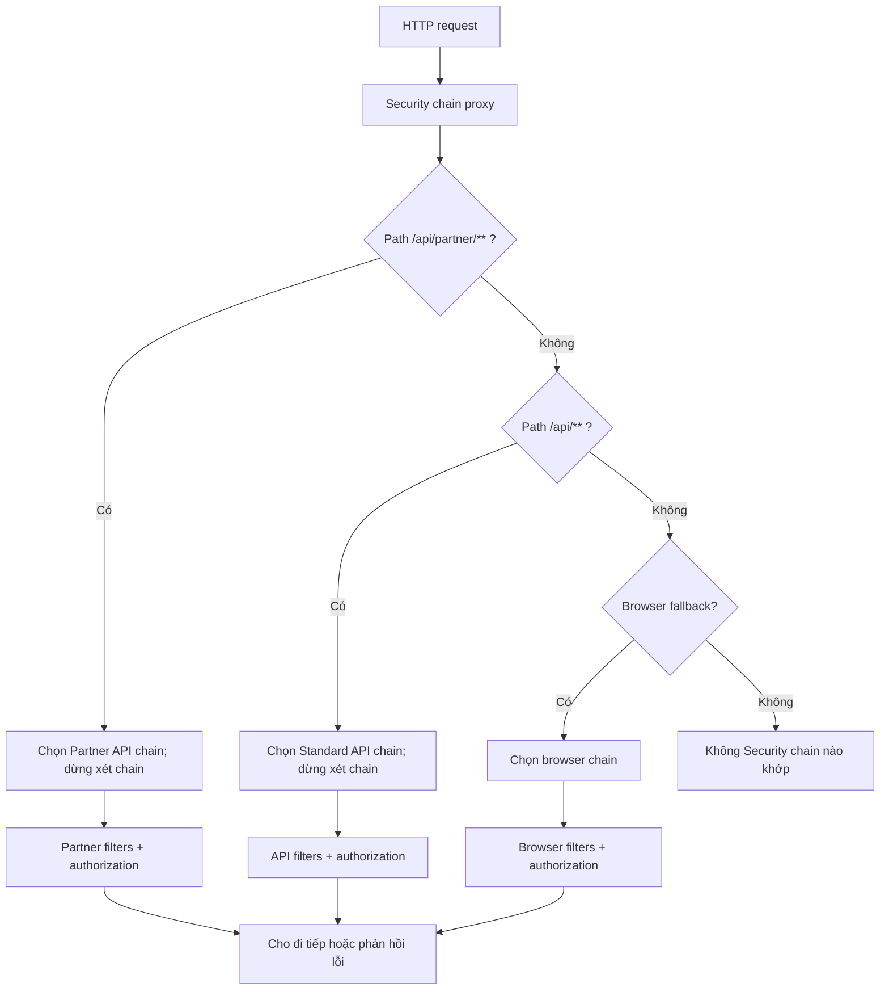

# Nhiều security chain và nguyên tắc chọn chain phù hợp

> **Chương:** Kiến trúc áp dụng  
> **Module:** `SPRING_SECURITY_HTTP_PROTECTION` — bảo vệ HTTP và trình duyệt với Spring Security: CSRF, CORS, security headers, Content Security Policy (CSP), HSTS, HTTP firewall và session, trên cả Servlet lẫn Reactive WebFlux.  
> **Tình huống trọng tâm:** Một ứng dụng đồng thời phục vụ browser dùng session cookie, REST API dùng Bearer JWT và API đối tác có chính sách CORS/authority riêng. Bài học hướng dẫn cách phân chia security chain, chọn chain theo request, kiểm thử ranh giới và xử lý cấu hình chồng lấn.

## 1. Kết quả cần đạt

Sau bài học, người học có thể:

1. Giải thích vì sao một ứng dụng có thể có **nhiều `SecurityFilterChain`** trên Servlet hoặc **nhiều `SecurityWebFilterChain`** trên WebFlux.
2. Mô tả đường đi của request qua `FilterChainProxy` / `WebFilterChainProxy`, nhấn mạnh nguyên tắc **chain khớp đầu tiên được chọn**.
3. Phân biệt matcher **chọn chain** với matcher **phân quyền bên trong chain** và thứ tự các security filters.
4. Quyết định khi nào nên tách chain vì khác authentication, CSRF, CORS, session, security headers hoặc entry point; khi nào chỉ cần thêm rule authorization trong cùng chain.
5. Sắp xếp `@Order` hợp lý giữa chain chuyên biệt, chain tổng quát và fallback; dự đoán các lỗi chain bị che hoặc request không khớp chain nào.
6. Cấu hình và kiểm thử ba vùng HTTP: Partner API, API Bearer thông thường, browser form login/session trên Servlet lẫn WebFlux.
7. Chẩn đoán các hiện tượng 302 thay vì 401, 403 CSRF bất ngờ, CORS preflight bị chặn, CSP/HSTS thiếu và session xuất hiện ở API stateless.
8. Lập ma trận kiểm thử cả đường đi hợp lệ và đường đi bị từ chối, bao gồm request gần giống URL được bảo vệ, OPTIONS, HTTP method khác và URL sau gateway rewrite.

## 2. Nhiều chain giải quyết vấn đề gì?

Một security chain là tập hợp **điều kiện áp dụng request** và **các security filter/policy** được bật cho request đó. Hai nhóm request có thể cùng được bảo vệ bởi Spring Security nhưng cần chính sách khác nhau:

| Khu vực | Client | Authentication | CSRF | CORS | Session / headers |
|---|---|---|---|---|---|
| `/api/partner/**` | Hệ thống đối tác hoặc frontend đối tác | Bearer JWT với authority của đối tác | Có thể tắt **nếu không tin credential tự gửi bởi browser** | Chỉ origin đối tác được phép | Không lưu context trong session; security headers phù hợp API |
| `/api/**` | SPA/mobile | Bearer JWT | Có thể tắt theo cùng điều kiện | Chỉ origin frontend ứng dụng | API stateless, response JSON và security headers |
| Các URL còn lại (browser) | Trình duyệt trực tiếp | Form login và session cookie | **Bật** cho unsafe methods | Chỉ bật nếu có nhu cầu cross-origin thực | CSP, HSTS, cookie Secure/HttpOnly/SameSite theo topology |

Việc tách chain hữu ích khi **bộ filter và cơ chế xác thực khác nhau**, ví dụ API dùng Bearer token, còn browser dùng form login với CSRF và session. Nếu hai nhóm URL đều sử dụng cùng cơ chế và chỉ khác role/scope, một chain với các `requestMatchers`/`pathMatchers` khác nhau thường đơn giản hơn.

**Ví dụ:** `/api/admin/**` cũng dùng JWT, CORS và session policy y hệt `/api/**` thì thường không cần một chain riêng. Chỉ cần rule `hasAuthority("SCOPE_admin")` đứng trước `anyRequest().authenticated()` trong API chain. Tách chain chỉ để thay một role có thể làm tăng công cấu hình mà không tăng giá trị bảo vệ.

## 3. Đường đi của request: trước hết phải chọn chain

Trên Servlet, chuỗi kiến trúc chính là:

```text
HTTP request
    ↓
Servlet container / các Servlet Filter
    ↓
DelegatingFilterProxy → bean springSecurityFilterChain
    ↓
FilterChainProxy
    ├─ HttpFirewall kiểm tra request
    ├─ Xét SecurityFilterChain theo @Order
    └─ Chọn CHAIN ĐẦU TIÊN khớp
          ↓
      Các security filters CỦA CHAIN ĐÓ
          ↓
      DispatcherServlet / Controller
```

Trên WebFlux:

```text
HTTP server → WebFlux HttpHandler
    ↓
Global WebFilters
    ↓
WebFilterChainProxy
    ├─ Xét SecurityWebFilterChain theo thứ tự
    └─ Chọn CHAIN ĐẦU TIÊN khớp
          ↓
      Security WebFilters CỦA CHAIN ĐÓ
          ↓
      DispatcherHandler / RouterFunction handler
```

Trong WebFlux, server, proxy và các cơ chế kiểm URL/firewall reactive tùy phiên bản cũng có thể từ chối request trước handler. Cả hai sơ đồ là kiến trúc tổng quát; vị trí cụ thể của các filter và hành vi error dispatch phải xem ở bản Spring Security đang chạy.

### 3.1. “First match wins” — không cộng dồn filter từ các chain

Giả sử có ba chain theo thứ tự:

```text
@Order(1) securityMatcher("/api/partner/**")  → Partner API
@Order(2) securityMatcher("/api/**")          → Standard API
@Order(3) không securityMatcher               → Browser fallback
```

Request `POST /api/partner/invoices` khớp **cả** `/api/partner/**` và `/api/**` nhưng chỉ **Partner API chain** chạy. Không có chuyện Spring Security gộp filter từ hai chain thành một “chain mạnh hơn”.

Request `GET /api/catalog/items` không khớp Partner API, khớp Standard API nên chọn chain 2. Request `GET /profile` không khớp hai chain API nên chọn browser fallback.



**Tác động trực tiếp:** Nếu Partner API yêu cầu scope nghiêm ngặt nhưng được một Standard API chain tổng quát đứng trước nhận trước, điều kiện scope riêng có thể **không bao giờ được thực thi**.

### 3.2. `@Order` ưu tiên chain, không sắp security filters

Chỉ số order nhỏ hơn thường được xét trước: `@Order(1)` trước `@Order(2)`. Các chain không có ưu tiên tường minh có thể được sắp khác kỳ vọng khi thêm bean mới. Với chain chồng lấn, nên **chỉ định order rõ ràng, tránh cùng một giá trị order** và test kết quả chọn chain.

Trong từng chain, các filter như `CorsFilter`, `CsrfFilter`, authentication filters và `AuthorizationFilter` có thứ tự riêng do Spring Security quy định. Viết `.csrf(...).cors(...).authorizeHttpRequests(...)` theo thứ tự nào trong DSL **không quyết định** thứ tự runtime của chúng.

## 4. Ba loại matcher thường bị nhầm

| Cấp | Servlet | WebFlux | Câu hỏi thực sự |
|---|---|---|---|
| **Chọn chain** | `HttpSecurity.securityMatcher(...)` | `ServerHttpSecurity.securityMatcher(...)` | Request này có vào **toàn bộ chain** không? |
| **Authorization trong chain** | `authorizeHttpRequests(a -> a.requestMatchers(...))` | `authorizeExchange(a -> a.pathMatchers(...))` | Nếu request đã vào chain, ai có quyền truy cập? |
| **Chọn request cần CSRF** | `CsrfConfigurer` với matcher/ngoại lệ | `ServerHttpSecurity.CsrfSpec` với matcher/ngoại lệ phù hợp | Request này có phải gửi CSRF token không? |

CORS sử dụng policy riêng dựa trên path/origin/method/request headers; matcher của CORS **không thay thế** matcher cấp chain hoặc authorization.

Một cấu hình sai về logic:

```java
http.securityMatcher("/api/**")
    .authorizeHttpRequests(auth -> auth
        .requestMatchers("/admin/**").hasRole("ADMIN")
        .anyRequest().authenticated());
```

Request `GET /admin/reports` **không vào chain trên**, nên rule `/admin/**` không thể bảo vệ URL đó. Không thể dùng authorization rule để mở rộng phạm vi một chain đã chọn hẹp.

### 4.1. `permitAll` vẫn ở trong security chain

Một rule `permitAll()` cho phép ở lớp authorization; request vẫn có thể bị CORS, CSRF, authentication filter gặp token hỏng hoặc HTTP firewall chặn. Security headers vẫn có thể được thêm nếu header writer có trong chain.

**Phân biệt:**

- `permitAll()`: cho anonymous đi tiếp tại authorization, vẫn đi qua các filter khác.
- `authenticated()`: cần principal đã xác thực; không tự kiểm authority chi tiết.
- `hasAuthority(...)` / `hasRole(...)`: yêu cầu quyền cụ thể trong chain.
- `denyAll()`: từ chối ở authorization, hữu ích cho fallback khắt khe.
- Servlet `web.ignoring()`: bỏ qua Spring Security filter chain đối với matcher tương ứng; headers/CSRF/CORS thuộc chain có thể không được áp dụng.
- **Không chain nào khớp:** request có thể tiếp tục vào handler mà không được các security filters của những chain bảo vệ; hạ tầng hoặc method security khác vẫn có thể hoạt động nếu được bật.

Không dùng `web.ignoring` hoặc loại bỏ fallback chỉ để giải quyết lỗi 403. Hãy tìm filter/policy đang từ chối rồi sửa phạm vi của chính nó.

### 4.2. Không nên tách chain khi chỉ khác một quyền

Giả sử `GET /api/catalog/**` là public, `POST /api/orders` cần `SCOPE_orders.write`, `GET /api/admin/**` cần `SCOPE_admin` — tất cả đều dùng JWT và CORS policy giống nhau. Một API chain có thể đủ:

```java
.authorizeHttpRequests(auth -> auth
    .requestMatchers(HttpMethod.GET, "/api/catalog/**").permitAll()
    .requestMatchers(HttpMethod.POST, "/api/orders")
        .hasAuthority("SCOPE_orders.write")
    .requestMatchers("/api/admin/**")
        .hasAuthority("SCOPE_admin")
    .anyRequest().authenticated())
```

Các rule cụ thể đứng trước `anyRequest`. Chỉ tạo thêm chain khi bạn thật sự muốn thay **bộ security filters hoặc phạm vi áp dụng các chính sách**.

## 5. Thiết kế chain bằng ma trận bảo vệ trước khi viết code

Với mô hình Partner API + Standard API + browser, lập bảng trước để đảm bảo mỗi nhóm request có một chính sách rõ ràng.

| Request ví dụ | Chain cần chọn | Authentication/authority | Phản hồi điển hình nếu thiếu credential |
|---|---|---|---|
| `GET /api/partner/reports` | Partner API | JWT có `SCOPE_partner.read` | 401 |
| `POST /api/partner/invoices` | Partner API | JWT có `SCOPE_partner.write` | 401 |
| `GET /api/catalog/items` | Standard API | `permitAll()` | Vào handler nếu không filter nào khác chặn |
| `GET /api/orders` | Standard API | JWT hợp lệ | 401 |
| `GET /profile` | Browser fallback | Form login/session | Thường 302 tới trang login |
| `POST /profile` | Browser fallback | Session và CSRF token hợp lệ | Có thể 403 do CSRF nếu thiếu token |
| `GET /admin/reports` | Browser fallback | Session và role ADMIN | Thường 302 hoặc 403 tùy principal |
| `GET /assets/app.css` | Browser fallback | `permitAll()` | Tải asset, vẫn có security headers theo policy |
| `GET /api2/orders` | Browser fallback | Không thuộc `/api/**` | Không bị coi nhầm là API; thường redirect login khi anonymous |

Đối với route riêng tư, kỳ vọng khác nhau theo loại client: API Bearer thường dùng **401** khi chưa xác thực; browser form login thường **302** redirect; principal đã xác thực nhưng không đủ quyền thường **403**. Những mã này là hành vi điển hình, có thể khác khi entry point/error handler được tùy biến.

### 5.1. Những câu hỏi thiết kế quyết định có cần chain riêng không

Trước khi tách một vùng URL thành chain mới, trả lời:

1. Nhóm client có dùng credential khác hẳn không: browser cookie, Basic, Bearer, mTLS?
2. Có cần chính sách CSRF khác không vì credential tự được browser gửi?
3. Có cần CORS allowlist hoặc credential mode khác nhau không?
4. Có cần entry point khác nhau (JSON 401 so với redirect login 302) không?
5. Có cần `SessionCreationPolicy`/`ServerSecurityContextRepository` hoặc request cache khác nhau không?
6. Security headers, CSP, HSTS hoặc frame policy có khác theo loại response không?
7. Có cách chia URL **ổn định, không chồng chéo mơ hồ** không?

Nếu hầu hết câu trả lời đều giống nhau, giữ ít chain hơn giúp giảm rủi ro cấu hình. Nếu các cơ chế bảo mật khác nhau, tách chain để thể hiện ranh giới rõ ràng sẽ dễ kiểm thử và quản lý.

## 6. Cấu hình Servlet: ba `SecurityFilterChain` với thứ tự tường minh

Ví dụ dưới đây áp dụng cho Spring MVC/Servlet cùng Spring Security có API DSL tương ứng (thường Spring Boot 3 / Spring Security 6). Mọi endpoint chỉ là minh họa; cần controller, JWT decoder và user store thực tế để chạy.

```java
package example.security;

import java.util.List;
import org.springframework.beans.factory.annotation.Qualifier;
import org.springframework.context.annotation.Bean;
import org.springframework.context.annotation.Configuration;
import org.springframework.core.annotation.Order;
import org.springframework.http.HttpMethod;
import org.springframework.security.config.Customizer;
import org.springframework.security.config.annotation.web.builders.HttpSecurity;
import org.springframework.security.config.annotation.web.configuration.EnableWebSecurity;
import org.springframework.security.config.annotation.web.configurers.AbstractHttpConfigurer;
import org.springframework.security.config.http.SessionCreationPolicy;
import org.springframework.security.web.SecurityFilterChain;
import org.springframework.web.cors.CorsConfiguration;
import org.springframework.web.cors.CorsConfigurationSource;
import org.springframework.web.cors.UrlBasedCorsConfigurationSource;

@Configuration
@EnableWebSecurity
public class MultiChainServletSecurity {

    @Bean
    @Order(1)
    SecurityFilterChain partnerApi(
            HttpSecurity http,
            @Qualifier("partnerCorsSource")
            CorsConfigurationSource partnerCors) throws Exception {

        return http
            .securityMatcher("/api/partner/**")
            .cors(cors -> cors.configurationSource(partnerCors))
            // Phù hợp khi chỉ dùng Bearer header, không nhận browser
            // session cookie làm credentials cho Partner API.
            .csrf(AbstractHttpConfigurer::disable)
            .sessionManagement(session -> session
                .sessionCreationPolicy(SessionCreationPolicy.STATELESS))
            .authorizeHttpRequests(auth -> auth
                .requestMatchers(HttpMethod.POST, "/api/partner/invoices/**")
                    .hasAuthority("SCOPE_partner.write")
                .anyRequest().hasAuthority("SCOPE_partner.read"))
            .oauth2ResourceServer(oauth2 -> oauth2
                .jwt(Customizer.withDefaults()))
            .build();
    }

    @Bean
    @Order(2)
    SecurityFilterChain standardApi(
            HttpSecurity http,
            @Qualifier("standardApiCorsSource")
            CorsConfigurationSource apiCors) throws Exception {

        return http
            .securityMatcher("/api/**")
            .cors(cors -> cors.configurationSource(apiCors))
            .csrf(AbstractHttpConfigurer::disable)
            .sessionManagement(session -> session
                .sessionCreationPolicy(SessionCreationPolicy.STATELESS))
            .authorizeHttpRequests(auth -> auth
                .requestMatchers(HttpMethod.GET, "/api/catalog/**")
                    .permitAll()
                .requestMatchers(HttpMethod.POST, "/api/orders")
                    .hasAuthority("SCOPE_orders.write")
                .anyRequest().authenticated())
            .oauth2ResourceServer(oauth2 -> oauth2
                .jwt(Customizer.withDefaults()))
            .build();
    }

    @Bean
    @Order(3)
    SecurityFilterChain browser(HttpSecurity http) throws Exception {
        return http
            // Không securityMatcher: đây là fallback mọi URL còn lại.
            .authorizeHttpRequests(auth -> auth
                .requestMatchers("/login", "/assets/**").permitAll()
                .requestMatchers("/admin/**").hasRole("ADMIN")
                .anyRequest().authenticated())
            .formLogin(Customizer.withDefaults())
            .csrf(Customizer.withDefaults())
            .headers(headers -> headers
                .contentSecurityPolicy(csp -> csp.policyDirectives(
                    "default-src 'self'; object-src 'none'; " +
                    "base-uri 'self'; frame-ancestors 'none'")))
            .build();
    }

    @Bean("partnerCorsSource")
    CorsConfigurationSource partnerCorsSource() {
        return corsSource("/api/partner/**", "https://partner.example.com");
    }

    @Bean("standardApiCorsSource")
    CorsConfigurationSource standardApiCorsSource() {
        return corsSource("/api/**", "https://client.example.com");
    }

    private CorsConfigurationSource corsSource(
            String path, String allowedOrigin) {

        CorsConfiguration cors = new CorsConfiguration();
        cors.setAllowedOrigins(List.of(allowedOrigin));
        cors.setAllowedMethods(List.of(
            "GET", "POST", "PUT", "PATCH", "DELETE"));
        cors.setAllowedHeaders(List.of(
            "Authorization", "Content-Type"));
        cors.setMaxAge(1800L);

        UrlBasedCorsConfigurationSource source =
            new UrlBasedCorsConfigurationSource();
        source.registerCorsConfiguration(path, cors);
        return source;
    }
}
```

### 6.1. Vì sao có hai `CorsConfigurationSource`?

Partner API và Standard API có **origin allowlist khác nhau**. Nếu chỉ thêm hai bean CORS và dùng `.cors(Customizer.withDefaults())` mà không chỉ định source, nhiều cấu hình có thể gây không rõ source được chọn hoặc làm auto-configuration không áp dụng như kỳ vọng. Ví dụ truyền `@Qualifier` vào từng chain rồi gọi `configurationSource(...)` tường minh.

Các nguồn CORS trong ví dụ dùng package **Servlet**: `org.springframework.web.cors.CorsConfigurationSource` và `UrlBasedCorsConfigurationSource`. Trên WebFlux, package khác.

Trong ứng dụng triển khai thật cần thống nhất CORS ở API gateway, Spring MVC và Spring Security: nếu nhiều tầng viết `Access-Control-Allow-Origin` khác nhau, trình duyệt có thể từ chối response dù backend authorization đúng.

### 6.2. Vì sao API chain không giới hạn method ở cấp `securityMatcher`?

Hai matcher cấp chain nhận toàn bộ `/api/partner/**` và `/api/**` **không phụ thuộc HTTP method**. Nhờ vậy, preflight `OPTIONS /api/partner/invoices` hoặc `OPTIONS /api/orders` vẫn đi vào đúng API chain, nơi CORS filter xử lý sớm trước authentication.

Nếu chain chỉ khớp `POST /api/**`, OPTIONS preflight có thể rơi vào browser fallback; browser báo “CORS error”, hoặc nhận 302/401/403 không mong đợi. Nên giới hạn method **ở authorization rule** khi nhu cầu là quyền cho GET/POST cụ thể.

### 6.3. Vì sao có fallback?

Browser chain không đặt `securityMatcher` nên làm fallback cho mọi request ngoài hai vùng API. Một URL mới như `GET /new-feature` không vô tình nằm ngoài Spring Security: nó yêu cầu authentication theo `anyRequest().authenticated()`.

Fallback browser phù hợp khi ứng dụng ngoài API thật sự dùng form login. Với một dịch vụ chỉ có API và endpoint nội bộ, có thể dùng fallback `denyAll()` hoặc entry point API phù hợp để không có redirect HTML ngoài ý muốn. Chọn chính sách theo nhóm client thực tế và viết test tương ứng.

### 6.4. Điều kiện an toàn của cấu hình mẫu

- Hai API chain chỉ dùng Bearer header, không dùng cookie/session làm credential tự gửi; việc tắt CSRF phải phù hợp threat model đó. Nếu API nhận cookie, Basic authentication trong browser hoặc credential tự động khác, **cần đánh giá và cấu hình CSRF**.
- Cấu hình Bearer yêu cầu OAuth2 Resource Server/JWT dependency và `JwtDecoder` phù hợp (ví dụ dựa trên issuer). Resource Server không tự sinh JWT hoặc quyết định partner claims cho bạn.
- Claim/scope cần được ánh xạ thành `GrantedAuthority` đúng tên, ví dụ `SCOPE_partner.read`. Nếu token hợp lệ nhưng mapping sai, request có thể nhận 403 dù người dùng mong được phép.
- HSTS chỉ được browser ghi nhận qua HTTPS hợp lệ; CSP mẫu cần điều chỉnh theo script/style/CDN thực và kiểm thử trước khi dùng ở production.
- Không nên gán chung `formLogin` vào API chain trong ví dụ này; làm vậy có thể khiến API trả redirect thay cho Bearer challenge.

## 7. Cấu hình Reactive WebFlux: ba `SecurityWebFilterChain`

Trên WebFlux, `ServerHttpSecurity` xây dựng `SecurityWebFilterChain` và `WebFilterChainProxy` chọn chain đầu tiên khớp. Logic phân vùng giống Servlet nhưng **không dùng Servlet Filter/RequestMatcher/HttpSession**.

```java
package example.security;

import java.util.List;
import org.springframework.beans.factory.annotation.Qualifier;
import org.springframework.context.annotation.Bean;
import org.springframework.context.annotation.Configuration;
import org.springframework.core.annotation.Order;
import org.springframework.http.HttpMethod;
import org.springframework.security.config.Customizer;
import org.springframework.security.config.annotation.web.reactive.EnableWebFluxSecurity;
import org.springframework.security.config.web.server.ServerHttpSecurity;
import org.springframework.security.web.server.SecurityWebFilterChain;
import org.springframework.security.web.server.context.NoOpServerSecurityContextRepository;
import org.springframework.security.web.server.util.matcher.ServerWebExchangeMatchers;
import org.springframework.web.cors.CorsConfiguration;
import org.springframework.web.cors.reactive.CorsConfigurationSource;
import org.springframework.web.cors.reactive.UrlBasedCorsConfigurationSource;

@Configuration
@EnableWebFluxSecurity
public class MultiChainReactiveSecurity {

    @Bean
    @Order(1)
    SecurityWebFilterChain partnerApi(
            ServerHttpSecurity http,
            @Qualifier("partnerReactiveCors")
            CorsConfigurationSource partnerCors) {

        return http
            .securityMatcher(ServerWebExchangeMatchers
                .pathMatchers("/api/partner/**"))
            .cors(cors -> cors.configurationSource(partnerCors))
            .csrf(ServerHttpSecurity.CsrfSpec::disable)
            .securityContextRepository(
                NoOpServerSecurityContextRepository.getInstance())
            .authorizeExchange(auth -> auth
                .pathMatchers(HttpMethod.POST, "/api/partner/invoices/**")
                    .hasAuthority("SCOPE_partner.write")
                .anyExchange().hasAuthority("SCOPE_partner.read"))
            .oauth2ResourceServer(oauth2 -> oauth2
                .jwt(Customizer.withDefaults()))
            .build();
    }

    @Bean
    @Order(2)
    SecurityWebFilterChain standardApi(
            ServerHttpSecurity http,
            @Qualifier("standardReactiveCors")
            CorsConfigurationSource apiCors) {

        return http
            .securityMatcher(ServerWebExchangeMatchers
                .pathMatchers("/api/**"))
            .cors(cors -> cors.configurationSource(apiCors))
            .csrf(ServerHttpSecurity.CsrfSpec::disable)
            .securityContextRepository(
                NoOpServerSecurityContextRepository.getInstance())
            .authorizeExchange(auth -> auth
                .pathMatchers(HttpMethod.GET, "/api/catalog/**")
                    .permitAll()
                .pathMatchers(HttpMethod.POST, "/api/orders")
                    .hasAuthority("SCOPE_orders.write")
                .anyExchange().authenticated())
            .oauth2ResourceServer(oauth2 -> oauth2
                .jwt(Customizer.withDefaults()))
            .build();
    }

    @Bean
    @Order(3)
    SecurityWebFilterChain browser(ServerHttpSecurity http) {
        return http
            // Fallback cho các exchange không thuộc API.
            .authorizeExchange(auth -> auth
                .pathMatchers("/login", "/assets/**").permitAll()
                .pathMatchers("/admin/**").hasRole("ADMIN")
                .anyExchange().authenticated())
            .formLogin(Customizer.withDefaults())
            .csrf(Customizer.withDefaults())
            .headers(headers -> headers
                .contentSecurityPolicy(csp -> csp.policyDirectives(
                    "default-src 'self'; object-src 'none'; " +
                    "base-uri 'self'; frame-ancestors 'none'")))
            .build();
    }

    @Bean("partnerReactiveCors")
    CorsConfigurationSource partnerReactiveCors() {
        return corsSource("/api/partner/**", "https://partner.example.com");
    }

    @Bean("standardReactiveCors")
    CorsConfigurationSource standardReactiveCors() {
        return corsSource("/api/**", "https://client.example.com");
    }

    private CorsConfigurationSource corsSource(
            String path, String origin) {

        CorsConfiguration cors = new CorsConfiguration();
        cors.setAllowedOrigins(List.of(origin));
        cors.setAllowedMethods(List.of(
            "GET", "POST", "PUT", "PATCH", "DELETE"));
        cors.setAllowedHeaders(List.of(
            "Authorization", "Content-Type"));
        cors.setMaxAge(1800L);

        UrlBasedCorsConfigurationSource source =
            new UrlBasedCorsConfigurationSource();
        source.registerCorsConfiguration(path, cors);
        return source;
    }
}
```

Các loại `CorsConfigurationSource` / `UrlBasedCorsConfigurationSource` ở đây thuộc **`org.springframework.web.cors.reactive`**. Nếu copy import Servlet, cấu hình có thể không biên dịch hoặc không gắn được vào reactive CORS filter.

### 7.1. Phân biệt context và session giữa hai stack

| Thành phần | Servlet | WebFlux |
|---|---|---|
| Security proxy | `FilterChainProxy` | `WebFilterChainProxy` |
| Chain | `SecurityFilterChain` | `SecurityWebFilterChain` |
| Builder | `HttpSecurity` | `ServerHttpSecurity` |
| Matcher | `RequestMatcher` | `ServerWebExchangeMatcher` |
| Session | `HttpSession` | `WebSession` |
| Security context | `SecurityContextHolder` theo chiến lược Servlet | `ReactiveSecurityContextHolder` qua Reactor Context |
| Session policy API | `SessionCreationPolicy.STATELESS` | `NoOpServerSecurityContextRepository` trong ví dụ |
| Authorization DSL | `authorizeHttpRequests` | `authorizeExchange` |

`NoOpServerSecurityContextRepository` làm cho Spring Security không lưu/đọc context thông qua repository đó; nó **không đảm bảo mọi thành phần khác trong ứng dụng không tạo WebSession**. Kiểm cả cookie và đường đi thực tế nếu yêu cầu stateless nghiêm ngặt.

### 7.2. WebFlux functional router cũng được bảo vệ bởi chain

`SecurityWebFilterChain` được chọn dựa trên `ServerWebExchange` trước khi WebFlux xác định annotated controller hay `RouterFunction` sẽ xử lý request. Do đó route WebFlux mới dưới `/api/**` đi vào Standard API chain dù được khai báo functional; route ngoài `/api/**` được browser fallback bảo vệ theo mẫu.

Không dùng `SecurityContextHolder.getContext()` theo ThreadLocal làm cách lấy danh tính mặc định trong reactive handler; dùng `ReactiveSecurityContextHolder` hoặc principal reactive để tránh mất context sau các đoạn async.

## 8. Chồng lấn, khoảng trống và chain không bao giờ chạy

### 8.1. Ba lỗi thứ tự phổ biến

**Lỗi A — đặt fallback lên đầu:**

```text
@Order(0) Browser fallback (match tất cả)
@Order(1) Partner API
@Order(2) Standard API
```

Mọi request đi qua browser chain; hai API chain gần như không bao giờ được chọn. Kết quả có thể là redirect login 302 hoặc CSRF 403 thay vì API Bearer 401.

**Lỗi B — đặt Standard API trước Partner API:**

```text
@Order(1) Standard API: /api/**
@Order(2) Partner API:  /api/partner/**
@Order(3) Browser fallback
```

`/api/partner/**` bị Standard API nhận trước; chính sách authority và origin riêng của Partner API **không chạy**. Đây là lỗi nguy hiểm vì request có thể vẫn được xác thực JWT, khiến người kiểm thử tưởng chính sách đúng.

**Lỗi C — quên fallback:**

```text
@Order(1) Partner API:  /api/partner/**
@Order(2) Standard API: /api/**
Không có chain khác
```

`GET /profile` hoặc `POST /admin/settings` không khớp security chain nào; các filter bảo mật của những chain trên không áp dụng cho chúng. Một HTTP firewall/proxy hoặc method security khác vẫn có thể chặn, nhưng **không nên dựa vào những lớp đó để thay thế HTTP protection đã thiếu**.

### 8.2. Vì sao chain không cần “mạnh nhất” đứng đầu?

Thứ tự ưu tiên nên dựa trên **độ đặc hiệu của matcher và nhu cầu client**, không phải suy đoán chain nào có số lượng filter nhiều hơn. Một chain `/api/partner/**` phải đứng trước `/api/**` vì nó là tập con. Một browser fallback phải đứng sau cả hai vì match rộng nhất.

Nếu chain có cùng độ đặc hiệu hoặc matcher khó so sánh, ưu tiên chuyển chúng thành vùng URL phân biệt rõ ràng, hoặc đặt order có chủ đích và test tất cả trường hợp chồng lấn. Không dựa vào tên bean, thứ tự method trong source hay trật tự component scan.

### 8.3. “Không match chain” khác “đã match nhưng permitAll”

| Trường hợp | Security filters của ứng dụng | Authorization | Security headers từ chain |
|---|---|---|---|
| Match browser chain, `permitAll` | Các filter có trong browser chain vẫn tham gia | Cho phép nếu request đến authorization | Có thể được ghi theo cấu hình |
| Match API chain, `authenticated` | Các filter API tham gia | Cần authentication | Có thể được ghi theo cấu hình |
| Không match chain nào | Không chạy filter của các security chain | Không có HTTP authorization rule của các chain | Không được ghi bởi header writer của chúng |
| Servlet `web.ignoring` | Bỏ qua các security filters theo matcher bỏ qua | Không áp rule trong chain | Header writer của chain không áp dụng |

Với tài nguyên tĩnh công khai như `/assets/**`, ưu tiên `permitAll` trong chain thích hợp khi muốn giữ HSTS, CSP, nosniff và các headers khác. Không dùng `web.ignoring` như một cách “tối ưu” mặc định mà chưa đánh giá hệ quả bảo mật.

## 9. Các chi tiết HTTP làm thay đổi chain được chọn

### 9.1. Path, method và preflight OPTIONS

Chain cấp path `/api/**` nên thường không giới hạn HTTP method để CORS preflight `OPTIONS` được xử lý trong cùng vùng chính sách. Một authorization rule `requestMatchers(HttpMethod.POST, "/api/orders")` chỉ giới hạn **quyền cho POST** trong chain đó.

Ví dụ:

```http
OPTIONS /api/partner/invoices HTTP/1.1
Origin: https://partner.example.com
Access-Control-Request-Method: POST
Access-Control-Request-Headers: authorization,content-type
```

Ở cấu hình đúng, request vào Partner API chain, `CorsFilter` hoặc `CorsWebFilter` xử lý preflight theo Partner origin, rồi có thể trả response sớm không yêu cầu JWT.

Nếu client gửi Origin `https://client.example.com` tới Partner API, không nên cấp `Access-Control-Allow-Origin` cho origin đó chỉ vì Standard API chain cho phép; **chain Standard API không được chạy**.

### 9.2. Context path, Servlet path và nhiều servlet

Trên Servlet, URL public có thể là:

```text
https://app.example.com/portal/api/orders
                   └─ context path /portal
                                  └─ path ứng dụng /api/orders
```

Matcher thông thường được cấu hình theo đường dẫn ứng dụng, không đơn giản chép toàn bộ URL công khai có context path vào pattern. Tuy nhiên kiểu matcher, servlet mapping và Spring MVC handler mapping có thể làm kết quả khác dự đoán.

Nếu ứng dụng có `DispatcherServlet` được ánh xạ trên `/mvc/*` hoặc nhiều servlet, cần dùng matcher phù hợp với servlet path/framework version và test qua Servlet container thật. Một rule trông như khớp `/admin/**` trong MVC có thể không áp đúng servlet mapping hoặc route thực tế.

### 9.3. URL rewrite sau gateway

Giả sử client gọi:

```text
https://edge.example.com/service-a/api/partner/invoices
    ↓ gateway xóa prefix /service-a
http://backend:8080/api/partner/invoices
```

Security chain của backend xét **path backend nhận**, không phải nguyên URL browser nhìn thấy. Nếu dùng matcher `/service-a/api/**` trong backend nhưng gateway đã bỏ prefix, request có thể rơi vào fallback. Hãy kiểm public URL và backend URL cùng với trusted forwarded headers.

Header `Forwarded`/`X-Forwarded-*` chỉ nên được tin từ reverse proxy đã cấu hình đáng tin cậy. Không dùng header mà bất cứ client nào cũng tự khai báo để chọn chain có quyền cao hơn.

### 9.4. Slash, encoding và URL chuẩn hóa

Các URL sau có thể được proxy, server, firewall và matcher xử lý khác nhau:

| Request | Điều cần kiểm |
|---|---|
| `/api/orders` | Vào Standard API chain. |
| `/api/partner/invoices` | Vào Partner API chain trước Standard API. |
| `/api2/orders` | Không được khớp `/api/**` do dùng prefix string thô. |
| `/API/orders` | Phân biệt hoa/thường tùy matcher/router. |
| `/api/orders/` | Trailing slash có thể khác exact route. |
| `/api/%2e%2e/admin` | URL encoding/traversal cần kiểm ở firewall, gateway và router. |
| `/api/orders;param=x` | Dấu semicolon/path parameter có thể ảnh hưởng canonicalization. |
| `/api/orders?tenant=another` | Query parameter không tự nằm trong path matcher; quyền tenant cần kiểm nghiệp vụ. |

Spring Security Servlet thường dùng `StrictHttpFirewall` để từ chối nhiều URL bất thường trước khi matcher được xét. Với WebFlux, HTTP server, proxy và thành phần firewall reactive tùy phiên bản cần được đánh giá riêng. Không nới encoded slash hoặc path normalization chỉ để “làm matcher khớp” khi chưa kiểm khả năng bypass.

### 9.5. ERROR/FORWARD dispatch và Actuator management port

Với Servlet, forward/error dispatch có thể có đường đi và dispatcher type khác request gốc. Một rule cho `/error` chỉ có hiệu lực nếu security proxy tham gia dispatch đó; lỗi trang error bị 403 cần kiểm filter registration và exception handling.

Actuator management endpoints có thể nằm trong application context hoặc cổng khác. Đừng giả định các chain của app chính tự bảo vệ mọi management port. Kiểm cấu hình exposure, mạng, context thực và security chain tương ứng.

## 10. CORS, CSRF, headers và session thuộc chain nào?

Một lợi ích chính của nhiều chain là tách chính sách HTTP theo **loại client và credential**.

### 10.1. CORS: được chọn theo chain đang chạy

CORS preflight phải được xử lý trước authentication vì preflight thường không có cookie/session hoặc Bearer token như request chính. Trong ví dụ, hai API chain có `CorsConfigurationSource` khác nhau.

CORS cho phép một origin/method/header theo chính sách browser; nó **không cấp quyền** gọi API. Sau preflight, request POST thật vẫn cần JWT và scope phù hợp.

Khi bật credentialed CORS cho browser session, không trả literal `Access-Control-Allow-Origin: *` với credentials. Cần allowlist origin cụ thể, cookie policy phù hợp và CSRF protection riêng.

### 10.2. CSRF: chain API khác browser vì cách gửi credential

Browser tự gắn session cookie nên request thay đổi trạng thái có thể bị CSRF. Browser fallback giữ `CsrfFilter` hoặc `CsrfWebFilter` để kiểm token cho unsafe methods.

API chỉ nhận Bearer token do client chủ động đính kèm, không dựa vào cookie/browser auto-credentials, có thể không cần CSRF theo threat model đã xác minh. Tuy nhiên **JSON, REST, WebFlux hay OAuth2 không tự bảo đảm miễn CSRF**. Nếu API nhận cookie hoặc cơ chế browser tự gửi credential, phải thiết kế lại chính sách CSRF cho chain đó.

### 10.3. Security headers/CSP/HSTS cần kiểm trên mỗi chain

Servlet `HeaderWriterFilter` và WebFlux `HttpHeaderWriterWebFilter` ghi security headers khi response đi qua chain phù hợp, trước khi response commit. CSP thường cần policy chủ động; header HSTS chỉ được browser tin qua HTTPS hợp lệ.

Một API JSON có thể không cần cùng CSP HTML như browser document, nhưng vẫn có thể cần nosniff, cache-control hoặc HSTS thích hợp. Nếu một request bị gateway, server hoặc firewall từ chối **trước** header writer, header từ Spring Security chain có thể không xuất hiện.

### 10.4. Session và entry point là tín hiệu chọn chain

| Tình huống | API Bearer chain | Browser form-login chain |
|---|---|---|
| Anonymous vào private endpoint | Thường 401 với Bearer challenge | Thường 302 tới login |
| Authentication thành công | JWT trong request hiện tại | Session có thể lưu context qua các request |
| Request POST thiếu CSRF | Theo policy API được thiết kế; ví dụ không đòi token khi chỉ Bearer | Thường 403 |
| Response 403 | Có thể thiếu authority/scope | Có thể do CSRF hoặc thiếu role |
| Session | Stateless trong Spring Security chain được cấu hình | Web session / HttpSession tùy stack |

`SessionCreationPolicy.STATELESS` trên Servlet hoặc `NoOpServerSecurityContextRepository` trên WebFlux không ngăn mọi thành phần khác của ứng dụng tạo session. Vì vậy sự hiện diện của cookie/session ở API cần được chẩn đoán cả ngoài security chain.

## 11. Kiểm thử Servlet bằng MockMvc: chứng minh chọn đúng chain

Ví dụ dùng `@SpringBootTest` + `@AutoConfigureMockMvc` và `spring-security-test`. Giả định có các handler/fixture:

- `GET /api/catalog/items` trả 200.
- `GET /api/orders` trả 200 nếu có JWT hợp lệ.
- `GET /api/partner/reports` trả 200 nếu có quyền partner.read.
- `POST /api/partner/invoices` trả 201 nếu có quyền partner.write.
- `POST /profile` trả 204 khi user đã đăng nhập và có CSRF.
- `GET /assets/app.css` trả 200 khi asset tồn tại.

Các assertion liên quan 200/201/204 chỉ chạy đúng khi controller/fixture đã được tạo; test security authorization không cần tin vào dữ liệu nghiệp vụ ngoài phạm vi bài.

```java
@SpringBootTest
@AutoConfigureMockMvc
class MultiChainServletTest {

    @Autowired MockMvc mvc;

    @Test
    void anonymousPartnerApiReturns401NotLoginRedirect()
            throws Exception {
        mvc.perform(get("/api/partner/reports"))
            .andExpect(status().isUnauthorized());
    }

    @Test
    void partnerRequiresPartnerAuthority() throws Exception {
        mvc.perform(get("/api/partner/reports")
                .with(jwt().authorities(
                    new SimpleGrantedAuthority("SCOPE_orders.read"))))
            .andExpect(status().isForbidden());
    }

    @Test
    void standardApiAllowsPublicCatalog() throws Exception {
        mvc.perform(get("/api/catalog/items"))
            .andExpect(status().isOk())
            .andExpect(header().string(
                "X-Content-Type-Options", "nosniff"));
    }

    @Test
    void anonymousStandardApiIs401() throws Exception {
        mvc.perform(get("/api/orders"))
            .andExpect(status().isUnauthorized());
    }

    @Test
    void browserAnonymousGetsLoginRedirect() throws Exception {
        mvc.perform(get("/profile"))
            .andExpect(status().is3xxRedirection());
    }

    @Test
    void browserPostMissingCsrfIs403() throws Exception {
        mvc.perform(post("/profile")
                .with(user("lan").roles("USER")))
            .andExpect(status().isForbidden());
    }

    @Test
    void browserPostWithCsrfReachesController() throws Exception {
        mvc.perform(post("/profile")
                .with(user("lan").roles("USER"))
                .with(csrf()))
            .andExpect(status().isNoContent());
    }

    @Test
    void api2DoesNotAccidentallyMatchApiPrefix() throws Exception {
        mvc.perform(get("/api2/orders"))
            .andExpect(status().is3xxRedirection());
    }

    @Test
    void partnerPreflightUsesPartnerCors() throws Exception {
        mvc.perform(options("/api/partner/invoices")
                .header("Origin", "https://partner.example.com")
                .header("Access-Control-Request-Method", "POST")
                .header("Access-Control-Request-Headers",
                    "authorization,content-type"))
            .andExpect(status().isOk())
            .andExpect(header().string(
                "Access-Control-Allow-Origin",
                "https://partner.example.com"));
    }

    @Test
    void standardOriginIsNotAllowedForPartnerPreflight()
            throws Exception {
        mvc.perform(options("/api/partner/invoices")
                .header("Origin", "https://client.example.com")
                .header("Access-Control-Request-Method", "POST")
                .header("Access-Control-Request-Headers",
                    "authorization,content-type"))
            .andExpect(status().isForbidden());
    }
}
```

Các import tĩnh:

```java
import static org.springframework.security.test.web.servlet.request.SecurityMockMvcRequestPostProcessors.*;
import static org.springframework.test.web.servlet.request.MockMvcRequestBuilders.*;
import static org.springframework.test.web.servlet.result.MockMvcResultMatchers.*;
```

Các import khác:

```java
import org.junit.jupiter.api.Test;
import org.springframework.beans.factory.annotation.Autowired;
import org.springframework.boot.test.context.SpringBootTest;
import org.springframework.boot.test.autoconfigure.web.servlet.AutoConfigureMockMvc;
import org.springframework.security.core.authority.SimpleGrantedAuthority;
import org.springframework.test.web.servlet.MockMvc;
```

**Lưu ý về test:**

- `jwt()` của Spring Security Test tạo authentication giả lập, phù hợp kiểm role/scope và matcher, **không kiểm JWT signature, issuer, audience hay expiry**. Test decoder cần chạy riêng.
- Test CORS rejection đang assert 403 theo xử lý mặc định thông thường của Spring CORS; custom handler có thể khác. Điều bất biến cần chứng minh là response **không cho phép origin không tin cậy**.
- Test `/api2/orders` nhằm xác nhận browser fallback được chọn, dù route đó không cần tồn tại. Khi anonymous, authorization/entry point thường xử lý trước controller, nhưng cần chỉnh assertion nếu entry point được tùy biến.
- Nếu test 200 không có handler fixture, response có thể là 404 sau khi security cho phép; hãy tạo route mẫu thay vì sửa authorization để “đạt 200”.

### 11.1. Test ưu tiên chain bằng phép đảo có kiểm soát

Trên nhánh thử nghiệm, hoán `@Order(1)` của Partner API với `@Order(2)` của Standard API. Chạy lại test `partnerRequiresPartnerAuthority()` và `partnerPreflightUsesPartnerCors()`.

Một trong hai có thể thất bại vì Partner API request bị Standard API chain bắt trước: authority partner không được xét hoặc Origin policy sai. Khôi phục thứ tự, giữ các test đó làm hồi quy.

**Kiểm riêng 401 không đủ:** Cả Partner API và Standard API đều có thể trả 401 cho anonymous. Muốn biết đúng chain, phải test **điểm khác biệt policy** như partner authority và partner CORS.

## 12. Kiểm thử WebFlux bằng WebTestClient

Trong WebFlux, bind `WebTestClient` vào application context và áp Spring Security Test:

```java
@SpringBootTest
class MultiChainReactiveTest {

    @Autowired ApplicationContext context;
    WebTestClient client;

    @BeforeEach
    void init() {
        client = WebTestClient.bindToApplicationContext(context)
            .apply(springSecurity())
            .configureClient()
            .build();
    }

    @Test
    void anonymousPartnerApiReturns401() {
        client.get().uri("/api/partner/reports")
            .exchange()
            .expectStatus().isUnauthorized();
    }

    @Test
    void partnerRejectsJwtWithOnlyOrdersScope() {
        client.mutateWith(mockJwt().authorities(
                new SimpleGrantedAuthority("SCOPE_orders.read")))
            .get().uri("/api/partner/reports")
            .exchange()
            .expectStatus().isForbidden();
    }

    @Test
    void standardApiPublicCatalogIsAccessible() {
        client.get().uri("/api/catalog/items")
            .exchange()
            .expectStatus().isOk();
    }

    @Test
    void apiAnonymousGets401() {
        client.get().uri("/api/orders")
            .exchange()
            .expectStatus().isUnauthorized();
    }

    @Test
    void browserAnonymousGetsLoginRedirect() {
        client.get().uri("/profile")
            .exchange()
            .expectStatus().is3xxRedirection();
    }

    @Test
    void browserPostWithoutCsrfGets403() {
        client.mutateWith(mockUser("lan").roles("USER"))
            .post().uri("/profile")
            .exchange()
            .expectStatus().isForbidden();
    }

    @Test
    void partnerPreflightAllowsPartnerOrigin() {
        client.options().uri("/api/partner/invoices")
            .header("Origin", "https://partner.example.com")
            .header("Access-Control-Request-Method", "POST")
            .header("Access-Control-Request-Headers",
                "authorization,content-type")
            .exchange()
            .expectStatus().isOk()
            .expectHeader().valueEquals(
                "Access-Control-Allow-Origin",
                "https://partner.example.com");
    }

    @Test
    void partnerPreflightRejectsStandardApiOrigin() {
        client.options().uri("/api/partner/invoices")
            .header("Origin", "https://client.example.com")
            .header("Access-Control-Request-Method", "POST")
            .header("Access-Control-Request-Headers",
                "authorization,content-type")
            .exchange()
            .expectStatus().isForbidden();
    }

    @Test
    void nearPrefixUsesBrowserFallback() {
        client.get().uri("/api2/orders")
            .exchange()
            .expectStatus().is3xxRedirection();
    }
}
```

Các imports:

```java
import org.junit.jupiter.api.BeforeEach;
import org.junit.jupiter.api.Test;
import org.springframework.beans.factory.annotation.Autowired;
import org.springframework.boot.test.context.SpringBootTest;
import org.springframework.context.ApplicationContext;
import org.springframework.security.core.authority.SimpleGrantedAuthority;
import org.springframework.test.web.reactive.server.WebTestClient;
import static org.springframework.security.test.web.reactive.server.SecurityMockServerConfigurers.*;
```

Cần WebFlux Test, Spring Security Test, cấu hình `ReactiveJwtDecoder` và các handlers nếu assert status thành công 200. `mockJwt()` mô phỏng security context cho authorization, không kiểm mã hóa/chữ ký của JWT.

### 12.1. Hai negative tests quan trọng hơn một positive test

Để chứng minh Partner API chain được chọn, cần ít nhất:

1. JWT hợp lệ nhưng **thiếu partner scope** → 403.
2. CORS preflight từ **origin Standard API** tới Partner API → bị từ chối.

Nếu cả hai test vẫn pass sau khi đảo thứ tự chain, cần kiểm lại chúng có thật sự quan sát đúng phần policy khác biệt không. Có thể log chain và thêm một phép kiểm header riêng theo chain nếu cần.

### 12.2. Không chỉ test status

Một request có thể bị trả 403 vì CSRF **trước** khi authorization được kiểm. Khi test partner write scope trên API chain đã tắt CSRF, 403 dễ quy về authorization hơn; khi test browser POST, hãy cung cấp CSRF token hợp lệ trước khi kết luận thiếu role.

Dùng một request GET đến tài nguyên cần role, hoặc unsafe request có token CSRF hợp lệ, để tách nguyên nhân của 403.

## 13. Hệ quả của việc chọn nhầm chain đối với các lớp HTTP protection

| Hiện tượng | Chain thực có thể đang chạy | Vì sao cần quan sát |
|---|---|---|
| API `GET /api/orders` trả 302 login | Browser fallback thay API | Form login entry point xử lý anonymous |
| API `POST /api/orders` trả 403 CSRF | Browser fallback thay API | Browser chain bật CSRF |
| Partner JWT thiếu scope vẫn được vào | Standard API thay Partner API | Rule partner authority không được chạy |
| Partner origin bị từ chối CORS | Standard API thay Partner API | CORS allowlist của API khác |
| Standard origin được dùng cho Partner API | Standard API thay Partner API | Có thể mở origin không dự kiến |
| URL browser thiếu CSP | URL không match browser chain hoặc có `web.ignoring` | Header writer của browser không tham gia |
| API xuất hiện session không mong muốn | Browser chain hoặc thành phần khác tạo session | Session policy thực tế khác giả định |
| API không có HSTS sau TLS proxy | Scheme nhận sai hoặc header policy/proxy khác | HSTS chỉ có hiệu lực qua HTTPS hợp lệ |
| 400 trước authentication | HTTP firewall/server/proxy chặn | Chain chưa nhất thiết được chọn |
| 403 ở error page che lỗi gốc | ERROR/FORWARD dispatch và matching | Lớp security áp vào dispatch có thể khác |

Một vấn đề thường liên quan nhiều lớp: ví dụ browser thấy “CORS error” nhưng backend log cho biết request thực bị CSRF 403, hoặc gateway tự tạo response không có CORS headers. Vì vậy phải quan sát **preflight** và **request chính** riêng, đồng thời phân biệt response từ backend với response từ gateway.

## 14. Quan sát chain thật đang được chọn

### 14.1. Log có kiểm soát

Ở môi trường phát triển:

```properties
# Servlet
logging.level.org.springframework.security.web.FilterChainProxy=TRACE

# WebFlux
logging.level.org.springframework.security.web.server=TRACE

# Khi cần nhiều ngữ cảnh hơn:
logging.level.org.springframework.security=DEBUG
```

Tên logger và mức chi tiết cụ thể khác nhau theo phiên bản. TRACE có thể nhiều; không bật liên tục trong production hoặc ghi giá trị Bearer token, cookie phiên, CSRF token và dữ liệu nhạy cảm.

Trong Servlet, có thể bật các log về filter chain đã xây khi application khởi động và log filtering của từng request. Trong WebFlux, quan sát security WebFilters và matcher/authorization cùng request ID/correlation ID.

**Không suy “đã được bảo vệ đúng” chỉ từ một dòng log bảo vệ request.** Cần biết chain nào được chọn, policy nào đã áp dụng, filter nào kết thúc và handler có chạy không.

### 14.2. Thứ tự chẩn đoán một lỗi 401/302/403

1. **Khôi phục request:** method, URL backend nhận sau rewrite, Origin, credential, cookie, CSRF token (không log bí mật).
2. **Xác định điểm vào:** request đến application context/port nào, đi qua security proxy chưa, HTTP firewall có chặn không.
3. **Tìm chain đầu tiên khớp:** kiểm `@Order`, matcher của từng chain, bao gồm fallback.
4. **Tìm filter kết thúc:** CORS, CSRF, authentication, authorization, header writer, redirect hoặc handler.
5. **Kiểm chính sách của chain:** Bearer/form, authority, session policy, CSRF exemption, CORS source, CSP/HSTS.
6. **Viết hai test:** một test cho request mong được cho qua, một test cho request phải bị chặn bởi **chính sách khác biệt** giữa các chain.

Ví dụ, nếu `GET /api/partner/reports` trả 401 cho anonymous, điều đó **chưa chứng minh** Partner API chain đúng vì Standard API cũng có thể trả 401. Hãy thêm JWT sai partner scope và CORS origin khác biệt để kiểm chain chính xác.

## 15. Ma trận hồi quy nên có trước khi triển khai

| Tình huống | Chain mong đợi | Kết quả cần chứng minh |
|---|---|---|
| `GET /api/partner/reports` anonymous | Partner | 401 |
| `GET /api/partner/reports` JWT thiếu partner.read | Partner | 403 |
| `GET /api/partner/reports` JWT có partner.read | Partner | Handler chạy nếu endpoint tồn tại |
| `POST /api/partner/invoices` JWT chỉ có partner.read | Partner | 403 thiếu partner.write |
| `OPTIONS /api/partner/invoices` từ Partner origin | Partner | CORS preflight được phép |
| `OPTIONS /api/partner/invoices` từ Standard API origin | Partner | Không được trả allow-origin cho origin này |
| `GET /api/catalog/items` anonymous | Standard API | Public qua authorization, vẫn có headers |
| `GET /api/orders` anonymous | Standard API | 401, không redirect login |
| `POST /api/orders` JWT thiếu orders.write | Standard API | 403 |
| `OPTIONS /api/orders` từ Standard API origin | Standard API | CORS preflight được phép |
| `OPTIONS /api/orders` từ Partner origin | Standard API | CORS từ chối theo chính sách ví dụ |
| `GET /profile` anonymous | Browser fallback | Redirect login |
| `POST /profile` logged in, thiếu CSRF | Browser fallback | 403 trước handler |
| `POST /profile` logged in, CSRF hợp lệ | Browser fallback | Handler có thể chạy |
| `GET /admin/reports` role USER | Browser fallback | 403 |
| `GET /assets/app.css` anonymous | Browser fallback | Public asset và security headers theo policy |
| `GET /api2/orders` anonymous | Browser fallback | Không match nhầm `/api/**` |
| `GET /new-feature` anonymous | Browser fallback | Route mới không công khai ngoài ý muốn |
| URL có encoding bất thường | Proxy/server/firewall + matcher | Không bypass chính sách do chuẩn hóa path khác nhau |
| Request qua reverse proxy rewrite | Chain theo backend path thật | Public URL và backend path được xác minh đồng thời |

Đây là **bảng kỳ vọng theo cấu hình minh họa**, không phải tuyên bố mọi Spring Security app trả cùng status. Với handler chưa tồn tại, response có thể là 404 sau khi authorization cho phép; với entry point tùy biến, response có thể khác 302/401. Điều cần giữ là **chính sách bảo mật đúng cho mỗi request**.

## 16. Những sai lầm vận hành dễ bỏ sót

### 16.1. Các chain cùng `@Order`

Nếu hai chain chồng lấn có cùng order, không nên phụ thuộc vào thứ tự method trong class hay thứ tự bean discovery. Đặt order tường minh khác nhau và test request nằm ở phần giao nhau.

### 16.2. Tưởng một `HttpSecurity` là “global cấu hình chung”

Mỗi `http.build()` tạo một chain với các filter của **chính nó**. Khi cấu hình một chain API, đừng mặc định tùy chọn `.cors()`, `.headers()` hay `.csrf()` đặt trong browser chain cũng áp cho API chain. Những chính sách cần chung phải được cấu hình ở tất cả chain liên quan, hoặc được trừu tượng hóa thành cấu hình tái sử dụng một cách chủ động.

Tương tự với `ServerHttpSecurity`: cấu hình chain riêng phải thể hiện rõ chính sách của chain đó. Không dựa vào vị trí code hoặc tên bean để suy filter được chia sẻ.

### 16.3. Cấu hình CORS ở nhiều tầng

Một API gateway có thể trả preflight ngay tại edge, Spring Security có thể xử lý preflight trong chain, và MVC/WebFlux router có thể có CORS policy. Nếu khác nguồn allowlist, browser nhận header trùng hoặc mâu thuẫn. Xác định tầng sở hữu CORS, kiểm end-to-end và quản lý allowed credentials đúng.

### 16.4. Nới CSRF để sửa lỗi API do matcher sai

Khi API bị browser fallback bắt, POST Bearer có thể gặp CSRF 403. Tắt CSRF toàn ứng dụng sẽ “làm hết lỗi” nhưng khiến browser session mất một lớp bảo vệ. Sửa `@Order`/`securityMatcher` để request vào đúng API chain, rồi giữ CSRF cho browser.

### 16.5. Thêm chain riêng cho tất cả role

Tách một chain cho mỗi role nhưng dùng authentication/CSRF/CORS giống nhau có thể tạo hàng chục matcher chồng lấn. Thường nên giữ một chain và đặt các authorization rules rõ ràng. Tách chain là quyết định kiến trúc về **HTTP security pipeline**, không phải thay thế authorization manager.

### 16.6. Custom filter đăng ký hai lần

Một Servlet `Filter` bean có thể được container đăng ký tự động và cũng được thêm vào `SecurityFilterChain` bằng `addFilterBefore/After`; một WebFlux `WebFilter` có thể vừa là global bean vừa được thêm vào một `SecurityWebFilterChain`. Khi đó filter có thể chạy hai lần và tạo log/header/side effects khó chẩn đoán.

Xác định rõ filter là global hay nằm trong chain riêng; kiểm thứ tự thực thi. Đừng tự viết lại JWT validation/CSRF nếu Spring Security đã cung cấp cơ chế phù hợp.

## 17. Bài tập thực hành và định hướng đáp án

### Bài 1 — Chọn chain cho bảy request

Với ba chain ở mục 6, cho các request:

1. `GET /api/partner/reports`.
2. `POST /api/partner/invoices`.
3. `GET /api/catalog/items`.
4. `OPTIONS /api/orders` kèm header preflight.
5. `POST /profile`.
6. `GET /api2/orders`.
7. `GET /admin/reports`.

**Yêu cầu:** ghi chain được chọn và lớp kiểm tra quan trọng, chưa cần đoán mã HTTP khi thiếu credential. Gợi ý: hai request đầu vào Partner chain; hai request tiếp theo vào Standard API; ba request còn lại vào browser fallback.

### Bài 2 — Đảo thứ tự Standard và Partner

Đổi thứ tự thành `@Order(1) Standard API /api/**` và `@Order(2) Partner API /api/partner/**`. Chạy test partner scope và partner origin.

**Câu hỏi:** Vì sao test anonymous 401 có thể vẫn pass nhưng hệ thống vẫn sai? Vì cả hai chain đều có Bearer entry point trả 401; cần test policy **khác biệt** giữa chúng.

### Bài 3 — Một chain hay hai chain?

Một nhóm route `/api/catalog/**` (public) và `/api/admin/**` (scope admin) đều dùng JWT, cùng CORS và stateless policy. Một nhóm đề xuất thêm chain riêng cho `/api/admin/**`.

**Yêu cầu:** trình bày hai thiết kế và lựa chọn dựa trên khác biệt thực của pipeline. Nếu chỉ khác authority, một API chain với rule chuyên biệt thường đủ; chain riêng có thể hợp lý khi admin API thực sự có authentication hoặc HTTP protection policy khác.

### Bài 4 — Browser 403 vì API matcher sai

Một API `POST /api/orders` có Bearer token hợp lệ nhưng nhận 403 CSRF sau khi thêm browser fallback. Tìm chain thực đang chọn; kiểm `@Order` và matcher. Chỉ sửa CSRF exemption sau khi chứng minh vì sao API cần chính sách khác browser. Viết test POST API và POST browser thiếu CSRF để tránh sửa một lỗi tạo lỗi khác.

### Bài 5 — CORS của đối tác

Dựng preflight:

```http
OPTIONS /api/partner/invoices HTTP/1.1
Origin: https://client.example.com
Access-Control-Request-Method: POST
Access-Control-Request-Headers: authorization
```

**Yêu cầu:** giải thích vì sao request này phải bị từ chối theo cấu hình bài và vì sao response cho phép từ Standard API origin sẽ chỉ ra chain/policy sai. Đối chiếu với request từ `https://partner.example.com`.

### Bài 6 — WebFlux và context reactive

Thêm functional route `GET /api/partner/status` vào WebFlux, dùng `ReactiveSecurityContextHolder` để đọc Authentication trong reactive pipeline. Viết test `mockJwt()` cho partner.read và token thiếu partner.read; xác minh route mới vẫn vào Partner chain dù được khai báo bằng `RouterFunction`.

### Bài 7 — Kết hợp reverse proxy và management port

Một gateway rewrite public `/service-a/api/orders` thành backend `/api/orders`; đồng thời Actuator chạy ở management port riêng. Hãy mô tả chain nào bảo vệ backend route, đâu là chính sách riêng cho Actuator, và các trường hợp security config của app chính **không** tự bao phủ management context.

## 18. Câu hỏi tự kiểm

**1. Có hai chain cùng khớp request. Spring Security có gộp filter của cả hai không?**  
Không. Proxy chọn chain đầu tiên khớp theo thứ tự.

**2. Tại sao `@Order(1) /api/**` đứng trước `@Order(2) /api/partner/**` lại nguy hiểm?**  
Vì `/api/**` khớp cả partner requests và che khuất chain Partner riêng.

**3. Có nên tách chain khi chỉ khác role?**  
Thường không cần nếu toàn bộ authentication/CSRF/CORS/session/header policy giống nhau; một chain với các authorization matchers đủ.

**4. `permitAll()` có bỏ qua CSRF, CORS hoặc header writer không?**  
Không. Nó là quyết định tại authorization trong chain.

**5. Vì sao API có thể trả redirect login 302 thay vì 401?**  
Có thể request đã bị browser form-login fallback nhận trước vì matcher/order sai.

**6. Cần xác minh gì để biết Partner chain đúng, ngoài test 401 anonymous?**  
Kiểm scope partner, CORS origin riêng và một hành vi khác biệt với Standard API.

**7. WebFlux có dùng `SecurityFilterChain` hay `HttpSecurity` của Servlet không?**  
Không. WebFlux dùng `SecurityWebFilterChain` và `ServerHttpSecurity` cùng WebFilterChainProxy.

**8. Fallback chain bảo vệ mọi request trong toàn hệ thống, kể cả Actuator port riêng không?**  
Không mặc định; cần xác định application context/port, filter registration và đường đi thật của management endpoints.

## 19. Ghi nhớ kiến trúc

- **Nhiều security chain** dùng để thể hiện các vùng HTTP có authentication, session, CSRF, CORS hoặc entry point khác nhau.
- **`FilterChainProxy` và `WebFilterChainProxy` chọn đúng một chain đầu tiên khớp.** Chain chuyên biệt đứng trước chain tổng quát; fallback đứng cuối.
- **`securityMatcher` chọn chain, `requestMatchers`/`pathMatchers` chọn authorization rule trong chain.** Không thể dùng rule bên trong để mở rộng phạm vi matcher bên ngoài.
- **Đừng mặc định mọi chain chia sẻ cấu hình.** CSRF, CORS source, JWT, headers và session policy cần được xét cho từng chain.
- **Không match chain nào là khoảng trống HTTP protection.** Fallback phù hợp và negative tests giúp phòng lỗi khi thêm route mới.
- **Phạm vi client và credential quyết định chính sách CSRF.** Browser session cần chống CSRF cho unsafe methods; API chỉ dùng Bearer header có thể có policy khác sau khi đánh giá threat model.
- **Kiểm tra ranh giới bằng policy khác biệt**, không chỉ bằng cùng một mã 401/403. Test scope, Origin, redirect, headers, OPTIONS, path gần giống và URL sau gateway rewrite.
