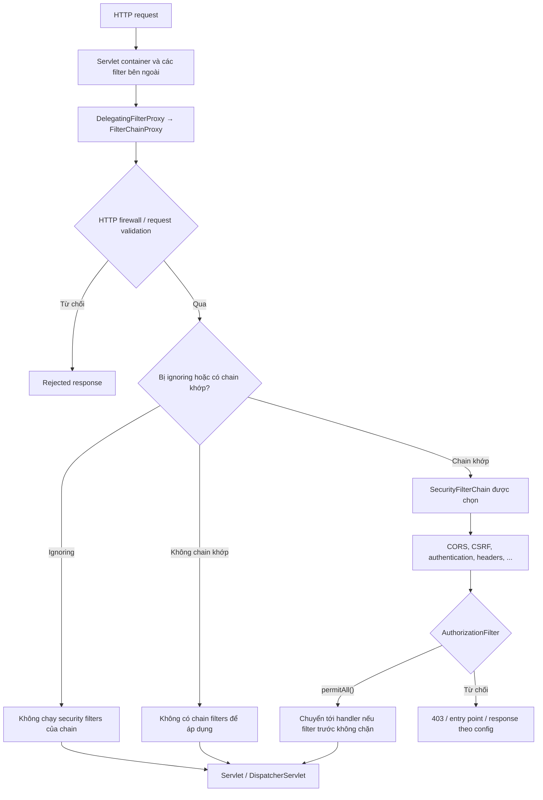
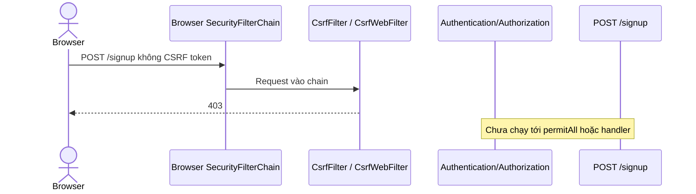
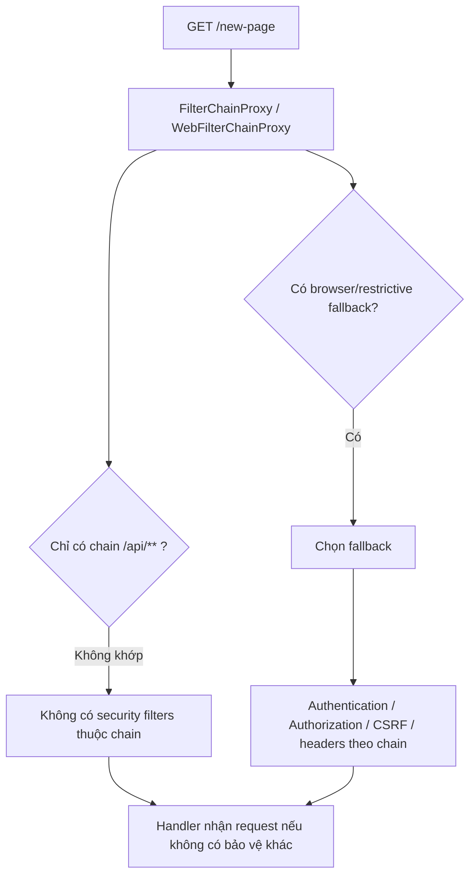

# Khác biệt giữa cho phép truy cập với bỏ qua security chain

> **Chương:** Kiến trúc áp dụng  
> **Phạm vi module:** `SPRING_SECURITY_HTTP_PROTECTION` — phòng vệ HTTP và trình duyệt bằng Spring Security, từ CSRF, CORS, security headers, CSP, HSTS đến HTTP firewall và bảo vệ session; áp dụng trên Servlet và Reactive WebFlux, kiểm thử và chẩn đoán xung đột khi triển khai.  
> **Tình huống trung tâm:** Trang login, file CSS hoặc API công khai không cần đăng nhập. Nên cấu hình `permitAll()` hay loại request khỏi Spring Security? Hai cách có thể đều làm tài nguyên truy cập được, nhưng **khác biệt lớn về lớp bảo vệ, thời điểm kiểm tra và response**.

## 1. Mục tiêu học tập

Sau khi học, người học có thể:

1. Phân biệt **“được authorization cho phép”** với **“không đi qua security filters”** trên cả Servlet và WebFlux.
2. Giải thích `permitAll()` trong `authorizeHttpRequests`/`authorizeExchange`, Servlet `web.ignoring()` và trường hợp **không có security chain nào khớp**.
3. Mô tả ảnh hưởng đến HTTP firewall, CORS, CSRF, authentication filters, authorization, headers/CSP/HSTS, session và logging khi thay đổi phạm vi bảo vệ.
4. Nhận diện vì sao endpoint `permitAll()` vẫn có thể bị từ chối do token hỏng, CSRF thiếu, CORS policy hoặc firewall.
5. Thiết kế tài nguyên công khai an toàn: login, CSS/JS, health/readiness, API GET công khai, preflight OPTIONS và webhook, không mở rộng ngoại lệ bảo mật ngoài chủ đích.
6. Cấu hình `HttpSecurity`/`SecurityFilterChain` và `ServerHttpSecurity`/`SecurityWebFilterChain`, có fallback cho URL ngoài các vùng API.
7. Viết test MockMvc/WebTestClient chứng minh những filter và header thực sự tham gia, kể cả trên response lỗi.
8. Chẩn đoán lỗi “đã `permitAll` mà vẫn 401/403”, “asset công khai thiếu CSP/HSTS” và “route mới nằm ngoài security chain”.

## 2. Định nghĩa ba trường hợp phải tách bạch

| Cơ chế | Ý nghĩa | Request có chạy security filters trong chain không? |
|---|---|---|
| **`permitAll()`** trong authorization rule | Đến bước phân quyền thì không đòi người dùng có quyền cụ thể để đi tiếp. | **Có**, nếu request đã match security chain và các filter tương ứng được bật. |
| **Servlet `web.ignoring()`** | Chỉ định matcher mà Spring Security bỏ qua các security filters của security chain. | **Không** chạy các security filters bên trong chain cho matcher bị ignore. |
| **Không có chain nào khớp** | Proxy không chọn được một `SecurityFilterChain`/`SecurityWebFilterChain` có thể áp dụng. | **Không** chạy security filters của một chain được chọn, vì không có chain đó. |

Một số hệ thống còn có **chain có danh sách filter rỗng**; về mặt hiệu ứng filter, nó cũng không cung cấp các lớp bảo vệ HTTP của security chain thông thường. Tuy nhiên cách cấu hình và vị trí HTTP firewall ở ngoài security filters có thể khác so với không match hoặc proxy không được đăng ký. Vì vậy không gộp ba trường hợp thành “Spring Security hoàn toàn không hoạt động”.

**Nguyên tắc mặc định trong ứng dụng web:** Nếu một resource cần **anonymous được phép truy cập**, ưu tiên cho nó **đi qua security chain với `permitAll()`** thay vì loại bỏ toàn bộ security filters. Chỉ bỏ qua chain khi có lý do kiến trúc rõ ràng và đã xác định được lớp bảo vệ thay thế.

### 2.1. Một request “công khai” vẫn cần phòng vệ

Ví dụ `GET /assets/app.js` không cần user login, nhưng trình duyệt tải tài nguyên vào trang và có thể cần:

- `X-Content-Type-Options: nosniff` để giảm MIME sniffing.
- `Content-Security-Policy` thích hợp trên **HTML document** chứa asset (và các header áp theo chính sách trên response asset nếu có).
- `Strict-Transport-Security` khi browser nhận response qua HTTPS hợp lệ, nếu domain dùng HSTS.
- CORS nếu asset được tải cross-origin và server chủ động cho phép.
- HTTP firewall/URL validation phù hợp; tránh đường dẫn encode bất thường.
- Cache policy đúng với asset public và dữ liệu private.
- Logging, tracing, rate limiting và bảo vệ hạ tầng theo phạm vi được triển khai.

`permitAll()` không biến các lớp bảo vệ ấy thành thừa. “Không cần xác thực” **khác** “không cần bảo vệ HTTP”.

## 3. Request đi đâu trên Servlet?

Spring Security Servlet thường được tích hợp qua `DelegatingFilterProxy`, chuyển tiếp tới `FilterChainProxy`. Proxy dùng request matching để chọn security chain đầu tiên phù hợp.



Sơ đồ là mô hình khái niệm. Servlet container, reverse proxy và HTTP firewall có thể từ chối request trước các security filters; **Servlet `web.ignoring()` không nhất thiết đồng nghĩa request né được mọi xử lý của `FilterChainProxy`/HTTP firewall**, bởi nó có thể được mô hình hóa thành chain rỗng trong proxy. Hành vi cụ thể phụ thuộc cách tích hợp và phiên bản.

### 3.1. `permitAll()` trong cùng một chain

Ví dụ:

```java
@Bean
SecurityFilterChain browser(HttpSecurity http) throws Exception {
    return http
        .authorizeHttpRequests(auth -> auth
            .requestMatchers("/login", "/assets/**").permitAll()
            .requestMatchers("/admin/**").hasRole("ADMIN")
            .anyRequest().authenticated())
        .formLogin(Customizer.withDefaults())
        .csrf(Customizer.withDefaults())
        .headers(headers -> headers
            .contentSecurityPolicy(csp -> csp.policyDirectives(
                "default-src 'self'; object-src 'none'; " +
                "base-uri 'self'; frame-ancestors 'none'")))
        .build();
}
```

Với `GET /assets/app.css`, request vào browser chain. Nếu các filter trước authorization không chặn, `permitAll()` cho phép đi tiếp tới handler phục vụ CSS. `HeaderWriterFilter` vẫn thuộc chain và có thể viết security headers theo policy.

Với `POST /login`, URL login được authorization cho phép, nhưng **CSRF protection của browser vẫn được áp dụng theo cấu hình**. Form login cần nhận và gửi CSRF token hợp lệ cho request cần token. Không dùng `permitAll()` để vượt lớp CSRF.

### 3.2. `web.ignoring()` trên Servlet

Một cách cấu hình khác:

```java
@Bean
WebSecurityCustomizer webSecurityCustomizer() {
    return web -> web.ignoring()
        .requestMatchers("/assets/**");
}
```

Import:

```java
import org.springframework.context.annotation.Bean;
import org.springframework.security.config.annotation.web.configuration.WebSecurityCustomizer;
```

Với URL khớp ignore matcher, các security filters như `HeaderWriterFilter`, `CsrfFilter`, authentication filter và `AuthorizationFilter` **không chạy trong security chain** cho request đó.

Không suy ra rằng mọi lớp hạ tầng đều đã tắt: reverse proxy, Servlet container, các global Servlet filters không thuộc Spring Security và một số chức năng của proxy/firewall vẫn có thể tham gia. Tuy nhiên **các lớp bảo vệ do security filters của chain cung cấp không còn được đảm bảo**.

**Hệ quả thực tế:** Dùng `web.ignoring()` cho static files để “tăng hiệu năng” thường không cần thiết nếu chỉ muốn anonymous tải asset. `permitAll()` giữ khả năng ghi headers và các filter khác, đồng thời vẫn tránh yêu cầu authenticated user ở authorization.

### 3.3. Không có chain nào khớp

Giả sử ứng dụng chỉ khai báo:

```java
@Bean
SecurityFilterChain api(HttpSecurity http) throws Exception {
    return http
        .securityMatcher("/api/**")
        .authorizeHttpRequests(auth -> auth
            .anyRequest().authenticated())
        .httpBasic(Customizer.withDefaults())
        .build();
}
```

Một request `GET /profile` **không khớp `/api/**`**. Nếu không tồn tại chain khác hoặc cấu hình bảo vệ thay thế, các security filters của Spring Security không áp dụng cho URL này. Tài nguyên có thể được handler phục vụ mà không có HTTP authentication/headers/CSRF tương ứng.

**Điểm cần nhớ:** Khi ứng dụng định nghĩa security chain bean riêng, không được mặc định Spring Boot vẫn tạo thêm một fallback cho mọi URL. Phải kiểm các bean chain thật đang được xây trong application context.

## 4. WebFlux: khác API, cùng ranh giới bảo mật

WebFlux dùng `WebFilterChainProxy` điều phối các `SecurityWebFilterChain`. Filter trong chain là `WebFilter` làm việc với `ServerWebExchange` và trả `Mono<Void>`. Cấu hình dùng `ServerHttpSecurity`, không dùng Servlet `WebSecurityCustomizer`.

| Tác vụ | Servlet | Reactive WebFlux |
|---|---|---|
| Chọn security chain | `FilterChainProxy` | `WebFilterChainProxy` |
| Chain | `SecurityFilterChain` | `SecurityWebFilterChain` |
| Builder | `HttpSecurity` | `ServerHttpSecurity` |
| Authorization DSL | `authorizeHttpRequests` | `authorizeExchange` |
| Cho anonymous | `requestMatchers(...).permitAll()` | `pathMatchers(...).permitAll()` |
| Bỏ qua security filters | `web.ignoring()` hoặc không chọn chain | Không có chain khớp, hoặc cấu hình loại trừ tương ứng |
| Security headers | `HeaderWriterFilter` | `HttpHeaderWriterWebFilter` |
| CSRF | `CsrfFilter` | `CsrfWebFilter` |
| CORS | `CorsFilter` | `CorsWebFilter` |
| Session | `HttpSession` | `WebSession` |
| Security context | `SecurityContextHolder` theo chiến lược Servlet | `ReactiveSecurityContextHolder` qua Reactor Context |

Ví dụ một browser chain WebFlux:

```java
@Bean
SecurityWebFilterChain browser(ServerHttpSecurity http) {
    return http
        .authorizeExchange(auth -> auth
            .pathMatchers("/login", "/assets/**").permitAll()
            .pathMatchers("/admin/**").hasRole("ADMIN")
            .anyExchange().authenticated())
        .formLogin(Customizer.withDefaults())
        .csrf(Customizer.withDefaults())
        .headers(headers -> headers
            .contentSecurityPolicy(csp -> csp.policyDirectives(
                "default-src 'self'; object-src 'none'; " +
                "base-uri 'self'; frame-ancestors 'none'")))
        .build();
}
```

Với `GET /assets/app.css`, request được chọn vào chain; authorization `permitAll()` không yêu cầu principal, nhưng `HttpHeaderWriterWebFilter` và các WebFilters đã cấu hình vẫn có cơ hội xử lý.

Nếu ứng dụng WebFlux chỉ có một chain match `/api/**` mà không có fallback, những URL ngoài API không nhận các security WebFilters từ chain đó. **Đừng cố dùng `WebSecurityCustomizer` Servlet trên `ServerHttpSecurity`**; hãy cấu hình matcher và chain reactive theo đúng kiểu.

## 5. Phân biệt lớp kiểm soát: cái gì vẫn chạy sau `permitAll`?

Một cấu hình Spring Security có nhiều lớp, không chỉ authorization.

| Lớp | Với `permitAll()` trong chain | Khi bỏ qua security filters của chain |
|---|---|---|
| **HTTP firewall** | Proxy/firewall có thể kiểm trước khi chọn chain | Còn phụ thuộc request có đi qua proxy không và cách cấu hình; **không mặc định bỏ qua firewall** |
| **Security headers** | Header writer trong chain có thể ghi theo policy | Header writer của chain không chạy |
| **CORS filter** | Vẫn có thể kiểm Origin và trả preflight/rejection sớm | CORS filter trong security chain không chạy; tầng CORS khác có thể xử lý nếu được cấu hình |
| **CSRF filter** | Với unsafe methods, vẫn có thể đòi token | CSRF filter của chain không chạy |
| **Authentication filter** | Nếu có credentials, filter có thể kiểm chúng; malformed Bearer có thể bị từ chối | Authentication filter của chain không chạy |
| **Authorization filter** | Rule `permitAll()` quyết định cho phép tại bước phân quyền | Authorization filter của chain không chạy |
| **Session/security context filters** | Vẫn thuộc chain nếu được cấu hình, nhưng mức đọc/ghi session tùy filter và policy | Những filters đó không chạy; handler khác vẫn có thể dùng session |
| **Exception handling của Spring Security** | Có thể chuyển lỗi authentication/authorization thành response phù hợp | Entry point/access denied handler của chain không áp dụng |
| **Custom filter được add vào chain** | Vẫn có thể chạy theo vị trí filter | Không chạy nếu request nằm ngoài chain |
| **Logging/tracing ngoài Spring Security** | Phụ thuộc filter/logger toàn cục | Vẫn có thể chạy; không mặc định biến mất |

Đừng suy từ bảng rằng mọi chain luôn chứa đủ tất cả filter. `httpBasic()`, `formLogin()`, OAuth2 Resource Server, CSRF, CORS và headers được bật/tắt theo cấu hình. “`permitAll` giữ filter” nghĩa là **những filter đã nằm trong chain vẫn thuộc đường đi**; không có nghĩa nó tự kích hoạt các cơ chế chưa được cấu hình.

### 5.1. `permitAll()` có tự tạo session không?

Không. `permitAll()` là rule authorization, không phải lệnh tạo `HttpSession` hoặc `WebSession`. Ở các phiên bản Spring Security hiện đại, authorization `permitAll` có thể không cần truy xuất Authentication để quyết định quyền, giúp giảm thao tác lấy security context từ session.

Tuy nhiên các filter, handler hoặc framework component khác vẫn có thể khởi tạo session/cookie theo chức năng của chúng. **Không lập luận “dùng `permitAll` nên chắc chắn có session”**, cũng không lập luận “bỏ qua chain nên chắc chắn không có session”.

### 5.2. `permitAll()` không có nghĩa “chưa xác thực thì luôn HTTP 200”

Mã 200 phụ thuộc controller/handler tồn tại và response nghiệp vụ. Một URL công khai có thể trả:

- **200** khi handler trả nội dung thành công.
- **404** khi không có handler/resource, dù authorization đã cho phép.
- **400** do request validation/firewall/container.
- **403** do CSRF/CORS hoặc business rule.
- **401** do authentication filter thấy token không hợp lệ.
- **302** do một filter/handler có chủ đích redirect.
- **5xx** do lỗi ứng dụng hoặc hạ tầng.

Không dùng status 200 đơn lẻ để chứng minh chain nào đã được chọn. Cần nhìn **security headers, filter logs, response source và negative tests**.

## 6. Trường hợp gây nhầm nhất: public API vẫn trả 401

Giả sử một API chain cho phép đọc catalog công khai:

```java
.authorizeHttpRequests(auth -> auth
    .requestMatchers(HttpMethod.GET, "/api/catalog/**")
        .permitAll()
    .anyRequest().authenticated())
.oauth2ResourceServer(oauth2 -> oauth2
    .jwt(Customizer.withDefaults()))
```

Hai request:

```http
GET /api/catalog/items HTTP/1.1
Host: api.example.com
```

và:

```http
GET /api/catalog/items HTTP/1.1
Host: api.example.com
Authorization: Bearer invalid-token
```

Request thứ nhất không mang credential; authorization public có thể cho vào handler.

Request thứ hai mang Bearer token nhưng không hợp lệ; `BearerTokenAuthenticationFilter` (Servlet) hoặc thành phần authentication Bearer tương ứng (WebFlux) có thể từ chối **trước khi authorization xét `permitAll()`**.

Điều này không mâu thuẫn với `permitAll`: **được phép không xác thực** khác **phải bỏ qua xác minh một credential mà client đã gửi**.

### 6.1. Cách xử lý đúng

- Nếu endpoint thật sự là public, client không cần đính kèm token.
- Nếu ứng dụng muốn bỏ qua Bearer authentication cho đúng nhóm URL, đó là một **quyết định kiến trúc** về authentication filter/chain riêng, không đơn thuần là `permitAll`. Phải xem tác động đến headers, firewall, CORS, session và response.
- Không nên silently chấp nhận một Bearer token hỏng bằng cách tắt xác thực trên toàn bộ API.
- Kiểm thử cả **public request không token** lẫn **public request có token sai** theo policy mong muốn.

## 7. CSRF: tại sao `permitAll` không làm POST công khai vượt qua?

Trên browser dùng session cookie, attacker có thể lợi dụng việc trình duyệt tự gửi cookie khi thực hiện request thay đổi trạng thái. `CsrfFilter` (Servlet) hoặc `CsrfWebFilter` (WebFlux) thường bảo vệ những method không an toàn theo matcher.

Ví dụ một trang đăng ký nhận `POST /signup` mà **không yêu cầu user login**. Nếu route được cho `permitAll()`, CSRF vẫn có thể đòi token khi browser chain bật CSRF. Với form login, `POST /login` cũng thường cần token theo policy.



**Không sửa sai bằng cách bỏ qua toàn bộ chain cho `POST /signup`**. Khi cần exception CSRF cho một endpoint server-to-server đặc thù, giới hạn exception đúng endpoint và dùng xác thực thích hợp (ví dụ webhook signature). Với browser form, tạo và gửi CSRF token hợp lệ.

### 7.1. Token trong form

```html
<form method="post" action="/signup">
  <input type="email" name="email">
  <input type="hidden" name="_csrf" value="TOKEN_DO_SERVER_CAP">
  <button type="submit">Đăng ký</button>
</form>
```

Giá trị token phải được lấy từ Spring Security repository/token của request, **không hard-code**. Với WebFlux, CSRF token có thể được expose bằng reactive publisher và cần được lấy/sử dụng đúng lifecycle của view/handler.

### 7.2. Một API Bearer stateless có thể không cần CSRF, nhưng không phải vì `permitAll`

Một REST API chỉ xác thực bằng Bearer token do client chủ động đính kèm trong Authorization header, không tin cookie/browser auto-credentials, có thể tắt CSRF theo threat model được đánh giá.

Nguyên nhân là **cách credential được gửi**, không phải vì endpoint `permitAll` hay response JSON.

Nếu API cũng nhận session cookie, Basic auth được browser tự gửi hoặc credential tự động khác để thay đổi trạng thái, CSRF có thể vẫn là yêu cầu bắt buộc.

## 8. CORS: preflight cần filter, không phải bỏ qua security

Browser thường gửi preflight OPTIONS trước một cross-origin request có header Authorization:

```http
OPTIONS /api/orders HTTP/1.1
Origin: https://client.example.com
Access-Control-Request-Method: POST
Access-Control-Request-Headers: authorization,content-type
```

Preflight thường **không có Bearer token/cookie như request chính**. Nếu CORS filter được cấu hình đúng và chạy sớm trong API chain, nó có thể trả response preflight mà không đòi authentication.

Không nên giải quyết preflight lỗi 401 bằng cách `web.ignoring()` toàn bộ OPTIONS, vì có thể làm mất **chính filter CORS** mà browser cần, và bỏ qua những lớp HTTP protection khác. Cho tất cả OPTIONS `permitAll()` cũng không thay việc khai báo allowed Origin/method/headers.

### 8.1. CORS và authorization là hai câu hỏi riêng

- **CORS**: Browser origin này có được phép thực hiện/đọc request cross-origin theo allowlist không?
- **CSRF**: Request thay đổi trạng thái có bằng chứng chống giả mạo hợp lệ không, khi credential do browser tự gửi?
- **Authentication**: Ai đang yêu cầu, credential có hợp lệ không?
- **Authorization**: Principal đó có quyền làm hành động không?

Một preflight được cho phép **không cấp quyền nghiệp vụ**. Một POST thật sau preflight vẫn cần JWT và scope/role thích hợp. Và một simple form POST có thể gây CSRF mà không cần preflight; CORS không thay thế CSRF.

### 8.2. Hệ quả của bỏ qua chain

Nếu Servlet dùng `web.ignoring().requestMatchers("/api/**")` để cho phép preflight, Spring Security CORS filter trong chain API không chạy cho toàn bộ prefix. Browser có thể thấy response không có `Access-Control-Allow-Origin` và vẫn chặn request; request thật còn mất authentication/authorization của chain.

Trong WebFlux, nếu không có `SecurityWebFilterChain` nào khớp `/api/**`, `CorsWebFilter` thuộc chain không thể thực thi. Một global WebFlux CORS filter hoặc gateway vẫn có thể có tác dụng nếu được cấu hình riêng, nhưng không được mặc định dựa vào nó.

## 9. Security headers, CSP, HSTS: thứ đầu tiên dễ mất khi bỏ qua

Security header writer trên Servlet là `HeaderWriterFilter`, trên WebFlux là `HttpHeaderWriterWebFilter`. Những writer này có thể đặt header **trước khi HTTP response commit** nếu request đi qua chain có chúng.

Ví dụ response HTML được bảo vệ:

```http
HTTP/1.1 200 OK
Content-Type: text/html; charset=utf-8
X-Content-Type-Options: nosniff
Content-Security-Policy: default-src 'self'; object-src 'none'; base-uri 'self'; frame-ancestors 'none'
Strict-Transport-Security: max-age=31536000; includeSubDomains
```

Trong tình huống `GET /login` được `permitAll`, response vẫn có thể nhận security headers theo chain browser. Nếu URL login bị `web.ignoring` hoặc nằm ngoài chain, các header writer của chain không chạy.

**Lưu ý:** không phải mọi phiên bản Spring Security mặc định đặt CSP; CSP cần policy do ứng dụng thiết kế. Header HSTS chỉ được trình duyệt ghi nhận khi response tới browser qua HTTPS hợp lệ, không chỉ vì fake request được đánh dấu `secure=true` trong unit test.

### 9.1. CSP áp trên document nào?

CSP chủ yếu được browser dùng theo **HTML document** nhận header. Nếu file CSS/JS public bị ignore nhưng **HTML document chính** đã có CSP thích hợp, CSP của document vẫn có thể hạn chế nguồn tải asset. Vì vậy không nên tuyên bố “bỏ qua CSS là CSP của toàn trang mất hiệu lực”.

Điều đúng là: **response bị ignore không được Spring Security header writer tự thêm header**. Hệ quả thực tế phụ thuộc loại resource, document đang sử dụng, browser và các header do CDN/proxy cung cấp.

Đối với trang `/login` hoặc `/error` trả HTML, mất CSP ở chính document có thể nghiêm trọng hơn mất CSP riêng trên JSON API response. Cần kiểm trên **response cuối**, không chỉ nhìn config.

### 9.2. HSTS bị ảnh hưởng ở hai lớp khác nhau

- **Phạm vi chain:** URL không đi qua header writer có thể không nhận HSTS từ Spring Security.
- **Transport:** Browser chỉ chấp nhận HSTS qua HTTPS tin cậy. TLS termination ở reverse proxy có thể khiến backend nhận request là HTTP; phải xử lý forwarded scheme từ proxy đáng tin cậy hoặc cấu hình HSTS tại edge.

Nếu reverse proxy tự thêm HSTS trên mọi response HTTPS, một URL bị ignore trong app **có thể vẫn có HSTS ở edge**. Không được dùng việc thấy HSTS để kết luận Spring Security chain đã chạy.

### 9.3. HTTP error response và headers

Với `permitAll` trong chain, các response như 403 CSRF hoặc 401 do token hỏng vẫn có thể có security headers nếu header writer đã tham gia trước khi response commit. Response do gateway/container/firewall tạo **trước chain** có thể không có header của ứng dụng.

Bởi vậy khi kiểm, bao gồm 200, 302, 401, 403, 404, OPTIONS và HTTPS response thực; đừng chỉ kiểm success case.

## 10. Ví dụ Servlet đầy đủ: API Bearer và browser public pages

Tình huống: cùng một ứng dụng Spring MVC phục vụ API JWT dưới `/api/**` và browser form-login/session ở các URL khác. Public API `GET /api/catalog/**` không cần credential; public browser `/login`, `/assets/**` và `/help` cần security headers.

```java
package example.security;

import java.util.List;

import org.springframework.context.annotation.Bean;
import org.springframework.context.annotation.Configuration;
import org.springframework.core.annotation.Order;
import org.springframework.http.HttpMethod;
import org.springframework.security.config.Customizer;
import org.springframework.security.config.annotation.web.builders.HttpSecurity;
import org.springframework.security.config.annotation.web.configuration.EnableWebSecurity;
import org.springframework.security.config.annotation.web.configurers.AbstractHttpConfigurer;
import org.springframework.security.config.http.SessionCreationPolicy;
import org.springframework.security.web.SecurityFilterChain;
import org.springframework.web.cors.CorsConfiguration;
import org.springframework.web.cors.CorsConfigurationSource;
import org.springframework.web.cors.UrlBasedCorsConfigurationSource;

@Configuration
@EnableWebSecurity
public class ServletPublicAccessSecurity {

    @Bean
    @Order(1)
    SecurityFilterChain api(HttpSecurity http) throws Exception {
        return http
            .securityMatcher("/api/**")
            .cors(cors -> cors.configurationSource(apiCors()))
            // Chỉ phù hợp khi API không dùng credential browser tự gửi.
            .csrf(AbstractHttpConfigurer::disable)
            .sessionManagement(session -> session
                .sessionCreationPolicy(SessionCreationPolicy.STATELESS))
            .authorizeHttpRequests(auth -> auth
                .requestMatchers(HttpMethod.GET, "/api/catalog/**")
                    .permitAll()
                .anyRequest().authenticated())
            .oauth2ResourceServer(oauth2 -> oauth2
                .jwt(Customizer.withDefaults()))
            .headers(Customizer.withDefaults())
            .build();
    }

    @Bean
    @Order(2)
    SecurityFilterChain browser(HttpSecurity http) throws Exception {
        return http
            // Fallback: bao gồm public browser URLs.
            .authorizeHttpRequests(auth -> auth
                .requestMatchers("/login", "/assets/**", "/help")
                    .permitAll()
                .requestMatchers("/admin/**").hasRole("ADMIN")
                .anyRequest().authenticated())
            .formLogin(Customizer.withDefaults())
            .csrf(Customizer.withDefaults())
            .headers(headers -> headers
                .contentSecurityPolicy(csp -> csp.policyDirectives(
                    "default-src 'self'; object-src 'none'; " +
                    "base-uri 'self'; frame-ancestors 'none'")))
            .build();
    }

    @Bean
    CorsConfigurationSource apiCors() {
        CorsConfiguration cors = new CorsConfiguration();
        cors.setAllowedOrigins(List.of("https://client.example.com"));
        cors.setAllowedMethods(List.of(
            "GET", "POST", "PUT", "PATCH", "DELETE"));
        cors.setAllowedHeaders(List.of(
            "Authorization", "Content-Type"));
        cors.setMaxAge(1800L);

        UrlBasedCorsConfigurationSource source =
            new UrlBasedCorsConfigurationSource();
        source.registerCorsConfiguration("/api/**", cors);
        return source;
    }
}
```

**Đặc tính đáng quan sát:**

1. `GET /api/catalog/items` vào API chain, public ở authorization. Security headers mặc định của API chain vẫn có thể được ghi.
2. `GET /help` vào browser fallback, `permitAll`; CSP dành cho HTML được áp khi response đi qua chain.
3. `POST /profile` đã đăng nhập nhưng thiếu CSRF token thường bị 403.
4. `GET /api/orders` không token đi vào API chain, thường nhận 401 Bearer, **không** redirect login.
5. `GET /admin/reports` với role USER thường nhận 403.
6. `GET /new-page` dù route mới vẫn vào browser fallback và cần authentication, thay vì nằm ngoài Spring Security.

**Điều kiện chạy:** phải có dependency Spring Security, OAuth2 Resource Server/JWT, JWT decoder/issuer config và user store/handlers phù hợp. Cấu hình mẫu không tự sinh JWT, database users hoặc controllers.

### 10.1. Một lỗi cấu hình có vẻ vô hại nhưng không an toàn

Nếu thêm đoạn này vào ứng dụng Servlet trên:

```java
@Bean
WebSecurityCustomizer ignoreStatic() {
    return web -> web.ignoring()
        .requestMatchers("/assets/**", "/help");
}
```

Các request `/assets/**` và `/help` giờ **bỏ qua security filters của Spring Security chain**, dù browser chain có `permitAll()` và CSP. Rule `permitAll()` **không thể kéo request đã bị ignore trở lại chain**.

Kiểm với `MockMvc` trong một cấu hình test riêng hoặc bằng response thực; nếu CDN hoặc global filters tự thêm một số headers, đừng suy thiếu/vắng header chỉ từ một tầng. Chọn **một** cách cho một route và kiểm theo chủ đích thiết kế.

### 10.2. Public endpoint có cần CSRF nếu chỉ GET?

Các request GET, HEAD, TRACE, OPTIONS thường được CSRF matcher mặc định coi là safe; GET public không cần token CSRF theo chính sách phổ biến. Nhưng server **không được dùng GET để thay đổi trạng thái** chỉ nhằm né CSRF. Một POST public qua browser chain có thể vẫn yêu cầu CSRF dù không có authentication.

## 11. Ví dụ WebFlux: `permitAll` giữ WebFilters trong chain

Cấu hình tương ứng nhưng dùng stack reactive:

```java
package example.security;

import java.util.List;

import org.springframework.context.annotation.Bean;
import org.springframework.context.annotation.Configuration;
import org.springframework.core.annotation.Order;
import org.springframework.http.HttpMethod;
import org.springframework.security.config.Customizer;
import org.springframework.security.config.annotation.web.reactive.EnableWebFluxSecurity;
import org.springframework.security.config.web.server.ServerHttpSecurity;
import org.springframework.security.web.server.SecurityWebFilterChain;
import org.springframework.security.web.server.context.NoOpServerSecurityContextRepository;
import org.springframework.security.web.server.util.matcher.ServerWebExchangeMatchers;
import org.springframework.web.cors.CorsConfiguration;
import org.springframework.web.cors.reactive.CorsConfigurationSource;
import org.springframework.web.cors.reactive.UrlBasedCorsConfigurationSource;

@Configuration
@EnableWebFluxSecurity
public class ReactivePublicAccessSecurity {

    @Bean
    @Order(1)
    SecurityWebFilterChain api(ServerHttpSecurity http) {
        return http
            .securityMatcher(
                ServerWebExchangeMatchers.pathMatchers("/api/**"))
            .cors(cors -> cors.configurationSource(apiCors()))
            .csrf(ServerHttpSecurity.CsrfSpec::disable)
            .securityContextRepository(
                NoOpServerSecurityContextRepository.getInstance())
            .authorizeExchange(auth -> auth
                .pathMatchers(HttpMethod.GET, "/api/catalog/**")
                    .permitAll()
                .anyExchange().authenticated())
            .oauth2ResourceServer(oauth2 -> oauth2
                .jwt(Customizer.withDefaults()))
            .headers(Customizer.withDefaults())
            .build();
    }

    @Bean
    @Order(2)
    SecurityWebFilterChain browser(ServerHttpSecurity http) {
        return http
            .authorizeExchange(auth -> auth
                .pathMatchers("/login", "/assets/**", "/help")
                    .permitAll()
                .pathMatchers("/admin/**").hasRole("ADMIN")
                .anyExchange().authenticated())
            .csrf(Customizer.withDefaults())
            .formLogin(Customizer.withDefaults())
            .headers(headers -> headers
                .contentSecurityPolicy(csp -> csp.policyDirectives(
                    "default-src 'self'; object-src 'none'; " +
                    "base-uri 'self'; frame-ancestors 'none'")))
            .build();
    }

    @Bean
    CorsConfigurationSource apiCors() {
        CorsConfiguration cors = new CorsConfiguration();
        cors.setAllowedOrigins(List.of("https://client.example.com"));
        cors.setAllowedMethods(List.of(
            "GET", "POST", "PUT", "PATCH", "DELETE"));
        cors.setAllowedHeaders(List.of(
            "Authorization", "Content-Type"));
        cors.setMaxAge(1800L);

        UrlBasedCorsConfigurationSource source =
            new UrlBasedCorsConfigurationSource();
        source.registerCorsConfiguration("/api/**", cors);
        return source;
    }
}
```

Khác biệt so với Servlet:

- `CorsConfigurationSource` và `UrlBasedCorsConfigurationSource` của WebFlux ở package `org.springframework.web.cors.reactive`, không phải package Servlet.
- `ServerHttpSecurity` tạo `SecurityWebFilterChain` chứa các WebFilters reactive; `WebFilterChainProxy` xét matcher theo exchange.
- `NoOpServerSecurityContextRepository` khiến Spring Security không dùng repository để lưu/khôi phục context từ WebSession trong API chain; **không** cấm tất cả thành phần khác sử dụng WebSession.
- Authentication/Authorization chạy trong Reactor Context; handler reactive nên dùng `ReactiveSecurityContextHolder`/principal reactive, không phụ thuộc ThreadLocal của Servlet.
- Không áp `WebSecurityCustomizer` của Servlet để “ignore WebFlux”; muốn public, dùng `permitAll` trong chain phù hợp và giữ fallback.

### 11.1. Khi không có WebFlux chain khớp

Nếu chỉ khai báo API chain:

```java
.securityMatcher(
    ServerWebExchangeMatchers.pathMatchers("/api/**"))
```

và **không có fallback chain**, request `GET /help` đi tiếp WebFlux pipeline ngoài các security WebFilters của API chain. Các global WebFilters hoặc gateway có thể vẫn chạy, nhưng Spring Security API chain không cung cấp CSP/CSRF/authentication cho URL đó.

Bổ sung browser fallback hoặc một restrictive fallback theo nhu cầu, không giải quyết bằng `anyExchange().permitAll()` của **API chain vốn không khớp `/help`**.

## 12. Kiểm thử Servlet với MockMvc: phải chứng minh filter còn chạy

Một bài test chất lượng không chỉ assert `200`. Hãy kiểm header do Spring Security thêm, đường đi không xác thực, CSRF và quyền truy cập.

Giả định ứng dụng Servlet dùng cấu hình mục 10 và có fixture:

| Endpoint | Response handler kỳ vọng |
|---|---|
| `GET /help` | 200 + HTML |
| `GET /assets/app.css` | 200 + CSS |
| `GET /api/catalog/items` | 200 + JSON |
| `POST /profile` | 204 khi user đã login và CSRF hợp lệ |
| `GET /admin/reports` | 200 khi role ADMIN |

Các route demo có thể được tạo trong test application. Ví dụ test:

```java
@SpringBootTest
@AutoConfigureMockMvc
class ServletPermitAllVsIgnoreTest {

    @Autowired
    MockMvc mvc;

    @Test
    void publicHtmlGetsCspFromBrowserChain()
            throws Exception {
        mvc.perform(get("/help"))
            .andExpect(status().isOk())
            .andExpect(header().string(
                "Content-Security-Policy",
                "default-src 'self'; object-src 'none'; " +
                "base-uri 'self'; frame-ancestors 'none'"));
    }

    @Test
    void publicCssStillGetsSecurityHeaders()
            throws Exception {
        mvc.perform(get("/assets/app.css"))
            .andExpect(status().isOk())
            .andExpect(header().string(
                "X-Content-Type-Options", "nosniff"));
    }

    @Test
    void anonymousApiCatalogIsPublicButStillProtected()
            throws Exception {
        mvc.perform(get("/api/catalog/items"))
            .andExpect(status().isOk())
            .andExpect(header().string(
                "X-Content-Type-Options", "nosniff"));
    }

    @Test
    void browserPostWithoutCsrfCanFailDespitePermitAll()
            throws Exception {
        mvc.perform(post("/profile")
                .with(user("lan").roles("USER")))
            .andExpect(status().isForbidden());
    }

    @Test
    void browserPostWithCsrfCanReachHandler()
            throws Exception {
        mvc.perform(post("/profile")
                .with(user("lan").roles("USER"))
                .with(csrf()))
            .andExpect(status().isNoContent());
    }

    @Test
    void privateApiWithoutTokenIs401()
            throws Exception {
        mvc.perform(get("/api/orders"))
            .andExpect(status().isUnauthorized());
    }

    @Test
    void loggedInUserWithoutAdminRoleIsForbidden()
            throws Exception {
        mvc.perform(get("/admin/reports")
                .with(user("lan").roles("USER")))
            .andExpect(status().isForbidden());
    }

    @Test
    void csrf403StillHasBrowserCsp()
            throws Exception {
        mvc.perform(post("/profile")
                .with(user("lan").roles("USER")))
            .andExpect(status().isForbidden())
            .andExpect(header().exists("Content-Security-Policy"));
    }
}
```

Các import tĩnh chính:

```java
import static org.springframework.security.test.web.servlet.request.SecurityMockMvcRequestPostProcessors.*;
import static org.springframework.test.web.servlet.request.MockMvcRequestBuilders.*;
import static org.springframework.test.web.servlet.result.MockMvcResultMatchers.*;
```

Cùng imports `org.junit.jupiter.api.Test`, `org.springframework.beans.factory.annotation.Autowired`, `org.springframework.boot.test.context.SpringBootTest`, `org.springframework.boot.test.autoconfigure.web.servlet.AutoConfigureMockMvc`, `org.springframework.test.web.servlet.MockMvc`.

**Điều kiện:** `spring-security-test`, Spring MVC Test, handler demo và JWT decoder phù hợp phải có để context khởi tạo/test 200 chạy được. `with(user(...))` là mock authentication; nó không kiểm việc đăng nhập thực, cookie session hay session fixation.

### 12.1. Test sự khác nhau khi cấu hình `web.ignoring`

Trong một test context **riêng** có `WebSecurityCustomizer` ignore `/assets/**`, hãy kiểm response thực:

```java
@Test
void ignoredAssetHasNoSpringSecurityNosniffInIsolatedSetup()
        throws Exception {
    mvc.perform(get("/assets/app.css"))
        .andExpect(status().isOk())
        .andExpect(header().doesNotExist("X-Content-Type-Options"));
}
```

**Đừng đưa test này chạy trong cùng config `permitAll` ở trên**: nó giả định đã bật `web.ignoring("/assets/**")` riêng và không có filter/proxy/server khác thêm nosniff. Nếu server khác viết header, kiểm log/filter registration để chứng minh **Spring Security header writer không chạy**, thay vì khăng khăng header phải vắng trong mọi môi trường.

Test **so sánh hai cấu hình** cần cùng một controller và request, chỉ khác `permitAll` với ignore. Điều thay đổi được kỳ vọng là **filter coverage**, không phải nhất thiết HTTP status.

### 12.2. Thử public API với token hỏng

Với Resource Server thật, test một request `GET /api/catalog/items` có `Authorization: Bearer invalid-token` và JWT decoder được cấu hình để từ chối. Kỳ vọng thường 401 do authentication filter.

Đừng dùng `with(jwt())` cho test token hỏng: helper đó tạo mock authentication, không thực hiện kiểm chữ ký JWT. Sử dụng decoder test/integration phù hợp để xác minh authentication failure.

## 13. Kiểm thử WebFlux với WebTestClient

Trên WebFlux, sử dụng `WebTestClient` bind vào application context và áp `springSecurity()` từ Spring Security Test.

```java
@SpringBootTest
class ReactivePermitAllVsNoChainTest {

    @Autowired
    ApplicationContext context;

    WebTestClient client;

    @BeforeEach
    void setup() {
        client = WebTestClient
            .bindToApplicationContext(context)
            .apply(springSecurity())
            .configureClient()
            .build();
    }

    @Test
    void publicBrowserHtmlStillHasCsp() {
        client.get().uri("/help")
            .exchange()
            .expectStatus().isOk()
            .expectHeader().valueEquals(
                "Content-Security-Policy",
                "default-src 'self'; object-src 'none'; " +
                "base-uri 'self'; frame-ancestors 'none'");
    }

    @Test
    void publicApiCatalogStillHasNosniff() {
        client.get().uri("/api/catalog/items")
            .exchange()
            .expectStatus().isOk()
            .expectHeader().valueEquals(
                "X-Content-Type-Options", "nosniff");
    }

    @Test
    void csrfStillAppliesOnBrowserPost() {
        client.mutateWith(mockUser("lan").roles("USER"))
            .post().uri("/profile")
            .exchange()
            .expectStatus().isForbidden()
            .expectHeader().exists("Content-Security-Policy");
    }

    @Test
    void addingCsrfTokenAllowsBrowserPostToProceed() {
        client.mutateWith(mockUser("lan").roles("USER"))
            .mutateWith(csrf())
            .post().uri("/profile")
            .exchange()
            .expectStatus().isNoContent();
    }

    @Test
    void apiPrivateWithoutJwtReturns401() {
        client.get().uri("/api/orders")
            .exchange()
            .expectStatus().isUnauthorized();
    }

    @Test
    void browserPrivateRedirectsAnonymous() {
        client.get().uri("/profile")
            .exchange()
            .expectStatus().is3xxRedirection();
    }
}
```

Imports:

```java
import org.junit.jupiter.api.BeforeEach;
import org.junit.jupiter.api.Test;
import org.springframework.beans.factory.annotation.Autowired;
import org.springframework.boot.test.context.SpringBootTest;
import org.springframework.context.ApplicationContext;
import org.springframework.test.web.reactive.server.WebTestClient;
import static org.springframework.security.test.web.reactive.server.SecurityMockServerConfigurers.*;
```

Cần WebFlux Test, Spring Security Test, các handler demo và `ReactiveJwtDecoder` bean phù hợp. `mockUser()` chỉ cung cấp principal test, không xác minh session cookie thật.

### 13.1. Kiểm “không match chain” trên WebFlux

Dùng một test application context khác, chỉ có security chain `/api/**` và **không có fallback**, tạo handler `GET /help` trả 200. Trong môi trường không có global writer nào khác, kiểm response không mang CSP do browser chain (vì browser chain không tồn tại).

Đây là test về **coverage**; nếu gateway/server/global WebFilter khác thêm CSP thì header vẫn có thể xuất hiện. Kết quả cần chứng minh là *security WebFilter của chain không áp dụng*, không phải suy mọi tầng bảo mật đều biến mất.

### 13.2. Khi thấy 403, chưa biết nguyên nhân

`POST /profile` trả 403 có thể do CSRF, thiếu role hoặc handler nghiệp vụ. Muốn chứng minh CSRF, so cặp request với/không `csrf()` trong cùng authentication context.

Tương tự, để kiểm authorization admin, dùng request GET không vướng CSRF, hoặc cấp CSRF token hợp lệ rồi kiểm rule. Status giống nhau không đồng nghĩa filter gây lỗi giống nhau.

## 14. Những tài nguyên công khai thường gặp và chính sách phù hợp

| Resource | Authorization gợi ý | Có nên bypass toàn bộ chain? | Lý do |
|---|---|---|---|
| **Trang `/login` (HTML)** | `permitAll` | Thường **không** | Trang login cần CSP, frame protection, HSTS, CSRF cho form POST |
| **`/assets/**` CSS/JS/fonts** | `permitAll` | Thường không | Giữ security headers; xem cache policy riêng cho static |
| **Trang `/help`** | `permitAll` | Thường không | Nội dung HTML vẫn cần bảo vệ trình duyệt |
| **`GET /api/catalog/**`** | `permitAll` trong API chain | Thường không | Giữ CORS/headers và policy authentication cho token nếu gửi |
| **`GET /actuator/health`** | Tùy policy; có thể public health tối thiểu | Chỉ khi xác định rõ context/port | Không vô tình mở Actuator nhạy cảm; management context có thể tách khỏi app chính |
| **CORS preflight OPTIONS** | Cho CORS filter xử lý sớm; không đòi Bearer trên preflight | **Không mặc định** | Bypass có thể loại chính CORS filter |
| **Webhook server-to-server** | Auth riêng bằng chữ ký và authorization rõ | Không vì chỉ muốn miễn CSRF | Giới hạn CSRF exemption đúng endpoint, vẫn cần signature/replay checks |
| **Lỗi `/error`** | Chính sách riêng theo dispatcher/error handler | Không mặc định | Trang lỗi HTML có thể cần headers; tránh che lỗi gốc bằng rule quá chặt |
| **Upload công khai** | Rule theo nghiệp vụ và threat model | Cần thận trọng | Kiểm kích thước/loại file, CSRF nếu cookie, rate limits, antivirus khi phù hợp |

Các quy tắc là gợi ý kiến trúc, không phải “mọi endpoint public đều an toàn”. Cần phân tích loại credential, liệu URL có thay đổi trạng thái, và tầng HTTP thực sự phục vụ resource.

### 14.1. Tài nguyên static và cache

Security headers và cache policy không phải luôn đồng nghĩa với “cấm cache mọi CSS/JS”. Spring Security có cache-control mặc định giúp giảm rò rỉ nội dung nhạy cảm, nhưng static assets có hash trong tên có thể hưởng lợi từ caching dài hạn khi được phép.

Đặt caching policy rõ tại asset handler/CDN và xác minh nó không vô tình cache HTML chứa dữ liệu riêng tư. **Không bypass security chain chỉ để bật cache**; có thể tinh chỉnh header/caching theo loại resource.

### 14.2. Health endpoints và management context

`/actuator/health` có thể công khai theo chiến lược readiness/liveness, nhưng `/actuator/env` hoặc cấu hình quản trị khác có thể nhạy cảm. Nếu Actuator chạy trên management port hoặc application context riêng, security chain của app chính **không nhất thiết bảo vệ port đó**.

Cần xác định port/context/matcher thực, network exposure và endpoint authorization. Đừng dùng `web.ignoring("/actuator/**")` toàn bộ chỉ để health check hoạt động.

## 15. Fallback chain và vùng URL không được bảo vệ

Một lỗi nguy hiểm là tạo API chain chuyên biệt mà quên fallback.



Nên có chiến lược fallback:

- **Ứng dụng browser + API:** browser chain fallback đòi authentication theo `anyRequest().authenticated()`, cho phép công khai các URL rõ ràng với `permitAll()`.
- **Dịch vụ API-only:** fallback có thể dùng `denyAll()` hoặc cơ chế trả response API phù hợp, không nên mặc định redirect login HTML.
- **Nhiều application context/port:** mỗi entry point phải được xem xét bảo mật riêng, không mặc định một fallback bao trùm mọi cổng.

Ví dụ chain fallback Servlet API-only mang policy chặn:

```java
@Bean
@Order(99)
SecurityFilterChain denyUnmatchedPaths(HttpSecurity http)
        throws Exception {
    return http
        .authorizeHttpRequests(auth -> auth
            .anyRequest().denyAll())
        .build();
}
```

Ví dụ này **không tự thay thế các filter, CSRF/CORS/session policy cần cho chain khác**. Khi dùng fallback `denyAll` với CSRF bật, unsafe request có thể bị CSRF 403 trước bước deny; test nên xác nhận route không vào handler chứ không suy từ nguyên nhân của 403. Chọn fallback theo hệ thống thật, không copy vào browser app nếu muốn login/asset hoạt động.

## 16. Khi nào bỏ qua chain có thể là lựa chọn có chủ đích?

Bỏ qua chain không phải luôn vô nghĩa. Nó có thể xuất hiện trong thiết kế có **một lớp khác chịu trách nhiệm rõ ràng** cho tài nguyên tách biệt, chẳng hạn asset được phục vụ hoàn toàn bởi CDN/reverse proxy và request không vào ứng dụng. Nhưng khi đó thường **không cần cấu hình `web.ignoring` trong app** vì request không đến backend.

Nếu vẫn muốn loại trừ tại ứng dụng, phải trả lời:

1. Tài nguyên này có thể chứa HTML, JavaScript, dữ liệu user hoặc thay đổi trạng thái không?
2. Những header bắt buộc sẽ được ghi ở đâu: security chain, Servlet filter/WebFilter toàn cục, reverse proxy hay CDN?
3. Có cần CORS để browser đọc resource không, và tầng nào xử lý preflight?
4. Có request nào gửi cookie hoặc authentication header đến URL này không?
5. Đường dẫn exclude có quá rộng, có chứa route mới hoặc endpoint nhạy cảm sau này không?
6. HTTP firewall, URL normalization, logging và metrics có được bảo đảm trên đường đi thực không?
7. Có test chứng minh response cuối và negative cases sau gateway/HTTPS không?

**Nếu không thể xác nhận những điều này, `permitAll` trong một chain có policy phù hợp thường an toàn và dễ vận hành hơn.**

## 17. Triệu chứng và chẩn đoán theo tầng

| Triệu chứng | Giả thuyết | Kiểm chứng |
|---|---|---|
| `/login` public nhưng trả 403 khi POST | CSRF yêu cầu token, không phải authorization | Kiểm CSRF repository, form token và method |
| `/api/catalog` public nhưng trả 401 khi có token | Bearer token hỏng bị authentication filter chặn | So request không token và invalid token |
| Asset 200 nhưng thiếu CSP/nosniff | `web.ignoring`, không match chain hoặc proxy overwrite | Xem filter chain đã chọn và header ở backend/edge |
| Asset 404 nhưng có security headers | `permitAll` thành công, handler không tìm resource | Kiểm mapping/file, không đổi authorization để “sửa 404” |
| Preflight OPTIONS 401 | CORS filter không xử lý sớm hoặc chain sai | Kiểm CORS source, matcher API, Origin/method/header |
| Browser CSRF 403 biến mất sau khi ignore URL | Security chain bị bypass, không phải bảo vệ đã đúng | Khôi phục chain và sửa token/exemption chính xác |
| API redirect login 302 | Browser fallback bắt trước API chain | Kiểm `@Order`, `securityMatcher("/api/**")` |
| API public mất HSTS ở HTTPS | Chain bỏ qua, scheme proxy sai hoặc edge rewrite | Test HTTPS cuối, trusted forwarded headers và policy |
| `/new-page` accessible anonymous bất ngờ | Không có fallback hoặc rule public quá rộng | Inventory routes và negative test |
| WebFlux `ReactiveSecurityContextHolder` trống | Handler không qua auth chain hoặc context bị mất | Kiểm matcher, publisher context, subscription |
| Response 403 của gateway không có CSP | Gateway tự trả trước Spring Security | Kiểm access logs gateway/backend; cấu hình edge |
| Header vẫn có dù URL ignored | Proxy/global filter tự thêm header | Kiểm owner của header, không suy chain từ header đơn lẻ |

### 17.1. Cách truy dấu security chain

Ở môi trường phát triển có kiểm soát:

```properties
# Servlet
logging.level.org.springframework.security.web.FilterChainProxy=TRACE

# WebFlux
logging.level.org.springframework.security.web.server=TRACE

# Bật rộng khi thật sự cần:
logging.level.org.springframework.security=DEBUG
```

Tùy phiên bản, tên logger và mức chi tiết sẽ khác. Không bật TRACE dài hạn trên production; tránh ghi Bearer token, session cookie và CSRF token vào log. Kết hợp request ID từ gateway, backend và handler để biết **tầng nào tạo response**.

### 17.2. Chuỗi câu hỏi chẩn đoán

1. Request thực sự đến backend với path, method, Origin và credential nào?
2. Có `FilterChainProxy`/`WebFilterChainProxy` tiếp nhận request không, hay bị gateway/server chặn trước?
3. Request bị **ignore**, **không match chain**, hay đã chọn một chain?
4. Nếu đã chọn chain, filter nào trả response: CORS, CSRF, authentication, authorization hay controller?
5. Header/CSP/HSTS được ghi tại lớp nào, có sống sót qua reverse proxy/TLS không?
6. Một test negative nào sẽ thất bại nếu vô tình bỏ security chain cho route đó?

**Đừng chữa sai bằng cách chuyển mọi thứ thành `permitAll`**, cũng đừng dùng `web.ignoring` để làm hết lỗi 403. Cần giữ ranh giới bảo mật và sửa đúng lớp tạo lỗi.

## 18. Bài tập thực hành

### Bài 1 — Ba đường đi, một URL

Với `GET /help`, thử ba cấu hình trong các test context độc lập:

1. Browser security chain khớp URL và có `permitAll()`.
2. Servlet `web.ignoring("/help")`.
3. Không security chain nào khớp `/help`.

**Yêu cầu:** So kết quả handler, `X-Content-Type-Options`, CSP và log security filters. Giải thích vì sao cả ba có thể trả 200 nhưng coverage khác nhau. Đừng dùng sự có mặt của header do CDN làm bằng chứng chain.

### Bài 2 — Public login không có nghĩa bỏ CSRF

Tạo form login dùng session. `GET /login` được `permitAll` và có CSP; `POST /login` thiếu CSRF token bị 403. Bổ sung CSRF token từ server vào form và kiểm đường đi đăng nhập. Giải thích tại sao không nên đưa `/login` vào `web.ignoring` để làm POST “hoạt động”.

### Bài 3 — Public API gặp Bearer token sai

Tạo `GET /api/catalog/items` với `permitAll` trong API chain Resource Server. Gửi request không token và với Bearer sai. Dự đoán 200/401 điển hình và kiểm authentication logs. Nếu muốn thay đổi hành vi, đề xuất thay đổi cụ thể ở authentication design thay vì loại trừ toàn bộ security chain.

### Bài 4 — CORS preflight và bỏ qua OPTIONS

Browser gửi OPTIONS `/api/orders` từ origin cho phép, yêu cầu header Authorization. Thử bỏ tất cả OPTIONS khỏi security chain. Kiểm CORS headers có còn do Spring Security ghi không. Khôi phục và cấu hình CORS source đúng chain để preflight được xử lý trước auth.

### Bài 5 — Header trên response lỗi

Gửi `POST /profile` có user nhưng thiếu CSRF; assert 403 và CSP từ browser chain. Sau đó gửi URL bất thường bị server/firewall/gateway từ chối; so headers. Nêu rõ lớp tạo response, lý do một response có thể không qua header writer.

### Bài 6 — WebFlux và no-match

Chỉ tạo reactive chain `/api/**`, thêm functional route `GET /help` và kiểm coverage. Thêm fallback WebFlux với `pathMatchers("/help").permitAll()` và `anyExchange().authenticated()`, xác nhận CSP xuất hiện và route mới ngoài `/help` không public.

### Bài 7 — Audit một ứng dụng thực tế

Lập bảng gồm `/login`, `/assets/**`, `/api/public/**`, `/api/private/**`, `/actuator/health`, `/actuator/env`, `/error` và các route mới:

| Cần ghi | Câu hỏi |
|---|---|
| Client | Browser, mobile, service-to-service hay monitoring? |
| Credential | Cookie tự gửi, Bearer chủ động, Basic, mTLS hay không? |
| Chain | URL match chain nào, thứ tự `@Order` nào? |
| Authorization | `permitAll`, authenticated, role/scope hay deny? |
| HTTP protection | CSRF, CORS, headers, CSP/HSTS, session/cookie, firewall |
| Test | Positive case, negative case, preflight và response cuối |

Từ bảng, xác định mọi URL đang bị `web.ignoring` hoặc không match chain, rồi nêu rõ vì sao được phép hoặc cần thay bằng `permitAll`/fallback.

## 19. Câu hỏi tự kiểm

**1. `permitAll()` có ngừng chạy authentication filter không?**  
Không. Nó cho phép tại authorization; những authentication filters đã có trong chain vẫn có thể xử lý credentials.

**2. Một public endpoint có thể trả 401 khi client gửi token hỏng không?**  
Có. Authentication filter có thể từ chối token trước authorization `permitAll()`.

**3. `permitAll()` có vô hiệu hóa CSRF cho POST không?**  
Không. CSRF là filter riêng, có thể chặn trước authorization.

**4. Servlet `web.ignoring()` có tác dụng gì?**  
Loại request khớp khỏi các security filters trong chain của Spring Security; không khẳng định request né được gateway, container hoặc mọi xử lý firewall.

**5. Bỏ qua chain có làm mất HSTS do reverse proxy thêm không?**  
Không nhất thiết. Chỉ làm mất HSTS từ header writer của chain; edge/proxy có thể ghi header riêng.

**6. Làm thế nào giữ security headers cho static assets công khai?**  
Thường dùng `requestMatchers("/assets/**").permitAll()` trong chain có header writer, thay vì ignore toàn bộ.

**7. WebFlux có `WebSecurityCustomizer` Servlet để ignore resource không?**  
Không dùng API Servlet này cho WebFlux; cấu hình `SecurityWebFilterChain`/matcher reactive theo phạm vi mong muốn.

**8. Một `anyRequest().permitAll()` trong API chain `securityMatcher("/api/**")` có làm public `/help` không?**  
Không. `/help` không vào chain API nên rule authorization trong chain ấy không áp dụng.

**9. Vì sao test 200 không đủ để chứng minh `permitAll` khác ignoring?**  
Vì cả hai có thể cho handler trả 200; phải kiểm filter coverage, headers, CSRF/CORS và negative cases.

**10. Khi nào một request không match chain có thể vẫn bị từ chối?**  
Khi reverse proxy, HTTP server, firewall, global filters, business handler hoặc method security khác chặn. Điều đó không thay thế việc chứng minh HTTP security chain đã bảo vệ đúng.

## 20. Ghi nhớ kiến trúc

- **`permitAll()` = cho phép tại bước authorization**, không phải tắt các filter đã được cấu hình trong chain.
- **`web.ignoring()` (Servlet) hoặc không có chain khớp = không áp dụng security filters của chain** cho request đó; phải đánh giá hậu quả đối với headers, CSRF, CORS, authentication và observability.
- **Một resource public vẫn cần HTTP protection.** Trang login, asset, help, JSON public, health và preflight có threat model khác nhau; đừng mặc định bypass chỉ vì không cần đăng nhập.
- **CORS, CSRF, CSP, HSTS, session và HTTP firewall thuộc những lớp khác nhau**; một lớp có thể chặn request dù authorization là `permitAll`.
- **Servlet và Reactive WebFlux dùng API khác nhau**, nhưng nguyên tắc chung là chọn đúng security chain, giữ các WebFilters/Filters cần thiết và có fallback để không bỏ sót URL mới.
- **Kiểm thử cả request thành công và bị từ chối**: header 200, CSRF 403, API 401, CORS OPTIONS, browser 302, HTTPS/HSTS và response do gateway tạo.
- **Khi gặp lỗi, không “sửa” bằng cách bỏ security chain**. Xác định request đi qua tầng nào, security filter nào trả response và policy nào cần điều chỉnh chính xác.
