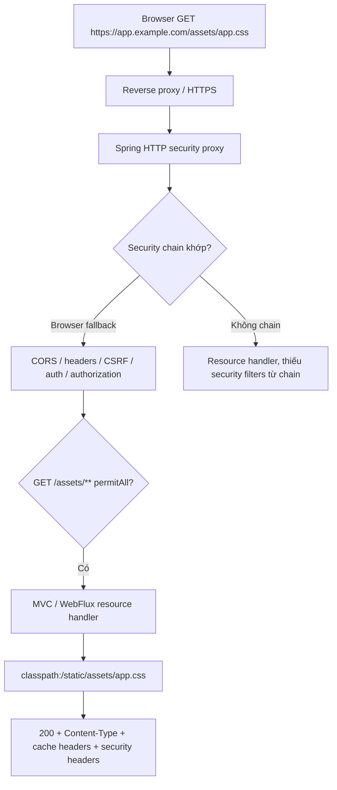
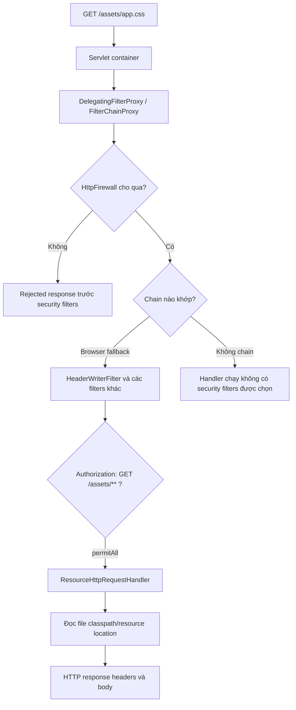
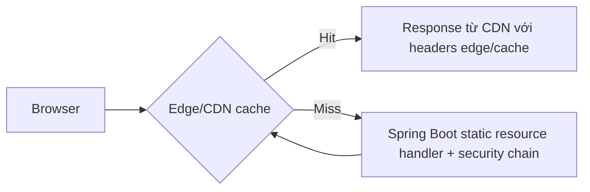

# Đường dẫn tài nguyên tĩnh và các lớp bảo vệ vẫn cần áp dụng

> **Chương:** Kiến trúc áp dụng  
> **Module:** `SPRING_SECURITY_HTTP_PROTECTION` — áp dụng các lớp phòng vệ HTTP và trình duyệt trong Spring Security: CSRF, CORS, security headers, CSP, HSTS, HTTP firewall, session; cấu hình Servlet và Reactive WebFlux, kiểm thử hành vi tấn công web và chẩn đoán xung đột triển khai.  
> **Tình huống:** Người dùng chưa đăng nhập vẫn cần tải CSS, JavaScript, font, ảnh và trang login. Cần cho phép anonymous ở lớp authorization, nhưng không được vô tình xóa các lớp bảo vệ HTTP hay làm sai chiến lược cache/CDN.

## 1. Mục tiêu học tập

Sau bài học, người học có thể:

1. Phân biệt **đường dẫn URL công khai**, **vị trí file trong classpath/file system**, **resource handler**, **security matcher** và **đường dẫn sau reverse proxy rewrite**.
2. Giải thích vì sao tài nguyên tĩnh thường được **`permitAll()` trong security chain**, thay vì dùng Servlet `web.ignoring()` hoặc để request không khớp chain.
3. Phân tích lớp nào vẫn cần hoạt động cho response static: HTTP firewall, security headers, CSP, HSTS, CORS khi cần, xác thực/CSRF theo loại request và session policy.
4. Thiết kế cache policy khác nhau cho asset đã fingerprint/version, HTML và dữ liệu người dùng; nhận biết mối liên hệ với cache header mặc định của Spring Security.
5. Xác định tác dụng của CSP trên **HTML document** khác với việc ghi CSP lên CSS/JS/JSON riêng lẻ, và xử lý `nosniff` khi MIME type không đúng.
6. Thiết kế an toàn cho ảnh, SVG, HTML hoặc file do người dùng upload; tránh biến khu vực “public static” thành đường dẫn thực thi active content hoặc rò rỉ tài liệu nội bộ.
7. Cấu hình Spring MVC/Servlet và Spring WebFlux/Reactive cho static resource handlers, security chains và cache headers.
8. Viết kiểm thử MockMvc, WebTestClient và kiểm tra HTTP end-to-end qua HTTPS/CDN để xác minh policy thật sự được áp dụng.

## 2. Một tài nguyên “tĩnh” vẫn là một HTTP response

Static resources là các nội dung thường được trả nguyên hoặc ít thay đổi qua nhiều request: `.css`, `.js`, font `.woff2`, ảnh `.png`, `favicon.ico`, source map, file downloadable hoặc HTML shell của SPA. “Tĩnh” mô tả **cách phục vụ nội dung**, không có nghĩa resource an toàn mặc định.

Ví dụ browser đang ở `https://app.example.com/login` tải:

```http
GET /assets/app.2c9a51.css HTTP/1.1
Host: app.example.com
Accept: text/css,*/*
```

Response giả định:

```http
HTTP/1.1 200 OK
Content-Type: text/css
X-Content-Type-Options: nosniff
Cache-Control: public, max-age=31536000, immutable
Strict-Transport-Security: max-age=31536000

:root { color-scheme: light; }
```

Request này không cần session để xác định user, nhưng vẫn có những câu hỏi bảo mật:

- URL có khớp đúng **vùng static**, hay pattern quá rộng bắt nhầm `/admin/**`?
- Resource handler có thể đọc nhầm file ngoài thư mục được phép không?
- Browser có nhận MIME type chính xác, `nosniff`, CSP của document và TLS/HSTS phù hợp không?
- Asset có thực sự **bất biến** để được cache dài hạn không?
- Reverse proxy/CDN có thay header hoặc cache nội dung riêng tư không?
- Resource có chứa script độc hại, credential, bản build debug hay source map nhạy cảm không?

**Kết luận:** Cho phép anonymous đọc CSS/JS là yêu cầu về **authorization**, không phải lý do bỏ toàn bộ HTTP security pipeline.

## 3. Ba lớp đường dẫn phải được xác định trước khi cấu hình

Trong Spring Boot, không thể suy security policy chỉ từ thư mục `static` trên máy. Cần phân biệt rõ ba lớp sau.

| Lớp | Ví dụ | Chủ thể quyết định |
|---|---|---|
| **URL browser gọi** | `/assets/app.2c9a51.css` | HTML/CSS/JS, CDN URL, gateway prefix |
| **Resource handler mapping** | `/assets/**` → `classpath:/static/assets/` | Spring MVC `ResourceHttpRequestHandler` hoặc WebFlux resource handler |
| **Security chain và matcher** | `securityMatcher("/api/**")`, browser fallback, `requestMatchers("/assets/**").permitAll()` | `FilterChainProxy` / `WebFilterChainProxy` và authorization policy |

Ví dụ đường đi:



Đường dẫn resource handler xác định **file nào được phục vụ**; matcher trong security chain xác định **request có đi qua các security filters hay không**. Việc handler tìm được file không chứng minh authentication/authorization đã được thực thi.

### 3.1. Những vị trí static thường gặp trong Spring Boot

Trong cấu hình mặc định thường gặp của Spring Boot, ứng dụng có thể phục vụ tài nguyên tĩnh từ các vị trí classpath như:

```text
classpath:/static/
classpath:/public/
classpath:/resources/
classpath:/META-INF/resources/
```

Ví dụ:

```text
src/main/resources/static/
    index.html
    favicon.ico
    assets/
        app.2c9a51.css
        app.64b32f.js
        logo.svg
```

Khi static path mapping mặc định là `/**`, một file `classpath:/static/assets/app.2c9a51.css` có thể được truy cập qua `GET /assets/app.2c9a51.css`. URL **không chứa** `/static/` chỉ vì file nằm trong thư mục `static`.

Tuy nhiên mapping thực phụ thuộc cấu hình Boot/Spring, ví dụ `spring.mvc.static-path-pattern`, `spring.webflux.static-path-pattern`, `spring.web.resources.static-locations`, các resource handlers do ứng dụng tự thêm và version framework.

**Không dùng các đường dẫn classpath ở trên như một bảo đảm mọi ứng dụng đều đang expose chúng**. Khi đánh giá security, phải quan sát URL HTTP thực và resource handler đang được đăng ký.

### 3.2. Resource handler không đồng nghĩa public authorization

Có thể cấu hình handler `/assets/**` cho phép server tìm CSS/JS, nhưng Spring Security vẫn có thể chặn anonymous trước handler. Ngược lại, có thể `permitAll("/assets/**")` ở authorization nhưng handler không tìm thấy file và trả 404.

Do đó:

- **403/302/401** có thể đến từ security filters trước handler.
- **404** có thể đến từ resource handler, dù authorization đã cho qua.
- **200** có thể đến từ resource handler đi qua chain, hoặc từ tài nguyên ngoài chain.
- **Header security xuất hiện** có thể đến từ chain **hoặc** proxy/CDN, không đủ chứng minh chain nào được chọn.

Muốn chẩn đoán chính xác, kiểm cả security chain, handler mapping và response cuối.

## 4. Servlet: đường đi tới static resource qua `FilterChainProxy`

Trong Spring MVC trên Servlet stack, `DelegatingFilterProxy` thường kết nối Servlet filter chain với bean `FilterChainProxy` của Spring Security. Proxy chọn `SecurityFilterChain` khớp đầu tiên.



Điểm cần hiểu:

- `HttpSecurity.securityMatcher(...)` xác định phạm vi một chain; một chain chỉ khớp `/api/**` **không bảo vệ** `/assets/**`.
- `authorizeHttpRequests(...requestMatchers("/assets/**").permitAll())` chỉ được xét **sau khi request đã được chọn vào chain**.
- `HeaderWriterFilter` trong chain có thể thêm security headers vào response static hoặc response bị từ chối sớm.
- `CsrfFilter` mặc định thường không đòi token đối với GET/HEAD; **điều đó không phải lý do bỏ filter** cho static requests.
- `StrictHttpFirewall` có thể từ chối những URL bất thường trước khi handler tìm file. Không nên nới firewall chỉ để xử lý path encode lạ.

### 4.1. Không nên đặt quy tắc static ở chain sai

Ví dụ sai ý nghĩa:

```java
@Bean
@Order(1)
SecurityFilterChain apiOnly(HttpSecurity http) throws Exception {
    return http
        .securityMatcher("/api/**")
        .authorizeHttpRequests(auth -> auth
            .requestMatchers("/assets/**").permitAll()
            .anyRequest().authenticated())
        .build();
}
```

Rule `/assets/**` **không bao giờ giúp public asset** trong chain chỉ match `/api/**`. Nếu không có browser/fallback chain, request asset có thể nằm ngoài Spring Security HTTP protection. Nếu có fallback đòi authentication, asset có thể bị 302/401.

Cách đúng là xác định **chain nào thực sự nhận `/assets/**`**, rồi viết authorization rule trong chain đó.

### 4.2. Spring Boot matcher tiện dụng không thay khảo sát URL

Một số nhánh Spring Boot có tiện ích Servlet `PathRequest.toStaticResources().atCommonLocations()` để nhận diện các vị trí static phổ biến. Đây là công cụ **theo convention**, có thể không bao quát thư mục custom `/assets/**`, management paths hoặc resource mapping mới.

Ví dụ ở môi trường Servlet khi API hỗ trợ:

```java
import org.springframework.boot.autoconfigure.security.servlet.PathRequest;

// Bên trong authorizeHttpRequests của chain phù hợp:
.requestMatchers(PathRequest.toStaticResources().atCommonLocations())
    .permitAll()
```

Không chép matcher Servlet này vào cấu hình WebFlux; không mặc định nó tự bao phủ mọi static path custom. Với vùng URL rõ ràng, `requestMatchers(HttpMethod.GET, "/assets/**")` và kiểm thử mapping thực có thể dễ kiểm soát hơn.

## 5. `permitAll()` và `web.ignoring()`: khác biệt đặc biệt quan trọng cho asset

| Cách thiết kế | Anonymous có thể tải asset? | Security filters của chain chạy? | Ảnh hưởng đáng chú ý |
|---|---|---|---|
| `/assets/**` được `permitAll()` trong chain đã match | Có, nếu handler tồn tại và filter khác không chặn | **Có** | Header writer, CORS/CSRF policy, firewall và các filter khác còn cơ hội xử lý |
| Servlet `web.ignoring().requestMatchers("/assets/**")` | Có thể | **Không** chạy các security filters của chain cho matcher ignore | Mất header writer của chain; các lớp ở proxy/container/gateway có thể vẫn tồn tại |
| Không có `SecurityFilterChain` nào match asset | Có thể | **Không** có security chain để áp dụng | Khoảng trống authentication/headers/CSRF nếu không có lớp khác |
| Asset được CDN trả trực tiếp, request không tới app | Có thể | Không có Spring Security application chain | Cần policy headers/cache/TLS tại CDN, không tại backend |

**Khuyến nghị thực hành:** Khi asset được phục vụ **bởi ứng dụng Spring**, dùng `permitAll()` trong một security chain phù hợp, trừ khi có lý do đã được đánh giá rõ cho việc không chạy security filters. Bỏ qua chain không phải là một phép tối ưu mặc định.

### 5.1. Vì sao `web.ignoring` có thể làm mất headers?

Servlet `web.ignoring()` bỏ security filters cho request đã match ignore rule. Khi đó `HeaderWriterFilter` thuộc chain không tham gia viết header `X-Content-Type-Options`, CSP, HSTS hoặc cache-control của Spring Security cho response đó.

Có hai caveat quan trọng:

1. Một reverse proxy/CDN hoặc Servlet filter khác vẫn có thể thêm các header ấy. **Header có mặt không chứng minh Spring Security đã chạy.**
2. Bỏ security filters **không nhất thiết né mọi xử lý `FilterChainProxy`/HTTP firewall**, tùy cách request được tích hợp. Không diễn giải ignoring là bypass hoàn toàn container hoặc proxy.

### 5.2. Static path có nên giới hạn HTTP method?

Thông thường CSS/JS/font/ảnh được đọc bằng GET hoặc HEAD. Nếu URL `/assets/**` vô tình trỏ tới endpoint xử lý POST/DELETE, việc `requestMatchers("/assets/**").permitAll()` cho **mọi method** có thể quá rộng.

Một thiết kế chặt hơn:

```java
.authorizeHttpRequests(auth -> auth
    .requestMatchers(HttpMethod.GET, "/assets/**").permitAll()
    .requestMatchers(HttpMethod.HEAD, "/assets/**").permitAll()
    .requestMatchers("/assets/**").denyAll()
    .anyRequest().authenticated())
```

Đây là **authorization policy**, không thay thế cấu hình resource handler. Với CORS preflight cho assets cross-origin, cần thiết kế CORS filter để xử lý OPTIONS **trước authorization** nếu chủ ý cho cross-origin GET.

### 5.3. Không ép URL công khai phải xuất hiện trên mọi response policy

Một asset public có thể không cần session nhưng vẫn cần nosniff và HSTS. Một HTML document công khai cần CSP thích hợp. Một font tải từ CDN có thể cần CORS header. Những response này **không nhất thiết cùng một bộ header**, dù đều là `permitAll()`.

Chọn policy theo **loại tài nguyên + origin + cách client sử dụng**, không theo nhãn “static = một mức bảo vệ duy nhất”.

## 6. Lớp bảo vệ nào vẫn có giá trị trên response static?

| Lớp | Có cần xem xét cho static? | Ý nghĩa cụ thể |
|---|---|---|
| **HTTP firewall / URL normalization** | Có | Chặn đường dẫn encode hoặc không chuẩn hóa có thể khiến matcher và resource handler hiểu khác nhau |
| **HTTPS/TLS** | Có | Bảo vệ tính toàn vẹn và bảo mật dữ liệu trên đường truyền; đặc biệt quan trọng với JavaScript/CSS |
| **HSTS** | Có trên origin HTTPS phù hợp | Hướng browser sử dụng HTTPS cho kết nối sau; `includeSubDomains` cần đánh giá mọi subdomain |
| **`X-Content-Type-Options: nosniff`** | Có | Hạn chế browser sniff sai MIME type; cần server gửi Content-Type đúng |
| **CSP** | Đặc biệt cho HTML document | Hạn chế nguồn script/style/font/iframe và active content theo policy của document |
| **Frame protection** | Đặc biệt cho document | `frame-ancestors`/frame headers giúp hạn chế nhúng trang trái phép |
| **CORS** | Khi resource được tải cross-origin theo cơ chế cần CORS | Origin/method/header allowlist; font và module scripts có tình huống riêng |
| **CSRF** | Theo method và credential | GET static bình thường không đổi trạng thái; endpoint POST trong cùng namespace cần kiểm phù hợp |
| **Authentication/authorization** | Có thể cần đối với tài nguyên riêng tư | Không phải mọi file “static” là public; tài liệu riêng tư, avatar nhạy cảm cần quyền |
| **Caching** | Rất quan trọng | Asset fingerprint có thể cache dài; HTML/user-specific content cần chính sách khác |
| **Session/cookie scope** | Cần đánh giá | Public asset không cần tạo session; cookie cùng origin có thể vẫn được gửi kèm |
| **Observability và rate limiting** | Theo hạ tầng | Phát hiện truy cập bất thường mà không ghi credential nhạy cảm |
| **Content-Disposition** | Với file download không tin cậy | Giúp browser download thay vì render active HTML/SVG khi phù hợp |
| **Resource isolation** | Với user-uploaded files | Tránh active content cùng origin với ứng dụng và tránh truy cập file ngoài vùng cho phép |

Một security chain có `permitAll()` **không tự bật mọi lớp trên**. Nó chỉ giữ những filter đã được cấu hình hoạt động. Ví dụ CSP phải được thiết kế chủ động; CORS cần policy source tương ứng; tài nguyên upload cần xử lý ngoài Spring Security HTTP matcher.

## 7. CSP cho trang HTML và asset: tránh hiểu lầm phạm vi

CSP thường được trả ở **HTML document** đang được browser render, ví dụ:

```http
Content-Security-Policy: default-src 'self'; script-src 'self'; style-src 'self'; img-src 'self' data:; object-src 'none'; base-uri 'self'; frame-ancestors 'none'
```

Khi document `/login` chứa:

```html
<link rel="stylesheet" href="/assets/app.2c9a51.css">
<script defer src="/assets/app.64b32f.js"></script>
```

browser dùng CSP của **document `/login`** để đánh giá việc tải và thực thi những asset đó. Việc asset CSS/JS có CSP header riêng **không đồng nghĩa** header ấy điều khiển CSP của document đang nhúng nó.

Ngược lại, nếu `GET /login` bị bỏ ngoài chain và không có CSP được edge thêm, document có thể thiếu policy trình duyệt dù các CSS/JS đều trả 200.

### 7.1. Chọn directive hợp với frontend thực

Một ví dụ baseline:

```text
default-src 'self';
script-src 'self';
style-src 'self';
img-src 'self' data:;
font-src 'self';
connect-src 'self';
object-src 'none';
base-uri 'self';
frame-ancestors 'none'
```

Các directive này mang tính minh họa, có thể **chặn inline scripts/styles** hoặc CDN/font/API khác origin. Trước khi enforce:

1. Liệt kê script/style/font/image/worker/API/WebSocket origins mà ứng dụng thật cần.
2. Tạo policy thích hợp; ưu tiên nonce/hash cho script hợp lệ thay vì nới `unsafe-inline` quá rộng.
3. Dùng `Content-Security-Policy-Report-Only` để quan sát vi phạm khi cần.
4. Kiểm console/network của trang login, SPA shell và error page.
5. Giữ header và HTML được sinh nhất quán; nonce cho script phải khớp nonce trong response header.

**Không dùng CSP để thay thế kiểm soát quyền truy cập file.** Nếu source map hoặc file secret bị expose công khai, CSP của một trang khác không làm file đó trở nên bí mật.

### 7.2. Subresource Integrity (SRI) là lớp khác CSP

Khi tải JavaScript/CSS từ CDN ngoài origin, có thể dùng integrity hash:

```html
<script
  src="https://cdn.example.com/lib-v1.min.js"
  integrity="sha384-GIA_TRI_HASH_CAN_DUOC_TINH_THAT"
  crossorigin="anonymous"></script>
```

Đây là **mẫu cấu trúc**: hash placeholder không hợp lệ để triển khai. Giá trị integrity cần được tính từ đúng nội dung file được phép và cập nhật khi file thay đổi.

SRI giúp browser kiểm nội dung subresource đã tải có khớp hash mong đợi; CSP hạn chế nguồn được phép tải; HTTPS bảo vệ đường truyền. Ba lớp bổ sung nhau, không thay thế authentication/authorization hoặc build pipeline integrity.

### 7.3. Security header còn cần trên trang lỗi

Trang `/error` hoặc HTML `404` có thể được browser render như document. Nếu nó đi qua browser security chain, security headers có thể được ghi trên cả response lỗi. Nếu lỗi được gateway/CDN tạo trước backend, Spring Security của app không thể đặt header vào response ấy.

Khi deploy SPA có fallback `index.html`, phải kiểm CSP/cache policy của **HTML shell** được phục vụ cho deep links như `/dashboard/settings`. Một URL fallback trả HTML có thể không nằm trong pattern `/assets/**`, nên chỉ “permit assets” chưa đủ.

## 8. HSTS, `nosniff` và MIME type: cấu hình đúng từng mục đích

### 8.1. HSTS chỉ có tác dụng trên HTTPS hợp lệ

Header:

```http
Strict-Transport-Security: max-age=31536000
```

Browser chỉ ghi nhận HSTS từ HTTPS hợp lệ, áp cho origin/host theo semantics HSTS. Nếu TLS kết thúc ở reverse proxy và backend nhận HTTP, Spring Security header writer có thể không nhận ra request an toàn theo điều kiện mặc định.

Giải pháp cần dựa trên topology:

- Quản lý HSTS tại edge TLS termination, hoặc
- Truyền scheme qua forwarded headers **chỉ từ proxy tin cậy**, để backend xác định đúng request HTTPS.

Đừng đặt `includeSubDomains` tùy tiện nếu có subdomain cũ chỉ dùng HTTP; chính sách đó có thể khiến browser từ chối truy cập các hệ thống chưa hỗ trợ HTTPS.

### 8.2. `nosniff` yêu cầu `Content-Type` chính xác

Với asset CSS:

```http
Content-Type: text/css
X-Content-Type-Options: nosniff
```

Với JavaScript, Content-Type phải thuộc MIME type JavaScript được browser hỗ trợ. Nếu CDN trả CSS thành `text/plain` hay JavaScript thành `application/octet-stream`, browser có thể từ chối sử dụng khi `nosniff` bật. **Không tắt `nosniff` để “chữa lỗi asset không tải”**; sửa MIME mapping của server/CDN.

Kiểm bằng DevTools Network:

- Response status và Content-Type.
- `X-Content-Type-Options`.
- URL có trả HTML error page thay vì CSS/JS không.
- CDN có định cấu hình `Content-Type` theo extension/nội dung chính xác không.

Một route SPA fallback sai có thể trả `index.html` (HTML) cho `/assets/app.js` không tồn tại; browser chặn script do MIME type. Đó là tín hiệu cần sửa URL/resource fallback, không phải loại security headers.

## 9. CORS cho tài nguyên tĩnh: chỉ cấu hình khi thực sự cross-origin

Nhiều static assets được tải **cùng origin** với HTML, không cần policy CORS riêng. Nhưng một số tình huống cần CORS:

- Font được tải từ `https://static.example.com` vào CSS của `https://app.example.com`.
- JavaScript ES modules tải cross-origin.
- JavaScript `fetch()` lấy JSON/icon/font từ host riêng.
- Website dùng `crossorigin` và SRI đối với CDN resource.
- Ảnh được sử dụng với canvas và client cần đọc pixel dữ liệu.

Một request ví dụ:

```http
GET /fonts/app.woff2 HTTP/1.1
Host: static.example.com
Origin: https://app.example.com
```

CORS response:

```http
Access-Control-Allow-Origin: https://app.example.com
Vary: Origin
```

Chính sách khác origin nên dựa trên allowlist thực; **không cần bật `allowCredentials(true)` cho public fonts/assets nếu client không cần cookie/credential**, và nên tránh gửi cookie tới static domain. Nếu static host phục vụ nội dung public cho mọi origin và không dùng credentials, wildcard có thể phù hợp theo threat model, nhưng phải kiểm mục tiêu cache, browser và data exposure.

### 9.1. CORS không phải bảo vệ bí mật của static file

Một URL public có thể bị truy cập bằng client ngoài browser dù CORS từ chối JavaScript đọc response trong trình duyệt. **CORS không phải authentication**. Nếu file chỉ dành cho user đăng nhập, phải xác minh quyền ở server, dùng signed URL ngắn hạn hoặc thiết kế phân phối tài nguyên riêng tư phù hợp.

### 9.2. Không bỏ qua preflight để “sửa lỗi CORS”

Browser có thể gửi OPTIONS preflight khi dùng custom headers/methods:

```http
OPTIONS /assets/data.json HTTP/1.1
Origin: https://app.example.com
Access-Control-Request-Method: GET
Access-Control-Request-Headers: x-client-version
```

Nếu tài nguyên được phục vụ bởi Spring Security, preflight nên đi qua chain có CORS filter/source phù hợp. Loại trừ `OPTIONS /assets/**` khỏi security chain có thể khiến chính CORS filter không xử lý request nữa.

Thông thường cross-origin GET font không cần preflight, nhưng vẫn cần response CORS hợp lệ. Cần kiểm cả response GET thật và preflight khi client/browser tạo ra nó.

### 9.3. CORS, CORP và COEP không đồng nghĩa

Các cơ chế như `Cross-Origin-Resource-Policy` (CORP), `Cross-Origin-Embedder-Policy` (COEP) và `Cross-Origin-Opener-Policy` (COOP) giải quyết những vấn đề isolation khác với CORS. Khi bật chính sách cách ly cross-origin, một asset CDN có thể bị chặn **dù URL tải được bằng curl**.

Hãy xác định rõ nhu cầu (ví dụ một ứng dụng muốn cross-origin isolation) rồi cấu hình đồng bộ document headers và resource responses. Đừng thêm các header này hàng loạt nếu chưa biết chúng ảnh hưởng thế nào đến image/font/script/CORS của frontend.

## 10. Cache policy: static fingerprint không giống HTML riêng tư

Một asset có tên gắn content hash:

```text
/assets/app.2c9a51.css
/assets/app.64b32f.js
```

thường an toàn để cache dài hạn **nếu tên file thay đổi khi nội dung thay đổi**. Response có thể dùng:

```http
Cache-Control: public, max-age=31536000, immutable
```

Ngược lại, HTML shell `/index.html` hoặc `/login` có thể thay đổi nội dung hoặc tham chiếu asset mới. Nếu cache HTML quá lâu, client có thể tiếp tục tham chiếu JS cũ đã bị xóa. Tài liệu riêng tư và HTML chứa dữ liệu user cần chính sách cache hạn chế hơn, ví dụ `no-store` khi phù hợp.

| Loại tài nguyên | Chiến lược cache điển hình | Điều cần tránh |
|---|---|---|
| CSS/JS có content hash | Public, max-age dài, immutable | Không đổi tên khi nội dung thay đổi |
| Font/ảnh phiên bản cố định | Cache dài nếu immutable và public | CDN phục vụ bản đã thay mà giữ cùng URL |
| `index.html` / SPA shell | Revalidate thường xuyên hoặc max-age ngắn | Cache HTML lâu khiến trỏ tới asset đã deploy cũ |
| Trang login có token CSRF | Thường không cache public | Cache nhầm token/session-specific HTML |
| Trang tài khoản/dữ liệu user | Private/no-store theo độ nhạy | CDN lưu nội dung riêng tư và phân phối chéo user |
| Download user-specific | Kiểm quyền, cache hạn chế, signed URLs khi phù hợp | Dùng URL public đoán được hoặc shared cache chứa tài liệu riêng |
| Source map build production | Chủ động quyết định có publish không | Expose nội bộ, secrets hoặc source không muốn công khai |

### 10.1. Spring Security cache header mặc định có thể ảnh hưởng static

Spring Security có thể thêm các cache-control headers giúp tránh cache nội dung nhạy cảm. Với static assets, nếu muốn cache dài hạn, cần thiết kế **resource handler hoặc proxy/CDN** để trả chính sách phù hợp và kiểm response cuối.

Một số cache-control writers của Spring Security thường tránh ghi đè khi response đã có cache headers, nhưng không nên phụ thuộc máy móc vào giả định này trên mọi phiên bản/chain/proxy. Kiểm bản Spring Security đang chạy và response thực tế.

Không tắt cache-control header writer **cho toàn bộ ứng dụng** chỉ để CSS được cache, vì hành động đó có thể làm trang riêng tư bị cache sai. Hãy tách policy theo resource path hoặc quản lý tại tầng phục vụ static với test chống rò rỉ.

### 10.2. CDN có thể trả asset trước khi request tới Spring Security



Khi cache hit, Spring Security **không chạy cho request đó**. Đây không nhất thiết là lỗi nếu CDN đã phục vụ đúng nội dung public và áp TLS/header policies phù hợp. Nhưng nếu CDN cache nhầm response riêng tư hoặc loại security headers cần thiết, backend config không cứu được response cache hit.

Cần phân biệt **hành vi ở origin** và **hành vi ở edge** trong kiểm thử. CDN key cần xét path, version, Vary và các yếu tố liên quan; tránh cache dữ liệu phụ thuộc Cookie/Authorization trừ khi có thiết kế rất cụ thể.

## 11. Spring MVC: cấu hình resource handler tường minh

Nếu ứng dụng sở hữu thư mục `src/main/resources/static/assets/`, có thể cấu hình handler mapping và cache:

```java
package example.web;

import java.time.Duration;
import org.springframework.context.annotation.Configuration;
import org.springframework.http.CacheControl;
import org.springframework.web.servlet.config.annotation.ResourceHandlerRegistry;
import org.springframework.web.servlet.config.annotation.WebMvcConfigurer;

@Configuration
public class ServletStaticResourceConfig implements WebMvcConfigurer {

    @Override
    public void addResourceHandlers(ResourceHandlerRegistry registry) {
        registry.addResourceHandler("/assets/**")
            .addResourceLocations("classpath:/static/assets/")
            // Chỉ dùng cache dài khi file thực sự có tên
            // fingerprint/hash và bất biến theo URL.
            .setCacheControl(CacheControl.maxAge(Duration.ofDays(365))
                .cachePublic()
                .immutable());
    }
}
```

**Lưu ý về cache:** Ví dụ áp chính sách cache dài cho **toàn bộ `/assets/**`**; chỉ dùng nếu quy trình build bảo đảm file trong vùng này đều versioned/immutable. Nếu có `/assets/runtime-config.json` thay đổi mà giữ nguyên tên, nó **không được** cache 365 ngày. Tách nhóm URL/cache policy hoặc dùng thời hạn ngắn hơn cho file không fingerprint.

### 11.1. Nhớ rằng handler và security chain là hai nơi khác nhau

`addResourceHandlers("/assets/**")` làm cho MVC biết phục vụ file từ `classpath:/static/assets/`. Nó **không** tự thêm rule `permitAll` trong Spring Security. Cần khai báo cả hai bên theo thiết kế.

Một resource handler có thể trả 404 nếu file không tồn tại; điều đó khác 401/302 do Spring Security từ chối trước khi handler chạy.

### 11.2. Đừng để asset path trùng đường dẫn nghiệp vụ

Tránh đặt handler static quá rộng hoặc dùng `/**` mà không hiểu thứ tự handler mappings, SPA fallback và các controller khác. Một fallback trả `index.html` cho mọi URL có thể che 404 tài nguyên static, khiến browser thấy HTML ở URL `*.js`.

Có thể tách:

```text
/assets/**          CSS, JS, fonts, images do build tạo
/index.html         SPA shell
/api/**             API nghiệp vụ
/uploads/**         Nội dung user-uploaded (policy riêng)
```

Đây là sơ đồ tham khảo, không phải bắt buộc. Điều quan trọng là nhóm **nguồn tin cậy, policy cache, authorization và content type** phải được nhận diện nhất quán.

## 12. Spring MVC: cấu hình security chain cho asset công khai

Ví dụ ứng dụng vừa có API chỉ nhận Bearer JWT dưới `/api/**`, vừa có browser pages và static resources ở các URL còn lại.

```java
package example.security;

import org.springframework.context.annotation.Bean;
import org.springframework.context.annotation.Configuration;
import org.springframework.core.annotation.Order;
import org.springframework.http.HttpMethod;
import org.springframework.security.config.Customizer;
import org.springframework.security.config.annotation.web.builders.HttpSecurity;
import org.springframework.security.config.annotation.web.configuration.EnableWebSecurity;
import org.springframework.security.config.annotation.web.configurers.AbstractHttpConfigurer;
import org.springframework.security.config.http.SessionCreationPolicy;
import org.springframework.security.web.SecurityFilterChain;

@Configuration
@EnableWebSecurity
public class ServletStaticSecurityConfig {

    @Bean
    @Order(1)
    SecurityFilterChain api(HttpSecurity http) throws Exception {
        return http
            .securityMatcher("/api/**")
            .csrf(AbstractHttpConfigurer::disable)
            .sessionManagement(session -> session
                .sessionCreationPolicy(SessionCreationPolicy.STATELESS))
            .authorizeHttpRequests(auth -> auth
                .requestMatchers(HttpMethod.GET, "/api/public/**")
                    .permitAll()
                .anyRequest().authenticated())
            .oauth2ResourceServer(oauth2 -> oauth2
                .jwt(Customizer.withDefaults()))
            .build();
    }

    @Bean
    @Order(2)
    SecurityFilterChain browser(HttpSecurity http) throws Exception {
        return http
            // Không securityMatcher: fallback.
            .authorizeHttpRequests(auth -> auth
                .requestMatchers(HttpMethod.GET,
                    "/assets/**", "/webjars/**",
                    "/favicon.ico", "/robots.txt").permitAll()
                .requestMatchers(HttpMethod.HEAD,
                    "/assets/**", "/webjars/**",
                    "/favicon.ico", "/robots.txt").permitAll()
                .requestMatchers(
                    "/assets/**", "/webjars/**").denyAll()
                .requestMatchers(
                    "/login", "/index.html").permitAll()
                .requestMatchers("/admin/**").hasRole("ADMIN")
                .anyRequest().authenticated())
            .formLogin(Customizer.withDefaults())
            .csrf(Customizer.withDefaults())
            .headers(headers -> headers
                .contentSecurityPolicy(csp -> csp.policyDirectives(
                    "default-src 'self'; script-src 'self'; " +
                    "style-src 'self'; img-src 'self' data:; " +
                    "object-src 'none'; base-uri 'self'; " +
                    "frame-ancestors 'none'")))
            .build();
    }
}
```

**Ý nghĩa quan trọng:**

- API chain đứng trước, chỉ xử lý `/api/**`. Việc tắt CSRF ở đây chỉ hợp lý khi API **không** sử dụng credential được browser tự gửi; cần JWT decoder/dependency hợp lệ.
- Browser chain làm fallback, chứa security header writers và CSRF cho form/session.
- Anonymous GET/HEAD tới static resources được authorization cho qua, nhưng filter chain **vẫn chạy**.
- Những method khác ở `/assets/**` hoặc `/webjars/**` bị deny tại authorization; filter CSRF có thể từ chối unsafe method **trước** authorization, nên status 403 không tự chứng minh rule `denyAll` đã được xét.
- `/login` và `/index.html` công khai để trang login/SPA shell nhận CSP phù hợp.
- Nếu ứng dụng có favicon ngoài `/favicon.ico` hoặc static assets dưới prefix khác, phải cập nhật matcher và kiểm URL thực; không giả định `/assets/**` bao phủ mọi file.

**Điều kiện chạy:** Cần dependencies Spring Security, OAuth2 Resource Server/JWT, JWT decoder, user store, handlers và static files thực tế. Đây là mẫu kiến trúc; Spring Security version có thể thay đổi API DSL/default headers.

### 12.1. Vì sao không dùng `web.ignoring()` cho CSS?

Nếu cấu hình:

```java
@Bean
WebSecurityCustomizer ignoreStatic() {
    return web -> web.ignoring()
        .requestMatchers("/assets/**", "/webjars/**");
}
```

thì các security filters trong chain sẽ không chạy cho nhóm resource đó. Nếu muốn CSP/HSTS/nosniff/cache policy từ Spring Security, hành vi này khác hoàn toàn `permitAll()`. Nó có thể vẫn nhận headers do CDN/proxy/Servlet filter khác thêm, nhưng không nên dựa vào điều đó khi chưa khảo sát.

**Không dùng đồng thời ignore và `permitAll` cho cùng URL rồi kỳ vọng `permitAll` khôi phục filter coverage**: request ignore đã bị loại khỏi security filters trước authorization.

### 12.2. Khi CDN sở hữu toàn bộ static assets

Nếu CSS/JS đến từ `https://static.example.com/assets/...` do CDN phục vụ trực tiếp, request đó **không đi tới Servlet filter chain của app.example.com**. Khi đó security policies ở CDN, TLS, response header và cache key mới là phạm vi cần kiểm. Không cần thêm `web.ignoring` trong backend cho URL mà backend không bao giờ nhận.

Ngược lại, khi CDN cache miss đến backend, response origin cũng phải đúng Content-Type, CORS, cache-control và security headers theo vai trò của origin.

## 13. WebFlux: ResourceHandler và SecurityWebFilterChain

WebFlux không dùng Servlet `HttpSecurity` hoặc `SecurityFilterChain`. Static files được phục vụ bởi WebFlux resource handler; Spring Security áp dụng `SecurityWebFilterChain` được chọn qua `WebFilterChainProxy`.

### 13.1. Resource handler reactive

```java
package example.web;

import java.time.Duration;
import org.springframework.context.annotation.Configuration;
import org.springframework.http.CacheControl;
import org.springframework.web.reactive.config.ResourceHandlerRegistry;
import org.springframework.web.reactive.config.WebFluxConfigurer;

@Configuration
public class ReactiveStaticResourceConfig implements WebFluxConfigurer {

    @Override
    public void addResourceHandlers(ResourceHandlerRegistry registry) {
        registry.addResourceHandler("/assets/**")
            .addResourceLocations("classpath:/static/assets/")
            .setCacheControl(CacheControl.maxAge(Duration.ofDays(365))
                .cachePublic()
                .immutable());
    }
}
```

Ở đây `ResourceHandlerRegistry` thuộc **`org.springframework.web.reactive.config`**, khác class cùng tên trong Spring MVC. Handler vẫn áp thời hạn cache dài cho cả `/assets/**`; phải bảo đảm mọi asset ở prefix đó thực sự immutable.

### 13.2. Reactive security chain

```java
package example.security;

import org.springframework.context.annotation.Bean;
import org.springframework.context.annotation.Configuration;
import org.springframework.core.annotation.Order;
import org.springframework.http.HttpMethod;
import org.springframework.security.config.Customizer;
import org.springframework.security.config.annotation.web.reactive.EnableWebFluxSecurity;
import org.springframework.security.config.web.server.ServerHttpSecurity;
import org.springframework.security.web.server.SecurityWebFilterChain;
import org.springframework.security.web.server.context.NoOpServerSecurityContextRepository;
import org.springframework.security.web.server.util.matcher.ServerWebExchangeMatchers;

@Configuration
@EnableWebFluxSecurity
public class ReactiveStaticSecurityConfig {

    @Bean
    @Order(1)
    SecurityWebFilterChain api(ServerHttpSecurity http) {
        return http
            .securityMatcher(
                ServerWebExchangeMatchers.pathMatchers("/api/**"))
            .csrf(ServerHttpSecurity.CsrfSpec::disable)
            .securityContextRepository(
                NoOpServerSecurityContextRepository.getInstance())
            .authorizeExchange(auth -> auth
                .pathMatchers(HttpMethod.GET, "/api/public/**")
                    .permitAll()
                .anyExchange().authenticated())
            .oauth2ResourceServer(oauth2 -> oauth2
                .jwt(Customizer.withDefaults()))
            .build();
    }

    @Bean
    @Order(2)
    SecurityWebFilterChain browser(ServerHttpSecurity http) {
        return http
            .authorizeExchange(auth -> auth
                .pathMatchers(HttpMethod.GET,
                    "/assets/**", "/webjars/**",
                    "/favicon.ico", "/robots.txt").permitAll()
                .pathMatchers(HttpMethod.HEAD,
                    "/assets/**", "/webjars/**",
                    "/favicon.ico", "/robots.txt").permitAll()
                .pathMatchers("/assets/**", "/webjars/**").denyAll()
                .pathMatchers("/login", "/index.html").permitAll()
                .pathMatchers("/admin/**").hasRole("ADMIN")
                .anyExchange().authenticated())
            .formLogin(Customizer.withDefaults())
            .csrf(Customizer.withDefaults())
            .headers(headers -> headers
                .contentSecurityPolicy(csp -> csp.policyDirectives(
                    "default-src 'self'; script-src 'self'; " +
                    "style-src 'self'; img-src 'self' data:; " +
                    "object-src 'none'; base-uri 'self'; " +
                    "frame-ancestors 'none'")))
            .build();
    }
}
```

**Các khác biệt với Servlet:**

- `ServerHttpSecurity` xây `SecurityWebFilterChain`; `ServerWebExchangeMatcher` quyết định chain theo exchange.
- `HttpHeaderWriterWebFilter` ghi headers theo reactive response lifecycle, cần hoàn tất trước HTTP commit.
- `ReactiveSecurityContextHolder` truyền authentication trong Reactor Context; không đọc `SecurityContextHolder` theo ThreadLocal như cách mặc định của Servlet.
- `NoOpServerSecurityContextRepository` trên API chain ngăn Spring Security dùng repository đó để lưu/khôi phục context qua WebSession; nó không cấm toàn bộ components khác tạo WebSession.
- WebFlux functional router và annotated controller đều nằm sau security WebFilter chain, vì vậy một route mới dưới `/assets/**` có thể gặp static policy **dù route được code như handler động**. Cần tránh URL namespace conflict.

**Cẩn trọng:** Nếu chain API khai báo `securityMatcher("/api/**")` nhưng không có browser fallback, `/assets/**` không nhận security WebFilters từ API chain. `anyExchange().permitAll()` nằm trong **API chain** không thể mở phạm vi cho `/assets/**`.

## 14. CORS cho static host riêng: mẫu cấu hình có giới hạn

Nếu app cần đọc font từ một static server Spring WebFlux khác origin, có thể cung cấp CORS source chỉ cho vùng font.

Ví dụ cấu hình Spring WebFlux khi chính WebFlux phục vụ font:

```java
@Bean
CorsConfigurationSource fontCorsSource() {
    CorsConfiguration cors = new CorsConfiguration();
    cors.setAllowedOrigins(List.of("https://app.example.com"));
    cors.setAllowedMethods(List.of("GET", "HEAD"));
    cors.setAllowedHeaders(List.of("*"));
    cors.setAllowCredentials(false);
    cors.setMaxAge(1800L);

    UrlBasedCorsConfigurationSource source =
        new UrlBasedCorsConfigurationSource();
    source.registerCorsConfiguration("/fonts/**", cors);
    return source;
}
```

Imports:

```java
import java.util.List;
import org.springframework.context.annotation.Bean;
import org.springframework.web.cors.CorsConfiguration;
import org.springframework.web.cors.reactive.CorsConfigurationSource;
import org.springframework.web.cors.reactive.UrlBasedCorsConfigurationSource;
```

Để source thực sự có hiệu lực trong Spring Security WebFlux, phải gắn nó vào **chain đang nhận `/fonts/**`** bằng cấu hình `cors(cors -> cors.configurationSource(fontCorsSource()))`, hoặc dùng global reactive CORS filter được kiểm soát khác. Cần có fallback/chain phù hợp cho font.

**Tùy nhu cầu thực:** Public fonts thường không cần request header tùy biến. `setAllowedHeaders(List.of("*"))` trong mẫu này giúp minh họa nhưng nên giới hạn hơn nếu client xác định rõ request headers. Static host không cần cookies thì không nên bật credentials.

Servlet có cách làm tương ứng với `org.springframework.web.cors.CorsConfigurationSource` và `UrlBasedCorsConfigurationSource` **không có `.reactive` trong package**, được gắn vào `HttpSecurity.cors(...)` ở chain phù hợp.

### 14.1. Khác biệt giữa CORS và đường dẫn public

Một file public `/fonts/app.woff2` có thể được tải bằng curl từ bất kỳ origin nào. CORS điều khiển quyền của **browser JavaScript/subresource request** theo policy; nó không làm file thành private.

Nếu font chỉ dành cho khách hàng có license hoặc file tải chứa thông tin riêng, không dựa vào CORS để chặn truy cập. Phải thiết kế access control/signed URL/resource authorization tương ứng.

## 15. File upload không nên mặc nhiên nhập chung vùng static public

Một nguồn lỗi nguy hiểm là cho phép upload rồi đặt file trực tiếp vào cùng origin và cùng folder được static resource handler phục vụ:

```text
POST /upload               (người dùng tải file)
          ↓
/static/assets/user.svg     (bị xuất bản như asset tin cậy)
          ↓
GET /assets/user.svg        (browser tải từ origin ứng dụng)
```

Dù user chỉ upload ảnh, các loại file như HTML, SVG, PDF hoặc một số file active có thể có hành vi nguy hiểm tùy cách browser diễn giải, viewer và Content-Type. Nếu nội dung do attacker kiểm soát được phục vụ **cùng origin với ứng dụng đã đăng nhập**, nó có thể mở rộng rủi ro XSS/content injection.

### 15.1. Các biện pháp cần áp dụng ở lớp upload và serving

1. Tách **trusted build assets** ra khỏi **untrusted user content**; không dùng chung namespace `/assets/**`.
2. Giới hạn loại file được chấp nhận theo nhu cầu nghiệp vụ; kiểm nội dung thực, không tin riêng extension/MIME do client tự khai.
3. Đặt file trong kho lưu trữ không thể vô tình được server thực thi hoặc truy cập ngoài path cho phép.
4. Tạo tên file/path an toàn do server quản lý; chống path traversal, overwrite và collision.
5. Đặt `Content-Type` chính xác, dùng `nosniff` và cân nhắc `Content-Disposition: attachment` cho file active/không tin cậy.
6. Nếu phải hiển thị content không tin cậy, cân nhắc **origin riêng không dùng cùng cookie ứng dụng**, CSP sandbox hoặc sandbox iframe khi phù hợp.
7. Giới hạn kích thước, số lượng và tần suất upload/download; quét malware khi threat model yêu cầu.
8. Quyết định rõ authorization: public avatar khác với hóa đơn/tài liệu riêng tư. Không dùng `permitAll("/uploads/**")` nếu namespace chứa file cần quyền.

**Quan trọng:** Đặt `X-Content-Type-Options` hoặc CSP trên response không thay thế kiểm soát file type, storage isolation và authorization. Đặc biệt không thể lấy “đó là static” làm lý do public toàn bộ nội dung upload.

### 15.2. Public path có thể rò rỉ file không chủ ý

Các file cần xem xét khi build/package:

```text
/assets/app.js.map
/assets/debug.html
/assets/runtime-config.json
/assets/.env
/assets/private-key.pem
/assets/backup.zip
```

Đây là **ví dụ kiểm kê rủi ro**, không phải khẳng định Spring Boot tự expose mọi tên file trên. Rủi ro xuất hiện khi file được deploy vào thư mục static, resource handler/public server thực sự phục vụ nó.

Source map có thể lộ source code, endpoint names hoặc logic nội bộ; môi trường build tuyệt đối không được đóng gói token/secret vào frontend bundle. Các file cấu hình/backup/keys không nên tồn tại dưới web root, dù đã có `nosniff` hoặc CSP.

## 16. Kiểm thử Servlet với MockMvc

Các test dưới đây giả định dùng Servlet config ở mục 11–12 và đã có fixture:

- `src/main/resources/static/assets/app.2c9a51.css` với MIME type CSS.
- `src/main/resources/static/assets/app.64b32f.js` với MIME type JavaScript.
- `GET /login` hoặc `GET /index.html` trả HTML thành công.
- `GET /api/orders` là API private cần JWT.
- `GET /profile` là trang cần login.

Đây là **test minh họa**, không thể chạy nếu chưa tạo fixture/controller và JWT decoder bean phù hợp. Cần `spring-security-test`, MVC Test và dependencies của ứng dụng.

```java
@SpringBootTest
@AutoConfigureMockMvc
class ServletStaticProtectionTest {

    @Autowired
    MockMvc mvc;

    @Test
    void anonymousCanGetCssButStillGetsNosniff()
            throws Exception {
        mvc.perform(get("/assets/app.2c9a51.css"))
            .andExpect(status().isOk())
            .andExpect(header().string(
                "X-Content-Type-Options", "nosniff"))
            .andExpect(header().string(
                "Content-Type", "text/css"));
    }

    @Test
    void publicLoginDocumentGetsCsp() throws Exception {
        mvc.perform(get("/login"))
            .andExpect(status().isOk())
            .andExpect(header().exists(
                "Content-Security-Policy"));
    }

    @Test
    void staticResourceCanHaveExplicitCachePolicy()
            throws Exception {
        mvc.perform(get("/assets/app.2c9a51.css"))
            .andExpect(status().isOk())
            .andExpect(header().exists("Cache-Control"));
    }

    @Test
    void assetPostIsNotAFreeStateChangingOperation()
            throws Exception {
        mvc.perform(post("/assets/app.2c9a51.css")
                .with(csrf()))
            .andExpect(status().isForbidden());
    }

    @Test
    void missingStaticFileIsNotAnAuthRedirect()
            throws Exception {
        mvc.perform(get("/assets/missing.999.css"))
            .andExpect(status().isNotFound())
            .andExpect(header().string(
                "X-Content-Type-Options", "nosniff"));
    }

    @Test
    void browserPrivateStillNeedsLogin()
            throws Exception {
        mvc.perform(get("/profile"))
            .andExpect(status().is3xxRedirection());
    }

    @Test
    void apiPrivateStillNeedsBearer()
            throws Exception {
        mvc.perform(get("/api/orders"))
            .andExpect(status().isUnauthorized());
    }

    @Test
    void secureRequestCanReceiveHsts()
            throws Exception {
        mvc.perform(get("/assets/app.2c9a51.css")
                .secure(true))
            .andExpect(status().isOk())
            .andExpect(header().exists(
                "Strict-Transport-Security"));
    }
}
```

Imports mẫu:

```java
import org.junit.jupiter.api.Test;
import org.springframework.beans.factory.annotation.Autowired;
import org.springframework.boot.test.context.SpringBootTest;
import org.springframework.boot.test.autoconfigure.web.servlet.AutoConfigureMockMvc;
import org.springframework.test.web.servlet.MockMvc;

import static org.springframework.security.test.web.servlet.request.SecurityMockMvcRequestPostProcessors.*;
import static org.springframework.test.web.servlet.request.MockMvcRequestBuilders.*;
import static org.springframework.test.web.servlet.result.MockMvcResultMatchers.*;
```

**Lưu ý về test:**

- `post("/assets/...").with(csrf())` có token CSRF hợp lệ để giảm khả năng 403 chỉ do CSRF trước authorization. Mục tiêu là xác minh chính sách `denyAll` cho method không được phép. Nếu custom filters/handlers có hành vi khác, cần xem response source và log.
- Test cache hiện chỉ xác minh header **tồn tại**. Để kiểm `max-age`/`immutable` theo chính sách, assert **giá trị** cụ thể đã quan sát ở application/proxy; đừng xem việc có header là bằng chứng cache tối ưu.
- `.secure(true)` chỉ giả lập request HTTPS trong MockMvc, không chứng minh TLS/forwarded-header/HSTS hoạt động ở domain public.
- 404 static file sau khi đã `permitAll` có thể vẫn nhận security headers. Nếu resource handler fallback SPA trả HTML thay vì 404, hãy sửa route/test để tránh che lỗi asset missing.

### 16.1. Test `permitAll` so với `web.ignoring` trong context tách biệt

Trong một test application context **riêng**, nếu bật `web.ignoring("/assets/**")` và không có filter/proxy nào khác thêm nosniff:

```java
@Test
void ignoredAssetDoesNotGetSpringSecurityNosniff()
        throws Exception {
    mvc.perform(get("/assets/app.2c9a51.css"))
        .andExpect(status().isOk())
        .andExpect(header().doesNotExist("X-Content-Type-Options"));
}
```

Test này **không áp dụng cho cấu hình `permitAll` ở mục 12**; nó so hai cấu hình khác nhau. Trong triển khai thật, CDN hoặc Servlet filter toàn cục có thể tự ghi nosniff. Mục tiêu là chứng minh **Spring Security header writer không chạy trên ignored resource**, không khẳng định header luôn vắng ở mọi tầng.

### 16.2. Kiểm thử asset path không tự mở API

Bổ sung test:

```java
@Test
void nearPathDoesNotBecomeStaticPublic() throws Exception {
    mvc.perform(get("/assets2/private"))
        .andExpect(status().is3xxRedirection());
}
```

Dưới cấu hình fallback form login, `/assets2/private` không thuộc `/assets/**` nên anonymous thường bị redirect trước khi handler trả 404. Nếu hệ thống chủ ý có fallback khác, sửa assertion theo chính sách. Quan trọng là **không dùng so prefix thủ công `startsWith("/assets")`** khiến `/assets2/**` bị coi nhầm là static public.

## 17. Kiểm thử WebFlux với WebTestClient

WebFlux test cần resource handler và security chain tương ứng ở mục 13, với các file fixture tại `classpath:/static/assets/`. Sử dụng `WebTestClient` bind vào application context và áp Spring Security test support.

```java
@SpringBootTest
class ReactiveStaticProtectionTest {

    @Autowired
    ApplicationContext context;

    WebTestClient client;

    @BeforeEach
    void setup() {
        client = WebTestClient
            .bindToApplicationContext(context)
            .apply(springSecurity())
            .configureClient()
            .build();
    }

    @Test
    void publicCssIsAccessibleAndHasNosniff() {
        client.get().uri("/assets/app.2c9a51.css")
            .exchange()
            .expectStatus().isOk()
            .expectHeader().valueEquals(
                "X-Content-Type-Options", "nosniff");
    }

    @Test
    void loginDocumentHasCsp() {
        client.get().uri("/login")
            .exchange()
            .expectStatus().isOk()
            .expectHeader().exists(
                "Content-Security-Policy");
    }

    @Test
    void browserPrivateRequiresLogin() {
        client.get().uri("/profile")
            .exchange()
            .expectStatus().is3xxRedirection();
    }

    @Test
    void apiPrivateStillReturns401() {
        client.get().uri("/api/orders")
            .exchange()
            .expectStatus().isUnauthorized();
    }

    @Test
    void unexpectedStaticPrefixIsNotPublic() {
        client.get().uri("/assets2/private")
            .exchange()
            .expectStatus().is3xxRedirection();
    }

    @Test
    void staticPostIsNotPermitted() {
        client.mutateWith(csrf())
            .post().uri("/assets/app.2c9a51.css")
            .exchange()
            .expectStatus().isForbidden();
    }
}
```

Imports mẫu:

```java
import org.junit.jupiter.api.BeforeEach;
import org.junit.jupiter.api.Test;
import org.springframework.beans.factory.annotation.Autowired;
import org.springframework.boot.test.context.SpringBootTest;
import org.springframework.context.ApplicationContext;
import org.springframework.test.web.reactive.server.WebTestClient;

import static org.springframework.security.test.web.reactive.server.SecurityMockServerConfigurers.*;
```

Cần WebFlux Test, Spring Security Test, `ReactiveJwtDecoder` phù hợp và resource fixtures. Đây không phải test xác thực JWT signature; muốn kiểm JWT thật, cần integration test decoder/issuer.

### 17.1. Cẩn thận với test header trên response 404/403

Các WebFilters và exception handlers có thể tạo response trước hoặc sau một số header writers. Nếu test 404 static file thiếu header kỳ vọng, hãy xác định chain đã match và header writer đã tham gia chưa, thay vì sửa authorization chỉ để làm header xuất hiện.

Nếu một test `POST /assets/**` trả 403, cần bảo đảm nó không chỉ bị CSRF từ chối trước `denyAll`. Mẫu đã dùng `csrf()` giúp tách nguyên nhân, nhưng vẫn phải kiểm runtime nếu có filter khác chặn.

## 18. Kiểm tra end-to-end: response cuối qua CDN, gateway và HTTPS

MockMvc và WebTestClient bind-to-context không mô phỏng đầy đủ cache hit, MIME mapping của CDN, TLS termination hoặc browser CSP. Trong staging, kiểm resource thật bằng HTTP client và DevTools.

Ví dụ:

```bash
# Kiểm response GET đầy đủ mà không tải body ra console:
curl -sS -D - -o /dev/null \
  https://app.example.com/assets/app.2c9a51.css

# Kiểm HTML document phục vụ SPA/login:
curl -sS -D - -o /dev/null \
  https://app.example.com/login

# Kiểm resource không tồn tại:
curl -sS -D - -o /dev/null \
  https://app.example.com/assets/missing.css

# Kiểm font cross-origin:
curl -i 'https://static.example.com/fonts/app.woff2' \
  -H 'Origin: https://app.example.com' \
  -o /dev/null
```

Tên miền và file trong ví dụ chỉ là placeholder. Không coi lệnh là test thành công khi host/asset chưa tồn tại.

**Cẩn trọng:** `curl -I` gửi HEAD, có thể có mapping/chính sách khác GET. Khi cần kiểm security policy cho tải asset thật, dùng GET với `-D - -o /dev/null`. Với response qua CDN, ghi cache status/age để so cache hit và miss; kiểm headers từ **response cuối**.

### 18.1. Checklist browser

Trong DevTools Network của browser:

1. Chọn response **document** như `/login` hoặc `/index.html`; kiểm CSP/Referrer-Policy/frame protection.
2. Chọn response **CSS/JS**; kiểm status, Content-Type, nosniff, cache-control, ETag/version.
3. Chọn response **font**; kiểm Origin/CORS và console errors nếu cross-origin.
4. Quan sát HTTPS/HSTS tại domain công khai, không chỉ HTTP nội bộ.
5. Kiểm asset với tên phiên bản mới sau deploy và asset cũ còn tồn tại đủ lâu cho HTML/clients đã cache.
6. Thử CDN cache hit/miss và response 404/403; không mặc định proxy giữ mọi header upstream.
7. Kiểm header `Set-Cookie` không xuất hiện vô lý trên public static request nếu ứng dụng muốn giảm session/cookie usage.

### 18.2. CORS, CSP và MIME error thường dễ bị nhầm

Một asset JS không chạy có thể do:

- 404: đường dẫn build sai hoặc CDN chưa cập nhật.
- 200 nhưng body là HTML: SPA fallback định tuyến sai.
- `nosniff` từ chối: Content-Type sai.
- CSP: document không cho phép script/font source đó.
- CORS: module script/font từ origin khác không được phép.
- SRI: bytes không khớp integrity hash.
- Cache: HTML tham chiếu asset version cũ đã bị xóa.

Mỗi nguyên nhân có cách sửa riêng. **Không tắt CSP/nosniff/CORS hay bypass security chain hàng loạt** để che lỗi đường dẫn/build/deploy.

## 19. Chẩn đoán theo symptom và tầng chịu trách nhiệm

| Hiện tượng | Giả thuyết đầu tiên | Cách phân biệt |
|---|---|---|
| `GET /assets/app.css` trả 302 login | Static rule nằm trong chain sai hoặc fallback không permit | Kiểm `@Order`, `securityMatcher`, `requestMatchers` |
| Static asset 200 nhưng thiếu nosniff | `web.ignoring`/no match chain hoặc edge remove header | So response backend và edge, log filter |
| CSS bị browser từ chối vì MIME | `Content-Type` sai, body trả HTML error | Network tab, body và resource handler mapping |
| Login HTML có CSP nhưng script không chạy | CSP chặn inline/CDN source | Browser console, policy và nonce/hash |
| JS CSS trỏ tới path cũ sau deploy | HTML cache dài hoặc asset cũ bị xóa | Cache-Control/ETag và release asset strategy |
| Font cross-origin bị chặn | Static host thiếu/khác CORS policy | Origin request, allow-origin response, credentials |
| Một font request CORS 403 | Filter CORS đã chạy nhưng policy từ chối | Kiểm allowlist và selected chain |
| HSTS thiếu qua HTTPS proxy | Scheme backend/edge policy sai hoặc URL ignored | Trusted forwarded headers và response edge HTTPS |
| Public CSS tự tạo session cookie | Handler/middleware khác hoặc chain cấu hình state | Kiểm `Set-Cookie` và session creation logs |
| Source map bị tải công khai | File đã deploy trong static root | Kiểm build package, publish policy và file contents |
| `/uploads/file.svg` có thể thực thi active content | User file cùng origin/Content-Type không an toàn | Tách origin, upload scanning/serving headers |
| `/assets2/private` được permit ngoài ý muốn | Matcher prefix thủ công quá rộng | Test `/assets/**` vs `/assets2/**` |
| Path encoded bị chặn 400 trước handler | HTTP firewall/container/gateway | Raw path, normalization, logs; đừng nới firewall bừa |
| Response CDN 404 thiếu CSP | CDN tạo lỗi, backend không được gọi | Kiểm cache status và access logs |
| Static asset cache private HTML nhầm | Cache policy quá rộng/chung header | Tách static immutable vs HTML/user data |
| OPTIONS preflight 401 | CORS không xử lý trước authentication | Kiểm CORS source, chain matcher, proxy |

### 19.1. Log phục vụ điều tra

Ở môi trường dev hoặc staging có kiểm soát:

```properties
logging.level.org.springframework.security.web.FilterChainProxy=TRACE
logging.level.org.springframework.security.web.server=TRACE
logging.level.org.springframework.security=DEBUG
logging.level.org.springframework.web=INFO
```

Các logger cụ thể phụ thuộc framework version. Không bật TRACE lâu dài trong production; log không được chứa secrets, JWT, cookies hoặc token CSRF. Có thể cần log từ resource handler, gateway, CDN và HTTP server để tìm nơi request dừng hoặc header thay đổi.

**Lưu ý:** Chỉ bật các log ở mức chi tiết cao trong môi trường điều tra phù hợp, rồi giảm mức log sau khi xác định vấn đề.

### 19.2. Sáu bước tìm đúng nguyên nhân

1. Xác định URL **browser gọi** và URL **backend thực nhận**, kèm method/Origin/credentials.
2. Kiểm resource handler nào phục vụ URL, file từ classpath/file system nào, và có SPA fallback không.
3. Kiểm security proxy/chain match: `permitAll`, ignore, không match hay bị auth/CSRF/CORS chặn.
4. Kiểm Content-Type, cache headers và security headers **trước CDN**.
5. Kiểm response **sau CDN/HTTPS** và browser CSP/CORS/SRI enforcement.
6. Bổ sung một positive test và một negative test cho path/role/cache/header tương ứng, không chỉ assert HTTP 200.

## 20. Bài tập thực hành

### Bài tập A — Tìm đường dẫn static thật

Tạo các file ở `classpath:/static/assets/`, đặt resource handler `/assets/**`. Dùng MockMvc hoặc WebTestClient GET `/assets/demo.css`, kiểm `Content-Type`, nosniff và response body. Sau đó thử `/static/assets/demo.css` và giải thích vì sao URL không mặc nhiên chứa tên thư mục `static`.

### Bài tập B — So sánh `permitAll` và `web.ignoring`

Trên Servlet, chạy hai application test contexts: một cho `permitAll("/assets/**")` trong browser chain, một cho `web.ignoring("/assets/**")`. Kiểm các response headers của Spring Security, CSP trên HTML document, log invocation và hiệu quả của CDN/global filters. Nêu vì sao status 200 ở cả hai không chứng minh coverage tương đương.

### Bài tập C — Kiểm path boundary

Viết test cho:

```text
GET  /assets/app.css
HEAD /assets/app.css
POST /assets/app.css
GET  /assets2/private
GET  /api/orders
GET  /login
```

Ghi chain, authorization rule và status mong đợi. Test POST với CSRF token hợp lệ để tách `denyAll` khỏi CSRF; test GET `/assets2/private` để phát hiện prefix matcher quá rộng.

### Bài tập D — Cache asset fingerprint và HTML

Tạo `app.abc123.js` có content hash, đặt cache dài chỉ cho asset versioned. Giữ `index.html`/`login` revalidate hoặc policy cache ngắn. Mô phỏng deploy phiên bản mới, kiểm HTML mới trỏ đúng asset và không yêu cầu xóa asset cũ ngay khi clients có thể đang cache HTML trước đó.

### Bài tập E — Font CDN và CORS

Đặt `/fonts/app.woff2` trên static host riêng, tải từ app origin. Kiểm request có Origin, response allow-origin và `Vary` thích hợp. Không bật credentials nếu không cần. Nếu bật CSP `font-src 'self'` trên app document, cập nhật CSP để cho phép font CDN theo chính sách thực; giải thích CORS và CSP phải đồng bộ nhưng không thay nhau.

### Bài tập F — MIME và `nosniff`

Cố ý cấu hình server trả `text/html` cho một URL `*.js` không tồn tại để tái hiện lỗi SPA fallback. Quan sát browser chặn script hoặc báo MIME error. Sửa routing/file URL và Content-Type đúng, **không** tắt `nosniff`.

### Bài tập G — Upload file không tin cậy

Thiết kế hai namespace:

```text
/assets/**    → build assets đáng tin cậy, public, cache theo fingerprint
/uploads/**   → file user-uploaded, content type + quyền + storage riêng
```

Viết checklist phòng path traversal, XSS từ HTML/SVG, content sniffing, file size, virus scan nếu cần, signed download và cookie-less separate origin. Giải thích vì sao không gộp tất cả dưới `permitAll("/assets/**")`.

### Bài tập H — Kiểm CDN cache hit/miss

Trong staging, kiểm một asset khi cache miss và khi cache hit. So Content-Type, Cache-Control, nosniff, HSTS, CORS nếu liên quan và CSP trên HTML document. Xác định lớp nào là “owner” của mỗi header, và bằng chứng nào cho thấy Spring Security không chạy khi CDN tự phục vụ response.

## 21. Câu hỏi tự kiểm

**1. Thư mục `src/main/resources/static/assets/` có buộc URL phải bắt đầu `/static/assets/` không?**  
Không. URL do resource handler/static path pattern quyết định; thông thường file dưới `static/assets` được truy cập qua `/assets/...`.

**2. `permitAll("/assets/**")` có vô hiệu hóa security headers không?**  
Không. Nó cho phép tại authorization; header writer của chain vẫn có thể chạy.

**3. Vì sao `web.ignoring("/assets/**")` khác `permitAll`?**  
Vì ignore loại request khỏi security filters của chain; không còn tự nhận CSP/HSTS/nosniff từ các writer của chain.

**4. CSP trên file CSS có quyết định script trong trang HTML được chạy không?**  
Thông thường CSP của **HTML document** quyết định các subresources của document. CSP header trên response CSS riêng không thay chính sách của document.

**5. Khi `nosniff` chặn JavaScript do MIME sai, nên làm gì?**  
Sửa Content-Type hoặc URL/resource routing để trả đúng JS, không tắt nosniff tùy tiện.

**6. Static CSS/JS có content hash nên cache giống HTML login không?**  
Không. Fingerprinted immutable asset có thể cache dài; HTML có thể cần revalidate và tài liệu riêng tư cần policy nghiêm ngặt hơn.

**7. CORS có bảo vệ quyền truy cập tài liệu private trên static CDN không?**  
Không. CORS là browser cross-origin policy; cần authentication/authorization hoặc signed URLs phù hợp cho tài liệu riêng tư.

**8. HSTS của backend có luôn xuất hiện khi TLS kết thúc ở proxy không?**  
Không. Phụ thuộc scheme được truyền tin cậy và cấu hình tại backend/edge; browser chỉ tin HSTS qua HTTPS hợp lệ.

**9. Có an toàn khi phục vụ file SVG/HTML upload cùng origin với ứng dụng đã login không?**  
Có thể không. Cần kiểm loại file, content isolation, headers, origin/cookie scope và quyền truy cập; file active không nên mặc định được public như build assets.

**10. Vì sao 404 static file vẫn có security headers?**  
Vì request có thể đã đi qua chain và được `permitAll` trước khi resource handler trả 404. Status và header không đồng nghĩa với việc file tồn tại.

## 22. Ghi nhớ kiến trúc

- **Static resource là HTTP endpoint**, không phải vùng miễn trừ toàn bộ bảo mật. Đường dẫn URL, resource handler, security matcher và CDN đều có phạm vi riêng.
- **Public cho anonymous nên ưu tiên `permitAll()` trong chain phù hợp**, thay vì `web.ignoring()` hoặc để URL ngoài chain khi vẫn cần Spring Security headers/CORS/CSRF/firewall semantics.
- **CSP ưu tiên kiểm trên HTML document; `nosniff` đòi MIME đúng; HSTS đòi HTTPS hợp lệ.** Không đồng nhất các header này hoặc xem sự hiện diện của chúng là bằng chứng authorization đúng.
- **Cache dài chỉ dành cho nội dung immutable/versioned**, không áp máy móc cho HTML có token/session, dữ liệu riêng tư hay runtime config.
- **CORS cho static cần đúng origin và loại resource**, nhất là font/module script/CDN; CORS không biến tài nguyên public thành private.
- **User-uploaded files cần tách khỏi trusted build assets** và có storage/content-type/authorization/origin policy phù hợp; không phó mặc cho `permitAll`.
- **Servlet và WebFlux có API resource handler/security chain khác nhau**, nhưng đều cần test request được chọn vào chain, headers trên response và đường đi qua gateway/CDN.
- **Đánh giá bằng HTTP thực và negative tests**: 200/404, GET/HEAD/POST, `/assets/**` vs `/assets2/**`, HTTPS, CSP/CORS/MIME, cache hit/miss và file không tin cậy.
