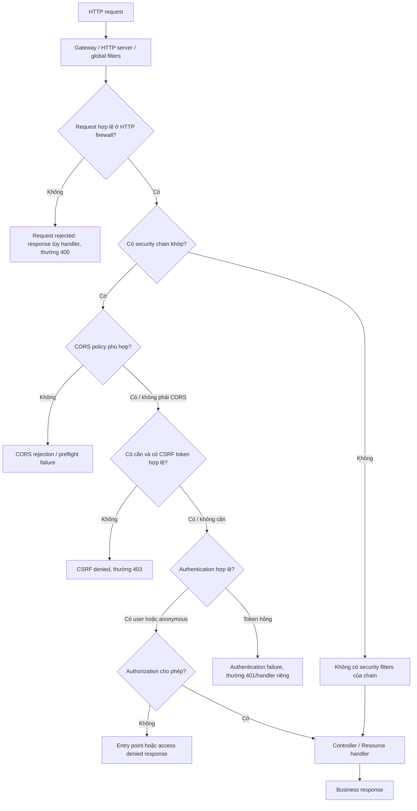
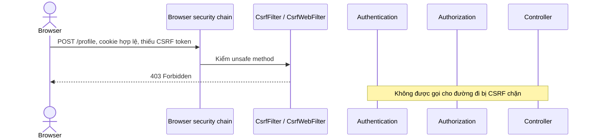

# Xử lý từ chối ở firewall, CSRF và tầng phân quyền

> **Chương:** Kiến trúc áp dụng  
> **Module:** `SPRING_SECURITY_HTTP_PROTECTION` — áp dụng phòng vệ HTTP và trình duyệt trong Spring Security từ CSRF, CORS, security headers, CSP, HSTS đến HTTP firewall và session. Bài học dùng cả Servlet/Spring MVC và Reactive WebFlux, kết hợp kiểm thử các tình huống tấn công web và chẩn đoán xung đột bảo mật khi triển khai.  
> **Vấn đề trung tâm:** Một request nhận `400`, `401`, `403` hoặc `302`. Làm sao biết nó bị từ chối bởi **HTTP firewall**, **CSRF**, **authentication**, **authorization**, **CORS**, **gateway** hay **handler**? Vì sao sửa nhầm lớp — chẳng hạn tắt CSRF để chữa lỗi matcher — có thể làm ứng dụng mất bảo vệ?

## 1. Kết quả học tập

Sau bài này, người học có thể:

1. Mô tả các điểm từ chối theo đường đi HTTP: **server/proxy/firewall → chọn security chain → CORS → CSRF → authentication → authorization → controller**; nhận ra những security filters và error handlers xen giữa.
2. Phân biệt `RequestRejectedException` do firewall Servlet, `InvalidCsrfTokenException`/`MissingCsrfTokenException` do CSRF và `AccessDeniedException`/authentication exception từ các lớp liên quan.
3. Giải thích vì sao **mã 403 không chỉ có một nguyên nhân** và vì sao anonymous thường thấy 401/302 trong khi authenticated user thiếu quyền thường thấy 403.
4. Hiểu vai trò `RequestRejectedHandler`, `AccessDeniedHandler`, `AuthenticationEntryPoint` và `ExceptionTranslationFilter` trên Servlet; xác định thành phần WebFlux tương ứng mà không áp nhầm API Servlet.
5. Viết cấu hình có API Bearer JWT và browser session/form login, với CSRF và security headers đúng phạm vi, cùng CORS preflight.
6. Dùng MockMvc/WebTestClient tạo các request có **một nguyên nhân lỗi nổi bật**, thay vì test trả 403 chung chung.
7. Xem xét HTTP firewall, URL encoding, gateway rewrite, dispatcher, session, CSP/HSTS và response đã commit khi xử lý lỗi.
8. Thiết kế quy trình chẩn đoán có chứng cứ, logging an toàn và test hồi quy cho lỗi HTTP protection.

## 2. Cần phân biệt “request bị từ chối” với “user không có quyền”

Nhìn từ client, các request dưới đây đều “không thành công”, nhưng không cùng loại:

| Tình huống | Lớp có thể kết thúc request | Lý do chính |
|---|---|---|
| Path chứa dấu/encoding mà HTTP firewall không chấp nhận | Server/proxy/HTTP firewall | Cú pháp và canonicalization của request bị coi là không an toàn |
| `OPTIONS` preflight từ origin không được phép | CORS filter | Không thỏa policy Origin/method/headers |
| `POST /profile` có cookie phiên nhưng không có CSRF token | CSRF filter | Không có bằng chứng request thay đổi trạng thái xuất phát từ giao diện tin cậy |
| `GET /api/orders` không Bearer token | Authorization/entry point cho anonymous | Chưa có authentication cần thiết |
| `GET /api/orders` mang Bearer token hỏng | Authentication filter | Credentials không hợp lệ |
| `GET /admin/reports` có user role USER | Authorization | Đã xác thực nhưng thiếu role ADMIN |
| `POST /orders` có role đúng nhưng payload không hợp lệ | Controller/validation | Request qua security nhưng vi phạm quy tắc input/nghiệp vụ |
| Endpoint không tồn tại | Dispatcher/handler mapping | Không có resource/handler tương ứng |

**Không suy diễn ngược chỉ từ HTTP status.** Firewall rejection có thể được ánh xạ thành 400, CSRF thường 403, CORS rejection thường 403; authorization cũng thường 403; controller có thể tùy ý trả 400/403. Thứ cần xác định là **tầng đã ra quyết định**.

### 2.1. Ba câu hỏi kiểm định quan trọng

Với bất kỳ response lỗi nào, trước tiên hỏi:

1. **Request đã vào security chain chưa?** Nếu bị từ chối ở proxy/HTTP firewall/container trước chain, authorization rule và CSRF filter chưa có cơ hội chạy.
2. **Nếu vào chain, filter nào dừng request trước?** Một request có thể sai CSRF **và** thiếu quyền, nhưng filter CSRF có thể trả 403 trước; chưa thể kết luận authorization đã được kiểm.
3. **Ai tạo response cuối?** RequestRejectedHandler, CSRF access-denied handler, authentication entry point, access-denied handler, gateway hay controller có thể trả cùng mã trạng thái nhưng headers/body khác.

## 3. Sơ đồ tổng thể: các điểm từ chối trước handler



Đây là **sơ đồ các quyết định chính**, không phải danh sách filter đầy đủ hoặc cam kết thứ tự tuyệt đối cho mọi phiên bản. Security header writers, security context, logout, request cache, exception translation và các custom filters nằm xen giữa. Gateway hay container có thể từ chối request **trước cả HTTP firewall của Spring Security**; filter ngoài proxy cũng có thể tạo response.

**Lưu ý về CORS:** CORS filter không đơn giản trả lỗi cho mọi request không có Origin; nó xử lý chính sách cross-origin khi có ngữ cảnh tương ứng. Preflight hợp lệ có thể được trả response ngay và không đi tiếp đến CSRF/authentication/authorization.

## 4. HTTP firewall Servlet: từ chối trước khi vào filter chain

Trên Servlet, `FilterChainProxy` phối hợp với `HttpFirewall` (thường là `StrictHttpFirewall` trong cấu hình mặc định phù hợp) để chuẩn hóa/kiểm tra request trước khi chạy security filters của chain được chọn.

HTTP firewall giúp giảm chênh lệch cách giải mã/chuẩn hóa URL giữa:

- Reverse proxy hoặc load balancer.
- Servlet container.
- `RequestMatcher` của Spring Security.
- Spring MVC handler mapping.
- Các Servlet filters và controller.

Nếu hai tầng hiểu `/api/%2e%2e/admin` hoặc semicolon khác nhau, một request có thể được authorization theo URL A nhưng được router đưa tới resource B. Firewall cố gắng chặn nhiều dạng URL không chuẩn hóa/không an toàn **trước khi matcher xử lý**.

### 4.1. Dạng request cần đặc biệt chú ý

| Dạng | Rủi ro | Cần quan sát |
|---|---|---|
| Encoded slash `%2F`, backslash `%5C` | Các tầng tách segment khác nhau | Proxy/container decode, firewall policy, router |
| Dot segments / encoded dot `%2e` | Path traversal/canonicalization | Raw URI và normalized path |
| Semicolon path parameter `;x=y` | Servlet path/matrix parameters khác biệt | Matcher và MVC handler interpretation |
| Double slash `//` hoặc dấu phân cách bất thường | Path matching không nhất quán | Gateway rewrite + firewall |
| HTTP method lạ hoặc method không hợp lệ | Vượt expectation/matcher method | HTTP parser/firewall policy |
| Header/host không hợp lệ | Request smuggling hoặc host confusion (tùy tầng) | Gateway/server validation, không chỉ firewall |
| Query string có payload độc hại | Input/business validation vẫn cần | Không suy HTTP firewall kiểm hết giá trị query |

Danh sách này là **nhóm kiểm thử**, không phải cam kết `StrictHttpFirewall` mặc định chặn mọi biến thể trong mọi version. Parser của HTTP server/gateway có thể từ chối trước hoặc biến đổi raw request; cần test tại điểm triển khai thực.

### 4.2. `RequestRejectedException` và `RequestRejectedHandler`

Trên Servlet, khi `HttpFirewall` không chấp nhận request, luồng xử lý có thể phát `RequestRejectedException`. `FilterChainProxy` sử dụng cơ chế `RequestRejectedHandler` để xử lý loại từ chối này theo cấu hình/phiên bản.

Kết quả thường gặp là **HTTP 400**, nhưng không nên coi `RequestRejectedException = luôn 400`: handler và hạ tầng có thể khác, thậm chí container đã trả response trước khi Spring Security nhìn thấy request. Một số cấu hình có thể ghi log rồi trả status, một số cơ chế khác có thể ném tiếp exception đến xử lý lỗi tổng quát.

**Quan trọng:** `ExceptionTranslationFilter` của authorization **không phải nơi xử lý chính của request đã bị firewall từ chối trước chain**. Việc thay authorization `AccessDeniedHandler` không bảo đảm đổi được firewall rejection response.

### 4.3. Không nới `StrictHttpFirewall` để che lỗi routing

Nếu một URL bị từ chối do dấu semicolon hoặc encoded slash, có ba câu hỏi trước khi sửa:

1. Client có thật sự cần URL đó không, hay đang gửi path bị encode hai lần?
2. Proxy và Servlet container có nhất quán về decoding/path normalization không?
3. Việc cho phép URL mới có thể làm security matcher và controller match khác nhau không?

**Không** giải quyết bằng cách bật đồng loạt `setAllowUrlEncodedSlash(true)`, cho mọi semicolon hay tắt firewall. Nới từng rule chỉ khi thực sự cần, có test bảo vệ cả request hợp lệ lẫn request tấn công và hiểu canonicalization end-to-end.

## 5. Firewall và vùng ngoài security chain

Một request có thể nằm trong ba trường hợp:

- Được chọn vào một `SecurityFilterChain`, đi qua firewall và các security filters tương ứng.
- Bị Servlet `web.ignoring()` nên không chạy các **security filters trong chain** cho URL đó, dù một số bước proxy/firewall và các Servlet filters ngoài chain có thể vẫn hoạt động.
- Không có chain nào khớp, nên các security filters của chain không bảo vệ request.

Đừng phát biểu “`web.ignoring()` bỏ qua mọi HTTP firewall” như một chân lý. Trong những cấu hình có `FilterChainProxy`, ignored request có thể vẫn đi qua phần xử lý của proxy với chain filters rỗng. Tuy nhiên URL không đi qua security proxy ở mức hạ tầng hoặc được CDN phục vụ trực tiếp thì hoàn toàn không có Spring Security application firewall cho lượt request ấy.

**Thực hành:** Với `/login` và `/assets/**` công khai, `permitAll()` trong chain có security headers thường có lợi hơn loại bỏ toàn bộ chain.

## 6. CSRF: request có thể bị 403 trước authentication và authorization

CSRF bảo vệ ứng dụng nhận **credential mà browser tự gắn**, đặc biệt session cookie. Một trang tấn công có thể khiến browser của user gửi một request thay đổi trạng thái; việc attacker không đọc được response vì CORS **không ngăn tác động phía server**.

Trong chain browser phổ biến, `CsrfFilter` (Servlet) kiểm request cần token theo matcher. Các method GET, HEAD, TRACE và OPTIONS thường được coi an toàn theo policy mặc định, còn POST/PUT/PATCH/DELETE thường phải có token; không được xây handler GET có side effect chỉ để né token.

Khi thiếu/sai token:

- Servlet CSRF filter có thể đưa ra `MissingCsrfTokenException` hoặc `InvalidCsrfTokenException` (đều gắn với việc truy cập bị từ chối).
- Thông thường trả **403** qua cách xử lý access denied phù hợp cho CSRF filter.
- Request có thể **không đến authentication filter, AuthorizationFilter hoặc controller**.
- Nếu CSRF filter xử lý lỗi trước `ExceptionTranslationFilter` trong filter chain, không được mặc định mọi CSRF 403 đều đi qua cùng `AccessDeniedHandler` cấu hình cho authorization.

### 6.1. Dòng thời gian cho browser POST



**Session cookie hợp lệ không thay token CSRF.** Tương tự, `permitAll("/signup")` ở lớp authorization không loại nghĩa vụ CSRF cho POST browser nếu CSRF matcher vẫn yêu cầu.

### 6.2. Token đúng nhưng user chưa login

Nếu request POST có CSRF token hợp lệ nhưng chưa có authentication:

1. CSRF filter cho đi tiếp.
2. Authentication/authorization xử lý quyền truy cập.
3. Browser form login có thể chuyển hướng 302 đến trang login; API entry point có thể trả 401.

Khi điều tra, so hai request chỉ khác **CSRF token** giúp xác định lớp đã chặn đầu tiên. Nhưng phải giữ nguyên những điều kiện khác: session, Origin, method, URL, headers và payload.

## 7. Các trường hợp CSRF đặc biệt: login, logout, SPA và API

### 7.1. Login và logout cũng là hành động thay đổi trạng thái

Form login `POST /login` thường chịu CSRF theo cấu hình mặc định; URL login được `permitAll` không tắt `CsrfFilter`. Logout thường được Spring Security xử lý qua cơ chế riêng và có yêu cầu method/token tương ứng với CSRF đang bật.

Nếu đăng nhập thất bại và browser hiển thị 403, cần kiểm có **CSRF token trong POST** trước khi kết luận username/password sai. Nếu token đúng mà credential sai, form login failure handler có thể redirect về `/login?error` thay vì trả 403.

### 7.2. SPA dùng session cookie

Với SPA gọi API bằng cookie phiên, request unsafe có rủi ro CSRF. Browser thường cần lấy token CSRF từ response có cơ chế phù hợp và gửi token ở header như `X-CSRF-TOKEN` hoặc theo repository/request handler đã chọn.

Nếu SPA ở origin khác, **CORS preflight có thể chặn header CSRF trước khi request thật tới CSRF filter**. Phải cho phép custom header trong CORS policy đúng origin, đồng thời vẫn kiểm **giá trị CSRF token** ở request thật.

Không biến lỗi preflight thành lý do tắt toàn bộ CSRF.

### 7.3. API Bearer stateless

Một API thực sự chỉ dựa trên `Authorization: Bearer ...` do client chủ động thêm, không tin session cookie hay credential khác browser tự gửi, có thể cấu hình không yêu cầu CSRF theo threat model. Tuy nhiên **REST, JSON hoặc WebFlux không tự miễn CSRF**. Nếu endpoint cũng nhận cookie authentication hoặc Basic credentials trình duyệt tự gửi, CSRF cần được đánh giá lại.

Một webhook server-to-server xác minh chữ ký riêng có thể có CSRF exemption đúng vùng URL, nhưng **bỏ CSRF không thay kiểm chữ ký, timestamp hoặc replay protection**.

## 8. Authentication: 401 hoặc redirect thường không phải authorization 403

Authentication trả lời “request đến từ ai và credential có hợp lệ không?”. Trên Servlet có thể có `BearerTokenAuthenticationFilter`, form login filter, HTTP Basic; trên WebFlux có các `AuthenticationWebFilter` theo cơ chế bật.

Hai tình huống khác nhau:

- **Không gửi token** vào API private: authentication filter có thể không tạo user; authorization thấy anonymous và kích hoạt entry point. Resource Server API thường trả 401 kèm challenge Bearer phù hợp.
- **Gửi Bearer token hỏng**: authentication filter có thể trả 401 **trước khi authorization được xét**; kể cả endpoint có `permitAll()`.

Với browser form login, anonymous truy cập URL private thường được đưa đến trang login qua redirect 302; một số cấu hình có thể trả 401 hoặc mã khác. Đừng dùng status 302/401 để suy tồn tại quyền mà không kiểm entry point của chain.

### 8.1. “Public endpoint vẫn trả 401” là một trường hợp hợp lệ

Ví dụ:

```http
GET /api/public/catalog HTTP/1.1
Authorization: Bearer not-a-valid-token
```

Dù rule authorization khai báo `GET /api/public/**` là `permitAll`, authentication filter của API Resource Server có thể từ chối credential sai. Public nghĩa là **không bắt buộc có credential**, không phải yêu cầu framework chấp nhận credential hỏng.

Khi test một public endpoint, hãy tách trường hợp không token, token hỏng và token hợp lệ. Tránh “sửa” bằng cách bỏ authentication filter trên toàn API.

## 9. Authorization: phân biệt anonymous với authenticated user thiếu quyền

Authorization đánh giá quyền trên request sau các security filters trước đó. Spring Security hiện đại thường dùng `AuthorizationFilter` trên Servlet hoặc `AuthorizationWebFilter` trên WebFlux.

Ví dụ:

```java
.authorizeHttpRequests(auth -> auth
    .requestMatchers("/admin/**").hasRole("ADMIN")
    .requestMatchers("/assets/**").permitAll()
    .anyRequest().authenticated())
```

Ở đây:

- User chưa đăng nhập `GET /admin/reports`: rule yêu cầu ADMIN không thỏa, có thể kích authentication entry point (302 cho form login).
- User role USER `GET /admin/reports`: đã authenticated nhưng không có ADMIN, thường 403.
- User ADMIN `GET /admin/reports`: authorization cho đi tiếp, controller vẫn có thể trả lỗi nghiệp vụ.
- User role USER `POST /admin/settings` thiếu CSRF: 403 có thể phát **từ CSRF trước khi rule ADMIN được đánh giá**.

Vì vậy, nếu muốn kiểm rule admin với POST, phải cung cấp CSRF token hợp lệ theo chain đang dùng, rồi mới assert 403 do thiếu role.

### 9.1. `ExceptionTranslationFilter`, `AuthenticationEntryPoint` và `AccessDeniedHandler`

Trong Servlet chain phổ biến, `ExceptionTranslationFilter` nằm trước `AuthorizationFilter` trên đường gọi vào, để chuyển các security exceptions phù hợp từ downstream thành phản hồi HTTP:

- Khi authentication chưa được thiết lập và cần entry point, có thể gọi `AuthenticationEntryPoint` (Bearer 401, Basic challenge hoặc form login redirect).
- Khi user đã xác thực nhưng bị từ chối quyền, `AccessDeniedHandler` có thể trả 403 hoặc response tùy biến.

**Giới hạn:** `ExceptionTranslationFilter` không phải catch-all cho toàn request. Nó không bảo đảm xử lý firewall rejection đã xảy ra trước security chain, hay lỗi CSRF được filter nằm trước nó tự xử lý. Authentication filter cũng có thể sở hữu failure handler riêng.

Trên WebFlux, vai trò tương ứng thuộc `ExceptionTranslationWebFilter`, `ServerAuthenticationEntryPoint` và `ServerAccessDeniedHandler`. Không đem trực tiếp Servlet `AccessDeniedHandler` gắn vào Reactive WebFilter.

## 10. So sánh mã trạng thái: không có ánh xạ một-một

| HTTP status / triệu chứng | Nguồn thường gặp | Có thể không đúng với |
|---|---|---|
| `400 Bad Request` | HTTP parser/firewall reject, request validation | 400 cũng có thể do controller, không phải firewall |
| `401 Unauthorized` | API authentication/entry point, Bearer hỏng/thiếu | Public API không token thường không cần 401; custom handler có thể khác |
| `302 Found` / `303 See Other` | Browser login redirect, auth failure, controller redirect | Redirect không có nghĩa thiếu role; phải xem `Location` |
| `403 Forbidden` | CSRF, authorization, CORS preflight rejection, business deny | Không chứng minh `AuthorizationFilter` đã chạy |
| `404 Not Found` | Handler/resource không có | Security cũng có thể cố ý che tài nguyên bằng 404 |
| `405 Method Not Allowed` | Handler mapping, method policy | Một security rule có thể chặn trước 405 |
| `5xx` | Server/container/filter exception hoặc gateway lỗi | Không suy là Spring Security đã cho phép request |
| Browser hiển thị “CORS error” | CORS response thiếu/mâu thuẫn hoặc response bị chặn bởi tầng khác | Backend có thể thực tế đã trả 401/403/500 nhưng browser không cho script đọc |

**Quy tắc:** Tra cứu **status + response headers + selected chain + filter log + handler invocation**. Một chỉ số trạng thái đơn lẻ không mang đủ nguyên nhân.

## 11. Ba request cùng 403: phân tích bằng cách thay một biến

Giả sử ứng dụng có ba endpoint:

- `POST /profile`: dùng browser session, cần CSRF.
- `GET /admin/reports`: cần role ADMIN.
- `OPTIONS /api/orders`: CORS preflight cho API Bearer, chỉ cho origin tin cậy.

| Trường hợp | Điều kiện thử | 403 nên đến từ đâu theo cấu hình ví dụ? |
|---|---|---|
| A | User đã login, `POST /profile` thiếu CSRF | CSRF filter |
| B | User đã login role USER, `GET /admin/reports` | Authorization |
| C | Preflight từ `https://attacker.example`, method/header không được cho | CORS filter |

Cần kiểm chứng:

1. A: Thêm CSRF token hợp lệ, giữ nguyên user/request. Nếu response không còn bị CSRF chặn, đã khoanh vùng CSRF; controller có thể trả 2xx hoặc lỗi khác.
2. B: Dùng GET để không nhiễu CSRF; đổi role USER thành ADMIN. Nếu cùng endpoint cho đi tiếp, chứng tỏ authorization rule có hiệu lực.
3. C: Chỉ thay `Origin` thành origin được phép; preflight phải nhận CORS allow-origin phù hợp, không cần JWT.

Đây là **phép thử phân biệt nguyên nhân**, tốt hơn ba assertion `status().isForbidden()` giống nhau.

## 12. Nhiều security chain khiến một lỗi có vẻ thuộc sai tầng

Một ứng dụng có:

```text
@Order(1)  securityMatcher("/api/**") → Bearer JWT API, CORS API, stateless
@Order(2)  browser fallback          → Form login, session, CSRF
```

Request `POST /api/orders` đáng lẽ vào API chain. Nếu browser fallback đứng trước:

- API request có thể bị `CsrfFilter` từ chối 403, dù client có Bearer token hợp lệ.
- API GET anonymous có thể redirect 302 tới login, thay vì Bearer 401.
- CORS preflight OPTIONS của API có thể bị xử lý bởi chain sai, browser thấy “CORS error”.
- API có thể nhận CSP/session behavior không đúng loại client.

**Giải pháp:** sửa `@Order` và `securityMatcher`, không tắt CSRF toàn bộ ứng dụng để “chữa” POST API.

### 12.1. Chain chọn trước authorization rule

Điều kiện của `securityMatcher("/api/**")` quyết định request có vào API chain không. Một `requestMatchers("/admin/**").hasRole("ADMIN")` **nằm trong API chain** không thể bảo vệ `/admin/reports` nếu nó không thuộc `/api/**`.

Nếu không có chain fallback, các URL ngoài API có thể không nhận security filters của Spring Security, dù handler của chúng tồn tại.

### 12.2. CORS preflight và HTTP method

API chain nên bao gồm `OPTIONS /api/**` khi client cần preflight, thay vì chỉ matcher cấp chain theo `POST`. CORS filter xử lý preflight sớm và có thể trả kết quả mà không cần authentication. Matcher cấp authorization vẫn phân quyền theo method thật (GET/POST/DELETE).

## 13. Cấu hình Servlet: bảo vệ API và browser mà không lẫn lỗi

Ví dụ Spring MVC/Servlet trên nhánh Spring Security hỗ trợ DSL tương ứng; API xác thực bằng Bearer JWT, browser bằng form login/session cookie. Hai nhóm này có threat model CSRF khác nhau.

```java
package example.security;

import java.util.List;

import org.springframework.context.annotation.Bean;
import org.springframework.context.annotation.Configuration;
import org.springframework.core.annotation.Order;
import org.springframework.http.HttpMethod;
import org.springframework.security.config.Customizer;
import org.springframework.security.config.annotation.web.builders.HttpSecurity;
import org.springframework.security.config.annotation.web.configuration.EnableWebSecurity;
import org.springframework.security.config.annotation.web.configurers.AbstractHttpConfigurer;
import org.springframework.security.config.http.SessionCreationPolicy;
import org.springframework.security.web.SecurityFilterChain;
import org.springframework.web.cors.CorsConfiguration;
import org.springframework.web.cors.CorsConfigurationSource;
import org.springframework.web.cors.UrlBasedCorsConfigurationSource;

@Configuration
@EnableWebSecurity
public class ServletDenialLayersConfig {

    @Bean
    @Order(1)
    SecurityFilterChain api(HttpSecurity http) throws Exception {
        return http
            .securityMatcher("/api/**")
            .cors(cors -> cors.configurationSource(apiCors()))
            // Chỉ dùng khi API KHÔNG tin cookie/session
            // hoặc credential browser tự đính kèm.
            .csrf(AbstractHttpConfigurer::disable)
            .sessionManagement(session -> session
                .sessionCreationPolicy(SessionCreationPolicy.STATELESS))
            .authorizeHttpRequests(auth -> auth
                .requestMatchers(HttpMethod.GET, "/api/public/**")
                    .permitAll()
                .requestMatchers(HttpMethod.DELETE, "/api/orders/**")
                    .hasAuthority("SCOPE_orders.delete")
                .anyRequest().authenticated())
            .oauth2ResourceServer(oauth2 -> oauth2
                .jwt(Customizer.withDefaults()))
            .build();
    }

    @Bean
    @Order(2)
    SecurityFilterChain browser(HttpSecurity http) throws Exception {
        return http
            .authorizeHttpRequests(auth -> auth
                .requestMatchers("/login", "/assets/**").permitAll()
                .requestMatchers("/admin/**").hasRole("ADMIN")
                .anyRequest().authenticated())
            .csrf(Customizer.withDefaults())
            .formLogin(Customizer.withDefaults())
            .headers(headers -> headers
                .contentSecurityPolicy(csp -> csp.policyDirectives(
                    "default-src 'self'; script-src 'self'; " +
                    "object-src 'none'; base-uri 'self'; " +
                    "frame-ancestors 'none'")))
            .build();
    }

    @Bean
    CorsConfigurationSource apiCors() {
        CorsConfiguration cors = new CorsConfiguration();
        cors.setAllowedOrigins(
            List.of("https://client.example.com"));
        cors.setAllowedMethods(
            List.of("GET", "POST", "PUT", "PATCH", "DELETE"));
        cors.setAllowedHeaders(
            List.of("Authorization", "Content-Type"));
        cors.setMaxAge(1800L);

        UrlBasedCorsConfigurationSource source =
            new UrlBasedCorsConfigurationSource();
        source.registerCorsConfiguration("/api/**", cors);
        return source;
    }
}
```

Giải thích theo điểm từ chối:

1. `GET /api/orders` không Bearer: API chain, authorization yêu cầu authenticated, entry point Resource Server thường 401.
2. `GET /api/public/news` không token: API chain, `permitAll` cho đi tiếp; handler quyết định 200/404.
3. `GET /api/public/news` với Bearer token hỏng: authentication filter vẫn có thể trả 401 trước `permitAll`.
4. `DELETE /api/orders/42` JWT chỉ có read scope: authentication hợp lệ, authorization không đủ `SCOPE_orders.delete`, thường 403.
5. `POST /profile` session user nhưng thiếu CSRF: browser chain, CSRF có thể trả 403 trước authorization/handler.
6. `GET /admin/reports` user role USER: browser chain, authorization `hasRole("ADMIN")` từ chối 403.
7. `OPTIONS /api/orders` từ origin được phép: CORS preflight có thể hoàn tất trước Bearer authentication.
8. URL không chuẩn bị firewall từ chối: có thể không đi vào bất kỳ security filter cụ thể nào của chain.

**Để chạy:** cần OAuth2 Resource Server/JWT dependencies, `JwtDecoder`/issuer phù hợp, authentication provider cho form login và controller/handler test. Mẫu không tạo user, JWT hoặc resource nghiệp vụ; khi đổi Spring Security version cần đối chiếu DSL/deprecations.

### 13.1. Không lạm dụng một global `@ControllerAdvice` để sửa mọi lỗi

`@ControllerAdvice` thường xử lý exception từ MVC controller/handler. Nó **không phải tầng mặc định bao quát các response do firewall hoặc security filter tạo trước DispatcherServlet**.

Nếu muốn JSON error envelope nhất quán cho API, cần thiết kế ở **đúng tầng** (authentication entry point, access-denied handler, CSRF failure handling, gateway/server errors), đồng thời thống nhất status/headers và không che giấu nguyên nhân trong logs bảo mật.

### 13.2. Một cách dùng `StrictHttpFirewall` tường minh

Trong ứng dụng Servlet cần quản lý firewall:

```java
package example.security;

import org.springframework.context.annotation.Bean;
import org.springframework.context.annotation.Configuration;
import org.springframework.security.config.annotation.web.configuration.WebSecurityCustomizer;
import org.springframework.security.web.firewall.StrictHttpFirewall;

@Configuration
class ServletFirewallConfig {

    @Bean
    WebSecurityCustomizer firewallCustomizer() {
        return web -> web.httpFirewall(new StrictHttpFirewall());
    }
}
```

Cấu hình này minh họa việc chọn firewall strict và thường tương đương định hướng mặc định, **không phải yêu cầu phải khai báo bean này để Spring Security có firewall**. Cách tùy biến rejection response qua `RequestRejectedHandler` phụ thuộc API/version; khi cần đổi handler, hãy dùng integration point phù hợp thay vì cố bắt exception trong controller. Nếu cần nới một quy tắc URL, phải có lý do cụ thể và test firewall/matcher/router end-to-end.

## 14. Cấu hình Reactive WebFlux: cùng mục tiêu, component khác

WebFlux sử dụng `WebFilterChainProxy` và `ServerHttpSecurity`, không dùng `HttpSecurity`, Servlet `RequestMatcher` hoặc Servlet `HttpServletResponse`. Authentication được truyền qua Reactor Context.

```java
package example.security;

import java.util.List;

import org.springframework.context.annotation.Bean;
import org.springframework.context.annotation.Configuration;
import org.springframework.core.annotation.Order;
import org.springframework.http.HttpMethod;
import org.springframework.security.config.Customizer;
import org.springframework.security.config.annotation.web.reactive.EnableWebFluxSecurity;
import org.springframework.security.config.web.server.ServerHttpSecurity;
import org.springframework.security.web.server.SecurityWebFilterChain;
import org.springframework.security.web.server.context.NoOpServerSecurityContextRepository;
import org.springframework.security.web.server.util.matcher.ServerWebExchangeMatchers;
import org.springframework.web.cors.CorsConfiguration;
import org.springframework.web.cors.reactive.CorsConfigurationSource;
import org.springframework.web.cors.reactive.UrlBasedCorsConfigurationSource;

@Configuration
@EnableWebFluxSecurity
public class ReactiveDenialLayersConfig {

    @Bean
    @Order(1)
    SecurityWebFilterChain api(ServerHttpSecurity http) {
        return http
            .securityMatcher(
                ServerWebExchangeMatchers.pathMatchers("/api/**"))
            .cors(cors -> cors.configurationSource(apiCors()))
            .csrf(ServerHttpSecurity.CsrfSpec::disable)
            .securityContextRepository(
                NoOpServerSecurityContextRepository.getInstance())
            .authorizeExchange(auth -> auth
                .pathMatchers(HttpMethod.GET, "/api/public/**")
                    .permitAll()
                .pathMatchers(HttpMethod.DELETE, "/api/orders/**")
                    .hasAuthority("SCOPE_orders.delete")
                .anyExchange().authenticated())
            .oauth2ResourceServer(oauth2 -> oauth2
                .jwt(Customizer.withDefaults()))
            .build();
    }

    @Bean
    @Order(2)
    SecurityWebFilterChain browser(ServerHttpSecurity http) {
        return http
            .authorizeExchange(auth -> auth
                .pathMatchers("/login", "/assets/**").permitAll()
                .pathMatchers("/admin/**").hasRole("ADMIN")
                .anyExchange().authenticated())
            .csrf(Customizer.withDefaults())
            .formLogin(Customizer.withDefaults())
            .headers(headers -> headers
                .contentSecurityPolicy(csp -> csp.policyDirectives(
                    "default-src 'self'; script-src 'self'; " +
                    "object-src 'none'; base-uri 'self'; " +
                    "frame-ancestors 'none'")))
            .build();
    }

    @Bean
    CorsConfigurationSource apiCors() {
        CorsConfiguration cors = new CorsConfiguration();
        cors.setAllowedOrigins(
            List.of("https://client.example.com"));
        cors.setAllowedMethods(
            List.of("GET", "POST", "PUT", "PATCH", "DELETE"));
        cors.setAllowedHeaders(
            List.of("Authorization", "Content-Type"));
        cors.setMaxAge(1800L);

        UrlBasedCorsConfigurationSource source =
            new UrlBasedCorsConfigurationSource();
        source.registerCorsConfiguration("/api/**", cors);
        return source;
    }
}
```

Điểm khác:

- `CorsConfigurationSource` của WebFlux ở package `org.springframework.web.cors.reactive`; không truyền source Servlet vào reactive CORS filter.
- `CsrfWebFilter` xử lý token từ `ServerCsrfTokenRepository` theo reactive lifecycle. Cách nó phát lỗi và handler tương ứng phải xem API/version đang chạy.
- `AuthorizationWebFilter` và `ExceptionTranslationWebFilter` xử lý authorization/translation trong reactive pipeline; không dùng Servlet `AccessDeniedHandler` ở đây.
- `ReactiveSecurityContextHolder` giữ authentication qua Reactor Context, không dựa mặc định vào ThreadLocal; không tự gọi `subscribe()` hoặc `block()` trong custom matcher/filter.
- `NoOpServerSecurityContextRepository` tránh lưu/khôi phục security context qua repository đó cho API, nhưng **không ngăn mọi thành phần khác tạo WebSession**.

### 14.1. Firewall/rejection trên WebFlux có thể thuộc tầng nào?

Reactive WebFlux có HTTP server, gateway, routing, validation và các thành phần kiểm request của Spring Security tùy phiên bản. Không nên ngộ nhận **mọi** lỗi URL encoding trên Reactor Netty hoặc gateway đều tạo cùng exception Servlet `RequestRejectedException`.

Khi request bị từ chối trước WebFlux security chain, `ServerAccessDeniedHandler` của authorization không tự động nhận lỗi đó. Cần xác định tầng tạo response; dùng chức năng firewall reactive chính thức của version khi có, không chép `StrictHttpFirewall` Servlet vào WebFlux.

### 14.2. Reactive error handler cũng phải xử lý trước commit

Trong WebFlux, `ServerHttpResponse` có thời điểm commit; một filter đã viết status/body và hoàn tất response có thể làm handler phía sau không chạy. Nếu custom error mapper cố đổi response đã commit, header/status không được sửa như mong đợi.

Khi viết `ServerAccessDeniedHandler` tùy biến, trả `Mono<Void>` từ pipeline hợp lệ và không tạo subscription tách rời; ghi error JSON trước commit, giữ Content-Type/headers phù hợp và tránh tiết lộ JWT hoặc chi tiết rule nội bộ.

## 15. Đừng dùng cùng một error handler cho mọi tầng

Một kiến trúc API có thể muốn error body dạng:

```json
{
  "code": "ACCESS_DENIED",
  "message": "Không có quyền thực hiện thao tác",
  "requestId": "example-correlation-id"
}
```

Đây là **ví dụ schema**, không phải response mặc định của Spring Security. Cần phân công rõ “owner” của từng loại lỗi:

| Nguồn lỗi | Thành phần xử lý thích hợp | Lưu ý |
|---|---|---|
| Servlet HTTP firewall | `RequestRejectedHandler`/server/proxy | Không yêu cầu principal hoặc controller đã chạy |
| CORS preflight bị từ chối | CORS processor/filter | Đừng trả allow-origin cho origin không tin cậy để cho browser đọc body |
| Servlet CSRF thiếu/sai | CSRF filter và handler của nó | Có thể xảy ra trước authorization/exception translation |
| API chưa auth/credential sai | Authentication filter / `AuthenticationEntryPoint` | Giữ status 401 và challenge `WWW-Authenticate` khi cơ chế yêu cầu |
| Authenticated user thiếu quyền | `AccessDeniedHandler` từ authorization | 403; không tự mô tả authorities nhạy cảm cho client |
| Reactive authorization | `ServerAccessDeniedHandler` | Publisher phải hoàn tất trước response commit |
| Controller validation | `@ControllerAdvice`/handler error mapping | 400/422 theo API contract, không giả làm security denial |
| Gateway/container | Error handler ở gateway/server | App không sửa được response nếu request không đến app |

**Không biến mọi lỗi thành HTTP 200 chứa `{"success": false}`**. Trình duyệt, cache, metrics, API clients và security automation dựa vào status/headers chuẩn. Trả mã phù hợp và dùng body thống nhất ở những tầng có thể kiểm soát.

### 15.1. Response body không được rò thông tin nhạy cảm

Client không cần biết:

- Giá trị CSRF token đúng đang lưu ở server.
- JWT secret, key ID nội bộ hoặc chi tiết kiểm chữ ký.
- Tên role/permission nội bộ của người dùng khác.
- Filesystem path, stack trace, matcher chi tiết, canonicalization của firewall.
- Thông tin tài khoản có tồn tại hay không nếu threat model tránh user enumeration.

Trả thông báo ngắn gọn, có correlation ID an toàn; ghi thông tin chẩn đoán tại server với kiểm soát truy cập log và không lưu token/password/cookie nguyên văn.

## 16. Security headers, CSP, HSTS trên response bị từ chối

Servlet `HeaderWriterFilter` và WebFlux `HttpHeaderWriterWebFilter` thường tham gia security chain để thêm security headers trước HTTP response commit.

Kết quả khác nhau theo nơi response được tạo:

- **CSRF 403**: nếu request đã đi qua header writer trong chain, response có thể có CSP/nosniff/HSTS theo policy và HTTPS.
- **Authorization 403**: tương tự, header writer có thể áp trên response do access denied handler tạo.
- **Authentication 401 hoặc redirect 302**: response từ security filter vẫn có thể nhận security headers.
- **CORS preflight response**: nếu header writer đã chạy trước CORS filter, một số headers có thể xuất hiện; bản thân CORS headers do CORS policy quyết định.
- **Firewall rejection trước chain**: header writer thuộc chain **không chạy**, nên CSP/HSTS từ Spring Security chain có thể vắng.
- **Gateway trả lỗi trước backend**: security headers chỉ do gateway/edge tự áp hoặc giữ lại; app không can thiệp.

Không dùng sự có mặt của header để khẳng định một rule authorization đã thực thi: một proxy có thể cũng thêm HSTS hoặc nosniff.

### 16.1. CSP áp cho document, không sửa lỗi từ chối quyền

CSP là chính sách browser dành cho tài nguyên/document, không phải authorization rule. Nếu trang `/error` hoặc `/login` render HTML, cần CSP thích hợp cho **document đó**. Gửi CSP trong JSON 403 không làm user có quyền và không thay thế CSRF/authentication.

### 16.2. HSTS chỉ có tác dụng trên HTTPS hợp lệ

`Strict-Transport-Security` được browser ghi nhận qua HTTPS hợp lệ; nếu TLS kết thúc tại reverse proxy và backend nhìn request là HTTP, HSTS có thể không được writer thêm như kỳ vọng.

Đừng cho phép mọi client tự gắn `X-Forwarded-Proto: https` rồi được ứng dụng tin; forwarded headers chỉ đáng tin từ proxy được cấu hình. Kiểm HSTS ở **response cuối tại domain công khai**, kể cả response lỗi và redirect.

### 16.3. Lỗi sau response commit

Nếu một filter/custom handler đã gọi `sendError()`, `sendRedirect()`, flush body hoặc bắt đầu stream khiến response commit, code phía sau không thể bảo đảm thay status/header. Với WebFlux, callback `beforeCommit(...)` chỉ hữu ích khi được đăng ký đúng lúc trước commit.

Không cố thêm `Access-Control-Allow-Origin`, CSP hay HSTS ở một callback sau khi body đã được gửi; cần đặt ở filter/edge thích hợp ngay từ đầu.

## 17. CORS làm ẩn nguyên nhân HTTP từ phía browser

Một SPA gọi cross-origin API có thể hiển thị lỗi CORS ngay khi backend thật sự đã tạo 401 hoặc 403. Browser không cho JavaScript đọc một response thiếu CORS headers phù hợp; DevTools, server log và HTTP client có thể cho thấy status thực.

Phân biệt hai hành trình:

**Preflight**

```http
OPTIONS /api/orders HTTP/1.1
Origin: https://client.example.com
Access-Control-Request-Method: DELETE
Access-Control-Request-Headers: authorization,content-type
```

CORS policy kiểm Origin, requested method và headers. Preflight từ origin không cho phép có thể bị từ chối **trước authentication**, thường không có `Access-Control-Allow-Origin` phù hợp. Không nên yêu cầu JWT ở preflight.

**Request thật**

```http
DELETE /api/orders/42 HTTP/1.1
Origin: https://client.example.com
Authorization: Bearer <token-thuc>
```

Sau CORS, authentication kiểm Bearer; authorization kiểm scope. Nếu client đủ CORS nhưng thiếu scope, 403 có thể do authorization. Nếu API dùng cookie và CSRF bật, request thật còn phải có CSRF token hợp lệ.

### 17.1. CORS không thay thế CSRF

CORS kiểm khả năng browser script truy cập cross-origin theo policy; CSRF ngăn những request thay đổi trạng thái lợi dụng credential do browser tự gửi. Một HTML form cross-site đơn giản có thể được trình duyệt gửi không qua preflight và attacker không cần đọc response để gây tác động.

Không chữa CSRF 403 bằng cách mở `Access-Control-Allow-Origin: *`, hoặc chữa CORS bằng cách tắt CSRF. Phải xác định đúng request và threat model.

## 18. Quy trình log và giám sát để truy đúng filter

Đặt mục tiêu log: **request ID, route đã nhận, chain được chọn, filter ra quyết định, status và khoảng thời gian**. Không ghi giá trị bí mật.

Có thể bật ngắn hạn trong môi trường phát triển:

```properties
logging.level.org.springframework.security.web.FilterChainProxy=TRACE
logging.level.org.springframework.security.web.firewall=DEBUG
logging.level.org.springframework.security.web.csrf=DEBUG
logging.level.org.springframework.security.web.access=DEBUG
logging.level.org.springframework.security.web.server=TRACE
```

Logger names/chi tiết có thể khác theo phiên bản; các mức này không bảo đảm filter nào cũng ghi đầy đủ một request. Khi nghi lỗi ở reverse proxy hoặc WebFlux HTTP server, cần log hạ tầng tương ứng, không chỉ log Spring Security.

### 18.1. Quy tắc logging an toàn

- Không log giá trị `Authorization`, cookie phiên, password, CSRF token hoặc raw private payload.
- Có thể log sự hiện diện của header/token hoặc loại lỗi, không log secret.
- Gắn request/correlation ID ở gateway và app để nối preflight, actual request và error handler.
- Chỉ bật TRACE khi điều tra có kiểm soát, sau đó hạ log level.
- Không đưa nguyên chuỗi request URL chứa query nhạy cảm vào log phổ thông; loại bỏ/mask fields thích hợp.
- Bảo đảm logs có access controls và retention phù hợp.

### 18.2. Sáu bước phân tích response 403

1. **Khôi phục request thật:** method, path backend sau gateway rewrite, Origin/preflight headers, loại credential, CSRF token có/không (không ghi giá trị).
2. **Xác định response từ tầng nào:** gateway/container/firewall hay security chain/handler?
3. **Kiểm selected chain:** `@Order` và matcher; một request API có bị browser fallback bắt không?
4. **Xác định lớp chặn đầu tiên:** CORS → CSRF → authentication → authorization theo đường đi; có thể có filter khác.
5. **Dùng phép thử thay một biến:** thêm CSRF token, đổi origin, đổi role/scope, bỏ token hỏng.
6. **Viết negative regression test:** một case cho lớp cần chặn và một case được cho qua, đồng thời xác minh security headers/entry point đúng.

Nếu không biết CSRF filter đã chạy hay chưa, một test chỉ assert `status().isForbidden()` là bằng chứng yếu.

## 19. Kiểm thử Servlet bằng MockMvc: tách lỗi CSRF và authorization

Giả định dùng config mục 13 cùng controllers test:

- `POST /profile` trả 204 khi user authenticated và CSRF hợp lệ.
- `GET /admin/reports` trả 200 khi có role ADMIN.
- `POST /admin/settings` trả 204 khi có role ADMIN và CSRF hợp lệ.
- `GET /api/public/news` trả 200.
- `GET /api/orders` trả 200 khi có JWT hợp lệ.
- `DELETE /api/orders/42` trả 204 nếu JWT có scope `orders.delete`.

Đây là test tập trung vào security; cần `spring-security-test`, MVC Test, JWT decoder bean và handler fixtures để các assertion thành công phản ánh đúng giả định.

```java
@SpringBootTest
@AutoConfigureMockMvc
class ServletDenialLayersTest {

    @Autowired
    MockMvc mvc;

    @Test
    void browserPostMissingCsrfIs403() throws Exception {
        mvc.perform(post("/profile")
                .with(user("lan").roles("USER")))
            .andExpect(status().isForbidden())
            .andExpect(header().exists("Content-Security-Policy"));
    }

    @Test
    void browserPostWithCsrfReachesHandler() throws Exception {
        mvc.perform(post("/profile")
                .with(user("lan").roles("USER"))
                .with(csrf()))
            .andExpect(status().isNoContent());
    }

    @Test
    void authenticatedUserMissingAdminRoleIs403()
            throws Exception {
        mvc.perform(get("/admin/reports")
                .with(user("lan").roles("USER")))
            .andExpect(status().isForbidden());
    }

    @Test
    void unsafeAdminRequestWithValidCsrfStillNeedsRole()
            throws Exception {
        mvc.perform(post("/admin/settings")
                .with(user("lan").roles("USER"))
                .with(csrf()))
            .andExpect(status().isForbidden());
    }

    @Test
    void apiAnonymousIs401NotBrowserRedirect()
            throws Exception {
        mvc.perform(get("/api/orders"))
            .andExpect(status().isUnauthorized());
    }

    @Test
    void apiValidJwtWithoutDeleteScopeIs403()
            throws Exception {
        mvc.perform(delete("/api/orders/42")
                .with(jwt().authorities(
                    new SimpleGrantedAuthority("SCOPE_orders.read"))))
            .andExpect(status().isForbidden());
    }

    @Test
    void apiPublicWithoutTokenCanReachHandler()
            throws Exception {
        mvc.perform(get("/api/public/news"))
            .andExpect(status().isOk());
    }

    @Test
    void corsPreflightDoesNotNeedBearer()
            throws Exception {
        mvc.perform(options("/api/orders")
                .header("Origin", "https://client.example.com")
                .header("Access-Control-Request-Method", "DELETE")
                .header("Access-Control-Request-Headers",
                    "authorization,content-type"))
            .andExpect(status().isOk())
            .andExpect(header().string(
                "Access-Control-Allow-Origin",
                "https://client.example.com"));
    }

    @Test
    void untrustedCorsPreflightIsRejected() throws Exception {
        mvc.perform(options("/api/orders")
                .header("Origin", "https://attacker.example")
                .header("Access-Control-Request-Method", "DELETE")
                .header("Access-Control-Request-Headers",
                    "authorization"))
            .andExpect(status().isForbidden());
    }
}
```

Imports thường dùng:

```java
import org.junit.jupiter.api.Test;
import org.springframework.beans.factory.annotation.Autowired;
import org.springframework.boot.test.context.SpringBootTest;
import org.springframework.boot.test.autoconfigure.web.servlet.AutoConfigureMockMvc;
import org.springframework.security.core.authority.SimpleGrantedAuthority;
import org.springframework.test.web.servlet.MockMvc;

import static org.springframework.security.test.web.servlet.request.SecurityMockMvcRequestPostProcessors.*;
import static org.springframework.test.web.servlet.request.MockMvcRequestBuilders.*;
import static org.springframework.test.web.servlet.result.MockMvcResultMatchers.*;
```

**Lưu ý quan trọng:**

- `with(user(...))` và `with(jwt())` giả lập authentication context, không kiểm login thật hoặc chữ ký JWT. Test authentication failure cần decoder/token thực hoặc test double có chủ đích.
- Nếu không có handler cho expected 200/204, response có thể 404; hãy bổ sung fixture thay vì “sửa” authorization.
- CORS rejection status 403 là hành vi phổ biến của Spring CORS; với custom processor/gateway có thể khác. Mục tiêu bất biến là không cho origin không tin cậy.
- Test CSRF bằng POST browser; test thiếu role bằng GET hoặc POST **đã có CSRF hợp lệ**, để 403 có ý nghĩa phân biệt.

### 19.1. Test firewall độc lập, không nhầm với controller 400

Nếu muốn kiểm riêng `StrictHttpFirewall` mà không phụ thuộc vào cách MockMvc/container phân tích raw URI:

```java
@Test
void strictFirewallRejectsSemicolonInServletPath() {
    StrictHttpFirewall firewall = new StrictHttpFirewall();

    MockHttpServletRequest request =
        new MockHttpServletRequest("GET",
            "/api/orders;mode=admin");
    request.setServletPath("/api/orders;mode=admin");

    assertThrows(RequestRejectedException.class,
        () -> firewall.getFirewalledRequest(request));
}
```

Imports:

```java
import org.junit.jupiter.api.Test;
import org.springframework.mock.web.MockHttpServletRequest;
import org.springframework.security.web.firewall.RequestRejectedException;
import org.springframework.security.web.firewall.StrictHttpFirewall;
import static org.junit.jupiter.api.Assertions.assertThrows;
```

Test này kiểm **quyết định từ chối của firewall khi nhận path mô phỏng**, không chứng minh HTTP status mà `RequestRejectedHandler` sẽ trả hoặc path raw đã được gateway/container xử lý thế nào. Một integration test HTTP thật phải xác minh 400/response/headers ở server triển khai.

## 20. Kiểm thử WebFlux bằng WebTestClient

Với WebFlux, bind `WebTestClient` vào application context và áp `springSecurity()`:

```java
@SpringBootTest
class ReactiveDenialLayersTest {

    @Autowired
    ApplicationContext context;

    WebTestClient client;

    @BeforeEach
    void setup() {
        client = WebTestClient
            .bindToApplicationContext(context)
            .apply(springSecurity())
            .configureClient()
            .build();
    }

    @Test
    void browserPostMissingCsrfIs403() {
        client.mutateWith(mockUser("lan").roles("USER"))
            .post().uri("/profile")
            .exchange()
            .expectStatus().isForbidden()
            .expectHeader().exists("Content-Security-Policy");
    }

    @Test
    void browserPostWithCsrfCanComplete() {
        client.mutateWith(mockUser("lan").roles("USER"))
            .mutateWith(csrf())
            .post().uri("/profile")
            .exchange()
            .expectStatus().isNoContent();
    }

    @Test
    void userWithoutAdminRoleGets403OnGet() {
        client.mutateWith(mockUser("lan").roles("USER"))
            .get().uri("/admin/reports")
            .exchange()
            .expectStatus().isForbidden();
    }

    @Test
    void userWithoutAdminRoleGets403AfterValidCsrf() {
        client.mutateWith(mockUser("lan").roles("USER"))
            .mutateWith(csrf())
            .post().uri("/admin/settings")
            .exchange()
            .expectStatus().isForbidden();
    }

    @Test
    void apiWithoutJwtIs401() {
        client.get().uri("/api/orders")
            .exchange()
            .expectStatus().isUnauthorized();
    }

    @Test
    void apiJwtMissingDeleteScopeIs403() {
        client.mutateWith(mockJwt().authorities(
                new SimpleGrantedAuthority("SCOPE_orders.read")))
            .delete().uri("/api/orders/42")
            .exchange()
            .expectStatus().isForbidden();
    }

    @Test
    void allowedPreflightDoesNotNeedJwt() {
        client.options().uri("/api/orders")
            .header("Origin", "https://client.example.com")
            .header("Access-Control-Request-Method", "DELETE")
            .header("Access-Control-Request-Headers",
                "authorization,content-type")
            .exchange()
            .expectStatus().isOk()
            .expectHeader().valueEquals(
                "Access-Control-Allow-Origin",
                "https://client.example.com");
    }

    @Test
    void untrustedPreflightIsRejected() {
        client.options().uri("/api/orders")
            .header("Origin", "https://attacker.example")
            .header("Access-Control-Request-Method", "DELETE")
            .header("Access-Control-Request-Headers",
                "authorization")
            .exchange()
            .expectStatus().isForbidden();
    }
}
```

Imports:

```java
import org.junit.jupiter.api.BeforeEach;
import org.junit.jupiter.api.Test;
import org.springframework.beans.factory.annotation.Autowired;
import org.springframework.boot.test.context.SpringBootTest;
import org.springframework.context.ApplicationContext;
import org.springframework.security.core.authority.SimpleGrantedAuthority;
import org.springframework.test.web.reactive.server.WebTestClient;

import static org.springframework.security.test.web.reactive.server.SecurityMockServerConfigurers.*;
```

Cần WebFlux Test, Spring Security Test, `ReactiveJwtDecoder` phù hợp và test handlers. `mockJwt()` chỉ mô phỏng principal/authorities trong security context, **không** kiểm chữ ký, issuer hoặc expiry. Với raw invalid URL, test qua HTTP server/gateway thật; WebTestClient bind-to-context không tái hiện mọi normalization của mạng.

## 21. Kiểm thử end-to-end với gateway và browser thật

Một unit test chỉ kiểm filter có thể bỏ sót reverse proxy, TLS và cách browser che response khi CORS sai.

### 21.1. Các lệnh HTTP điều tra

Ví dụ với host staging giả định:

```bash
# API anonymous: HTTP 401 hay redirect?
curl -i https://app.example.com/api/orders

# Preflight hợp lệ:
curl -i -X OPTIONS https://app.example.com/api/orders \
  -H 'Origin: https://client.example.com' \
  -H 'Access-Control-Request-Method: DELETE' \
  -H 'Access-Control-Request-Headers: authorization,content-type'

# Preflight origin lạ:
curl -i -X OPTIONS https://app.example.com/api/orders \
  -H 'Origin: https://attacker.example' \
  -H 'Access-Control-Request-Method: DELETE'

# Browser private URL: xem redirect Location mà không follow:
curl -i https://app.example.com/admin/reports
```

Không gắn Bearer token, session cookie hoặc CSRF token thật vào output/log được chia sẻ. Các URL là placeholder, không phải endpoint đã có sẵn.

**Lưu ý:** `curl` không áp cùng chính sách CORS như browser; nó có thể hiển thị body của response mà JavaScript trên origin lạ không đọc được. Dùng DevTools Network/Console để đối chiếu hành vi browser, kiểm cả preflight và actual request.

### 21.2. Tại sao firewall phải test qua server thật?

URL encoding có thể bị:

1. Gateway từ chối hoặc decode/rewrite.
2. Servlet container / reactive HTTP parser chuẩn hóa hoặc chặn.
3. Spring Security firewall từ chối.
4. Matcher match một path khác.
5. Router đi vào handler ngoài dự kiến.

Test HTTP trên staging phải so **raw URL public**, URL backend nhận, log rejection và response từ từng tầng. Không kết luận firewall đã xử lý chỉ vì trình duyệt báo 400. Không nới parser/firewall để một path bất thường đi qua khi chưa kiểm đối chiếu giữa matcher và router.

### 21.3. Header và TLS trên response lỗi

Kiểm `X-Content-Type-Options`, CSP ở HTML error page, HSTS trên HTTPS, CORS headers theo origin, `WWW-Authenticate` với API 401 và `Location` với browser redirect.

Phân biệt response từ app với gateway/CDN. Nếu request bị firewall/container từ chối trước header writer, response có thể thiếu headers do Spring Security chain sinh. Chính sách edge cần được xem xét riêng cho các lỗi được tạo tại edge.

## 22. Bảng chẩn đoán nhanh theo triệu chứng

| Triệu chứng | Điểm kiểm trước | Test phân biệt |
|---|---|---|
| URL có ký tự đặc biệt trả 400 | Gateway/container/`StrictHttpFirewall` | So raw path, firewall unit test và network integration |
| Browser POST đã login nhưng trả 403 | CSRF token/method/repository | Cùng request thêm token hợp lệ |
| Browser GET admin trả 403 | Role/authority/authorization rule | Dùng principal role ADMIN ở cùng GET |
| Browser POST admin 403 dù CSRF hợp lệ | Authorization/handler | User ADMIN + CSRF hợp lệ, xem handler có chạy |
| API private anonymous trả 302 | Request vào nhầm browser fallback | Kiểm `@Order` và `securityMatcher` |
| API private anonymous 401 | Entry point theo API policy | Thêm JWT mock hợp lệ cho authz test |
| API public có token sai trả 401 | Authentication filter | Bỏ token hỏng, giữ nguyên endpoint |
| Bearer hợp lệ thiếu scope trả 403 | Authorization mapping | Mock JWT có/không required scope |
| Preflight trả 401 | CORS chưa xử lý trước auth hoặc chọn sai chain | OPTIONS origin được phép không credential |
| Browser thấy CORS error nhưng backend 403 | CORS headers có thể vắng trên response thật | So Network tab, curl và backend logs |
| CSRF 403 không có CSP | Header writer không chạy hoặc response khác tầng | Kiểm chain/filter order, response owner |
| 400 firewall thiếu HSTS | Từ chối trước app header writer | Kiểm HTTPS edge/proxy policy |
| HTTP error trả 200 | Error handler mapping sai | Kiểm status contract và metrics |
| Error 403 che 404 ban đầu | ERROR dispatch/security matcher | So request gốc, dispatch và controller logs |
| WebFlux principal trống | Reactor Context bị mất hoặc không qua auth chain | Kiểm SecurityWebFilterChain/matcher và reactive pipeline |
| CSRF chỉ lỗi sau login/logout | Token lifecycle/rotation/repository | Test vòng đời session/token trong browser |

## 23. Bài tập thực hành

### Bài A — Nhận diện tầng chặn

Cho các request:

```text
1. GET /api/orders, không JWT
2. GET /api/orders, JWT hỏng
3. GET /admin/reports, user role USER
4. POST /profile, cookie session, thiếu CSRF
5. OPTIONS /api/orders, Origin không cho phép
6. GET /api/orders;mode=debug, firewall strict
```

Với mỗi request, ghi **chain**, **filter/handler có thể trả response đầu tiên**, **status thường gặp**, **cách chứng minh nguồn lỗi**. Không chỉ viết “401/403/400” mà thiếu lý do.

### Bài B — Chứng minh CSRF độc lập authorization

Dùng `POST /admin/settings` cần role ADMIN và CSRF. Tạo bốn test:

1. User USER, thiếu CSRF → 403 từ CSRF.
2. User USER, CSRF hợp lệ → 403 từ authorization.
3. User ADMIN, CSRF hợp lệ → handler có thể chạy.
4. User ADMIN, CSRF không hợp lệ → 403 từ CSRF.

Bằng chứng cần gồm filter log/test instrumentation hoặc so cặp request chỉ khác một yếu tố, không chỉ status.

### Bài C — Sửa chain sai mà giữ CSRF browser

Cố ý để browser fallback đứng trước API chain. Quan sát `POST /api/orders` bị CSRF 403 hoặc anonymous API GET redirect login. Sửa `@Order`; xác minh API Bearer 401/403 đúng và browser POST thiếu CSRF **vẫn** bị 403.

Giải thích vì sao tắt toàn bộ CSRF sẽ làm biến mất một triệu chứng nhưng tạo lỗ hổng.

### Bài D — Firewall và URL canonicalization

Dùng `StrictHttpFirewall` để unit test request path có semicolon. Sau đó dùng staging server gửi các biến thể encoded slash/dot và so response giữa gateway/container/Spring Security.

Không nới URL parsing khi chưa đánh giá khác biệt giữa matcher và handler. Ghi nguồn response và header thực tế của mỗi tầng.

### Bài E — SPA cookie với CSRF/CORS

Một SPA trên `https://client.example.com` dùng session cookie gọi `POST /profile` trên API khác origin và gửi `X-CSRF-TOKEN`. Thiết kế credentialed CORS có allowlist cụ thể; preflight không cần session/JWT; actual request phải có cookie và CSRF token hợp lệ. Viết test để tách CORS header bị từ chối và CSRF token sai.

### Bài F — JSON error envelope đúng tầng

Thiết kế mã lỗi công khai không tiết lộ nội bộ cho:

- Firewall/request parser reject.
- CSRF missing/invalid.
- API anonymous/invalid token.
- Authenticated user denied.
- Controller validation.

Chỉ rõ thành phần nào sở hữu response, status/headers nào bắt buộc giữ, và trường hợp gateway tạo response ngoài app không thể được xử lý bởi `@ControllerAdvice`.

### Bài G — Response headers khi lỗi xảy ra sớm

Kiểm CSP/nosniff trên browser CSRF 403, trên authorization 403, HSTS trên HTTPS 401, và so với URL bị gateway/firewall từ chối trước security chain. Giải thích tại sao một số response không có header do Spring Security ghi, và ở đâu cần bổ sung header policy cho lỗi edge.

### Bài H — WebFlux reactive error flow

Viết hai test WebTestClient cho `POST /profile` với/không CSRF, hai test cho role USER/ADMIN tại `GET /admin/reports`. Quan sát `ExceptionTranslationWebFilter` và `CsrfWebFilter` trong log thích hợp; giải thích vì sao không dùng Servlet `AccessDeniedHandler` hoặc ThreadLocal security context.

## 24. Câu hỏi tự kiểm

**1. `RequestRejectedException` do Servlet firewall có nhất thiết đi qua `ExceptionTranslationFilter` không?**  
Không. Firewall thường xử lý trước các security filters của chain; rejection dùng đường xử lý riêng.

**2. 403 có chứng minh authorization rule đã chạy không?**  
Không. CSRF, CORS hoặc handler nghiệp vụ cũng có thể trả 403.

**3. Session hợp lệ có thay thế CSRF token không?**  
Không. Browser POST dùng cookie phiên vẫn có thể cần token CSRF theo matcher.

**4. User chưa đăng nhập truy cập API private nên thường thấy gì?**  
Resource Server API thường trả 401; browser form login có thể redirect 302 theo entry point.

**5. Đã authenticated nhưng không có authority cần thiết thường nhận gì?**  
Thường 403 từ authorization, nếu request không bị filter trước đó chặn.

**6. `permitAll()` có bảo đảm token Bearer sai không bị kiểm không?**  
Không. Authentication filter có thể từ chối token hỏng trước authorization.

**7. CSRF 403 và authorization 403 được phân biệt bằng một status assertion không?**  
Không. Cần thay một biến như CSRF token hoặc role/scope và kiểm filter/handler.

**8. Vì sao browser có thể báo CORS error dù backend trả 401?**  
Vì response thiếu CORS headers phù hợp khiến browser không cho script đọc response; phải xem network/backend logs.

**9. Tại sao không nới firewall để chấp nhận mọi encoded slash?**  
Vì proxy/container/matcher/router có thể hiểu path khác nhau, tạo đường bypass security.

**10. WebFlux có dùng `HttpServletResponse.sendError()` và `StrictHttpFirewall` Servlet để xử lý lỗi không?**  
Không. Nó dùng `ServerHttpResponse`/reactive WebFilters và cơ chế request validation/firewall tương ứng với stack/server/phiên bản.

**11. HSTS trên response 403 có được browser tin khi trả từ HTTP thường không?**  
Không. Browser chỉ ghi nhận HSTS khi nhận qua HTTPS hợp lệ.

**12. Khi nào có thể dùng `@ControllerAdvice` cho response lỗi?**  
Cho lỗi phát sinh trong handler/controller thuộc phạm vi MVC phù hợp; không mặc nhiên bắt được firewall hoặc security filter rejection trước handler.

## 25. Ghi nhớ kiến trúc

- **HTTP firewall, CSRF và authorization giải quyết ba vấn đề khác nhau:** tính hợp lệ/canonicalization của request; chống giả mạo request thay đổi trạng thái; và quyền truy cập của principal.
- **Từ chối sớm quyết định lớp nào có cơ hội chạy:** firewall trước chain, CSRF có thể trước authentication/authorization, authentication có thể từ chối token trước `permitAll`.
- **400/401/403/302 không phải fingerprint duy nhất của một filter.** Muốn biết nguyên nhân, cần selected chain, request context, filter logs và phép thử thay một biến.
- **CSRF 403 không được “chữa” bằng cách vô hiệu hóa CSRF toàn browser.** Kiểm token, repository, phương thức, CORS và khả năng request đi nhầm chain.
- **Authorization 403 của user đã authenticated khác authentication entry point cho anonymous.** Giữ HTTP status, challenge và redirect phù hợp client API/browser.
- **Servlet và WebFlux có component xử lý lỗi khác nhau.** Không dùng Servlet RequestRejectedHandler/AccessDeniedHandler làm mặc định cho reactive pipeline.
- **CORS và security headers ảnh hưởng đến cách client nhìn lỗi.** Response do firewall/gateway tạo sớm có thể không nhận headers từ Spring Security chain; kiểm HTTPS/edge thực.
- **Kiểm thử bằng các case phân biệt:** firewall rejection, thiếu/sai CSRF, anonymous, token hỏng, thiếu scope/role, CORS preflight và controller validation. Ưu tiên negative regression tests để ngăn sửa lỗi này mở lỗ hổng khác.
