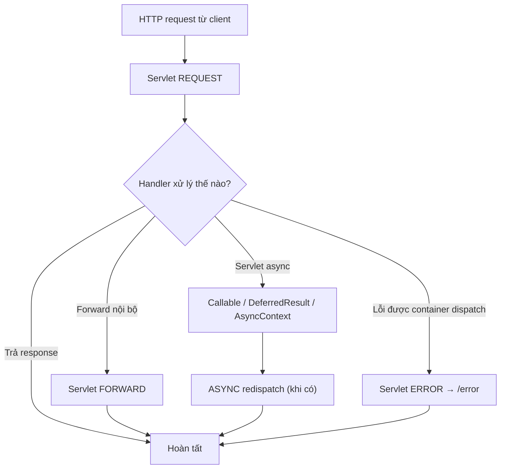
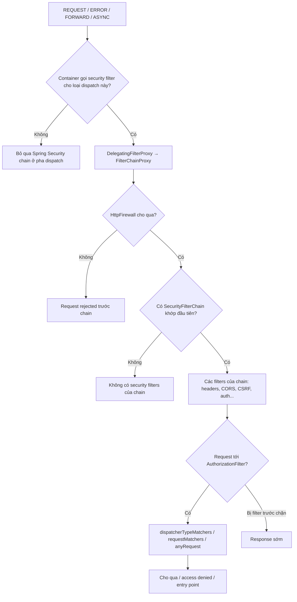
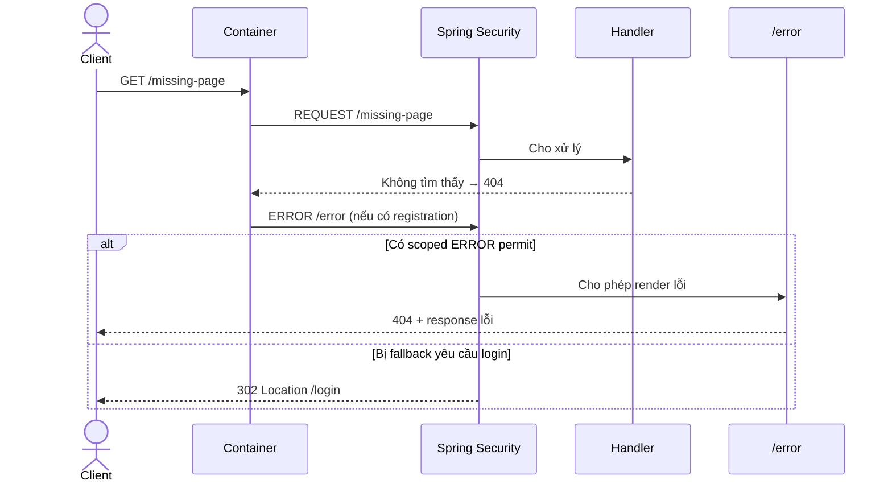
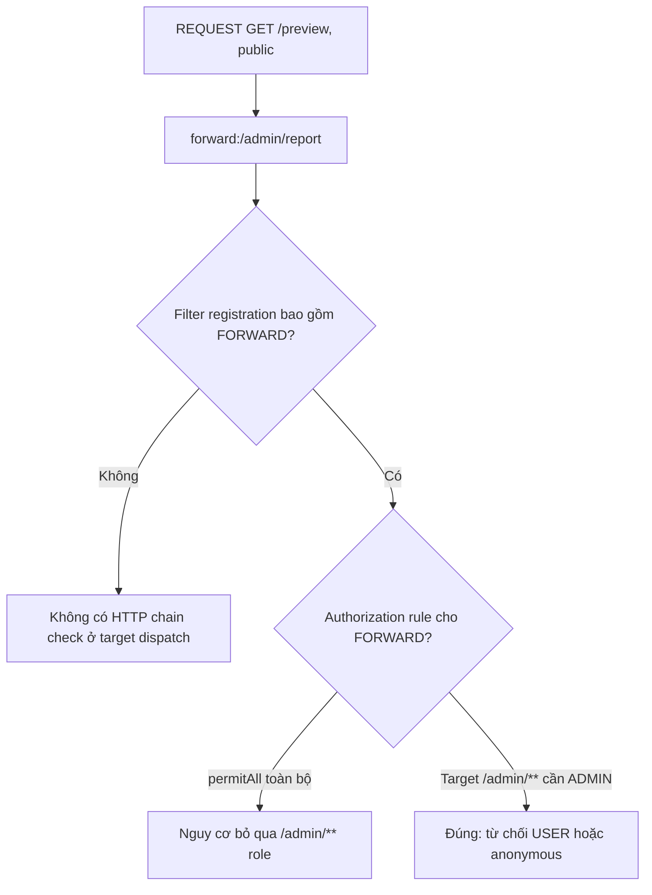

# Kiểm tra phạm vi áp dụng với ERROR, FORWARD và ASYNC dispatch

> **Chương:** Kiến trúc áp dụng  
> **Module:** `SPRING_SECURITY_HTTP_PROTECTION` — áp dụng các lớp phòng vệ HTTP và trình duyệt trong Spring Security, từ CSRF, CORS, security headers, CSP, HSTS đến HTTP firewall và bảo vệ session. Học viên cấu hình Servlet và Reactive, kiểm thử kịch bản tấn công web và chẩn đoán xung đột khi triển khai.  
> **Vấn đề:** Trên Servlet, cùng một HTTP request có thể trải qua `REQUEST`, `ERROR`, `FORWARD` hoặc `ASYNC` dispatch. Nếu Spring Security được đăng ký hoặc cấu hình matcher không đúng, trang lỗi có thể biến 404 thành 302; forward đến controller quản trị có thể bypass quyền; response async có thể mất SecurityContext.

## 1. Mục tiêu học tập

Sau bài học, người học có thể:

1. Phân biệt các kiểu `jakarta.servlet.DispatcherType`: REQUEST, ERROR, FORWARD, ASYNC và INCLUDE.
2. Mô tả **hai điều kiện độc lập**: Servlet container có gọi security filter cho dispatcher type đó không, và security chain/authorization rule nào được chọn khi nó được gọi.
3. Nêu nguyên nhân lỗi gốc 404/500 có thể biến thành redirect 302/403 khi error dispatch sang `/error`.
4. Giải thích vì sao `dispatcherTypeMatchers(FORWARD).permitAll()` quá rộng có thể vượt ranh giới authorization.
5. Thiết kế ngoại lệ giới hạn dispatcher type **và URL đích**, thay vì permit mọi ERROR/FORWARD/ASYNC.
6. Hiểu Servlet async redispatch, `Callable`, `DeferredResult`, `SecurityContextHolder` và context propagation qua executor.
7. Phân biệt `OncePerRequestFilter` skip dispatch với Servlet filter registration.
8. Liên hệ CSRF, CORS, HTTP firewall, security headers, CSP/HSTS và session với các pha dispatch.
9. Viết kiểm thử MockMvc và real HTTP integration cho dispatch và response; phân biệt những gì một mock test không chứng minh.
10. Hiểu WebFlux dùng Reactor Context và WebFilters, **không có Servlet DispatcherType**.

## 2. DispatcherType mô tả điều gì?

Servlet API cho phép chuyển request giữa các thành phần trong server mà không cần browser gửi một HTTP request mới. `HttpServletRequest.getDispatcherType()` cho biết pha xử lý hiện tại.

| Giá trị | Khi phát sinh | Ví dụ |
|---|---|---|
| `REQUEST` | Servlet container nhận HTTP request ban đầu | `GET /account`, `POST /api/orders` |
| `ERROR` | Container dispatch đến error page/handler theo cấu hình | Handler gây 404/500 rồi đến `/error` |
| `FORWARD` | Servlet hoặc MVC chuyển nội bộ sang resource khác | `RequestDispatcher.forward(...)`, `forward:/admin/report` hoặc forward tới JSP |
| `ASYNC` | Servlet async processing thực hiện redispatch | `Callable`/`DeferredResult` hoàn tất rồi quay lại MVC |
| `INCLUDE` | Container include nội dung của một Servlet/JSP khác | JSP hoặc Servlet `RequestDispatcher.include(...)` |

Những lưu ý cốt lõi:

- **FORWARD không phải HTTP reverse proxy forward.** Header `Forwarded` hoặc `X-Forwarded-Proto` không biến request thành `DispatcherType.FORWARD`.
- **ASYNC không phải mọi hoạt động bất đồng bộ.** Một service `@Async` hay một `CompletableFuture` chạy trên thread khác không tự biến HTTP request thành Servlet ASYNC redispatch.
- **ERROR không xuất hiện trên mọi 404/500.** Controller có thể trả `ResponseEntity.notFound()` hoặc `@ControllerAdvice` xử lý lỗi trực tiếp mà không có container error dispatch.
- **INCLUDE có semantics riêng.** Không áp dụng tự động cùng ngoại lệ authorization như FORWARD.

### 2.1. Đường đi mẫu



Sơ đồ là minh họa, không khẳng định mọi request đi qua các nhánh hoặc luôn có chính xác một redispatch. Container, MVC exception resolver, framework và response commit ảnh hưởng đường đi thực tế.

## 3. Hai cổng độc lập quyết định security có bảo vệ dispatch

**Cổng thứ nhất: Filter registration ở Servlet container.** `DelegatingFilterProxy` cần được map tới dispatcher type hiện tại. Nếu container không gọi filter cho FORWARD, các rule FORWARD trong Spring Security DSL sẽ không được thực thi ở pha này.

**Cổng thứ hai: Spring Security chain/rule matching.** Khi proxy được gọi, `FilterChainProxy` dùng matcher để chọn `SecurityFilterChain` đầu tiên khớp. Những filter bên trong chain và `AuthorizationFilter` sau đó áp policy theo request.



Thêm rule `dispatcherTypeMatchers(DispatcherType.ERROR).permitAll()` chỉ tác động **cổng thứ hai**, không đăng ký filter ở cổng thứ nhất.

### 3.1. Ba tầng thứ tự không thể thay nhau

| Tầng | API / cấu hình | Mục đích |
|---|---|---|
| Container filter mapping | Dispatcher types của security proxy | Có gọi proxy ở pha dispatch hiện tại không? |
| Chọn security chain | `@Order` + `securityMatcher` | Chain nào được chọn khi proxy đã được gọi? |
| Authorization | `dispatcherTypeMatchers`, `requestMatchers`, `anyRequest` | Quyền nào áp dụng nếu request đến AuthorizationFilter? |

Thứ tự các **security filters** bên trong một chain lại là vấn đề riêng. CORS, CSRF hoặc authentication có thể chặn request trước AuthorizationFilter; vì vậy `permitAll()` không tự bỏ qua các lớp ấy.

## 4. Đăng ký dispatcher types cho Spring Security Servlet

Với Spring Boot Servlet sử dụng cơ chế auto-registration tương ứng, có thể khai báo:

```properties
# Minh họa khi muốn Spring Security còn thấy FORWARD.
spring.security.filter.dispatcher-types=REQUEST,ASYNC,ERROR,FORWARD
```

Chú ý:

- Đây là **cấu hình Servlet filter registration**, không phải DSL `authorizeHttpRequests`.
- Danh sách mặc định/cách binding cần kiểm theo phiên bản Spring Boot và cách ứng dụng đăng ký filter thật. Nếu hệ thống dùng `web.xml`, `FilterRegistrationBean` hoặc custom Servlet initializer, dispatcher mapping của cơ chế đó mới quyết định.
- Thêm FORWARD có thể khiến các security filters chạy ở những pha trước đây không tham gia, ảnh hưởng view rendering và authorization.
- Thêm ASYNC trong registration không làm mọi custom filter tự propagate SecurityContext.
- Nếu ứng dụng đã auto-register `DelegatingFilterProxy`, không tạo thêm filter registration chỉ để thử: đăng ký trùng có thể khiến security filters chạy hai lần.

Không đọc cấu hình `dispatcherTypeMatchers(...)` rồi suy ra registration chắc chắn đúng. Hãy kiểm mapping trên container và quan sát các dispatch thực.

### 4.1. Kiểm từng loại dispatch

| Loại | Cần biết | Kiểm thử đại diện |
|---|---|---|
| REQUEST | Security proxy có bảo vệ HTTP entry point không? | Anonymous không vào route private |
| ERROR | Error page có bị auth redirect/403 hoặc mất headers không? | 404/500 không bị đổi nghĩa ngoài ý muốn |
| FORWARD | Forward target có bị kiểm authorization đúng không? | Public forward không rò dữ liệu admin |
| ASYNC | Context/authority ở redispatch có đúng không? | Callable hoàn tất và không gặp login 302 |
| INCLUDE | Include target có cần bảo vệ riêng không? | Nội dung nhúng không lộ tài nguyên nhạy cảm |

## 5. ERROR dispatch có thể thay đổi response lỗi gốc

Giả sử HTTP `GET /missing-page` của anonymous được app cho phép nhưng không có handler:

1. Pha `REQUEST` đi qua security chain tương ứng.
2. Controller/handler/container kết luận 404.
3. Container có thể dispatch tới `/error` với `DispatcherType.ERROR`.
4. Nếu proxy được map ERROR, matcher nhìn request ở **URL đích error dispatch**.
5. Nếu `/error` rơi vào browser fallback `anyRequest().authenticated()`, anonymous có thể nhận 302 redirect login thay vì 404.



**Không phải mọi lỗi đều tạo ERROR dispatch.** MVC có thể trực tiếp trả 404, 400 hoặc 500; một response đã commit không cho error handler sửa headers/status như bình thường. Cần log từng pha và xác minh container.

### 5.1. Các attributes hỗ trợ chẩn đoán

Servlet API thường cung cấp:

```java
Object originalUri = request.getAttribute(
    RequestDispatcher.ERROR_REQUEST_URI);
Object originalStatus = request.getAttribute(
    RequestDispatcher.ERROR_STATUS_CODE);
Object error = request.getAttribute(
    RequestDispatcher.ERROR_EXCEPTION);
```

Imports: `jakarta.servlet.RequestDispatcher` và `jakarta.servlet.http.HttpServletRequest`.

Dữ liệu này dùng để biết request gốc, không phải để đưa stack trace hoặc filesystem path cho client. Trang lỗi nên trả thông tin tối thiểu và correlation ID. Không dùng một error attribute làm bằng chứng quyền truy cập vào resource khác.

### 5.2. Ngoại lệ ERROR quá rộng

Một cách cấu hình phổ biến:

```java
.authorizeHttpRequests(auth -> auth
    .dispatcherTypeMatchers(DispatcherType.ERROR).permitAll()
    .anyRequest().authenticated())
```

Cách này có thể phù hợp nếu **mọi ERROR dispatch targets đã được kiểm tra an toàn**. Nhưng nếu một error dispatch có thể nhắm tới controller nhạy cảm, rule tổng quát cho phép mọi ERROR là quá rộng.

Thiết kế chặt hơn: chỉ cho phép **ERROR đến một endpoint lỗi đã kiểm soát**, như `/error`, còn URL nhạy cảm vẫn chịu rule theo role.

## 6. FORWARD dispatch có thể vượt qua ranh giới authorization

Ví dụ một controller public forward đến handler quản trị:

```java
@Controller
class PreviewController {
    @GetMapping("/preview")
    String preview() {
        return "forward:/admin/report";
    }
}
```

Nếu `/preview` public nhưng `/admin/report` yêu cầu ADMIN, có hai rủi ro:

- Container **không map** security filter cho FORWARD, nên target không được kiểm lại bằng HTTP security chain ở pha này.
- Filter được map FORWARD, nhưng authorization có `dispatcherTypeMatchers(FORWARD).permitAll()` **đứng trước** rule `/admin/**`. Target có thể được cho phép chỉ vì nó là forward.



**FORWARD là nội bộ không có nghĩa FORWARD an toàn.** Client không tự chọn DispatcherType, nhưng một endpoint public, thư viện hoặc ứng dụng có thể tạo forward đến resource có quyền cao hơn.

### 6.1. JSP view khác controller nhạy cảm

Một controller đã được authorize có thể forward đến `/WEB-INF/views/profile.jsp` để render. Nếu security filter được map FORWARD, authorization có thể cần một ngoại lệ **hạn chế cho view path**, để view rendering không bị chặn không cần thiết.

Nhưng forward sang `/admin/report` là **một endpoint nghiệp vụ**; không được cho phép chỉ vì dispatcher type FORWARD. Chặn tại URL target và bổ sung method/service authorization khi có quyền theo tài nguyên.

### 6.2. FORWARD và URL gốc

Servlet API có thể cung cấp `RequestDispatcher.FORWARD_REQUEST_URI` để quan sát request gốc. Request path ở pha forward thường phản ánh **target**, vì thế matcher có thể đánh giá target path. Header `X-Forwarded-For` hoặc `X-Original-URL` từ proxy không phải thuộc tính Servlet forward và không được coi là tin cậy chỉ vì có tên “forwarded”.

## 7. ASYNC dispatch, Callable và SecurityContext

Servlet async cho phép request chờ kết quả ngoài request thread ban đầu. Ví dụ MVC:

```java
@RestController
class SlowReportController {
    @GetMapping("/reports/slow")
    Callable<ResponseEntity<String>> slow() {
        return () -> ResponseEntity.ok("report-ready");
    }
}
```

Imports:

```java
import java.util.concurrent.Callable;
import org.springframework.http.ResponseEntity;
import org.springframework.web.bind.annotation.GetMapping;
import org.springframework.web.bind.annotation.RestController;
```

Một đường đi thường gặp:

1. Pha REQUEST đi qua Spring Security và authorization.
2. MVC bắt đầu Servlet async processing cho `Callable`.
3. Logic chạy trên executor thread; context cần được propagate đúng.
4. Khi kết quả sẵn sàng, container có thể thực hiện `ASYNC` dispatch để MVC hoàn tất response.
5. Tùy filter registration và filter behavior, security filters có thể chạy lại hoặc skip ở pha này.

**Không giả định số lần filter invocation cố định.** Container, Spring Security version và `OncePerRequestFilter` ảnh hưởng kết quả.

### 7.1. Context có tự lan qua mọi thread không?

Không. Servlet `SecurityContextHolder` thường theo thread; framework có hỗ trợ tích hợp MVC async như `WebAsyncManagerIntegrationFilter` cho `Callable` do MVC quản lý. Điều đó **không** bảo đảm context được truyền sang mọi:

- `CompletableFuture.supplyAsync(...)` với executor tùy biến.
- Producer của `DeferredResult` do ứng dụng tự quản lý.
- `new Thread(...)` và scheduled jobs.
- Luồng làm việc tiếp tục sau khi request/session đã kết thúc.

Khi cần, dùng propagation có kiểm soát như `DelegatingSecurityContextExecutor` hoặc wrapper tương ứng; test cleanup để tránh user context rò sang task khác.

### 7.2. Tránh blanket `ASYNC permitAll`

Một hệ thống có thể muốn không authorize lại khi async redispatch đến **cùng** target đã được xác thực ở REQUEST. Nhưng nếu app dùng `AsyncContext.dispatch("/admin/report")` để chuyển sang URL quyền cao hơn, rule `dispatcherTypeMatchers(ASYNC).permitAll()` quá rộng có thể bỏ kiểm quyền target.

Nên phân tích URI đích, SecurityContext lifecycle và trust boundary. Không dùng ASYNC permitAll như giải pháp chung cho lỗi mất context.

### 7.3. Không nhầm Spring `@Async` với Servlet `ASYNC`

`@Async` chỉ điều khiển thực thi method trên executor. Nó không tự đảm bảo HTTP Servlet async lifecycle. Khi dùng `Callable`, `DeferredResult` hoặc `AsyncContext` thì có thể có `DispatcherType.ASYNC`; cần kiểm `request().asyncStarted()` và real container logs.

## 8. `OncePerRequestFilter` không bảo đảm chỉ chạy một lần trên mọi dispatch

Một số Servlet security filters hoặc custom filters kế thừa `OncePerRequestFilter`. Nó có cơ chế đánh dấu request, dispatcher skip và nested-error handling; tên class không có nghĩa nó chạy đúng một lần cho toàn bộ request lifecycle.

Ví dụ override trong một **custom filter**:

```java
@Override
protected boolean shouldNotFilterAsyncDispatch() {
    return false;  // Có cơ hội xử lý ASYNC dispatch.
}

@Override
protected boolean shouldNotFilterErrorDispatch() {
    return false;  // Có cơ hội xử lý ERROR dispatch.
}
```

Còn phải thỏa các điều kiện:

1. Servlet container filter mapping có dispatcher type đó.
2. Custom filter không skip pha đó bởi logic của chính nó.
3. Security proxy/chain thực tế chứa custom filter, và không có filter trước kết thúc request.

Một số container có **nested ERROR dispatch**, khác một ERROR dispatch tách rời; `OncePerRequestFilter` có hook `doFilterNestedErrorDispatch(...)` cho tình huống liên quan. Không suy behavior giống nhau trên mọi container.

**Cảnh báo:** Khi một custom `Filter` vừa auto-registered global vừa được thêm vào `HttpSecurity.addFilterBefore(...)`, nó có thể chạy hai lần. Chọn đúng một phạm vi đăng ký và kiểm thứ tự filter thực.

## 9. Sự khác biệt giữa `securityMatcher` và `dispatcherTypeMatchers`

Giả sử:

```text
@Order(1) API chain       : securityMatcher("/api/**")
@Order(2) Browser fallback: không giới hạn securityMatcher
```

Một REQUEST tới `/api/orders` vào API chain. Nếu xảy ra Servlet ERROR dispatch đến `/error`, lần dispatch ấy có thể vào **browser fallback** vì current path là `/error`.

Hệ quả có thể bao gồm:

- Error của API Bearer bị browser form-login entry point biến thành 302.
- Error JSON bị xử lý bởi browser error policy.
- CORS headers của API response có thể thiếu trên response cuối; browser báo CORS error dù status gốc là 404/500.
- Header writer của browser chain ghi CSP lên response lỗi, nhưng không chứng minh API authorization đúng.
- Một rule ERROR chỉ nằm trong API chain không có tác dụng khi ERROR target không còn khớp API chain.

**Nguyên tắc:** Kiểm đường dẫn *trong từng pha dispatch*, không chỉ URL browser gõ. `@Order` chọn chain theo matcher; authorization rule chỉ chạy trong chain đã chọn.

## 10. Cấu hình một ngoại lệ theo cả dispatcher type và path

Đối với servlet app dùng `DispatcherServlet` ở mapping mặc định, có thể tạo matcher hạn chế:

```java
RequestMatcher errorPageDispatch = request ->
    request.getDispatcherType() == DispatcherType.ERROR
    && "/error".equals(request.getServletPath());

RequestMatcher internalJspForward = request ->
    request.getDispatcherType() == DispatcherType.FORWARD
    && request.getServletPath().startsWith("/WEB-INF/views/");
```

Ý nghĩa:

- Chỉ cho phép `ERROR` **đến `/error`**, không tự cho `REQUEST /error` từ browser.
- Chỉ miễn authorization cho `FORWARD` đến vùng JSP view nội bộ; không miễn `FORWARD /admin/report`.
- Nếu có custom servlet path như `/mvc/*` hoặc nhiều DispatcherServlet, phải điều chỉnh `getServletPath()`/matcher theo **path thật** mà container cung cấp.

Không dùng một header tự khai như `X-Dispatch-Type: ERROR` làm bằng chứng dispatcher type: Servlet container mới sở hữu `getDispatcherType()`.

### 10.1. Khi nào `dispatcherTypeMatchers(ERROR).permitAll()` vẫn hợp lý?

Nếu ứng dụng hoàn toàn kiểm soát error targets, chúng chỉ trả sanitized error responses và tất cả đều nên public, rule tổng quát có thể đơn giản và phù hợp. Nhưng phải đánh giá lại khi thêm custom error mapping/handler hoặc forward.

Với FORWARD và ASYNC chuyển tới business handlers, ngoại lệ toàn cục thường cần thận trọng hơn vì chúng có thể chạm resource có quyền riêng.

## 11. Cấu hình Spring Security Servlet hoàn chỉnh theo phạm vi

Ví dụ ứng dụng có API Bearer `/api/**` và browser form login. Browser chain xử lý trang lỗi `/error` và forward nội bộ đến JSP; các URL quản trị vẫn cần ADMIN.

```java
package example.security;

import jakarta.servlet.DispatcherType;
import org.springframework.context.annotation.Bean;
import org.springframework.context.annotation.Configuration;
import org.springframework.core.annotation.Order;
import org.springframework.http.HttpMethod;
import org.springframework.security.config.Customizer;
import org.springframework.security.config.annotation.web.builders.HttpSecurity;
import org.springframework.security.config.annotation.web.configuration.EnableWebSecurity;
import org.springframework.security.config.annotation.web.configurers.AbstractHttpConfigurer;
import org.springframework.security.config.http.SessionCreationPolicy;
import org.springframework.security.web.SecurityFilterChain;
import org.springframework.security.web.util.matcher.RequestMatcher;

@Configuration
@EnableWebSecurity
public class ServletDispatcherSecurityConfig {

    @Bean
    @Order(1)
    SecurityFilterChain api(HttpSecurity http) throws Exception {
        return http
            .securityMatcher("/api/**")
            // Chỉ phù hợp khi API chỉ tin header Bearer,
            // không dùng browser cookie authentication.
            .csrf(AbstractHttpConfigurer::disable)
            .sessionManagement(session -> session
                .sessionCreationPolicy(SessionCreationPolicy.STATELESS))
            .authorizeHttpRequests(auth -> auth
                .requestMatchers(HttpMethod.GET, "/api/public/**")
                    .permitAll()
                .anyRequest().authenticated())
            .oauth2ResourceServer(oauth2 -> oauth2
                .jwt(Customizer.withDefaults()))
            .build();
    }

    @Bean
    @Order(2)
    SecurityFilterChain browser(HttpSecurity http) throws Exception {

        RequestMatcher errorPageDispatch = request ->
            request.getDispatcherType() == DispatcherType.ERROR
            && "/error".equals(request.getServletPath());

        RequestMatcher internalJspForward = request ->
            request.getDispatcherType() == DispatcherType.FORWARD
            && request.getServletPath()
                .startsWith("/WEB-INF/views/");

        return http
            .authorizeHttpRequests(auth -> auth
                .requestMatchers(errorPageDispatch).permitAll()
                .requestMatchers(internalJspForward).permitAll()
                .requestMatchers("/login", "/assets/**").permitAll()
                .requestMatchers("/admin/**").hasRole("ADMIN")
                .anyRequest().authenticated())
            .csrf(Customizer.withDefaults())
            .formLogin(Customizer.withDefaults())
            .headers(headers -> headers
                .contentSecurityPolicy(csp -> csp.policyDirectives(
                    "default-src 'self'; object-src 'none'; " +
                    "base-uri 'self'; frame-ancestors 'none'")))
            .build();
    }
}
```

Giải thích:

1. API chain chuyên biệt đứng trước; initial HTTP `/api/**` áp chính sách JWT.
2. Browser fallback bảo vệ mọi URL còn lại, bao gồm error target `/error`.
3. ERROR được permit **chỉ** khi path đích đúng `/error`.
4. FORWARD được permit **chỉ** khi đích là internal JSP views; forward tới `/admin/**` vẫn có rule ADMIN.
5. CSRF vẫn bảo vệ unsafe browser requests. `permitAll` không làm CSRF filter bỏ qua token.
6. CSP được ghi theo chain nếu header writer chạy trước khi response commit.

**Điều kiện chạy:** Có dependency Spring Security, JWT Resource Server/decoder, user store/browser login, controller, error endpoint/JSP views thật và filter registration dispatcher types phù hợp. Ví dụ không tự cung cấp những thành phần này.

### 11.1. Chỉ dùng matcher ở cấp authorization chưa đủ

Nếu filter registration của container không bao gồm FORWARD thì mẫu `internalJspForward` không được kiểm trong pha FORWARD. Nếu container error target dùng path khác `/error`, matcher ERROR cũng không khớp. Vì vậy phải test **cả URL và dispatcher mapping** trong hệ thống thực.

### 11.2. Tránh một request PUBLIC forward đến ADMIN

Với sample config, một `REQUEST /preview` được `permitAll()` rồi forward tới `/admin/report` **không** được xem là đã được cấp quyền admin. Target vẫn phải được kiểm theo rule ADMIN khi FORWARD security filter được gọi. Có thể bổ sung method/service authorization cho logic quản trị nếu có nhiều entry points.

Không xây đường forward public tới admin trong production chỉ để dựa vào một lần authorization thứ hai; loại bỏ đường đi sai nếu có thể.

## 12. CSRF theo dispatcher type: 403 có thể xảy ra trước rule ERROR

Trong browser session chain, `CsrfFilter` thường kiểm token cho POST/PUT/PATCH/DELETE theo matcher. Một POST thiếu CSRF có thể trả 403 **trước Authentication và AuthorizationFilter**.

Điều đó có nghĩa:

- `dispatcherTypeMatchers(ERROR).permitAll()` ở authorization không bảo đảm sửa được CSRF 403.
- CSRF failure handler có thể hoàn tất response trực tiếp, không bắt buộc tạo Servlet ERROR dispatch.
- Nếu thật sự có ERROR dispatch, cách filter CSRF tham gia lần đó còn phụ thuộc registration, filter skip behavior, method và handler.
- Không tắt CSRF toàn browser để “làm trang lỗi hiện đúng”; cần xác định filter gây 403 ở pha nào.

### 12.1. CORS preflight có phải ASYNC/FORWARD không?

Browser preflight thường là `OPTIONS` **HTTP REQUEST** có `Origin` và `Access-Control-Request-Method`. Nó cần CORS filter xử lý sớm, không phải `DispatcherType.ASYNC` hoặc `FORWARD`.

Một preflight bị 401 do API chain hoặc CORS ordering sai không được “chữa” bằng blanket permit FORWARD/ERROR. Sau preflight thành công, request thật vẫn cần authentication/authorization và có thể cần CSRF token nếu dùng cookie authentication.

## 13. Security headers/CSP/HSTS ở pha ERROR và ASYNC

Servlet `HeaderWriterFilter` viết security headers khi request đi qua chain chứa writer và response còn có thể chỉnh sửa. Các tình huống:

| Response | Header writer của Spring Security có cơ hội chạy? |
|---|---|
| 200 từ handler đi qua REQUEST chain | Có nếu chain có writer |
| 403 do CSRF sau header filter | Có thể được ghi trước response commit |
| 302 do form login entry point | Có thể có security headers của chain |
| ERROR dispatch tới `/error` có filter mapping | Có thể chạy chain cho ERROR và thêm headers |
| Firewall rejection trước security chain | Không thể mặc định có headers của chain |
| Gateway/CDN tạo lỗi trước backend | Không có Spring Security app header writer trong lượt request ấy |
| ASYNC streaming response đã commit | Không thể thêm header sau commit |

**CSP:** đặc biệt cần trên HTML document như trang login hoặc trang lỗi; nó không thay authorization và không làm JSON 403 thành an toàn nếu secret đã bị lộ.

**HSTS:** browser chỉ ghi nhận header trên HTTPS hợp lệ. TLS termination ở proxy cần forwarded headers đáng tin hoặc HSTS tại edge; MockMvc request `secure(true)` không chứng minh HTTPS cuối cùng hoạt động đúng.

**Response commit:** gửi redirect, sendError, flush body hoặc bắt đầu streaming có thể commit status/headers. Error handler/custom filter đăng ký header quá muộn có thể không thay response như dự kiến.

## 14. Session và SecurityContext ở ERROR/FORWARD/ASYNC

Cùng một HTTP exchange không bảo đảm `SecurityContextHolder.getContext()` giữ cùng principal ở mọi thread. Cần phân biệt:

- REQUEST ban đầu dùng authentication filter và security context repository phù hợp.
- ERROR/FORWARD có thể chạy lại security proxy/filters hoặc bypass tùy registration.
- ASYNC Callable có tích hợp của Spring MVC/Spring Security cho context; executor khác cần propagation riêng.
- Browser `HttpSession` và API stateless Bearer có chính sách lưu/khôi phục context khác nhau.
- Error path đổi từ `/api/**` sang `/error` có thể vào chain khác ngay cả khi cùng HTTP request.

Một error handler thường chỉ cần status/message sanitized, không nhất thiết phải truy principal. Nếu error page phải hiển thị user-specific content, cần giải thích threat model và bảo đảm context thực sự đáng tin ở pha đó.

## 15. Kiểm thử MockMvc cho ERROR và FORWARD matcher

MockMvc có thể mô phỏng DispatcherType trên `MockHttpServletRequest`, qua request post-processor. Ví dụ cần test application có Servlet config ở mục 11 và error handler fixture phù hợp.

```java
@SpringBootTest
@AutoConfigureMockMvc
class ServletDispatchMatcherTest {

    @Autowired
    MockMvc mvc;

    @Test
    void directAdminRequestRequiresLogin() throws Exception {
        mvc.perform(get("/admin/report"))
            .andExpect(status().is3xxRedirection());
    }

    @Test
    void forwardedAdminTargetStillRequiresLogin()
            throws Exception {
        mvc.perform(get("/admin/report")
                .with(request -> {
                    request.setDispatcherType(DispatcherType.FORWARD);
                    return request;
                }))
            .andExpect(status().is3xxRedirection());
    }

    @Test
    void errorDispatchCanUseNarrowPermission()
            throws Exception {
        mvc.perform(get("/error")
                .with(request -> {
                    request.setDispatcherType(DispatcherType.ERROR);
                    request.setAttribute(
                        RequestDispatcher.ERROR_REQUEST_URI,
                        "/missing-page");
                    request.setAttribute(
                        RequestDispatcher.ERROR_STATUS_CODE, 404);
                    return request;
                }))
            // Mã cuối phụ thuộc error handler trong app;
            // không được biến thành login redirect.
            .andExpect(result -> assertNotEquals(
                302, result.getResponse().getStatus()))
            .andExpect(header().exists("X-Content-Type-Options"));
    }

    @Test
    void directErrorUrlDoesNotInheritErrorPrivilege()
            throws Exception {
        mvc.perform(get("/error"))
            .andExpect(status().is3xxRedirection());
    }
}
```

Imports:

```java
import jakarta.servlet.DispatcherType;
import jakarta.servlet.RequestDispatcher;
import org.junit.jupiter.api.Test;
import org.springframework.beans.factory.annotation.Autowired;
import org.springframework.boot.test.context.SpringBootTest;
import org.springframework.boot.test.autoconfigure.web.servlet.AutoConfigureMockMvc;
import org.springframework.test.web.servlet.MockMvc;
import static org.junit.jupiter.api.Assertions.assertNotEquals;
import static org.springframework.test.web.servlet.request.MockMvcRequestBuilders.*;
import static org.springframework.test.web.servlet.result.MockMvcResultMatchers.*;
```

**Giới hạn không được bỏ qua:** `setDispatcherType(...)` chỉ giả lập request có dispatcher type; nó **không chứng minh Servlet container đã đăng ký security filter cho dispatcher type ấy**. Nếu thiếu error controller/JSP fixture, test có thể trả 404/500. Điều quan trọng là policy không redirect/permit sai; cần integration test HTTP thật để xác minh dispatch sequence.

### 15.1. Test forward thật

Trong test-only controller, có thể tạo:

```java
@Controller
class ForwardProbeController {
    @GetMapping("/preview")
    String preview() {
        return "forward:/admin/report";
    }
}
```

Để chứng minh không bypass, chạy qua embedded Servlet container có filter registration FORWARD, gửi `GET /preview` anonymous và xác nhận không nhận admin content. Test không nên chỉ assert 403/302 vì custom error handler có thể đổi status; cần kiểm protected handler có bị thực thi trái phép không.

Đây là fixture cố ý tạo đường đi rủi ro để kiểm thử, **không đưa tuyến public→admin vào production**.

## 16. Kiểm thử ASYNC với MockMvc

Dùng controller `Callable<ResponseEntity<String>>` ở mục 7, Spring Security Test và `asyncDispatch`:

```java
@SpringBootTest
@AutoConfigureMockMvc
class ServletAsyncSecurityTest {

    @Autowired
    MockMvc mvc;

    @Test
    void authenticatedCallableCompletes() throws Exception {
        MvcResult started = mvc.perform(get("/reports/slow")
                .with(user("lan").roles("USER")))
            .andExpect(request().asyncStarted())
            .andReturn();

        mvc.perform(asyncDispatch(started))
            .andExpect(status().isOk())
            .andExpect(content().string("report-ready"))
            .andExpect(header().string(
                "X-Content-Type-Options", "nosniff"));
    }

    @Test
    void anonymousDoesNotStartPrivateCallable()
            throws Exception {
        mvc.perform(get("/reports/slow"))
            .andExpect(status().is3xxRedirection());
    }
}
```

Imports:

```java
import org.junit.jupiter.api.Test;
import org.springframework.beans.factory.annotation.Autowired;
import org.springframework.boot.test.context.SpringBootTest;
import org.springframework.boot.test.autoconfigure.web.servlet.AutoConfigureMockMvc;
import org.springframework.test.web.servlet.MockMvc;
import org.springframework.test.web.servlet.MvcResult;
import static org.springframework.security.test.web.servlet.request.SecurityMockMvcRequestPostProcessors.*;
import static org.springframework.test.web.servlet.request.MockMvcRequestBuilders.*;
import static org.springframework.test.web.servlet.result.MockMvcResultMatchers.*;
```

Các test này kiểm Spring MVC async/security logic trong mock application context, **chưa kiểm** dispatcher mapping/asyncSupported ở real Servlet container. Nếu muốn chứng minh ASYNC target đổi path vẫn cần quyền, cần riêng test `AsyncContext.dispatch("/admin/report")` qua HTTP server thật.

## 17. Kiểm thử container và reverse proxy: không chỉ MockMvc

Khi đánh giá dispatcher types, kiểm thử với embedded server thật (ví dụ `@SpringBootTest(webEnvironment = RANDOM_PORT)`), hoặc staging qua gateway. Ma trận đề xuất:

| Tình huống | Kỳ vọng cần chứng minh |
|---|---|
| `GET /missing` anonymous gây ERROR 404 | Không bị browser fallback đổi thành login 302 |
| Error từ API Bearer `/api/missing` | Response lỗi giữ API contract; kiểm path dispatch |
| Handler lỗi 500 | Không lặp error dispatch hoặc che status sai |
| Public route forward tới admin | Không trả dữ liệu admin |
| Authorized controller forward tới JSP | View render được khi có scoped JSP exception |
| Callable `/reports/slow` authenticated | Response hoàn tất, không phát 401/302 ở ASYNC redispatch |
| Async redispatch đến target bảo vệ | Không vượt quyền target |
| POST browser thiếu CSRF | 403 do CSRF đúng policy; không suy chắc có ERROR dispatch |
| HTTPS error sau proxy | CSP/HSTS/header đúng trên response cuối |
| Gateway từ chối path encode bất thường | Không suy Spring Security ERROR rule đã xử lý lỗi |

Với Servlet container thật, kiểm:

1. Filter registration dispatcher types ở runtime.
2. Current dispatcher type và servlet path ở từng pha.
3. Security chain được chọn, authentication context và authorization.
4. Response status/headers cuối, redirect `Location` và commit timing.
5. JSP servlet/handler mapping, gateway URL rewrite và TLS forwarding.

### 17.1. Dùng curl không tự follow redirect

```bash
# Quan sát lỗi trực tiếp, không dùng -L:
curl -i https://app.example.com/missing

# Phân biệt API error và redirect form login:
curl -i https://app.example.com/api/missing

# Kiểm FORWARD probe ở staging:
curl -i https://app.example.com/preview

# Kiểm HSTS/CSP trên response HTTPS cuối:
curl -sS -D - -o /dev/null \
  https://app.example.com/missing
```

URL là ví dụ; không gửi cookie/JWT thật vào output được chia sẻ. `curl` chỉ thấy HTTP response; để xác định dispatcher type cần log của container/app.

## 18. WebFlux không có Servlet DispatcherType

**Reactive WebFlux dùng `ServerWebExchange` và `WebFilter`, không dùng Servlet `DispatcherType.ERROR`, `FORWARD` hoặc `ASYNC`** để mô tả lifecycle theo cách Servlet. Không copy `dispatcherTypeMatchers(...)` của `HttpSecurity` sang `ServerHttpSecurity`.

Trong WebFlux:

- `WebFilterChainProxy` chọn `SecurityWebFilterChain` theo `ServerWebExchangeMatcher`.
- Authentication context được truy cập qua Reactor Context/`ReactiveSecurityContextHolder`.
- `WebExceptionHandler` và reactive exception handling có thể tạo error response mà **không có Servlet ERROR redispatch**.
- Async/non-blocking và `Flux` streaming thuộc reactive pipeline, không đồng nghĩa Servlet ASYNC.
- Functional routes và annotated controllers nằm sau security WebFilters; handler delegation không tự tạo Servlet FORWARD.

Ví dụ bảo vệ reactive:

```java
@Configuration
@EnableWebFluxSecurity
class ReactiveHttpProtection {

    @Bean
    SecurityWebFilterChain chain(ServerHttpSecurity http) {
        return http
            .authorizeExchange(auth -> auth
                .pathMatchers("/public/**").permitAll()
                .pathMatchers("/admin/**").hasRole("ADMIN")
                .anyExchange().authenticated())
            .csrf(Customizer.withDefaults())
            .headers(Customizer.withDefaults())
            .build();
    }
}
```

Nếu WebFlux app có route `/error` hoặc error handler riêng, hãy thiết kế quyền và response theo cơ chế **WebFlux**, không theo Servlet dispatcher registration.

### 18.1. WebTestClient kiểm reactive error flow

```java
@SpringBootTest
class ReactiveErrorPolicyTest {

    @Autowired
    ApplicationContext context;

    WebTestClient client;

    @BeforeEach
    void setup() {
        client = WebTestClient.bindToApplicationContext(context)
            .apply(springSecurity())
            .configureClient()
            .build();
    }

    @Test
    void publicMissingRouteReturns404WithHeaders() {
        client.get().uri("/public/missing")
            .exchange()
            .expectStatus().isNotFound()
            .expectHeader().exists("X-Content-Type-Options");
    }
}
```

Cần WebFlux Test, Spring Security Test và handler/error behavior phù hợp trong application context. Test không chứng minh servlet dispatcher types vì WebFlux **không có khái niệm đó**, và bind-to-context cũng không kiểm TLS/gateway thật.

## 19. Ma trận triệu chứng và chẩn đoán

| Triệu chứng | Nguyên nhân nên kiểm | Phép thử phân biệt |
|---|---|---|
| 404 biến thành 302 login | ERROR sang `/error` bị fallback auth | Log cả REQUEST/ERROR và chain tương ứng |
| 500 biến thành 403 | Error target bị CSRF/authz hoặc custom filter chặn | Log error attributes và filter ra quyết định |
| JSP view bị 403 sau nâng cấp config | FORWARD được filter nhưng rule view không cho | Scoped permit chỉ cho view path |
| Anonymous thấy admin qua forward | Không map FORWARD hoặc blanket permit | Public→admin negative test real container |
| ASYNC response cuối 401 | Context mất hoặc redispatch gặp auth | Test Callable vs executor riêng và log phase |
| `@Async` service không có principal | Context không propagate | Dùng context-aware executor khi cần |
| API error không có CORS headers | ERROR path vào chain khác hoặc edge xử lý | So preflight, actual, ERROR path và headers |
| CSRF POST trả 403 | Có thể không liên quan ERROR | Thử token hợp lệ, xem CSRF filter log |
| HSTS vắng trên lỗi | Edge/proxy scheme hoặc writer không chạy | Kiểm HTTPS thực và response owner |
| ERROR rule không có hiệu lực | Filter mapping không gồm ERROR hoặc chain không khớp | Xem registration và selected chain |
| FORWARD rule không có hiệu lực | Filter mapping không gồm FORWARD | Test real container, không chỉ MockMvc |
| Header được ghi hai lần | Custom filter đăng ký global và security chain | Kiểm filter registration/OncePerRequestFilter |
| WebFlux không nhận DispatcherType | Đây là hai HTTP stacks khác nhau | Kiểm WebFilter, WebExceptionHandler, Reactor Context |

### 19.1. Log theo pha, không log bí mật

Ở môi trường điều tra có kiểm soát:

```properties
logging.level.org.springframework.security.web.FilterChainProxy=TRACE
logging.level.org.springframework.security.web.access=DEBUG
logging.level.org.springframework.web.servlet=DEBUG
logging.level.org.springframework.security.web.server=TRACE
```

Một filter quan sát an toàn có thể log `dispatcherType`, `servletPath`, request ID và status, nhưng phải được đăng ký cho dispatcher types cần quan sát. Không lưu Bearer token, password, cookie phiên, CSRF token hoặc query dữ liệu nhạy cảm.

### 19.2. Quy trình điều tra sáu bước

1. Xác định request ban đầu: method, public URI, backend URI sau gateway rewrite, Origin, loại credential.
2. Tìm chuỗi dispatcher types thực tế và original/target URI ở từng pha.
3. Kiểm Servlet filter mapping: proxy có được gọi trên ERROR/FORWARD/ASYNC không?
4. Với mỗi lần proxy được gọi, tìm chain đầu tiên khớp và rule authorization thực sự được xét.
5. Xác định response owner: CORS, CSRF, auth, authz, firewall, error handler, container hay gateway.
6. Viết positive/negative tests qua MockMvc **và** real container cho đúng ranh giới, kiểm security headers/redirect/response cuối.

Ví dụ log minh họa:

```text
requestId=abc123 phase=REQUEST GET /api/missing chain=api status=404
requestId=abc123 phase=ERROR   GET /error       chain=browser
final=302 Location=/login
```

Chính chuỗi sự kiện này, chứ không phải status 302 riêng lẻ, gợi ý error dispatch bị browser login che lỗi gốc.

## 20. Bài tập thực hành

### Bài A — Hai cổng của ERROR

Dùng Servlet app có browser fallback:

1. Map security filter chỉ cho REQUEST.
2. Map thêm ERROR nhưng không permit `/error`.
3. Map ERROR và chỉ permit ERROR tới `/error`.

Gửi `GET /missing` anonymous. Ghi chain/dispatcher types, status và headers cuối; giải thích vì sao cấu hình 1 có thể hiện error page nhưng không qua Spring Security filters ở pha ERROR.

### Bài B — FORWARD bypass

Tạo endpoint public `/preview` forward đến `/admin/report`. So ba cấu hình: không map FORWARD, blanket permit FORWARD, và map FORWARD nhưng chỉ permit internal view path. Viết test chứng minh anonymous không xem được nội dung admin trong cấu hình đúng.

### Bài C — FORWARD tới JSP view

Một controller authenticated trả `profile.jsp` dưới `/WEB-INF/views/`. Khi filter map FORWARD, kiểm view có còn render hay bị 403. Thêm scoped matcher cho JSP view forward mà không giảm bảo vệ `/admin/**`.

### Bài D — Callable và context

Tạo `Callable<ResponseEntity<String>>`; kiểm `asyncStarted()` và `asyncDispatch(...)`. Kiểm principal trong Callable; so với `CompletableFuture` trên executor riêng và thiết kế propagation an toàn.

### Bài E — ASYNC đổi target

Thử `AsyncContext.dispatch("/admin/report")` từ flow có quyền thấp. Chứng minh một `dispatcherTypeMatchers(ASYNC).permitAll()` quá rộng có thể nguy hiểm và thiết kế target authorization đúng.

### Bài F — API 404 thành login

API chain match `/api/**`, browser fallback match còn lại. Tạo API 404 dẫn đến ERROR `/error`. Sửa policy để giữ status 404/API error contract và không redirect login, nhưng không permit mọi ERROR target tùy ý.

### Bài G — Error response headers

So CSRF 403, ERROR page HTML, error từ gateway và async response đã stream. Xem CSP/HSTS/nosniff ở response cuối; xác định khi nào Spring Security header writer không có cơ hội chạy.

### Bài H — Servlet và WebFlux

Lập bảng:

```text
Servlet ERROR dispatch   → WebFlux WebExceptionHandler (không tương đương 1:1)
Servlet FORWARD dispatch → WebFlux handler delegation (khác lifecycle)
Servlet ASYNC dispatch   → WebFlux non-blocking (khác mô hình)
SecurityContextHolder    → ReactiveSecurityContextHolder
SecurityFilterChain      → SecurityWebFilterChain
```

Giải thích vì sao không đem Servlet `DispatcherType` hay `dispatcherTypeMatchers` vào WebFlux.

## 21. Câu hỏi tự kiểm

**1. `dispatcherTypeMatchers(ERROR).permitAll()` có tự map filter cho ERROR?**  
Không. Filter registration ở container quyết định security proxy có được gọi hay không.

**2. Vì sao API 404 có thể biến thành 302?**  
ERROR dispatch đến `/error` có thể vào browser fallback và bị yêu cầu form login.

**3. Vì sao không blanket permit FORWARD?**  
Vì forward target có thể là endpoint cần role cao, không chỉ JSP view.

**4. `FORWARD` có phải `X-Forwarded-Proto`?**  
Không. Một cái là Servlet dispatch; một cái là proxy header.

**5. Spring MVC `Callable` có thể chạy ở thread khác không?**  
Có; framework có tích hợp context propagation phù hợp, nhưng executor tùy biến phải được kiểm riêng.

**6. `OncePerRequestFilter` có chạy đúng một lần trên mọi pha không?**  
Không mặc định; registration, skip hooks và nested error dispatch quyết định.

**7. MockMvc setDispatcherType có kiểm filter registration thật không?**  
Không. Phải thêm HTTP integration test qua Servlet container.

**8. `ERROR /error` scoped permit có làm `REQUEST /error` public không?**  
Không khi matcher yêu cầu đồng thời dispatcher type ERROR và path đích.

**9. CSRF 403 có chắc tạo Servlet ERROR dispatch không?**  
Không. Filter có thể trả response trực tiếp.

**10. WebFlux có `DispatcherType.ASYNC` không?**  
Không. WebFlux dùng reactive WebFilters/Reactor Context, không dùng Servlet dispatch types.

## 22. Ghi nhớ kiến trúc

- **Servlet DispatcherType xác định pha xử lý nội bộ, không phải thêm HTTP request từ browser.**
- **Có hai cổng:** filter registration theo dispatcher type và Spring Security chain/rule matching.
- **ERROR có thể làm URL đổi thành `/error` và chọn chain khác**, che 404/500 thành 302/403 khi authorization sai.
- **FORWARD phải bảo vệ target**, không được cấp quyền chỉ vì là internal dispatch; chỉ permit những internal view forwards đã xác định an toàn.
- **ASYNC phải xét context propagation và target redispatch**; không blanket permit để né lỗi mất context.
- **CSRF, CORS, firewall, CSP/HSTS, session và security headers vẫn quan trọng** trong mọi đường đi HTTP; chúng không được thay bằng một rule `permitAll`.
- **WebFlux không có Servlet DispatcherType** và cần được kiểm theo reactive error/async semantics.
- **MockMvc chưa đủ để chứng minh registration**; kết hợp real container, gateway/HTTPS và negative tests để xác minh phạm vi bảo vệ thật.
