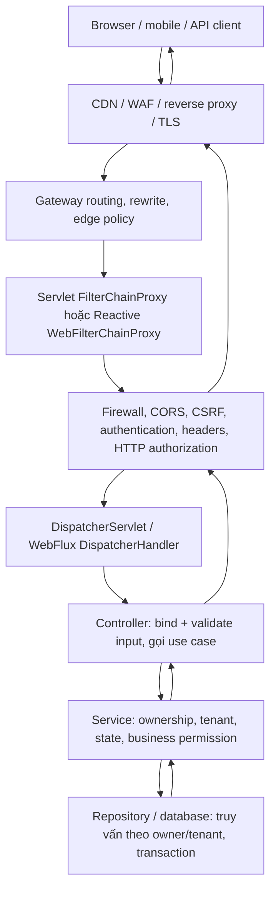
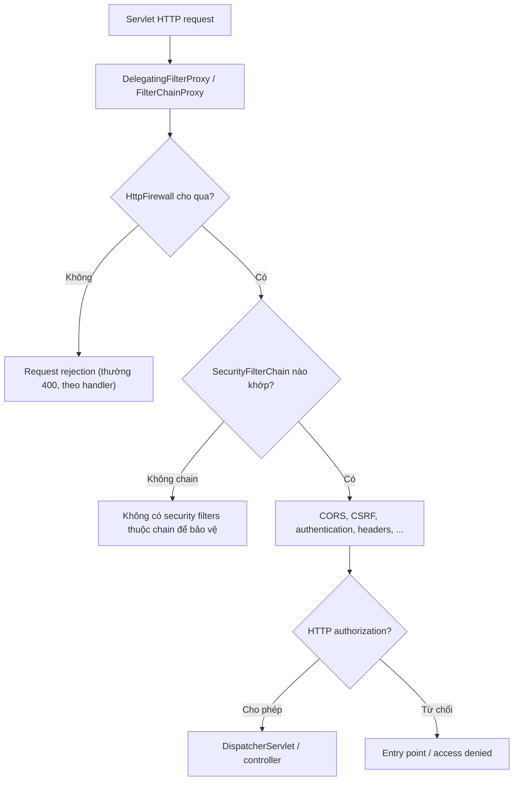

# Ranh giới giữa bộ lọc bảo mật với controller, service và proxy

> **Chương:** Kiến trúc áp dụng  
> **Module:** `SPRING_SECURITY_HTTP_PROTECTION` — áp dụng các lớp phòng vệ HTTP và trình duyệt trong Spring Security, từ CSRF, CORS, security headers, Content Security Policy (CSP), HSTS, HTTP firewall đến bảo vệ session; triển khai trên Servlet và Reactive WebFlux, kiểm thử kịch bản tấn công web và chẩn đoán xung đột khi triển khai.  
> **Câu hỏi trọng tâm:** Reverse proxy đã xác thực người dùng thì backend còn cần kiểm gì? Spring Security filter cho `GET /api/orders/42` đi tiếp có đồng nghĩa người dùng được xem đơn hàng số 42 không? Khi browser báo CORS, API trả 403 hoặc response thiếu HSTS, phải sửa ở tầng nào?

## 1. Kết quả học tập

Sau bài học, người học có thể:

1. Vẽ và giải thích đường đi từ browser/API client qua CDN, reverse proxy, gateway, HTTP server, Spring Security chain, controller và service/repository.
2. Phân biệt **bảo vệ ở biên HTTP** (security filters, CORS, CSRF, headers, session) với **authorization theo nghiệp vụ** (quyền sở hữu đơn hàng, tenant, trạng thái tài nguyên).
3. Nêu chính xác việc nên và không nên giao cho reverse proxy/gateway, Spring Security, controller, service, database và frontend.
4. Phân biệt `securityMatcher` cấp chain, `requestMatchers`/`pathMatchers` cấp HTTP authorization và `@PreAuthorize`/kiểm tra nghiệp vụ ở tầng service.
5. Thiết kế hai mô hình credential: API stateless dùng Bearer JWT và browser dùng form login/session cookie với CSRF.
6. Xử lý ranh giới tin cậy của `Forwarded`, `X-Forwarded-For`, `X-Forwarded-Proto`, `X-User` hoặc tenant headers; không coi dữ liệu do client tự khai là danh tính đã xác minh.
7. Dùng `@EnableMethodSecurity` hoặc `@EnableReactiveMethodSecurity`, truy vấn theo owner/tenant và tránh IDOR/BOLA, proxy self-invocation và lỗi SecurityContext khi async.
8. Chẩn đoán HTTP 400/401/403/404/302, lỗi CORS, CSRF và security headers bị thiếu do gateway hay filter tạo response trước.
9. Viết kiểm thử MockMvc, WebTestClient và tích hợp qua proxy để xác nhận **mỗi ranh giới bảo mật** chặn đúng loại tấn công.
10. Tránh nhầm mô hình Servlet Filter với Reactive WebFilter và context truyền theo thread với Reactor Context.

## 2. Một HTTP request đi qua nhiều ranh giới tin cậy

Ví dụ browser/SPA gọi:

```http
GET /shop/api/orders/42 HTTP/1.1
Host: app.example.com
Origin: https://client.example.com
Authorization: Bearer <access-token>
```

Giả định gateway nhận `/shop/api/**` rồi xóa prefix `/shop` trước khi chuyển tới Spring Boot backend `/api/**`. Ứng dụng cần xác thực JWT, kiểm scope `orders.read` và kiểm rằng order 42 thuộc về principal/tenant đã xác thực.



Không phải mọi ứng dụng có đủ tất cả hộp: có hệ thống không dùng CDN/gateway, có hệ thống chỉ Servlet hoặc chỉ WebFlux, và một số kiểm tra được hợp nhất. Nhưng **mỗi lớp vẫn có một loại trách nhiệm riêng**.

### 2.1. Phân biệt ba câu hỏi bảo mật

- **Request hợp lệ về HTTP và từ nguồn phù hợp không?** Gateway, HTTP parser, firewall và CORS xử lý những phần khác nhau của câu hỏi này.
- **Client là ai, có quyền gọi nhóm endpoint này không?** Spring Security authentication/HTTP authorization và session/token policy.
- **Client này có quyền đối với *tài nguyên cụ thể* hay hành động cụ thể không?** Service/domain authorization và truy vấn dữ liệu gắn principal/tenant, có thể thêm method security.

Một user hợp lệ có `SCOPE_orders.read` vẫn có thể **không được phép xem order của người khác**. Một response 200 từ controller chưa chứng minh tất cả ba câu hỏi trên đã được kiểm đúng.

## 3. Ma trận trách nhiệm theo tầng

| Tầng | Nhiệm vụ thích hợp | Không được coi là trách nhiệm thay thế |
|---|---|---|
| **Browser/frontend** | Gửi CSRF token khi cần, quản lý luồng UX, không render nội dung nguy hiểm, tuân CSP | Không là nguồn quyết định quyền truy cập; có thể bị client sửa |
| **CDN / reverse proxy** | TLS termination, host routing, rate limits/WAF, header forwarding tin cậy, HSTS ở edge, cache tĩnh | Không quyết định ownership của mọi order trừ khi có policy/backend authorization tương ứng |
| **API gateway** | Routing, path rewrite, quotas, coarse-grained auth khi có thiết kế, loại bỏ spoofed identity headers | Không thay object-level authorization trong service hoặc HTTP protection của backend mở trực tiếp |
| **Servlet HTTP server / WebFlux HTTP server** | Parse request, kiểm giới hạn protocol, dispatch request | Không biết resource order 42 thuộc tenant nào |
| **Spring Security HTTP chain** | Chọn chain, authentication, session/security context, CORS, CSRF, HTTP authorization, headers | Không mặc nhiên biết quyền theo dữ liệu hoặc business workflow |
| **Controller / router** | Bind/validate đầu vào, ánh xạ HTTP tới use case, status/DTO | Không nên là chỗ duy nhất kiểm ownership nếu service được gọi từ đường khác |
| **Service / domain** | Quyền theo subject/tenant/resource, trạng thái, giao dịch, invariants và audit nghiệp vụ | Không tự phát CSP/HSTS hay xử lý browser preflight |
| **Repository / database** | Truy vấn giới hạn owner/tenant, transaction, constraint, row-level policy nếu có | Không thay identity verification ở biên khi client gửi credentials |
| **Observability / incident response** | Correlation ID, chain/request diagnostics, metrics, audit an toàn | Không sửa quyền bằng cách chỉ ghi log lỗi |

**“Defense in depth” không có nghĩa copy cùng một logic vào mọi lớp**. Cần phân chia rõ: filter biết HTTP credential, service biết dữ liệu/operation, database bảo vệ tính toàn vẹn; proxy biết kết nối/đường đi và chính sách edge.

## 4. Ranh giới đầu tiên: reverse proxy không phải chủ sở hữu mọi quyết định

Một reverse proxy thường nhận public URL và chuyển backend URL:

```text
Browser: https://app.example.com/shop/api/orders/42
                 ↓ TLS + routing + prefix rewrite
Gateway: http://orders-service:8080/api/orders/42
                 ↓
Backend: Spring Security /api/** chain
```

Điều Spring Security nhìn thấy phụ thuộc **request đến backend**, không nhất thiết giống URL browser gõ. Nếu cấu hình chain `securityMatcher("/shop/api/**")` ở backend trong khi gateway đã bỏ `/shop`, API request có thể rơi vào browser fallback, nhận 302 form login hoặc CSRF 403 thay vì 401 Bearer.

### 4.1. TLS termination và HSTS

Gateway có thể là nơi kết thúc HTTPS; kết nối từ gateway tới backend đôi khi là HTTP trong mạng riêng. Khi đó:

- Browser cần HSTS trên **response HTTPS cuối**; có thể cấu hình tại gateway.
- Spring Security có thể thêm HSTS ở backend khi request được nhìn nhận là secure theo trusted forwarded scheme.
- HSTS chỉ được browser ghi nhận qua HTTPS hợp lệ. Header ở backend HTTP không tự biến kết nối public thành HTTPS.
- `includeSubDomains` cần kiểm tất cả subdomain của host trước khi bật.

Không đặt HSTS ở cả proxy và backend theo hai policy mâu thuẫn rồi đoán browser nhận cái nào. Quyết định **chủ sở hữu header** và test response cuối tại public origin.

### 4.2. Trusted forwarded headers

Một số thông tin do gateway có thể chuyển:

```http
Forwarded: for=203.0.113.10;proto=https;host=app.example.com
X-Forwarded-Proto: https
X-Forwarded-Host: app.example.com
X-Forwarded-For: 203.0.113.10
```

Các giá trị này chỉ có thể tin khi **backend chỉ nhận từ proxy được cấu hình tin cậy**, và proxy đã xóa/ghi đè bản do client bên ngoài tự gửi.

Nếu backend nhận trực tiếp `X-Forwarded-Proto: https` do attacker gửi rồi dùng nó để xác định secure cookies/redirect/HSTS, trust boundary có thể bị sai.

Cấu hình Spring Boot `server.forward-headers-strategy=framework` là một lựa chọn có trong các phiên bản phù hợp, nhưng **không nên bật mà chưa kiểm topology tin cậy và sanitation ở ingress**. Tùy server/proxy, việc áp dụng forwarded headers có thể qua native server support thay vì framework filter. Tài liệu của bản Boot thực tế quyết định chi tiết.

### 4.3. Host-header, origin và cache poisoning

Một request có `Host` hoặc `X-Forwarded-Host` bị spoof có thể ảnh hưởng URL redirect, absolute links, link trong email, cache key hoặc origin validation nếu ứng dụng tin tùy tiện.

Tách rõ:

- **Host validation:** public domains nào server chấp nhận.
- **CORS:** những origin nào browser JavaScript được phép gọi/đọc API.
- **CSRF:** các unsafe requests sử dụng browser auto-credentials có token hợp lệ không.
- **Authentication:** token/session có hợp lệ không.
- **Ownership:** subject có quyền với resource được gọi không.

Không dùng so sánh origin/host đơn giản làm thay authentication hoặc CSRF.

## 5. Gateway authentication và header danh tính: ai được tin?

Một số kiến trúc cho gateway xác thực token rồi truyền danh tính đã xác minh tới backend bằng headers. Điều này có thể hợp lệ nếu có **hợp đồng tin cậy rõ ràng**, ví dụ:

- Backend không mở trực tiếp cho internet; chỉ nhận lưu lượng từ gateway qua mạng bị giới hạn.
- Gateway **xóa mọi identity headers từ client** rồi tái tạo dựa trên authentication đã kiểm.
- Kênh gateway → backend có xác thực/thực thi tính toàn vẹn phù hợp, chẳng hạn mTLS hoặc cơ chế service identity.
- Backend có cách kiểm nguồn và/hoặc tính xác thực của identity assertion thay vì tin tùy tiện `X-User`.
- Service vẫn thực hiện object/resource-level authorization.

### 5.1. Cấu hình nguy hiểm

```http
GET /api/admin/report HTTP/1.1
X-User: admin
X-Role: ADMIN
X-Tenant-Id: tenant-victim
```

Nếu một custom filter backend biến các headers này thành authenticated principal mà không xác minh nguồn và chữ ký/kênh, attacker có thể giả danh admin. **Đừng chọn chain quyền cao chỉ vì client tự gửi `X-Internal-Request: true`.**

Một backend kiểm Bearer JWT trực tiếp thường có ranh giới authentication rõ hơn. Nếu cần tin gateway, hãy tài liệu hóa và kiểm thử gateway bypass, spoof headers, direct backend access và token/claim mapping.

### 5.2. “Gateway đã cấp 200” không thay domain authorization

Gateway có thể xác thực JWT và biết `SCOPE_orders.read`. Nhưng gateway thường không biết order 42 hiện thuộc `tenant-a` hay `tenant-b`, hoặc user hiện có quyền đọc trạng thái nhạy cảm đó không. Đây là trách nhiệm service/domain, đôi khi database row-level security cũng hỗ trợ.

**Đầu vào như tenant ID trong path/header là selector, không là bằng chứng quyền.** Cần so subject/tenant membership từ identity đã xác minh với resource ở database.

## 6. Servlet filter chain: phạm vi của Spring Security

Trong Servlet stack, `DelegatingFilterProxy` đưa request vào `FilterChainProxy`. Proxy sử dụng `HttpFirewall` và các `SecurityFilterChain` đã cấu hình; chain đầu tiên có matcher khớp được chọn.



Trong thực tế security context, exception translation, authentication filters, HTTP header writers và các custom filters được sắp theo framework. Sơ đồ chỉ biểu diễn các điểm quyết định chính, không tuyên bố thứ tự chạy của mọi filter.

### 6.1. Chain matcher không phải rule authorization

Hai API khác nhau:

```java
http.securityMatcher("/api/**")
    .authorizeHttpRequests(auth -> auth
        .requestMatchers(HttpMethod.GET, "/api/catalog/**")
            .permitAll()
        .requestMatchers(HttpMethod.GET, "/api/orders/**")
            .hasAuthority("SCOPE_orders.read")
        .anyRequest().denyAll());
```

- `securityMatcher` giới hạn **toàn bộ chain** cho `/api/**`.
- `requestMatchers` là **quyết định HTTP authorization** trong chain được chọn.
- `GET /account` không vào chain API dù có `anyRequest().denyAll()` bên trong chain đó.
- Nếu thiếu chain fallback, request ngoài API có thể không có Spring Security HTTP protection.
- `permitAll()` cho public catalog vẫn giữ các filter hiện có của API chain, không đồng nghĩa bỏ xác thực cho token hỏng.

### 6.2. Không dùng `web.ignoring` cho URL chỉ cần public

Với `/assets/**` và `/login`, thường nên để request vào browser security chain và khai `permitAll()`. Servlet `web.ignoring()` hoặc không có chain khớp khiến các security filters của chain không chạy, bao gồm header writers/CORS/CSRF nếu chúng vốn nằm trong chain.

Các lớp khác như CDN/proxy/global filters có thể vẫn tham gia, và ignoring không nhất thiết né toàn bộ HTTP firewall của `FilterChainProxy` theo mọi cách đăng ký. Nhưng **không thể coi chúng tự động thay thế Spring Security**.

### 6.3. HTTP firewall không kiểm business ownership

`StrictHttpFirewall` có thể từ chối URL không chuẩn hóa, encoded slash/semicolon đáng ngờ hay method không phù hợp tùy phiên bản/cấu hình. Nó giúp hạn chế matcher/router hiểu path không nhất quán.

Nhưng request chuẩn:

```http
GET /api/orders/42 HTTP/1.1
Authorization: Bearer <jwt-hop-le>
```

vẫn có thể đọc nhầm order của user khác nếu service chỉ truy vấn `findById(42)` mà không kiểm ownership. HTTP firewall và JWT **không giải quyết IDOR/BOLA**.

## 7. Reactive WebFlux: tương đồng về mục tiêu, khác về cơ chế

WebFlux dùng `WebFilterChainProxy`, `SecurityWebFilterChain`, `ServerHttpSecurity`, `ServerWebExchangeMatcher` và `ReactiveSecurityContextHolder`. Không đem `HttpServletRequest`, Servlet `Filter` hoặc `SecurityContextHolder` thread-bound vào reactive pipeline như giải pháp mặc định.

| Công việc | Servlet | Reactive WebFlux |
|---|---|---|
| Đối tượng HTTP | `HttpServletRequest/Response` | `ServerWebExchange` |
| Security pipeline | `FilterChainProxy` và `SecurityFilterChain` | `WebFilterChainProxy` và `SecurityWebFilterChain` |
| Cấu hình | `HttpSecurity` | `ServerHttpSecurity` |
| Matcher | `RequestMatcher` | `ServerWebExchangeMatcher` |
| HTTP authorization | `authorizeHttpRequests` | `authorizeExchange` |
| Context danh tính | `SecurityContextHolder` theo chiến lược Servlet | `ReactiveSecurityContextHolder` trong Reactor Context |
| Session | `HttpSession` | `WebSession` |
| Security headers | `HeaderWriterFilter` | `HttpHeaderWriterWebFilter` |
| CSRF | `CsrfFilter` | `CsrfWebFilter` |
| CORS | Servlet `CorsFilter` | Reactive `CorsWebFilter` |

Một `Mono`/`Flux` được xử lý bất đồng bộ không đồng nghĩa Servlet `ASYNC` dispatch. Trên WebFlux, lỗi có thể do `WebExceptionHandler`/reactive pipeline tạo, không phát sinh Servlet `ERROR` dispatch như Servlet container.

### 7.1. Filter reactive phải không blocking

Một WebFilter không nên gọi `block()` để đọc repository hoặc tự `subscribe()` riêng rồi tiếp tục chain. Làm vậy có thể phá reactive context, gây deadlock/latency và khiến response commit trước khi kiểm tra hoàn tất.

Business authorization theo resource thường thuộc service/repository, với R2DBC hoặc publisher tương ứng; chỉ đưa vào security filter khi thực sự là HTTP-scoped policy và có API reactive chuẩn.

## 8. Controller chịu trách nhiệm gì?

Controller là adapter giữa HTTP và use case. Những nhiệm vụ phù hợp:

- Bind `@PathVariable`, `@RequestParam`, JSON body vào kiểu dữ liệu có giới hạn.
- Kiểm validation cấu trúc như required fields, length, format, range, chống mass assignment.
- Lấy authenticated principal từ Spring Security ở đúng stack; **không** lấy identity từ query param/header do client tự khai.
- Chuyển request sang service, ánh xạ kết quả nghiệp vụ thành HTTP status/DTO.
- Không đưa entity nội bộ chứa password/secret/field riêng tư ra JSON response.
- Giới hạn body size/content types theo HTTP server/app config; file upload phải được validate và bảo vệ trong use case.

Những trách nhiệm không nên chỉ đặt ở controller:

- Quyền sở hữu tài nguyên cho mọi đường vào cùng use case.
- Tenant isolation khi service được gọi từ HTTP controller khác, event consumer, scheduled job hay CLI.
- Kiểm tra race/transaction và business invariants.
- Chống CSRF/CORS/security headers: các policy này thuộc HTTP filter/edge, không nên tự gắn lẻ tẻ vào từng controller.

### 8.1. Validation không thay authorization

Giả sử controller:

```java
@GetMapping("/api/orders/{id}")
OrderDto get(@PathVariable String id) {
    return orderService.findById(id);
}
```

Ngay cả khi `id` đã được validate đúng format, một user có thể đoán ID của người khác. Cần service authorization hoặc query giới hạn theo owner/tenant. Giới hạn độ dài ID là input validation, **không** là bằng chứng user được đọc object đó.

### 8.2. HTTP authorization hợp lệ vẫn chưa đủ

Một API chain yêu cầu `SCOPE_orders.read` cho `GET /api/orders/**`. Nếu user A và user B đều có scope đó, filter sẽ cho **cả hai** tới controller. Nếu `OrderService` đọc theo ID trần, user A có thể đọc đơn hàng B. Đây là Broken Object Level Authorization/IDOR.

**Nguyên tắc:** Authentication chứng minh principal; authority ở URL chứng minh nhóm hành động; service/domain phải xác minh quyền đối với **object cụ thể**.

## 9. Service là nơi nắm quy tắc quyền nghiệp vụ

Một service có thể thực thi các điều kiện mà filter không biết:

- User là owner, thành viên dự án hoặc được chia sẻ quyền?
- Principal thuộc tenant nào, có quyền truy cập order thuộc tenant đó không?
- Order có trạng thái cho phép huỷ/sửa không?
- Quyền có hết hạn hoặc bị thu hồi trong lúc thực hiện không?
- Một operation có yêu cầu maker/checker, approval hoặc đa bước không?
- Dữ liệu trả về có fields khác nhau theo role/tenant không?

Có hai lớp hỗ trợ:

1. **Spring Method Security** với `@PreAuthorize`, `@PostAuthorize` hoặc authorization manager phù hợp, kiểm principal/authority/condition ở ranh giới method.
2. **Business authorization và query constraints trong service/repository**, thường quan trọng nhất đối với object-level rules và transaction.

### 9.1. Không thiết kế service chỉ cho mỗi một HTTP controller

Service có thể được gọi từ job/event/GraphQL/gRPC/REST handler mới trong tương lai. Nếu ownership check chỉ nằm ở REST controller A, đường vào B có thể bỏ qua nó.

Đặt quyền theo tài nguyên ở service/repository hoặc domain policy đã kiểm tra tất cả entry points. Nếu lựa chọn method security, lưu ý bean proxy và việc tự gọi nội bộ có thể bỏ qua interceptor; không coi annotation là rào chắn tuyệt đối khi không hiểu hình thức invocation.

### 9.2. Kiểm quyền tại query thường giảm rò rỉ

Thay vì:

```java
OrderRecord order = repository.findById(orderId).orElseThrow();
if (!order.getOwnerSubject().equals(currentSubject)) {
    throw new AccessDeniedException("Not owner");
}
```

có thể giới hạn truy vấn:

```java
OrderRecord order = repository
    .findByIdAndOwnerSubject(orderId, currentSubject)
    .orElseThrow(() ->
        new ResponseStatusException(HttpStatus.NOT_FOUND));
```

Cách truy vấn theo owner giúp **tránh tải toàn bộ bản ghi ngoài phạm vi** vào service và có thể trả 404 để không xác nhận sự tồn tại của tài nguyên ngoài quyền. Tuy nhiên 404 hay 403 là một lựa chọn API/threat model; phải giữ nhất quán và không rò qua timing, search/list hay các API khác.

Với multi-tenant, filter query cần điều kiện cả tenant và principal/membership theo model, không chỉ owner string. Nếu owner subject là string của JWT, phải mapping đúng sang domain principal và tenant đáng tin cậy.

## 10. SecurityContext là nguồn danh tính, không phải tùy ý client input

Trong Servlet, controller có thể nhận đối tượng `Authentication` đã được Spring Security xác minh:

```java
@GetMapping("/api/orders/{orderId}")
OrderDto get(
        @PathVariable String orderId,
        Authentication authentication) {

    return orderService.readOwned(orderId,
        authentication.getName());
}
```

Với JWT resource server mặc định, `Authentication.getName()` thường liên hệ subject của JWT, nhưng có thể thay đổi nếu custom principal/name converter được cấu hình. Service phải sử dụng **định danh ổn định được đối chiếu đúng với database**, không dựa vào tên hiển thị hoặc header do client nhập.

Không làm:

```java
// KHÔNG an toàn: client tự chọn owner để đọc.
@GetMapping("/api/orders/{id}")
OrderDto get(
        @PathVariable String id,
        @RequestHeader("X-User-Id") String owner) {
    return orderService.readOwned(id, owner);
}
```

Một attacker có thể gửi owner khác. Dù gateway thêm header user, backend chỉ có thể tin nó khi ranh giới gateway được bảo vệ và header đã xác minh theo thiết kế; dùng Spring Security principal là đường rõ ràng hơn trong ví dụ JWT.

### 10.1. Truyền danh tính vào service hay đọc global context?

Truyền subject từ `Authentication` đã xác thực vào service làm dependency dễ kiểm thử, nhưng method có tham số subject **phải chống người gọi truyền subject tùy ý**, ví dụ method security so sánh subject với principal và query theo subject, hoặc service có cơ chế authorization trung tâm.

Đọc trực tiếp `SecurityContextHolder` trong service Servlet có thể giảm tham số, nhưng tăng coupling với HTTP/security context và cần đặc biệt chú ý background tasks/thread propagation. Với WebFlux, không được thay bằng truy cập ThreadLocal trong reactive service; dùng Reactor Context hoặc truyền identity đã được xác minh.

## 11. Spring Method Security: thêm ranh giới, không thay service logic

Trên Spring Security Servlet, có thể bật method security:

```java
@Configuration
@EnableMethodSecurity
class MethodSecurityConfig {
}
```

Khi service bean được gọi qua Spring AOP proxy, `@PreAuthorize` có thể kiểm authority và principal trước khi thực thi method:

```java
@Service
public class OrderService {

    private final OrderRepository repository;

    public OrderService(OrderRepository repository) {
        this.repository = repository;
    }

    @PreAuthorize(
        "hasAuthority('SCOPE_orders.read') " +
        "and authentication.name == #ownerSubject")
    public OrderDto readOwned(
            String orderId,
            @P("ownerSubject") String ownerSubject) {

        OrderRecord record = repository
            .findByIdAndOwnerSubject(orderId, ownerSubject)
            .orElseThrow(() ->
                new ResponseStatusException(HttpStatus.NOT_FOUND));

        return OrderDto.from(record);
    }
}
```

Các imports tiêu biểu:

```java
import org.springframework.context.annotation.Configuration;
import org.springframework.security.config.annotation.method.configuration.EnableMethodSecurity;
import org.springframework.security.access.prepost.PreAuthorize;
import org.springframework.security.core.parameters.P;
import org.springframework.stereotype.Service;
import org.springframework.http.HttpStatus;
import org.springframework.web.server.ResponseStatusException;
```

Các interface `OrderRepository`, `OrderRecord` và `OrderDto` là domain fixtures cần tự triển khai. Ví dụ giả định `ownerSubject` đã được lấy từ `Authentication.getName()` trong controller, **không** từ request header/param. Annotation `@P("ownerSubject")` giúp SpEL nhận tên tham số nhất quán ngay cả khi metadata tên parameter không có; ứng dụng có thể dùng hỗ trợ tên tham số khác tùy build/version.

**Hai bước quyền riêng biệt:**

- `@PreAuthorize` yêu cầu scope read và subject truyền vào phải trùng principal hiện tại.
- Repository chỉ trả record thuộc subject ấy. Cả khi HTTP URL rule quá rộng, service vẫn hạn chế quyền theo object.

### 11.1. Proxy self-invocation và background entry points

Spring AOP method security thường chặn khi method được gọi **qua Spring-managed proxy**. Nếu một method trong cùng object gọi `this.readOwned(...)`, lời gọi nội bộ có thể không qua interceptor; method security annotation **có thể không được thực thi**.

Vì vậy:

- Không thiết kế một protected service chỉ dựa trên annotation rồi để các method khác trong cùng class gọi thẳng vào nó.
- Giữ checks owner/tenant bên trong query/use case như trong ví dụ, không chỉ dựa vào annotation.
- Kiểm method được gọi qua Spring bean/proxy trong test service, không tự `new OrderService(...)` rồi kết luận annotation bảo vệ.
- Background jobs với service principal cần chính sách quyền riêng và context đúng, không chạy với identity giả hoặc lạm dụng system/admin role.

### 11.2. Transaction/race conditions và mutation

Khi cập nhật order, chỉ kiểm quyền trên một read rồi update theo ID trần có thể tạo TOCTOU nếu owner/tenant/status thay đổi trong quá trình. Tùy DB, cần transaction, optimistic locking hoặc update có điều kiện:

```sql
UPDATE orders
SET status = :nextStatus
WHERE id = :orderId
  AND owner_subject = :currentSubject
  AND status = :expectedStatus
```

Kiểm số hàng bị cập nhật và xử lý conflict/denial nhất quán. Tenant-aware schema cần bổ sung tenant predicate. Method-level annotation không tự bảo đảm atomicity hoặc isolation của dữ liệu.

## 12. HTTP filter vs controller/service: nơi xử lý lỗi

Một lỗi giống status có thể phát sinh ở nhiều tầng:

| Dấu hiệu | Nguồn có thể | Chủ thể xử lý phù hợp |
|---|---|---|
| `400` path encode lạ | Gateway/HTTP parser/`HttpFirewall` | Request rejection handler hoặc server/proxy |
| `401` thiếu/sai Bearer | Authentication filter / entry point | `AuthenticationEntryPoint`, reactive tương ứng |
| `403` thiếu CSRF | `CsrfFilter` / `CsrfWebFilter` | CSRF failure handling trong security pipeline |
| `403` principal thiếu role/scope | Authorization filter/method security | `AccessDeniedHandler` hoặc handler phù hợp |
| `404` order ngoài quyền | Service/domain query theo owner | Business response mapping/handler |
| `400/422` JSON invalid | Controller validation | `@ControllerAdvice`/WebFlux exception handling |
| `503/429` do gateway | Edge/gateway | Gateway error policy và headers |
| `5xx` do DB/service | Handler/service exception | Error mapping, không tiết lộ stack trace |

Servlet `ExceptionTranslationFilter` hỗ trợ chuyển các exception authentication/access denied từ downstream theo filter pipeline thành HTTP response; nhưng **không phải catch-all** cho HTTP firewall rejection trước chain hoặc tất cả lỗi do CSRF filter tự xử lý. `@ControllerAdvice` cũng không phải catch-all cho security filter phát lỗi trước DispatcherServlet.

Trên WebFlux, `ExceptionTranslationWebFilter`, `ServerAuthenticationEntryPoint`, `ServerAccessDeniedHandler` và `WebExceptionHandler` đảm nhận các vai trò tương ứng theo reactive contract, không gắn Servlet `AccessDeniedHandler` vào `ServerHttpSecurity`.

### 12.1. Không đổi mọi lỗi thành 200

Một API có thể dùng JSON error envelope thống nhất nhưng vẫn cần status đúng:

```json
{
  "code": "ORDER_NOT_FOUND",
  "message": "Không tìm thấy đơn hàng",
  "requestId": "example-correlation-id"
}
```

Đừng trả `HTTP 200` với `{"success":false}` cho mọi lỗi: browser, client, cache, metrics, gateways và security monitors cần HTTP semantics chuẩn. Error body không nên lộ JWT, cookie, CSRF token, filesystem path, stack trace hoặc chi tiết role nội bộ.

### 12.2. Response đã commit và security headers

Security header writers có cơ hội ghi headers khi response đi qua chain và **trước commit**. Một gateway tạo 403 trước backend, Servlet container từ chối URL trước chain hoặc một streaming handler đã flush body sẽ không cho filter phía sau tự sửa headers đã gửi.

Vì vậy phải xác định **response owner** và **thời điểm commit**, đặc biệt với 401/403, redirect, CORS errors và HTML error pages.

## 13. Cấu hình Servlet: hai security chain đúng vai trò

Giả sử ứng dụng Spring MVC có các nhóm URL:

- `GET /api/catalog/**`: public, không cần JWT.
- `GET /api/orders/{id}`: JWT có `SCOPE_orders.read`, service còn phải kiểm owner/tenant.
- `POST /api/orders`: JWT có `SCOPE_orders.write`.
- `/account/**`: browser session/form login, unsafe methods cần CSRF.
- `/admin/**`: role ADMIN, service vẫn kiểm business invariants.
- `/login` và `/assets/**`: anonymous được phép nhưng vẫn đi qua security chain.
- Request khác ngoài API: browser fallback yêu cầu authentication.

Ví dụ dùng Spring Security Servlet DSL tương ứng với phiên bản có `HttpSecurity`, `authorizeHttpRequests` và OAuth2 Resource Server:

```java
package example.security;

import java.util.List;

import org.springframework.context.annotation.Bean;
import org.springframework.context.annotation.Configuration;
import org.springframework.core.annotation.Order;
import org.springframework.http.HttpMethod;
import org.springframework.security.config.Customizer;
import org.springframework.security.config.annotation.method.configuration.EnableMethodSecurity;
import org.springframework.security.config.annotation.web.builders.HttpSecurity;
import org.springframework.security.config.annotation.web.configuration.EnableWebSecurity;
import org.springframework.security.config.annotation.web.configurers.AbstractHttpConfigurer;
import org.springframework.security.config.http.SessionCreationPolicy;
import org.springframework.security.web.SecurityFilterChain;
import org.springframework.web.cors.CorsConfiguration;
import org.springframework.web.cors.CorsConfigurationSource;
import org.springframework.web.cors.UrlBasedCorsConfigurationSource;

@Configuration
@EnableWebSecurity
@EnableMethodSecurity
public class ServletBoundarySecurityConfig {

    @Bean
    @Order(1)
    SecurityFilterChain bearerApi(HttpSecurity http)
            throws Exception {

        return http
            // Chỉ path backend nhận SAU gateway rewrite.
            .securityMatcher("/api/**")
            .cors(cors -> cors.configurationSource(apiCors()))
            // Chỉ khi API xác thực hoàn toàn bằng Bearer header;
            // không sử dụng cookie/session tự gửi từ browser.
            .csrf(AbstractHttpConfigurer::disable)
            .sessionManagement(session -> session
                .sessionCreationPolicy(SessionCreationPolicy.STATELESS))
            .authorizeHttpRequests(auth -> auth
                .requestMatchers(HttpMethod.GET, "/api/catalog/**")
                    .permitAll()
                .requestMatchers(HttpMethod.GET, "/api/orders/**")
                    .hasAuthority("SCOPE_orders.read")
                .requestMatchers(HttpMethod.POST, "/api/orders")
                    .hasAuthority("SCOPE_orders.write")
                // API method/path chưa khai báo phải bị từ chối.
                .anyRequest().denyAll())
            .oauth2ResourceServer(oauth2 -> oauth2
                .jwt(Customizer.withDefaults()))
            .build();
    }

    @Bean
    @Order(2)
    SecurityFilterChain browser(HttpSecurity http)
            throws Exception {

        return http
            // Fallback; không đặt securityMatcher.
            .authorizeHttpRequests(auth -> auth
                .requestMatchers("/login", "/assets/**")
                    .permitAll()
                .requestMatchers("/admin/**")
                    .hasRole("ADMIN")
                .anyRequest().authenticated())
            .csrf(Customizer.withDefaults())
            .formLogin(Customizer.withDefaults())
            .headers(headers -> headers
                .contentSecurityPolicy(csp -> csp.policyDirectives(
                    "default-src 'self'; script-src 'self'; " +
                    "object-src 'none'; base-uri 'self'; " +
                    "frame-ancestors 'none'")))
            .build();
    }

    @Bean
    CorsConfigurationSource apiCors() {
        CorsConfiguration policy = new CorsConfiguration();
        policy.setAllowedOrigins(
            List.of("https://client.example.com"));
        policy.setAllowedMethods(
            List.of("GET", "POST", "PUT", "PATCH", "DELETE"));
        policy.setAllowedHeaders(
            List.of("Authorization", "Content-Type"));
        policy.setMaxAge(1800L);

        UrlBasedCorsConfigurationSource source =
            new UrlBasedCorsConfigurationSource();
        source.registerCorsConfiguration("/api/**", policy);
        return source;
    }
}
```

### 13.1. Vì sao hai chain?

Hai nhóm URL **khác authentication credential và CSRF/session policy**, nên tách chain là có cơ sở. Nếu mọi API chỉ khác role nhưng đều dùng JWT, một API chain với nhiều authorization rules thường đủ.

**Không nhầm**:

- API chain chọn theo `/api/**`.
- Rule `GET /api/orders/**` chỉ xác nhận scope **nhóm thao tác**.
- Service `readOwned(...)` vẫn kiểm object-level access.
- Browser fallback không được đứng trước API chain, nếu không API có thể redirect login 302 hay CSRF 403.
- `CorsFilter` của API cần xử lý OPTIONS preflight trước authentication; chain matcher chỉ theo path, **không giới hạn POST**.

### 13.2. Vì sao `anyRequest().denyAll()` ở API?

Các method/path chưa được inventory không được tự động coi là authorized. Nếu controller sau này thêm `DELETE /api/orders/{id}`, rule mới phải khai báo quyền `orders.delete` trước khi endpoint được mở.

Dù `denyAll` là chặt, nó chỉ áp trong chain API. Những URL không khớp chain cần fallback riêng. Tương tự, một filter bên trong chain có thể trả response trước khi `denyAll` được xét (CORS, authentication, CSRF nếu bật).

### 13.3. Điều kiện chạy code

Cần dependencies Spring Security, OAuth2 Resource Server/JWT, `JwtDecoder`/issuer configuration, authorities converter khi claims khác convention, user store cho browser login và controllers. Cần kiểm audience của token nếu service cần ràng buộc audience; xác minh chữ ký và issuer **không mặc định đồng nghĩa token dành cho đúng API** trong mọi thiết kế.

Mẫu này **không tự tạo** user, JWT, database hoặc HTML form. Thực tế nên bổ sung session fixation policy, cookie Secure/HttpOnly/SameSite, CSP phù hợp frontend, kiểm HSTS tại HTTPS edge và CSRF repository/request handler cho SPA cookie nếu có.

## 14. Một controller và service Servlet có ranh giới quyền rõ

Controller chỉ lấy identity đã được xác thực từ Spring Security rồi chuyển tới use case; service bảo vệ quyền theo principal và truy vấn theo owner:

```java
@RestController
public class ServletOrderController {

    private final OrderService service;

    public ServletOrderController(OrderService service) {
        this.service = service;
    }

    @GetMapping("/api/orders/{orderId}")
    public OrderDto getOwned(
            @PathVariable String orderId,
            Authentication authentication) {

        // authentication được Spring Security cung cấp;
        // không dùng client-supplied X-User-Id.
        return service.readOwned(orderId, authentication.getName());
    }
}
```

Imports:

```java
import org.springframework.security.core.Authentication;
import org.springframework.web.bind.annotation.GetMapping;
import org.springframework.web.bind.annotation.PathVariable;
import org.springframework.web.bind.annotation.RestController;
```

Với `OrderService` ở mục 11, hai ràng buộc bổ sung cho nhau:

- Method security không cho gọi `readOwned(id, subjectKhac)` nếu `subjectKhac` không trùng `authentication.name`.
- Query repository chỉ tìm record `WHERE id = id AND owner_subject = principalSubject`.

**Nếu bỏ annotation method security:** query theo owner vẫn ngăn một subject đọc record không phải của mình, nhưng service có tham số subject vẫn cần bảo đảm chỉ các callers được tin cậy truyền identity đúng. Nếu bỏ owner-filter trong repository: chỉ có role/scope không đủ chống IDOR nếu subject được xác định sai hoặc có code path bypass method security.

### 14.1. Chỗ đặt validation

Controller có thể validate ID đúng format, JSON body đúng schema, enum trạng thái và giới hạn kích thước. Service validate trạng thái nghiệp vụ và quyền. Database giữ constraints/transactions.

Nếu một user gửi `orderId` hợp lệ về cú pháp nhưng không thuộc mình, đó không phải lỗi format để trả 400; đó là **từ chối quyền hoặc không tìm thấy trong phạm vi user**. Trả 404/403 theo contract và tránh xác nhận sự tồn tại của đối tượng ở ngoài quyền khi không cần.

### 14.2. “Ẩn” endpoint bằng frontend không bảo mật dữ liệu

Nếu SPA không hiển thị nút “Xem đơn hàng” của người khác, attacker vẫn có thể gửi HTTP GET trực tiếp hoặc đổi path parameter. Backend phải kiểm quyền ngay cả khi UI không gửi nút/route đó.

Tương tự, CORS chỉ hạn chế JavaScript ở browser đọc response cross-origin; nó không chặn curl/mobile/backend client gọi URL public. Không dựa CORS để bảo vệ order 42.

## 15. Ranh giới CORS, CSRF, CSP và HSTS: chọn đúng “owner”

Các cơ chế này cùng thuộc HTTP/browser protection nhưng khác mục đích:

| Lớp | Câu hỏi bảo mật | Nơi nên cấu hình |
|---|---|---|
| **CORS** | Browser origin này có được gọi/đọc cross-origin API theo method/headers không? | Gateway hoặc Spring Security CORS, có owner rõ ràng |
| **CSRF** | Unsafe request dùng browser auto-credentials có token chống giả mạo không? | Spring Security CSRF theo chain/threat model, tích hợp frontend token |
| **Authentication** | Credential có hợp lệ; principal là ai? | Spring Security hoặc gateway+trusted identity contract |
| **HTTP authorization** | Principal có quyền gọi nhóm route/method không? | Security chain rule |
| **Object authorization** | Principal/tenant có quyền với object này không? | Service/method security/repository |
| **CSP** | HTML document được dùng nguồn script/style/frame nào? | Security header writer hoặc edge; policy gắn frontend |
| **HSTS** | Browser có ép HTTPS cho host trong tương lai không? | HTTPS edge hoặc writer với trusted scheme |
| **HTTP firewall** | Path/method request có cấu trúc gây mismatch/bypass không? | Server/gateway và Servlet `HttpFirewall` |
| **Session/cookies** | Context browser được lưu và cookie có thuộc tính an toàn không? | Spring Security/session config, server và TLS edge |
| **Rate limit** | Một source/principal vượt quota không? | Gateway/WAF và app-level quota khi cần theo user/tenant |

### 15.1. CORS preflight là một request riêng

```http
OPTIONS /api/orders HTTP/1.1
Origin: https://client.example.com
Access-Control-Request-Method: POST
Access-Control-Request-Headers: authorization,content-type
```

Preflight thường không có Bearer token của request thật. CORS filter phải có cơ hội xử lý sớm trong API chain (hoặc tại gateway nếu gateway là owner preflight), không bị browser form-login chain bắt trước.

Nếu gateway trả preflight sớm, Spring Security sẽ **không nhìn thấy preflight đó**. Phải bảo đảm gateway allowlist/method/header policy khớp contract của backend; request POST thật vẫn đi qua authentication, authorization và service checks.

### 15.2. CSRF không phải validation controller

Với browser dùng session cookie, `POST /account/profile` cần CSRF token theo policy. Nếu thiếu, Spring Security có thể trả 403 trước controller, nên `@Valid` hoặc `@ControllerAdvice` trong controller không chạy.

Với API chỉ nhận Bearer header do client chủ động gửi (không dùng cookie/credential browser tự gửi), có thể tắt CSRF **sau khi kiểm threat model**. Nếu cùng `/api/**` cũng dùng session cookie hoặc Basic authentication browser tự gửi, giả định này không còn đúng.

Một form POST cross-site đơn giản có thể gây CSRF mà không cần CORS preflight; CORS không thay CSRF.

### 15.3. CSP là browser document policy, không phải service policy

CSP của HTML document giúp hạn chế nguồn active content; không biết order owner là ai. CSP header trên JSON 403 hoặc CSS riêng không tự thay CSP trên document đang render.

Trang `/login` hoặc SPA shell nên có CSP phù hợp script/style/nonce/hash của frontend thật. Một chính sách quá chặt có thể chặn frontend; một chính sách quá lỏng có thể không giảm rủi ro XSS mong muốn.

### 15.4. HSTS và 401/403 do edge tạo

Nếu gateway tự trả 401 hoặc 429, Spring Security header writer của backend không chạy. Khi đó HSTS/nosniff và header policy trên response edge phải do gateway quản lý. Trên HTTPS host công khai, kiểm response cuối cho success **và** error, không chỉ response 200 backend.

## 16. Reactive WebFlux: cấu hình Bearer API và browser đúng stack

Một ứng dụng WebFlux tương ứng sử dụng `ServerHttpSecurity`, `SecurityWebFilterChain` và reactive CORS types:

```java
package example.security;

import java.util.List;
import org.springframework.context.annotation.Bean;
import org.springframework.context.annotation.Configuration;
import org.springframework.core.annotation.Order;
import org.springframework.http.HttpMethod;
import org.springframework.security.config.Customizer;
import org.springframework.security.config.annotation.method.configuration.EnableReactiveMethodSecurity;
import org.springframework.security.config.annotation.web.reactive.EnableWebFluxSecurity;
import org.springframework.security.config.web.server.ServerHttpSecurity;
import org.springframework.security.web.server.SecurityWebFilterChain;
import org.springframework.security.web.server.context.NoOpServerSecurityContextRepository;
import org.springframework.security.web.server.util.matcher.ServerWebExchangeMatchers;
import org.springframework.web.cors.CorsConfiguration;
import org.springframework.web.cors.reactive.CorsConfigurationSource;
import org.springframework.web.cors.reactive.UrlBasedCorsConfigurationSource;

@Configuration
@EnableWebFluxSecurity
@EnableReactiveMethodSecurity
public class ReactiveBoundarySecurityConfig {

    @Bean
    @Order(1)
    SecurityWebFilterChain bearerApi(ServerHttpSecurity http) {
        return http
            .securityMatcher(
                ServerWebExchangeMatchers.pathMatchers("/api/**"))
            .cors(cors -> cors.configurationSource(apiCors()))
            // API chỉ Bearer header; không auto-cookie auth.
            .csrf(ServerHttpSecurity.CsrfSpec::disable)
            .securityContextRepository(
                NoOpServerSecurityContextRepository.getInstance())
            .authorizeExchange(auth -> auth
                .pathMatchers(HttpMethod.GET, "/api/catalog/**")
                    .permitAll()
                .pathMatchers(HttpMethod.GET, "/api/orders/**")
                    .hasAuthority("SCOPE_orders.read")
                .pathMatchers(HttpMethod.POST, "/api/orders")
                    .hasAuthority("SCOPE_orders.write")
                .anyExchange().denyAll())
            .oauth2ResourceServer(oauth2 -> oauth2
                .jwt(Customizer.withDefaults()))
            .build();
    }

    @Bean
    @Order(2)
    SecurityWebFilterChain browser(ServerHttpSecurity http) {
        return http
            // Fallback cho URLs ngoài /api/**.
            .authorizeExchange(auth -> auth
                .pathMatchers("/login", "/assets/**").permitAll()
                .pathMatchers("/admin/**").hasRole("ADMIN")
                .anyExchange().authenticated())
            .csrf(Customizer.withDefaults())
            .formLogin(Customizer.withDefaults())
            .headers(headers -> headers
                .contentSecurityPolicy(csp -> csp.policyDirectives(
                    "default-src 'self'; script-src 'self'; " +
                    "object-src 'none'; base-uri 'self'; " +
                    "frame-ancestors 'none'")))
            .build();
    }

    @Bean
    CorsConfigurationSource apiCors() {
        CorsConfiguration policy = new CorsConfiguration();
        policy.setAllowedOrigins(
            List.of("https://client.example.com"));
        policy.setAllowedMethods(
            List.of("GET", "POST", "PUT", "PATCH", "DELETE"));
        policy.setAllowedHeaders(
            List.of("Authorization", "Content-Type"));
        policy.setMaxAge(1800L);

        UrlBasedCorsConfigurationSource source =
            new UrlBasedCorsConfigurationSource();
        source.registerCorsConfiguration("/api/**", policy);
        return source;
    }
}
```

### 16.1. Đừng chép Servlet API sang WebFlux

- Không dùng `HttpSecurity`, `SecurityFilterChain` hay `HttpServletRequest` cho reactive security chain.
- Không dùng Servlet `CorsConfigurationSource`, vì reactive source thuộc package `org.springframework.web.cors.reactive`.
- Không dùng `SecurityContextHolder` thread-bound làm nguồn danh tính mặc định trong reactive service; dùng `ReactiveSecurityContextHolder` hoặc principal được inject trong handler.
- Không gọi `block()` trong WebFilter/reactive service để biến DB reactive thành đồng bộ.
- `NoOpServerSecurityContextRepository` ngăn lưu/đọc context qua repository ấy, **không** cấm tất cả WebSession được tạo bởi component khác.

Cần dependencies WebFlux Security, Resource Server/JWT, reactive JWT decoder, user store nếu có form login, và handlers/repositories test. API DSL hoặc deprecations có thể thay đổi theo version; phải đối chiếu với Spring Security đang dùng.

## 17. Reactive controller và service: object authorization trong publisher

WebFlux có thể inject JWT đã xác minh vào controller:

```java
@RestController
public class ReactiveOrderController {

    private final ReactiveOrderService service;

    public ReactiveOrderController(ReactiveOrderService service) {
        this.service = service;
    }

    @GetMapping("/api/orders/{orderId}")
    public Mono<OrderDto> getOwned(
            @PathVariable String orderId,
            @AuthenticationPrincipal Jwt jwt) {

        // Jwt đến từ Resource Server authentication,
        // không phải từ request parameter/header tự khai.
        return service.readOwned(orderId, jwt.getSubject());
    }
}
```

Service reactive bảo vệ method và query theo owner:

```java
@Service
public class ReactiveOrderService {

    private final ReactiveOrderRepository repository;

    public ReactiveOrderService(
            ReactiveOrderRepository repository) {
        this.repository = repository;
    }

    @PreAuthorize(
        "hasAuthority('SCOPE_orders.read') " +
        "and authentication.name == #ownerSubject")
    public Mono<OrderDto> readOwned(
            String orderId,
            @P("ownerSubject") String ownerSubject) {

        return repository
            .findByIdAndOwnerSubject(orderId, ownerSubject)
            .map(OrderDto::from)
            .switchIfEmpty(Mono.error(
                new ResponseStatusException(HttpStatus.NOT_FOUND)));
    }
}
```

Imports tiêu biểu:

```java
import org.springframework.http.HttpStatus;
import org.springframework.security.access.prepost.PreAuthorize;
import org.springframework.security.core.annotation.AuthenticationPrincipal;
import org.springframework.security.core.parameters.P;
import org.springframework.security.oauth2.jwt.Jwt;
import org.springframework.stereotype.Service;
import org.springframework.web.bind.annotation.GetMapping;
import org.springframework.web.bind.annotation.PathVariable;
import org.springframework.web.bind.annotation.RestController;
import org.springframework.web.server.ResponseStatusException;
import reactor.core.publisher.Mono;
```

`ReactiveOrderRepository` là một repository trả `Mono<OrderRecord>` khi ID **và** owner subject khớp. `OrderRecord`/`OrderDto` là domain types cần tự triển khai. Với R2DBC, dùng reactive transaction manager khi cần; không tự đem JDBC blocking vào event loop.

### 17.1. Method security reactive khác Servlet

`@EnableReactiveMethodSecurity` áp method authorization theo reactive return types như `Mono`/`Flux`; phải gọi qua Spring-managed bean proxy và giữ đúng Reactor Context. Nếu service trả một object trực tiếp, gọi `subscribe()` tách rời hoặc làm mất Reactor Context, chính sách method security có thể không hoạt động theo kỳ vọng; thiết kế theo reactive contract của framework/version.

Tương tự Servlet, self-invocation có thể bỏ qua Spring AOP proxy. Query theo owner/tenant giúp duy trì ranh giới dữ liệu ngay cả khi một caller sai đường.

### 17.2. Không suy `jwt.getSubject()` là domain user ID

Một JWT subject có thể là external IdP identifier, còn database dùng một nội bộ user ID. Cần mapping được kiểm soát và ổn định, không so tên hiển thị/email không chuẩn hóa. Với tenant, user có thể có nhiều memberships; cần kiểm quan hệ subject→tenant→resource chứ không chỉ dùng tenant ID từ URL.

## 18. Context propagation và các công việc không xuất phát từ HTTP

### 18.1. Servlet async/executor

Servlet authentication thường liên quan `SecurityContextHolder` theo thread. Spring Security có tích hợp như `WebAsyncManagerIntegrationFilter` cho `Callable` do MVC quản lý, nhưng context **không tự bảo đảm** lan tới mọi `CompletableFuture`, thread pool, scheduled job hoặc event consumer.

Nếu logic nghiệp vụ cần principal trong background task, chọn rõ:

- Truyền một **identity snapshot đã xác minh** chứa các claims cần thiết nhưng không chứa raw token.
- Hoặc dùng wrapper phù hợp như `DelegatingSecurityContextExecutor` với context lifecycle/copy/cleanup.
- Xác định quyền của system jobs thay vì giả lập user tùy tiện.
- Tránh giữ user context lâu sau khi quyền bị thu hồi; với operation dài cần revalidate theo business policy.

### 18.2. WebFlux Reactor Context

Reactor Context đi theo subscription pipeline, không phải mọi thread. Khi dùng `publishOn`/`subscribeOn` đúng cách trong cùng reactive chain, context được quản lý theo Reactor semantics; nhưng tạo subscription rời hoặc kết hợp blocking code/threadlocal có thể khiến danh tính không ở nơi cần.

Không tự gọi `subscribe()` trong controller/filter để bắt đầu một authorization check rồi trả response trước khi check hoàn tất. Compose publisher và trả nó cho WebFlux.

### 18.3. Non-HTTP entry point

Một service được gọi từ RabbitMQ/Kafka consumer hoặc scheduled job không đi qua HTTP security filters. Method security có thể yêu cầu một principal/context; domain authorization vẫn phải dùng identity/service capability rõ ràng. Các sự kiện từ nguồn bên ngoài cũng cần kiểm schema, signature/ACL của message broker và authorization theo resource, không dựa vào việc “event không đi qua internet”.

## 19. Ma trận tình huống: ai phải chặn request?

| Kịch bản | Lớp chặn chính | Bằng chứng cần kiểm |
|---|---|---|
| Public URL có encoded path nguy hiểm | Proxy/server/HTTP firewall | Raw URL, normalization, firewall rejection |
| Preflight OPTIONS từ origin không tin cậy | Gateway CORS hoặc Spring Security CORS | Không có allow-origin cho origin lạ |
| Browser `POST /account/profile` không CSRF | Spring Security CSRF | 403 trước controller; token hợp lệ làm thay đổi kết quả |
| API private không Bearer token | Authentication entry point/authorization | 401 Bearer, không browser login 302 |
| API có Bearer token hỏng | Authentication filter/JWT decoder | 401 trước HTTP authorization hoặc controller |
| JWT hợp lệ không có `orders.read` | HTTP authorization/method security | 403; không chạy service nghiệp vụ |
| JWT có scope nhưng order thuộc người khác | Service/repository owner query | 404/403; không trả fields của order |
| Client giả `X-User-Id: admin` | Ingress sanitation/backend identity policy | Không thay authenticated principal |
| Request thỏa owner nhưng order không thể huỷ | Service/domain state rule | Business conflict/denial có contract rõ |
| Update status race | Transaction/database conditional update | Không cập nhật sai owner/state sau cạnh tranh |
| Controller nhận JSON không hợp lệ | Controller binding/validation | 400/422, không giả làm CSRF/authz |
| Browser tải HTML chứa script không phù hợp CSP | CSP của document/browser | Violation log/console, headers ở HTML |
| Response 401 do gateway thiếu HSTS | Gateway/edge header policy | HTTPS response cuối có HSTS phù hợp |
| Cache hit CDN trả dữ liệu của người khác | Edge cache key/policy, origin headers | Vary/Cache-Control, không cache private response sai |
| Handler streaming cố sửa header quá muộn | Response lifecycle | Headers được viết trước commit |
| Route mới nằm ngoài security chain | Chain matcher/fallback | Negative test anonymous phải bị chặn |

Có thể có nhiều lớp cùng tác động một request. Bảng chỉ nêu nơi **nên sở hữu quyết định chính**; không khẳng định mọi deployment đều trả cùng HTTP status.

## 20. Kiểm thử Servlet bằng MockMvc: ranh giới filter và service

Giả sử dùng Servlet config mục 13, controller và service mục 11/14, cùng test data:

- User `alice` có order `order-a`; `bob` có `order-b`.
- `GET /api/catalog/items` có controller trả 200.
- `GET /api/orders/{id}` trả DTO chỉ khi owner/tenant khớp.
- `POST /account/profile` trả 204 khi user đăng nhập và CSRF hợp lệ.
- Public `/assets/app.css` có static resource fixture.

```java
@SpringBootTest
@AutoConfigureMockMvc
class ServletSecurityBoundaryTest {

    @Autowired
    MockMvc mvc;

    @Test
    void anonymousApiPrivateGetsBearer401() throws Exception {
        mvc.perform(get("/api/orders/order-a"))
            .andExpect(status().isUnauthorized());
    }

    @Test
    void validJwtWithoutScopeGets403() throws Exception {
        mvc.perform(get("/api/orders/order-a")
                .with(jwt().jwt(j -> j.subject("alice"))
                    .authorities(new SimpleGrantedAuthority(
                        "SCOPE_orders.write"))))
            .andExpect(status().isForbidden());
    }

    @Test
    void userCannotReadAnotherUsersOrder() throws Exception {
        mvc.perform(get("/api/orders/order-b")
                .with(jwt().jwt(j -> j.subject("alice"))
                    .authorities(new SimpleGrantedAuthority(
                        "SCOPE_orders.read"))))
            .andExpect(status().isNotFound());
    }

    @Test
    void forgedUserHeaderDoesNotChangePrincipal() throws Exception {
        mvc.perform(get("/api/orders/order-b")
                .header("X-User-Id", "bob")
                .with(jwt().jwt(j -> j.subject("alice"))
                    .authorities(new SimpleGrantedAuthority(
                        "SCOPE_orders.read"))))
            .andExpect(status().isNotFound());
    }

    @Test
    void ownerCanReadTheirOrder() throws Exception {
        mvc.perform(get("/api/orders/order-a")
                .with(jwt().jwt(j -> j.subject("alice"))
                    .authorities(new SimpleGrantedAuthority(
                        "SCOPE_orders.read"))))
            .andExpect(status().isOk());
    }

    @Test
    void publicCatalogStillHasSecurityHeaders() throws Exception {
        mvc.perform(get("/api/catalog/items"))
            .andExpect(status().isOk())
            .andExpect(header().string(
                "X-Content-Type-Options", "nosniff"));
    }

    @Test
    void browserPostWithoutCsrfIsRejected() throws Exception {
        mvc.perform(post("/account/profile")
                .with(user("alice").roles("USER")))
            .andExpect(status().isForbidden());
    }

    @Test
    void browserPostWithCsrfCanReachHandler() throws Exception {
        mvc.perform(post("/account/profile")
                .with(user("alice").roles("USER"))
                .with(csrf()))
            .andExpect(status().isNoContent());
    }

    @Test
    void browserAnonymousRedirectsInsteadOfBearer401()
            throws Exception {
        mvc.perform(get("/account/profile"))
            .andExpect(status().is3xxRedirection());
    }

    @Test
    void allowedPreflightDoesNotNeedJwt() throws Exception {
        mvc.perform(options("/api/orders")
                .header("Origin", "https://client.example.com")
                .header("Access-Control-Request-Method", "POST")
                .header("Access-Control-Request-Headers",
                    "authorization,content-type"))
            .andExpect(status().isOk())
            .andExpect(header().string(
                "Access-Control-Allow-Origin",
                "https://client.example.com"));
    }
}
```

Imports gợi ý:

```java
import org.junit.jupiter.api.Test;
import org.springframework.beans.factory.annotation.Autowired;
import org.springframework.boot.test.context.SpringBootTest;
import org.springframework.boot.test.autoconfigure.web.servlet.AutoConfigureMockMvc;
import org.springframework.security.core.authority.SimpleGrantedAuthority;
import org.springframework.test.web.servlet.MockMvc;
import static org.springframework.security.test.web.servlet.request.SecurityMockMvcRequestPostProcessors.*;
import static org.springframework.test.web.servlet.request.MockMvcRequestBuilders.*;
import static org.springframework.test.web.servlet.result.MockMvcResultMatchers.*;
```

**Điều kiện:** Cần `spring-security-test`, MVC Test, JWT decoder bean, các handler và repository fixtures. `with(jwt())` là test authentication mock, **không kiểm JWT signature/issuer/audience/expiry**. Nó hữu ích để xác minh HTTP rules, method security và object authorization. Bổ sung integration tests decoder thật khi kiểm authentication boundary.

### 20.1. Test thiếu scope khác test IDOR

- Token `alice` **thiếu scope** bị 403 ở HTTP/method authorization; service có thể không chạy.
- Token `alice` **có scope** nhưng gọi `order-b` cần 404/403 do service/repository owner check.
- Token `alice` **có scope** gọi `order-a` cần vào handler và trả 200 với DTO được phép.

Nếu chỉ test anonymous 401, hệ thống vẫn có thể chứa IDOR dù toàn bộ filter hoạt động đúng.

### 20.2. Test CORS không thay test CSRF

Preflight OPTIONS từ allowlisted origin có thể trả 200 không JWT. Điều này không chứng minh request POST thật được phép hoặc tránh CSRF. Browser session POST thiếu CSRF phải bị chặn dù route là public ở lớp authorization (khi chính sách CSRF vẫn áp).

### 20.3. Test spoof header chỉ chứng minh backend trong context này

MockMvc cho request kèm `X-User-Id` mà service vẫn dùng JWT principal giúp bắt lỗi backend tin header tự khai. Nhưng nó **không chứng minh gateway đã xóa headers độc hại**; cần test qua ingress/proxy thực để kiểm trust boundary phía trước.

## 21. Kiểm thử Reactive bằng WebTestClient

Giả sử Reactive config mục 16, controller/service mục 17 và reactive repository có cùng dữ liệu Alice/Bob.

```java
@SpringBootTest
class ReactiveSecurityBoundaryTest {

    @Autowired
    ApplicationContext context;

    WebTestClient client;

    @BeforeEach
    void setup() {
        client = WebTestClient
            .bindToApplicationContext(context)
            .apply(springSecurity())
            .configureClient()
            .build();
    }

    @Test
    void anonymousApiPrivateIs401() {
        client.get().uri("/api/orders/order-a")
            .exchange()
            .expectStatus().isUnauthorized();
    }

    @Test
    void jwtWithoutReadScopeIs403() {
        client.mutateWith(mockJwt()
                .jwt(j -> j.subject("alice"))
                .authorities(new SimpleGrantedAuthority(
                    "SCOPE_orders.write")))
            .get().uri("/api/orders/order-a")
            .exchange()
            .expectStatus().isForbidden();
    }

    @Test
    void aliceCannotReadBobsOrder() {
        client.mutateWith(mockJwt()
                .jwt(j -> j.subject("alice"))
                .authorities(new SimpleGrantedAuthority(
                    "SCOPE_orders.read")))
            .get().uri("/api/orders/order-b")
            .exchange()
            .expectStatus().isNotFound();
    }

    @Test
    void forgedIdentityHeaderDoesNotChangeAuthenticatedUser() {
        client.mutateWith(mockJwt()
                .jwt(j -> j.subject("alice"))
                .authorities(new SimpleGrantedAuthority(
                    "SCOPE_orders.read")))
            .get().uri("/api/orders/order-b")
            .header("X-User-Id", "bob")
            .exchange()
            .expectStatus().isNotFound();
    }

    @Test
    void aliceCanReadOwnedOrder() {
        client.mutateWith(mockJwt()
                .jwt(j -> j.subject("alice"))
                .authorities(new SimpleGrantedAuthority(
                    "SCOPE_orders.read")))
            .get().uri("/api/orders/order-a")
            .exchange()
            .expectStatus().isOk();
    }

    @Test
    void browserSessionPostStillRequiresCsrf() {
        client.mutateWith(mockUser("alice").roles("USER"))
            .post().uri("/account/profile")
            .exchange()
            .expectStatus().isForbidden();
    }

    @Test
    void browserPostWithCsrfReachesHandler() {
        client.mutateWith(mockUser("alice").roles("USER"))
            .mutateWith(csrf())
            .post().uri("/account/profile")
            .exchange()
            .expectStatus().isNoContent();
    }

    @Test
    void publicApiGetsNosniff() {
        client.get().uri("/api/catalog/items")
            .exchange()
            .expectStatus().isOk()
            .expectHeader().valueEquals(
                "X-Content-Type-Options", "nosniff");
    }

    @Test
    void apiPreflightIsHandledBeforeAuthentication() {
        client.options().uri("/api/orders")
            .header("Origin", "https://client.example.com")
            .header("Access-Control-Request-Method", "POST")
            .header("Access-Control-Request-Headers",
                "authorization,content-type")
            .exchange()
            .expectStatus().isOk()
            .expectHeader().valueEquals(
                "Access-Control-Allow-Origin",
                "https://client.example.com");
    }
}
```

Imports gợi ý:

```java
import org.junit.jupiter.api.BeforeEach;
import org.junit.jupiter.api.Test;
import org.springframework.beans.factory.annotation.Autowired;
import org.springframework.boot.test.context.SpringBootTest;
import org.springframework.context.ApplicationContext;
import org.springframework.security.core.authority.SimpleGrantedAuthority;
import org.springframework.test.web.reactive.server.WebTestClient;
import static org.springframework.security.test.web.reactive.server.SecurityMockServerConfigurers.*;
```

**Điều kiện:** WebFlux Test, Spring Security Test, `ReactiveJwtDecoder`, reactive handlers/repositories. `mockJwt()` không kiểm chữ ký JWT; các route 200/204 và dữ liệu ownership cần fixtures. Nếu browser fallback tùy biến auth entry point, status anonymous có thể khác 302.

### 21.1. Kiểm reactive context ở service

Có thể bổ sung test service dùng `ReactiveSecurityContextHolder.getContext()` để đọc Authentication trong **cùng publisher pipeline**. Tránh tự `subscribe()` trong test hoặc dùng ThreadLocal để suy context đã propagate. Test cả trường hợp no context nếu service là entry point non-HTTP.

## 22. Integration test qua gateway: phần mock HTTP không kiểm được

MockMvc/WebTestClient bind-to-context chưa xác minh:

- TLS termination, scheme forwarding và host allowlist.
- Gateway đã xóa hoặc ghi đè `X-User-Id`, `X-Role`, `X-Tenant-Id` do client bên ngoài gửi.
- Gateway rewrite `/shop/api/**` thành `/api/**` đúng.
- Backend có bị truy cập trực tiếp từ internet để bỏ qua gateway authentication/rate limits hay không.
- CDN cache có lưu riêng tư user data hoặc làm rơi security headers không.
- `X-Forwarded-Proto` có bị client spoof hay không.
- Error do gateway tạo có HSTS/CORS/nosniff thích hợp không.
- HTTP parser/firewall có hiểu URL encoding giống routing layer không.
- JWT issuer/audience/expiry/signature có được xác thực với IdP thật hoặc test key không.

### 22.1. Các request HTTP mẫu

```bash
# API private không token: kỳ vọng Bearer challenge, không phải form redirect.
curl -i https://app.example.com/shop/api/orders/order-a

# Preflight từ origin được phép:
curl -i -X OPTIONS \
  https://app.example.com/shop/api/orders \
  -H 'Origin: https://client.example.com' \
  -H 'Access-Control-Request-Method: POST' \
  -H 'Access-Control-Request-Headers: authorization,content-type'

# Preflight từ origin lạ:
curl -i -X OPTIONS \
  https://app.example.com/shop/api/orders \
  -H 'Origin: https://untrusted.example' \
  -H 'Access-Control-Request-Method: POST'

# Kiểm CSP/HSTS/redirect ở browser URL, không follow redirects:
curl -i https://app.example.com/login
```

Tên miền và IDs là ví dụ; lệnh không có Bearer token thật. Không đưa token/session cookie vào console output hoặc logs công khai. `curl` không thực thi CORS giống browser; dùng DevTools để đối chiếu preflight, actual request, CSP và cookie behavior.

### 22.2. Thử identity spoofing tại edge

Ở staging có quyền kiểm thử, gửi request với `X-User-Id: admin` hoặc `X-Tenant-Id: other` từ client bên ngoài, kèm JWT/identity của user thường. Kiểm response và backend logs: principal/tenant **không bị thay bởi headers tự khai**, gateway phải sanitize chúng nếu backend dùng trusted assertion.

Không coi một bài test trong unit MockMvc là đủ để chứng minh ranh giới giữa internet và gateway. Cần test cả đường đi ingress thật, mạng riêng/backend listener và IAM/network policy.

### 22.3. Kiểm Content-Type/Cache-Control/HSTS trên response cuối

Một backend có thể trả đúng `Cache-Control: no-store` cho private JSON nhưng CDN có misconfiguration và cache theo path không xét Authorization. Hoặc HSTS do backend viết bị proxy loại bỏ trên 401/403. Test end-to-end phải xem response cuối với cache hit và miss, và tránh cache credentials/private data.

## 23. Chẩn đoán: nhìn lỗi ở đúng ranh giới

| Triệu chứng | Khả năng chính | Thao tác kiểm |
|---|---|---|
| API trả 302 login | Backend path rewrite/chain order sai, request vào browser fallback | Ghi public URL vs backend URL và selected chain |
| API GET có JWT hợp lệ nhưng 403 | Thiếu scope hoặc method security rule | So JWT authorities với required authority; test owner khác |
| API GET có scope nhưng đọc được order user khác | Service query không lọc owner/tenant | Test IDOR với hai principals và hai records |
| API trả 404 cho order của user khác | Service owner query từ chối như thiết kế | Xác minh principal, database filter, API contract |
| API 401 khi route `permitAll` có token hỏng | Authentication filter kiểm token trước authorization | Thử không token và invalid token |
| Browser POST bị 403 dù đã login | Thiếu/sai CSRF token | Test cùng request thêm CSRF hợp lệ |
| Browser báo CORS error dù backend 403 | Response thiếu allow-origin phù hợp hoặc gateway tạo lỗi | So preflight, actual, Network tab và backend logs |
| HSTS thiếu chỉ trên 401 do edge | Response do gateway tạo trước app | Kiểm header policy edge, scheme HTTPS |
| CSP không có ở HTML login | Không qua browser chain/edge override hoặc CSP chưa bật | Kiểm document response và header writer |
| Static asset trả 200 không nosniff | Asset bị ignore/no chain hoặc CDN remove headers | So origin/edge và static matcher |
| Request `/api2/**` bị cho là API | Matcher tự `startsWith("/api")` | Dùng path matcher framework và boundary tests |
| `X-Role: ADMIN` tự nâng quyền | Backend tin client-supplied header | Xác minh gateway sanitation và principal source |
| Service gọi trực tiếp không qua `@PreAuthorize` | Self-invocation hoặc bean không proxy | Test service qua Spring bean và query owner |
| WebFlux service thấy SecurityContext trống | Subscription/context propagation sai | Compose publisher, kiểm `ReactiveSecurityContextHolder` |
| Request malformed URL 400 trước app | Proxy/server/firewall | Kiểm raw path và response owner; không nới firewall vội |
| Một role có thể đổi order trái trạng thái | Service thiếu domain invariant/atomic update | Test state transitions và conditional database update |
| Trả 200 cho mọi lỗi | Error mapper sai HTTP semantics | Giữ 401/403/404/409/429 phù hợp contract |

### 23.1. Log an toàn, có ngữ cảnh

Ở môi trường phát triển có thể bật ngắn hạn:

```properties
logging.level.org.springframework.security.web.FilterChainProxy=TRACE
logging.level.org.springframework.security.web.access=DEBUG
logging.level.org.springframework.security.web.csrf=DEBUG
logging.level.org.springframework.security.web.server=TRACE
```

Kết hợp request ID xuyên proxy/backend, log **đã chọn chain nào**, subject ID đã được pseudonymize khi cần, authority check result, tenant/resource decision và status. Không log raw Bearer token, cookie, CSRF token, private payload, password hoặc thông tin user khác.

Bật TRACE có kiểm soát vì có thể lộ nhiều metadata; giảm log sau điều tra và hạn chế quyền truy cập logs. Logger availability/chi tiết tùy phiên bản Spring Security.

### 23.2. Quy trình truy lỗi bảy bước

1. **Tìm response owner:** CDN/gateway/server/filter/controller/service? Có backend access log không?
2. **Khôi phục request thật:** method, URI sau rewrite, Origin, credential, content type và các forwarded headers tin cậy.
3. **Kiểm HTTP chain:** firewall, chain matcher, `@Order`, CORS, CSRF, authentication/HTTP authorization.
4. **Kiểm principal:** subject/tenant đã xác minh từ token/session hay từ header do client tự khai?
5. **Kiểm business operation:** service method authorization, ownership query, domain state rule, transaction.
6. **Kiểm response headers:** security headers, CORS allow-origin, HSTS trên HTTPS, cache policy, commit.
7. **Ghi hồi quy:** cả request được phép và negative case; thêm test qua ingress nếu lỗi liên quan proxy.

Chỉ sửa nơi có **bằng chứng**. Một lỗi 403 của CSRF không nên “chữa” bằng cách tắt toàn bộ CSRF; lỗi 404 do owner check không nên “chữa” bằng repository `findById` không giới hạn; CORS error không nên “chữa” bằng wildcard credentials.

## 24. Bài tập thực hành

### Bài A — Phân tầng trách nhiệm

Vẽ luồng HTTP từ browser tới `GET /shop/api/orders/42` qua gateway rewrite rồi Servlet backend. Ghi ít nhất bảy quyết định: TLS, host/path, firewall, CORS (nếu có), JWT, scope, owner/tenant và response headers.

**Yêu cầu:** nêu tầng nào có thể chặn mà controller chưa chạy, tầng nào bắt buộc cần dữ liệu database, và nơi đặt test tương ứng.

### Bài B — Phát hiện IDOR dù JWT đúng

Tạo hai users Alice/Bob và hai orders riêng. Cùng JWT scope `orders.read`, gọi `GET /api/orders/{id}` cho order của bản thân và của người kia.

**Yêu cầu:** self-owned 200; other-owned không trả data, theo contract 403/404. Thay repository `findById` bằng query giới hạn owner/tenant. Giải thích vì sao HTTP filter alone không đủ.

### Bài C — Kiểm tra method security proxy

Tạo `OrderService.readOwned(...)` với `@PreAuthorize`. Gọi nó qua Spring bean và qua một lời gọi nội bộ `this.readOwned(...)` trong cùng service; quan sát interceptor có được gọi hay không.

**Yêu cầu:** không dùng self-invocation như căn cứ để miễn authorization; tiếp tục giữ owner predicates trong query.

### Bài D — Proxy identity spoofing

Gateway đang thêm `X-User-Id`. Từ client gửi `X-User-Id: admin` cùng JWT Alice. Kiểm ingress có loại header gốc không, backend có chỉ tin asserted identity sau khi xác thực nguồn không, và service có ngăn Alice đọc dữ liệu của admin không.

### Bài E — Browser CSRF đối lập API Bearer

Một endpoint browser `POST /account/profile` dùng session cookie và một API `POST /api/orders` chỉ dùng Bearer header. Thiết kế hai chain phù hợp; test browser POST thiếu CSRF bị 403 và API Bearer không nhận session cookie làm credential.

**Yêu cầu:** giải thích chính xác vì sao có thể miễn CSRF cho API theo threat model, không dựa vào tên REST hay JSON.

### Bài F — CORS và response từ gateway

Tạo preflight từ `https://client.example.com` rồi từ `https://untrusted.example` tới `/shop/api/orders`. Nếu gateway trả preflight, backend CORS filter có chạy không? Kiểm allow-origin, requested method/header và xác thực trên request POST thật.

### Bài G — WebFlux non-blocking owner lookup

Viết `ReactiveOrderService.readOwned(...)` bằng reactive repository với owner predicate. Dùng `mockJwt()` cho Alice và Bob, assert other-owned không rò dữ liệu. Không dùng `block()`/self `subscribe()` trong controller, WebFilter hay service.

### Bài H — Response 401/403/404 và HSTS

Tạo 401 ở gateway, 403 CSRF trong browser security chain và 404 owner query trong service. So `Strict-Transport-Security`, `Content-Security-Policy` (đối với HTML document), `X-Content-Type-Options` và CORS headers ở response cuối. Chỉ rõ lớp sở hữu từng header.

### Bài I — Race condition sau authorization

Một order đang ở trạng thái PENDING. Hai request đồng thời muốn chuyển thành CANCELLED/SHIPPED. Thiết kế conditional update với owner, tenant và expectedStatus; kiểm số row updated hoặc optimistic version để tránh cập nhật sai sau khi quyền/trạng thái thay đổi.

### Bài J — Gateway bypass và fallback chain

Đảm bảo backend không mở cổng trực tiếp cho internet khi hệ thống dựa vào gateway auth. Kiểm một route mới `/internal/debug` không bị public ngoài ý muốn. Chứng minh fallback chain và service authorization vẫn bảo vệ theo mô hình đã định.

## 25. Câu hỏi tự kiểm

**1. Gateway đã xác thực JWT thì service có cần kiểm quyền sở hữu order không?**  
Có. JWT/HTTP authority thường chỉ cho biết principal được gọi nhóm thao tác; order ownership/tenant phải được kiểm theo dữ liệu.

**2. CORS cho phép origin có làm API private trở thành an toàn trước curl từ origin khác không?**  
Không. CORS là policy của browser, không phải access control cho mọi HTTP client.

**3. `securityMatcher("/api/**")` có tự bảo vệ `/account/**` không?**  
Không. Cần chain khác hoặc fallback, vì rule bên trong API chain không mở rộng scope của chain.

**4. Vì sao `permitAll()` không chắc trả 200 khi Bearer token hỏng?**  
Authentication filter có thể từ chối credential trước authorization.

**5. Rủi ro của `X-User-Id` do client khai báo là gì?**  
Attacker có thể spoof danh tính nếu backend tin header mà không xác minh/không có ingress sanitation.

**6. `@PreAuthorize` có thay query theo owner/tenant không?**  
Không hoàn toàn. Method check có thể bị bỏ qua bởi self-invocation/entry points sai; query theo owner bảo vệ phạm vi dữ liệu và làm authorization cụ thể hơn.

**7. Controller `@Valid` có thay CSRF và role check không?**  
Không. Validation kiểm định dạng dữ liệu; CSRF và authorization kiểm hai loại rủi ro khác.

**8. WebFlux có dùng `SecurityContextHolder` ThreadLocal như Servlet mặc định không?**  
Không. Dùng Reactor Context/`ReactiveSecurityContextHolder` hoặc principal được inject đúng reactive stack.

**9. Vì sao backend response có HSTS nhưng browser public response không có?**  
Proxy/CDN có thể xóa/ghi đè header hoặc response được tạo ở edge trước backend; cần kiểm HTTPS response cuối.

**10. Khi API trả 404 cho resource của user khác, có nên đổi service thành `findById` để hiển thị 200 không?**  
Không. 404 có thể là intentional anti-enumeration behavior; không được nới owner constraint để “sửa lỗi”.

**11. Một 403 có luôn do `AuthorizationFilter` không?**  
Không. CSRF, CORS, method security hoặc business handler cũng có thể tạo 403.

**12. Vì sao MockMvc test không chứng minh gateway đã chặn direct backend access?**  
Vì MockMvc chạy trong app context, không mô phỏng ingress, TLS, network policy hoặc reverse proxy routing thật.

## 26. Ghi nhớ kiến trúc

- **Reverse proxy biết kết nối, routing, edge policy; Spring Security biết HTTP credential và chain; service biết quyền theo resource.** Phân rõ owner của mỗi quyết định.
- **Xác thực JWT hợp lệ và scope đúng vẫn chưa đủ chống IDOR/BOLA.** Service/repository phải kiểm owner/tenant và business state trên từng object.
- **Controller là adapter HTTP**, không phải nơi duy nhất bảo vệ operation được gọi từ nhiều entry points; method security hỗ trợ nhưng không thay domain authorization và atomic database constraints.
- **Headers `X-User`, `X-Role`, `Forwarded` không tự đáng tin**; chỉ tin sau khi ingress/proxy đã kiểm và backend xác minh trust boundary đúng thiết kế.
- **Servlet và WebFlux thực hiện cùng mục tiêu bằng API khác nhau.** Không trộn `HttpSecurity`/`HttpServletRequest` với `ServerHttpSecurity`/Reactor Context.
- **CSRF, CORS, CSP, HSTS, HTTP firewall và session giải quyết những vấn đề riêng**; lỗi ở tầng này không nên “chữa” bằng cách tắt bảo vệ ở tầng khác.
- **Kiểm thử theo từng ranh giới:** 401 thiếu token, 403 thiếu scope/CSRF, 404/403 do owner, preflight được phép/từ chối, spoof identity header, gateway rewrite, HTTPS headers và cache policy.
- **Một response thành công chỉ thực sự đáng tin khi cả HTTP boundary lẫn business boundary đều được kiểm.** Ghi rõ chính sách, source of truth và negative regression tests để ngăn mở lỗ hổng khi ứng dụng phát triển.
